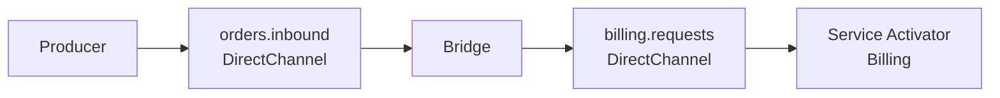
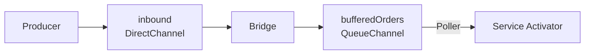
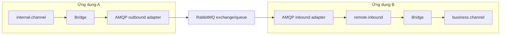
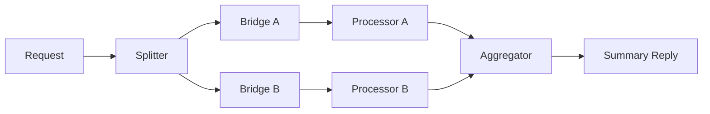

# Bridge giữa channel nội bộ và channel khác trong Spring Integration

## Mục tiêu bài học

Sau bài này, bạn có thể:

- Giải thích **Bridge pattern** và vai trò của `BridgeHandler` khi chuyển một message từ channel đầu vào sang channel đầu ra trong Spring Integration.
- Phân biệt Bridge với `Service Activator`, `Transformer`, `Router`, `Gateway` và **Channel Adapter**.
- Xây dựng một luồng chuyển tiếp giữa hai `DirectChannel` bằng Java DSL và xác minh payload/header được đưa tới đúng consumer.
- Chọn cách kết nối `DirectChannel` với `QueueChannel` hoặc `ExecutorChannel`, hiểu rõ điểm đồng bộ, giới hạn queue và poller.
- Phân tích việc bảo toàn `replyChannel`, `errorChannel`, correlation ID, sequence headers khi có request–reply, Splitter hoặc Aggregator.
- Thiết kế điểm nối với broker hoặc hệ thống ngoài và xử lý lỗi, retry, duplicate, backpressure, tracing một cách có chủ đích.

Chủ đề **Bridge** nằm trong mô-đun **SPRING_INTEGRATION_PATTERN**, nơi chúng ta thực hành các *Enterprise Integration Patterns* với Spring Integration nhằm xây dựng luồng thông điệp ít phụ thuộc, dễ mở rộng. Bridge cho phép nối các đoạn message flow mà không buộc producer biết logic bên nhận. Khi kết hợp Router, Filter, Transformer, Splitter, Aggregator, Gateway, retry, error channel và correlation, Bridge thường đóng vai trò một điểm **chuyển tiếp**, còn các endpoint khác đảm nhiệm logic nghiệp vụ.

## 1. Bridge pattern giải quyết vấn đề gì?

Giả sử hệ thống nhận sự kiện đơn hàng vào channel `orders.inbound`. Nhóm tiếp nhận sở hữu channel này; nhóm xử lý hóa đơn sở hữu channel `billing.requests`. Nếu producer gửi thẳng đến channel của nhóm xử lý, mỗi lần thay đổi cấu trúc flow đều buộc producer biết chi tiết bên dưới.

Bridge tạo một bước nối tường minh:



**Bridge** là một endpoint nhận message từ channel nguồn và chuyển message tới một channel đích. Nó không có trách nhiệm tự tính toán đơn hàng, đổi schema payload, quyết định nhiều nhánh hay đảm bảo message đã được lưu bền.

Trong Spring Integration, `BridgeHandler` triển khai vai trò chuyển tiếp này; Java DSL có thể khai báo bằng `.bridge()`. Bridge thường chuyển tiếp nội dung message (payload và những header cần thiết) theo cơ chế message handling của framework. Tuy nhiên, **đừng coi Bridge là một hợp đồng bảo đảm bất biến byte-by-byte hoặc tự serialize mọi header qua mạng**; hãy kiểm chứng những header mà flow thật sự cần.

Điểm lợi ích là quan hệ giữa hai channel được biểu diễn trực tiếp bằng cấu hình. Hai đầu channel có thể thuộc hai đoạn flow phát triển độc lập, trong khi Bridge chịu trách nhiệm nối chúng.

### 1.1. Bridge không tạo một kênh truyền mới bên ngoài JVM

Bridge nối **Spring Integration message channels** trong flow. Nếu đích là RabbitMQ, Kafka, JMS, HTTP hoặc SFTP nằm ngoài process, bạn cần một **outbound channel adapter/gateway** để đóng gói, kết nối và gửi dữ liệu bằng giao thức phù hợp. Ở phía nhận, **inbound adapter** đưa thông điệp trở lại thành Spring `Message<?>`.

```text
Trong một process:
  channel A -> BridgeHandler -> channel B

Giữa hai process:
  channel A -> outbound adapter -> broker/HTTP -> inbound adapter -> channel B
           (có thể có Bridge trước/sau adapter để tổ chức flow)
```

Nhờ phân biệt này, ta không gán nhầm cho Bridge các trách nhiệm mà chỉ transport/broker hoặc adapter mới có thể cung cấp: serialization, network retry, ack, persistence, authentication và delivery semantics.

## 2. Bridge so với những endpoint khác

| Thành phần | Trách nhiệm chính | Khác Bridge ở điểm nào? |
| --- | --- | --- |
| **Bridge** | Chuyển tiếp message giữa hai channel | Mục đích là nối các đoạn flow; không đòi hỏi biến đổi payload |
| **Service Activator** | Gọi một phương thức nghiệp vụ khi nhận message | Có thể trả kết quả, gây side effect hoặc ném lỗi |
| **Transformer** | Chuyển payload/header/định dạng | Có trách nhiệm tạo biểu diễn mới theo hợp đồng |
| **Router** | Chọn một hoặc nhiều channel đích theo điều kiện | Quyết định hướng đi; Bridge thường có một đích đã cấu hình |
| **Filter** | Cho qua hoặc loại message | Áp điều kiện chấp nhận; Bridge không lọc theo nghiệp vụ |
| **Gateway** | Cung cấp giao diện gọi và có thể chờ reply | Thiết lập hợp đồng request–reply và vòng đời caller |
| **Channel Adapter** | Đưa dữ liệu vào/ra Spring Integration qua hệ thống ngoài | Có giao thức và mapping transport riêng |
| **Splitter / Aggregator** | Chia thành nhiều message / gom nhóm message | Quản lý số lượng, tương quan và điều kiện hoàn tất |

Nếu mục đích chỉ là nối hai channel đã có, dùng Bridge giúp cấu hình thể hiện đúng ý định. Nếu thực sự cần thay đổi nội dung, hãy dùng Transformer. Nếu cần chọn đích dựa trên loại sự kiện, dùng Router. Nếu cần đưa message sang broker, dùng outbound adapter.

## 3. Ví dụ cơ bản: Bridge giữa hai DirectChannel

Ví dụ dưới đây sử dụng **Java 17+, Spring Boot 3.x và Spring Integration 6.x**. Cần dependency Spring Integration phù hợp với ứng dụng; các lớp `public` đặt trong file Java riêng, cùng package được quét bởi Spring Boot.

Luồng có hai channel nội bộ: `incomingOrders` và `readyForBilling`. Producer chỉ biết channel đầu, còn handler nghiệp vụ chỉ đăng ký ở channel sau.

### 3.1. Dữ liệu nghiệp vụ

```java
// OrderAccepted.java
public record OrderAccepted(
        String orderId,
        long amountMinorUnit
) {}
```

`amountMinorUnit` biểu diễn tiền theo đơn vị nhỏ nhất (ví dụ đồng với VND) để ví dụ tránh sai số dấu phẩy động. Giá trị chỉ dùng cho minh họa cơ chế channel; bản thân Bridge không quan tâm cấu trúc record.

### 3.2. Khai báo hai channel và Bridge

```java
// OrderBridgeConfiguration.java
import org.springframework.context.annotation.Bean;
import org.springframework.context.annotation.Configuration;
import org.springframework.integration.channel.DirectChannel;
import org.springframework.integration.config.EnableIntegration;
import org.springframework.integration.dsl.IntegrationFlow;
import org.springframework.messaging.MessageChannel;

@Configuration
@EnableIntegration
public class OrderBridgeConfiguration {

    @Bean
    public MessageChannel incomingOrders() {
        return new DirectChannel();
    }

    @Bean
    public MessageChannel readyForBilling() {
        return new DirectChannel();
    }

    @Bean
    public IntegrationFlow orderBridgeFlow() {
        return IntegrationFlow.from("incomingOrders")
            .bridge()
            .channel("readyForBilling")
            .get();
    }
}
```

`IntegrationFlow.from("incomingOrders")` đăng ký điểm nhận message từ channel nguồn. `.bridge()` tạo bước Bridge trong flow; `.channel("readyForBilling")` chỉ định channel tiếp theo. Khi Spring khởi tạo flow, subscriber của `incomingOrders` sẽ chuyển message sang `readyForBilling`.

**Chú ý:** cấu hình sử dụng `DirectChannel` ở cả hai phía. Với handler bình thường, lời gọi `send()` có thể thực hiện xuyên qua Bridge tới handler của channel đích trong **cùng thread**. Bridge **không tự khởi động executor** và không bảo đảm gửi bất đồng bộ.

### 3.3. Consumer phía sau Bridge

```java
// BillingCollector.java
import java.util.Map;
import java.util.concurrent.ConcurrentHashMap;
import org.springframework.integration.annotation.ServiceActivator;
import org.springframework.messaging.Message;
import org.springframework.stereotype.Component;

@Component
public class BillingCollector {
    private final Map<String, String> observedRequestIds =
        new ConcurrentHashMap<>();

    @ServiceActivator(inputChannel = "readyForBilling")
    public void handle(Message<OrderAccepted> message) {
        OrderAccepted order = message.getPayload();
        String requestId = message.getHeaders().get(
            "requestId", String.class);

        observedRequestIds.put(order.orderId(), requestId);
        // Trong production, thay bằng xử lý nghiệp vụ có idempotency.
    }

    public String requestIdFor(String orderId) {
        return observedRequestIds.get(orderId);
    }
}
```

Consumer nhận `Message<OrderAccepted>` để quan sát header. `requestId` được tạo bởi producer trong ví dụ, phục vụ truy vết. Việc Bridge không biến đổi payload giúp handler nhận cùng kiểu `OrderAccepted`. Tuy nhiên khi đi qua adapter ra ngoài process, cần mapping header tương ứng; không dựa vào cơ chế truyền object nội bộ.

### 3.4. Producer gửi message vào channel nguồn

```java
// OrderPublisher.java
import org.springframework.beans.factory.annotation.Qualifier;
import org.springframework.messaging.MessageChannel;
import org.springframework.messaging.support.MessageBuilder;
import org.springframework.stereotype.Component;

@Component
public class OrderPublisher {
    private final MessageChannel channel;

    public OrderPublisher(
            @Qualifier("incomingOrders") MessageChannel channel) {
        this.channel = channel;
    }

    public void publish(String orderId) {
        boolean accepted = channel.send(
            MessageBuilder.withPayload(new OrderAccepted(orderId, 120000L))
                .setHeader("requestId", "req-" + orderId)
                .build()
        );
        if (!accepted) {
            throw new IllegalStateException("ORDER_SEND_REJECTED");
        }
    }
}
```

Sau khi gọi `publish("O-101")`, message đi theo tuyến:

```text
OrderPublisher
  -> incomingOrders
  -> orderBridgeFlow / BridgeHandler
  -> readyForBilling
  -> BillingCollector.handle(...)
```

`send() == true` nghĩa channel chấp nhận thao tác gửi theo hợp đồng của nó. Trong tuyến `DirectChannel` đồng bộ của ví dụ, handler thường đã được gọi trước khi `send()` trả về; nếu một đoạn được thay bằng `ExecutorChannel` hoặc queue, điều này không còn chứng minh nghiệp vụ downstream đã hoàn tất.

## 4. Nối DirectChannel với QueueChannel: Bridge không tự đọc hàng đợi

Giả sử producer gửi nhanh nhưng handler cần xử lý theo từng đợt. Có thể đặt `QueueChannel` ở phía sau Bridge:



Đây là **một cấu hình thay thế độc lập** so với ví dụ phần 3. Không đồng thời đăng ký hai Bridge cùng nhận một channel nguồn nếu không chủ ý phân phối tải hoặc fan-out.

### 4.1. Cấu hình ví dụ

```java
// BufferedBridgeConfiguration.java
import org.springframework.context.annotation.Bean;
import org.springframework.context.annotation.Configuration;
import org.springframework.integration.channel.DirectChannel;
import org.springframework.integration.channel.QueueChannel;
import org.springframework.integration.config.EnableIntegration;
import org.springframework.integration.dsl.IntegrationFlow;
import org.springframework.messaging.MessageChannel;
import org.springframework.messaging.PollableChannel;

@Configuration
@EnableIntegration
public class BufferedBridgeConfiguration {

    @Bean
    public MessageChannel bufferedIngress() {
        return new DirectChannel();
    }

    @Bean
    public PollableChannel bufferedOrders() {
        return new QueueChannel(100);
    }

    @Bean
    public IntegrationFlow bridgeIntoBuffer() {
        return IntegrationFlow.from("bufferedIngress")
            .bridge()
            .channel("bufferedOrders")
            .get();
    }
}
```

`QueueChannel(100)` là hàng đợi tối đa 100 message **trong bộ nhớ**. Bridge chuyển message vào queue; nó không tự đảm bảo consumer lấy message ra. Vì `QueueChannel` là `PollableChannel`, cần poller/consumer ở phía sau.

### 4.2. Consumer dùng poller

```java
// BufferedOrderHandler.java
import org.springframework.integration.annotation.Poller;
import org.springframework.integration.annotation.ServiceActivator;
import org.springframework.stereotype.Component;

@Component
public class BufferedOrderHandler {

    @ServiceActivator(
        inputChannel = "bufferedOrders",
        poller = @Poller(
            fixedDelay = "500",
            maxMessagesPerPoll = "5"
        )
    )
    public void process(OrderAccepted order) {
        // Xử lý có thể chậm; nguồn được đọc theo lịch.
        System.out.println("Billing order: " + order.orderId());
    }
}
```

Ở đây **Bridge chỉ chuyển message**, còn **polling consumer** gọi handler theo lịch. `fixedDelay = 500 ms` đặt khoảng nghỉ giữa các lượt poll; `maxMessagesPerPoll = 5` giới hạn số message trong mỗi lượt, tùy các đặc điểm khác của nguồn và scheduler.

### 4.3. Rủi ro với buffer nội bộ

| Tình huống | Hành vi cần dự liệu |
| --- | --- |
| Queue đã đầy | Thao tác send có thể bị block hoặc thất bại tùy timeout/chính sách; cần cấu hình giới hạn chờ và xử lý từ chối |
| Handler chậm hơn producer | Backlog tăng; latency thực tế lớn hơn thời gian Bridge chuyển message |
| Process bị restart | `QueueChannel` trong ví dụ không đảm bảo khôi phục message sau restart |
| Handler ném exception | Tác động phụ thuộc consumer, error flow và transaction; không mặc định message tự quay lại queue |
| Nhiều consumer đọc cùng queue | Message thường được lấy bởi một consumer; không đồng nghĩa Publish–Subscribe |

Để có độ bền và khả năng phục hồi qua restart, cần một transport/store phù hợp, chính sách xác nhận hoàn tất và idempotency. Chỉ thêm Bridge trước QueueChannel không biến queue trong bộ nhớ thành message broker.

## 5. Nối với ExecutorChannel: bước bất đồng bộ nằm ở channel

Nếu đích là `ExecutorChannel`, channel gửi công việc cho executor để xử lý trên thread khác:

```text
producer thread
    |
    v
DirectChannel -- Bridge --> ExecutorChannel
                             |
                             v
                        worker thread
                             |
                             v
                       Service Activator
```

Ví dụ cấu hình **độc lập** cho một flow khác:

```java
// AsyncBridgeConfiguration.java
import org.springframework.context.annotation.Bean;
import org.springframework.context.annotation.Configuration;
import org.springframework.integration.channel.DirectChannel;
import org.springframework.integration.channel.ExecutorChannel;
import org.springframework.integration.config.EnableIntegration;
import org.springframework.integration.dsl.IntegrationFlow;
import org.springframework.messaging.MessageChannel;
import org.springframework.scheduling.concurrent.ThreadPoolTaskExecutor;

@Configuration
@EnableIntegration
public class AsyncBridgeConfiguration {

    @Bean
    public ThreadPoolTaskExecutor bridgeExecutor() {
        ThreadPoolTaskExecutor executor = new ThreadPoolTaskExecutor();
        executor.setCorePoolSize(2);
        executor.setMaxPoolSize(4);
        executor.setQueueCapacity(50);
        executor.setThreadNamePrefix("bridge-worker-");
        return executor;
    }

    @Bean
    public MessageChannel asyncIngress() {
        return new DirectChannel();
    }

    @Bean
    public MessageChannel asyncWork() {
        return new ExecutorChannel(bridgeExecutor());
    }

    @Bean
    public IntegrationFlow bridgeToAsyncWork() {
        return IntegrationFlow.from("asyncIngress")
            .bridge()
            .channel("asyncWork")
            .get();
    }
}
```

**Bất đồng bộ xuất phát từ `ExecutorChannel`, không phải từ Bridge.** Giới hạn `maxPoolSize` và `queueCapacity` khiến việc bàn giao công việc có giới hạn hữu hạn; nếu xử lý chậm và nguồn gửi quá nhanh, ứng dụng có thể bị từ chối task hoặc tăng độ trễ. Việc `send()` trả về trên thread producer không có nghĩa handler đã thành công.

Một Bridge cũng không tạo thêm transaction xuyên thread: nếu request được gửi từ transaction đang mở, worker có thể chạy với ranh giới transaction khác. Khi nghiệp vụ yêu cầu xử lý chính xác một lần hoặc ghi dữ liệu bền, cần định nghĩa điểm commit, retry và trạng thái hoàn tất riêng.

## 6. Bridge và Channel Adapter khi có broker hoặc dịch vụ ngoài

“Channel khác” có thể là channel nội bộ khác, hoặc một **kênh trao đổi ở hệ thống ngoài**. Hai trường hợp không có cùng cơ chế:

### 6.1. Trường hợp channel nội bộ

```text
JVM A:
  internalChannel -> BridgeHandler -> processingChannel
```

Hai channel là Spring `MessageChannel` cùng application context hoặc các context được kết nối phù hợp. Chúng chia sẻ process và có thể chuyển object Java trực tiếp.

### 6.2. Trường hợp broker



**Outbound adapter** thực hiện việc chọn exchange/routing key, chuyển payload/header thành message có thể gửi, kết nối RabbitMQ và áp dụng các quy tắc transport. **Inbound adapter** nhận message từ broker rồi đưa vào channel nội bộ. Bridge ở hai đầu chỉ giúp tổ chức flow nội bộ, không tự triển khai giao thức mạng.

Ví dụ cấu trúc logic:

```text
Ứng dụng A
  order.events.internal
       -> Bridge
       -> toRabbitChannel
       -> AMQP outbound adapter(exchange="orders.events")

RabbitMQ
  orders.events exchange
       -> queue dành cho consumer

Ứng dụng B
  AMQP inbound adapter(queue="orders.billing")
       -> fromRabbitChannel
       -> Bridge
       -> billing.channel
       -> Service Activator
```

Để thành flow chạy được, còn phải cấu hình exchange, queue, binding, converter, authentication, ack, retry, dead-letter và các tùy chọn vận hành. Đây là các **trách nhiệm của adapter và broker**, không thuộc `BridgeHandler`.

### 6.3. Header cần bảo toàn khi vượt process

| Metadata | Tại Bridge nội bộ | Qua broker/adapter |
| --- | --- | --- |
| Payload | Được chuyển tiếp theo message flow | Phải serialize/deserialize; schema giữa producer và consumer cần thống nhất |
| `requestId` nghiệp vụ | Có thể giữ trong header/payload | Nên được ánh xạ rõ để tracing, đối soát, idempotency |
| `correlationId` | Có thể phục vụ Splitter/Aggregator hoặc request–reply nội bộ | Phải quyết định ánh xạ sang broker header nào, ai tạo và ai khôi phục |
| `replyChannel` | Có thể là một `MessageChannel` object nội bộ | Không tự gửi nguyên trạng Java object qua mạng; dùng reply destination/correlation thích hợp |
| `errorChannel` | Quy định đường lỗi trong cùng flow | Lỗi từ xa cần chiến lược retry, dead-letter hoặc error response riêng |
| `sequenceNumber` / `sequenceSize` | Hỗ trợ nhóm message sau Splitter | Nếu Aggregator ở process khác, mapping các header nhóm phải được kiểm tra |
| `traceId` | Giúp lần theo message | Truyền trace context theo quy ước observability và chính sách bảo mật |

Nếu mục tiêu là **request–reply**, producer cần biết khi nào và bằng cách nào nhận phản hồi. Bridge không tự tạo một reply destination hay bảng pending request. Nên dùng Gateway/request–reply adapter phù hợp hoặc một giao thức tự định nghĩa với correlation ID, deadline và xử lý late reply.

## 7. Cẩn trọng khi Bridge nằm trong luồng Request–Reply

Một request đi qua Bridge vẫn có thể cần quay về caller:

```text
Caller -> Messaging Gateway -> requestChannel
                               |
                               v
                             Bridge
                               |
                               v
                           workerChannel
                               |
                               v
                          Service Activator
                               |
                               v
                       replyChannel của caller
```

Trong cùng process, header `replyChannel` do Gateway thiết lập có thể được các endpoint Spring Integration dùng để định tuyến response. Khi thêm Bridge, bạn phải bảo toàn đường reply hoặc cấu hình output channel phù hợp để kết quả đến được Gateway. Bridge chỉ chuyển request tới worker; **Service Activator/Gateway** mới định nghĩa hợp đồng request–reply.

### 7.1. Ví dụ nhận biết rủi ro header bị mất

Giả sử một handler tự tạo message mới mà bỏ qua header cần thiết:

```java
Message<?> replacement = MessageBuilder
    .withPayload(original.getPayload())
    .build();
// Chỉ dùng để minh họa: replacement không chủ đích sao chép header.
```

Nếu message này thay thế request trên đường tới Service Activator và không có đường trả lời được cấu hình tường minh, caller có thể chờ tới hết `replyTimeout`. Trong Spring Integration, các endpoint chuẩn thường hỗ trợ truyền/ghép header theo cơ chế framework, nhưng adapter hoặc custom handler có thể thay đổi chúng. Khi cần dựng message mới, hãy xác định header nào phải chuyển tiếp và header nào không thể serialize.

### 7.2. Correlation khi có Splitter và Aggregator

Một message đầu vào có thể được chia thành nhiều phần tử, đi qua các Bridge khác nhau rồi được gom về một nhóm:



Bridge không quyết định số phần tử của nhóm, correlation strategy hay điều kiện release. Khi một nhánh chậm, Filter bỏ message hoặc xử lý qua broker, Aggregator có thể đợi đến khi đủ reply hoặc hết group timeout. Nếu `CORRELATION_ID`, `SEQUENCE_NUMBER` hoặc `SEQUENCE_SIZE` bị mất trong quá trình mapping, việc gom nhóm có thể sai hoặc không hoàn tất.

**Phân biệt:** correlation của Aggregator nhận dạng nhóm các message; correlation của một RPC qua broker nhận dạng một lượt request–reply. Chúng có thể có liên hệ nhưng không được mặc định là cùng một trường với cùng ý nghĩa.

## 8. Lỗi, backpressure và khả năng giao nhận

Bridge không phải retry engine và cũng không phải buffer. Khi một đoạn flow bị lỗi, kết quả phụ thuộc loại channel và endpoint phía sau.

| Tình huống | Với `DirectChannel` | Với `QueueChannel` / `ExecutorChannel` |
| --- | --- | --- |
| Handler downstream ném exception | Thường truyền trên cùng call stack tới sender | Có thể xảy ra sau khi sender đã được chấp nhận; cần error flow phù hợp |
| Consumer chậm | Sender có thể bị chặn trong lúc xử lý | Backlog hoặc thời gian chờ worker tăng |
| Channel không có subscriber hợp lệ | Có thể gây lỗi dispatch | Queue có thể nhận mà chưa có consumer; executor cần handler để dispatch |
| Process restart | Không có bảo đảm lưu bền | Queue/executor trong bộ nhớ cũng không tự khôi phục dữ liệu |
| Giới hạn tài nguyên | Thread sender chịu chi phí | Queue capacity, thread pool, policy từ chối cần được cấu hình rõ |

**Error channel:** các thành phần bất đồng bộ có thể chuyển exception thành `ErrorMessage` thông qua `errorChannel` khi đã cấu hình đúng. Không coi lỗi từ Bridge hoặc từ mọi handler luôn tự gửi đến một queue lỗi; trong flow đồng bộ, exception có thể truyền trực tiếp về caller.

**Retry:** nếu một message gửi qua Bridge đến adapter rồi broker trả lỗi tạm thời, retry phải gắn với ranh giới thực sự có thể thất bại. Retry một thao tác có tác dụng phụ mà không có idempotency có thể tạo trùng. Với nguồn file/JDBC, phải biết lúc nào bản ghi được đánh dấu đã đọc và lúc nào nghiệp vụ thực sự hoàn tất.

**Backpressure:** một `DirectChannel` không thêm hàng đợi; nó gây sức ép ngược lên sender khi handler chậm. `QueueChannel` đệm hữu hạn và `ExecutorChannel` bàn giao công việc sang thread pool; hai lựa chọn đều cần capacity, timeout và metric. Bridge không điều tiết tốc độ gửi giúp bạn.

### 8.1. Khi nào dùng Bridge có lợi?

| Nhu cầu | Bridge có phù hợp? | Gợi ý |
| --- | --- | --- |
| Nối hai đoạn IntegrationFlow trong cùng process | Có | Bridge giúp giữ ranh giới channel rõ ràng |
| Đổi từ channel input này sang channel output đã có | Có | Bảo toàn hợp đồng về payload/header |
| Thêm bước định tuyến theo loại message | Không đủ | Dùng Router hoặc Filter |
| Chuyển `OrderEvent` thành JSON khác schema | Không đủ | Dùng Transformer/converter |
| Gửi message sang RabbitMQ hoặc HTTP API | Không đủ | Dùng outbound channel adapter/gateway |
| Cần đọc dữ liệu định kỳ từ DB/SFTP | Không đủ | Dùng inbound polling adapter và poller |
| Cần phản hồi đồng bộ cho caller | Bridge có thể là một đoạn trong flow | Gateway, Service Activator và reply/error contract là phần chính |
| Cần bảo đảm message sống qua restart | Bridge không cung cấp | Sử dụng broker/message store/transaction phù hợp |

## 9. Kiểm thử Bridge nội bộ

Với các class ở phần 3, một test tích hợp có thể kiểm tra rằng message có payload và header được chuyển đến đúng consumer. Test dùng Spring Boot context chứa `OrderBridgeConfiguration`, `BillingCollector` và `OrderPublisher`.

```java
// OrderBridgeFlowTest.java
import static org.assertj.core.api.Assertions.assertThat;

import java.util.UUID;
import org.junit.jupiter.api.Test;
import org.springframework.beans.factory.annotation.Autowired;
import org.springframework.boot.test.context.SpringBootTest;

@SpringBootTest
class OrderBridgeFlowTest {

    @Autowired
    private OrderPublisher publisher;

    @Autowired
    private BillingCollector collector;

    @Test
    void forwardsMessageAndRequestHeader() {
        String orderId = "O-" + UUID.randomUUID();

        publisher.publish(orderId);

        // Với hai DirectChannel và handler đồng bộ,
        // thông điệp đã đến BillingCollector trước khi publish trả về.
        assertThat(collector.requestIdFor(orderId))
            .isEqualTo("req-" + orderId);
    }
}
```

Test này xác minh hành vi quan trọng của flow là **đúng điểm nhận và đúng header**. Nó không chứng minh Bridge lưu bền, khả năng retry hay sự tương quan qua broker.

### 9.1. Những ca kiểm thử nên bổ sung theo kiến trúc

1. **Channel đích không có handler:** xác nhận lỗi được phát hiện và ghi nhận theo cơ chế dispatch thực tế.
2. **Downstream xử lý chậm:** với DirectChannel, quan sát thời gian `send()` bị giữ; với ExecutorChannel, đo độ trễ worker.
3. **Queue đầy:** tạo backlog vượt capacity, xác minh chính sách block/timeout/reject và metric.
4. **Header request–reply:** gửi request có `replyChannel`, kiểm tra kết quả vẫn quay đúng lời gọi sau khi qua Bridge.
5. **Correlation nhóm:** gửi hai nhóm Splitter/Aggregator đồng thời, đảo thứ tự nhánh, bảo đảm nhóm không bị trộn.
6. **Lỗi sau async boundary:** worker ném exception; error flow nhận đúng sự kiện hoặc caller nhận trạng thái lỗi như hợp đồng.
7. **Qua broker:** sử dụng integration test với broker thật/test container, kiểm tra mapping header và redelivery; đừng dùng test DirectChannel để kết luận transport an toàn.

## 10. Quan sát vận hành

Trong hệ thống lớn, Bridge giúp thể hiện ranh giới flow nhưng không tự chỉ ra nguồn gây trễ. Hãy đo cả channel trước và sau Bridge, adapter và consumer.

| Chỉ số / trường trace | Mục đích |
| --- | --- |
| `messageId`, `requestId` | Phân biệt message cụ thể với thao tác nghiệp vụ |
| `correlationId`, `traceId` | Ghép các nhánh xử lý và liên hệ log giữa dịch vụ |
| Số message nhận/gửi ở mỗi endpoint | Tìm điểm mất message hoặc tắc nghẽn |
| Thời gian `send()` vào `DirectChannel` | Nhìn thấy độ trễ downstream đồng bộ |
| Queue depth / oldest message age | Phát hiện backlog sau Bridge |
| Executor active threads / rejected tasks | Phát hiện quá tải async |
| Error count, retry count, dead-letter count | Đánh giá sức khỏe đường xử lý |
| End-to-end latency từ producer đến consumer | Đo ảnh hưởng thực tế đến nghiệp vụ |

Đối với broker, nên ghi lại exchange/queue/topic, delivery attempt và ID nghiệp vụ theo quy tắc bảo mật; tránh log toàn bộ payload nhạy cảm. Khi dùng Spring Integration management/metrics, tên channel và endpoint có ý nghĩa giúp phân tích luồng trên dashboard.

## 11. Bài thực hành thiết kế

Giả sử đơn hàng được nhận từ HTTP, một nhánh tính phí ngay, một nhánh ghi sự kiện vào broker để cập nhật dashboard:

```text
HTTP inbound gateway
  |
  v
validation.channel
  |
  +---- Router / Publish-Subscribe ----> pricing.channel -> Service Activator -> reply
  |
  +---- event.channel -> Bridge -> outbound.rabbit.channel -> AMQP adapter
```

Hãy tự trả lời:

1. Channel nào cần **reply** cho HTTP caller, channel nào chỉ cần phát event?
2. Nếu publish sự kiện thất bại sau khi đơn hàng đã commit, nên dùng transactional outbox hay cơ chế khôi phục nào?
3. Nếu thay `event.channel` bằng `QueueChannel`, ai là consumer và làm sao tránh queue nội bộ đầy?
4. Nếu đưa xử lý phí sang `ExecutorChannel`, Gateway cần timeout nào và phải xử lý late reply ra sao?
5. Khi thêm Splitter để gửi sự kiện tới ba đích, correlation ID và điều kiện release ở đâu?

Một phương án tốt là để Bridge nối rõ các channel nội bộ, giao việc phân nhánh cho Router/Publish–Subscribe, giao việc truyền qua RabbitMQ cho outbound adapter, và giữ hợp đồng request–reply ở Gateway/Service Activator.

## 12. Checklist trước khi đưa Bridge vào production

1. **Có đúng hai ranh giới channel cần nối?** Nếu không, dùng endpoint phù hợp với nghiệp vụ thay vì thêm Bridge chỉ để tăng số bước.
2. **Kiểu channel hai đầu là gì?** Direct, Queue, Executor hay publish–subscribe? Thread, poller và độ trễ có thay đổi không?
3. **Những header nào bắt buộc giữ?** `requestId`, `replyChannel`, `errorChannel`, correlation và sequence metadata được xử lý thế nào?
4. **Có ranh giới process không?** Nếu có, outbound/inbound adapter và mapping transport đã được cấu hình đầy đủ chưa?
5. **Lỗi và retry ở đâu?** Khi một adapter ném lỗi hoặc queue đầy, ai xử lý và có nguy cơ side effect trùng không?
6. **Tài nguyên hữu hạn chưa?** Có giới hạn executor, queue, timeout, backpressure và chính sách khi quá tải không?
7. **Kiểm thử hành vi quan trọng chưa?** Header, reply routing, error path, thứ tự xử lý, concurrency và phục hồi sau restart?

## Kết luận

**Bridge pattern** nối một channel nguồn với một channel đích trong Spring Integration, giúp liên kết các đoạn flow mà không đưa thêm logic nghiệp vụ vào bước chuyển tiếp. Với `DirectChannel`, Bridge thường giữ cách xử lý đồng bộ; với `QueueChannel` hoặc `ExecutorChannel`, đặc tính chờ, bất đồng bộ và giới hạn tài nguyên đến từ **channel đích** cùng consumer. Khi điểm đích là broker hoặc một ứng dụng ngoài, cần thêm **channel adapter/gateway** để giải quyết transport, serialization, ack và retry. Một Bridge được đặt đúng chỗ giúp luồng Router, Transformer, Aggregator, Gateway và Service Activator rõ ràng hơn, đồng thời vẫn phải thiết kế rõ correlation, error channel và bảo đảm xử lý nghiệp vụ.
