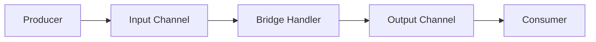
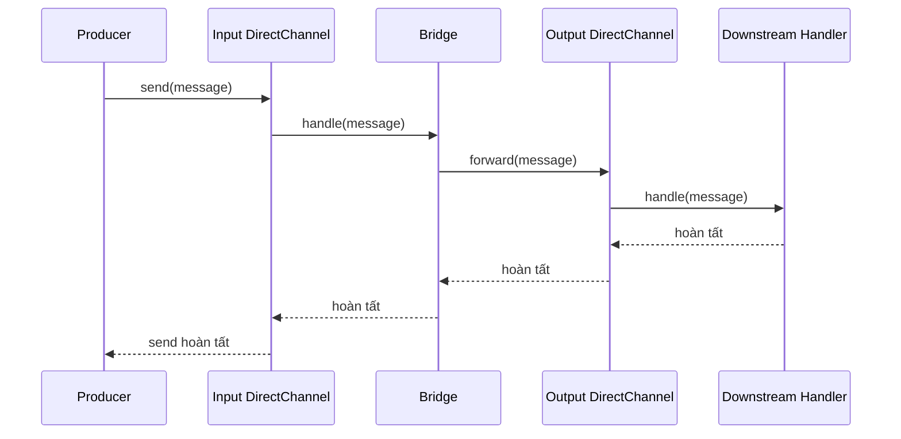
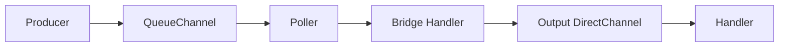
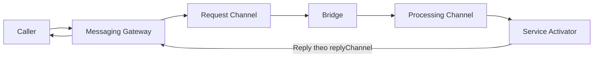
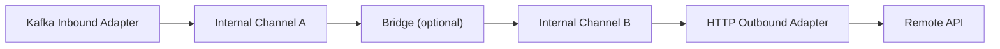

# Bridge không biến đổi message trong Spring Integration

## 1. Vấn đề cần giải quyết

Trong một hệ thống tích hợp, một luồng có thể nhận message từ module A và cần chuyển nguyên thông điệp sang module B. Chẳng hạn, hệ thống xử lý đơn hàng có kênh `validatedOrders` nhận các đơn hàng đã được kiểm tra và một kênh `ordersToDispatch` phục vụ việc phân phối đến các bước tiếp theo. Giữa hai kênh, ta chỉ cần **nối đường truyền message**, không cần đổi payload, sửa header hay tính toán dữ liệu mới.

Đó là tình huống áp dụng **Bridge** trong Enterprise Integration Patterns: nối hai đoạn của một hệ thống messaging để thông điệp tiếp tục đi qua, trong khi bản thân cầu nối không thực hiện biến đổi nội dung.

Trong **Spring Integration**, Bridge được hiện thực bằng một message handler có nhiệm vụ chuyển tiếp message từ input channel tới output channel. Bài học **Bridge không biến đổi message** thuộc chương **Bridge** của module **SPRING_INTEGRATION_PATTERN**. Module hướng tới xây dựng luồng tích hợp ít phụ thuộc và dễ mở rộng với Router, Filter, Transformer, Splitter, Aggregator, Gateway, retry, error channel, correlation và các phương pháp kiểm thử, quan sát luồng.

Sau bài này, bạn có thể:

- Giải thích chính xác "không biến đổi message" nghĩa là gì.
- Phân biệt Bridge với Transformer, Router, Filter, Wire Tap và Gateway.
- Dùng Java DSL của Spring Integration nối hai named channel qua Bridge.
- Kiểm chứng payload, message headers và dữ liệu nghiệp vụ được chuyển tiếp nguyên vẹn.
- Hiểu vai trò của loại channel, concurrency, poller và interceptor đối với hành vi của luồng.
- Xác định khi nào Bridge thích hợp và khi nào việc thêm Bridge là không cần thiết.

## 2. Bridge là gì?

Trong EIP, **Messaging Bridge** là một điểm kết nối giữa hai hệ thống hoặc hai đoạn luồng messaging. Ở mức **Spring Integration Bridge handler**, nó có nhiệm vụ đơn giản: nhận một `Message<?>` ở input và đưa tiếp message đó tới output đã được cấu hình.



Trong đường đi này, Bridge **không chủ động**:

- Chuyển payload từ DTO A sang DTO B.
- Chuyển JSON thành XML hay ngược lại.
- Thêm một trường nghiệp vụ mới vào payload.
- Thêm/xóa/sửa header như một Header Enricher hoặc Header Filter.
- Phân nhánh dựa trên nội dung như Router.
- Quyết định loại bỏ message theo điều kiện như Filter.
- Tự tạo reply mới cho một request.
- Tự lưu bền vững hoặc retry message.

Nếu nguồn đưa vào:

```text
payload = OrderCommand(orderId="O-42", quantity=2)
headers:
  businessCorrelationId = "req-42"
  source = "order-service"
```

thì thông điệp được Bridge chuyển tiếp **mang cùng nội dung payload và các header** trong cấu hình đơn giản, không có interceptor hoặc endpoint khác can thiệp.

### "Không biến đổi" không đồng nghĩa "không có gì xảy ra"

Bridge vẫn là **một endpoint trong topology**. Nó nhận message, xác định output channel và chuyển message tiếp. Hành vi đó có tác động đến đường đi, thread thực thi, thời điểm giao nhận và cách lỗi được lan truyền.

Mặt khác, các thành phần **xung quanh** Bridge vẫn có thể làm thay đổi message hoặc ngữ nghĩa xử lý:

- Channel interceptor có thể trả về message khác từ `preSend`.
- Converter/serializer khi qua broker hoặc transport ngoài có thể tạo một message mới sau khi deserialize.
- Downstream Transformer hoặc Header Enricher có thể tạo nội dung mới.
- Channel bất đồng bộ có thể thay đổi thứ tự hoàn tất.
- Message store hoặc queue có thể tạo thêm ranh giới persistence.

Vì vậy, nên phát biểu chính xác: **Bridge handler không thực hiện phép biến đổi nghiệp vụ lên payload hoặc headers; hành vi end-to-end còn phụ thuộc những channel và endpoint mà message đi qua.**

## 3. Các thành phần trong một Bridge flow

| Thành phần | Vai trò |
|---|---|
| **Input channel** | Kênh mà Bridge đăng ký nhận message. |
| **Bridge handler** | Nhận message và chuyển tiếp đến output. |
| **Output channel** | Kênh tiếp nhận message đã được forward. |
| **Producer** | Thành phần gửi message đến input. |
| **Consumer** | Thành phần đăng ký nhận từ output và tiếp tục xử lý. |
| **Channel interceptor** | Tùy chọn; có thể ghi nhận, từ chối hoặc thay đổi message ở ranh giới channel. |
| **Poller** | Cần trong một số topology dùng `PollableChannel` để lấy message và gọi Bridge. |

Khác với `Transformer`, Bridge không có trách nhiệm định nghĩa hàm ánh xạ `Message<A> → Message<B>`. Khác với `Router`, Bridge không tự lựa chọn nhiều output dựa trên nội dung. Nếu output channel là `PublishSubscribeChannel`, việc gửi tới nhiều subscriber là hành vi **của loại channel đó**, không phải Bridge tự nhân bản message theo một thuật toán phân nhánh.

### Message có cấu trúc gì?

Spring Messaging dùng giao diện `Message<T>` gồm:

- `payload`: dữ liệu mà message mang theo.
- `headers`: metadata như `id`, `timestamp`, correlation hoặc thông tin định tuyến và metadata ứng dụng.

Ví dụ tạo message:

```java
import org.springframework.messaging.Message;
import org.springframework.messaging.support.MessageBuilder;

Message<String> original = MessageBuilder.withPayload("O-42")
        .setHeader("businessCorrelationId", "req-42")
        .setHeader("source", "order-service")
        .build();
```

Bridge không có lý do nghiệp vụ để đổi `"O-42"` sang một mã khác, hay ghi đè `businessCorrelationId`. Cần lưu ý rằng Spring Messaging message thường có tính bất biến ở mức wrapper và tập header, **nhưng payload có thể tham chiếu đến một đối tượng mutable**. Việc Bridge không sao chép sâu payload không làm cho payload mutable tự trở nên an toàn khi nhiều thread hoặc subscriber cùng đọc/ghi.

## 4. Ví dụ hoàn chỉnh với Java DSL

Giả sử ứng dụng có hai luồng do hai nhóm quản lý:

1. **Đầu vào:** gửi các `OrderCommand` đã kiểm tra vào `validatedOrders`.
2. **Đầu ra:** một downstream consumer đăng ký `ordersToDispatch`.

Ta nối chúng bằng Bridge và xác nhận message đến nơi với payload/header không bị biến đổi.

Ví dụ dùng Java 17+, Spring Integration 6.x, Spring Framework/Spring Test và JUnit 5 tương thích. Đây là ví dụ trong cùng một ứng dụng, chưa cần message broker hoặc server HTTP.

### 4.1. Mô hình dữ liệu

```java
// OrderCommand.java
package com.example.bridge;

public record OrderCommand(
        String orderId,
        String sku,
        int quantity
) {
}
```

Record là lựa chọn phù hợp vì các trường không có setter; tuy nhiên các đối tượng lồng bên trong một record vẫn cần được thiết kế cẩn thận nếu mutable.

### 4.2. Khai báo channel và IntegrationFlow có Bridge

```java
// BridgeConfiguration.java
package com.example.bridge;

import org.springframework.context.annotation.Bean;
import org.springframework.context.annotation.Configuration;
import org.springframework.integration.channel.DirectChannel;
import org.springframework.integration.config.EnableIntegration;
import org.springframework.integration.dsl.IntegrationFlow;

@Configuration
@EnableIntegration
public class BridgeConfiguration {

    @Bean
    public DirectChannel validatedOrders() {
        return new DirectChannel();
    }

    @Bean
    public DirectChannel ordersToDispatch() {
        return new DirectChannel();
    }

    @Bean
    public IntegrationFlow orderBridgeFlow() {
        return IntegrationFlow.from("validatedOrders")
                .bridge()
                .channel("ordersToDispatch")
                .get();
    }
}
```

Giải thích:

1. `validatedOrders` là kênh đầu vào.
2. `IntegrationFlow.from("validatedOrders")` đăng ký đầu vào của flow.
3. `.bridge()` thêm Bridge endpoint để forward message.
4. `.channel("ordersToDispatch")` đặt output channel cho bước Bridge.
5. Downstream component có thể subscribe hoặc nhận message từ `ordersToDispatch`.

Cấu hình này không chứa `.transform(...)`, `.filter(...)` hay logic sửa headers. Trong trường hợp đơn giản, Bridge chuyển tiếp cùng message logic từ kênh A sang kênh B.

**Điều kiện vận hành:** với `DirectChannel`, phải có subscriber ở output channel khi message được gửi. Nếu không có handler nhận ở downstream, thao tác gửi có thể phát sinh `MessageDeliveryException` thay vì âm thầm lưu message. Bridge không tự biến `DirectChannel` thành queue.

### 4.3. Gửi message từ producer

```java
// Ví dụ sử dụng trong cùng Spring ApplicationContext.
import org.springframework.messaging.Message;
import org.springframework.messaging.MessageChannel;
import org.springframework.messaging.support.MessageBuilder;

OrderCommand command = new OrderCommand("O-42", "BOOK-01", 2);

Message<OrderCommand> message = MessageBuilder.withPayload(command)
        .setHeader("businessCorrelationId", "req-42")
        .setHeader("source", "order-service")
        .build();

inputChannel.send(message);
```

Ở đây `inputChannel` là bean `validatedOrders` được inject vào producer. Nội dung message chỉ gồm thông tin nghiệp vụ và metadata đã được chuẩn bị trước khi tới Bridge.

### 4.4. Kiểm thử payload và headers

Ta dùng `SpringJUnitConfig` để khởi tạo đúng cấu hình Spring Integration và đăng ký một subscriber quan sát output.

```java
// BridgeConfigurationTest.java
package com.example.bridge;

import static org.junit.jupiter.api.Assertions.*;

import java.util.concurrent.atomic.AtomicReference;

import org.junit.jupiter.api.Test;
import org.springframework.beans.factory.annotation.Autowired;
import org.springframework.beans.factory.annotation.Qualifier;
import org.springframework.integration.channel.DirectChannel;
import org.springframework.messaging.Message;
import org.springframework.messaging.MessageHandler;
import org.springframework.messaging.support.MessageBuilder;
import org.springframework.test.context.junit.jupiter.SpringJUnitConfig;

@SpringJUnitConfig(BridgeConfiguration.class)
class BridgeConfigurationTest {

    @Autowired
    @Qualifier("validatedOrders")
    DirectChannel input;

    @Autowired
    @Qualifier("ordersToDispatch")
    DirectChannel output;

    @Test
    void forwardsPayloadAndHeadersWithoutBusinessTransformation() {
        AtomicReference<Message<?>> captured = new AtomicReference<>();
        MessageHandler observer = captured::set;

        output.subscribe(observer);
        try {
            OrderCommand command =
                    new OrderCommand("O-42", "BOOK-01", 2);

            Message<OrderCommand> original = MessageBuilder
                    .withPayload(command)
                    .setHeader("businessCorrelationId", "req-42")
                    .setHeader("source", "order-service")
                    .build();

            assertTrue(input.send(original));

            Message<?> forwarded = captured.get();
            assertNotNull(forwarded);
            assertEquals(command, forwarded.getPayload());
            assertEquals(
                    "req-42",
                    forwarded.getHeaders().get("businessCorrelationId"));
            assertEquals(
                    "order-service",
                    forwarded.getHeaders().get("source"));

            // Trong topology DirectChannel không có interceptor này,
            // Bridge chuyển tiếp message mà không tái tạo id/timestamp.
            assertEquals(
                    original.getHeaders().getId(),
                    forwarded.getHeaders().getId());
            assertEquals(
                    original.getHeaders().getTimestamp(),
                    forwarded.getHeaders().getTimestamp());
        } finally {
            output.unsubscribe(observer);
        }
    }
}
```

Test xác minh **đường đi thực tế trong configuration này**: payload không đổi, metadata ứng dụng được giữ và ID/timestamp không bị Bridge chủ động tái tạo. Nó không chứng minh rằng mọi topology tương lai đều giữ cùng Java object identity; khi thêm interceptor, serializer hoặc transport, có thể xuất hiện message instance khác dù ý nghĩa nghiệp vụ vẫn không đổi.

Nếu dùng Spring Boot Test thay vì `SpringJUnitConfig`, cần đưa `BridgeConfiguration` vào application context và không để một consumer khác cạnh tranh trên cùng `DirectChannel` trong bài test. Vì subscriber được đăng ký tạm thời, test tháo subscriber trong `finally` để tránh ảnh hưởng các test khác.

### 4.5. Vì sao không nên chỉ assert cùng tham chiếu object?

Một số cấu hình trực tiếp có thể chuyển tiếp đúng cùng `Message<?>` instance, nhưng yêu cầu chức năng thực tế thường là **không đổi payload và các header có ý nghĩa**.

Nếu bạn chỉ test `assertSame(original, forwarded)`, sau này thêm một interceptor hợp lệ tạo message wrapper mới có thể làm test thất bại dù hợp đồng nghiệp vụ vẫn đúng. Ngược lại, chỉ kiểm tra cùng instance mà không kiểm tra side effect downstream cũng có thể bỏ sót lỗi khác.

Chọn assertion phù hợp với hợp đồng: payload, header bắt buộc, output channel, số lần nhận và hành vi khi downstream không sẵn sàng.

## 5. Bridge khác Transformer, Filter, Router và các pattern khác

| Pattern | Mục đích chính | Thay đổi nội dung message? | Ví dụ |
|---|---|---|---|
| **Bridge** | Nối input và output channel, forward message | Không chủ động | `validatedOrders → ordersToDispatch` |
| **Transformer** | Biến đổi kiểu/giá trị payload hoặc message | Có thể | `OrderDTO → PartnerOrderRequest` |
| **Header Enricher** | Bổ sung/thay metadata trong header | Có | Thêm tenant hoặc correlation |
| **Header Filter** | Loại một số header | Có | Bỏ token trước khi đi ra ngoài |
| **Filter** | Giữ hoặc loại message theo điều kiện | Không nhất thiết biến đổi nhưng có thể chặn message | Bỏ đơn hàng không hợp lệ |
| **Router** | Chọn đích dựa trên tiêu chí | Không nhất thiết biến đổi payload | Đưa đơn hàng đến nhánh VN/EU |
| **Splitter** | Phân một message thành nhiều phần | Có thể tạo nhiều message mới | Tách danh sách item |
| **Aggregator** | Gom nhiều message thành một kết quả | Có thể tạo kết quả mới | Tổng hợp kết quả item |
| **Wire Tap** | Sao chép đường quan sát sang kênh phụ | Không nhằm thay main flow | Gửi metadata sang audit |
| **Messaging Gateway** | Nối lời gọi Java với message flow, có thể request–reply | Ánh xạ method/message | `quote(request)` |
| **Channel Adapter** | Kết nối hệ thống ngoài với một phía của flow | Tùy giao thức và mapping | HTTP outbound adapter |

Bridge đặc biệt phù hợp khi cần **nối các channel đã được định nghĩa riêng** mà không muốn đưa logic nghiệp vụ vào điểm nối. Nếu cần đổi cấu trúc dữ liệu, dùng Transformer. Nếu cần chọn một trong nhiều đích, dùng Router. Nếu muốn nhìn trộm một bản message cho audit/metrics trong khi main flow vẫn đi tiếp, cân nhắc Wire Tap.

### Bridge và tên channel có tương đương không?

Một channel là **địa chỉ giao nhận**. Bridge là **message-handling endpoint** kết nối địa chỉ đầu vào với địa chỉ đầu ra. Việc đặt hai tên channel cạnh nhau trong một sơ đồ không tự làm message chuyển từ kênh này sang kênh kia.

Trong Java DSL, `.bridge().channel("ordersToDispatch")` thể hiện rõ endpoint chuyển tiếp. Nếu producer có thể gửi trực tiếp tới `ordersToDispatch` và không cần một ranh giới topology độc lập, bạn có thể **không cần Bridge**. Không nên thêm Bridge chỉ để tăng số thành phần mà không có mục đích thiết kế.

## 6. Bridge không đổi payload nhưng có thể đổi thời điểm xử lý

### 6.1. DirectChannel → Bridge → DirectChannel

Trong ví dụ, input và output đều là `DirectChannel`. Message được chuyển qua Bridge rồi tới downstream subscriber trong cùng đường gọi đồng bộ, nếu không có interceptor hoặc thành phần nào tạo ranh giới async.



Với đường đi này, handler downstream chậm hoặc ném exception có thể tác động trực tiếp tới thao tác `send()` của producer. **Bridge không phải bộ đệm**.

### 6.2. Output là ExecutorChannel

Nếu output channel dùng executor, message có thể được chuyển sang thread khác. Bridge vẫn không đổi payload, nhưng công việc phía sau có thể chạy bất đồng bộ, hoàn tất sau khi producer tiếp tục.

Khi có nhiều worker, thứ tự **hoàn tất** của hai message có thể khác thứ tự **gửi**. Việc cần xử lý theo thứ tự một `orderId` phải được bảo vệ bằng cơ chế key, serialization hoặc version check; Bridge không tự làm điều đó.

### 6.3. Output là QueueChannel

Nếu Bridge forward vào `QueueChannel`, queue là nơi lưu tạm message để downstream poll/receive. Cơ chế xếp hàng, sức chứa, timeout của send/receive và poller chịu trách nhiệm điều phối việc tiêu thụ. Bridge vẫn chỉ forward.

Lúc đó cần quyết định:

- Queue có sức chứa giới hạn hay không?
- Khi đầy thì gửi sẽ chờ bao lâu hoặc thất bại thế nào?
- Có bao nhiêu consumer/poller cùng lấy message?
- Có cần persistence qua restart không?
- Nếu consumer xử lý lỗi sau khi lấy khỏi queue, message được retry hoặc phục hồi ra sao?

`QueueChannel` trong bộ nhớ không tự mang lại độ bền như một broker hoặc transactional message store.

### 6.4. Input là PollableChannel

Khi input là một `PollableChannel` như `QueueChannel`, Bridge có thể được vận hành bởi **polling consumer** thay vì subscription trực tiếp. Poller quyết định khi nào lấy message và số lượng lấy ở mỗi lần poll.

Sơ đồ logic:



Ví dụ cấu hình **thay thế** flow ở mục 4 nếu input thực sự là queue:

```java
// Fragment minh họa dùng khi validatedOrders là QueueChannel.
@Bean
public IntegrationFlow queueBridgeFlow() {
    return IntegrationFlow
            .from("validatedOrders",
                    endpoint -> endpoint.poller(
                            Pollers.fixedDelay(250)))
            .bridge()
            .channel("ordersToDispatch")
            .get();
}
```

Cần import `org.springframework.integration.dsl.Pollers` và cấu hình một bean `QueueChannel` tên `validatedOrders`. Không nên đăng ký đồng thời cả hai Bridge flow cạnh tranh nhận cùng input trong một ví dụ. Đoạn code chỉ minh họa điểm đặt poller cho nguồn pollable; chi tiết cấu hình có thể phụ thuộc phiên bản Spring Integration.

**Tóm lại:** concurrency, buffering và ordering đến từ channel, poller hoặc handler downstream, không phải chức năng biến đổi của Bridge.

## 7. Header có được giữ nguyên không?

### 7.1. Ở Spring Integration Bridge handler

Trong flow đơn giản, Bridge chuyển tiếp message tới output; các header nghiệp vụ đi cùng message và không bị Bridge tự làm giàu hay loại bỏ.

Một số header thường cần quan tâm:

| Header | Vì sao cần giữ? |
|---|---|
| `id`, `timestamp` | Nhận diện và quan sát message trong luồng nội bộ |
| `businessCorrelationId` | Ghép các bước thuộc cùng yêu cầu nghiệp vụ |
| `correlationId` | Hữu ích cho các nhóm message trong Aggregator |
| `sequenceNumber` / `sequenceSize` | Dùng trong một số luồng Splitter/Aggregator |
| `replyChannel` | Đích nhận reply trong request–reply nội bộ |
| `errorChannel` | Kênh lỗi có thể được dùng theo ngữ cảnh xử lý |
| Metadata ứng dụng | Tenant, nguồn dữ liệu, version, trace context đã được kiểm soát |

Bridge không chủ động bỏ `replyChannel` chỉ vì đang chuyển giữa hai kênh; đó là điểm hữu ích khi Bridge nằm trên một nhánh request–reply nội bộ. Nhưng việc downstream có **tạo reply** hay không vẫn phụ thuộc vào handler sau Bridge.

### 7.2. Vì sao đôi lúc thấy header khác sau Bridge?

Nếu nhận thấy `MessageHeaders` thay đổi, hãy kiểm tra:

1. Input channel có `ChannelInterceptor` nào không?
2. Output channel có interceptor tạo message mới, chỉnh header hoặc từ chối không?
3. Có Transformer, Header Enricher, Header Filter hoặc Mapping component chạy trước/sau Bridge không?
4. Có adapter chuyển sang HTTP, Kafka, AMQP, JMS hoặc hệ thống khác không?
5. Message có bị serialize và deserialize ở ranh giới transport không?
6. Có mã ứng dụng tự tạo `MessageBuilder.withPayload(...)` mà không copy header cần thiết không?

Ví dụ một Transformer tự tạo message mới:

```java
Message<?> transformed = MessageBuilder
        .withPayload(newPayload)
        .copyHeaders(incoming.getHeaders())
        .build();
```

Đó là code của một bước biến đổi hoặc ánh xạ, **không phải hành vi của Bridge**. Với transport ngoài, cũng không nên copy mọi header máy móc: `replyChannel` và `errorChannel` có thể chứa đối tượng chỉ có nghĩa trong JVM, còn credential cần được bảo vệ.

### 7.3. Cẩn thận với payload mutable

Nếu Bridge gửi một đối tượng mutable như `ArrayList` qua nhiều subscriber, các subscriber có thể nhìn thấy cùng đối tượng và việc sửa tại một subscriber có thể ảnh hưởng subscriber khác.

Nên ưu tiên immutable DTO/record với các thành phần bên trong cũng được bảo vệ, hoặc tạo bản sao rõ ràng **ở nơi nghiệp vụ thực sự cần sao chép**. Bridge không có hợp đồng deep-copy payload.

## 8. Bridge có giữ nguyên thứ tự message không?

Bridge không được thiết kế để sắp xếp hoặc đánh số message. Nó chỉ forward theo các lời gọi xử lý nhận được.

Với một producer gửi tuần tự qua `DirectChannel` và một downstream handler đồng bộ, các lời gọi có thể được xử lý theo cùng thứ tự. Nhưng điều này không mở rộng thành đảm bảo ordering toàn cục khi:

- Nhiều producer gửi đồng thời vào cùng channel.
- Input có nhiều consumer hoặc output có nhiều thread.
- Có `ExecutorChannel` và xử lý bất đồng bộ.
- Có retry hoặc redelivery ở broker.
- Downstream tạo task async rồi return sớm.
- Một Router hoặc Splitter đưa các message liên quan sang nhiều nhánh.

Nếu nghiệp vụ yêu cầu một đơn hàng phải xử lý v1 → v2 → v3, nên dùng ordering key, sequence/version và idempotency tại nơi commit trạng thái. Bridge sẽ **không tự phục hồi** thứ tự đã bị đảo ở những phần khác.

## 9. Bridge trong flow request–reply

Bridge có thể nằm giữa Messaging Gateway và handler có reply:



Nếu request có header `replyChannel` và flow không làm mất header, handler cuối có thể tạo reply để framework gửi về đúng nơi Gateway đang chờ. Bridge không biến đổi request, cũng **không tự tạo reply**.

Các tình huống cần chẩn đoán:

- Handler downstream trả `null` hoặc chỉ log rồi kết thúc.
- Output channel của Bridge không có subscriber.
- Một bước sau Bridge làm mất `replyChannel`.
- Reply timeout vì handler xử lý quá chậm.
- Flow dùng nhiều nhánh nhưng không có Aggregator để phát một kết quả cuối.

Bridge chỉ đảm nhiệm **đường đi của message**. Thiết kế request–reply phải quyết định ai phát reply và xử lý lỗi/timeout ra sao.

## 10. Bridge không phải cầu nối mạng hoặc broker tự động

Tên "bridge" có thể khiến người học nghĩ rằng chỉ thêm `.bridge()` là có thể truyền message qua hai JVM hoặc từ Kafka sang RabbitMQ. Điều đó **không đúng** với Spring Integration Bridge handler.

Bridge handler nối **các MessageChannel trong một application context**. Để giao tiếp qua mạng, cần endpoint phù hợp: HTTP inbound/outbound gateway, AMQP/Kafka adapters, JMS hoặc transport khác.

Ví dụ truyền từ Kafka sang HTTP thực tế thường gồm:



Tại biên Kafka/HTTP có serialization, acknowledgment, error handling và bảo mật. Bridge giữa hai channel nội bộ không tự xử lý các trách nhiệm ấy.

Nếu chỉ cần nối trực tiếp đầu ra của Kafka adapter tới HTTP adapter và không có yêu cầu tách topology hay đo lường endpoint, có thể cấu hình cả hai trên cùng một channel mà không dùng Bridge.

## 11. Xử lý lỗi, retry và backpressure

### 11.1. Khi output không có consumer

Với `DirectChannel`, nếu output không có subscriber, việc gửi message có thể thất bại bằng exception kiểu delivery. Bridge không giữ message lại để gửi khi consumer xuất hiện.

Cách điều tra:

1. Kiểm tra bean `ordersToDispatch` có được tạo không.
2. Kiểm tra downstream endpoint có subscribe đúng tên channel không.
3. Kiểm tra component scan hoặc `@EnableIntegration` có hoạt động không.
4. Kiểm tra một endpoint có đang bị stopped hoặc cấu hình sai không.
5. Kiểm tra exception và đường error handling của caller/poller.

### 11.2. Khi consumer downstream ném exception

Với đường `DirectChannel → Bridge → DirectChannel` đồng bộ, exception từ downstream có thể lan ngược tới producer. Khi có poller hoặc async boundary, exception có thể được chuyển tới `errorChannel` theo cấu hình.

Không coi việc `bridge()` có mặt là một retry policy. Nếu cần retry, đặt advice hoặc cơ chế retry ở đúng handler/adapter có thao tác thất bại, đồng thời quyết định cách xử lý sau khi hết lượt.

### 11.3. Backpressure

Bridge không có bộ đệm riêng. Nếu output channel bị chặn hoặc downstream chậm, upstream có thể chịu áp lực thông qua thao tác gửi. Với queue hoặc async channel, áp lực được chuyển thành hàng chờ, giới hạn worker hoặc nguy cơ tràn bộ đệm.

Phải xem xét:

- Khả năng tiếp nhận của output channel.
- Timeout khi gửi message.
- Kích thước queue và số lượng worker.
- Concurrency và tính đúng thứ tự.
- Chính sách xử lý khi queue đầy.
- Cách dừng/pause producer và khôi phục khi downstream sẵn sàng.

### 11.4. Idempotency và duplicate

Bridge không tạo ra một bản sao nghiệp vụ theo chủ đích, nhưng duplicate vẫn có thể xuất hiện từ producer, broker retry/redelivery hoặc consumer xử lý lại sau crash. Nếu downstream ghi database hoặc gọi API có side effect, cần event ID/idempotency key ở phạm vi nghiệp vụ.

## 12. Khi nào nên dùng Bridge?

### Những trường hợp phù hợp

**1. Nối các named channel do hai module quản lý.** Module nhận message kết thúc tại `validatedOrders`, module xử lý tiếp bắt đầu tại `ordersToDispatch`. Bridge cung cấp một endpoint kết nối rõ ràng.

**2. Làm rõ ranh giới topology.** Hai đoạn flow có thể được cấu hình hoặc kiểm soát độc lập. Bridge thể hiện điểm nối trong sơ đồ hạ tầng.

**3. Chuyển từ pollable channel sang output.** Polling consumer lấy message từ queue rồi Bridge forward tới channel đích. Poller tạo ranh giới thời gian, Bridge đảm nhiệm forward.

**4. Tách nơi theo dõi.** Bridge có thể là một endpoint có định danh để quan sát luồng. Dù vậy, việc đo latency, throughput và error phải được thiết kế riêng; Bridge không tự thêm metric nghiệp vụ.

**5. Thay đổi topology channel mà giữ nguyên payload.** Ví dụ thay channel bên nhận từ DirectChannel sang ExecutorChannel để điều chỉnh mô hình thực thi, trong khi Bridge vẫn thực hiện forward.

### Những trường hợp không nên dùng

- Cần đổi DTO hoặc format: dùng Transformer.
- Cần filter theo business rule: dùng Filter.
- Cần định tuyến có điều kiện: dùng Router.
- Cần phát copy sang kênh audit: cân nhắc Wire Tap.
- Cần nối sang hệ thống ngoài: dùng Adapter/Gateway có transport.
- Cần buffer/durable queue: chọn QueueChannel/message store/broker phù hợp.
- Producer có thể gửi thẳng vào đúng channel đích mà không có ranh giới topology riêng: Bridge có thể không đem lại lợi ích thực tế.

## 13. Quan sát luồng mà không biến đổi message

Khi kiểm tra Bridge trong production, nên theo dõi:

| Dữ liệu | Mục đích |
|---|---|
| Số message nhận vào input | Xác định sản lượng đầu vào |
| Số message chuyển đến output | Xác định có bị lỗi gửi hay không |
| Thời gian hoàn tất thao tác send | Đo ảnh hưởng của downstream đồng bộ |
| Exception / delivery failure | Phát hiện thiếu subscriber và sự cố luồng |
| Queue depth hoặc executor saturation | Theo dõi tắc nghẽn nếu có async/queue boundary |
| Business correlation ID | Lần theo message từ producer qua consumer |
| Event ID / version | Chẩn đoán duplicate và thứ tự nghiệp vụ |

Không nên ghi toàn bộ payload và headers để xác nhận Bridge không biến đổi dữ liệu, đặc biệt khi chứa PII hoặc credential. Có thể log định danh đã được kiểm soát, tên endpoint, thời điểm, kích thước và kết quả.

### Đặt tên có ý nghĩa

Một tên như `validatedOrdersToDispatchBridge` có ích khi đọc metric hoặc tìm lỗi, nhưng nội dung không nên phụ thuộc trực tiếp vào tên bean. Trong ví dụ DSL, endpoint được tạo trong flow; nếu cần quan sát theo tên endpoint cố định, có thể cấu hình endpoint ID theo API DSL phù hợp phiên bản đang dùng.

## 14. Kiểm thử những tình huống quan trọng

Bên cạnh test payload/header ở mục 4, nên kiểm tra những tình huống sau:

| Tình huống | Kết quả mong đợi |
|---|---|
| Một message hợp lệ | Đến đúng output với payload/header cần thiết |
| Nhiều message tuần tự | Mỗi message được forward theo topology đã khai báo |
| Output DirectChannel không subscriber | Lỗi delivery được phát hiện, không âm thầm coi như đã lưu |
| Downstream ném exception | Lỗi lan theo đường đồng bộ hoặc error channel đã cấu hình |
| Có interceptor tại output | Hiểu rõ interceptor có thay message hay không |
| Có mutable payload | Không trông chờ Bridge deep-copy |
| Output ExecutorChannel | Tách xử lý async; kiểm tra ordering nếu cần |
| Input QueueChannel với poller | Message được poll và forward theo lịch |
| Request–reply qua Bridge | Handler cuối tạo reply đúng, Bridge không tự tạo |
| Broker redelivery | Consumer downstream idempotent, không giả định Bridge deduplicate |

### Đề xuất test đồng thời

Khi thay `DirectChannel` bằng executor hoặc queue, có thể gửi nhiều message chứa `orderId` và `version` rồi xác nhận kết quả **tại nơi commit**, thay vì chỉ kiểm tra thứ tự nhận. Nếu cần ordering theo key, có thể phát hiện cập nhật lùi bằng version check.

### Đề xuất test về interceptor

Tạo một `ChannelInterceptor` có kiểm soát ở output channel để thêm một header thử nghiệm. Sau đó xác minh rằng header ấy được thêm bởi **interceptor**, không phải Bridge. Bài test này giúp người học phân biệt trách nhiệm của handler với phần cấu hình channel.

## 15. Những nhầm lẫn thường gặp

**Nhầm lẫn 1: Bridge là Transformer không có phép biến đổi.** Bridge có trách nhiệm kết nối channel, còn Transformer có hợp đồng về ánh xạ nội dung. Tránh dùng Transformer chỉ để `return message` khi mục tiêu là nối hai channel.

**Nhầm lẫn 2: Bridge tự tạo một message mới với ID khác.** Trong topology nội bộ đơn giản, Bridge forward message mà không chủ động thay header. Nếu ID khác, cần kiểm tra interceptor hoặc những bước tạo lại message.

**Nhầm lẫn 3: Bridge tự đảm bảo delivery.** Nó không tạo queue bền vững, acknowledgment hay cơ chế retry. Delivery semantics đến từ channel, adapter, broker và phần error handling.

**Nhầm lẫn 4: Bridge tự giữ thứ tự dù output có thread pool.** Thread pool có thể làm đảo thứ tự hoàn tất. Muốn giữ bất biến của một aggregate, cần thiết kế ordering theo key/version.

**Nhầm lẫn 5: Bridge tương đương Wire Tap.** Bridge chuyển tiếp trên đường xử lý chính; Wire Tap gửi một bản tới kênh phụ để quan sát, không phải thay thế luồng chính.

**Nhầm lẫn 6: Bridge nối trực tiếp hai broker qua mạng.** Bridge của Spring Integration xử lý message bên trong application context; giao tiếp với broker ngoài cần adapter tương ứng.

**Nhầm lẫn 7: Payload không đổi nghĩa là chắc chắn an toàn khi nhiều subscriber cùng sửa.** Payload mutable vẫn có thể bị tác động do chia sẻ tham chiếu; cân nhắc immutable data và contract rõ ràng.

**Nhầm lẫn 8: Bridge tự trả lời một lời gọi Gateway.** Nó giữ đường đi của request; reply phải được tạo ở downstream handler theo đúng hợp đồng.

## 16. Câu hỏi ôn tập

1. Bridge thực hiện thao tác gì khi nhận một `Message<?>`?
2. Trong cấu hình đơn giản, payload và business headers thay đổi thế nào sau Bridge?
3. Vì sao không nên đồng nhất "không biến đổi" với "không thay đổi thứ tự xử lý"?
4. Channel interceptor có thể làm message khác đi sau Bridge như thế nào?
5. Bridge khác Transformer, Router và Wire Tap ở trách nhiệm gì?
6. Vì sao dùng Bridge không đủ để gửi message qua hai JVM?
7. Nếu output `DirectChannel` không có subscriber, chuyện gì có thể xảy ra?
8. Nếu input là `QueueChannel`, cần thành phần nào để Bridge nhận message định kỳ?
9. Bridge có tự tạo reply cho Messaging Gateway không?
10. Khi output là `ExecutorChannel`, điều gì thay đổi về thread và ordering?
11. Vì sao `Message<?>` có tính bất biến ở wrapper chưa đủ để bảo vệ một payload là danh sách mutable?
12. Những assertion nào trong test chứng minh Bridge không chủ động biến đổi dữ liệu?

## 17. Checklist thiết kế Bridge

- [ ] Xác định rõ lý do cần một Bridge endpoint giữa hai channel.
- [ ] Input và output channel có tên, kiểu và trách nhiệm rõ ràng.
- [ ] Flow chỉ forward message, không chèn logic biến đổi nghiệp vụ ở Bridge.
- [ ] Các header cần thiết cho correlation, reply và tracing được bảo toàn theo hợp đồng.
- [ ] Đã đánh giá interceptor, serializer và endpoint khác có thể thay message.
- [ ] Output có consumer hoặc cơ chế queue/polling phù hợp.
- [ ] Hiểu ranh giới đồng bộ/bất đồng bộ và tác động lên caller.
- [ ] Có error handling và retry tại đúng nơi thất bại.
- [ ] Không giả định Bridge lưu bền vững, deep-copy, deduplicate hay bảo đảm ordering.
- [ ] Có test payload, headers, delivery failure và đường request–reply nếu được sử dụng.
- [ ] Có metric/log đã lọc dữ liệu nhạy cảm để theo dõi luồng.
- [ ] Nếu cần kết nối ra ngoài JVM, đã chọn adapter/gateway và transport riêng.

**Ghi nhớ:** Bridge trong Spring Integration là **cầu nối giữa các message channel**. Nó chuyển tiếp message mà không chủ động biến đổi payload và headers, giúp tách các đoạn topology và giữ luồng tích hợp rõ ràng. Những đặc tính như lưu trữ, retry, định tuyến có điều kiện, chuyển đổi định dạng, đa luồng và giao tiếp mạng thuộc về các channel hoặc endpoint khác. Khi thiết kế và kiểm thử, hãy phân biệt trách nhiệm của Bridge với toàn bộ đường đi của message.
