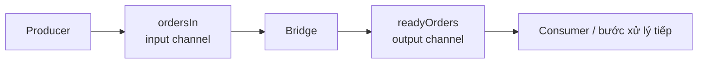
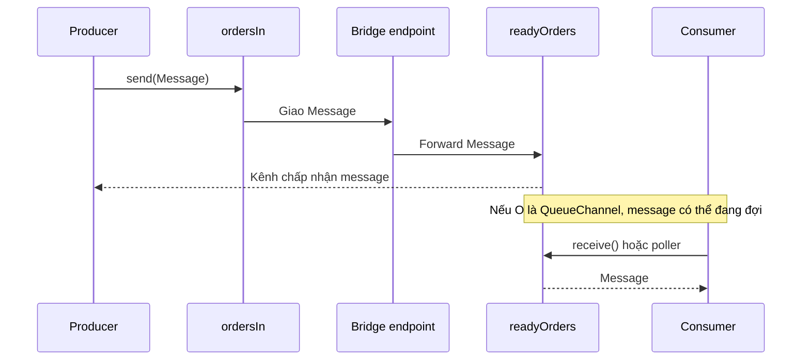
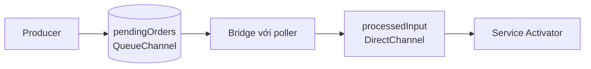
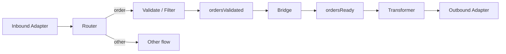
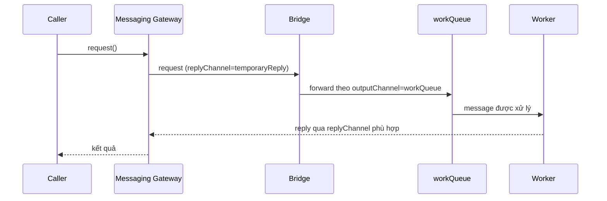
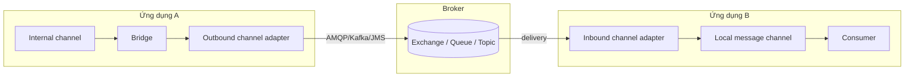

# Bridge — Bridge với output channel trong Spring Integration

## Mục tiêu học tập

Sau bài này, bạn có thể:

- Giải thích **Bridge** nối các `MessageChannel` như thế nào trong Enterprise Integration Patterns và vì sao Bridge thường không thay đổi nội dung nghiệp vụ của message.
- Xác định ý nghĩa của **`outputChannel` trên Bridge endpoint**; phân biệt nó với `inputChannel` và header `replyChannel` của một request.
- Khai báo một Bridge trong Spring Integration Java DSL để chuyển message từ `DirectChannel` sang `QueueChannel`; thực hiện kiểm thử xác nhận payload và header đi đúng đích.
- Biết khi nào cần poller khi kênh đầu vào là `PollableChannel`, và phân tích khác biệt giữa đầu ra `DirectChannel`, `QueueChannel`, `ExecutorChannel` và `PublishSubscribeChannel`.
- Phân tích lỗi chuyển tiếp, timeout, backpressure, correlation, error channel, tính bền vững và giới hạn của Bridge khi tích hợp với message broker.

Bài thuộc chương **Bridge** của module **SPRING_INTEGRATION_PATTERN**. Module hướng đến thực hành Enterprise Integration Patterns bằng Spring Integration để xây dựng luồng message ít phụ thuộc và dễ mở rộng, kết hợp Router, Filter, Transformer, Splitter, Aggregator, Gateway, retry, error channel và correlation; đồng thời kiểm thử, theo dõi các nhánh xử lý. Chủ đề ở đây là **Bridge với output channel**: một thành phần định tuyến chuyển message từ kênh nguồn đến kênh đích được cấu hình rõ ràng.

## 1. Bridge là gì?

Trong Spring Integration, **Bridge** là thành phần trung gian nối hai channel bằng cách nhận một `Message` từ kênh đầu vào và chuyển message về kênh đầu ra. Bridge thường được dùng khi muốn nối các đoạn flow nhưng không cần viết xử lý nghiệp vụ hay chuyển đổi payload.



Một message gồm **payload** và **headers**. Nếu producer gửi `OrderPlaced(orderId="ORD-100")` với `correlationId="req-42"`, Bridge sẽ cố chuyển tiếp message theo ngữ nghĩa pass-through; về mặt nghiệp vụ, không có bước “đổi OrderPlaced thành loại khác” trong Bridge.

Điều này khác với các thành phần sau:

| Thành phần | Trách nhiệm |
| --- | --- |
| **Bridge** | Kết nối channel nguồn với channel đích; thông thường chuyển tiếp thông điệp |
| **Transformer** | Tạo biểu diễn payload/message khác theo một quy tắc chuyển đổi |
| **Filter** | Cho message đi tiếp hoặc loại theo điều kiện |
| **Router** | Quyết định channel đích dựa trên nội dung/header hoặc quy tắc định tuyến |
| **Service Activator** | Gọi logic nghiệp vụ, có thể phát kết quả |
| **Channel Adapter** | Nối Spring Message flow với một nguồn/đích ở bên ngoài ứng dụng |
| **Messaging Gateway** | Cung cấp giao diện request–reply cho caller hoặc một hệ thống tích hợp |

Bridge không tự mở kết nối mạng, gọi API hay thêm queue bền vững. Nó là **endpoint trong hệ thống Spring Integration**; hành vi giao nhận thực tế phụ thuộc vào các loại channel và endpoint xung quanh.

### Khi nào cần dùng Bridge?

Một số tình huống phổ biến:

1. **Nối hai nhánh do hai nhóm cấu hình khác nhau sở hữu.** Nhóm nhận sự kiện phát vào `ordersIn`, nhóm xử lý đọc từ `readyOrders`, và Bridge là điểm nối rõ ràng.
2. **Nối channel đồng bộ với channel có buffer.** Producer đi qua `DirectChannel`; Bridge đưa message sang `QueueChannel` để downstream xử lý theo nhịp riêng.
3. **Nối một channel polling với flow tiếp theo.** Bridge có poller lấy message từ kênh đầu vào rồi gửi tới kênh khác.
4. **Đặt điểm quan sát hoặc chính sách vận hành** tại ranh giới giữa hai đoạn flow, ví dụ đặt ID endpoint, thêm logging/tracing hoặc cấu hình error handling phù hợp.

Nếu không cần một endpoint độc lập, Java DSL đôi khi có thể nối các bước bằng `.channel("...")` mà không viết Bridge tường minh. Việc chọn Bridge tường minh có ích khi muốn mô tả rõ trách nhiệm của điểm nối, điều chỉnh poller hoặc kiểm thử riêng đường chuyển tiếp.

## 2. Input channel, output channel và replyChannel

Ba thuật ngữ nghe giống nhau nhưng có vai trò khác nhau:

| Khái niệm | Nằm ở đâu? | Vai trò |
| --- | --- | --- |
| **Input channel** | Cấu hình endpoint hoặc nguồn của `IntegrationFlow` | Kênh mà Bridge **nhận** message |
| **Output channel** | Cấu hình của Bridge/endpoint hoặc bước `.channel(...)` tiếp theo | Kênh mà Bridge **phát kết quả/forward** |
| **`replyChannel`** | Header trên một **request message** | Kênh mà caller muốn nhận reply trong luồng request–reply khi endpoint không có đường output ưu tiên khác |

Ví dụ:

```text
                         message headers:
                         correlationId = req-42
                         replyChannel  = callerReplies
                                      |
Producer -> ordersIn -> Bridge -------+----> readyOrders -> Consumer
                         |
                         +-- outputChannel = readyOrders
```

Ở đây, **Bridge đã được cấu hình output channel cố định là `readyOrders`**. Message đi tới `readyOrders` dù request có header `replyChannel=callerReplies`. Header `replyChannel` vẫn có thể được giữ để các bước request–reply phía sau sử dụng theo hợp đồng của chúng; nhưng **điểm nối này** không trả kết quả trực tiếp vào `callerReplies`.

Quy tắc thực hành:

- Với endpoint có khả năng phát message reply, một **output channel được cấu hình tường minh** quyết định nơi phát ở endpoint đó.
- Khi endpoint không có output channel tường minh, các thành phần reply-producing có thể dùng `replyChannel` của message đầu vào, nếu có và hợp lệ.
- Một Bridge với output channel cố định là **chuyển tiếp sang nhánh đã định nghĩa**. Nó không đồng nghĩa “đã gửi reply về caller”.
- Nếu muốn dựng một đường request–reply, cần xem **toàn bộ flow**, nhất là handler cuối cùng sinh reply, output channel của các bước và việc header `replyChannel` có được giữ nguyên hay không.

**Lưu ý:** không nên dựa vào việc header framework hoặc `MessageHeaders.ID` luôn có cùng object identity sau mọi endpoint. Điều cần xác minh là payload và **các header nghiệp vụ cần bảo toàn** (ví dụ `correlationId`), và đích thực tế của message.

## 3. Cơ chế Bridge trong Spring Integration

Spring Integration cung cấp `BridgeHandler` cho mục đích chuyển tiếp. Trong Java DSL, có thể dùng `.bridge()` trong `IntegrationFlow`. Một Bridge là một endpoint có khả năng phát thông điệp đến output channel của nó.

Cách hình dung:



Sơ đồ nhấn mạnh hai thời điểm khác nhau:

1. **Forward thành công:** Bridge đã đưa message đến channel đích theo hợp đồng `send`.
2. **Nghiệp vụ hoàn tất:** consumer thực sự lấy message, xử lý và (nếu có) commit dữ liệu hoặc phát reply.

Nếu output là `QueueChannel`, hai thời điểm thường tách nhau. Nếu output là `DirectChannel` và subscriber chạy đồng bộ, Bridge có thể bị giữ trong thread gửi cho tới khi subscriber xử lý xong.

### Bridge có giữ nguyên message không?

Về mặt **trách nhiệm nghiệp vụ**, Bridge không phải một Transformer: nó được dùng để chuyển tiếp. Tuy nhiên, trong một flow hoàn chỉnh, message đi qua channel, interceptor, header enricher, filter hoặc adapter có thể được tạo lại hoặc thay đổi metadata theo cơ chế riêng. Vì vậy:

- Không yêu cầu `messageA == messageB` (cùng tham chiếu Java) như một điều kiện hợp đồng nghiệp vụ.
- Nên kiểm tra payload và header quan trọng vẫn đúng tại đích, ví dụ `eventId` và `correlationId`.
- Không giả định Bridge thực hiện serialization hay tự bảo đảm persistence.
- Nếu một interceptor hoặc bước khác thay header, cần kiểm tra nơi thay đổi đó thay vì quy cho Bridge.

## 4. Ví dụ hoàn chỉnh: Bridge từ DirectChannel sang QueueChannel

Bài toán: producer phát lệnh xử lý đơn hàng vào `ordersIn`. Ta muốn nối đến `readyOrders`, nơi consumer đọc theo nhu cầu. Bridge không kiểm tra hoặc thay đổi `orderId`; những bước Filter/Transformer nghiệp vụ có thể đặt trước hoặc sau điểm nối.

Ví dụ dùng Spring Integration Java DSL với Java 17 và Spring Framework/Spring Integration tương thích. Cần dependency Spring Integration trong dự án, thường qua starter Spring Boot:

```groovy
dependencies {
    implementation 'org.springframework.boot:spring-boot-starter-integration'
    testImplementation 'org.springframework.boot:spring-boot-starter-test'
}
```

### 4.1. Định nghĩa channel và Bridge

`BridgeOutputConfiguration.java`:

```java
import org.springframework.context.annotation.Bean;
import org.springframework.context.annotation.Configuration;
import org.springframework.integration.annotation.EnableIntegration;
import org.springframework.integration.channel.DirectChannel;
import org.springframework.integration.channel.QueueChannel;
import org.springframework.integration.dsl.IntegrationFlow;
import org.springframework.messaging.MessageChannel;

@Configuration
@EnableIntegration
public class BridgeOutputConfiguration {

    @Bean("ordersIn")
    public MessageChannel ordersIn() {
        return new DirectChannel();
    }

    @Bean("readyOrders")
    public QueueChannel readyOrders() {
        return new QueueChannel(10);
    }

    @Bean
    public IntegrationFlow ordersBridgeFlow() {
        return IntegrationFlow.from("ordersIn")
            .bridge()
            .channel("readyOrders")
            .get();
    }
}
```

Ý nghĩa của cấu hình:

- `ordersIn` là `DirectChannel`; nó giao message cho subscriber của Bridge trong phạm vi JVM.
- `.bridge()` thêm endpoint chuyển tiếp mà không biến đổi payload nghiệp vụ.
- `.channel("readyOrders")` xác định **output channel** của bước chuyển tiếp.
- `readyOrders` là `QueueChannel` có capacity 10, lưu message chờ consumer lấy.
- Nếu hiện chưa có consumer, message vẫn có thể nằm trong queue cho tới khi có người đọc; capacity hữu hạn sẽ bảo vệ bộ nhớ ở điểm này, nhưng không tạo persistence qua restart.

Ta có thể biểu diễn cùng ý định bằng `BridgeHandler` tường minh trong một **phương án cấu hình thay thế**:

```java
// Chọn cách này hoặc .bridge() ở trên, không đăng ký cả hai
// làm consumer cạnh tranh trên cùng ordersIn.
@Bean
public IntegrationFlow ordersBridgeFlow() {
    return IntegrationFlow.from("ordersIn")
        .handle(new org.springframework.integration.handler.BridgeHandler())
        .channel("readyOrders")
        .get();
}
```

Trong hai phương án, endpoint gửi ra `readyOrders`. `BridgeHandler` diễn đạt rõ ý định chuyển tiếp; cách viết `.bridge()` ngắn hơn. Đoạn thay thế trên dành cho **cùng một flow**, không phải bean thứ hai cần đăng ký cùng lúc.

### 4.2. Producer gửi message

Một thành phần ứng dụng có thể inject `ordersIn`:

```java
import org.springframework.beans.factory.annotation.Qualifier;
import org.springframework.messaging.MessageChannel;
import org.springframework.messaging.MessageHeaders;
import org.springframework.messaging.support.MessageBuilder;
import org.springframework.stereotype.Component;

@Component
public class OrderProducer {

    private final MessageChannel ordersIn;

    public OrderProducer(
            @Qualifier("ordersIn") MessageChannel ordersIn) {
        this.ordersIn = ordersIn;
    }

    public void submit(String orderId) {
        boolean accepted = ordersIn.send(
            MessageBuilder.withPayload(orderId)
                .setHeader("correlationId", "corr-" + orderId)
                .setHeader("eventType", "order.requested")
                .build()
        );

        if (!accepted) {
            throw new IllegalStateException(
                "Message was not accepted by ordersIn"
            );
        }
    }
}
```

`OrderProducer.submit("ORD-100")` chỉ xác nhận việc phát message vào flow theo ngữ nghĩa của `send()`. Nó **không chứng minh** rằng consumer đã xử lý xong `ORD-100`. Với `readyOrders` có capacity 10, nếu queue đầy thì đường gửi có thể bị chặn, trả thất bại hoặc báo lỗi tùy overload, timeout và endpoint. Do đó ứng dụng thực tế cần chính sách rõ ràng khi bị nghẽn.

### 4.3. Consumer lấy message ở output channel

Với kênh đích là `QueueChannel`, consumer có thể chủ động nhận:

```java
import org.springframework.beans.factory.annotation.Qualifier;
import org.springframework.integration.channel.QueueChannel;
import org.springframework.messaging.Message;
import org.springframework.stereotype.Component;

@Component
public class OrderQueueReader {

    private final QueueChannel readyOrders;

    public OrderQueueReader(
            @Qualifier("readyOrders") QueueChannel readyOrders) {
        this.readyOrders = readyOrders;
    }

    public String receiveOne() {
        Message<?> message = readyOrders.receive(1_000);
        if (message == null) {
            return null; // Không có message trong thời hạn chờ.
        }

        String orderId = (String) message.getPayload();
        // Tại đây mới bắt đầu kiểm tra/xử lý nghiệp vụ.
        return orderId;
    }
}
```

`receive(1_000)` chờ tối đa khoảng một giây tính từ lúc gọi. Đây là API của `PollableChannel`; `DirectChannel` không cung cấp `receive()` như vậy.

Có thể thay việc gọi thủ công bằng **polling Service Activator**:

```java
@ServiceActivator(
    inputChannel = "readyOrders",
    poller = @Poller(fixedDelay = "200", maxMessagesPerPoll = "1")
)
public void process(String orderId) {
    orderService.process(orderId);
}
```

Đoạn trên chỉ minh họa một phương án consumer khác, cần import `org.springframework.integration.annotation.ServiceActivator` và `org.springframework.integration.annotation.Poller`, đồng thời định nghĩa `orderService`. Nếu dùng polling consumer này trong cùng test context, nó sẽ cạnh tranh lấy message với `OrderQueueReader`; hãy chọn **một cách tiêu thụ cho từng kịch bản**.

### 4.4. Kiểm thử Bridge với output channel

Kiểm thử dùng JUnit 5 và Spring Test, kiểm tra message đi tới **`readyOrders` thay vì channel được đặt trong header `replyChannel`**. Điều này chứng minh output channel cố định của Bridge có hiệu lực.

`BridgeOutputIntegrationTest.java`:

```java
import static org.junit.jupiter.api.Assertions.assertEquals;
import static org.junit.jupiter.api.Assertions.assertNotNull;
import static org.junit.jupiter.api.Assertions.assertNull;
import static org.junit.jupiter.api.Assertions.assertTrue;

import org.junit.jupiter.api.Test;
import org.springframework.beans.factory.annotation.Autowired;
import org.springframework.beans.factory.annotation.Qualifier;
import org.springframework.integration.channel.QueueChannel;
import org.springframework.messaging.Message;
import org.springframework.messaging.MessageChannel;
import org.springframework.messaging.MessageHeaders;
import org.springframework.messaging.support.MessageBuilder;
import org.springframework.test.context.junit.jupiter.SpringJUnitConfig;

@SpringJUnitConfig(BridgeOutputConfiguration.class)
class BridgeOutputIntegrationTest {

    @Autowired
    @Qualifier("ordersIn")
    MessageChannel ordersIn;

    @Autowired
    @Qualifier("readyOrders")
    QueueChannel readyOrders;

    @Test
    void forwardsToConfiguredOutputChannelAndKeepsCorrelation() {
        QueueChannel unusedReplies = new QueueChannel(1);

        Message<String> request = MessageBuilder
            .withPayload("ORD-100")
            .setHeader("correlationId", "corr-100")
            .setHeader("eventType", "order.requested")
            .setHeader(MessageHeaders.REPLY_CHANNEL, unusedReplies)
            .build();

        assertTrue(ordersIn.send(request));

        Message<?> forwarded = readyOrders.receive(1_000);
        assertNotNull(forwarded);
        assertEquals("ORD-100", forwarded.getPayload());
        assertEquals(
            "corr-100", forwarded.getHeaders().get("correlationId"));
        assertEquals(
            "order.requested", forwarded.getHeaders().get("eventType"));

        // Bridge được cấu hình outputChannel=readyOrders.
        assertNull(unusedReplies.receive(0));
    }
}
```

**Kiểm thử này xác nhận:** Bridge đã đẩy message vào channel được cấu hình, payload không bị chuyển đổi và các header nghiệp vụ được giữ tại đích. Nó không kiểm chứng xử lý nghiệp vụ sau `readyOrders`, durability hay hành vi qua broker.

Nếu muốn kiểm tra output channel đi tới `DirectChannel` có subscriber xử lý đồng bộ, hãy cấu hình target thành `DirectChannel` và đăng ký một handler nhận message. Khi đó kiểm thử sẽ quan sát được handler được gọi, nhưng vẫn cần phân biệt nó với việc toàn bộ hệ thống bên ngoài đã hoàn tất nghiệp vụ.

## 5. Output channel quyết định ngữ nghĩa của bước tiếp theo

Bridge chuyển tiếp message; **kênh đích** quyết định nhiều đặc điểm vận hành.

| Output channel | Khi Bridge forward | Tác động lên caller và consumer |
| --- | --- | --- |
| `DirectChannel` | Gọi subscriber theo mô hình đồng bộ trong thread gửi (mặc định) | Exception từ consumer có thể lan ngược; caller có thể bị giữ cho đến khi handler hoàn tất |
| `QueueChannel` | Đưa message vào hàng đợi chờ `receive()`/poller | Producer có thể kết thúc trước xử lý nghiệp vụ; capacity và timeout gửi rất quan trọng |
| `ExecutorChannel` | Giao xử lý cho executor | Trách nhiệm lỗi/bảo đảm hoàn tất chuyển qua cơ chế bất đồng bộ; cần kiểm soát pool/queue |
| `PublishSubscribeChannel` | Phát tới các subscriber của channel | Có thể fan-out tới nhiều handler; cách xử lý lỗi phụ thuộc executor và cấu hình |
| Channel được kết nối outbound adapter | Adapter phát message sang bên ngoài | Cần xem transport, retry, publisher confirm, ack và header mapping riêng |

Đừng xem `outputChannel` là “lưu trữ kết quả”. Nếu output là `QueueChannel` trong RAM, dữ liệu đang chờ có thể mất khi JVM dừng. Nếu dùng broker, tính bền vững phụ thuộc queue, mode gửi, xác nhận, transaction và chính sách của adapter/broker.

### Bridge và backpressure

Giả sử Bridge đưa vào `QueueChannel(10)`, nhưng consumer chỉ xử lý 2 message/giây trong khi producer gửi 12 message/giây. Backlog tăng khoảng 10 message/giây và queue có thể đầy rất nhanh.

```text
Producer 12 msg/s -> Bridge -> QueueChannel(capacity=10)
                                         |
                                         +-> Consumer 2 msg/s
                                         |
                                         +-> Queue đầy: cần chính sách gửi/chờ/lỗi
```

Khi output channel đầy, việc phát từ Bridge có thể bị chặn hoặc thất bại. `send()` ban đầu không phải luôn trả `false` trong mọi trường hợp: một handler đồng bộ có thể phát sinh exception; còn các endpoint có cấu hình timeout sẽ ảnh hưởng thời gian chờ. Hãy kiểm tra hợp đồng của channel và endpoint thay vì suy diễn từ tên “Bridge”.

Giải pháp có thể gồm giới hạn inbound, giới hạn tốc độ outbound, pause nguồn có hỗ trợ, nâng năng lực consumer, queue bền vững và retry có giới hạn. Chỉ tăng capacity nếu mục tiêu là hấp thụ burst ngắn; một backlog tăng liên tục sẽ không được giải quyết nhờ buffer lớn hơn.

## 6. Bridge đọc từ PollableChannel: vì sao phải có poller?

Ví dụ trước có **input = DirectChannel**, nơi Bridge được kích hoạt khi producer gửi message. Nếu nguồn là `QueueChannel`, message nằm chờ trong queue và **phải có consumer chủ động poll** để Bridge chạy.

Sơ đồ:



Một phương án Java DSL độc lập:

```java
import org.springframework.context.annotation.Bean;
import org.springframework.integration.channel.QueueChannel;
import org.springframework.integration.dsl.IntegrationFlow;
import org.springframework.integration.dsl.Pollers;

@Bean("pendingOrders")
public QueueChannel pendingOrders() {
    return new QueueChannel(50);
}

@Bean
public IntegrationFlow pendingOrdersBridgeFlow() {
    return IntegrationFlow.from(
            "pendingOrders",
            spec -> spec.poller(
                Pollers.fixedDelay(200).maxMessagesPerPoll(5)
            )
        )
        .bridge()
        .channel("processedInput")
        .get();
}
```

Đoạn này giả định đã có bean channel `processedInput` và subscriber xử lý phù hợp; nó minh họa **một flow khác** với ví dụ `ordersIn → readyOrders` ở mục 4.

Lưu ý:

- `fixedDelay(200)` là nhịp kích hoạt poller, không phải cam kết chính xác số message mỗi giây; còn phụ thuộc thời gian xử lý và executor/scheduler.
- `maxMessagesPerPoll(5)` giới hạn số message xử lý trong một lượt poll, không phải trần throughput toàn hệ thống.
- Nếu Bridge poll message khỏi queue nguồn rồi thất bại khi gửi tới output, việc message có quay lại queue hay không **không tự động được bảo đảm**. Muốn retry/recovery cần cơ chế rõ theo nguồn, transaction hoặc persistent store phù hợp.
- Với queue nguồn có nhiều consumer, những consumer đó có thể cạnh tranh nhận message. Cần kiểm soát concurrency nếu thứ tự là yêu cầu nghiệp vụ.

## 7. Bridge với output channel trong một luồng có Router, Filter, Transformer

Bridge có ích khi các bước nghiệp vụ được chia thành những đoạn dễ quản lý:



Ví dụ ứng dụng nhận lệnh, Router chọn nhánh đơn hàng; Filter chỉ cho ID hợp lệ đi qua. Bridge nối `ordersValidated` với `ordersReady`. Sau Bridge, một Transformer có thể xây dựng payload cho API giao hàng và outbound adapter thực hiện call.

Các trách nhiệm rõ ràng:

- Router giải quyết **nhánh nào** cần đi.
- Filter giải quyết **message nào** đủ điều kiện đi tiếp.
- Transformer giải quyết **format gì** dùng cho bước sau.
- Bridge giải quyết **nối channel nào với channel nào**, giữ nguyên ý nghĩa nghiệp vụ của message.
- Outbound adapter giải quyết **đưa message đến hệ thống ngoài bằng giao thức nào**.

Không biến Bridge thành một Service Activator chứa logic kiểm tra hoặc gọi HTTP chỉ để giữ một endpoint “mang tên bridge”. Nếu cần xử lý nghiệp vụ, hãy dùng thành phần có trách nhiệm phù hợp để flow minh bạch và dễ kiểm thử.

### Khi nào không cần Bridge tường minh?

Nếu chỉ muốn nối các endpoint nằm trong **một IntegrationFlow** và không cần một điểm nối riêng, Java DSL có thể làm điều đó bằng cách gắn kênh trong chuỗi flow. Bridge tường minh phù hợp khi cần kết nối các channel đã tồn tại, khi muốn endpoint có tên/giám sát riêng hoặc khi consumer poll một channel chứa sẵn message.

Không cần chèn Bridge sau **mọi** channel; thêm quá nhiều endpoint pass-through có thể khiến cấu hình khó theo dõi mà không tăng giá trị xử lý.

## 8. Request–reply: outputChannel có thể làm đổi đường phản hồi

Giả sử caller gọi `@MessagingGateway` và chờ reply:



Trong mô hình này, Bridge **không trả reply nghiệp vụ**. Nó chuyển request tới `workQueue`. Worker xử lý sau đó mới phát reply dựa trên `replyChannel` hoặc đường output được cấu hình ở bước của worker.

Một số lỗi thường gặp:

1. **Bridge không có output channel rõ ràng.** Đường phát có thể phụ thuộc header `replyChannel`, làm message đi về một channel ngoài dự kiến.
2. **Bridge có output channel cố định khác đường caller chờ.** Caller không nhận reply nếu flow phía sau không có handler trả kết quả đúng.
3. **Một Transformer dựng message mới nhưng bỏ header.** `replyChannel` và `correlationId` có thể bị mất; cần quy tắc bảo toàn header quan trọng.
4. **Worker xử lý chậm trong queue.** Gateway có thể timeout trước khi reply được tạo; kết quả đến muộn là **late reply**.
5. **Kênh reply dùng chung cho nhiều caller.** Cần correlation/dispatcher để tránh nhận nhầm phản hồi.

Để triển khai RPC đáng tin cậy, phân biệt rõ **đường request do Bridge cố định** với **đường reply do Gateway/worker quản lý**. Nếu gọi qua broker hoặc service khác, cần reply destination phù hợp với transport và correlation ID; tham chiếu `MessageChannel` nội bộ không tự chuyển thành địa chỉ mạng.

## 9. Xử lý lỗi, retry và ngữ nghĩa delivery

### Lỗi đồng bộ và bất đồng bộ

| Điểm thất bại | Có thể quan sát ở đâu? | Điều cần làm |
| --- | --- | --- |
| Input `DirectChannel` không có subscriber hoặc Bridge lỗi | Lời gọi `send()` của producer có thể nhận exception | Bắt lỗi, ghi log và quyết định retry phù hợp |
| Output `DirectChannel` có handler ném exception | Có thể lan ngược theo chuỗi xử lý đồng bộ | Dùng error handling rõ, không retry bừa side effect |
| Output `QueueChannel` đầy | Bridge có thể bị chặn/timeout hoặc báo lỗi phát message | Giới hạn tốc độ, buffer, chính sách gửi và backpressure |
| Bridge poll nguồn rồi gửi output thất bại | Thread poller/error handler | Xác định retry, transaction hoặc nơi lưu message chưa gửi |
| Downstream chạy bất đồng bộ rồi lỗi | Error channel, log, listener hoặc cơ chế transport | Cần observability và recovery phù hợp |
| Broker bridge phía sau không kết nối được | Outbound adapter/transport | Retry có giới hạn, publisher confirm và outbox nếu cần |

### Error channel không thay thế đường output

`outputChannel` là đường phát message **bình thường**. `errorChannel` là cơ chế tiếp nhận `ErrorMessage` trong những luồng hỗ trợ và được cấu hình gửi lỗi qua đó. Bridge không biến output channel thành error channel.

Với xử lý đồng bộ, exception thường đi ngược call stack. Với polling/asynchronous endpoint, lỗi có thể được gửi về error channel qua cơ chế của framework. Hãy kiểm tra loại endpoint và cách cấu hình thay vì mặc định mọi exception đều được đưa vào một bean `errorChannel`.

Khi retry:

- Xác định retry ở **Bridge**, ở consumer, tại outbound adapter hay ở broker; tránh retry chồng tầng không kiểm soát.
- Giữ `eventId`/`idempotencyKey` ổn định qua các attempt nếu việc xử lý có side effect.
- Nếu gửi lại sau khi output đã nhận nhưng acknowledgement bị mất, consumer có thể nhận message **trùng**.
- Với hệ thống phân tán, Bridge nội bộ không tự cung cấp exactly-once. Dùng deduplication và transaction/outbox/inbox theo hợp đồng nghiệp vụ khi cần.

### Correlation và dấu vết quan sát

Một log/tracing record ở điểm nối có thể chứa:

```json
{
  "event": "bridge_forward",
  "endpoint": "ordersBridgeFlow",
  "inputChannel": "ordersIn",
  "outputChannel": "readyOrders",
  "eventId": "evt-42",
  "correlationId": "req-42"
}
```

Đây là **mẫu dữ liệu log tự thiết kế**, không phải log mà Spring Integration tự phát nguyên văn. Có thể dùng message history, wire tap, Micrometer/observations hoặc channel interceptors tùy cấu hình để theo dõi đường đi, nhưng tránh ghi payload hoặc headers có secret.

Nên đo số message được nhận ở input, số forward thành công, số lỗi gửi output, queue depth, thời gian chờ gửi, thời gian xử lý downstream và số reply timeout/late reply. Một message được forward chưa chắc đã hoàn thành nghiệp vụ: metric cần phản ánh đúng từng giai đoạn.

## 10. Bridge có kết nối hai microservice trực tiếp không?

**Không phải chỉ nhờ `.bridge()`.** Một BridgeHandler chuyển tiếp giữa các `MessageChannel` trong một Spring Integration application context. Hai ứng dụng khác JVM cần cơ chế vận chuyển:



Adapter đóng vai trò chuyển Spring Message sang protocol, serializer và header mapping rồi gửi tới broker; phía nhận chuyển ngược lại. Tại ranh giới đó cần quan tâm:

- Kênh internal khác với queue/topic trên broker; hai bean cùng tên ở hai JVM không tự kết nối.
- Header `replyChannel` là thông tin nội bộ; qua transport phải dùng reply destination/correlation ID theo hợp đồng.
- Publisher confirm không đồng nghĩa consumer đã commit nghiệp vụ; acknowledgement và redelivery có vòng đời riêng.
- Broker có thể giao lại message; consumer cần idempotency/dedup khi side effect có thể lặp.
- Nếu cần giao sự kiện không mất sau DB commit, cân nhắc transactional outbox và publisher có cơ chế xác nhận thích hợp.

Bridge với output channel là một bước định tuyến cục bộ trong tổng thể kiến trúc này, không thay thế adapter hoặc broker.

## 11. Kiểm thử và thực hành mở rộng

Từ cấu hình ở mục 4, hãy thực hiện các bài tập sau:

**Bài 1 — Xác nhận đường output.** Gắn `replyChannel` khác `readyOrders` vào request. Gửi tới `ordersIn`, kiểm tra `readyOrders` có message và queue reply không có message, tương tự kiểm thử JUnit.

**Bài 2 — Thử output là DirectChannel.** Thay `readyOrders` bằng một `DirectChannel` và subscriber đồng bộ. Cho handler mất 300 ms; đo thời gian `ordersIn.send()` và giải thích vì sao producer có thể phải chờ.

**Bài 3 — Thử output là QueueChannel đầy.** Dùng capacity 2, không khởi chạy consumer. Gửi nhiều message với chính sách timeout rõ ràng; ghi nhận hành vi send và cách bảo vệ hệ thống khỏi gửi vô hạn.

**Bài 4 — Bridge từ PollableChannel.** Thực hành flow `pendingOrders → Bridge có poller → processedInput`, đặt `fixedDelay` và `maxMessagesPerPoll`. Tắt consumer, quan sát backlog và lỗi khi output không tiếp nhận.

**Bài 5 — Correlation qua các bước.** Đặt Router/Transformer phía sau Bridge. Kiểm chứng payload được thay đổi ở đúng Transformer, còn `correlationId` vẫn được bảo toàn đến bước xử lý cuối.

**Bài 6 — Request–reply và late reply.** Cho một Messaging Gateway gửi qua Bridge vào queue; khiến worker xử lý chậm hơn `replyTimeout`. Phân biệt request đã forward, worker đã hoàn thành và caller đã nhận reply hay chưa.

**Bài 7 — Vượt ranh giới ứng dụng.** Thêm outbound adapter đẩy message từ output channel sang một RabbitMQ queue. Kiểm tra header mapping, publisher confirms và khả năng consumer nhận lại message; chỉ ra Bridge nằm ở đâu trong sơ đồ end-to-end.

**Tiêu chí hoàn thành:** từ một message có payload và `correlationId`, chỉ ra được input channel, Bridge endpoint, output channel và consumer; kiểm chứng đúng đường phát, phân biệt forward thành công với xử lý hoàn tất, và giải thích cách xử lý overload/lỗi theo loại channel.

## 12. Các sai lầm thường gặp

| Sai lầm | Hệ quả | Cách khắc phục |
| --- | --- | --- |
| Coi Bridge là Transformer | Mong Bridge đổi payload hoặc thêm dữ liệu nghiệp vụ | Dùng Transformer/Header Enricher khi cần thay đổi nội dung |
| Nhầm `outputChannel` với `replyChannel` | Message đi vào nơi khác hoặc caller không nhận reply | Xác định route request và route reply riêng |
| Dùng `QueueChannel` ở input nhưng không có poller | Message tích tụ, Bridge không chạy | Cấu hình polling consumer/endpoint phù hợp |
| Output QueueChannel không có consumer | Message chờ mãi hoặc queue đầy | Đăng ký consumer, đo queue depth và chính sách overload |
| Output DirectChannel không có subscriber | Forward thất bại khi không có endpoint nhận | Đăng ký handler hoặc chọn channel thích hợp |
| Coi forward là nghiệp vụ đã hoàn tất | Đánh dấu thành công quá sớm | Phân biệt metric forward, consume, commit, ack |
| Giả định `replyChannel` sẽ luôn thắng output cố định | Gửi nhầm hoặc bỏ qua đường xử lý định trước | Kiểm tra cấu hình endpoint và test route với replyChannel khác |
| Coi Bridge tạo kết nối broker | Hai service vẫn không truyền dữ liệu | Dùng outbound/inbound adapter và transport rõ ràng |
| Retry Bridge sau timeout một cách mù quáng | Side effect có thể lặp khi message đã được nhận | Idempotency, correlation, retry/recovery có giới hạn |
| Bỏ qua lỗi trong endpoint bất đồng bộ | Lỗi mất dấu, queue bị nghẽn hoặc task biến mất | Error channel, log/metric, recovery/transaction phù hợp |

## 13. Ghi nhớ

- Bridge là một **endpoint chuyển tiếp message**, thích hợp để nối hai `MessageChannel` trong Spring Integration.
- `inputChannel` chỉ nơi Bridge nhận; **`outputChannel` chỉ nơi Bridge phát**. Header `replyChannel` trên request có vai trò khác và không thay thế output channel đã được cấu hình tường minh.
- `.bridge().channel("readyOrders")` trong Java DSL là một cách khai báo Bridge và output channel. Với kênh đầu vào `QueueChannel`, cần poller để nhận dữ liệu.
- Tính đồng bộ, buffering, concurrency và lỗi phụ thuộc nhiều vào **loại output channel** và subscriber downstream; forward thành công không đồng nghĩa nghiệp vụ hoàn tất.
- Đối với request–reply, broker, retry và lỗi bất đồng bộ, cần thiết kế correlation, timeout, acknowledgement, idempotency và observability xuyên cả luồng.
