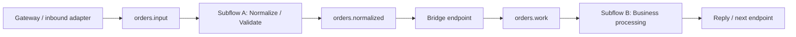
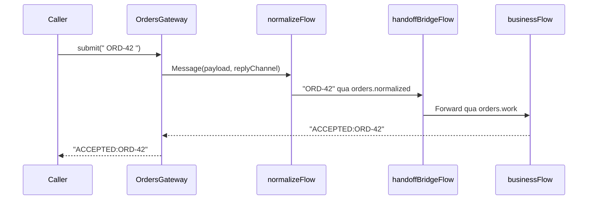

# Bridge để tách subflow

## 1. Bài toán: một luồng dài khó thay đổi

Trong Spring Integration, một hệ thống thường nhận thông điệp từ `Messaging Gateway` hoặc `Channel Adapter`, sau đó lần lượt chuẩn hóa, kiểm tra, định tuyến, gọi dịch vụ và trả kết quả. Khi toàn bộ xử lý được khai báo trong một `IntegrationFlow` lớn, việc tìm vị trí lỗi, thay đổi một chặng hoặc tái sử dụng một đoạn xử lý dễ trở nên khó khăn.

Ví dụ, dịch vụ tiếp nhận đơn hàng cần ba phần rõ ràng:

1. **Tiếp nhận và chuẩn hóa:** nhận mã đơn từ gateway, loại bỏ khoảng trắng, kiểm tra đầu vào.
2. **Bàn giao nội bộ:** chuyển thông điệp hợp lệ sang kênh đầu vào của phần nghiệp vụ.
3. **Xử lý:** ghi nhận đơn hoặc trả trạng thái cho người gọi.

Mẫu **Bridge** trong Enterprise Integration Patterns (EIP) cung cấp một endpoint chuyển thông điệp từ **một channel sang một channel khác**. Khi dùng nó để kết nối hai hoặc nhiều `IntegrationFlow` độc lập, ta có một điểm bàn giao minh bạch giữa các phần của luồng.

Bài học thuộc chương **Bridge** trong module `SPRING_INTEGRATION_PATTERN`, nơi thực hành các EIP bằng Spring Integration nhằm xây dựng luồng thông điệp ít phụ thuộc, dễ mở rộng, kiểm thử và quan sát. Ngoài Bridge, module còn bao gồm Router, Filter, Transformer, Splitter, Aggregator, Gateway, retry, error channel và correlation. Bài này tập trung vào **Bridge để tách subflow**, không dùng Bridge như một tên gọi chung cho mọi hình thức routing hoặc kết nối tới dịch vụ bên ngoài.

**Mục tiêu học tập:** Sau bài học, bạn có thể phân biệt Bridge với channel và các endpoint EIP khác; tách một luồng thành nhiều `IntegrationFlow` có hợp đồng channel rõ ràng; kiểm soát đồng bộ/bất đồng bộ, reply, exception và transaction tại điểm bàn giao; và viết kiểm thử xác nhận cả hai phía kết nối hoạt động đúng.

## 2. Bridge là gì và khi nào có ích?

**Bridge** nhận một `Message<?>` từ input channel và chuyển nó đến output channel. Trong Spring Integration, endpoint này được biểu diễn bởi `BridgeHandler`; Java DSL có thao tác `.bridge()`. Bridge không được dùng để sửa payload, phân loại nội dung hay tự động lưu thông điệp bền vững.



Đường đi trong sơ đồ là một chuỗi **channel và endpoint trong cùng ứng dụng**. Tách subflow ở đây có nghĩa là tách trách nhiệm và cấu hình của các `IntegrationFlow`, không mặc nhiên tạo tiến trình mới, kết nối mạng mới hoặc một hàng đợi bền vững.

### 2.1. Những tình huống nên cân nhắc Bridge

| Tình huống | Bridge giúp gì? | Điều cần kiểm tra |
| --- | --- | --- |
| Một flow quá dài, khó sở hữu | Tách thành các phần có input/output channel riêng. | Đặt tên channel và định nghĩa payload/header thống nhất. |
| Hai nhóm code cần ranh giới module | Cung cấp điểm bàn giao cố định, dễ quan sát và thay đổi bên trong từng phía. | Không để các module phụ thuộc vòng vào nhau. |
| Kết nối `DirectChannel` với `ExecutorChannel` | Tổ chức điểm chuyển giao sang chế độ thực thi khác khi channel đích được cấu hình bất đồng bộ. | Transaction, ack, lỗi và reply có thể đổi ngữ nghĩa. |
| Đưa message từ `QueueChannel` sang flow tiếp theo | Cấu hình một endpoint polling để đọc queue rồi chuyển đi. | Phải có poller, dung lượng queue và chính sách khi đầy. |
| Cần kiểm thử từng đoạn xử lý | Có thể gửi message trực tiếp đến channel đầu vào một subflow và kiểm tra kết quả. | Vẫn cần integration test cho toàn tuyến. |

Một Bridge chỉ chuyển từ một điểm đến một điểm đã cấu hình. Khi cần **chọn nhánh theo nội dung**, hãy dùng Router; khi cần **phát đến nhiều subscriber**, hãy chọn kênh publish–subscribe phù hợp; khi cần **biến đổi payload**, dùng Transformer.

## 3. Các khái niệm: Channel, Bridge, Subflow và Endpoint

Trong Spring Integration, `Message` có payload và headers; `MessageChannel` xác định cách thông điệp được bàn giao; endpoint tiêu thụ hoặc sản xuất message theo nhiệm vụ của nó.

| Thành phần | Trách nhiệm | Có làm thay đổi ý nghĩa message? |
| --- | --- | --- |
| `DirectChannel` | Giao message đến subscriber trên luồng gọi hiện tại. | Không cố ý; nhưng handler có thể biến đổi ở bước khác. |
| `ExecutorChannel` | Đưa tác vụ giao message sang executor. | Không tự biến đổi dữ liệu, nhưng thay đổi thread và phạm vi transaction. |
| `QueueChannel` | Giữ message trong hàng đợi để consumer poll. | Không tự biến đổi; tạo điểm đệm và bàn giao khác thời điểm. |
| `BridgeHandler` | Chuyển message từ input channel đến output channel. | Không chủ động biến đổi payload. |
| `Transformer` | Chuyển đổi biểu diễn payload/message. | Có. |
| `Router` | Chọn channel đích theo điều kiện. | Chọn tuyến, không đơn thuần nối cố định. |
| `IntegrationFlow` | Mô tả một chuỗi kênh và endpoint. | Tùy endpoint bên trong. |

**Subflow** có hai cách dùng cần phân biệt:

- Trong bài này, “tách subflow” là tổ chức **nhiều bean `IntegrationFlow`** và nối chúng bằng channel/Bridge. Mỗi flow có thể được đọc, thay đổi hoặc kiểm thử trong phạm vi riêng.
- Trong một số cấu hình Java DSL, `subFlowMapping(...)` dùng để định nghĩa **nhánh lồng trong một Router hoặc endpoint khác**. Đó là cơ chế rẽ nhánh, không đồng nghĩa mỗi đoạn được nối bằng Bridge.

Một số trường hợp đơn giản, `.channel("next.channel")` đã đủ để kết nối các endpoint. Dùng Bridge tường minh khi muốn điểm chuyển tiếp này có tên, vai trò, cấu hình endpoint và khả năng quan sát riêng.

### 3.1. Điều Bridge không tự cung cấp

Bridge **không** tự tạo retry, timeout, load balancing, lưu message, transaction, bảo đảm gửi đúng một lần hay correlation ID mới. Những đặc tính đó đến từ channel, endpoint/container, transaction manager, broker hoặc chính sách xử lý lỗi đặt quanh nó.

Với đầu vào và đầu ra đều là `DirectChannel`, lời gọi có thể tiếp tục **đồng bộ trên cùng thread**. Thêm Bridge không làm flow chạy song song; nó chỉ bổ sung một endpoint chuyển tiếp.

## 4. Ví dụ Spring Integration Java DSL: tách thành ba flow

Giả sử ứng dụng có API đồng bộ:

```text
ordersGateway.submit("  ORD-42  ") -> "ACCEPTED:ORD-42"
```

Ta dùng ba flow:

1. `normalizeFlow`: lấy payload `String`, chuẩn hóa và gửi vào `orders.normalized`.
2. `handoffBridgeFlow`: nhận từ `orders.normalized`, Bridge sang `orders.work`.
3. `businessFlow`: thực hiện nghiệp vụ và trả reply về gateway.

Ví dụ sử dụng Java 17+, Spring Boot 3.x, Spring Integration 6.x; dependency cốt lõi gồm Spring Integration và cơ chế scanning gateway. Các đoạn code có thể được đặt trong cùng package hoặc tách thành các file Java đúng quy ước dự án.

### 4.1. Định nghĩa channel và các IntegrationFlow

```java
import org.springframework.context.annotation.Bean;
import org.springframework.context.annotation.Configuration;
import org.springframework.integration.annotation.IntegrationComponentScan;
import org.springframework.integration.channel.DirectChannel;
import org.springframework.integration.config.EnableIntegration;
import org.springframework.integration.dsl.IntegrationFlow;
import org.springframework.messaging.MessageChannel;

@Configuration
@EnableIntegration
@IntegrationComponentScan
public class OrdersBridgeConfiguration {

    @Bean("orders.input")
    MessageChannel ordersInput() {
        return new DirectChannel();
    }

    @Bean("orders.normalized")
    MessageChannel ordersNormalized() {
        return new DirectChannel();
    }

    @Bean("orders.work")
    MessageChannel ordersWork() {
        return new DirectChannel();
    }

    @Bean
    IntegrationFlow normalizeFlow() {
        return IntegrationFlow.from("orders.input")
                .transform(String.class, String::trim)
                .channel("orders.normalized")
                .get();
    }

    @Bean
    IntegrationFlow handoffBridgeFlow() {
        return IntegrationFlow.from("orders.normalized")
                .bridge(e -> e.id("ordersHandoffBridge"))
                .channel("orders.work")
                .get();
    }

    @Bean
    IntegrationFlow businessFlow(OrderProcessingService service) {
        return IntegrationFlow.from("orders.work")
                .handle(String.class, (orderId, headers) ->
                        service.accept(orderId))
                .get();
    }
}
```

```java
import org.springframework.stereotype.Service;

@Service
public class OrderProcessingService {

    public String accept(String orderId) {
        if (orderId == null || orderId.isBlank()) {
            throw new IllegalArgumentException("Order ID is required");
        }

        // Ví dụ dùng chuỗi phản hồi; trong production có thể gọi
        // repository hoặc domain service tại đây.
        return "ACCEPTED:" + orderId;
    }
}
```

Trong một dự án thật, nếu `@Configuration` không tự quét các lớp `@Service`, cần bật component scanning hoặc khai báo `OrderProcessingService` thành bean. Ví dụ tách lớp để minh họa các vai trò; không yêu cầu gom tất cả vào một file nguồn Java.

**Phân tích ba flow:**

- `normalizeFlow` có trách nhiệm đầu vào: nhận payload, gọi `String::trim` và xuất ra channel hợp đồng `orders.normalized`. Nó không biết chi tiết xử lý đơn hàng phía sau.
- `handoffBridgeFlow` sở hữu endpoint tên `ordersHandoffBridge`. Input channel là `orders.normalized`, output channel là `orders.work`. Không có logic đổi payload trong Bridge.
- `businessFlow` có trách nhiệm nghiệp vụ. Tại đây, handler trả một `String` và Spring Integration dùng reply context của request ban đầu để chuyển kết quả về gateway.

Tên channel làm hợp đồng giữa các flow. Nếu đổi tên channel một phía mà không đổi phía còn lại, message không tới được consumer dự kiến; nên đặt tên hằng/định nghĩa tập trung khi dự án tăng quy mô.

### 4.2. Messaging Gateway gọi xuyên qua các subflow

```java
import org.springframework.integration.annotation.Gateway;
import org.springframework.integration.annotation.MessagingGateway;

@MessagingGateway(defaultRequestChannel = "orders.input")
public interface OrdersGateway {

    @Gateway(replyTimeout = "3000")
    String submit(String orderId);
}
```

Ở ví dụ này các channel là `DirectChannel`, vì vậy gateway gọi qua các flow trên cùng đường xử lý đồng bộ. Nếu `submit("  ORD-42  ")`, payload sau Transformer là `"ORD-42"` và handler trả `"ACCEPTED:ORD-42"`.

`replyTimeout` là giới hạn chờ reply ở gateway; nó **không** bảo đảm ngắt một handler blocking trên cùng thread. Với HTTP/DB/RPC blocking trong `businessFlow`, cần timeout ở client, transaction hoặc tầng I/O phù hợp.

**Lưu ý về reply:** Một Bridge không tự sinh reply. Nếu `businessFlow` được thiết kế one-way và handler trả `null`, gateway có kiểu trả về `String` có thể chờ mãi hoặc hết `replyTimeout`. Vì vậy phải phân biệt pipeline fire-and-forget với request–reply ngay khi định nghĩa hợp đồng channel.

### 4.3. Sơ đồ thực thi và ranh giới trách nhiệm



Bridge và channel được dùng để tách **tổ chức luồng**. Mỗi luồng vẫn tồn tại trong cùng ứng dụng Spring; để kết nối sang ứng dụng hoặc broker khác, cần channel adapter/gateway tương ứng và phải xét lại serialization, lỗi mạng, delivery semantics.

## 5. Khi nào chỉ dùng channel và khi nào đặt Bridge tường minh?

Giả sử một flow đang có:

```java
@Bean
IntegrationFlow compactFlow(OrderProcessingService service) {
    return IntegrationFlow.from("orders.input")
            .transform(String.class, String::trim)
            .handle(String.class, (id, headers) -> service.accept(id))
            .get();
}
```

Với luồng rất ngắn, một flow liền mạch thường dễ đọc nhất. Khi chuẩn hóa, phân loại, xác thực và xử lý nghiệp vụ trở thành các cụm riêng, tách chúng thành bean `IntegrationFlow` có thể hữu ích.

| Cách tổ chức | Lợi ích | Rủi ro/cái giá |
| --- | --- | --- |
| Một `IntegrationFlow` liên tục | Ít endpoint, dễ theo dõi cho pipeline nhỏ. | Flow dài có thể gom nhiều trách nhiệm. |
| Nhiều `IntegrationFlow` nối chung tên channel | Mô-đun hóa thuận tiện, giảm phụ thuộc giữa từng đoạn. | Phải quản lý tên và loại channel nhất quán. |
| Nhiều `IntegrationFlow` với Bridge riêng | Có điểm bàn giao mang ý nghĩa rõ ràng, dễ gắn tên/metrics/kiểm thử. | Có thêm cấu hình và endpoint; không làm hệ thống tự async. |
| Thêm broker/channel adapter thật ở giữa | Tách ứng dụng và vòng đời triển khai; hỗ trợ giao nhận qua mạng. | Phát sinh serialization, ack, retry, ordering và vận hành broker. |

Không thêm Bridge cho mọi cặp endpoint như một quy tắc máy móc. Bridge có ích nhất khi **ranh giới giữa hai đoạn là một khái niệm đáng đặt tên** (ví dụ `orders.normalized → orders.work`) hoặc cần chuyển sang loại channel khác.

## 6. Đổi loại channel: đồng bộ, bất đồng bộ và đệm

Bridge chuyển message sang output channel được cấu hình. Cách xử lý tiếp theo phụ thuộc chủ yếu vào **loại channel** và consumer của channel đích.

### 6.1. DirectChannel: đi xuyên nhiều flow trên cùng thread

Trong ví dụ phần 4, `orders.input`, `orders.normalized` và `orders.work` là `DirectChannel`. Khi gửi message, framework gọi subscriber đồng bộ. Một exception từ handler phía sau có thể lan về caller phía trước nếu không có endpoint nào bắt và chuyển hướng lỗi.

Điều này giúp các flow có thể tham gia **cùng phạm vi transaction do caller/listener khởi tạo**, với điều kiện transaction dùng thread-bound context và tất cả chặng vẫn ở cùng thread. Nhưng **Bridge tự nó không tạo transaction**; muốn rollback DB phải cấu hình transaction manager và vị trí bắt đầu transaction thích hợp.

### 6.2. ExecutorChannel: chuyển sang xử lý bất đồng bộ

Nếu muốn `businessFlow` được phân phối từ thread pool, có thể **thay bean `orders.work`** của ví dụ bằng `ExecutorChannel`:

```java
import java.util.concurrent.Executor;

import org.springframework.context.annotation.Bean;
import org.springframework.integration.channel.ExecutorChannel;
import org.springframework.messaging.MessageChannel;

@Bean("orders.work")
MessageChannel ordersWork(Executor ordersExecutor) {
    return new ExecutorChannel(ordersExecutor);
}
```

`ordersExecutor` phải là một bean `Executor` được cấu hình rõ kích thước pool, dung lượng queue và chính sách từ chối; đoạn code trên là **biến thể thay thế**, không khai báo song song hai bean trùng tên.

Khi `orders.work` là `ExecutorChannel`:

- Handler có thể chạy ở thread khác; thread-bound DB transaction của upstream **không tự truyền qua**.
- Exception không còn chắc chắn ném trực tiếp về listener/caller ở thread gửi; cần xem cơ chế `errorChannel` và xử lý lỗi bất đồng bộ.
- Gateway đồng bộ vẫn có thể chờ reply qua `replyChannel`, nhưng có thể timeout trước khi handler hoàn tất.
- Một inbound broker listener có thể xác nhận đã bàn giao message cho executor trước khi công việc nghiệp vụ thực sự commit. Nếu yêu cầu bảo đảm không mất việc, phải có durable handoff hoặc cơ chế acknowledgment phù hợp.

Chọn `ExecutorChannel` vì nhu cầu concurrency và cách ly thread, **không** chỉ để “tách code đẹp hơn”.

### 6.3. QueueChannel: có đệm và consumer phải poll

Một `QueueChannel` là `PollableChannel`. Khi gửi message vào queue, nó được giữ cho consumer lấy ra sau; không có subscriber xử lý ngay như `DirectChannel`.

Ví dụ biến thể **thay thế bridge ở phần 4**, nối `orders.normalized` sang một queue rồi dùng poller để chuyển sang `orders.work`:

```java
import org.springframework.context.annotation.Bean;
import org.springframework.integration.channel.QueueChannel;
import org.springframework.integration.dsl.IntegrationFlow;
import org.springframework.integration.dsl.Pollers;
import org.springframework.messaging.PollableChannel;

@Bean("orders.buffer")
PollableChannel ordersBuffer() {
    return new QueueChannel(100); // Hàng đợi in-memory, capacity = 100
}

@Bean
IntegrationFlow normalizeToBufferBridge() {
    return IntegrationFlow.from("orders.normalized")
            .bridge()
            .channel("orders.buffer")
            .get();
}

@Bean
IntegrationFlow bufferToWorkBridge() {
    return IntegrationFlow
            .from("orders.buffer",
                    e -> e.poller(Pollers.fixedDelay(250)
                            .maxMessagesPerPoll(10)))
            .bridge()
            .channel("orders.work")
            .get();
}
```

Khi dùng biến thể này, hãy **bỏ flow `handoffBridgeFlow` cũ** để tránh hai consumer cùng nhận từ `orders.normalized`. `DirectChannel` có nhiều subscriber có thể phân phối message tới một subscriber theo dispatcher, không bảo đảm tất cả cùng nhận.

`QueueChannel(100)` trong ví dụ là hàng đợi **bộ nhớ**, không bền vững khi ứng dụng dừng. Khi queue đầy, gửi message có thể thất bại hoặc chịu chính sách chờ; phải quyết định capacity, backpressure, lỗi khi send và vận hành khi restart. Với yêu cầu bền vững, cần message store hoặc broker phù hợp, cùng chính sách idempotency/ack.

**Đặc biệt với Gateway:** Khi producer trả về trước lúc một queue hoặc executor hoàn thành nghiệp vụ, reply có thể đến muộn hơn `replyTimeout`. Đó là thay đổi ngữ nghĩa request–reply cần được kiểm thử, không phải lỗi của Bridge.

### 6.4. Bảng quyết định nhanh

| Loại output channel | Handoff | Transaction qua thread | Thường dùng khi |
| --- | --- | --- | --- |
| `DirectChannel` | Gọi subscriber trực tiếp. | Có thể giữ thread-bound context. | Pipeline đồng bộ, cần lỗi lan về caller. |
| `ExecutorChannel` | Giao việc cho executor. | Không tự giữ transaction của thread gửi. | Cần đồng thời và tách tài nguyên thực thi. |
| `QueueChannel` | Đưa vào queue để poll sau. | Thông thường tách khỏi thread gửi. | Cần bộ đệm, chủ động điều chỉnh tốc độ xử lý. |
| Broker thông qua adapter | Vận chuyển qua hệ thống ngoài. | Không có transaction DB xuyên tiến trình theo mặc định. | Tách dịch vụ, độ bền và delivery semantics được thiết kế riêng. |

## 7. Lỗi, reply, headers và correlation qua Bridge

### 7.1. Bridge chuyển tiếp message, không quyết định kết quả nghiệp vụ

Trong trường hợp đồng bộ, một handler phía sau ném exception có thể khiến `Messaging Gateway` hoặc inbound listener ở đầu luồng nhìn thấy lỗi. Nếu upstream đang ở transaction, việc exception có dẫn đến rollback hay không phụ thuộc cách cấu hình transaction và việc exception có bị nuốt hay không.

Bridge không tự sửa payload để biểu diễn lỗi và không tự tạo `ErrorMessage`. Nếu có flow bất đồng bộ, lỗi có thể được publish tới `errorChannel` theo cấu hình xử lý lỗi của framework/endpoint. Không nên mặc định rằng lỗi sẽ tự đến đúng một channel chung trong mọi kiểu integration flow.

Đối với nguồn JMS/AMQP/Kafka, **acknowledgment, offset commit và redelivery phụ thuộc inbound adapter/container**. Đặc biệt khi đặt điểm async giữa adapter và handler, việc adapter đã bàn giao sang channel không đồng nghĩa DB phía sau đã commit. Hãy thiết kế retry, error flow và idempotency tương ứng.

### 7.2. Headers được bàn giao qua điểm Bridge

Một message có thể mang các headers như `correlationId`, `replyChannel`, `errorChannel` hoặc trace context. Trong mô hình Bridge thông thường, handler **chuyển tiếp message** mà không chủ động thay đổi payload; các headers phục vụ reply/correlation tiếp tục được mang theo khi message được chuyển tiếp qua flow.

Nhưng một Transformer, header enricher, gateway hay adapter ở trước/sau Bridge có thể tạo message mới hoặc thay đổi headers. Vì vậy cần kiểm thử giá trị header quan trọng tại **cả đầu vào và đầu ra** của điểm bàn giao. Không dùng `MessageHeaders.ID` của message instance làm khóa idempotency nếu message có thể được tái tạo trong retry/redelivery.

Một ví dụ message:

```text
payload = "ORD-42"
headers = {
    correlationId: "checkout-987",
    replyChannel: <reply channel managed by gateway>,
    errorChannel: <configured error channel>
}
```

Bridge không tự phát sinh `correlationId`, cũng không tự tạo fan-out. Nếu dùng Splitter rồi Aggregator, hãy bảo đảm correlation và sequence headers có ngữ nghĩa phù hợp ở đoạn trước và sau Bridge.

### 7.3. Không dựng chu trình Bridge vô hạn

Một cấu hình sai có thể tạo vòng lặp:

```text
orders.a -> Bridge 1 -> orders.b -> Bridge 2 -> orders.a -> ...
```

Với `DirectChannel`, vòng lặp có thể gây lời gọi đệ quy liên tiếp và kiệt tài nguyên. Với channel có queue, vòng lặp có thể gây ùn tắc không có điểm kết thúc. Nếu nghiệp vụ thực sự cần feedback loop, hãy có điều kiện dừng, state machine và giới hạn số lần chuyển tiếp có thể kiểm chứng.

## 8. Cách kiểm thử khi tách subflow

Có ba tầng kiểm thử cần phân biệt:

1. **Unit test thành phần nghiệp vụ:** gọi `OrderProcessingService.accept(...)` độc lập để kiểm tra validation và kết quả.
2. **Integration test mỗi subflow:** gửi message vào channel hợp đồng, kiểm tra flow tiêu thụ, xử lý đúng payload/headers.
3. **End-to-end integration test:** gọi gateway hoặc gửi từ inbound adapter, kiểm tra cả tuyến qua Bridge, reply, exception và các deadline nếu có bất đồng bộ.

Ví dụ kiểm tra đường request–reply trong cấu hình `DirectChannel` phần 4 với JUnit 5 và Spring Test:

```java
import static org.junit.jupiter.api.Assertions.assertEquals;

import org.junit.jupiter.api.Test;
import org.springframework.beans.factory.annotation.Autowired;
import org.springframework.test.context.junit.jupiter.SpringJUnitConfig;

@SpringJUnitConfig(classes = {
        OrdersBridgeConfiguration.class,
        OrderProcessingService.class
})
class OrdersBridgeIntegrationTest {

    @Autowired
    private OrdersGateway gateway;

    @Test
    void bridgeConnectsNormalizeAndBusinessFlow() {
        assertEquals("ACCEPTED:ORD-42",
                gateway.submit("  ORD-42  "));
    }
}
```

Trong môi trường thực tế, test context phải đăng ký được `OrdersGateway` qua `@IntegrationComponentScan` và có tất cả bean channel/flow cần thiết. Test trên minh họa đường đi **Gateway → Transformer → Bridge → Handler → Reply**; nó không chứng minh vấn đề ack hay timeout của adapter bất đồng bộ.

### 8.1. Ma trận trường hợp cần thử

| Tình huống | Cách kích hoạt | Kết quả mong đợi |
| --- | --- | --- |
| Payload hợp lệ | `"  ORD-42  "` | Bridge chuyển tiếp; handler nhận `ORD-42`, gateway nhận reply. |
| Payload không hợp lệ | Chuỗi trắng hoặc ID sai định dạng | Handler từ chối; với DirectChannel, lỗi lan ngược theo cơ chế request–reply. |
| Thiếu subscriber ở output channel | Cố ý không đăng ký `businessFlow` trong test cấu hình | Message không tới nghiệp vụ; phát hiện lỗi cấu hình chứ không coi là thành công. |
| Nhiều subscriber trên `DirectChannel` | Gắn thêm một consumer vào cùng input | Không giả định broadcast; cần kiểm tra dispatcher và mục đích phân phối. |
| Header correlation | Thêm `correlationId`/trace header | Giá trị được giữ qua điểm handoff, trừ endpoint được cấu hình thay đổi. |
| Executor bị bão hòa | Dùng pool/queue nhỏ, gửi nhiều message | Kiểm tra rejection, error flow và mức độ hoàn thành nghiệp vụ. |
| QueueChannel đầy | Gửi vượt capacity | Kiểm tra backpressure, send failure, không mất việc âm thầm. |
| Gateway timeout | Đưa xử lý chậm vào đoạn async | Gateway có thể hết hạn chờ; xác định xử lý message đến muộn. |
| Transaction rollback | Ném lỗi DB trong handler đồng bộ | Xác minh rollback trong phạm vi transaction thật sự cấu hình. |
| Restart với in-memory queue | Dừng ứng dụng khi queue còn message | Nhận ra queue bộ nhớ không bảo đảm khôi phục; dùng store/broker nếu cần. |

### 8.2. Quan sát điểm bàn giao

Tên endpoint như `ordersHandoffBridge` giúp phân biệt khâu chuẩn hóa, Bridge và xử lý khi xem log/metrics. Có thể đặt interceptor, instrument channel, tracing hoặc thống kê độ trễ tại ranh giới này, nhưng tránh log payload nhạy cảm ở tất cả hop.

Nên theo dõi: số message đầu vào từng channel, số message xử lý thành công/thất bại ở handler, độ trễ trước/sau Bridge, thread pool queue/rejection (nếu `ExecutorChannel`), số message tồn đọng (nếu `QueueChannel`), và tuổi message từ khi nhận đến khi hoàn tất. Bridge không tự tạo số liệu đầy đủ; khả năng quan sát phụ thuộc vào instrumentation của ứng dụng.

## 9. Lỗi kiến trúc thường gặp và cách sửa

**Lỗi 1 — Coi Bridge là Router.** Thiết kế một Bridge và kỳ vọng nó tự chọn channel theo loại đơn hàng. Bridge có output cố định. Nếu điều kiện đầu vào quyết định luồng, dùng Router trước điểm bàn giao hoặc một mapping subflow có điều kiện.

**Lỗi 2 — Coi tên channel là một API đủ rõ.** Hai subflow cùng tham chiếu `orders.work` nhưng một bên gửi `String`, bên kia kỳ vọng DTO. Cần định nghĩa hợp đồng payload, headers, phân loại lỗi, phiên bản dữ liệu và phép kiểm tra hợp đồng tối thiểu.

**Lỗi 3 — Dùng Bridge để “tăng hiệu năng” mà không chọn loại channel phù hợp.** Với `DirectChannel`, Bridge vẫn đồng bộ. Muốn concurrency thì cân nhắc `ExecutorChannel`, sizing executor và chính sách lỗi; muốn buffer thì cân nhắc `QueueChannel`/broker và độ bền của dữ liệu.

**Lỗi 4 — Đổi sang async nhưng giữ giả định transaction cũ.** Listener trả về sau khi đẩy message vào queue; DB transaction xảy ra sau đó. Hậu quả có thể mất việc khi crash. Cần durable handoff, ack phù hợp và idempotency tại consumer.

**Lỗi 5 — Dùng một channel chung cho nhiều flow như fan-out.** `DirectChannel` có nhiều subscriber có thể chọn một subscriber để dispatch. Nếu cần mỗi subscriber nhận một bản, xem `PublishSubscribeChannel` và chính sách bảo đảm delivery cho từng nhánh.

**Lỗi 6 — Nuốt exception rồi trả thành công.** Một endpoint dùng `try/catch` chỉ log mà không phản hồi lỗi có thể khiến gateway nhận kết quả không đúng hoặc inbound adapter ack quá sớm. Cần định nghĩa exception được propagate, retry hay đưa vào error flow.

**Lỗi 7 — Tạo vòng Bridge hoặc kết nối mù.** Những channel có tên gần giống nhau và nhiều flow cùng subscribe có thể tạo vòng, xử lý hai lần hoặc không có subscriber. Sơ đồ hóa graph channel và test cả tuyến để phát hiện.

**Lỗi 8 — Quên reply trong flow request–reply.** Nếu handler cuối trả `null`, gateway chờ `String` có thể timeout. Phân biệt endpoint one-way và endpoint tạo reply, thiết kế hợp đồng đầu ra của mỗi subflow.

## 10. Checklist áp dụng Bridge để tách subflow

Trước khi đưa thiết kế vào môi trường tích hợp, hãy kiểm tra:

1. **Ranh giới nghiệp vụ:** mỗi `IntegrationFlow` có một trách nhiệm dễ mô tả chưa?
2. **Tên channel:** input/output channel của hai phía đã khớp và được khai báo ổn định chưa?
3. **Hợp đồng message:** payload type, headers bắt buộc, correlation và error semantics được ghi rõ chưa?
4. **Bridge có mục đích:** điểm chuyển tiếp có giúp mô-đun hóa/quan sát hoặc chuyển channel type thật không?
5. **Đồng bộ/bất đồng bộ:** channel đích là Direct, Executor, Queue hay adapter đi broker? Điều này ảnh hưởng thread, reply và transaction thế nào?
6. **Xử lý lỗi:** exception có đi về đúng caller/listener, error flow hoặc DLQ theo thiết kế không?
7. **Ack và độ bền:** nếu dữ liệu đến từ broker, có điểm bàn giao async nào khiến ack xảy ra trước business commit không?
8. **Tính đúng đắn:** có side effect cần idempotency khi retry/redelivery hoặc có fan-out có thể tạo duplicate không?
9. **Kiểm thử:** có test gateway-to-handler, header propagation, thiếu subscriber, timeout và nhánh lỗi không?
10. **Vận hành:** có metrics/tracing cho Bridge và các channel, giới hạn queue/pool và cảnh báo tồn đọng nếu có async không?

Bridge phù hợp khi một luồng Spring Integration cần được chia thành các đoạn có hợp đồng channel độc lập và một **điểm bàn giao cố định, dễ hiểu**. Để quyết định độ tin cậy, hiệu năng hoặc tính nhất quán, vẫn phải xét loại channel, ranh giới transaction và cách xử lý lỗi. Khi ghép chúng với nhau có chủ đích, Bridge giúp cấu trúc tích hợp rõ ràng mà vẫn bảo toàn luồng message giữa các subflow.
