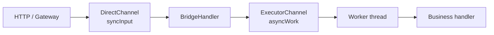
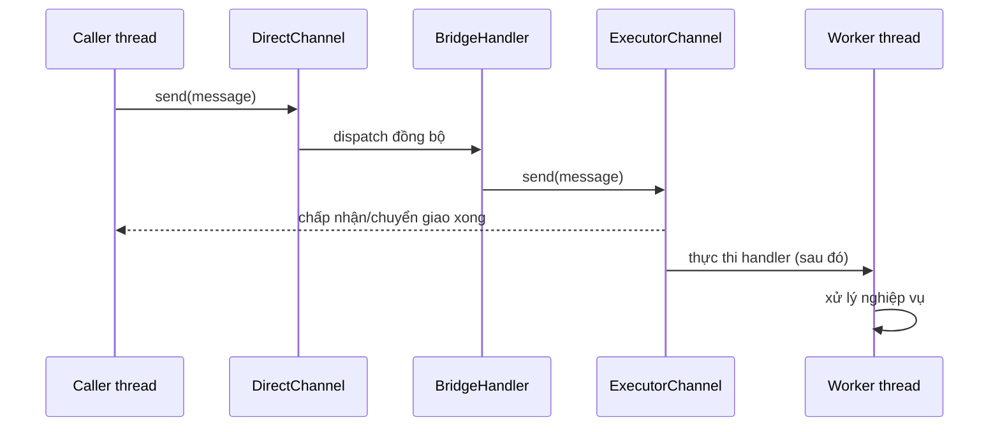
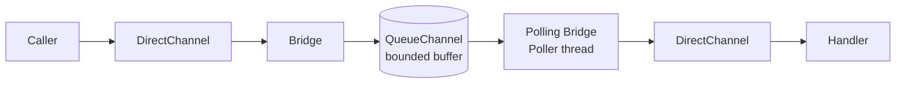
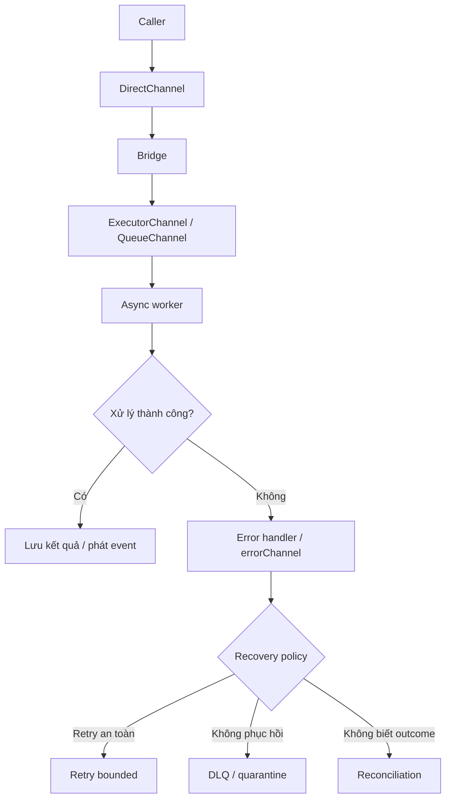

# Bridge giữa sync và async channel trong Spring Integration

## 1. Khi nào cần nối kênh đồng bộ với kênh bất đồng bộ?

Trong chương **Bridge** của mô-đun **SPRING_INTEGRATION_PATTERN**, chúng ta học cách kết nối các luồng thông điệp bằng Spring Integration để áp dụng **Enterprise Integration Patterns (EIP)**. Module còn sử dụng Router, Filter, Transformer, Splitter, Aggregator, Gateway, retry, error channel và correlation; vì vậy việc hiểu **đường đi của message** và **ranh giới thực thi** là nền tảng để xử lý lỗi và mở rộng hệ thống.

Giả sử API nhận yêu cầu cập nhật trạng thái đơn hàng. Nó cần kiểm tra dữ liệu rồi chuyển công việc cập nhật dữ liệu, gửi thông báo và ghi audit sang một luồng chạy trên worker. API không muốn giữ thread HTTP để đợi mọi xử lý hoàn tất.

Mô hình ban đầu sử dụng `DirectChannel`:

```text
HTTP request
    |
    v
Messaging Gateway
    |
    v
DirectChannel --> Handler A --> Handler B --> Handler C
                         (cùng thread của người gửi)
```

Nếu handler B gọi dịch vụ chậm hai giây, lời gọi từ gateway có thể bị chặn trong hai giây. Ta có thể tạo một ranh giới bất đồng bộ bằng cách chuyển message qua `ExecutorChannel` hoặc đệm qua `QueueChannel`, rồi dùng **Bridge** để kết nối các channel:



Mục tiêu của bài là trả lời ba câu hỏi:

1. **Bridge làm gì?** Chuyển message từ một channel sang một channel khác mà không đặt thêm logic chuyển đổi nghiệp vụ.
2. **Điều gì thực sự tạo bất đồng bộ?** Loại channel, executor hoặc poller, chứ không phải bản thân Bridge.
3. **Những gì thay đổi ở ranh giới?** Thread, transaction, khả năng bắt exception, thời điểm caller ngừng đợi, thứ tự xử lý, áp lực hàng đợi và cách quan sát.

Kết thúc bài, bạn có thể viết hai cấu trúc thông dụng: `DirectChannel → Bridge → ExecutorChannel` và `DirectChannel → Bridge → QueueChannel → polling Bridge → DirectChannel`; đồng thời biết cách kiểm thử, vận hành và lựa chọn cấu trúc phù hợp.

## 2. Phân biệt Bridge, channel và handler

### 2.1. Bridge là một Enterprise Integration Pattern

**Messaging Bridge** nối hai channel có vai trò riêng trong một topology. Trong Spring Integration, một bridge endpoint có thể sử dụng `BridgeHandler` để nhận message từ một channel và gửi tới output channel.

Một bridge đơn giản thường không cần thay đổi payload. Ý nghĩa của nó nằm ở **kết nối hai đoạn flow**, tạo ranh giới rõ ràng giữa nơi gửi và nơi nhận.

```text
Channel A --> [ Bridge ] --> Channel B
```

Nếu payload cần đổi từ JSON thành domain object, dùng **Transformer**. Nếu cần chọn một trong nhiều đích, dùng **Router**. Nếu cần loại message theo quy tắc, dùng **Filter**. Nếu cần xử lý nghiệp vụ, dùng **Service Activator**. Bridge thích hợp khi mục đích chính là **nối channel**.

### 2.2. Bridge không tự tạo một thread mới

Giả sử cả hai đầu đều là `DirectChannel`:

```text
Caller thread --> DirectChannel A --> Bridge --> DirectChannel B --> Handler
                  (thông thường toàn bộ chạy cùng caller thread)
```

Bridge có thêm một endpoint trong topology, nhưng không tự chuyển sang thread khác. Bất đồng bộ xuất hiện khi downstream channel có cơ chế dispatch bất đồng bộ hoặc một consumer polling chạy độc lập.

### 2.3. Các channel chính cần phân biệt

| Channel | Cơ chế | Thread chạy handler tiếp theo | Đặc tính cần chú ý |
| --- | --- | --- | --- |
| `DirectChannel` | Gọi subscriber trực tiếp qua dispatcher đồng bộ | Thường là thread gửi | Exception có thể đi ngược call stack; transaction có thể tiếp tục trong cùng thread |
| `ExecutorChannel` | Giao tác vụ cho `TaskExecutor` | Thường là worker thread khi executor chấp nhận tác vụ | Không mặc định truyền transaction/thread-local; có thể bị từ chối khi quá tải |
| `QueueChannel` | Đệm message trong queue | Chưa gọi handler khi mới enqueue; cần poller/receiver lấy ra | Có capacity, blocking/timeout khi đầy, cần cơ chế poll và khôi phục |
| `PriorityChannel` | Đệm message theo ưu tiên | Consumer/poller lấy ra sau | Có thể làm thay đổi thứ tự FIFO |
| `PublishSubscribeChannel` | Phát cho nhiều subscriber | Đồng bộ hoặc bất đồng bộ tùy có executor | Một message có thể có nhiều nhánh xử lý |
| `FluxMessageChannel` | Channel mang ngữ nghĩa reactive | Phụ thuộc subscriber/scheduler/reactive pipeline | Cần hiểu demand/backpressure và lifecycle riêng |

**Không được suy luận bất đồng bộ từ tên Bridge.** Phải nhìn vào loại channel ở đầu ra, executor, poller và luồng thực thi.

## 3. Hai cách kết nối sync → async phổ biến

### 3.1. Cách A: DirectChannel → Bridge → ExecutorChannel



**Ý nghĩa:** nếu executor đã tiếp nhận công việc và không dùng chính caller thread để chạy tác vụ, lệnh gửi có thể trả về trước khi handler hoàn tất. Phần thực thi nghiệp vụ diễn ra trong worker.

Lưu ý:

- `ExecutorChannel` không phải broker và không bảo đảm lưu bền qua restart.
- Hàng đợi của executor và chính sách từ chối quyết định điều gì xảy ra khi quá tải.
- Nếu executor dùng `CallerRunsPolicy` hoặc một executor chạy trực tiếp trên thread gọi, tác vụ có thể thực thi trên caller thread. Do đó **không được khẳng định chắc chắn luôn có thread mới** nếu chưa biết cấu hình executor.
- Hoàn tất lời gọi gửi message **không đồng nghĩa** handler đã commit dữ liệu.

### 3.2. Cách B: DirectChannel → Bridge → QueueChannel → polling Bridge → DirectChannel



**Ý nghĩa:** Bridge thứ nhất đưa message vào hàng đợi; một poller lấy message ra để chạy Bridge thứ hai và chuyển cho handler. Caller có thể trả về sau khi message được enqueue, trong khi handler chạy trong poller thread sau đó.

Cách này hữu ích khi cần **đệm tải** và điều tiết tốc độ lấy message. Khác với `ExecutorChannel`, `QueueChannel` lưu message trước khi một consumer polling lấy ra. Tuy nhiên, `QueueChannel` thông thường vẫn là cấu trúc trong bộ nhớ; muốn bảo đảm phục hồi sau restart, cần persistence hoặc broker phù hợp.

### 3.3. So sánh nhanh

| Tiêu chí | Bridge → ExecutorChannel | Bridge → QueueChannel + Poller |
| --- | --- | --- |
| Mục tiêu chính | Chuyển việc cho executor | Đệm và điều tiết tốc độ xử lý |
| Nơi giữ backlog | Hàng đợi của executor, nếu có | QueueChannel |
| Thành phần chủ động tiêu thụ | TaskExecutor dispatch | Poller gọi `receive()` |
| Khi quá tải | Executor có thể reject hoặc áp dụng policy | Queue đầy; `send` có thể chờ hoặc thất bại tùy timeout |
| Độ song song | Executor pool | Poller/task executor và cấu hình số consumer |
| Điều tiết nhịp | Pool size, queue capacity, rejection | Poll interval, max messages per poll, poller concurrency |
| Dữ liệu qua restart | Thường không bền | QueueChannel cơ bản không bền |
| Transaction gốc | Không tự chuyển sang worker | Không tự chuyển sang poller thread |
| Thứ tự hoàn thành | Có thể đảo do nhiều worker | Phụ thuộc poller và downstream concurrency |

## 4. Ví dụ thực hành: Bridge từ DirectChannel sang ExecutorChannel

Giả sử gateway nhận lệnh xử lý đơn. Mục tiêu là **giao công việc sang worker**. Đây là ứng dụng minh họa dùng Java 17+ và Spring Integration với cấu hình Java DSL; mỗi `public` type nằm trong file Java riêng khi triển khai.

### 4.1. Mô hình dữ liệu

```java
public record ProcessOrderCommand(
    String eventId,
    String orderId,
    long amountCents
) {}
```

`eventId` là định danh nghiệp vụ ổn định qua retry/redelivery; `orderId` liên kết các sự kiện về cùng một đơn. Spring message cũng có `MessageHeaders.ID`, nhưng message ID có thể thay đổi khi dựng message mới, nên không dùng nó làm khóa idempotency duy nhất.

### 4.2. Khai báo channel và executor

```java
import org.springframework.context.annotation.Bean;
import org.springframework.context.annotation.Configuration;
import org.springframework.integration.annotation.IntegrationComponentScan;
import org.springframework.integration.channel.DirectChannel;
import org.springframework.integration.channel.ExecutorChannel;
import org.springframework.integration.config.EnableIntegration;
import org.springframework.messaging.MessageChannel;
import org.springframework.scheduling.concurrent.ThreadPoolTaskExecutor;

@Configuration
@EnableIntegration
@IntegrationComponentScan
public class OrderBridgeChannels {

    @Bean("syncOrders")
    public MessageChannel syncOrders() {
        return new DirectChannel();
    }

    @Bean
    public ThreadPoolTaskExecutor orderWorkExecutor() {
        ThreadPoolTaskExecutor executor = new ThreadPoolTaskExecutor();
        executor.setCorePoolSize(4);
        executor.setMaxPoolSize(8);
        executor.setQueueCapacity(100);
        executor.setThreadNamePrefix("order-work-");
        // Spring quản lý khởi tạo và đóng executor bean.
        return executor;
    }

    @Bean("asyncOrders")
    public MessageChannel asyncOrders(
            ThreadPoolTaskExecutor orderWorkExecutor) {
        return new ExecutorChannel(orderWorkExecutor);
    }
}
```

Trong ví dụ này:

- `syncOrders` dispatch đồng bộ đến Bridge.
- `asyncOrders` giao công việc cho `orderWorkExecutor`.
- Pool có 4 core threads, tối đa 8 threads và queue capacity 100. Với `ThreadPoolExecutor` thông thường, các tác vụ có thể được xếp queue trước khi pool tăng tới max; điều chỉnh bằng đo lường.
- Executor là tài nguyên hữu hạn. Nếu queue đầy và không còn khả năng nhận việc, việc gửi có thể bị từ chối; caller cần có chính sách quá tải.

**Ghi nhớ:** `ExecutorChannel` không tự biến công việc thành durable job. Nếu tiến trình chết sau khi chấp nhận công việc nhưng trước khi handler hoàn tất, dữ liệu trong executor queue có thể mất.

### 4.3. Nối hai channel bằng Bridge

```java
import org.springframework.context.annotation.Bean;
import org.springframework.context.annotation.Configuration;
import org.springframework.integration.dsl.IntegrationFlow;

@Configuration
public class OrderBridgeFlow {

    @Bean
    public IntegrationFlow syncToAsyncOrderBridge() {
        return IntegrationFlow
            .from("syncOrders")
            .bridge(endpoint -> endpoint.id("syncAsyncOrderBridge"))
            .channel("asyncOrders")
            .get();
    }
}
```

Giải thích từng bước:

1. `from("syncOrders")` đăng ký endpoint đọc từ channel đồng bộ.
2. `bridge(...)` khai báo BridgeHandler làm nhiệm vụ chuyển tiếp.
3. `id("syncAsyncOrderBridge")` đặt tên endpoint để dễ truy vết graph, log và metric.
4. `channel("asyncOrders")` chọn output channel là `ExecutorChannel`.
5. Message được chuyển sang executor; logic xử lý ở consumer của `asyncOrders` thực thi theo lịch của executor.

Có thể viết một flow trực tiếp nối channel mà không tạo nhiều tầng xử lý, nhưng Bridge diễn tả rõ ràng ý định nối hai channel và cung cấp một endpoint có thể quản lý, quan sát.

### 4.4. Handler thực thi trên worker

```java
import org.springframework.integration.annotation.ServiceActivator;
import org.springframework.messaging.Message;
import org.springframework.stereotype.Component;

@Component
public class OrderWorker {

    private final OrderUseCase useCase;

    public OrderWorker(OrderUseCase useCase) {
        this.useCase = useCase;
    }

    @ServiceActivator(inputChannel = "asyncOrders")
    public void process(Message<ProcessOrderCommand> message) {
        ProcessOrderCommand command = message.getPayload();

        // Trong production: xử lý idempotent theo eventId.
        useCase.processOnce(command);

        // Dùng logging/metrics có correlation; không in payload nhạy cảm.
    }
}
```

`OrderUseCase` là lớp nghiệp vụ do ứng dụng triển khai. Nếu thao tác ghi dữ liệu, `processOnce` nên thực thi với idempotency key và transaction phù hợp, vì duplicate vẫn có thể xuất hiện khi hệ thống ngoài gửi lại yêu cầu.

### 4.5. Gateway phía caller

```java
import org.springframework.integration.annotation.MessagingGateway;

@MessagingGateway(defaultRequestChannel = "syncOrders")
public interface OrderWorkGateway {
    void submit(ProcessOrderCommand command);
}
```

Ví dụ gọi:

```java
gateway.submit(new ProcessOrderCommand(
    "evt-1024", "ord-589", 250_000
));
```

Với `void` gateway, lời gọi được thiết kế theo kiểu **giao việc một chiều**: caller không yêu cầu một reply nghiệp vụ trực tiếp. Khi executor tiếp nhận thành công, phương thức có thể trả về trong lúc handler tiếp tục chạy.

Nhưng ý nghĩa “đã gửi” cần được mô tả chính xác:

- Có thể khẳng định **lệnh gửi qua channel đã hoàn tất theo cơ chế channel tại thời điểm đó**.
- Không thể khẳng định handler đã xử lý xong hoặc database đã commit.
- Không thể khẳng định công việc sẽ sống sót qua restart.
- Lỗi xảy ra *sau khi dispatch sang worker* không tự trở thành exception của lời gọi `submit` đã trả về.

Nếu API phải hứa rằng công việc chắc chắn sẽ được xử lý dù ứng dụng restart, cần broker hoặc persistent job store/transactional outbox cùng trạng thái xử lý và idempotency.

## 5. Ví dụ có bộ đệm: Bridge sang QueueChannel rồi polling Bridge

`QueueChannel` hữu ích nếu bạn muốn chia hai đoạn flow bằng một hàng đợi rõ ràng và có thể điều tiết nhịp tiêu thụ.

### 5.1. Cấu hình các channel

```java
import org.springframework.context.annotation.Bean;
import org.springframework.context.annotation.Configuration;
import org.springframework.integration.channel.DirectChannel;
import org.springframework.integration.channel.QueueChannel;
import org.springframework.messaging.MessageChannel;
import org.springframework.messaging.PollableChannel;

@Configuration
public class BufferedBridgeChannels {

    @Bean("bufferedIngress")
    public MessageChannel bufferedIngress() {
        return new DirectChannel();
    }

    @Bean("orderBuffer")
    public PollableChannel orderBuffer() {
        return new QueueChannel(200);
    }

    @Bean("bufferedWorkerInput")
    public MessageChannel bufferedWorkerInput() {
        return new DirectChannel();
    }
}
```

Ở đây, `orderBuffer` có capacity 200 message. Nó có thể đệm khi producer nhanh hơn consumer trong thời gian ngắn, nhưng khi backlog vượt khả năng xử lý dài hạn, cuối cùng queue vẫn đầy.

### 5.2. Bridge đưa message vào QueueChannel

```java
import org.springframework.context.annotation.Bean;
import org.springframework.context.annotation.Configuration;
import org.springframework.integration.dsl.IntegrationFlow;

@Configuration
public class BufferedIngressBridge {

    @Bean
    public IntegrationFlow ingressToBuffer() {
        return IntegrationFlow
            .from("bufferedIngress")
            .bridge(endpoint -> endpoint.id("ingressBufferBridge"))
            .channel("orderBuffer")
            .get();
    }
}
```

Khi Bridge gửi vào `orderBuffer`, channel đưa message vào queue theo chính sách `send` của nó. Nếu buffer đầy, thao tác gửi có thể chờ hoặc thất bại tùy timeout. Cần cấu hình thời gian chờ và cách báo quá tải ở nơi gửi; không nên để request HTTP chờ vô hạn do queue đầy.

### 5.3. Polling Bridge lấy message ra

```java
import java.time.Duration;

import org.springframework.context.annotation.Bean;
import org.springframework.context.annotation.Configuration;
import org.springframework.integration.dsl.IntegrationFlow;
import org.springframework.integration.dsl.Pollers;

@Configuration
public class BufferedEgressBridge {

    @Bean
    public IntegrationFlow bufferToWorker() {
        return IntegrationFlow
            .from("orderBuffer")
            .bridge(endpoint -> endpoint
                .id("bufferWorkerBridge")
                .poller(
                    Pollers.fixedDelay(Duration.ofMillis(250))
                        .maxMessagesPerPoll(10)
                )
            )
            .channel("bufferedWorkerInput")
            .get();
    }
}
```

Đây là **polling bridge**: poller chạy độc lập với thread ban đầu, lấy message từ `QueueChannel` và chuyển qua Bridge vào `bufferedWorkerInput`.

`maxMessagesPerPoll(10)` giới hạn số lần nhận/xử lý trong mỗi poll, không bảo đảm đúng 10 message mỗi chu kỳ. Nhịp thực tế còn phụ thuộc thời gian handler, scheduler, queue và tình trạng hệ thống.

### 5.4. Handler phía sau poller

```java
import org.springframework.integration.annotation.ServiceActivator;
import org.springframework.stereotype.Component;

@Component
public class BufferedOrderWorker {

    private final OrderUseCase useCase;

    public BufferedOrderWorker(OrderUseCase useCase) {
        this.useCase = useCase;
    }

    @ServiceActivator(inputChannel = "bufferedWorkerInput")
    public void process(ProcessOrderCommand command) {
        useCase.processOnce(command);
    }
}
```

Ở topology này, handler nhận từ `DirectChannel` và thường chạy **trên thread đang poll**. Vậy đường bất đồng bộ xuất phát từ việc tách producer và consumer bằng QueueChannel/poller, không phải do `bufferedWorkerInput` tự chạy bất đồng bộ.

Cấu hình ở phần 4 và phần 5 là **hai phương án độc lập**. Khi dựng ứng dụng thử nghiệm, chọn một topology hoặc bảo đảm chúng có tên channel, bean và consumer riêng; tránh vô tình đăng ký hai subscriber xử lý cùng một lệnh.

### 5.5. Vấn đề khi poller lấy ra nhưng handler lỗi

Một `QueueChannel` trong bộ nhớ thường không mang bảo đảm giống một broker durable:

- Message đã được poller lấy ra khỏi queue không mặc định được đưa lại queue nếu handler downstream ném exception.
- Một exception ở polling endpoint có thể được chuyển đến error handling tùy cấu hình; chính sách trả lại, retry, bỏ qua hay chuyển sang nơi lưu bền phải do ứng dụng xác định.
- Sau restart, dữ liệu chờ trong QueueChannel không có bảo đảm tồn tại như durable broker.
- QueueChannel capacity giới hạn số item đang chờ, nhưng không tự tạo retry/deduplication/transaction nghiệp vụ.

Nếu không được mất message, cân nhắc `JDBC-backed MessageStore` với cấu hình channel phù hợp hoặc chuyển sang broker có cơ chế ack/redelivery bền vững. Cần đọc kỹ semantics của công nghệ được chọn: durable storage vẫn không tự bảo đảm một external side effect chỉ xảy ra một lần.

## 6. Thread boundary: sự thay đổi quan trọng nhất

### 6.1. Thread trước và sau bridge

Với `DirectChannel → Bridge → DirectChannel`:

```text
http-nio-8080-exec-1
  -> syncInput.send()
  -> BridgeHandler
  -> anotherDirectChannel.send()
  -> businessHandler
```

Với `DirectChannel → Bridge → ExecutorChannel`:

```text
http-nio-8080-exec-1
  -> syncInput.send()
  -> BridgeHandler
  -> executor nhận nhiệm vụ
  <- send() trả về

order-work-1
  -> businessHandler
```

Với `QueueChannel + Polling Bridge`:

```text
http-nio-8080-exec-1
  -> bufferedIngress.send()
  -> BridgeHandler
  -> QueueChannel.enqueue()
  <- send() trả về

scheduling-1
  -> QueueChannel.receive()
  -> BridgeHandler
  -> bufferedWorkerInput.send()
  -> businessHandler
```

Tên thread chỉ minh họa, không phải chuẩn bắt buộc. Hãy đo và log thread thực khi kiểm thử.

### 6.2. ThreadLocal, transaction và security context

Một số ngữ cảnh Java thường gắn với thread:

- Spring transaction đang hoạt động.
- `ThreadLocal` của ứng dụng.
- Logging MDC.
- Security context nếu đang dùng mô hình thread-local.
- Trace/span context trong một số thư viện quan sát.

Khi chuyển qua `ExecutorChannel` hoặc poller thread, **không mặc định** các ngữ cảnh ấy được truyền sang. Bridge giữ message payload/headers theo cách chuyển tiếp thông thường, nhưng **không phải cơ chế sao chép mọi ThreadLocal**.

Nếu worker cần:

1. **Transaction mới**: mở tại service/handler trên worker bằng `@Transactional` và thiết kế ranh giới commit riêng.
2. **Danh tính người gọi**: truyền thông tin đã được xác thực/ủy quyền theo một contract an toàn, không tin header từ nguồn bên ngoài một cách mù quáng.
3. **Correlation/tracing**: truyền ID và dùng instrumentation hoặc executor context propagation phù hợp, có test.
4. **Logging MDC**: thiết lập/khôi phục trong worker và xóa đúng lúc để tránh rò dữ liệu giữa các tác vụ của thread pool.

Không dùng việc tự động copy nguyên `SecurityContext` hay transaction context từ HTTP thread làm mặc định. Worker có vòng đời và ràng buộc bảo mật riêng; thông tin tối thiểu cần thiết nên được truyền có chủ đích.

### 6.3. Một transaction không kéo dài qua Bridge bất đồng bộ

Giả sử:

```text
HTTP transaction T1
  -> DirectChannel
  -> Bridge
  -> ExecutorChannel
       -> Worker transaction T2
```

Transaction T1 ở thread caller và T2 ở worker là hai transaction độc lập nếu worker được mở transaction riêng. T1 commit không đồng nghĩa T2 commit. T1 rollback cũng không tự rollback tác động đã thực hiện trong T2.

Vì vậy, nếu nghiệp vụ đòi **lưu đơn và lập lịch xử lý cùng một cách bền vững**, hãy sử dụng transactional outbox, broker hoặc cơ chế transaction/storage phù hợp, thay vì giả định một Bridge async “mang theo” transaction.

## 7. Exception propagation và error channel

### 7.1. Exception trước ranh giới bất đồng bộ

Những lỗi xảy ra khi:

- Gateway/producer tạo message không hợp lệ.
- Bridge không gửi được tới output channel.
- Executor từ chối nhiệm vụ ngay lúc `send`.
- QueueChannel đầy và lệnh gửi hết thời gian chờ.

…có thể trở về caller tùy loại channel/gateway và cấu hình. Đây là lỗi ở **giai đoạn chuyển giao**.

### 7.2. Exception sau ranh giới bất đồng bộ

Những lỗi khi worker chạy:

- Handler ném exception nghiệp vụ.
- Database timeout hoặc rollback.
- Outbound adapter gửi thất bại.
- Transformer, Router hoặc Aggregator downstream gặp lỗi.

…xảy ra khi caller có thể đã nhận kết quả “đã giao việc”. Exception ở worker không thể tự động truyền về một call stack đã kết thúc.



Spring Integration cung cấp `ErrorMessage` và `errorChannel` để xử lý lỗi tại những endpoint/adapter có cơ chế message error handling. Tuy nhiên, chỉ cấu hình một global error channel **không bảo đảm mọi exception ở mọi loại channel đều tự động đến đó**. Phải xác minh error handler tại đúng ranh giới executor, poller hoặc broker listener.

### 7.3. Error flow cần lưu message identity

Một error message thường chứa `Throwable`, và tùy nguồn có thể giữ failed/original message để lấy lại correlation.

```java
import org.springframework.integration.annotation.ServiceActivator;
import org.springframework.messaging.MessagingException;
import org.springframework.messaging.Message;
import org.springframework.messaging.support.ErrorMessage;
import org.springframework.stereotype.Component;

@Component
public class WorkErrorObserver {

    @ServiceActivator(inputChannel = "workErrors")
    public void observe(ErrorMessage errorMessage) {
        Throwable failure = errorMessage.getPayload();

        Message<?> original = errorMessage.getOriginalMessage();
        if (original == null
                && failure instanceof MessagingException me) {
            original = me.getFailedMessage();
        }

        Object eventId = original != null
            ? original.getHeaders().get("eventId")
            : null;

        // Ghi error type, eventId, stage, attempt.
        // Chọn retry/quarantine bằng policy riêng.
    }
}
```

Đây là **ví dụ handler cho một error channel có tên `workErrors`**; cần nối cấu hình xử lý lỗi của endpoint/boundary tương ứng vào channel đó. `void` method này chỉ quan sát, **không tự retry, không tạo reply, không bảo đảm đã ack/nack**.

Nếu dữ liệu cần phục hồi sau restart, log lỗi một mình không đủ. Cần nơi lưu trạng thái bền vững hoặc broker với chính sách giao nhận phù hợp.

## 8. Request–reply đi qua Bridge sync → async

Bridge vẫn có thể chuyển message thuộc flow request–reply. Trong Spring Integration, gateway có thể đợi phản hồi thông qua metadata reply channel; Bridge bình thường chuyển tiếp message để downstream xử lý.

Ví dụ yêu cầu kiểm tra giá bán:

```text
Caller -> Messaging Gateway
          -> DirectChannel
          -> Bridge
          -> ExecutorChannel
          -> Pricing Handler
          -> replyChannel của gateway
          -> Caller
```

Điều cần phân biệt:

- **Giao việc bất đồng bộ**: phía caller dùng `void` gateway, không mong reply nghiệp vụ trực tiếp.
- **Request–reply qua xử lý bất đồng bộ**: gateway vẫn đợi một reply, nhưng handler thực thi trên worker thread. Caller tiếp tục bị chặn **để chờ kết quả**, trừ khi API bên ngoài tự có cơ chế trả trạng thái khác.

### 8.1. Ví dụ gateway trả reply

```java
public record PriceCheck(String requestId, String sku) {}

public record PriceReply(
    String requestId,
    long priceCents,
    String status
) {}
```

```java
import org.springframework.integration.annotation.MessagingGateway;

@MessagingGateway(
    defaultRequestChannel = "priceSyncInput",
    defaultReplyTimeout = "1500"
)
public interface PriceGateway {
    PriceReply checkPrice(PriceCheck request);
}
```

Giả sử `priceSyncInput` nối qua Bridge tới `ExecutorChannel` và handler tạo `PriceReply`. Gateway chờ reply tối đa theo thời gian chờ reply của nó sau khi request được gửi.

**Timeout không có nghĩa handler bị hủy.** Nếu handler xử lý trong 2 giây còn gateway chờ 1,5 giây, caller có thể không nhận reply đúng hạn dù worker vẫn chạy. Với kiểu trả về object, gateway có thể trả `null` khi không có reply trong hạn hoặc ném exception cho những lỗi khác tùy cấu hình. Caller phải xử lý cả timeout, lỗi dispatch và trạng thái nghiệp vụ chưa xác định.

### 8.2. Chú ý header khi tạo message mới

Một Bridge đơn giản chuyển tiếp message và các header liên quan theo cơ chế Spring Integration. Nhưng một custom Transformer hoặc adapter qua mạng có thể tạo message mới và làm mất header `replyChannel`, `errorChannel` hoặc correlation.

Nếu request–reply chạy **trong cùng ứng dụng**, có thể dùng reply channel do gateway cung cấp. Nếu request đi **qua broker/service boundary**, không đưa đối tượng `MessageChannel` Java nội bộ thành metadata truyền qua mạng; dùng reply destination và correlation ID có thể serialize theo protocol.

### 8.3. Khi nào nên trả `202 Accepted` và theo dõi tiến độ?

Với công việc dài, thay vì giữ HTTP request chờ worker, có thể:

1. Xác nhận đã **lưu yêu cầu bền vững** và có `requestId`.
2. Trả một response “đã tiếp nhận để xử lý” theo contract.
3. Worker chạy và cập nhật trạng thái.
4. Client tra cứu qua `GET /operations/{requestId}` hoặc nhận callback/event hoàn tất.
5. Retry cùng `requestId` không tạo side effect trùng.

Chỉ trả trạng thái “đã tiếp nhận” với bảo đảm tương ứng khi đã có cơ chế tiếp nhận phù hợp. Bridge + ExecutorChannel thuần túy chỉ giao việc trong bộ nhớ, không đủ để hứa xử lý được sau restart.

## 9. Backpressure, capacity và giới hạn tài nguyên

### 9.1. Bất đồng bộ không tạo thêm năng lực vô hạn

Giả sử producer gửi 1.000 message/giây, worker xử lý tối đa 600 message/giây. Độ chênh 400 message/giây làm backlog tăng khoảng 24.000 message sau một phút, nếu không có giới hạn hoặc điều tiết. ExecutorChannel/QueueChannel **không giải quyết** chênh lệch throughput lâu dài.

Cần đặt:

- Giới hạn queue capacity và số worker.
- Chính sách khi đầy: reject nhanh, chờ có timeout, hoặc gửi qua kho lưu bền.
- Thời gian xử lý tối đa và cách hủy/cancel an toàn khi nghiệp vụ cho phép.
- Số lần retry và backoff.
- Hạn mức gửi và admission control tại ingress.
- Dashboard backlog/oldest age, không chỉ CPU usage.

### 9.2. Executor rejection và caller-runs policy

Với executor queue đầy:

- `AbortPolicy` hoặc cơ chế từ chối tương đương: `execute` có thể ném rejection, khiến đường gửi thất bại.
- `CallerRunsPolicy`: có thể thực thi task trên thread người gọi, tạo backpressure nhưng phá giả định “handler luôn chạy bất đồng bộ”.
- Một chính sách bỏ task lặng lẽ cực kỳ nguy hiểm nếu caller tưởng công việc đã được chấp nhận.

Trong bài toán nhạy cảm, hãy nêu rõ policy bằng code và kiểm thử. Không dựa vào queue vô hạn, vì điều đó có thể chuyển vấn đề từ từ chối tác vụ sang thiếu bộ nhớ và tăng latency.

### 9.3. QueueChannel capacity không thay thế durable queue

`QueueChannel(200)` có capacity 200, nhưng khi tiến trình dừng, không có cam kết dữ liệu còn lại. Nếu yêu cầu “đã chấp nhận thì phải xử lý” là một hợp đồng nghiệp vụ, cân nhắc message store bền vững hoặc broker và cam kết cụ thể về ghi bền.

Một đoạn flow có thể kết hợp:

```text
DirectChannel -> Bridge -> Durable broker adapter
                                   |
                                   v
                           Broker / message store
                                   |
                                   v
                       Inbound adapter -> Handler
```

Tại đây, broker là ranh giới bền vững theo cấu hình thực. Bridge chỉ giúp nối message flow; nó **không thay thế** publisher confirm, consumer ack hoặc transaction.

## 10. Thứ tự message và mức độ song song

Trong luồng chỉ có DirectChannel đồng bộ, các handler có thể được gọi theo thứ tự của từng lời gọi send. Tuy nhiên, nếu nhiều thread cùng gửi, thứ tự toàn cục vẫn cần xem xét.

Khi qua `ExecutorChannel` nhiều worker:

```text
Message A -> worker-1 -> xử lý 800 ms
Message B -> worker-2 -> xử lý 100 ms
                              |
                              +--> B có thể hoàn tất trước A
```

Với QueueChannel + nhiều poller/worker, thứ tự được lấy khỏi queue và thứ tự **hoàn thành hiệu ứng nghiệp vụ** cũng có thể khác nhau.

Nếu nghiệp vụ yêu cầu giữ thứ tự cho cùng `orderId`, có thể:

- Gắn `aggregateVersion`/sequence, kiểm tra và từ chối hoặc trì hoãn bản cập nhật không đúng version.
- Phân vùng theo khóa nghiệp vụ và xử lý tuần tự trong mỗi phân vùng phù hợp.
- Chỉ cho một consumer xử lý tại thời điểm cần giữ FIFO, chấp nhận giảm song song.
- Thiết kế thao tác idempotent và có khả năng đối soát event đến muộn.

Không được cho rằng Bridge duy trì “exactly once” hoặc “global FIFO” khi chuyển qua executor. Những thuộc tính này phụ thuộc cấu trúc kênh, điều độ và logic nghiệp vụ.

## 11. Retry, idempotency và kết quả chưa xác định

### 11.1. Vì sao retry sau bridge có thể tạo duplicate?

Tình huống:

1. Caller gửi `eventId=evt-301` vào `syncOrders`.
2. Bridge chuyển sang executor; caller nhận kết quả giao việc.
3. Worker ghi dữ liệu thành công nhưng mất reply/kết nối hoặc ứng dụng crash.
4. Caller không biết trạng thái và gửi lại cùng thao tác.
5. Nếu handler không chống trùng, tác động nghiệp vụ xảy ra hai lần.

Cần dùng một `eventId` hoặc `idempotencyKey` ổn định và xử lý atomically tại nơi phát sinh side effect. Ví dụ unique constraint trong DB ở cùng transaction với thao tác ghi.

### 11.2. Phân biệt những loại lỗi

| Tình huống | Đã biết gì? | Phản ứng phù hợp |
| --- | --- | --- |
| Executor từ chối ngay trước khi xử lý | Task chưa được executor chấp nhận theo đường này | Báo quá tải/retry có kiểm soát |
| QueueChannel đầy và send thất bại | Message không được enqueue thành công qua lần gửi đó | Áp dụng admission control hoặc kho lưu bền |
| Worker ném validation exception | Yêu cầu không hợp lệ | Ghi nhận trạng thái từ chối, không retry vô hạn |
| Worker lỗi DB tạm thời trước commit | Transaction không commit nếu rollback được xác nhận | Retry giới hạn nếu còn deadline |
| HTTP call từ worker read timeout | Remote có thể đã commit | Đối soát hoặc retry cùng idempotency key khi provider hỗ trợ |
| Worker commit nhưng tiến trình chết trước khi báo kết quả | Có thể đã có side effect | Tra cứu trạng thái, chống trùng |
| Gateway đợi reply và hết hạn | Caller không nhận reply đúng hạn | Chưa thể suy luận nghiệp vụ thất bại |

### 11.3. Retry advice khác với broker redelivery

`RequestHandlerRetryAdvice` có thể thử lại một handler trong phạm vi xử lý của nó. Broker redelivery diễn ra khi transport giao lại message theo ack/offset policy. Bridge không tự cung cấp cả hai. Nếu có nhiều tầng retry, cần giới hạn số lần tổng, ghi lại attempt và tránh retry mù các thao tác không idempotent.

Khi code ném exception tại một ranh giới bất đồng bộ, error channel có thể hỗ trợ policy điều phối, nhưng **không tự rollback remote operation đã hoàn tất**. Nếu phải bù trừ, đó là thao tác nghiệp vụ riêng có khóa idempotency và điều kiện trạng thái.

## 12. Correlation, observability và message history

### 12.1. Metadata nên mang theo

| Trường | Vai trò | Có cần ổn định qua retry? |
| --- | --- | --- |
| `eventId` | Khóa sự kiện nghiệp vụ, dedup | Có |
| `requestId` | Khóa lời gọi/operation nghiệp vụ | Có khi retry cùng operation |
| `correlationId` | Liên kết các bước, nhánh và reply | Theo contract correlation |
| `traceId` | Theo dõi một lần thực thi qua các hệ thống | Có thể thay theo attempt |
| `messageId` | Nhận diện instance Spring message | Có thể thay khi dựng lại message |
| `attempt` | Số lần thử xử lý | Tăng theo chính sách |
| `originChannel` | Channel đầu vào logic | Phục vụ vận hành |
| `targetChannel` | Channel đầu ra logic | Phục vụ vận hành |

Bridge chuyển tiếp message theo cơ chế xử lý thông điệp; header có thể được giữ qua đoạn channel nội bộ, nhưng không phải toàn bộ ThreadLocal/tracing context hoặc header sẽ tự truyền được qua network boundary. Với các ranh giới khác thread, cần instrument executor/poller hoặc sử dụng thông tin trong message để khởi tạo log/tracing context khi xử lý.

### 12.2. Log trước và sau async boundary

Một timeline minh họa:

```text
09:00:00.000 thread=http-1     eventId=evt-301 stage=RECEIVED
09:00:00.003 thread=http-1     eventId=evt-301 stage=BRIDGE_HANDOFF
09:00:00.005 thread=http-1     eventId=evt-301 stage=ENQUEUED
09:00:00.021 thread=order-work-1 eventId=evt-301 stage=PROCESSING
09:00:00.125 thread=order-work-1 eventId=evt-301 stage=COMMITTED
```

Các trạng thái `BRIDGE_HANDOFF` và `ENQUEUED` là tên log do ứng dụng định nghĩa. Chúng không chứng minh `COMMITTED`. Hãy đo cả **handoff latency**, **queue wait**, **handler duration** và **end-to-end latency**.

### 12.3. Integration Graph và metric

Spring Integration và Spring Boot Actuator/Micrometer có khả năng cung cấp thông tin về component, channel và message handler theo dependency/version/config.

Một cấu hình Actuator minh họa:

```yaml
management:
  endpoints:
    web:
      exposure:
        include: health,info,metrics,prometheus,integrationgraph
```

Khi môi trường thực có endpoint tương ứng, có thể kiểm tra:

- Bridge endpoint `syncAsyncOrderBridge` nối `syncOrders` tới `asyncOrders`.
- Số lượng message đi qua channel.
- Handler duration, failure count.
- Executor active threads, queue depth và rejection.
- Message backlog, oldest age và time-to-complete của operation.

Tên metric/tags cụ thể thay đổi theo Spring Integration, Micrometer và cấu hình instrumentation. Cần quan sát `/actuator/metrics` ở runtime thay vì mặc định một metric luôn tồn tại. Bảo vệ Actuator endpoints khỏi truy cập không có quyền vì graph có thể lộ topology nội bộ.

### 12.4. Message history và tracing

Message history của Spring Integration có thể ghi lại các component một message đi qua khi được bật. Ví dụ cấu hình:

```java
import org.springframework.context.annotation.Configuration;
import org.springframework.integration.config.EnableMessageHistory;

@Configuration
@EnableMessageHistory
public class MessageHistoryConfig {
}
```

History giúp nhận diện Bridge, channel và handler trong một ứng dụng, nhưng **không phải** bằng chứng database commit hoặc một distributed trace hoàn chỉnh. Với flow qua broker hoặc HTTP, cần bảo đảm tương quan bằng IDs/metadata mà giao thức hỗ trợ.

## 13. Kiểm thử ranh giới sync → async

Một bài test tốt phải chứng minh **hành vi quan sát được**, không chỉ kiểm tra một bean có kiểu `ExecutorChannel`.

### 13.1. Ma trận kiểm thử

| Kịch bản | Cách tạo điều kiện | Điều cần kiểm chứng |
| --- | --- | --- |
| Bridge giữa hai DirectChannel | Tạo flow Direct → Bridge → Direct | Handler chạy đồng bộ trên caller thread trong cấu hình cơ bản |
| Bridge sang ExecutorChannel | Handler được giữ bằng latch | Caller có thể hoàn tất handoff trước khi handler được nhả latch |
| Executor từ chối | Làm đầy pool và queue | Caller nhận được lỗi giao việc/overload theo policy |
| Caller-runs policy | Cấu hình executor caller-runs | Handler có thể chạy trên caller thread; không giả định async tuyệt đối |
| QueueChannel có capacity | Đẩy nhiều hơn số slot | Send có hành vi chờ/hết hạn/từ chối như cấu hình |
| Polling Bridge | Dừng hoặc chặn poller | Producer vẫn enqueue tới capacity; handler chỉ chạy khi poller lấy ra |
| Handler exception ở worker | Ném lỗi sau async boundary | Caller không tự nhận exception sau khi submit đã trả; error flow quan sát được |
| Transaction | Caller rollback sau handoff | Worker không tự rollback theo transaction của caller |
| Reply timeout | Async handler trả kết quả quá hạn | Caller xử lý timeout; handler có thể còn chạy |
| Ordering | Hai message có thời gian chạy khác nhau | Thứ tự hoàn tất có thể đảo khi có song song |
| Duplicate | Gửi lại cùng eventId | Side effect chỉ xảy ra một lần khi có idempotency |
| Process restart | Có việc chờ trong bộ nhớ | Nhìn thấy giới hạn durability và cơ chế recovery đã chọn |
| Correlation/tracing | Log qua hai thread | eventId nhất quán, trace context được chuyển theo cấu hình |
| Metrics và graph | Bật instrumentation | Bridge/channel được thấy đúng; không gắn ID động làm metric label |

### 13.2. Dùng CountDownLatch để kiểm chứng async handoff

Một phương pháp đáng tin cậy hơn `Thread.sleep(100)` là dùng hai `CountDownLatch` trong handler thử nghiệm:

- `started` xác nhận worker đã vào handler.
- `release` giữ handler chưa được phép hoàn tất.
- Test gọi gateway trên một thread phù hợp, chờ `started` trong thời hạn kiểm thử.
- Khi `release` vẫn chưa mở, xác minh lời gọi `void submit` đã hoàn tất theo đúng policy.
- Sau đó mở `release` và chờ handler kết thúc; giải phóng latch trong `finally` để tránh treo test.

Code minh họa ý tưởng:

```java
import java.util.concurrent.CountDownLatch;
import java.util.concurrent.TimeUnit;

public final class BlockingTestHandler {

    final CountDownLatch started = new CountDownLatch(1);
    final CountDownLatch release = new CountDownLatch(1);
    final CountDownLatch done = new CountDownLatch(1);

    public void handle(ProcessOrderCommand command)
            throws InterruptedException {
        started.countDown();
        try {
            if (!release.await(5, TimeUnit.SECONDS)) {
                throw new IllegalStateException("Test release timed out");
            }
        } finally {
            done.countDown();
        }
    }
}
```

Khi đưa vào integration test, hãy wiring handler này thành subscriber của channel async trong **context test riêng**, tránh trùng subscription với handler production. Để test thực sự chứng minh handoff, cần chờ `started` trước, sau đó xác nhận lời gọi gateway đã trở về khi `release` chưa được mở. Nếu executor không có worker sẵn hoặc bị caller-runs, test sẽ thể hiện hành vi khác.

### 13.3. Kiểm thử QueueChannel có poller

Với `QueueChannel`, tách ba điều kiện:

1. **Đã enqueue**: message nằm trong queue, producer đã trở về.
2. **Đã dequeue**: poller nhận message.
3. **Đã hoàn tất**: handler đã commit business state.

Một test có thể tạm dừng poller/làm chậm handler để kiểm tra queue depth và hành vi khi capacity đầy. Không sử dụng `Thread.sleep` với ngưỡng sát scheduler trên CI; dùng latch, Awaitility hoặc điều kiện chờ có timeout phù hợp.

### 13.4. Những gì test đơn vị không chứng minh

Một unit test của BridgeHandler không chứng minh:

- Task được lưu bền qua process crash.
- Transaction hoặc security context được truyền chính xác qua thread.
- Retry hoặc broker ack xảy ra như mong đợi.
- Thứ tự hoàn tất trên executor nhiều thread.
- Caller quan sát được lỗi trong worker sau khi submit trả về.

Những cam kết này cần integration test với executor/poller thật và, nếu có, broker/database thực trong môi trường thử nghiệm.

## 14. Các lỗi thiết kế thường gặp

**Nghĩ Bridge tự tạo bất đồng bộ.** Bridge kết nối channel; cần `ExecutorChannel`, `QueueChannel` cộng poller, hoặc một cơ chế async tương ứng để đổi cách thực thi.

**Nghĩ `void submit` trả về có nghĩa công việc đã xử lý xong.** Nó chỉ phản ánh ranh giới gửi theo topology hiện tại. Nếu cần cam kết nghiệp vụ hoàn tất, xây state/notification/reply contract riêng.

**Dùng executor không giới hạn queue.** Producer có thể đẩy backlog lớn, tăng bộ nhớ và thời gian chờ. Cần capacity, backpressure và cảnh báo.

**Mặc định transaction HTTP được mang qua worker.** Transaction gắn với thread không tự vượt ranh giới bất đồng bộ. Dùng transaction riêng và lưu intent bền vững khi cần.

**Chỉ bắt exception ở caller.** Exception của handler chạy sau handoff cần error handling ở worker/poller boundary và khả năng quan sát bằng event ID.

**Dùng QueueChannel trong bộ nhớ như durable broker.** Nếu tiến trình chết, message đang chờ có thể mất. Nêu rõ độ bền và phương án recovery.

**Kỳ vọng mọi message vẫn giữ nguyên thứ tự hoàn tất.** Nhiều worker, retry và thời gian xử lý không đồng đều có thể làm đảo thứ tự. Bổ sung sequence/version nếu cần.

**Cho retry không có idempotency.** Khi handler đã commit rồi kết quả bị mất, gửi lại có thể tạo duplicate.

**Đánh đồng reply timeout với hủy handler.** Gateway ngừng chờ không có nghĩa side effect đã được rollback.

**Đặt error channel nhưng không kiểm tra đường lỗi thực.** Cấu hình error flow phải được xác minh trên boundary thực và theo chính sách xử lý/ack/retry phù hợp.

## 15. Bài thực hành

1. Xây dựng `DirectChannel(syncOrders) → Bridge → ExecutorChannel(asyncOrders)` và đặt ID ổn định cho bridge.
2. Dùng `CountDownLatch` trong handler để chứng minh gateway `void submit` có thể trở về trước khi handler hoàn thành.
3. Cấu hình executor có capacity nhỏ; gửi nhiều message và quan sát rejection/backpressure.
4. Tạo phiên bản `QueueChannel(200)` với polling Bridge, đo queue depth và thời gian nằm trong buffer.
5. Cho handler ném exception sau khi handoff; ghi nhận error handling ở worker/poller và xác minh caller đã trả về sẽ không tự nhận exception đó.
6. Thử rollback transaction caller sau khi handoff; quan sát transaction worker độc lập.
7. Thêm gateway request–reply qua ExecutorChannel với `replyTimeout`; mô phỏng reply đến muộn.
8. Thêm `eventId` và idempotency trong DB. Gửi trùng cùng logical operation rồi kiểm tra side effect chỉ xảy ra một lần.
9. Tạo dashboard cho throughput, error rate, executor saturation, queue wait và p95 end-to-end latency.
10. Viết runbook giải thích khi nào chuyển từ in-memory queue sang broker hoặc persistent message store.

**Câu hỏi tự đánh giá:** Một `BridgeHandler` đã chuyển message vào `ExecutorChannel`, gateway trả về thành công; vài giây sau worker ghi dữ liệu lỗi và ứng dụng restart. Hệ thống đã bảo đảm điều gì, còn thiếu điều gì để không mất lệnh, và làm thế nào caller tra cứu được outcome của yêu cầu?

## Ghi nhớ

- **Bridge** nối hai message channel; nó không tự đổi thread, không chuyển đổi nghiệp vụ và không cung cấp durability.
- `DirectChannel → Bridge → ExecutorChannel` tách việc xử lý sang executor khi executor dispatch bất đồng bộ; cần tính đến rejection và caller-runs policy.
- `DirectChannel → Bridge → QueueChannel → polling Bridge` đệm message và tách producer khỏi poller/consumer; queue cơ bản là trong bộ nhớ.
- Ranh giới async làm thay đổi exception propagation, transaction, thread-local context, ordering và thời điểm một lời gọi gửi được coi là hoàn tất.
- Với request–reply, gateway vẫn có thể chờ reply sau khi handler chuyển sang worker; timeout không tự hủy công việc phía sau.
- Retry và redelivery cần event ID/idempotency, error flow có khả năng đối soát, và observability xuyên thread để kiểm tra tác động nghiệp vụ.
- Chọn loại channel và chính sách recovery theo **độ bền, throughput, deadline và contract nghiệp vụ**; đo kiểm cả handoff lẫn xử lý cuối cùng.
