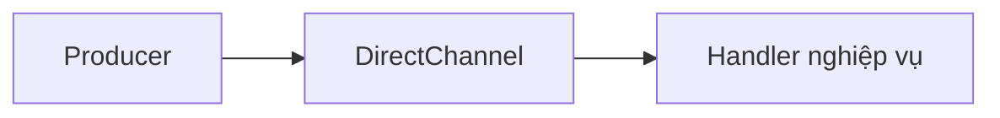
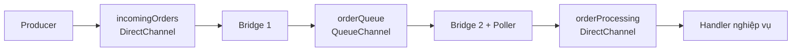
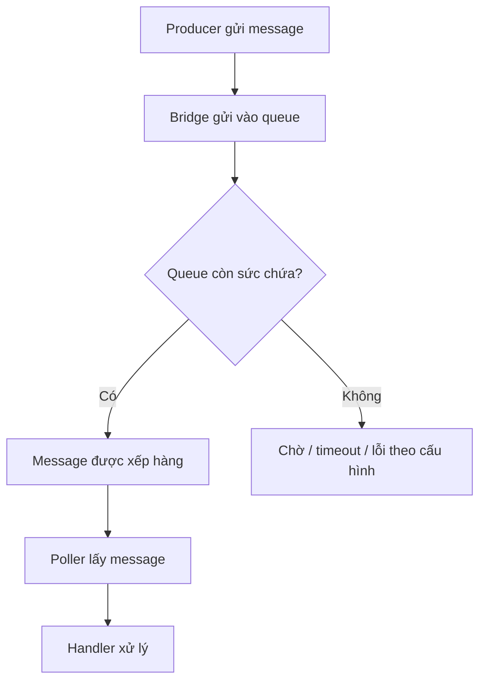
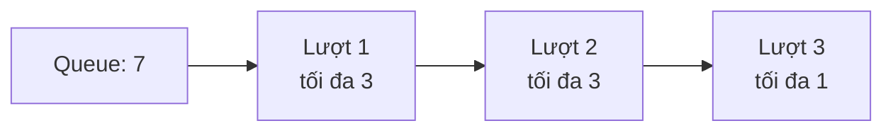
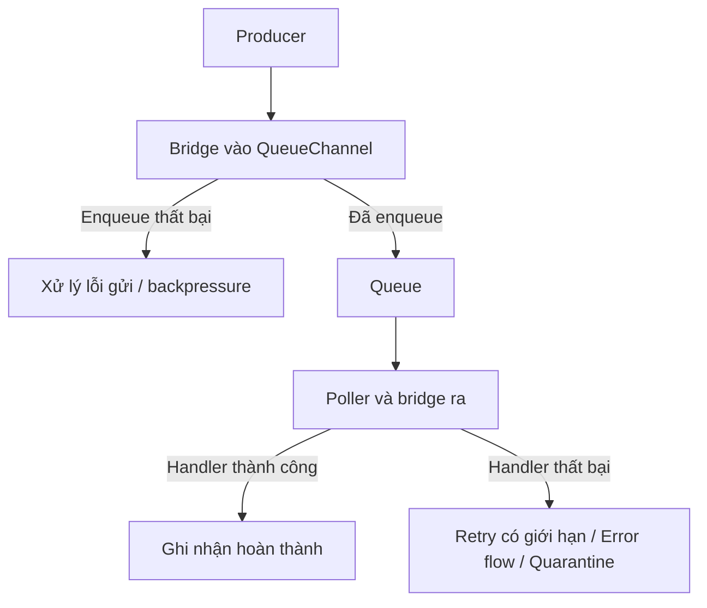

# Bridge qua queue và thay đổi semantics trong Spring Integration

## 1. Vì sao đặt queue giữa hai channel lại quan trọng?

Trong Enterprise Integration Patterns, **Message Bridge** nối hai kênh truyền message. Bản thân bridge thường chuyển tiếp payload và headers, không làm công việc chuyển đổi dữ liệu. Tuy nhiên, khi một trong hai channel là **`QueueChannel`**, cách toàn bộ luồng thực thi thay đổi đáng kể.

Xét hai cấu trúc:

**Luồng đồng bộ trực tiếp:**



**Luồng đi qua queue:**



Ở luồng đầu, producer gửi message qua `DirectChannel` và handler thường thực thi ngay trên **luồng gọi `send()`**. Ở luồng thứ hai, producer có thể hoàn tất thao tác **đưa message vào queue** trước khi handler thực sự bắt đầu. Một poller sau đó lấy message từ queue, bridge chuyển tiếp sang channel xử lý, và handler chạy trong ngữ cảnh của lượt polling.

Vì vậy, chủ đề **“Bridge qua queue và thay đổi semantics”** không chỉ nói về một đường nối giữa channel. Nó nói về **thay đổi hợp đồng thời gian và lỗi** của luồng thông điệp: khi nào gọi là đã nhận, khi nào thật sự hoàn thành, ai chịu trách nhiệm retry và backlog được quản lý ở đâu.

Bài học thuộc chương **Bridge** trong module **SPRING_INTEGRATION_PATTERN**. Các khái niệm này hỗ trợ xây dựng luồng EIP ít phụ thuộc, dễ mở rộng, có thể kết hợp Filter, Transformer, Router, Splitter, Aggregator, Gateway và các chiến lược retry/error channel/correlation.

### Kết quả học tập

Sau bài này, bạn có thể:

- Giải thích sự khác nhau giữa chuyển giao đồng bộ và chuyển giao qua `QueueChannel`.
- Cấu hình hai bridge để nối `DirectChannel → QueueChannel → DirectChannel` trong Spring Integration.
- Hiểu ý nghĩa của kết quả `send()` khi handler nghiệp vụ chạy sau một lượt polling.
- Thiết kế giới hạn queue, poller, thứ tự xử lý, error handling và idempotency.
- Lập kế hoạch kiểm thử các kịch bản lỗi và backlog khi đưa bridge qua queue vào sản xuất.

## 2. Message Bridge và QueueChannel thực hiện những trách nhiệm gì?

### 2.1. Bridge chuyển tiếp message

Bridge có đầu vào và đầu ra là các `MessageChannel`. Nó dùng message đầu vào để gửi đến channel đích mà không cần logic nghiệp vụ như parse JSON, xác thực đơn hàng hoặc phân nhánh. `BridgeHandler` là handler chuyên dụng trong Spring Integration; có thể cấu hình bridge bằng `@BridgeFrom`, `@BridgeTo`, Java DSL hoặc XML.

Đặt bridge trong flow không đồng nghĩa với tạo luồng xử lý mới. **Channel và cơ chế tiêu thụ channel** mới là yếu tố quyết định một đoạn flow chạy đồng bộ, phải polling hay được thực thi bằng executor.

### 2.2. QueueChannel lưu message cho bên nhận chủ động lấy ra

`QueueChannel` triển khai `PollableChannel`: producer có thể `send()` message vào queue, còn consumer gọi `receive()` để lấy message ra. Queue **không tự đẩy** message đến handler đã đăng ký như `DirectChannel`. Vì vậy, endpoint tiêu thụ `QueueChannel` thường cần **poller**.

`QueueChannel` mặc định được dùng làm hàng đợi nội bộ. Trong ví dụ với `new QueueChannel(20)`, queue có giới hạn 20 phần tử; không nên suy ra queue này có độ bền qua restart. Muốn lưu bền vững, phải thiết kế message store hoặc broker phù hợp và xác minh cơ chế giao dịch.

### 2.3. Cặp bridge ở hai phía của queue

Một phương án diễn đạt rõ ràng:

1. **Bridge 1:** nhận message từ `incomingOrders` là `DirectChannel`, gửi vào `orderQueue` là `QueueChannel`.
2. **Bridge 2:** dùng poller nhận message từ `orderQueue`, gửi tới `orderProcessing` là `DirectChannel`.
3. Handler nghiệp vụ subscribe vào `orderProcessing`.

Hai bridge không biến đổi payload. Phần “thay đổi semantics” đến từ việc `orderQueue` giữ message cho một thời điểm tiêu thụ khác và poller đặt ranh giới điều độ.

## 3. Những semantics thay đổi khi thêm queue

| Khía cạnh | `DirectChannel → Handler` | `DirectChannel → Bridge → QueueChannel → Bridge/Poller → Handler` |
| --- | --- | --- |
| **Thời điểm thực thi** | Handler thường chạy trong lời gọi `send()`. | Handler có thể chạy ở một lượt polling sau đó. |
| **Luồng thực thi** | Thường là thread của producer. | Handler phía sau thường chạy trên thread của poller. |
| **Ý nghĩa gửi thành công** | Với luồng đồng bộ, `send()` thường chỉ hoàn thành sau khi handler trở về. | Producer có thể chỉ biết message đã **được nhận vào queue**, chưa biết xử lý nghiệp vụ thành công. |
| **Lỗi handler** | Exception có thể lan trực tiếp về caller. | Exception xảy ra tại poller; không mặc định được trả lại caller đã gửi vào queue trước đó. |
| **Điều tiết tải** | Tải producer và consumer gắn chặt với nhau. | Queue tạo vùng đệm; poller và capacity ảnh hưởng backlog/throughput. |
| **Thứ tự** | Phụ thuộc channel và các handler trong flow. | Queue thường lấy theo thứ tự vào, nhưng thứ tự **hoàn thành** còn phụ thuộc số consumer/concurrency. |
| **Giao dịch** | Có thể cùng ngữ cảnh lời gọi nếu các thành phần tham gia đúng transaction. | Việc enqueue và xử lý sau polling có thể ở hai ngữ cảnh/giao dịch riêng. |
| **Độ bền** | Không có bảo đảm lưu bền chỉ từ `DirectChannel`. | `QueueChannel` bộ nhớ cũng không tự bảo đảm tồn tại qua crash hoặc restart. |

### 3.1. “Đã gửi” khác “đã xử lý thành công”

Với `DirectChannel` và handler đồng bộ, khi producer gửi message và không gặp exception, producer có thể đã quan sát được việc handler trả về. Dù vậy, điều này **không tự chứng minh** các side effect bên ngoài đã commit thành công nếu nghiệp vụ thực hiện thêm hành động bất đồng bộ.

Với `QueueChannel`, tình huống khác rõ hơn:

```text
T0  Producer send(order) tới incomingOrders
T1  Bridge 1 chuyển vào orderQueue
T2  send(order) của producer có thể hoàn thành
T3  Poller lấy order khỏi orderQueue
T4  Bridge 2 chuyển sang orderProcessing
T5  Handler ghi dữ liệu hoặc gọi dịch vụ bên ngoài
T6  Handler thành công hoặc thất bại
```

Giữa **T2** và **T6**, producer chưa có bằng chứng nghiệp vụ đã hoàn thành. Log “sent successfully” vì vậy nên được hiểu là **đã gửi/đã xếp hàng thành công**, không phải “đơn hàng đã xử lý”.

### 3.2. Bất đồng bộ theo thời gian, nhưng vẫn có những đoạn đồng bộ

Hệ thống qua queue có một ranh giới xử lý theo thời gian:

- Đoạn **producer → Bridge 1 → QueueChannel** có thể vẫn đồng bộ cho đến khi thao tác enqueue hoàn tất.
- Đoạn **poller → Bridge 2 → DirectChannel → handler** thường đồng bộ bên trong lượt polling.

Vì thế, lỗi handler có thể lan tới thread poller của **đoạn sau**, nhưng không còn lan trực tiếp về lời gọi `send()` đã kết thúc của **đoạn trước**.

Điều này khác với nhận định đơn giản rằng “mọi thứ qua queue đều chạy song song”. Số lượng thread, poller và consumer thực tế quyết định khả năng chạy song song.

### 3.3. Giới hạn vùng đệm và backpressure

Queue có dung lượng hữu hạn là một **bộ đệm**, không tạo thêm năng lực xử lý nghiệp vụ. Nếu message vào nhanh hơn tốc độ handler hoàn tất, backlog sẽ tăng đến giới hạn.

Khi queue đầy, thao tác gửi xuống queue có thể bị chặn, trả về thất bại hoặc phát sinh exception tùy timeout và đường gửi. Cần xác định rõ cách cấu hình timeout và cách producer phản ứng; timeout gọi vào một channel phía trước không mặc nhiên bảo đảm được áp dụng y hệt ở từng bước chuyển tiếp bên trong.



## 4. Ví dụ thực hành: DirectChannel → QueueChannel → DirectChannel

Giả sử ứng dụng nhận mã đơn hàng và đưa vào queue để xử lý theo đợt nhỏ. Ví dụ sử dụng Java 17+, Spring Boot 3.x và các API Spring Integration 6.x tương thích; khi dùng phiên bản mới hơn, hãy kiểm tra BOM và tài liệu API tương ứng với dự án.

### 4.1. Dependency Maven

```xml
<dependencies>
    <dependency>
        <groupId>org.springframework.boot</groupId>
        <artifactId>spring-boot-starter-integration</artifactId>
    </dependency>
</dependencies>
```

Đây là ví dụ về channel và endpoint nội bộ, nên chưa cần dependency cho File, Kafka, AMQP hoặc JDBC.

### 4.2. Cấu hình hai bridge bằng @BridgeFrom

Tạo lớp `BufferedBridgeConfiguration.java` trong package được Spring Boot quét:

```java
package com.example.integration;

import org.springframework.context.annotation.Bean;
import org.springframework.context.annotation.Configuration;
import org.springframework.integration.annotation.BridgeFrom;
import org.springframework.integration.annotation.Poller;
import org.springframework.integration.annotation.ServiceActivator;
import org.springframework.integration.channel.DirectChannel;
import org.springframework.integration.channel.QueueChannel;
import org.springframework.integration.config.EnableIntegration;
import org.springframework.messaging.MessageChannel;
import org.springframework.messaging.MessageHandler;
import org.springframework.messaging.PollableChannel;
import org.springframework.messaging.SubscribableChannel;

@Configuration
@EnableIntegration
public class BufferedBridgeConfiguration {

    // Producer gửi message vào đây.
    @Bean
    public MessageChannel incomingOrders() {
        return new DirectChannel();
    }

    // Bridge 1: incomingOrders -> orderQueue.
    @Bean
    @BridgeFrom("incomingOrders")
    public PollableChannel orderQueue() {
        return new QueueChannel(20);
    }

    // Bridge 2: orderQueue -> orderProcessing.
    @Bean
    @BridgeFrom(
        value = "orderQueue",
        poller = @Poller(fixedDelay = "1000", maxMessagesPerPoll = "3")
    )
    public SubscribableChannel orderProcessing() {
        return new DirectChannel();
    }

    @Bean
    @ServiceActivator(inputChannel = "orderProcessing")
    public MessageHandler handleOrder() {
        return message -> System.out.printf(
            "Processed payload=%s, correlationId=%s, thread=%s%n",
            message.getPayload(),
            message.getHeaders().get("correlationId"),
            Thread.currentThread().getName()
        );
    }
}
```

Trong ví dụ này:

- `incomingOrders` nhận message từ producer.
- Bridge 1 chuyển message nguyên dạng sang `orderQueue`. Queue có capacity 20 và là queue trong bộ nhớ.
- `@BridgeFrom` trên `orderProcessing` tạo bridge nhận từ queue qua poller. Poller chạy với độ trễ 1.000 ms và chuyển tối đa 3 message mỗi lượt.
- Handler trên `orderProcessing` xử lý message khi poller đã lấy message ra khỏi queue và chuyển sang `DirectChannel`.
- Header `correlationId` hỗ trợ theo dõi các bước. Bridge không phải thành phần phát sinh correlation ID theo nghiệp vụ; ví dụ tự gán header ở producer.

### 4.3. Tạo dữ liệu mẫu

Tạo lớp ứng dụng `BufferedBridgeApplication.java`:

```java
package com.example.integration;

import org.springframework.beans.factory.annotation.Qualifier;
import org.springframework.boot.CommandLineRunner;
import org.springframework.boot.SpringApplication;
import org.springframework.boot.autoconfigure.SpringBootApplication;
import org.springframework.context.annotation.Bean;
import org.springframework.messaging.MessageChannel;
import org.springframework.messaging.support.MessageBuilder;

@SpringBootApplication
public class BufferedBridgeApplication {

    public static void main(String[] args) {
        SpringApplication.run(BufferedBridgeApplication.class, args);
    }

    @Bean
    public CommandLineRunner submitOrders(
            @Qualifier("incomingOrders") MessageChannel input) {
        return args -> {
            for (int index = 1; index <= 7; index++) {
                String orderId = "ORDER-" + index;
                boolean accepted = input.send(
                    MessageBuilder.withPayload(orderId)
                        .setHeader("correlationId", "run-001")
                        .build()
                );

                System.out.printf(
                    "Sent order=%s, accepted=%s%n", orderId, accepted
                );
            }
        };
    }
}
```

Chạy `mvn spring-boot:run` trong một Maven project đã khai báo Spring Boot plugin, hoặc chạy trực tiếp lớp `BufferedBridgeApplication` từ IDE. Log quan sát được có dạng:

```text
Sent order=ORDER-1, accepted=true
Sent order=ORDER-2, accepted=true
...
Sent order=ORDER-7, accepted=true
Processed payload=ORDER-1, correlationId=run-001, thread=...
Processed payload=ORDER-2, correlationId=run-001, thread=...
...
```

Không nên dựa vào thứ tự tuyệt đối của **hai nhóm dòng log**. Poller có thể chạy xen kẽ với producer tùy lịch scheduler và tốc độ hệ thống. Với queue chưa có tải cạnh tranh và một consumer tuần tự, các message có thể được lấy ra theo thứ tự xếp hàng; nhưng thứ tự log toàn hệ thống không phải một cam kết về thời điểm xử lý.

### 4.4. Một bridge và một queue có đủ không?

Nếu producer gửi trực tiếp vào `QueueChannel`, ta có thể bỏ Bridge 1 và giữ bridge có poller đi ra channel xử lý. Nếu consumer có thể trực tiếp poll từ queue và không cần channel riêng, thậm chí có thể không cần Bridge 2.

Bài học dùng **hai bridge** để thể hiện rõ việc nối ba đoạn `DirectChannel → QueueChannel → DirectChannel` và trách nhiệm từng endpoint. Đừng thêm bridge chỉ để tăng số thành phần trong sơ đồ. Mỗi endpoint nên có vai trò điều tiết hoặc phân ranh giới rõ ràng.

## 5. Poller điều tiết tốc độ chuyển tiếp

Khi đọc queue, poller quyết định lịch và số message có thể được nhận trong mỗi lượt.

| Cấu hình | Ý nghĩa | Cần nhớ |
| --- | --- | --- |
| `fixedDelay = "1000"` | Đặt độ trễ 1.000 ms giữa các lượt thực thi polling. | Thời gian xử lý dài có thể làm lượt sau đến muộn. |
| `maxMessagesPerPoll = "3"` | Mỗi lần poll lấy tối đa 3 message. | Không có nghĩa là luôn xử lý đúng 3 message/giây. |
| `cron` | Kích hoạt ở những mốc lịch chỉ định. | Phù hợp với công việc theo thời điểm. |
| Executor / task scheduler | Ảnh hưởng thread chạy poller. | Concurrency tăng có thể thay đổi thứ tự hoàn thành và cách xử lý lỗi. |

Ví dụ queue có 7 message trước khi bắt đầu polling, không có message mới, không có lỗi và chỉ một poller đọc tuần tự:



Đây là minh họa cách đặt giới hạn **theo lượt**, không phải số liệu throughput bảo đảm. Nếu handler chậm hoặc downstream bị nghẽn, tốc độ thực tế có thể thấp hơn đáng kể.

Để tăng throughput, hãy đo thời gian xử lý, backlog, số consumer và độ trễ đầu cuối. Tăng `maxMessagesPerPoll` hoặc giảm `fixedDelay` không giúp ích nếu handler hoặc hệ thống đích đã đạt giới hạn.

## 6. Thay đổi semantics về thứ tự message

`QueueChannel` thông thường thực hiện hàng đợi FIFO cho các thao tác enqueue/dequeue. Nhưng **FIFO của queue không đồng nghĩa với hoàn tất nghiệp vụ đúng thứ tự** trong mọi cấu hình.

### Một poller và handler đồng bộ

Nếu chỉ một poller xử lý tuần tự qua `DirectChannel`, các message được lấy từ queue theo thứ tự nhận. Khi handler xử lý xong message trước rồi mới tiếp tục message sau, thứ tự hoàn thành thường phản ánh thứ tự lấy message.

### Nhiều consumer hoặc xử lý bất đồng bộ

Khi nhiều endpoint cùng poll từ queue, nhiều task chạy song song hoặc handler chuyển việc sang executor, message **ORDER-2** có thể hoàn thành trước **ORDER-1** dù được lấy sau. Queue vẫn có thể FIFO ở thời điểm dequeue, nhưng completion order khác.

Nếu nghiệp vụ bắt buộc xử lý theo thứ tự của từng khách hàng/đơn hàng, có thể cần chia partition theo khóa, hạn chế concurrency trên mỗi khóa hoặc cơ chế sequence/ordering riêng. Bridge không tự thực hiện các quy tắc này.

## 7. Thay đổi semantics về lỗi và transaction

### 7.1. Lỗi trước queue khác lỗi sau queue

Hãy phân biệt hai trường hợp:

**Lỗi ở đoạn producer → queue:** queue đầy, không thể gửi, channel không có subscriber hoặc bridge phát sinh lỗi khi enqueue. Caller có thể quan sát kết quả `send()` hoặc exception của chính lượt gửi, tùy cách cấu hình.

**Lỗi ở đoạn poller → handler:** message đã được lấy ra, sau đó parse thất bại, database lỗi hoặc dịch vụ downstream timeout. Producer của đoạn trước thường đã trở về; lỗi này cần được xử lý trong nhánh polling qua retry, error flow hoặc quy trình phục hồi tương ứng.



**Đừng đánh đồng** “queue đã nhận message” với “nghiệp vụ thành công”. Để phản hồi kết quả cuối cùng cho caller, cần thiết kế một kênh trả kết quả hoặc theo dõi trạng thái xử lý; khi cần request–reply đồng bộ, cân nhắc Gateway với timeout và correlation phù hợp.

### 7.2. Message rời queue có tự quay lại khi handler lỗi?

Không được giả định như vậy. Với queue trong bộ nhớ ở ví dụ, thao tác poll thường lấy message ra khỏi queue trước khi handler chạy. Bridge không tự áp dụng retry, hoàn tác side effect hoặc đẩy lại message thất bại.

Hành vi thực tế phụ thuộc kiểu queue/message store, transaction manager, poller advice, error handler và các thành phần downstream. Khi cần độ tin cậy, thiết kế rõ:

1. Lỗi tạm thời nào được retry, số lần và khoảng cách retry.
2. Lỗi vĩnh viễn nào chuyển sang dead-letter/quarantine kèm nguyên nhân.
3. Việc hoàn thành được ghi nhận ở đâu, và message xử lý lại có gây tác dụng phụ trùng không.
4. Khi ứng dụng chết giữa lúc poll và commit, phục hồi dữ liệu theo cơ chế nào.

Nếu cần retry có state và không làm mất dữ liệu, hãy kiểm chứng bằng thử nghiệm crash/restart với cơ chế lưu trữ và giao dịch thực tế. Chỉ thay `QueueChannel` cho `DirectChannel` không tạo ra at-least-once hay exactly-once.

### 7.3. Ngữ cảnh giao dịch và thread

Transaction gắn với thread hiện tại trong nhiều cách triển khai phổ biến. Khi producer gửi message vào queue và poller xử lý sau đó trên thread khác, transaction của producer thường không tự chuyển sang thread poller.

Tương tự, MDC, `ThreadLocal`, security context hoặc thông tin tracing gắn thread không tự động đi qua ranh giới này. Những giá trị cần cho handler nên được đưa vào **message headers hoặc payload** theo chính sách an toàn dữ liệu, hoặc được propagate bằng cơ chế tích hợp phù hợp.

Nếu bước xử lý cần transaction mới, cấu hình transaction advice/transaction manager quanh endpoint tiêu thụ và kiểm chứng phạm vi commit/rollback cụ thể.

## 8. Lập kế hoạch backpressure và năng lực phục vụ

Giả sử trung bình mỗi giây producer gửi 40 message, nhưng handler chỉ hoàn thành 25 message. Khi tốc độ trung bình ổn định như vậy, backlog tăng xấp xỉ **15 message mỗi giây** cho đến khi queue chạm capacity hoặc dòng vào giảm.

```text
Tốc độ vào trung bình      = 40 message/giây
Tốc độ xử lý hoàn thành    = 25 message/giây
Backlog tăng xấp xỉ       = 15 message/giây
```

Đây là phép tính minh họa trong điều kiện tốc độ trung bình giữ nguyên, không phải phép đo trong ví dụ Java.

Với queue capacity 20, không thể hấp thụ mức chênh lệch dài hạn. Cần xử lý bằng cách tăng năng lực downstream, giảm lưu lượng vào, điều chỉnh lịch polling, áp dụng chính sách từ chối/chờ hoặc dùng cơ chế buffer bền vững được thiết kế đúng nhu cầu.

### Những chỉ số nên đo

- Số message enqueue thành công và thất bại.
- Queue depth/backlog hiện tại và thời gian message chờ trước khi dequeue.
- Số message handler bắt đầu, xử lý thành công, thất bại.
- Thời gian từ lúc producer gửi đến khi handler hoàn tất.
- Số lượt polling rỗng, lượt polling lỗi, retry và message chuyển sang khu vực lỗi.
- Tần suất queue đầy và độ trễ gửi của producer.

Khi giám sát, thống nhất cách định nghĩa **accepted**, **started**, **completed** và **failed** để metric không gây hiểu nhầm.

## 9. Phân biệt bridge qua queue với các EIP liên quan

| Bài toán | Pattern hoặc thành phần phù hợp | Giải thích |
| --- | --- | --- |
| Tách nhịp producer và consumer | **Message Bridge + QueueChannel + Poller** | Đổi thời điểm chuyển giao giữa hai đoạn flow. |
| Chuyển JSON thành `Order` | **Transformer** | Thay đổi payload/schema. |
| Chỉ cho đơn hợp lệ đi qua | **Filter** | Quyết định message có đi tiếp hay bị loại. |
| Chia xử lý theo loại đơn | **Router** | Chọn nhánh/channel đích. |
| Chia đơn thành các mục và gom kết quả | **Splitter / Aggregator** | Cần correlation/sequence, timeout và completion strategy. |
| Giao tiếp cần kết quả trả lại cho người gọi | **Gateway** | Có request–reply, timeout và reply channel. |
| Nhận/gửi dữ liệu từ hệ thống ngoài | **Inbound/Outbound Channel Adapter** | Kết nối ranh giới giao thức bên ngoài. |

Bridge có thể giúp các đoạn flow dùng cùng một kiểu message liên kết với nhau. Nếu hai bên chưa tương thích về payload hoặc headers, cần Transformer hoặc một endpoint chuyên trách; bridge không phải cơ chế chuyển đổi schema.

## 10. Kiểm thử semantics trước và sau khi thêm queue

Đừng chỉ kiểm tra “message cuối cùng có đến handler hay không”. Cần kiểm thử **thay đổi về thời điểm, lỗi và trạng thái**.

### 10.1. Kịch bản nên có

| Kịch bản | Điều cần xác minh |
| --- | --- |
| Một message hợp lệ | Handler nhận đúng payload và header `correlationId`. |
| Nhiều message hơn `maxMessagesPerPoll` | Message được chuyển qua nhiều lượt polling; queue được rút dần. |
| Producer gửi rồi handler chưa chạy | Trạng thái “accepted/queued” được phân biệt với “completed”. |
| Handler chậm | Backlog và độ trễ tăng; producer có thể tiếp tục gửi đến giới hạn capacity. |
| Queue đầy | Có kết quả lỗi/timeout hoặc chính sách chờ phù hợp; producer không im lặng làm mất message. |
| Handler ném exception | Error flow và retry được quan sát ở nhánh poller; không kỳ vọng producer đã trở về nhận exception đó. |
| Khởi động lại ứng dụng | Với queue trong bộ nhớ, không giả định message chưa xử lý được lưu giữ. |
| Hai consumer song song | Xác minh thứ tự dequeue và thứ tự hoàn thành theo yêu cầu nghiệp vụ. |

### 10.2. Gợi ý kiểm thử tích hợp

Có thể sử dụng Spring Boot Test kết hợp Spring Integration Test, `CountDownLatch`, một probe handler hoặc channel kiểm thử để quan sát message được lấy khỏi queue. Với thử nghiệm đo lỗi và concurrency, dùng latch hoặc điều kiện chờ có timeout rõ ràng thay vì `Thread.sleep()` cố định rồi giả định poller đã chạy.

Một chiến lược có ích là ghi sự kiện vào bộ thu thập test khi:

1. Producer gọi `send()` xong.
2. Handler bắt đầu.
3. Handler hoàn tất hoặc ném lỗi.

Từ ba mốc này, test có thể phát hiện luồng đã đổi từ xử lý đồng bộ sang xử lý sau polling và kiểm tra trạng thái nghiệp vụ chính xác.

## 11. Những nhầm lẫn thường gặp

**“Đặt queue vào giữa nghĩa là message đã bền vững.”** `QueueChannel` lưu trong bộ nhớ không mặc định survive khi ứng dụng chết. Muốn durability phải thiết kế và kiểm thử tầng lưu trữ thích hợp.

**“`send()` trả về `true` tức xử lý nghiệp vụ thành công.”** Với queue, điều đó có thể chỉ xác nhận việc gửi/chuyển giao tới vùng đệm. Handler có thể chưa chạy hoặc chạy thất bại sau đó.

**“Bridge tự retry message khi handler lỗi.”** Bridge chuyển tiếp message. Retry và recovery phải được cấu hình riêng cùng chính sách nhận diện lỗi và idempotency.

**“Queue luôn giữ được thứ tự xử lý.”** FIFO của dequeue chưa đảm bảo thứ tự hoàn thành nếu nhiều consumer hoặc có bước bất đồng bộ.

**“Thêm queue chắc chắn tăng throughput.”** Queue chỉ hấp thụ chênh lệch tải tạm thời. Throughput lâu dài phụ thuộc năng lực xử lý và tài nguyên downstream.

**“Poller cứ đặt nhanh nhất có thể.”** Polling quá dày tạo nhiều lượt rỗng hoặc tăng áp lực xuống hệ thống; nên chọn tần suất dựa trên độ trễ cho phép và tốc độ xử lý đo được.

## 12. Tự kiểm tra kiến thức

1. Với `DirectChannel → Bridge → QueueChannel → Bridge/Poller → DirectChannel`, lệnh gửi của producer và handler chạy trên cùng thread hay có thể khác thread? Vì sao?
2. Khi `send()` trả về thành công nhưng handler thất bại ở lượt polling sau, ứng dụng nên biểu diễn hai trạng thái đó như thế nào?
3. Một queue có capacity 20 mà tốc độ vào luôn lớn hơn tốc độ xử lý thì điều gì sẽ xảy ra? Những chiến lược ứng phó nào khả thi?
4. Nếu hệ thống cần đảm bảo các đơn hàng của cùng một khách hàng được xử lý theo đúng thứ tự, cần kiểm soát những điểm nào ngoài bản thân `QueueChannel`?
5. Vì sao bridge qua queue không thay thế cho Transformer, Gateway hoặc retry policy?

**Ghi nhớ:** Bridge qua queue tạo **ranh giới về thời điểm xử lý**, đồng thời ảnh hưởng cách lỗi, transaction, thứ tự và backpressure được quan sát. Khi thiết kế luồng Spring Integration, hãy định nghĩa rõ ý nghĩa “đã nhận”, “đang xử lý” và “đã hoàn thành”, rồi chọn channel, poller và cơ chế phục hồi tương ứng.

**Tài liệu tham khảo:** [Spring Integration Reference — Messaging Bridge](https://docs.spring.io/spring-integration/reference/bridge.html), [Spring Integration Reference — Message Channels](https://docs.spring.io/spring-integration/reference/channel.html).
