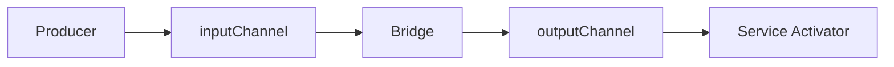
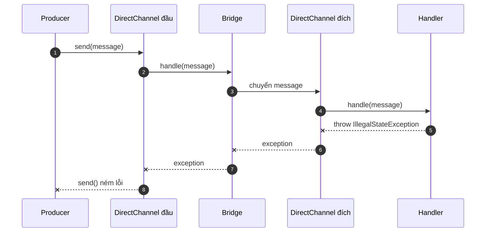
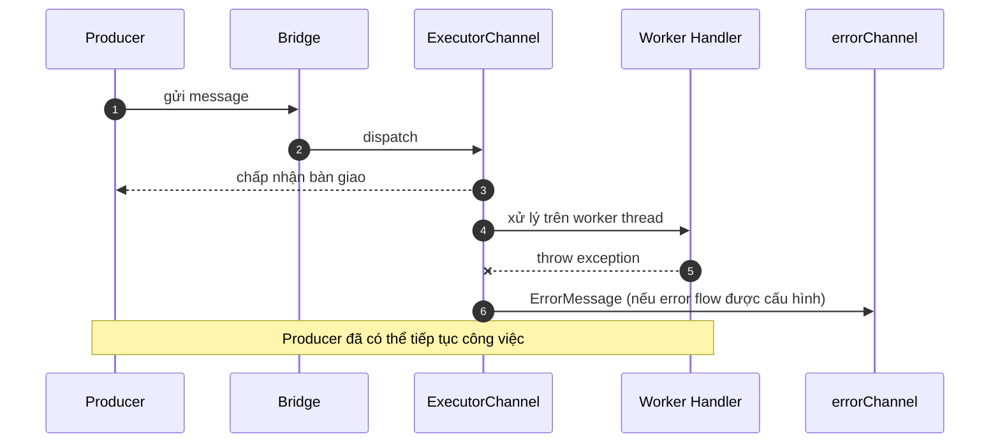
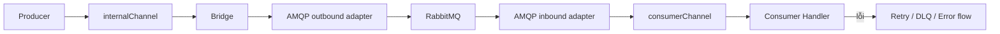

# Bridge error propagation trong Spring Integration

## Mục tiêu bài học

Sau bài này, bạn có thể:

- Giải thích cách **Bridge** chuyển message giữa hai channel và vì sao đường đi của **exception** phụ thuộc vào kiểu channel và ranh giới đồng bộ/bất đồng bộ.
- Phân biệt lỗi khi **gửi vào channel**, lỗi của **handler phía sau Bridge**, lỗi khi **đợi reply** và lỗi sau khi message đã ra broker.
- Dự đoán khi nào bên gửi nhận exception trực tiếp, khi nào lỗi được biểu diễn thành `ErrorMessage` trên `errorChannel` và khi nào caller chỉ thấy timeout.
- Viết một ví dụ Java Spring Integration với `DirectChannel`, `ExecutorChannel`, `IntegrationFlow.bridge()`, `@ServiceActivator` và kênh lỗi tường minh.
- Kiểm thử riêng hành vi báo lỗi đồng bộ và chuyển lỗi bất đồng bộ, kể cả việc giữ khóa `requestId` để đối soát.
- Thiết kế retry, idempotency, correlation, giám sát và xử lý lỗi khi Bridge nối tới một adapter/broker.

Bài học thuộc chương **Bridge** của mô-đun **SPRING_INTEGRATION_PATTERN**. Mô-đun thực hành các *Enterprise Integration Patterns* bằng Spring Integration để xây dựng luồng thông điệp ít phụ thuộc, dễ mở rộng. Khi các flow kết hợp Router, Filter, Transformer, Splitter, Aggregator, Gateway, retry, error channel và correlation, hiểu cách lỗi đi qua một Bridge là điều kiện để xử lý thất bại đúng nơi, không để caller chờ vô hạn hoặc làm mất thông tin truy vết.

## 1. Bridge chuyển message; ai chịu trách nhiệm chuyển lỗi?

**Bridge pattern** kết nối một channel nguồn với một channel đích mà không yêu cầu biến đổi payload theo nghiệp vụ. Trong Spring Integration, `BridgeHandler` là endpoint chuyển tiếp; khi dùng Java DSL, ta thường khai báo `.bridge()`.



Về mặt nghiệp vụ, Bridge thường “trong suốt”: handler đích nhận nội dung request do producer gửi. Nhưng khi xảy ra lỗi, không thể suy luận đơn giản rằng “Bridge sẽ chuyển exception theo đúng chiều ngược lại”. Điều quyết định là **lỗi xảy ra trên thread nào**, **thao tác gửi đã hoàn tất hay chưa**, và **endpoint/channel có cấu hình xử lý lỗi hay không**.

Hãy đặt bốn câu hỏi:

1. Exception phát sinh **ngay trong lời gọi `send()`** hay sau khi message được bàn giao sang worker khác?
2. Channel đích là `DirectChannel`, `QueueChannel`, `ExecutorChannel` hay một adapter tới broker?
3. Message có `errorChannel` hợp lệ, hay có luồng lỗi mặc định được cấu hình không?
4. Caller có cần **reply nghiệp vụ** hay chỉ quan tâm message đã được tiếp nhận?

**Bridge không phải cơ chế retry, dead-letter, rollback hoặc bảo đảm gửi thành công xuyên hệ thống.** Các trách nhiệm đó phải được cấu hình tại handler, channel, adapter, transaction và broker theo từng ranh giới cụ thể.

## 2. Ba đường lỗi cần phân biệt

| Đường đi | Khi lỗi xảy ra | Bên gửi thường nhìn thấy | Ai xử lý tiếp |
| --- | --- | --- | --- |
| **Đồng bộ:** `DirectChannel → Bridge → DirectChannel` | Handler đích ném exception trong cùng call stack | `send()` có thể ném exception, thường có wrapper từ Spring Messaging/Integration | Caller hoặc error handling bao ngoài điểm gọi |
| **Bất đồng bộ:** `DirectChannel → Bridge → ExecutorChannel` | Handler chạy trên worker và ném exception sau khi đã bàn giao | `send()` có thể đã trả thành công; exception không tự quay về thread producer | Error flow dùng `errorChannel`, hoặc cơ chế xử lý lỗi của executor/channel |
| **Có broker:** `Bridge → outbound adapter → broker → consumer` | Publish thất bại, consumer xử lý lỗi hoặc reply thất lạc | Phụ thuộc giai đoạn: lỗi publish trực tiếp, nack/confirm, event lỗi hoặc timeout | Adapter, broker, retry/dead-letter, consumer và hợp đồng request–reply |

### 2.1. Đồng bộ: exception có thể đi ngược về `send()`



`DirectChannel` gọi subscriber đồng bộ trên thread của người gửi. Nếu handler phía sau Bridge ném lỗi, exception có thể lan trở lại caller trong cùng call stack, có thể được bọc dưới `MessageHandlingException` hoặc `MessageDeliveryException` tùy vị trí và cách dispatch.

Lỗi **không mặc nhiên biến thành `ErrorMessage`** trên global `errorChannel` chỉ vì ứng dụng có khai báo kênh lỗi. Để xử lý đồng bộ, caller thường phải bắt exception hoặc đặt cơ chế advice/error handling phù hợp ở điểm tiếp nhận.

### 2.2. Bất đồng bộ: lỗi thuộc vòng đời của worker



Với `ExecutorChannel`, lỗi từ handler có thể được chuyển thành `ErrorMessage` tới channel được chỉ định bởi header `MessageHeaders.ERROR_CHANNEL` hoặc cơ chế error channel mặc định theo cấu hình. Nếu không có nơi tiếp nhận hợp lệ, lỗi có thể được ghi log hoặc thất bại trên worker mà caller không nhận được phản hồi nghiệp vụ.

**Đừng nhầm “đã gửi thành công” với “đã xử lý thành công”.** `send()` thành công trên ranh giới bất đồng bộ thường chỉ chứng minh message đã được chấp nhận để dispatch; handler thực tế có thể thất bại ngay sau đó.

### 2.3. Lỗi khi gửi khác lỗi khi xử lý

Ngay cả khi handler chưa chạy, việc chuyển tiếp qua Bridge vẫn có thể thất bại:

- Channel đích là `DirectChannel` nhưng không có subscriber phù hợp.
- `QueueChannel` hữu hạn đã đầy hoặc vượt timeout chờ gửi.
- `ExecutorChannel` không thể nộp công việc vì executor từ chối khi quá tải.
- Adapter đích không thể kết nối, serialize payload hoặc publish message tới broker.

Các lỗi **phát sinh ngay trong lúc dispatch** có thể xuất hiện trên thread gửi. Một số lỗi sau khi bàn giao mới xuất hiện trong error flow hoặc trạng thái của hệ thống ngoài. Vì vậy, cần đo **send/dispatch failure** tách với **handler failure**.

## 3. Ví dụ Java: hai Bridge giống nhau, hai đường báo lỗi khác nhau

Ví dụ dùng **Java 17+, Spring Boot 3.x và Spring Integration 6.x**. Các `public` class/record đặt trong file Java riêng, cùng package được Spring Boot quét. Cần dependency Spring Integration và Spring Boot Test. Mục tiêu là quan sát ranh giới thread; không cần HTTP service, RabbitMQ hoặc database.

### 3.1. Hợp đồng công việc

```java
// WorkItem.java
public record WorkItem(
        String requestId,
        boolean simulateFailure
) {}
```

`requestId` là khóa nghiệp vụ do producer cung cấp để đối soát trong log và error flow. Nó khác với `MessageHeaders.ID` hoặc correlation ID dùng cho Splitter/Aggregator.

### 3.2. Cấu hình hai flow và một kênh nhận lỗi

```java
// BridgeErrorConfiguration.java
import org.springframework.beans.factory.annotation.Qualifier;
import org.springframework.context.annotation.Bean;
import org.springframework.context.annotation.Configuration;
import org.springframework.integration.channel.DirectChannel;
import org.springframework.integration.channel.ExecutorChannel;
import org.springframework.integration.channel.QueueChannel;
import org.springframework.integration.config.EnableIntegration;
import org.springframework.integration.dsl.IntegrationFlow;
import org.springframework.messaging.MessageChannel;
import org.springframework.scheduling.concurrent.ThreadPoolTaskExecutor;

@Configuration
@EnableIntegration
public class BridgeErrorConfiguration {

    @Bean("syncIngress")
    public MessageChannel syncIngress() {
        return new DirectChannel();
    }

    @Bean("syncWork")
    public MessageChannel syncWork() {
        return new DirectChannel();
    }

    @Bean
    public IntegrationFlow syncBridgeFlow() {
        return IntegrationFlow.from("syncIngress")
            .bridge()
            .channel("syncWork")
            .get();
    }

    @Bean("bridgeExecutor")
    public ThreadPoolTaskExecutor bridgeExecutor() {
        ThreadPoolTaskExecutor executor = new ThreadPoolTaskExecutor();
        executor.setCorePoolSize(2);
        executor.setMaxPoolSize(4);
        executor.setQueueCapacity(20);
        executor.setThreadNamePrefix("bridge-errors-");
        return executor;
    }

    @Bean("asyncIngress")
    public MessageChannel asyncIngress() {
        return new DirectChannel();
    }

    @Bean("asyncWork")
    public MessageChannel asyncWork(
            @Qualifier("bridgeExecutor") ThreadPoolTaskExecutor executor) {
        return new ExecutorChannel(executor);
    }

    @Bean
    public IntegrationFlow asyncBridgeFlow() {
        return IntegrationFlow.from("asyncIngress")
            .bridge()
            .channel("asyncWork")
            .get();
    }

    @Bean("bridgeErrorInbox")
    public QueueChannel bridgeErrorInbox() {
        // Inbox trong bộ nhớ để test chủ động nhận ErrorMessage.
        return new QueueChannel(20);
    }
}
```

Ở đây có hai flow **độc lập**:

- `syncIngress → Bridge → syncWork`: cả hai channel đều đồng bộ.
- `asyncIngress → Bridge → asyncWork`: Bridge vẫn chạy trên thread gửi, nhưng `asyncWork` bàn giao message sang executor.

`bridgeErrorInbox` là `QueueChannel` dành riêng cho ví dụ/test. Đưa lỗi vào queue trong bộ nhớ không tạo ra durable error store; khi triển khai thật cần một consumer xử lý lỗi, lưu audit hoặc một hạ tầng thông điệp bền nếu nghiệp vụ yêu cầu.

### 3.3. Hai Service Activator tạo lỗi có kiểm soát

```java
// WorkHandlers.java
import org.springframework.integration.annotation.ServiceActivator;
import org.springframework.stereotype.Component;

@Component
public class WorkHandlers {

    @ServiceActivator(inputChannel = "syncWork")
    public void processSync(WorkItem item) {
        if (item.simulateFailure()) {
            throw new IllegalStateException(
                "SYNC_BUSINESS_FAILURE id=" + item.requestId());
        }
        // Xử lý thành công theo hợp đồng one-way.
    }

    @ServiceActivator(inputChannel = "asyncWork")
    public void processAsync(WorkItem item) {
        if (item.simulateFailure()) {
            throw new IllegalStateException(
                "ASYNC_BUSINESS_FAILURE id=" + item.requestId());
        }
        // Xử lý thành công theo hợp đồng one-way.
    }
}
```

Hai handler đều cố ý ném `IllegalStateException` khi `simulateFailure=true`. Lỗi trong business handler giống nhau; **cách caller quan sát lỗi khác nhau vì channel đích khác nhau**.

### 3.4. Producer gửi message và chỉ định error channel

```java
// WorkPublisher.java
import org.springframework.beans.factory.annotation.Qualifier;
import org.springframework.integration.channel.QueueChannel;
import org.springframework.messaging.MessageChannel;
import org.springframework.messaging.MessageHeaders;
import org.springframework.messaging.support.MessageBuilder;
import org.springframework.stereotype.Component;

@Component
public class WorkPublisher {
    private final MessageChannel syncIngress;
    private final MessageChannel asyncIngress;
    private final QueueChannel bridgeErrorInbox;

    public WorkPublisher(
            @Qualifier("syncIngress") MessageChannel syncIngress,
            @Qualifier("asyncIngress") MessageChannel asyncIngress,
            @Qualifier("bridgeErrorInbox") QueueChannel bridgeErrorInbox) {
        this.syncIngress = syncIngress;
        this.asyncIngress = asyncIngress;
        this.bridgeErrorInbox = bridgeErrorInbox;
    }

    public boolean publishSync(String requestId) {
        return syncIngress.send(
            MessageBuilder.withPayload(new WorkItem(requestId, true))
                .setHeader("requestId", requestId)
                .build()
        );
    }

    public boolean publishAsync(String requestId) {
        return asyncIngress.send(
            MessageBuilder.withPayload(new WorkItem(requestId, true))
                .setHeader("requestId", requestId)
                .setHeader(
                    MessageHeaders.ERROR_CHANNEL, bridgeErrorInbox)
                .build()
        );
    }
}
```

`publishSync(...)` thường không trả một boolean thành công khi handler ném lỗi, vì `send()` sẽ ném exception. `publishAsync(...)` có thể trả `true` sau khi message được giao cho executor; exception của handler sẽ được xử lý qua đường lỗi bất đồng bộ.

Header `MessageHeaders.ERROR_CHANNEL` trong ví dụ chứa một `MessageChannel` object vì hai đầu chạy **trong cùng JVM**. Không lấy object Java này gửi nguyên trạng qua RabbitMQ/Kafka/JMS; khi vượt process, phải dùng định danh lỗi hoặc reply destination theo adapter/giao thức.

## 4. Kiểm thử lỗi đồng bộ

Một test tích hợp có thể chứng minh exception của handler phía sau Bridge đến được nơi gọi `send()`.

```java
// BridgeErrorFlowTest.java (phần test đồng bộ)
import static org.assertj.core.api.Assertions.assertThat;
import static org.assertj.core.api.Assertions.catchThrowable;

import org.junit.jupiter.api.Test;
import org.springframework.beans.factory.annotation.Autowired;
import org.springframework.boot.test.context.SpringBootTest;

@SpringBootTest
class BridgeErrorFlowTest {
    @Autowired
    private WorkPublisher publisher;

    private static Throwable deepestCause(Throwable error) {
        Throwable current = error;
        while (current.getCause() != null && current.getCause() != current) {
            current = current.getCause();
        }
        return current;
    }

    @Test
    void syncBridgePropagatesDownstreamFailureToSender() {
        Throwable thrown = catchThrowable(() ->
            publisher.publishSync("SYNC-101"));

        assertThat(thrown).isNotNull();
        assertThat(deepestCause(thrown))
            .isInstanceOf(IllegalStateException.class)
            .hasMessageContaining("SYNC_BUSINESS_FAILURE");
    }
}
```

Đây là một kiểm tra có ý nghĩa: lỗi phát sinh tại `WorkHandlers.processSync` nhưng nơi gọi `WorkPublisher.publishSync` vẫn quan sát được. Test kiểm tra nguyên nhân sâu nhất thay vì yêu cầu đúng một loại wrapper, vì framework có thể bọc exception khi dispatch message.

**Nếu bạn đổi `syncWork` thành `ExecutorChannel`**, kỳ vọng “exception ném trực tiếp về caller” không còn phù hợp. Trong trường hợp ấy phải kiểm tra `ErrorMessage` hoặc một tín hiệu hoàn tất bất đồng bộ.

## 5. Kiểm thử lỗi bất đồng bộ qua error channel

Với `asyncWork`, test phải chờ **thông báo lỗi** trên `bridgeErrorInbox`, thay vì kỳ vọng `publishAsync(...)` ném cùng exception của handler.

Thêm các import sau vào file `BridgeErrorFlowTest.java` ở phần 4:

```java
import org.springframework.beans.factory.annotation.Qualifier;
import org.springframework.integration.channel.QueueChannel;
import org.springframework.messaging.Message;
import org.springframework.messaging.support.ErrorMessage;
```

Và thêm field cùng phương thức kiểm thử vào chính class test đó:

```java
@Autowired
@Qualifier("bridgeErrorInbox")
private QueueChannel bridgeErrorInbox;

@Test
void asyncBridgePublishesFailureAsErrorMessage() {
    // Đặt trước khi publish để giảm nguy cơ test đọc nhầm lỗi cũ.
    boolean accepted = publisher.publishAsync("ASYNC-101");
    assertThat(accepted).isTrue();

    Message<?> error = bridgeErrorInbox.receive(5_000);

    assertThat(error).isInstanceOf(ErrorMessage.class);
    Throwable failure = ((ErrorMessage) error).getPayload();
    assertThat(deepestCause(failure))
        .isInstanceOf(IllegalStateException.class)
        .hasMessageContaining("ASYNC_BUSINESS_FAILURE");
}
```

**Điều được xác minh:** lời gọi gửi vào `asyncIngress` được chấp nhận và một lỗi xử lý của worker được chuyển tới error channel đã chỉ định. Test không đòi hỏi handler kịp chạy trước khi `send()` trả về và cũng không tuyên bố rằng việc đưa lỗi vào queue đảm bảo lưu trữ bền.

Đối với test chạy song song hoặc context có nhiều producer, thay queue dùng chung bằng **error channel riêng cho từng message** hoặc lọc/kiểm tra `requestId` của failed message trước khi assert. Không dựa vào “ErrorMessage đầu tiên trong queue luôn thuộc test hiện tại” nếu nhiều test có thể phát lỗi đồng thời.

### 5.1. ErrorMessage chứa gì?

Khi Spring Integration gửi lỗi tới error channel, thông điệp thường là một `ErrorMessage` chứa một `Throwable` làm payload; Throwable có thể là `MessagingException`/`MessageHandlingException` mang thông tin **failed message**. Tùy đường lỗi, `ErrorMessage` cũng có thể chứa original message.

Khi xử lý lỗi, nên khai thác ít nhất:

| Dữ kiện | Ý nghĩa |
| --- | --- |
| Root cause / exception type | Phân loại lỗi nghiệp vụ, I/O, timeout, chuyển đổi dữ liệu |
| Failed message / original message nếu có | Tìm request đã thất bại |
| `requestId` hoặc operation ID nghiệp vụ | Liên hệ với log, audit và kết quả trước đó |
| Endpoint/channel name | Biết lỗi ở Bridge, channel dispatch hay handler |
| Attempt count, deadline | Phân biệt lỗi có thể retry và lỗi đã hết hạn |
| Trace ID | Theo dõi message qua nhiều endpoint hoặc ứng dụng |

Đừng giả định mọi `ErrorMessage` đều chứa một failed message ở cùng vị trí; trường hợp gửi thất bại trước khi một endpoint nhận message có thể có hình dạng exception khác với trường hợp Service Activator đã chạy. Error handler nên kiểm tra kiểu và null một cách an toàn.

## 6. Khi không cấu hình error channel thì sao?

Spring Integration có **global `errorChannel`** trong những cấu hình chuẩn, nhưng việc một exception được gửi tới đó còn phụ thuộc endpoint và ranh giới bất đồng bộ. Các kịch bản thường gặp:

| Trường hợp | Hành vi cần dự kiến |
| --- | --- |
| `DirectChannel` với handler ném exception | Exception lan theo call stack; global error channel không tự bắt mọi exception |
| `ExecutorChannel` với errorChannel header hợp lệ | Có thể phát `ErrorMessage` tới kênh đã chỉ định |
| `ExecutorChannel` không có errorChannel header | Cơ chế mặc định có thể định tuyến về global `errorChannel` khi được cấu hình; cần đảm bảo có subscriber quan sát |
| `QueueChannel` cùng polling consumer | Lỗi xuất hiện trong lượt poll; sử dụng error handling của poller/endpoint tương ứng |
| Handler bắt lỗi và trả kết quả thất bại | Không còn exception chưa xử lý để error channel tự nhận; cần quy ước kết quả rõ ràng |
| Error handler tự ném exception | Lỗi xử lý lỗi có thể bị ghi log, bubble hoặc gây vòng lặp tùy cách cấu hình |

Nếu đặt một global error channel nhưng không có handler xử lý, hệ thống có thể chỉ ghi nhận lỗi trong log hoặc làm mất tín hiệu nghiệp vụ cho caller. Khi cần vận hành ổn định, cần **một đường xử lý lỗi có người tiêu thụ**, ví dụ ghi audit, cập nhật trạng thái job và phát cảnh báo, kèm chính sách giữ lỗi có thời hạn.

### 6.1. Ví dụ error consumer thay cho queue quan sát

Một ứng dụng thực tế có thể định tuyến error message đến channel và Service Activator riêng:

```java
// Ví dụ độc lập với bridgeErrorInbox dùng trong test.
import org.springframework.integration.annotation.ServiceActivator;
import org.springframework.messaging.support.ErrorMessage;
import org.springframework.stereotype.Component;

@Component
public class BridgeErrorLogger {
    @ServiceActivator(inputChannel = "operationalErrors")
    public void handle(ErrorMessage error) {
        Throwable failure = error.getPayload();
        // Phân loại failure, trích requestId nếu còn trong
        // failed/original message, ghi audit/metric và quyết định retry.
        System.err.println(
            "Bridge downstream failure: " + failure.getClass().getName());
    }
}
```

Phần này giả định đã cấu hình `operationalErrors` là một channel và định tuyến lỗi của message/endpoint về đó. In ra stderr **chỉ minh họa vị trí xử lý lỗi**, không phải một hệ thống audit hay retry production. Nếu lỗi cần trả về caller, error handler phải cung cấp **hợp đồng phản hồi** phù hợp thay vì chỉ log.

## 7. Bridge trong request–reply: lỗi không được phép thành một timeout khó hiểu

Một Gateway đang chờ reply có thể đi qua Bridge:

```text
API caller -> Messaging Gateway -> requestChannel
                                   |
                                 Bridge
                                   |
                               workChannel
                                   |
                           Service Activator
                                   |
                              replyChannel
                                   |
                             Gateway -> caller
```

Nếu handler đồng bộ ném exception, Gateway có thể thấy lỗi ngay trong đường gọi. Nếu ranh giới sau Bridge là bất đồng bộ, lỗi từ worker cần được đưa về đúng **error/reply contract**; nếu chỉ log hoặc gửi tới một kênh lỗi không liên hệ được request, Gateway có thể đợi đến `replyTimeout`.

Một request có thể có:

- `replyChannel`: nơi nhận **kết quả nghiệp vụ**.
- `errorChannel`: nơi nhận **lỗi kỹ thuật** nếu error flow hỗ trợ.
- `requestId`: khóa do ứng dụng tạo, dùng để đối soát và truy vết.
- `correlationId`: khóa liên hệ trong những luồng cần ghép message, ví dụ Splitter/Aggregator hoặc broker RPC.

Các trường này **không thay thế nhau**. Bridge có thể chuyển tiếp header trong cùng process; khi tự dựng lại message hoặc dùng adapter sang broker, phải quyết định header nào được bảo toàn và ánh xạ sang định dạng transport nào.

### 7.1. “Lỗi rồi không có reply” cần một chính sách rõ

Giả sử hệ thống có Filter sau Bridge và message bị loại. Nếu caller đang chờ reply, không có handler nào trả kết quả có thể khiến Gateway timeout dù chẳng có exception. Tương tự, một Router đưa message vào nhánh không có consumer hoặc một Aggregator không bao giờ nhận đủ các phần tử có thể gây timeout.

Một hợp đồng tốt xác định các kết quả:

| Kết quả | Caller/API nhận gì? |
| --- | --- |
| Thành công | Reply payload tương ứng với request |
| Lỗi nghiệp vụ dự đoán được | Reply lỗi có cấu trúc, ví dụ `INVALID_ORDER` |
| Lỗi hạ tầng có thể phục hồi | Retry có giới hạn hoặc reply lỗi rõ ràng |
| Không nhận reply trước deadline | Timeout có request ID để tra cứu/đối soát |
| Reply đến sau khi caller hết hạn | Xử lý late reply; không ghép sang request tiếp theo |

Không để một error flow tiêu thụ mọi exception rồi chỉ ghi log nếu nghiệp vụ đã hứa **mỗi request phải kết thúc bằng một trạng thái rõ ràng**.

## 8. Bridge qua broker: lỗi publish và lỗi xử lý là hai hợp đồng riêng

Khi Bridge được dùng để nối đến outbound adapter, nó vẫn chỉ chuyển message trong Spring Integration:



Lúc này phải phân biệt:

1. **Lỗi trước hoặc trong publish:** adapter không thể serialize payload, kết nối tới broker hoặc nhận kết quả publish theo cơ chế confirm đã chọn. Nếu publish là thao tác đồng bộ trong thread gửi, lỗi có thể quay về sender; nếu confirm đến sau, phải có callback/event hoặc trạng thái riêng.
2. **Lỗi khi broker đã nhận:** producer có thể đã thành công theo tiêu chí ack/confirm, nhưng consumer sau đó có thể thất bại. Lỗi consumer không tự đi ngược qua Bridge của ứng dụng producer.
3. **Lỗi khi chuyển reply:** trong request–reply qua broker, response có thể bị mất hoặc đến sau deadline. Cần `replyTo`/correlation ID đúng và chính sách late reply.
4. **Lỗi sau khi side effect đã commit:** redelivery có thể chạy lại thao tác. Cần idempotency và đối soát thay vì chỉ tăng retry.

`errorChannel` bên trong application context không phải một kênh toàn cục xuyên các process. Broker có cơ chế ack/nack, requeue, dead-letter và độ bền của riêng nó; các cơ chế ấy phải được cấu hình tại adapter và consumer. Khi muốn chuyển lỗi từ remote process về requester, cần gửi **error response/message** qua giao thức đã thỏa thuận.

### 8.1. Khi Bridge chuyển message tới một QueueChannel

Nếu channel đích là `QueueChannel`, Bridge chỉ đưa message vào queue:

```text
DirectChannel -> Bridge -> QueueChannel -- PollingConsumer --> Handler
                                |
                      lỗi Handler phát sinh
                      trong lượt poll về sau
```

Một `QueueChannel` trong bộ nhớ không tự tạo durability hoặc rollback. Khi consumer polling lấy message ra rồi ném lỗi, cần xem cách poller, transaction và source/message store xử lý message đã nhận. Không giả định exception của handler sẽ khiến message tự quay lại queue hoặc quay về thread đã gửi.

## 9. Retry đặt ở đâu để không gây xử lý trùng?

**Retry là quyết định theo loại lỗi và ranh giới tác vụ**, không phải chức năng sẵn có của Bridge. Ví dụ:

| Vị trí retry | Có thể khắc phục | Nguy cơ |
| --- | --- | --- |
| Retry khi send bị từ chối vì lỗi tạm thời | Tái gửi message khi nguồn/đích phục hồi | Message có thể đã được nhận trước khi caller biết kết quả |
| Retry quanh Service Activator | Lỗi tạm thời trong business handler | Có thể lặp side effect nếu lần trước đã commit |
| Broker redelivery | Consumer chết trước ack hoặc bị nack/requeue | Cùng message có thể được xử lý lại |
| Retry toàn bộ Gateway request | RPC timeout, network gián đoạn | Kết quả của lần đầu không xác định, có thể tạo hai thao tác |

Khi dùng Spring Integration, có thể áp dụng advice như `RequestHandlerRetryAdvice` cho các endpoint phù hợp để giới hạn số lần thử và backoff. Nó được cấu hình ở handler endpoint chứ không nên hiểu là Bridge tự động retry mọi lỗi downstream. Đối với retry async, nếu tất cả attempts thất bại, vẫn cần chuyển **lỗi cuối cùng** tới error flow hoặc cập nhật job status.

**Idempotency** bảo vệ một thao tác khỏi bị thực hiện hai lần khi message phát lại. Ví dụ tạo hóa đơn dùng `operationId` làm khóa duy nhất, trong transaction ghi trạng thái xử lý và hóa đơn đã tạo; nếu cùng key đến lại, trả kết quả đã lưu. Một `HashSet` trong bộ nhớ hoặc câu lệnh “kiểm tra rồi insert” không nguyên tử chưa đủ khi nhiều worker chạy song song.

## 10. Kiểm thử những điều Bridge không đảm bảo

Ngoài hai test ở phần 4–5, một bộ kiểm thử tích hợp cho lỗi nên bao gồm:

| Kịch bản | Cách tạo tình huống | Kết quả kỳ vọng |
| --- | --- | --- |
| Handler đồng bộ ném lỗi | `DirectChannel` cả hai đầu | Caller `send()` nhìn thấy exception; không âm thầm thành timeout |
| Handler bất đồng bộ ném lỗi | Sau Bridge là `ExecutorChannel` | Error flow nhận `ErrorMessage`; send acceptance không bị hiểu là business success |
| Channel đích không có subscriber | Dựng channel không gắn handler | Lỗi dispatch được phát hiện/ghi nhận |
| Executor quá tải | Thread pool và queue hữu hạn, gửi vượt năng lực | Chính sách từ chối hoặc backpressure được quan sát |
| QueueChannel đầy | Không có consumer, gửi quá capacity | Sender có hành vi block/timeout/failure theo cấu hình |
| Gateway đợi reply nhưng handler thất bại | Flow async có Gateway | Caller nhận trạng thái lỗi theo hợp đồng hoặc timeout có thể đối soát |
| Transformer làm mất header | Tạo message mới thiếu `requestId`/`errorChannel` | Error flow phát hiện thiếu correlation, không gán nhầm |
| Có retry và side effect | Sau commit giả lập phát lại cùng `operationId` | Không tạo tác dụng phụ thứ hai |
| Broker nhận thành công, consumer lỗi | Integration test với broker/test container | Retry/dead-letter của consumer đúng, producer không tưởng đã hoàn tất nghiệp vụ |

### 10.1. Test riêng correlation của lỗi

Trong môi trường nhiều request đồng thời, lỗi cần được gắn về đúng request. Khi dùng `ErrorMessage`, thử gửi một message có `requestId="R-1"` và một message có `requestId="R-2"`, cố ý cho handler R-2 thất bại trước. Error consumer phải phân biệt lỗi R-1/R-2 qua **failed message/original message hoặc khóa nghiệp vụ được chuyển tiếp**.

Không gán lỗi đầu tiên cho request đầu tiên theo thứ tự gửi. Khi error consumer không còn tra được request ID, hãy ghi lại lỗi với thông tin thiếu correlation và đưa vào luồng đối soát riêng thay vì suy đoán.

## 11. Theo dõi error propagation trong production

Một Bridge thường không tạo nhiều logic mới, nên tìm nguyên nhân lỗi phải đi **qua cả hai phía**:

| Chỉ số / trường theo dõi | Mục đích |
| --- | --- |
| `requestId`, `traceId`, `messageId` | Liên hệ producer, Bridge, handler và error flow |
| `sourceChannel` / `destinationChannel` | Xác định đoạn flow đang chuyển tiếp |
| `send.duration` / `send.failure` | Phát hiện block hoặc lỗi ngay khi dispatch |
| `handler.duration` / `handler.failure` | Phát hiện business handler chậm hoặc lỗi |
| `errorChannel.received` / `error.unhandled` | Xem lỗi có được xử lý hay bị thất lạc |
| `executor.active` / `executor.rejected` | Tìm quá tải sau Bridge bất đồng bộ |
| `queue.depth` / `oldest.message.age` | Tìm backlog sau Bridge tới PollableChannel |
| `retry.count` / `deadletter.count` | Phân biệt lỗi tạm thời với message không thể xử lý |
| `gateway.timeout` / `late.reply` | Xác định request không được kết thúc đúng hạn |

Ghi log với endpoint/channel và request ID cụ thể sẽ hữu ích hơn một dòng “Bridge failed”. Tránh ghi toàn bộ payload nhạy cảm và exception chứa token, mật khẩu hoặc thông tin cá nhân. Metric **send success** và **business success** phải là hai đại lượng khác nhau khi có ranh giới bất đồng bộ.

## 12. Những nhầm lẫn thường gặp

**“Bridge sẽ bắt và log mọi exception.”** Không đúng: với DirectChannel đồng bộ, exception có thể truyền thẳng tới caller; với ExecutorChannel, lỗi có thể xuất hiện trên error channel. Bridge không tự đóng vai trò catch-all.

**“Đặt `errorChannel` thì lỗi đồng bộ nào cũng gửi vào đó.”** Không mặc định. `DirectChannel` thường ném exception trên call stack; xử lý lỗi ở đúng endpoint và kiểm tra thực tế của flow.

**“`send()` trả `true` nghĩa là downstream xử lý xong.”** Điều này có thể đúng về mặt thời điểm trong một flow đồng bộ đơn giản, nhưng không đúng khi message được bàn giao qua executor, queue hoặc broker.

**“Bridge nối được sang RabbitMQ mà không cần adapter.”** Bridge nối channel của Spring Integration; adapter chịu trách nhiệm giao thức, serialization, acknowledgment và mapping header qua process.

**“Exception đi qua Bridge sẽ tự quay thành reply của Gateway.”** Không bảo đảm. Phải thiết kế reply/error routing, timeout và correlation rõ ràng; nhất là khi có Router, Filter, Splitter hoặc Aggregator.

**“Retry sau lỗi luôn an toàn.”** Khi downstream có side effect và kết quả attempt trước không xác định, retry có thể xử lý lặp. Cần idempotency và deadline trước khi retry.

## 13. Bài tập thiết kế

Xét hệ thống tiếp nhận đơn hàng:

```text
orderGateway
   |
   v
incomingOrders (DirectChannel)
   |
 Bridge
   |
   +--> validatedOrders (ExecutorChannel) --> Billing Service
                                             |
                                             +--> success / error
```

Hãy trả lời:

1. Nếu Billing ném exception trong worker, thread gọi Gateway có trực tiếp bắt được ngoại lệ đó không?
2. Nếu Billing đã commit nhưng reply không về kịp, lúc retry dùng khóa nào để tránh tạo hai hóa đơn?
3. Khi producer đã nhận `send() == true`, trạng thái nghiệp vụ nào **chưa được chứng minh**?
4. Nếu errorChannel nhận `ErrorMessage` nhưng caller đang chờ reply, cần thêm thành phần/hợp đồng nào để caller nhận lỗi đúng request?
5. Nếu đổi `validatedOrders` thành `QueueChannel`, ai chịu trách nhiệm polling, retry và khôi phục sau restart?

Một thiết kế phù hợp sẽ giữ Bridge ở vai trò chuyển tiếp, chọn kiểu channel theo nhu cầu concurrency, đặt error handler ở ranh giới có thể phát sinh lỗi, và duy trì request ID/correlation để đối soát mọi kết quả. Những thao tác tạo side effect cần idempotency và retry có giới hạn.

## Kết luận

**Bridge error propagation** không phải một cơ chế riêng để “đưa exception đi qua Bridge”; đó là hành vi lỗi của **toàn bộ đoạn message flow**. Với `DirectChannel`, lỗi downstream thường xuất hiện ngay trong lời gọi gửi; với `ExecutorChannel` hoặc polling consumer, lỗi xuất hiện sau điểm bàn giao và phải được xử lý qua `errorChannel` hoặc một error flow phù hợp. Khi Bridge nối tới adapter/broker, lỗi publish, lỗi consumer, timeout và phản hồi đến muộn có vòng đời riêng. Muốn hệ thống Spring Integration dễ kiểm thử, theo dõi và mở rộng, cần phân biệt send acceptance với business completion, bảo toàn correlation, định nghĩa hợp đồng trả lỗi, đồng thời áp dụng retry và idempotency ở đúng ranh giới.
