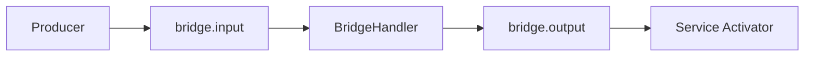
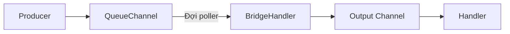
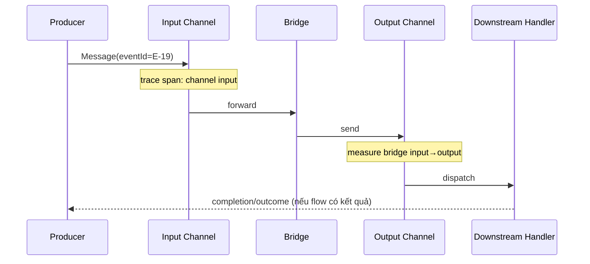

# Đo độ trễ do bridge

Trong chương **Bridge** của module **SPRING_INTEGRATION_PATTERN**, chúng ta sử dụng Spring Integration để kết nối các `MessageChannel` và phối hợp các **Enterprise Integration Patterns** như Router, Filter, Transformer, Splitter, Aggregator và Gateway. Bridge là một endpoint đơn giản: nó nhận message từ một channel và chuyển tiếp tới channel khác mà không cần biến đổi payload nghiệp vụ. Khi hệ thống có nhiều nhánh, queue và poller, người vận hành cần trả lời câu hỏi: **Bridge làm message chậm thêm bao nhiêu?**

Câu hỏi này dễ bị hiểu sai. Một message có thể ở lại `QueueChannel` hàng chục mili giây trước khi Bridge được poller kích hoạt, trong khi thời gian chính Bridge chuyển tiếp chỉ rất nhỏ. Nếu chỉ đo từ lúc producer gửi đến lúc consumer nhận, ta nhìn thấy **độ trễ toàn đoạn**, chưa thể quy trách nhiệm riêng cho Bridge.

Bài học tập trung vào **thiết kế phép đo**, **phân tách từng nguồn trễ**, **thực hành Java DSL và Micrometer**, **đọc kết quả p50/p95/p99**, **đối chứng**, và **kiểm thử khi tải tăng**. Các ví dụ dùng cùng JVM để sử dụng đồng hồ đơn điệu; khi phải đo qua nhiều tiến trình, cần thay đổi cách thu thập và đồng bộ thời gian.

## 1. Bridge chuyển tiếp message như thế nào?

Spring Integration dùng Bridge để nối các kênh mà không cần một handler nghiệp vụ mới. Một sơ đồ thường gặp:



Với một đoạn Java DSL đơn giản:

```java
import org.springframework.context.annotation.Bean;
import org.springframework.context.annotation.Configuration;
import org.springframework.integration.config.EnableIntegration;
import org.springframework.integration.dsl.IntegrationFlow;

@Configuration
@EnableIntegration
class BasicBridgeFlow {

    @Bean
    IntegrationFlow bridgeFlow() {
        return IntegrationFlow.from("bridge.input")
            .bridge()
            .channel("bridge.output")
            .get();
    }
}
```

Ở ví dụ này, `bridge.input` và `bridge.output` được dùng làm tên channel trong integration flow. Nếu cả hai là các channel gửi/nhận đồng bộ (chẳng hạn `DirectChannel`), việc chuyển tiếp thường diễn ra ngay trong đường gọi. Bridge không cần gọi REST API hoặc deserialize dữ liệu.

Nếu đầu vào là `QueueChannel` và Bridge nhận dữ liệu qua **poller**, flow có thêm giai đoạn chờ được lập lịch:



**Điểm mấu chốt:** thời gian chờ queue/poller có thể lớn hơn nhiều so với chi phí logic của Bridge. Khi báo cáo, hãy ghi rõ loại channel và cấu hình poller.

## 2. Phân rã độ trễ thành các thành phần có ý nghĩa

Một lần đi qua Bridge có thể chia thành các mốc:

| Mốc | Mô tả | Công cụ đo |
| --- | --- | --- |
| `t0` | Message được đưa đến đầu vào cần đo | `ChannelInterceptor.preSend` ở input |
| `t1` | Message được lấy khỏi hàng đợi, nếu có | `ChannelInterceptor.postReceive` của `PollableChannel` |
| `t2` | Message chuẩn bị được gửi vào output channel | `ChannelInterceptor.preSend` ở output |
| `t3` | Downstream handler bắt đầu xử lý | Instrumentation tại handler |
| `t4` | Downstream handler hoàn thành | Instrumentation hoặc timer của handler |

Các đại lượng:

- **Độ trễ đầu vào → đầu ra:** `L_bridge_path = t2 - t0`. Nếu input là queue, giá trị này **bao gồm** chờ queue/poller.
- **Chờ queue/poller:** `L_wait = t1 - t0`, chỉ có ý nghĩa khi nhận qua `PollableChannel` có ranh giới nhận xác định.
- **Chuyển tiếp sau khi lấy message:** `L_forward = t2 - t1`. Giá trị này bao gồm điều phối endpoint, interceptor và phần gửi tới output; gần với chi phí Bridge hơn.
- **Thời gian vào downstream:** `L_downstream_start = t3 - t2`. Nếu output là kênh bất đồng bộ, đây có thể là thời gian chờ executor/queue.
- **Xử lý downstream:** `L_handler = t4 - t3`.
- **Độ trễ đến khi hoàn tất công việc:** `L_end_to_end = t4 - t0`.

```text
t0             t1         t2               t3           t4
|--- queue wait --|--forward--|--dispatch wait--|--business--|
                 (nếu có)
```

Không nên đo `t4 - t0` rồi đặt tên metric là `bridge.processing.time`; đó là **thời gian cả flow**. Cũng không nên coi `t2 - t1` luôn là CPU time thuần của `BridgeHandler`: interceptor, dispatch và runtime của framework vẫn nằm trong đoạn đo.

### Ba đại lượng cần báo cáo riêng

| Metric | Trả lời câu hỏi nào? | Cách sử dụng |
| --- | --- | --- |
| `bridge.input_to_output` | Bao lâu từ lúc message đến đầu vào tới khi sắp vào output? | Theo dõi latency của đoạn tích hợp |
| `bridge.queue_wait` | Message đã chờ trong queue/poller bao lâu? | Phát hiện backlog, lịch poll và năng lực consumer |
| `bridge.forward` | Sau khi poller lấy ra, chuyển tiếp mất bao lâu? | Đánh giá chi phí endpoint/chuyển tiếp |

Trong thiết kế không có queue, `bridge.queue_wait` không áp dụng. Đừng tự ghi nhận bằng 0 rồi trộn với tập có queue khi so sánh percentile.

## 3. Dùng đồng hồ nào?

Độ trễ là **khoảng thời gian** giữa hai sự kiện. Trong cùng JVM, `System.nanoTime()` là lựa chọn phù hợp để tính khoảng thời gian vì nó có tính đơn điệu phục vụ đo elapsed time. Giá trị trả về không phải Unix timestamp và **không được gửi sang máy khác để trừ trực tiếp**.

```java
long start = System.nanoTime();
// thực hiện bước cần đo
long elapsedNanos = System.nanoTime() - start;
```

Ngược lại, `System.currentTimeMillis()` và `Instant.now()` hữu ích để ghi thời điểm theo đồng hồ thực, nhưng đồng hồ hệ điều hành có thể được điều chỉnh bởi NTP hoặc quản trị viên. Đo các khoảng ngắn bằng hai timestamp từ đồng hồ tường có thể tạo nhiễu hoặc giá trị âm khi clock bị điều chỉnh.

| Phạm vi đo | Đồng hồ nên dùng | Giới hạn |
| --- | --- | --- |
| Hai điểm trong cùng JVM | `System.nanoTime()` hoặc `Timer.Sample` của Micrometer | Không đại diện cho timestamp toàn cục |
| Cùng message qua nhiều thread **trong cùng JVM** | `System.nanoTime()` vẫn có thể tính chênh lệch | Cần lưu mốc khởi đầu đi cùng message hoặc một trạng thái liên kết |
| Qua HTTP/broker giữa **nhiều tiến trình** | Span/tracing + clock sync phù hợp; metrics riêng từng bên | Không lấy `nanoTime` của hai JVM trừ nhau |
| Điều tra lịch sử khi message được tạo/nhận | `Instant.now()` ở từng thành phần | Phải tính đến sai lệch đồng hồ giữa các host |

Không thể khẳng định chênh lệch giữa timestamp ở producer và consumer là chi phí của Bridge nếu chúng thuộc hai hệ thống có clock khác nhau.

## 4. Ví dụ đo input → output bằng ChannelInterceptor và Micrometer

Ta dùng hai interceptor:

1. Interceptor của `bridge.input` gắn mốc `bridgeStartedNano` khi message chuẩn bị được gửi vào input.
2. Interceptor của `bridge.output` đo khoảng thời gian cho đến lúc message sắp được gửi vào output, rồi ghi vào Micrometer `Timer`.

Ví dụ độc lập dưới đây giả định ứng dụng đã có Spring Integration Core và Micrometer `MeterRegistry`. Toàn bộ đoạn đo nằm trong **một JVM**.

```java
package example.bridge;

import java.util.concurrent.TimeUnit;

import io.micrometer.core.instrument.MeterRegistry;
import io.micrometer.core.instrument.Timer;
import org.springframework.context.annotation.Bean;
import org.springframework.context.annotation.Configuration;
import org.springframework.integration.channel.DirectChannel;
import org.springframework.integration.config.EnableIntegration;
import org.springframework.integration.dsl.IntegrationFlow;
import org.springframework.messaging.Message;
import org.springframework.messaging.MessageChannel;
import org.springframework.messaging.support.ChannelInterceptor;
import org.springframework.messaging.support.MessageBuilder;

@Configuration
@EnableIntegration
class BridgeLatencyConfiguration {

    private static final String START_HEADER = "bridgeStartedNano";

    @Bean(name = "bridge.input")
    DirectChannel bridgeInput() {
        var channel = new DirectChannel();

        channel.addInterceptor(new ChannelInterceptor() {
            @Override
            public Message<?> preSend(Message<?> message, MessageChannel ch) {
                return MessageBuilder.fromMessage(message)
                    .setHeader(START_HEADER, System.nanoTime())
                    .build();
            }
        });

        return channel;
    }

    @Bean(name = "bridge.output")
    DirectChannel bridgeOutput(MeterRegistry registry) {
        var timer = Timer.builder("demo.bridge.input_to_output")
            .description("Elapsed time between input and output preSend")
            .publishPercentileHistogram()
            .register(registry);

        var channel = new DirectChannel();

        channel.addInterceptor(new ChannelInterceptor() {
            @Override
            public Message<?> preSend(Message<?> message, MessageChannel ch) {
                Long start = message.getHeaders().get(
                    START_HEADER, Long.class
                );

                if (start != null) {
                    long elapsed = System.nanoTime() - start;
                    if (elapsed >= 0) {
                        timer.record(elapsed, TimeUnit.NANOSECONDS);
                    }
                }

                return message;
            }
        });

        return channel;
    }

    @Bean
    IntegrationFlow bridgeFlow() {
        return IntegrationFlow.from("bridge.input")
            .bridge()
            .channel("bridge.output")
            .get();
    }

    @Bean
    IntegrationFlow outputFlow() {
        return IntegrationFlow.from("bridge.output")
            .handle(String.class, (payload, headers) -> {
                // Handler kiểm tra đơn giản: không tạo reply.
                return null;
            })
            .get();
    }
}
```

Gửi message qua một bean cùng Spring context:

```java
package example.bridge;

import org.springframework.beans.factory.annotation.Qualifier;
import org.springframework.messaging.MessageChannel;
import org.springframework.messaging.support.MessageBuilder;
import org.springframework.stereotype.Component;

@Component
class BridgeSender {
    private final MessageChannel input;

    BridgeSender(@Qualifier("bridge.input") MessageChannel input) {
        this.input = input;
    }

    boolean send(String payload) {
        return input.send(
            MessageBuilder.withPayload(payload).build()
        );
    }
}
```

Giải thích về phép đo:

- `preSend` của input chạy **trước** khi input channel dispatch tới Bridge.
- `preSend` của output chạy **trước** khi output channel dispatch tới handler của downstream.
- Vì vậy timer ghi nhận **đoạn từ điểm vào input đến điểm chuẩn bị vào output**. Nó không gồm thời gian xử lý của downstream handler.
- Việc tạo message mới để thêm header và ghi metric cũng có overhead. Mẫu đo này hữu ích cho observability trong flow; nếu cần đo microbenchmark của riêng `BridgeHandler` thì phải trừ/đối chứng overhead instrumentation.
- Một header số nanosecond chỉ dùng **nội bộ JVM**. Không chuyển header này sang HTTP/broker hoặc đưa nó thành nhãn metric.
- Ví dụ không xử lý riêng trường hợp downstream gửi message không có header đo: ở đó metric không ghi nhận sample. Trong production nên có bộ đếm missing timestamp để tránh số liệu bị lệch âm thầm.

**Điều kiện để code chạy:** cần `MeterRegistry` được cấu hình làm bean (ví dụ qua Micrometer/Spring Boot Actuator hoặc cấu hình thủ công). Histogram/percentile phụ thuộc registry và monitoring backend. `publishPercentileHistogram()` đăng ký phân phối phù hợp theo cấu hình Micrometer; không có nghĩa dashboard tự xuất hiện.

## 5. Bridge có QueueChannel và poller: phép đo phải tách chờ queue

Khi đầu vào là `QueueChannel`, bridge chạy theo lịch của poller. Ví dụ:

```java
package example.bridge;

import java.time.Duration;

import org.springframework.context.annotation.Bean;
import org.springframework.context.annotation.Configuration;
import org.springframework.integration.channel.QueueChannel;
import org.springframework.integration.dsl.IntegrationFlow;
import org.springframework.integration.dsl.Pollers;

@Configuration
class PolledBridgeConfiguration {

    @Bean(name = "bridge.queue")
    QueueChannel bridgeQueue() {
        return new QueueChannel(1000);
    }

    @Bean
    IntegrationFlow polledBridgeFlow() {
        return IntegrationFlow.from(
                "bridge.queue",
                endpoint -> endpoint.poller(
                    Pollers.fixedDelay(Duration.ofMillis(100))
                        .maxMessagesPerPoll(10)
                )
            )
            .bridge()
            .channel("bridge.output")
            .get();
    }
}
```

Flow này chỉ minh họa một phiên bản khác của bridge input (thay cho flow `bridge.input` đồng bộ ở phần trước). Khi áp dụng, hãy chọn một topology rõ ràng và không dùng hai flow cạnh tranh xử lý cùng message chỉ để thu thập số liệu.

Giả sử poller có chu kỳ khoảng 100 ms và message vào ngay sau một lần poll. Message có thể chờ gần hết khoảng đó trước khi được lấy ra, ngoài thời gian chờ do backlog, tải CPU và lịch chạy. Không thể suy ra số trễ chính xác chỉ từ `fixedDelay(100ms)` vì delay được tính theo lịch poll và khối lượng xử lý.

### Đo riêng enqueue → dequeue

Có thể gắn interceptor ở `QueueChannel`, với mốc:

- `preSend`: gắn `queueEnqueueNano` khi message chuẩn bị đi vào queue.
- `postReceive`: sau khi poller nhận được message, gắn `queueDequeueNano`.
- `preSend` của output: tính các khoảng `dequeue - enqueue` và `output - dequeue`.

Pseudocode (tên biến thể hiện rõ vị trí đo):

```java
// Minh họa logic, không phải cấu hình @Bean đầy đủ.
@Override
public Message<?> preSend(Message<?> message, MessageChannel channel) {
    return MessageBuilder.fromMessage(message)
        .setHeader("queueEnqueueNano", System.nanoTime())
        .build();
}

@Override
public Message<?> postReceive(Message<?> message, MessageChannel channel) {
    if (message == null) {
        return null;
    }
    return MessageBuilder.fromMessage(message)
        .setHeader("queueDequeueNano", System.nanoTime())
        .build();
}

// Tại output preSend:
long queueWait = dequeueNano - enqueueNano;
long forwardTime = outputNano - dequeueNano;
```

Với `QueueChannel`, `postReceive` phù hợp để quan sát sau khi poller lấy message ra. Không áp dụng trực tiếp `postReceive` cho một `DirectChannel` vốn không có thao tác `receive()` kiểu poll.

**Giới hạn quan trọng:** các mốc trong interceptor đo xung quanh thao tác framework, không phải đúng thời điểm broker/file system xác nhận. Chúng cũng phải được gắn và thu thập theo cùng một đường đi; message bị router loại hoặc flow lỗi trước output sẽ không có `forwardTime`. Vì vậy, ngoài timer, cần có bộ đếm **received, forwarded, dropped, errors**.

## 6. Tại sao không đo bằng postSend?

`ChannelInterceptor.postSend(message, channel, sent)` chạy **sau** lời gọi `send()`. Với `DirectChannel`, việc gửi có thể bao gồm cả thời gian chạy subscriber đồng bộ.

Ví dụ:

```text
producer -> input DirectChannel -> BridgeHandler
         -> output DirectChannel -> slowHandler (sleep 500 ms)
```

Nếu bấm giờ từ trước `input.send(...)` đến sau khi `send(...)` trả về, kết quả gần 500 ms có thể phản ánh handler chậm, dù Bridge chỉ chuyển tiếp rất nhanh.

Khi mục tiêu là **độ trễ riêng đoạn Bridge**, hãy đặt điểm bắt đầu và kết thúc **trước khi downstream bắt đầu xử lý**, chẳng hạn `preSend` ở hai kênh. Nếu mục tiêu là **độ trễ từ producer đến hoàn tất nghiệp vụ**, đo end-to-end riêng và đặt tên metric tương ứng.

Tương tự:

- `afterSendCompletion` có ích để nắm được thành công/lỗi của thao tác gửi, nhưng không tự phân tách Bridge và handler.
- `postReceive` của queue hữu ích cho đo queue wait, nhưng không là điểm kết thúc đúng cho một flow đồng bộ không dùng queue.
- AOP quanh `BridgeHandler` có thể đo processing time theo method, nhưng kết quả chịu ảnh hưởng framework dispatch, advice và downstream send; cần xác định chính xác phạm vi interceptor/AOP.

## 7. Thiết kế benchmark có đối chứng

Một phép đo chỉ có ích nếu phân biệt được overhead của Bridge với overhead của channel và instrumentation. Hãy đo ít nhất ba cấu hình gần tương đương:

| Kịch bản | Topology | Câu hỏi |
| --- | --- | --- |
| **A – baseline** | Producer → DirectChannel → Handler | Bản thân send/dispatch/handler tốn bao lâu? |
| **B – bridge đồng bộ** | Producer → DirectChannel → Bridge → DirectChannel → Handler | Thêm Bridge và một channel chuyển tiếp ảnh hưởng ra sao? |
| **C – bridge polling** | Producer → QueueChannel → Poller → Bridge → DirectChannel → Handler | Queue và poller góp thêm bao nhiêu? |

Giữ các điều kiện giống nhau khi có thể: payload, số message, handler, JVM version, heap, warm-up, bộ thu metrics, cấu hình GC và mức tải.

### Trình tự chạy

1. **Warm-up JVM:** gửi đủ message trước giai đoạn tính số liệu để giảm ảnh hưởng class loading/JIT.
2. **Baseline A:** thu throughput và latency khi không có Bridge.
3. **Scenario B:** thu cùng loại metric khi chèn Bridge đồng bộ.
4. **Scenario C:** chuyển sang QueueChannel/poller, ghi cả queue depth và thời gian poll.
5. **Đổi thứ tự các lượt chạy:** tránh nhầm ảnh hưởng nhiệt độ hệ thống, contention hoặc GC với hiệu quả của một topology.
6. **Lặp lại và giữ phân phối:** báo cáo số sample, p50/p95/p99, max, throughput, lỗi, GC pause và CPU; không chỉ lấy một trung bình duy nhất.

**Lưu ý:** phép trừ hai p99 của hai tập không phải p99 của overhead theo từng message. Nếu muốn xác định mức chênh chi phí bằng thống kê, cần thiết kế đối chứng hoặc paired sampling hợp lệ và trình bày giới hạn phép suy luận.

### Giảm nhiễu khi đo đoạn rất ngắn

- Không log từng message trong đường nóng; log đồng bộ có thể lấn át chi phí Bridge.
- Tránh đo có debugger/breakpoint đang dừng thread.
- Không đo ngay ở lượt đầu JVM mới chạy; JIT/GC làm kết quả biến động.
- Nếu chi phí ở thang microsecond, chạy nhiều mẫu và tính đến overhead gọi đồng hồ, tạo header và xuất metric.
- Gắn metric labels với danh mục hữu hạn như `bridge=order-to-billing`, `channelType=direct`. **Không** gắn `messageId`, `orderId` hoặc `requestId` làm tags vì cardinality quá cao.
- Nếu dùng nhiều executor, giữ kích thước thread pool và mức cạnh tranh tải được ghi lại.

## 8. Đọc p50, p95, p99 và throughput như thế nào?

Một hệ thống có 100.000 message có thể có trung bình thấp nhưng một nhóm nhỏ chịu trễ lớn do queue backlog. Vì vậy:

- **p50:** khoảng một nửa số sample hoàn tất nhanh hơn hoặc bằng giá trị này; hữu ích cho trải nghiệm điển hình.
- **p95:** nhấn mạnh phần đuôi của 5% message chậm nhất.
- **p99:** theo dõi tail latency, thường nhạy với GC, lock contention, backlog và lịch chạy.
- **Throughput:** số message xử lý mỗi giây; phải xem cùng latency.
- **Error/drop count:** không được chỉ thống kê những message thành công rồi kết luận flow có độ trễ thấp.
- **Queue depth/age:** giải thích vì sao latency tăng khi tốc độ nhập lớn hơn tốc độ xử lý.

Bảng giả định sau **chỉ để minh họa cách phân tích, không phải số liệu benchmark thật**:

| Topology | p50 input→output | p95 input→output | Kết luận có thể rút ra |
| --- | ---: | ---: | --- |
| Bridge trên DirectChannel | 0,08 ms | 0,30 ms | Đường đi đồng bộ nhanh trong phép thử minh họa |
| Bridge sau QueueChannel + Poller | 45 ms | 130 ms | Tổng trễ tăng mạnh, cần đo queue wait và poller |
| Cùng queue nhưng tăng tải | 95 ms | 420 ms | Backlog/saturation có thể đang chi phối tail latency |

Không được kết luận rằng `BridgeHandler` tự xử lý mất 130 ms từ bảng này. Phần lớn có thể nằm ở thời gian chờ poller hoặc queue. Cần nhìn thêm `queueWait` và `forwardTime` mới xác định được.

## 9. Các yếu tố làm Bridge có vẻ chậm

| Tác nhân | Dấu hiệu quan sát | Hành động kiểm tra |
| --- | --- | --- |
| **Poll interval quá dài** | Latency biến thiên gần theo chu kỳ poll | Giảm/điều chỉnh chu kỳ và xem chi phí polling |
| **Queue backlog** | Queue depth tăng, p95/p99 tăng theo tải | Đo input/output rate, capacity, consumer concurrency |
| **Executor saturation** | Task chờ trong executor, nhiều thread bận | Queue size và thread pool metrics |
| **Downstream handler chậm** | `postSend` chậm, `preSend` output vẫn nhanh | Đo latency downstream riêng |
| **GC pause** | Nhiều metric cùng tăng đột ngột | So khớp log/metrics GC với timestamp latency |
| **Lock/contention** | Tail latency tăng dù CPU không quá cao | Kiểm tra thread dump/profiler khi cần |
| **Interceptor/serialization nặng** | Chèn instrumentation làm throughput giảm | So sánh chạy có/không instrumentation |
| **Broker/network bên ngoài** | End-to-end cao, đoạn bridge nội bộ thấp | Đo inbound/outbound transport riêng |
| **Quá nhiều message nhỏ** | Overhead cố định/message đáng kể | Xem batch size phù hợp, tránh batch làm thay đổi semantics |

Bridge không biến một flow thành asynchronous chỉ vì đặt giữa hai channel; chính **loại channel** và endpoint/poller quyết định việc gửi là đồng bộ hay có chờ.

## 10. Khi nào cần phân tích trace?

Metrics như Micrometer Timer trả lời câu hỏi tổng quát “đoạn Bridge đang chậm ở đâu” theo phân phối. **Tracing** hữu ích khi cần xem hành trình của một message cụ thể:



Cần lưu ý:

- `traceId` liên kết span qua các thành phần; **không tự làm Bridge nhanh/chậm hơn**.
- Với `DirectChannel`, nhiều span có thể lồng nhau trong cùng thread.
- Qua `QueueChannel` hoặc executor, cần context propagation nếu muốn cùng trace.
- Qua JMS/AMQP/HTTP, phải ánh xạ trace headers theo chính sách transport. Không truyền nguyên một đối tượng Java thread-local hay `nanoTime` sang process khác.
- Các phiên bản Spring Integration/Micrometer có cơ chế observation khác nhau; khi bật, nên kiểm tra instrumentation thực tế tạo span/timer tại vị trí nào để không đếm trùng.

Nếu chỉ có yêu cầu theo dõi p95/p99 toàn hệ thống, meter cardinality thấp thường đủ. Nếu cần điều tra một đơn hàng chậm, trace có ID hợp đồng sẽ hữu ích hơn việc log toàn bộ payload.

## 11. Tối ưu sau khi đã xác định đúng nguồn trễ

Thứ tự khắc phục nên dựa trên số liệu:

**Nếu queue wait lớn:** điều chỉnh poller interval, `maxMessagesPerPoll`, concurrency và số worker theo tốc độ nhập; kiểm tra backlog có vượt khả năng xử lý hay không. Việc tăng số consumer có thể làm mất thứ tự hoàn tất hoặc tăng cạnh tranh tài nguyên.

**Nếu forward time lớn:** xem số interceptor, advice, converter, thread contention và cách output channel dispatch. Một Bridge cơ bản thường không có biến đổi payload; overhead lớn bất thường có thể đến từ thành phần đi kèm.

**Nếu downstream chậm:** đo DB/API/handler riêng. Không giảm poll interval để che một handler bị nghẽn bởi database, vì điều đó có thể chỉ tăng số message chờ.

**Nếu chi phí Bridge thực sự không cần thiết:** cân nhắc nối trực tiếp hai thành phần khi không còn mục đích đổi topology, độc lập lifecycle hoặc vận hành. Nhưng hãy giữ Bridge nếu nó tạo ranh giới rõ ràng cho routing, channel isolation hay điểm theo dõi cần thiết; hiệu năng chỉ là một trong nhiều tiêu chí kiến trúc.

**Nếu cần thông lượng cao:** đo cả latency dưới tải thực, số message in-flight và tác động của batching. Tối ưu p50 trong một bài microbenchmark có thể không làm giảm p99 khi hệ thống bận.

## 12. Thiết kế kiểm thử đo latency

Một bài test đo Bridge cần tránh dựa trên thời gian tuyệt đối quá chặt vì JVM và máy chạy CI có tải biến động.

| Kiểm thử | Phương pháp | Điều cần xác minh |
| --- | --- | --- |
| **Bridge giữ payload/header** | Gửi message có ID nghiệp vụ qua flow đồng bộ | Downstream nhận đúng payload và header cần bảo toàn |
| **Timer có sample** | Gửi N message vào input, chờ N message ở output | Meter ghi nhận sample hợp lệ, không thiếu bất ngờ |
| **Không gộp downstream** | Downstream cố ý chậm | Metric input→output không tăng tương ứng với phần chậm downstream nếu điểm đo đúng |
| **Queue wait được tách** | QueueChannel + poller được kiểm soát | Có đo `enqueue→dequeue` và `dequeue→output` |
| **Backlog** | Tăng tốc độ gửi cao hơn tốc độ xử lý | Queue depth/latency tăng và được quan sát |
| **Lỗi downstream** | Handler ném exception | Có error count; timer không bị coi là xử lý thành công toàn flow |
| **Message không có timestamp** | Gửi từ một đường đi khác đến output | Có thể phát hiện missing-start; không ghi sample giả |
| **Nhiều thread** | Executor/consumer đồng thời | Không trộn mốc thời gian giữa message |
| **GC/CI variance** | Chạy nhiều lần | Không fail build vì một spike ngoài phạm vi kiểm soát |
| **Tắt metrics** | Không có MeterRegistry/observation tương ứng | Behavior message vẫn đúng theo cấu hình ứng dụng |

### Ví dụ kiểm chứng bằng CountDownLatch

Trong integration test, có thể đặt một handler đếm message nhận được và dùng `CountDownLatch` để chờ sự kiện thay vì `Thread.sleep` cố định:

```java
import java.util.concurrent.CountDownLatch;
import java.util.concurrent.TimeUnit;
import java.util.concurrent.atomic.AtomicInteger;

CountDownLatch received = new CountDownLatch(100);
AtomicInteger handled = new AtomicInteger();

void onMessage(String payload) {
    handled.incrementAndGet();
    received.countDown();
}

// Ở test: gửi 100 messages vào input.
boolean allReceived = received.await(5, TimeUnit.SECONDS);
if (!allReceived) {
    throw new AssertionError("Thiếu message tại output");
}
if (handled.get() != 100) {
    throw new AssertionError("Số message không khớp");
}
```

Đây là **đoạn minh họa test harness**, không phải một bean test đầy đủ; ứng dụng phải đăng ký `onMessage` làm handler đầu ra và gửi đúng 100 message. Khi kiểm tra timer, so số sample ghi nhận với số message đi qua output; nếu dùng histogram lấy từ monitoring backend, cần tính đến chu kỳ scrape/export. Không nên dùng ngưỡng “Bridge luôn dưới 1 ms” trên mọi máy CI.

### Test hiệu năng và test đúng chức năng là hai việc khác nhau

- **Functional test** xác nhận message đi đúng channel, không mất payload/header, exception và correlation đúng theo hợp đồng.
- **Performance test** chạy nhiều message ở tải đã định nghĩa, thu phân phối latency/throughput, so sánh với baseline và ghi rõ môi trường.
- **Load/stress test** kiểm tra saturation, queue depth, GC, backpressure, tail latency và khả năng phục hồi khi tải vượt mức thông thường.

Một flow có functional test thành công vẫn có thể trễ khi backlog lớn; một flow có p50 thấp vẫn có thể làm rơi message ở các đường lỗi nếu không có handling phù hợp.

## 13. Những sai lầm thường gặp

**Dùng `System.currentTimeMillis()` để đo một Bridge rất nhanh.** Độ phân giải và thay đổi đồng hồ tường gây nhiễu; dùng đồng hồ đơn điệu trong cùng JVM.

**Trừ `System.nanoTime()` của hai process.** Giá trị này không có gốc thời gian chung và không đại diện cho elapsed time xuyên máy.

**Lấy thời gian `send()` bao gồm handler downstream.** Với `DirectChannel`, lời gọi gửi có thể thực thi toàn bộ chuỗi xử lý đồng bộ. Hãy xác định đúng ranh giới `preSend`.

**Đổ mọi độ trễ QueueChannel lên Bridge.** Poller interval, backlog và scheduling thường chi phối. Tách `queueWait` khỏi `forwardTime`.

**Chỉ đo trung bình.** p95/p99, throughput và số message lỗi giúp thấy nhóm message bị ảnh hưởng nhiều nhất.

**Đo bằng cách log từng message.** I/O log có thể làm hệ thống chậm hơn đáng kể và bóp méo kết quả.

**Gắn message ID thành metric tag.** Cardinality bùng nổ làm tốn bộ nhớ và tài nguyên monitoring; chỉ dùng tag danh mục hữu hạn.

**Đo chỉ những message tới output.** Những message bị filter/drop/exception sẽ biến mất khỏi tập sample, khiến báo cáo latency nhìn đẹp nhưng sai về tỷ lệ hoàn tất.

**So sánh các kịch bản có handler hoặc tải khác nhau.** Khi baseline không tương đương, không thể suy ra chi phí Bridge.

**Nhầm Bridge với một remote gateway.** Bridge chuyển message giữa các channel; nếu input/output nối tới broker hoặc remote adapter thì transport và serialization là các giai đoạn riêng cần đo.

## 14. Checklist khi đo độ trễ do Bridge

1. Xác định topology: `DirectChannel`, `ExecutorChannel`, `QueueChannel`, poller và downstream handler.
2. Ghi rõ **đầu vào, đầu ra và định nghĩa latency** trước khi đặt tên metric.
3. Dùng `System.nanoTime()` để đo khoảng thời gian trong một JVM; qua process thì dùng tracing/clock sync thích hợp.
4. Đặt instrumentation ở vị trí không vô tình đo kèm downstream khi mục tiêu chỉ là Bridge.
5. Với queue/poller, đo riêng `enqueue→dequeue` và `dequeue→output`.
6. Thu sample count, p50, p95, p99, throughput, queue depth và error/drop count.
7. Giữ tags có cardinality thấp; không đính message ID vào meter tags.
8. Chạy baseline không Bridge và kịch bản có Bridge trong điều kiện tương đồng.
9. Warm-up JVM, lặp lại phép đo và quan sát CPU/GC/contended threads.
10. Phân biệt tác động của instrumentation với latency của flow thật.
11. Kiểm thử đường thành công, lỗi, message bị bỏ và concurrency.
12. Báo cáo rõ kết quả là **đo nội bộ Bridge**, **queue + Bridge** hay **end-to-end**.

## Kết luận

**Đo độ trễ do Bridge** trong Spring Integration đòi hỏi xác định chính xác ranh giới đo. Bridge thường chỉ chuyển tiếp message, còn `QueueChannel`, poller, executor và downstream handler có thể thêm thời gian chờ đáng kể. Bằng cách gắn mốc thời gian tại input/output channel, tách queue wait khỏi forward time, thu thập Micrometer Timer và so sánh với baseline, ta có thể xác định được thành phần gây trễ và tối ưu có cơ sở. Kết quả đáng tin cậy luôn đi kèm cấu hình topology, tải thử, phân phối p95/p99, tỷ lệ lỗi và giới hạn của phép đo.
