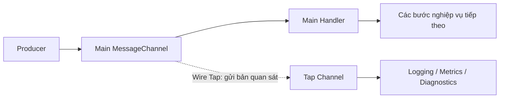
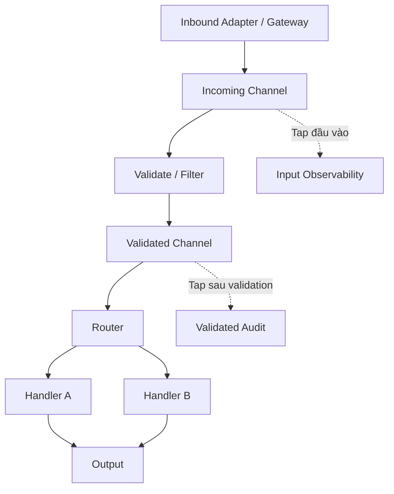
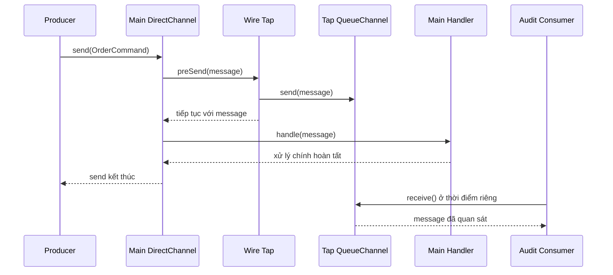
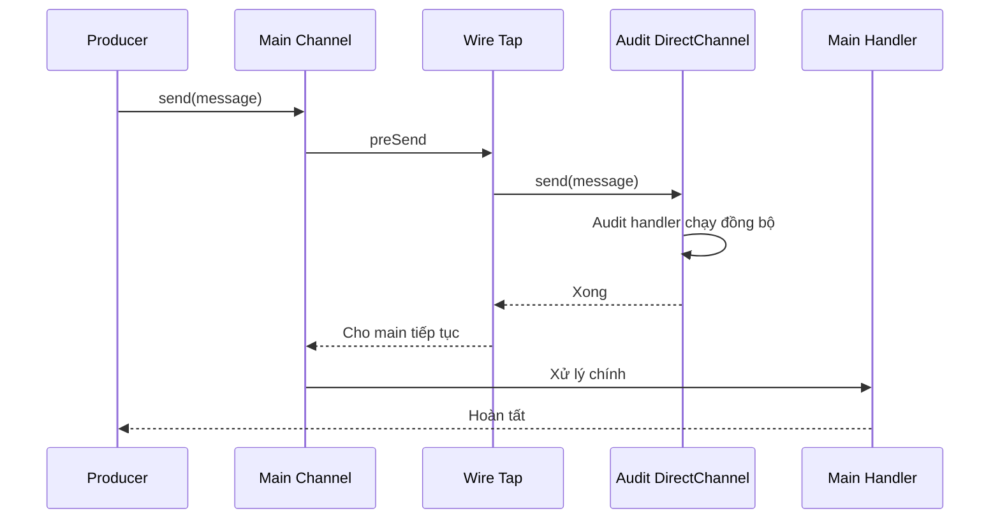
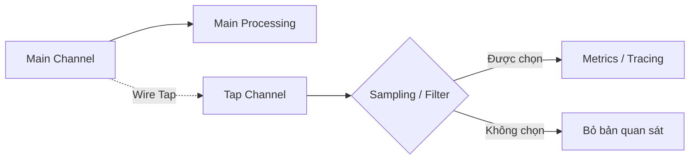
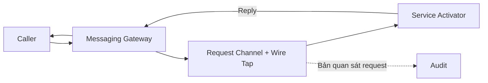

# Wire Tap quan sát message mà không đổi flow chính với Spring Integration

## 1. Tình huống: cần quan sát message nhưng không muốn can thiệp xử lý

Một hệ thống bán hàng có luồng:

1. Nhận lệnh tạo đơn hàng.
2. Kiểm tra dữ liệu và quy tắc nghiệp vụ.
3. Gửi yêu cầu tới hệ thống xử lý đơn.
4. Trả kết quả hoặc thông báo lỗi.

Đội vận hành muốn biết mỗi message đã đến đâu, đội kiểm thử muốn đối chiếu nội dung đầu vào và đội phát triển cần một điểm quan sát khi điều tra lỗi. Nếu đưa việc ghi audit, in log hoặc gửi metric vào chính handler nghiệp vụ, mỗi thay đổi quan sát có thể làm phức tạp luồng chính; lỗi của nơi lưu audit cũng có thể kéo theo lỗi xử lý đơn hàng.

**Wire Tap** là Enterprise Integration Pattern cho phép **chuyển một bản message sang nhánh quan sát phụ** trong khi message ban đầu vẫn đi theo đường xử lý chính. Trong Spring Integration, Wire Tap thường được triển khai như một `ChannelInterceptor` hoặc qua Java DSL `wireTap(...)`.

Bài **Wire Tap quan sát message mà không đổi flow chính** thuộc chương **Wire tap** của module **SPRING_INTEGRATION_PATTERN**. Module hướng tới triển khai các pattern Router, Filter, Transformer, Splitter, Aggregator, Gateway, retry, error channel và correlation để tạo luồng thông điệp ít phụ thuộc, dễ mở rộng, có kiểm thử và khả năng theo dõi.

Sau bài học, bạn có thể:

- Hiểu chính xác Wire Tap quan sát gì và không làm gì.
- Phân biệt Wire Tap với Bridge, Publish–Subscribe Channel, Router và Transformer.
- Thêm một nhánh quan sát vào channel bằng Spring Integration.
- Kiểm thử message trên nhánh chính và nhánh tap.
- Hiểu vì sao Wire Tap **không tự bảo đảm** nhánh chính hoàn toàn độc lập với lỗi của nhánh phụ.
- Thiết kế logging, metrics và audit an toàn, có giới hạn tài nguyên và không lộ dữ liệu nhạy cảm.

## 2. Wire Tap là gì?

Trong Enterprise Integration Patterns, Wire Tap tạo một **nhánh phụ** để theo dõi luồng message. Một message đi trên đường xử lý chính vẫn được giao cho consumer chính, trong khi một bản quan sát được gửi đến một channel riêng.



Trong Spring Integration, hình thức phổ biến là gắn Wire Tap với một channel. Khi message được gửi qua channel đó, interceptor gửi message sang tap channel và cho message tiếp tục qua channel chính.

**Điểm cốt lõi:** Wire Tap không được dùng để tính kết quả nghiệp vụ mới, lọc bỏ message trên đường chính hay tự quyết định thay đổi đích nhận của luồng chính.

### Quan sát không đồng nghĩa biến đổi

Ví dụ message được tạo trước khi vào Wire Tap:

```text
payload:
  orderId: O-42
  sku: BOOK-01
  quantity: 2

headers:
  businessCorrelationId: req-42
  source: checkout-service
```

Nhánh tap có thể ghi:

```text
operation=order-submission
orderId=O-42
correlationId=req-42
observedAt=...
```

trong khi main handler vẫn nhận payload `OrderCommand("O-42", "BOOK-01", 2)` cùng các header cần thiết.

Tuy nhiên, **Wire Tap không mặc định sao chép sâu payload**. Nó có thể chuyển cùng một đối tượng message hoặc tham chiếu payload tới nhánh phụ. Nếu nhánh audit sửa trực tiếp một đối tượng mutable, message mà main handler nhìn thấy có thể bị ảnh hưởng. Hãy thiết kế DTO bất biến và coi nhánh quan sát là **read-only**.

## 3. "Không đổi flow chính" nghĩa là gì — và không nghĩa là gì?

Câu "không đổi flow chính" thường được hiểu theo hai mức khác nhau:

| Mức | Ý nghĩa | Wire Tap có tự bảo đảm? |
|---|---|---|
| **Ngữ nghĩa nghiệp vụ** | Không sửa payload, không chuyển hướng, không loại message trên đường chính | Có theo trách nhiệm của Wire Tap; thành phần khác vẫn có thể thay message |
| **Cách ly vận hành** | Nhánh audit lỗi/chậm không được làm main flow chậm hoặc thất bại | **Không mặc định**; phụ thuộc tap channel, thread, queue, error handling và mức tải |

Nếu tap channel là `DirectChannel` và handler audit ghi xuống database trong ba giây, lời gọi gửi tới main channel có thể bị kéo dài do xử lý audit đồng bộ. Nếu handler audit ném exception, lỗi có thể ảnh hưởng đến thao tác gửi message ở luồng chính, tùy cấu hình.

Nếu tap channel là `QueueChannel` có sức chứa hữu hạn, việc gửi sang tap thường chỉ là đưa vào hàng đợi nội bộ, giúp tách thời gian ghi audit khỏi main handler. Nhưng queue vẫn có thể **đầy** hoặc mất dữ liệu khi process dừng nếu chỉ lưu trong bộ nhớ.

Vì vậy mục tiêu đúng là:

> **Giữ nội dung và hành trình nghiệp vụ chính không bị Wire Tap chủ động thay đổi; chủ động thiết kế cách ly tài nguyên và xử lý lỗi nếu muốn nhánh phụ không ảnh hưởng trải nghiệm chính.**

## 4. Vị trí của Wire Tap trong topology

Wire Tap nên được đặt tại điểm mà thông tin quan sát có ý nghĩa.



Đặt tap ở **incoming channel** cho biết message đã vào hệ thống, nhưng không chứng minh validation hoặc xử lý downstream thành công.

Đặt tap **sau Filter** cho biết message đã vượt qua bộ lọc, nhưng vẫn không chứng minh side effect ở hệ thống ngoài đã được commit.

Đặt tap **trước HTTP outbound adapter** cho biết request sắp được gửi, nhưng không phải bằng chứng đối tác đã tiếp nhận hoặc thực thi.

Đây là một nguyên tắc rất quan trọng khi dùng Wire Tap cho audit: **điểm quan sát chỉ chứng minh trạng thái tại vị trí quan sát**, không chứng minh mọi bước phía sau hoàn tất.

### Chọn điểm tap theo câu hỏi vận hành

| Câu hỏi | Vị trí tap phù hợp |
|---|---|
| Message nào đã được nhận từ nguồn? | Ngay sau inbound adapter hoặc request channel |
| Message nào đã qua validation? | Sau Filter/validation handler |
| Request nào được đưa vào nhánh xử lý A? | Channel của nhánh A sau Router |
| Tải thực tế đầu vào mỗi giây là bao nhiêu? | Kênh đầu vào hoặc metric của endpoint |
| Reply nào đã được tạo? | Kênh reply hoặc bước sau handler tạo reply |
| Giao dịch đã commit thành công chưa? | Không chỉ dựa vào Wire Tap đầu vào; cần audit ở transaction boundary |

## 5. So sánh Wire Tap với các EIP liên quan

| Pattern / thành phần | Mục tiêu | Khác Wire Tap ở điểm nào? |
|---|---|---|
| **Wire Tap** | Chuyển bản message sang nhánh quan sát phụ | Main flow tiếp tục; tap có tính bổ sung |
| **Bridge** | Nối hai channel trên đường đi chính | Chuyển tiếp main message, không có nhánh quan sát độc lập theo mặc định |
| **Publish–Subscribe Channel** | Phát message cho nhiều subscriber | Fan-out là mô hình phân phối chính, mỗi subscriber có thể là nghiệp vụ |
| **Recipient List Router** | Chọn một danh sách đích nhận | Phân phối có điều kiện theo logic routing, không chỉ quan sát |
| **Content-Based Router** | Chọn nhánh theo payload/header | Có thể đổi đường đi của main message |
| **Filter** | Chấp nhận hoặc loại message | Có thể loại message trên đường chính |
| **Transformer** | Đổi payload/headers/kiểu dữ liệu | Có mục tiêu biến đổi message |
| **Gateway** | Chuyển lời gọi method ↔ messaging flow | Có thể cần reply và timeout |
| **LoggingHandler** | Ghi log message | Là một handler quan sát; có thể đặt sau tap channel nhưng không đồng nhất với Wire Tap |
| **ChannelInterceptor** | Can thiệp vào hoạt động gửi/nhận của channel | Wire Tap là một hình thức interceptor chuyên dùng cho nhánh quan sát |

Một luồng có `PublishSubscribeChannel` và hai subscriber cũng có thể tạo hành vi giống "main + audit", nhưng không giống hoàn toàn về ý đồ và cấu hình. Wire Tap biểu thị rõ rằng **nhánh quan sát là phụ**, còn processing chính vẫn đi theo channel của nó.

## 6. Cơ chế Wire Tap trong Spring Integration

Về mặt ý tưởng:

1. Producer gọi `mainChannel.send(message)`.
2. Wire Tap được gắn trên channel quan sát message tại thời điểm gửi.
3. Wire Tap gửi message đó đến `tapChannel`.
4. Message tiếp tục được phân phối theo semantics của `mainChannel`.
5. Consumer của `tapChannel` xử lý độc lập về nghiệp vụ, ví dụ ghi metric.



Sơ đồ mô tả một topology dùng `DirectChannel` trên đường chính và `QueueChannel` cho tap. Nếu dùng `DirectChannel` cho tap thì audit consumer có thể chạy ngay khi Wire Tap gửi bản phụ, trước khi main handler bắt đầu xử lý.

### Các header có được giữ không?

Trong một trường hợp nội bộ đơn giản, Wire Tap gửi message với payload và headers như chúng được quan sát tại channel đó. Các trường như `businessCorrelationId`, `traceId`, `id` hoặc `timestamp` không được Wire Tap chủ động biến đổi thành dữ liệu mới chỉ để ghi log.

Nhưng interceptor khác trên channel, một transformer trước tap, hoặc adapter qua HTTP/Kafka có thể thay đổi message hay header. Nếu cần kiểm tra nguyên nhân khác biệt, hãy phân biệt:

- **Trước tap**: message có giá trị gì?
- **Tại tap**: Wire Tap quan sát đúng channel nào?
- **Sau tap**: interceptor/handler nào có thể tạo message mới?
- **Ở transport ngoài**: serializer/mapper có loại hoặc đổi header không?

Không mặc nhiên chuyển tiếp tất cả Spring Integration headers ra hệ thống ngoài: `replyChannel` và `errorChannel` có thể là đối tượng chỉ hợp lệ trong JVM, còn `Authorization`/API key cần được bảo vệ.

## 7. Ví dụ Java: Wire Tap quan sát OrderCommand

Ta xây dựng một cấu hình thuần Spring Integration trong cùng một `ApplicationContext`:

- `ordersIngress`: `DirectChannel`, đường xử lý chính.
- `auditTapChannel`: `QueueChannel` có sức chứa, nhận bản message quan sát.
- `processedOrders`: `QueueChannel` nhận kết quả xử lý chính.
- `WireTap`: interceptor gắn vào `ordersIngress`.
- `IntegrationFlow`: handler chính chuyển `OrderCommand` thành `ProcessedOrder`.

Ví dụ hướng tới Java 17+, Spring Integration 6.x, Spring Framework và JUnit 5 tương thích. Không cần broker thật để minh họa topology cơ bản.

### 7.1. Các record nghiệp vụ

```java
// OrderCommand.java
package com.example.wiretap;

public record OrderCommand(
        String orderId,
        String sku,
        int quantity
) {
}
```

```java
// ProcessedOrder.java
package com.example.wiretap;

public record ProcessedOrder(
        String orderId,
        String result
) {
}
```

Dùng record với các trường đơn giản giúp tránh rủi ro nhánh tap sửa cùng đối tượng payload mutable. Trong hệ thống thật, record chứa collection hoặc object mutable vẫn cần bảo vệ ở mức lồng nhau.

### 7.2. Cấu hình channel và Wire Tap interceptor

```java
// WireTapConfiguration.java
package com.example.wiretap;

import org.springframework.beans.factory.annotation.Qualifier;
import org.springframework.context.annotation.Bean;
import org.springframework.context.annotation.Configuration;
import org.springframework.integration.channel.DirectChannel;
import org.springframework.integration.channel.QueueChannel;
import org.springframework.integration.channel.interceptor.WireTap;
import org.springframework.integration.config.EnableIntegration;
import org.springframework.integration.dsl.IntegrationFlow;

@Configuration
@EnableIntegration
public class WireTapConfiguration {

    @Bean
    public QueueChannel auditTapChannel() {
        // Queue in-memory có giới hạn để tránh tăng vô hạn.
        return new QueueChannel(100);
    }

    @Bean
    public DirectChannel ordersIngress(
            @Qualifier("auditTapChannel") QueueChannel tapChannel) {

        DirectChannel main = new DirectChannel();

        // Forward bản message quan sát sang nhánh phụ.
        main.addInterceptor(new WireTap(tapChannel));

        return main;
    }

    @Bean
    public QueueChannel processedOrders() {
        return new QueueChannel(100);
    }

    @Bean
    public IntegrationFlow processOrdersFlow() {
        return IntegrationFlow.from("ordersIngress")
                .handle(
                    OrderCommand.class,
                    (command, headers) -> {
                        if (command.quantity() <= 0) {
                            throw new IllegalArgumentException(
                                    "Quantity must be positive");
                        }

                        return new ProcessedOrder(
                                command.orderId(), "ACCEPTED");
                    })
                .channel("processedOrders")
                .get();
    }
}
```

Điểm cần nhớ:

1. `WireTap` được gắn vào **channel đầu vào**, không thay thế main handler.
2. `QueueChannel(100)` giữ message quan sát tạm thời để consumer audit lấy sau.
3. Flow chính vẫn nhận `OrderCommand` và xử lý theo hợp đồng.
4. `ProcessedOrder` được tạo bởi **handler chính**, không phải Wire Tap.
5. Không có thành phần nào ở ví dụ này bảo đảm audit bền vững sau restart.
6. Nếu nhánh tap quá tải hoặc việc gửi tap gặp lỗi, cần xác định tác động lên main flow; queue có sức chứa không phải giải pháp cách ly hoàn chỉnh.

Trong một hệ thống production, điểm quan sát thường không nên đưa toàn bộ payload nhạy cảm vào audit queue. Có thể triển khai audit consumer chỉ xuất metadata hoặc đặt một lớp redaction/sampling có chủ đích.

### 7.3. Gửi một message

```java
// Ví dụ code trong một service được inject channel ordersIngress.
import org.springframework.messaging.Message;
import org.springframework.messaging.support.MessageBuilder;

OrderCommand command =
        new OrderCommand("O-42", "BOOK-01", 2);

Message<OrderCommand> message = MessageBuilder
        .withPayload(command)
        .setHeader("businessCorrelationId", "req-42")
        .setHeader("source", "checkout-service")
        .build();

boolean acceptedByChannel = ordersIngress.send(message);
```

`acceptedByChannel` thể hiện việc gửi vào channel theo semantics của channel. Nó không phải bằng chứng rằng tất cả các thao tác xa hơn, ví dụ thanh toán hoặc ghi vào database ở những nhánh async, đều đã được commit.

### 7.4. Kiểm thử cả đường chính và nhánh tap

```java
// WireTapConfigurationTest.java
package com.example.wiretap;

import static org.junit.jupiter.api.Assertions.*;

import org.junit.jupiter.api.Test;
import org.springframework.beans.factory.annotation.Autowired;
import org.springframework.beans.factory.annotation.Qualifier;
import org.springframework.integration.channel.DirectChannel;
import org.springframework.integration.channel.QueueChannel;
import org.springframework.messaging.Message;
import org.springframework.messaging.support.MessageBuilder;
import org.springframework.test.context.junit.jupiter.SpringJUnitConfig;

@SpringJUnitConfig(WireTapConfiguration.class)
class WireTapConfigurationTest {

    @Autowired
    @Qualifier("ordersIngress")
    DirectChannel ordersIngress;

    @Autowired
    @Qualifier("auditTapChannel")
    QueueChannel auditTapChannel;

    @Autowired
    @Qualifier("processedOrders")
    QueueChannel processedOrders;

    @Test
    void tapObservesInputAndMainFlowStillProducesResult() {
        OrderCommand command =
                new OrderCommand("O-42", "BOOK-01", 2);

        Message<OrderCommand> original = MessageBuilder
                .withPayload(command)
                .setHeader("businessCorrelationId", "req-42")
                .build();

        assertTrue(ordersIngress.send(original));

        Message<?> observed = auditTapChannel.receive(1000);
        Message<?> mainResult = processedOrders.receive(1000);

        assertNotNull(observed);
        assertNotNull(mainResult);

        // Tap nhìn thấy dữ liệu gốc, không phải ProcessedOrder.
        assertEquals(command, observed.getPayload());
        assertEquals(
                "req-42",
                observed.getHeaders().get("businessCorrelationId"));

        // Không có bước biến đổi ở chính Wire Tap.
        assertEquals(
                original.getHeaders().getId(),
                observed.getHeaders().getId());

        // Kết quả này do handler chính tạo, không do Wire Tap.
        assertEquals(
                new ProcessedOrder("O-42", "ACCEPTED"),
                mainResult.getPayload());
    }
}
```

Test này chứng minh **trong cấu hình cụ thể**:

- Producer gửi một message vào channel chính.
- Tap queue nhận được message với payload/header cần thiết.
- Main flow vẫn tạo output riêng của handler chính.
- Wire Tap không chủ động biến `OrderCommand` thành `ProcessedOrder`.

Test không chứng minh nhánh tap **luôn không ảnh hưởng hiệu năng** trong mọi điều kiện. Để kiểm tra điều đó, cần thêm test queue đầy, lỗi audit, throughput, latency và shutdown/restart.

### 7.5. Cấu hình Java DSL `wireTap(...)`

Ngoài cách thêm interceptor trực tiếp, Spring Integration Java DSL có thể cấu hình Wire Tap tại một điểm trong flow:

```java
@Bean
public IntegrationFlow alternativeWireTapFlow() {
    return IntegrationFlow.from("ordersIngress")
            .wireTap("auditTapChannel")
            .handle(
                OrderCommand.class,
                (command, headers) ->
                    new ProcessedOrder(command.orderId(), "ACCEPTED"))
            .channel("processedOrders")
            .get();
}
```

Đây là **phương án thay thế**, không phải bean đăng ký đồng thời cùng `processOrdersFlow()` ở mục 7.2. Nếu sử dụng DSL, cần bố trí và xác định channel mà `wireTap(...)` áp dụng, đặc biệt khi flow có nhiều channel hoặc endpoint.

Cả hai cách đều dùng một nhánh quan sát, không làm cho tap trở thành một Router hay Transformer.

## 8. Đọc message từ tap channel để ghi log an toàn

Trong ví dụ trên, tap channel là `QueueChannel`. Một poller/consumer có thể đọc message trên queue và ghi metadata vận hành.

**Phương án thay thế cho consumer test**: khi ứng dụng thật có audit consumer, đừng để một bài kiểm thử đồng thời cạnh tranh đọc cùng queue với poller audit, vì mỗi message có thể bị một bên lấy trước.

Ví dụ Service Activator trên PollableChannel:

```java
// Chỉ minh họa consumer phía audit.
import org.springframework.integration.annotation.Poller;
import org.springframework.integration.annotation.ServiceActivator;
import org.springframework.messaging.Message;
import org.springframework.stereotype.Component;

@Component
public class AuditObserver {

    @ServiceActivator(
            inputChannel = "auditTapChannel",
            poller = @Poller(
                    fixedDelay = "500",
                    maxMessagesPerPoll = "10"
            )
    )
    public void observe(Message<OrderCommand> message) {
        OrderCommand command = message.getPayload();

        // Trong dự án thật, dùng logger + redaction phù hợp.
        System.out.printf(
                "tap orderId=%s correlation=%s%n",
                command.orderId(),
                message.getHeaders().get("businessCorrelationId")
        );
    }
}
```

Trong môi trường production, thường dùng logging framework và chỉ ghi các trường được phê duyệt; không in nguyên payload hoặc những header chứa token/credential. Ví dụ đặt `orderId` trong log chỉ hợp lệ nếu chính sách bảo vệ dữ liệu của hệ thống cho phép.

### Audit branch cần có chính sách riêng

- Lưu gì: event ID, loại event, thời điểm quan sát, correlation ID?
- Ghi ở đâu: log, metrics backend hay audit store bền vững?
- Thời gian giữ dữ liệu: bao lâu và ai được đọc?
- Nếu queue đầy hoặc audit store không hoạt động: bỏ mẫu, ghi fallback hay chặn main?
- Khi message có PII/credential: redaction xảy ra trước khi ghi ở đâu?
- Nếu cần audit tuân thủ: Wire Tap in-memory có đáp ứng điều kiện durability không?

Nếu **mọi thao tác nghiệp vụ phải có một bản audit bền vững và không thể mất**, không nên chỉ dựa vào Wire Tap + queue trong bộ nhớ. Cân nhắc transactional outbox hoặc ghi audit trong cùng transaction với thay đổi nghiệp vụ, sau đó xuất audit event theo cơ chế delivery được kiểm soát.

## 9. Nhánh tap đồng bộ và bất đồng bộ

### 9.1. Tap tới DirectChannel

Nếu Wire Tap gửi sang một `DirectChannel`, handler của tap channel có thể chạy ngay trên thread gửi message ban đầu. Điều đó dễ test và có độ trễ ít do chuyển thread, nhưng audit handler chậm sẽ làm đường gửi message chậm.



Vì vậy câu "Wire Tap không ảnh hưởng luồng chính" chỉ mô tả **ý đồ thay đổi đường đi/nội dung**, không phải cam kết về thời gian hay lỗi.

### 9.2. Tap tới QueueChannel

`QueueChannel` tạo buffer giữa Wire Tap và audit consumer. Khi queue còn chỗ, thao tác gửi audit có thể kết thúc nhanh và poller xử lý sau.

Nhưng cần quan sát:

- Queue capacity, kích thước trung bình và mức cao nhất.
- Chính sách khi queue đầy.
- Tốc độ consumer xử lý và tốc độ sinh message.
- Mất message khi tiến trình restart nếu chỉ lưu trong bộ nhớ.
- Có nhiều poller cùng đọc hay không.
- Số record bị bỏ hoặc chờ quá lâu.

Queue trong bộ nhớ **không phải durable audit log**. Nếu yêu cầu quan sát là best effort, có thể cho phép bỏ mẫu dưới tải cao, nhưng quyết định đó phải được mô tả rõ.

### 9.3. Tap tới ExecutorChannel

Một `ExecutorChannel` có thể đưa audit work sang thread pool. Tuy nhiên, executor queue đầy hoặc bị từ chối tác vụ vẫn có thể tạo áp lực/lỗi. Điều này yêu cầu sizing, rejection policy, monitoring và kiểm thử tải.

Đồng thời, xử lý đa thread có thể làm log/audit event hoàn tất không cùng thứ tự input. Nếu cần thứ tự audit theo aggregate, cần keyed sequencing hoặc versioning phù hợp.

### 9.4. Chọn chiến lược phù hợp

| Mục tiêu | Hướng thiết kế |
|---|---|
| Debug đơn giản tại môi trường local | Tap DirectChannel + log đã lọc |
| Metrics best effort, không cần lưu từng message | Chỉ quan sát metadata, sampling và giới hạn tác động |
| Audit xử lý sau, tải vừa | Tap QueueChannel + poller, sức chứa và fallback rõ |
| Audit có thể tải cao | Queue/broker bền vững, giới hạn throughput, quan sát lag |
| Audit bắt buộc không được mất | Cơ chế giao dịch/outbox, không chỉ Wire Tap |
| Cần thứ tự audit theo đối tượng | Correlation/sequence/version và xử lý theo key |

## 10. Lọc hoặc sampling nhánh quan sát

Không phải mọi message đều cần ghi log chi tiết. Ví dụ, một API xử lý hàng chục nghìn request/giây có thể chỉ cần:

- Đếm tổng số request.
- Lấy mẫu một tỷ lệ message phục vụ tracing.
- Ghi chi tiết cho message lỗi hoặc đường xử lý chậm.
- Luôn ghi dấu vết tối thiểu của sự kiện bảo mật được phép.

Có thể chọn lọc **nhánh tap** bằng selector hoặc một bước Filter ở audit flow, tùy API và version Spring Integration. Điều quan trọng là **không loại message khỏi đường chính** chỉ vì không chọn nó cho quan sát.



Nếu audit flow dùng Filter, nó chỉ tác động lên message **đã đi vào nhánh phụ**. Thiết kế đừng để logic tap dùng một mutable object rồi thay đổi trạng thái mà main handler đang sử dụng.

### Sampling không thay thế audit bắt buộc

Sampling phù hợp cho quan sát hiệu năng hoặc debug thống kê; nó không phù hợp nếu quy định yêu cầu lưu **từng giao dịch**. Cần phân biệt telemetry best effort và event audit tuân thủ ngay từ đầu.

## 11. Bảo vệ dữ liệu trong Wire Tap

Wire Tap có thể vô tình nhân đôi **nơi dữ liệu nhạy cảm xuất hiện**. Một message có thể chứa thông tin khách hàng, mã đơn hàng, định danh người dùng hoặc credential trong header.

Các vị trí thường gây rò rỉ:

1. LoggingHandler in toàn bộ `Message<?>`.
2. HTTP debug logs của audit exporter.
3. Trace span lưu payload và headers.
4. Queue/DLQ chứa failed message chưa redaction.
5. Test report/snapshot chứa token giả hoặc dữ liệu người dùng thật.
6. Console/monitoring cho phép quá nhiều vai trò xem log.

### Không ghi nguyên message khi chưa phân loại dữ liệu

```java
// Tránh nếu payload hoặc headers có thể chứa dữ liệu nhạy cảm.
log.info("Tapped message: {}", message);
```

Ví dụ nên ưu tiên:

```java
log.info(
    "Observed order eventType={} correlationId={} outcome={}",
    eventType,
    correlationId,
    outcome
);
```

Thêm việc kiểm soát nguồn của các metadata này. Correlation ID hoặc custom tag do caller cung cấp có thể cần validation/sanitization để tránh log injection hoặc đưa dữ liệu nhạy cảm vào log.

### Kiểm soát header

Một số header không nên được phổ biến ra ngoài:

- `Authorization`, `Proxy-Authorization`, `Cookie`, `X-API-Key`.
- Secret hoặc token trong custom header.
- `replyChannel` và `errorChannel` chứa tham chiếu channel nội bộ.
- Exception message hoặc stack trace chưa lọc dữ liệu.
- Trace baggage chứa dữ liệu định danh không được phê duyệt.

Nếu gửi audit ra Kafka/HTTP, cần một **projection audit riêng** với schema được phép và một adapter có header allowlist. Wire Tap không tự loại bỏ secret trước khi message đến tap channel.

## 12. Error handling: lỗi nhánh tap có thật sự độc lập?

Tách nhánh quan sát về mặt sơ đồ không đồng nghĩa tách biệt tuyệt đối về failure domain.

### Rủi ro

- Handler audit đồng bộ ném exception khi Wire Tap đang gửi.
- Tap queue đầy hoặc gửi thất bại.
- Executor không còn thread/slot.
- Serialization của audit payload gặp lỗi.
- Broker lưu audit không khả dụng.
- Log exporter bị block hoặc hết disk.

Những lỗi này có thể xuất hiện tại thời điểm gửi bản tap hoặc khi audit consumer xử lý sau đó. Tùy loại channel và interceptor, lỗi có thể làm main send chậm, thất bại hoặc chỉ được báo qua error flow riêng.

### Chiến lược tách lỗi

Với **telemetry best effort**:

- Dùng buffer có giới hạn và chính sách bỏ/giảm mẫu được phê duyệt.
- Tách worker thread và giới hạn tài nguyên nhánh tap.
- Ghi nhận metric `tap_dropped` hoặc `tap_failed`.
- Không retry vô hạn cùng message quan sát.
- Không để lộ payload/credential qua error logs.

Với **audit bắt buộc**:

- Không âm thầm bỏ message.
- Chọn durable store hoặc transaction/outbox đúng yêu cầu.
- Định nghĩa cách main flow phản ứng khi không thể ghi audit.
- Kiểm thử restart, crash, queue full và replay.
- Xác định thời điểm audit event được coi là committed.

**Không có một chính sách duy nhất phù hợp cả hai mục tiêu.** Điều quan trọng là nói rõ nhánh quan sát chỉ để hỗ trợ vận hành hay là một phần của tính đúng đắn/tuân thủ nghiệp vụ.

## 13. Wire Tap với Gateway, Router, Splitter và Aggregator

### 13.1. Request–Reply Gateway

Một Gateway có thể đưa request qua channel có Wire Tap:



Tap chỉ giúp quan sát request tại channel. Nó **không tự tạo reply**, không làm biến mất nhu cầu xử lý timeout và không chứng minh reply đã trả về caller.

Nếu muốn theo dõi **reply**, nên đặt điểm quan sát riêng tại đoạn phản hồi phù hợp. Một tap trên request channel chỉ ghi nhận inbound request.

### 13.2. Router

Nếu có Router đưa message sang các nhánh VN/EU, Wire Tap trước Router phản ánh toàn bộ message đầu vào. Wire Tap trên kênh nhánh VN chỉ phản ánh message đã được chuyển vào VN.

Cần chọn điểm tap đúng với câu hỏi: tổng số request, số request theo vùng hay số request được xử lý thành công.

### 13.3. Filter

Nếu Wire Tap nằm **trước Filter**, audit thấy cả message bị Filter loại. Nếu nằm **sau Filter**, audit chỉ thấy message được thông qua. Không được nhầm một lần quan sát trước Filter với bằng chứng message đã hợp lệ.

### 13.4. Splitter

Khi Splitter chia một message thành nhiều phần, tap trước Splitter quan sát **request gốc**; tap sau Splitter quan sát **các message con**. Số message của tap có thể lớn hơn số request ban đầu.

Cần mang correlation ID và sequence thích hợp để ghép các phần với request gốc. Nếu in toàn bộ payload của từng message con, lượng log có thể tăng rất lớn.

### 13.5. Aggregator

Tap trước Aggregator có thể quan sát mỗi phần tử; tap sau Aggregator quan sát output khi nhóm được release. Nếu nhóm chưa hoàn tất hoặc bị timeout, có thể không có message ở tap sau Aggregator.

Vì vậy, thiếu audit ở tap sau Aggregator **không đủ** để kết luận request gốc chưa từng xuất hiện; cần kiểm tra correlation, release strategy và error flow.

## 14. Ordering, concurrency và mutable payload

Wire Tap không có nhiệm vụ sắp xếp message. Với tap queue và nhiều consumer, thứ tự **hoàn tất xử lý audit** có thể khác thứ tự nhận, dù main flow vẫn xử lý theo thứ tự của channel.

Nếu cần đối soát:

- Dùng `eventId` để nhận diện mỗi message.
- Dùng `businessCorrelationId` để ghép các phần của cùng workflow.
- Dùng `sequenceNumber` hoặc version nghiệp vụ khi trình tự có ý nghĩa.
- Ghi timestamp **quan sát** khác với timestamp **xử lý thành công**.
- Dùng idempotency khi audit exporter có retry/redelivery.

### Rủi ro payload mutable

Giả sử payload là một `ArrayList<OrderLine>`. Nhánh tap và main cùng nhận tham chiếu đến danh sách. Nếu audit consumer xóa một phần tử để "ẩn thông tin", main handler có thể nhận danh sách đã bị sửa.

**Cách đúng:** không sửa đối tượng gốc trong tap. Nếu phải redaction, tạo một DTO audit mới hoặc bản sao độc lập, ở nhánh phụ, sau khi message được giao sang tap channel. Ưu tiên payload immutable ngay từ đầu.

## 15. Chiến lược kiểm thử Wire Tap

Không chỉ xác nhận một message xuất hiện ở tap; cần kiểm tra cả đường chính, tính không biến đổi và failure isolation theo mục tiêu.

| Tình huống | Điều cần xác minh |
|---|---|
| Một message hợp lệ | Tap nhận dữ liệu gốc; main flow vẫn tạo kết quả dự kiến |
| Header correlation | Nhánh tap nhìn thấy ID cần thiết tại điểm quan sát |
| Main handler đổi payload | Tap không bị hiểu nhầm là nguồn thay đổi |
| Input vào Filter | Tap trước/sau Filter có tập message khác nhau đúng thiết kế |
| Tap queue đầy | Có chính sách xử lý rõ; đo ảnh hưởng lên main |
| Audit consumer chậm | Độ trễ main và chiều dài tap queue nằm trong ngân sách |
| Audit consumer ném lỗi | Error path/metric hoạt động, không nuốt lỗi không kiểm soát |
| Payload mutable | Audit không sửa dữ liệu dùng bởi main |
| Nhiều message song song | Không nhầm correlation và không khẳng định thứ tự global |
| Restart khi tap queue còn dữ liệu | Hiểu rõ rủi ro mất quan sát nếu queue trong bộ nhớ |
| Thêm HTTP/Kafka adapter audit | Header/payload được lọc theo schema và bảo mật |
| Retry audit exporter | Có idempotency hoặc chấp nhận duplicate rõ ràng |

### Kiểm thử tap không tạo thêm business execution

Với nhánh chính làm side effect, nên đếm invocation của handler nghiệp vụ. Khi gửi một message, Wire Tap phải tạo **một bản quan sát**, chứ không tự gọi handler nghiệp vụ lần thứ hai. Nếu một sơ đồ khiến audit message quay ngược vào main input, đó có thể là vòng lặp sai topology.

### Kiểm thử bảo mật

Sử dụng credential giả trong test, không lấy secret production. Kiểm tra bản ghi audit không chứa `Authorization` hoặc trường dữ liệu không được phép; chỉ xác nhận metadata đã redaction.

## 16. Khi nào không nên dùng Wire Tap?

**1. Cần thay đổi payload trước khi gửi đi.** Dùng Transformer hoặc Header Filter thích hợp, không gán trách nhiệm biến đổi cho Wire Tap.

**2. Cần route request tới một trong nhiều dịch vụ.** Dùng Router; Wire Tap chỉ là nhánh quan sát.

**3. Cần một bản audit không bao giờ mất cùng transaction nghiệp vụ.** Dùng transactional outbox hoặc cơ chế lưu trữ giao dịch phù hợp; tap chỉ có thể là thêm một điểm quan sát phụ.

**4. Cần lấy kết quả từ nhánh phụ để quyết định xử lý chính.** Đó không còn là telemetry đơn thuần; cần thiết kế request–reply, Aggregator hoặc orchestration rõ ràng.

**5. Muốn log tất cả payload/headers trong production.** Rủi ro bảo mật và dung lượng thường không đáng. Tách metadata, sampling và kiểm soát truy cập.

**6. Chỉ muốn số liệu throughput/latency.** Có thể dùng Micrometer/observation và metric của endpoint/channel mà không phải gửi một bản payload đầy đủ qua tap, tùy yêu cầu.

## 17. Sai lầm thường gặp

**Sai lầm 1 — “Wire Tap chắc chắn không ảnh hưởng main flow”.** Nó không chủ động đổi đường đi nghiệp vụ, nhưng handler tap đồng bộ/chậm/lỗi vẫn có thể tác động thời gian và exception.

**Sai lầm 2 — “Wire Tap deep-copy message”.** Nó không phải cơ chế deep-copy. Payload mutable có thể bị chia sẻ tham chiếu.

**Sai lầm 3 — “Tap trên request channel chứng minh xử lý thành công”.** Tap chỉ thấy message tại thời điểm quan sát, không xác minh commit phía sau.

**Sai lầm 4 — “QueueChannel audit là log bền vững”.** Queue trong bộ nhớ có thể mất dữ liệu khi restart và bị đầy khi consumer chậm.

**Sai lầm 5 — “LoggingHandler và Wire Tap giống nhau”.** Wire Tap tạo nhánh quan sát; LoggingHandler là một consumer có thể được dùng ở nhánh đó.

**Sai lầm 6 — “Có tap là không cần tracing/correlation”.** Khi flow tách nhánh, correlation và sequence giúp hiểu các event liên quan.

**Sai lầm 7 — “Thay Wire Tap bằng Router”.** Router có thể thay đổi đích chính, không đơn thuần thêm đường quan sát.

**Sai lầm 8 — “Audit có thể in bất kỳ header nào”.** Header có thể chứa token, cookie, channel nội bộ hoặc dữ liệu nhạy cảm.

**Sai lầm 9 — “Tap failure nên luôn được bỏ qua”.** Với best-effort telemetry có thể chấp nhận bỏ mẫu; với audit tuân thủ, không được bỏ một cách âm thầm.

**Sai lầm 10 — “Tap thấy bản gốc ở mọi nơi”.** Nếu tap được đặt sau Transformer, nó thấy message **sau biến đổi** tại vị trí đó, không phải payload đầu vào toàn hệ thống.

## 18. Quy trình thiết kế Wire Tap cho dự án

1. **Xác định mục tiêu:** debug, metrics, tracing hay audit bắt buộc?
2. **Chọn channel quan sát:** trước/sau Filter, Router, Transformer hoặc remote adapter?
3. **Xác định dữ liệu tối thiểu:** metadata nào đủ, payload nào không được phép lưu?
4. **Chọn tap channel:** DirectChannel, QueueChannel, ExecutorChannel hay durable broker?
5. **Thiết lập giới hạn:** capacity, concurrency, latency, rate limit và retry.
6. **Định nghĩa failure policy:** tap lỗi thì ảnh hưởng main như thế nào?
7. **Định nghĩa retention:** log/audit được giữ bao lâu, ai có quyền truy cập?
8. **Bảo vệ immutability:** nhánh tap không sửa payload/main headers.
9. **Bổ sung correlation/tracing:** ID nào cho phép ghép event và phát hiện duplicate?
10. **Viết kiểm thử:** main result, tap observation, queue full, error và security.
11. **Quan sát chính nhánh tap:** queue depth, dropped count, processing lag, failures.
12. **Đối chiếu nghiệp vụ:** không suy ra successful commit chỉ từ sự kiện "đã quan sát".

## 19. Câu hỏi ôn tập

1. Wire Tap tạo thêm đường gì trong topology mà Bridge không có?
2. Vì sao Wire Tap không tự bảo đảm main flow không bị chậm khi audit handler chậm?
3. Sự khác nhau giữa gửi tap vào DirectChannel và QueueChannel là gì?
4. Vì sao một message quan sát trước Filter không chứng minh nó đã được validation?
5. Nhánh tap có thể vô tình thay đổi main payload khi payload là mutable object như thế nào?
6. Wire Tap khác Publish–Subscribe Channel và Router ở ý đồ sử dụng ra sao?
7. Khi Gateway cần reply, Wire Tap trên request channel có tự tạo reply không?
8. Tap trước và sau Splitter cho ra số message quan sát khác nhau thế nào?
9. Với Aggregator, thiếu event ở tap output có thể có những nguyên nhân gì?
10. Khi nào cần transactional outbox thay vì chỉ dùng Wire Tap để audit?
11. Những header nào không nên ghi nguyên văn vào log và vì sao?
12. Kiểm thử nào cho thấy nhánh tap không làm handler chính thực thi thêm lần nữa?
13. Nếu audit queue đầy, nên xử lý ra sao trong telemetry best effort và audit bắt buộc?
14. Correlation ID, event ID và sequence/version giúp điều tra nhánh tap như thế nào?

## 20. Checklist triển khai

- [ ] Xác định Wire Tap dùng cho telemetry best effort hay audit bắt buộc.
- [ ] Chọn đúng điểm channel cần quan sát và hiểu ý nghĩa của dữ liệu tại đó.
- [ ] Main flow vẫn nhận message theo hợp đồng sau khi thêm tap.
- [ ] Tap không tự sửa mutable payload hoặc headers dùng chung.
- [ ] Có giới hạn queue/executor và cách xử lý khi nhánh tap chậm.
- [ ] Có chính sách khi tap send hoặc audit consumer thất bại.
- [ ] Không suy ra thành công nghiệp vụ chỉ từ message đã được quan sát.
- [ ] Có schema/allowlist cho metadata audit và redaction payload/header.
- [ ] Có correlation/event ID để đối chiếu sự kiện và phát hiện duplicate.
- [ ] Có metrics cho tap backlog, lag, failure và dropped count nếu áp dụng.
- [ ] Nếu audit cần durability, đã có transaction/outbox hoặc durable design.
- [ ] Test xác minh cả nhánh chính và nhánh tap, bao gồm exception và tải.
- [ ] Các luồng Router/Filter/Splitter/Aggregator có điểm quan sát và sequence rõ ràng.

**Ghi nhớ:** Wire Tap trong Spring Integration cho phép **quan sát message tại một channel bằng một nhánh phụ**, trong khi handler chính tiếp tục xử lý theo topology của nó. Wire Tap không nhằm biến đổi payload, không thay thế Router hay Transformer và không tự tạo durability, retry hoặc cách ly lỗi tuyệt đối. Muốn “quan sát mà không ảnh hưởng flow chính” một cách đáng tin cậy, cần phối hợp Wire Tap với thiết kế channel, giới hạn tài nguyên, bảo vệ dữ liệu, error handling và kiểm thử phù hợp.
