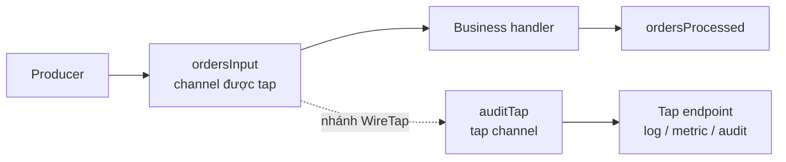
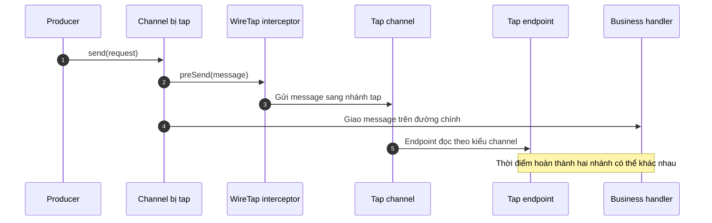
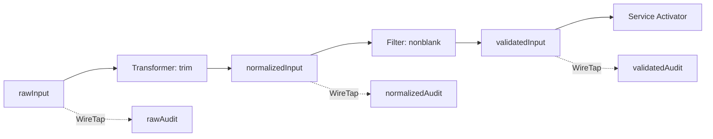
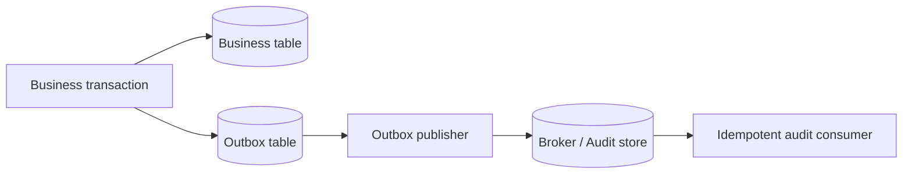

# Wire tap — Tap channel và tap endpoint trong Spring Integration

## Mục tiêu học tập

Sau bài này, bạn có thể:

- Giải thích cơ chế **Wire Tap** tạo một nhánh quan sát từ `MessageChannel` mà vẫn cho message đi theo luồng nghiệp vụ chính.
- Phân biệt **channel bị tap**, **tap channel** (kênh nhận nhánh quan sát) và **tap endpoint** (thành phần tiêu thụ/ghi nhận dữ liệu từ tap channel).
- Cài đặt `WireTap` dưới dạng `ChannelInterceptor` và cấu hình phương án Java DSL `.wireTap(...)`.
- Kiểm thử payload, header `correlationId` và vị trí quan sát trước/sau Transformer, Filter hoặc Router; phân biệt message đã được tap với xử lý nghiệp vụ hoàn thành.
- Đánh giá tác động của tap đồng bộ và bất đồng bộ đối với latency, backpressure, lỗi, error channel, retry, bảo mật và tính bền vững.

Bài thuộc chương **Wire tap** của module **SPRING_INTEGRATION_PATTERN**. Module thực hành Enterprise Integration Patterns với Spring Integration để xây dựng luồng thông điệp ít phụ thuộc và dễ mở rộng, kết hợp Router, Filter, Transformer, Splitter, Aggregator, Gateway, retry, error channel, correlation, kiểm thử và theo dõi các nhánh. Trong một hệ thống nhiều endpoint, Wire Tap cho phép quan sát message tại điểm đã chọn mà không buộc các handler nghiệp vụ phải tự gọi logger hoặc service giám sát.

## 1. Vấn đề: theo dõi message mà không trộn logic nghiệp vụ

Giả sử hệ thống tiếp nhận yêu cầu xử lý đơn hàng:

```text
ordersInput -> Normalize -> Validate -> Process -> Reply
```

Nhóm vận hành muốn ghi lại thời điểm và mã tương quan khi request vừa vào kênh, hoặc muốn gửi một bản quan sát sang hệ thống audit. Nếu từng handler tự gọi `auditService.record(...)` thì chức năng giám sát bị rải rác, khó bật/tắt và dễ làm phát sinh phụ thuộc giữa logic nghiệp vụ với hạ tầng quan sát.

**Wire Tap** là mẫu Enterprise Integration Patterns dùng để “rẽ” một nhánh sao chép/quan sát message tại một điểm trên đường truyền. Đường chính vẫn có thể xử lý message như bình thường:



Hai nhánh có mục đích khác nhau:

- **Main path**: đưa request đến Filter, Transformer, Service Activator, Gateway hoặc một endpoint nghiệp vụ.
- **Tap path**: nhận thông tin tại điểm được tap để log, đo metric, audit hoặc chẩn đoán, theo quy tắc quan sát đã công bố.

Tap không được hiểu là “business handler đã xử lý thành công”. Một message có thể được ghi nhận ở đầu flow rồi bị Filter loại, bị Router chuyển sang nhánh khác hoặc gặp lỗi ở bước kế tiếp.

## 2. “Tap channel” và “tap endpoint” là hai vai trò khác nhau

Trong Spring Integration, `WireTap` thực chất là một **`ChannelInterceptor`** có thể gắn lên một channel. Nó can thiệp vào bước gửi thông điệp của channel bị theo dõi và phát thông điệp sang một `MessageChannel` khác.

| Thành phần | Vai trò | Ví dụ |
| --- | --- | --- |
| Channel bị tap | Nơi message của luồng chính đi qua; gắn WireTap tại đây | `ordersInput` |
| `WireTap` interceptor | Tạo nhánh gửi tới kênh tap tại điểm đã chọn | `new WireTap(auditTap)` |
| **Tap channel** | Đích nhận bản message quan sát | `auditTap` là `QueueChannel` |
| **Tap endpoint** | Consumer đọc từ tap channel và thực hiện công việc phụ | `@ServiceActivator(inputChannel = "auditTap")` |
| Endpoint nghiệp vụ | Consumer của channel chính, tiếp tục xử lý nghiệp vụ | `ordersFlow` |



Tài liệu và mã nguồn thường dùng tên `tapChannel` hoặc `loggingChannel`. **Không có một kiểu Java đặc biệt tên “TapChannel” hay “TapEndpoint” bắt buộc dùng**: tap channel có thể là một `MessageChannel` bình thường, còn tap endpoint có thể là Service Activator hoặc một handler khác.

### Tap không tương đương Transformer, Router hay PublishSubscribeChannel

- **Transformer** được dùng khi cần thay đổi payload hoặc biểu diễn của message nghiệp vụ.
- **Router** quyết định đường nghiệp vụ nào sẽ nhận message.
- **PublishSubscribeChannel** phân phối message tới những subscriber của chính channel đó. Đây là lựa chọn hợp lý nếu fan-out là **ngữ nghĩa chính của luồng**.
- **Wire Tap** thêm nhánh phụ từ một **điểm quan sát** trên channel, trong khi handler chính vẫn nhận message theo cấu hình channel đó.

Wire Tap hữu ích khi mục tiêu là logging/tracing/audit và muốn kiểm soát điểm quan sát độc lập với phần nghiệp vụ. Nó không tự định nghĩa một giao kèo phân phối bền vững qua mạng.

## 3. Chọn vị trí tap: trước hay sau endpoint?

Điểm quan sát quyết định **dữ liệu bạn nhìn thấy**. Xét flow:

```text
                   tap A                       tap B
                    |                           |
request -> rawInput -> Transformer -> normalizedInput -> Filter -> processed
```

- Tap trên `rawInput` thấy payload **trước Transformer**: ví dụ chuỗi `"  ORD-42  "`.
- Tap trên `normalizedInput` thấy payload **sau Transformer**, ví dụ `"ORD-42"`, nhưng có thể vẫn chứa message mà Filter sau đó sẽ loại.
- Tap sau Filter chỉ quan sát được những message **đã đi qua Filter** tại điểm đặt tap.
- Tap trước Router không nói rõ message đã được chuyển sang nhánh nào. Muốn biết routing outcome, quan sát kênh đầu ra tương ứng hoặc một điểm nhận sau Router.

Ví dụ thiết kế:



**Chọn một điểm tap phục vụ câu hỏi cần trả lời.** Gắn tap lên mọi channel làm tăng số message ghi log, khó phân biệt lần quan sát với số request thực tế và có thể gây rò rỉ dữ liệu trước bước làm sạch. Khi cần nhiều tap để theo dõi hành trình, hãy giữ `eventId`/`correlationId` và bổ sung định danh điểm quan sát.

## 4. Ví dụ hoàn chỉnh: WireTap trên channel, tap endpoint đọc riêng

Bài toán: ứng dụng nhận mã đơn hàng qua `ordersInput`, xử lý bằng Transformer rồi tạo trạng thái `ACCEPTED`. Cùng lúc, Wire Tap đưa message đầu vào sang `auditTap`. Kênh này tách khỏi đường xử lý chính nên bài kiểm thử có thể đọc message quan sát mà không làm thay đổi handler nghiệp vụ.

Ví dụ dùng Java 17, Spring Boot/Spring Integration với các thành phần trong `spring-boot-starter-integration`, JUnit 5 và Spring Test:

```groovy
dependencies {
    implementation 'org.springframework.boot:spring-boot-starter-integration'
    testImplementation 'org.springframework.boot:spring-boot-starter-test'
}
```

### 4.1. Cấu hình hai channel và WireTap

`WireTapConfiguration.java`:

```java
import org.springframework.beans.factory.annotation.Qualifier;
import org.springframework.context.annotation.Bean;
import org.springframework.context.annotation.Configuration;
import org.springframework.integration.annotation.EnableIntegration;
import org.springframework.integration.channel.DirectChannel;
import org.springframework.integration.channel.QueueChannel;
import org.springframework.integration.channel.interceptor.WireTap;
import org.springframework.integration.dsl.IntegrationFlow;
import org.springframework.messaging.MessageChannel;

@Configuration
@EnableIntegration
public class WireTapConfiguration {

    @Bean("auditTap")
    public QueueChannel auditTap() {
        return new QueueChannel(100);
    }

    @Bean("ordersInput")
    public DirectChannel ordersInput(
            @Qualifier("auditTap") MessageChannel tapChannel) {
        DirectChannel input = new DirectChannel();

        // Intercept tất cả message gửi qua ordersInput.
        input.addInterceptor(new WireTap(tapChannel));
        return input;
    }

    @Bean("ordersProcessed")
    public QueueChannel ordersProcessed() {
        return new QueueChannel(100);
    }

    @Bean
    public IntegrationFlow ordersFlow() {
        return IntegrationFlow.from("ordersInput")
            .transform(String.class, String::trim)
            .filter(String.class, orderId -> !orderId.isBlank())
            .handle(String.class, (orderId, headers) ->
                "ACCEPTED:" + orderId)
            .channel("ordersProcessed")
            .get();
    }
}
```

Các vai trò rất cụ thể:

1. `ordersInput` là **channel bị tap**: WireTap interceptor được gắn bằng `addInterceptor(...)`.
2. `auditTap` là **tap channel**: `QueueChannel(100)` giữ tối đa 100 message đang chờ đọc.
3. `ordersFlow` là **đường nghiệp vụ**: chuẩn hóa, kiểm tra và tạo kết quả vào `ordersProcessed`.
4. `ordersProcessed` là **output channel của handler nghiệp vụ**, không phải tap channel.
5. Một **tap endpoint** sẽ đọc `auditTap` trong biến thể có ghi log hoặc đẩy sự kiện quan sát; bài kiểm thử trước hết nhận trực tiếp từ queue để xác nhận nội dung.

Với cấu hình này, audit tap nhận message **trước** khi Transformer/Filter của `ordersFlow` chạy. Vì vậy payload quan sát là dữ liệu gốc, còn output nghiệp vụ là kết quả đã xử lý. Không nên thay đổi payload quan sát rồi kỳ vọng đường chính sẽ tự dùng phiên bản đã thay đổi đó.

### 4.2. Producer gửi request

`OrderIngress.java`:

```java
import org.springframework.beans.factory.annotation.Qualifier;
import org.springframework.messaging.MessageChannel;
import org.springframework.messaging.support.MessageBuilder;
import org.springframework.stereotype.Component;

@Component
public class OrderIngress {

    private final MessageChannel ordersInput;

    public OrderIngress(
            @Qualifier("ordersInput") MessageChannel ordersInput) {
        this.ordersInput = ordersInput;
    }

    public void submit(String orderId, String correlationId) {
        boolean accepted = ordersInput.send(
            MessageBuilder.withPayload(orderId)
                .setHeader("correlationId", correlationId)
                .setHeader("eventType", "order.requested")
                .build()
        );
        if (!accepted) {
            throw new IllegalStateException("Input channel rejected request");
        }
    }
}
```

Gọi `submit("  ORD-42  ", "req-42")` đưa message đi theo cả đường chính và nhánh quan sát. Kết quả nghiệp vụ là `ACCEPTED:ORD-42`, nhưng nhánh audit thấy payload gốc `"  ORD-42  "`. `correlationId` là header ứng dụng dùng để liên kết log, không có nghĩa rằng framework đã lưu vết vào một kho bền vững.

### 4.3. Tap endpoint thực sự nhận và ghi metadata

Khi vận hành, cần consumer cho tap channel; nếu không, `auditTap` chỉ tích message cho đến khi queue đầy. Ví dụ một **tap endpoint polling**:

`AuditTapEndpoint.java`:

```java
import org.springframework.integration.annotation.Poller;
import org.springframework.integration.annotation.ServiceActivator;
import org.springframework.messaging.Message;
import org.springframework.stereotype.Component;

@Component
public class AuditTapEndpoint {

    @ServiceActivator(
        inputChannel = "auditTap",
        poller = @Poller(
            fixedDelay = "200",
            maxMessagesPerPoll = "10"
        )
    )
    public void record(Message<?> tapped) {
        // Ví dụ chỉ in metadata; không ghi payload hoặc token nhạy cảm.
        Object correlationId = tapped.getHeaders().get("correlationId");
        Object eventType = tapped.getHeaders().get("eventType");
        System.out.println(
            "tap eventType=" + eventType
            + " correlationId=" + correlationId
        );
    }
}
```

Khi dùng Spring Boot component scan, bean `AuditTapEndpoint` được tạo và poller có thể đọc từ `auditTap`. **Không chạy endpoint polling này cùng các bài kiểm thử nhận thủ công từ `auditTap`**, vì hai bên sẽ cạnh tranh lấy message. Ở mục kiểm thử, `@SpringJUnitConfig(WireTapConfiguration.class)` chỉ nạp cấu hình được chỉ định, không quét `@Component` bên ngoài cấu hình; do đó có thể kiểm tra queue một cách quyết định.

`record(...)` trả `void` nên đây là **consumer quan sát một chiều**, không phát normal reply vào header `replyChannel` của request. Không dùng tap endpoint để thay đổi trạng thái đơn hàng, tạo thanh toán hoặc xác nhận hoàn thành nghiệp vụ. Nếu audit là yêu cầu pháp lý bắt buộc, cần đường ghi nhận bền vững và chính sách xác nhận độc lập, thay vì dựa vào queue trong RAM.

## 5. Kiểm thử Wire Tap và đường nghiệp vụ

Kiểm thử dưới đây dùng Spring Test và JUnit 5 để chứng minh:

- Cùng một request gửi qua `ordersInput` được ghi nhận tại `auditTap`.
- Luồng chính tiếp tục qua Transformer, Filter và Service Activator đến `ordersProcessed`.
- Header `correlationId` vẫn có trong nhánh tap.
- Một message bị Filter loại **vẫn xuất hiện trong tap đặt trước Filter**, nhưng không có output nghiệp vụ.

`WireTapIntegrationTest.java`:

```java
import static org.junit.jupiter.api.Assertions.assertEquals;
import static org.junit.jupiter.api.Assertions.assertNotNull;
import static org.junit.jupiter.api.Assertions.assertNull;
import static org.junit.jupiter.api.Assertions.assertTrue;

import org.junit.jupiter.api.Test;
import org.springframework.beans.factory.annotation.Autowired;
import org.springframework.beans.factory.annotation.Qualifier;
import org.springframework.integration.channel.QueueChannel;
import org.springframework.messaging.Message;
import org.springframework.messaging.MessageChannel;
import org.springframework.messaging.support.MessageBuilder;
import org.springframework.test.context.junit.jupiter.SpringJUnitConfig;

@SpringJUnitConfig(WireTapConfiguration.class)
class WireTapIntegrationTest {

    @Autowired
    @Qualifier("ordersInput")
    MessageChannel ordersInput;

    @Autowired
    @Qualifier("auditTap")
    QueueChannel auditTap;

    @Autowired
    @Qualifier("ordersProcessed")
    QueueChannel ordersProcessed;

    @Test
    void observesOriginalRequestWhileBusinessFlowContinues() {
        Message<String> request = MessageBuilder
            .withPayload("  ORD-42  ")
            .setHeader("correlationId", "req-42")
            .setHeader("eventType", "order.requested")
            .build();

        assertTrue(ordersInput.send(request));

        Message<?> observed = auditTap.receive(1_000);
        Message<?> result = ordersProcessed.receive(1_000);

        assertNotNull(observed);
        assertNotNull(result);
        assertEquals("  ORD-42  ", observed.getPayload());
        assertEquals("req-42",
            observed.getHeaders().get("correlationId"));
        assertEquals("order.requested",
            observed.getHeaders().get("eventType"));
        assertEquals("ACCEPTED:ORD-42", result.getPayload());
    }

    @Test
    void observesMessageEvenIfFilterRejectsItLater() {
        assertTrue(ordersInput.send(
            MessageBuilder.withPayload("   ")
                .setHeader("correlationId", "req-empty")
                .build()
        ));

        Message<?> observed = auditTap.receive(1_000);
        assertNotNull(observed);
        assertEquals("   ", observed.getPayload());
        assertEquals("req-empty",
            observed.getHeaders().get("correlationId"));

        // Filter phía sau tap loại chuỗi trống.
        assertNull(ordersProcessed.receive(0));
    }
}
```

Các test này xác minh **định tuyến và vị trí quan sát**; chúng chưa chứng minh độ bền sau restart, tính chính xác của một logger production, hoặc hành vi khi tap channel bị quá tải. Ví dụ `QueueChannel(100)` còn đủ capacity, nên không thử chính sách khi nó đầy.

### Cần kiểm tra thêm những gì?

| Kịch bản | Kiểm tra mong đợi |
| --- | --- |
| Tap trước Transformer | Tap thấy payload trước chuẩn hóa |
| Tap sau Transformer | Tap thấy payload đã biến đổi nếu đặt WireTap trên channel sau Transformer |
| Filter từ chối | Tap ở trước Filter vẫn thấy request, tap ở sau Filter không thấy message bị loại |
| Handler nghiệp vụ ném exception | Quan sát ở đầu channel đã xảy ra, nhưng trạng thái nghiệp vụ là lỗi |
| Tap endpoint chạy chậm | Backlog tap tăng; cần metric và chính sách quá tải |
| Tap endpoint bị lỗi | Bảo đảm error handling phù hợp với loại channel, thread và mức độ ưu tiên audit |
| Nhiều request song song | Tap giữ đúng `correlationId`; kết quả quan sát có thể đến khác thứ tự xử lý nghiệp vụ |
| Reply đến muộn | Đối chiếu cả thời điểm gateway timeout và thời điểm tap/handler xử lý, không suy từ tap rằng caller đã nhận reply |

## 6. Cấu hình Java DSL `.wireTap(...)` và vị trí tap

Bên cạnh cách gắn `new WireTap(...)` vào `DirectChannel`, Java DSL của Spring Integration có toán tử `.wireTap("tapChannel")` để định nghĩa điểm tap trong một `IntegrationFlow`.

Ví dụ **phương án thay thế**, áp dụng khi channel `ordersInput` **không gắn interceptor thủ công** như mục 4:

```java
@Bean
public IntegrationFlow ordersFlow() {
    return IntegrationFlow.from("ordersInput")
        .wireTap("auditTap")
        .transform(String.class, String::trim)
        .filter(String.class, orderId -> !orderId.isBlank())
        .handle(String.class, (orderId, headers) ->
            "ACCEPTED:" + orderId)
        .channel("ordersProcessed")
        .get();
}
```

Cần khai báo bean channel `ordersInput`, `auditTap`, `ordersProcessed` như đã minh họa, nhưng bỏ `input.addInterceptor(...)` nếu dùng variant này để tránh tap trùng. DSL lắp điểm tap vào đường đi của flow và giữ trách nhiệm nghiệp vụ ở các bước kế tiếp.

Muốn thấy **payload sau Transformer**, một thiết kế minh bạch là đặt một channel có tên giữa các bước, rồi gắn interceptor WireTap vào channel trung gian đó:

```java
@Bean("normalizedOrders")
public DirectChannel normalizedOrders(
        @Qualifier("normalizedAudit") MessageChannel audit) {
    DirectChannel channel = new DirectChannel();
    channel.addInterceptor(new WireTap(audit));
    return channel;
}

@Bean
public IntegrationFlow normalizationFlow() {
    return IntegrationFlow.from("ordersInput")
        .transform(String.class, String::trim)
        .channel("normalizedOrders")
        .filter(String.class, value -> !value.isBlank())
        .handle(String.class, (value, headers) -> "ACCEPTED:" + value)
        .channel("ordersProcessed")
        .get();
}
```

Đây cũng là **phương án cấu hình độc lập**: phải khai báo thêm `normalizedAudit` và loại bỏ flow cùng tên/đường xử lý cũ khi thử; không đăng ký đồng thời hai subscriber cạnh tranh vào `ordersInput`. Lợi ích của channel trung gian là người đọc cấu hình biết chắc tap quan sát ở **sau** Transformer, **trước** Filter.

## 7. Chọn loại tap channel và tap endpoint

Channel được dùng làm tap quyết định liệu nhánh quan sát có ảnh hưởng đến đường chính hay không:

| Tap channel | Cách consumer hoạt động | Tác động cần lưu ý |
| --- | --- | --- |
| `DirectChannel` | Tap endpoint xử lý đồng bộ trong thread gửi, theo mặc định | Tap chậm hoặc lỗi có thể làm chậm/ảnh hưởng việc gửi của luồng chính |
| `QueueChannel` hữu hạn | Message được enqueue, tap endpoint poll độc lập | Tách thời điểm xử lý; đầy queue có thể gây block/timeout/lỗi; dữ liệu trong RAM có thể mất |
| `ExecutorChannel` | Dispatch cho thread khác qua executor | Tách thread nhưng phải giới hạn pool, queue và chính sách lỗi |
| `PublishSubscribeChannel` | Nhiều tap endpoint đăng ký cùng channel | Phù hợp nhiều observer, nhưng fan-out làm tăng tải và rủi ro lỗi |
| Adapter gửi sang broker | Tap endpoint/flow publish ra ngoài | Cần serialize headers, publisher confirms, retry và lưu bền vững nếu cần |

### 7.1. Tap đồng bộ có thật sự “không ảnh hưởng” main flow?

Không có bảo đảm vô điều kiện như vậy. `WireTap` hoạt động ở thời điểm channel phát message. Nếu tap channel là `DirectChannel` và subscriber gọi chậm, việc gửi trên nhánh phụ có thể giữ thread hoặc làm phát sinh lỗi tùy cấu hình và điểm xử lý.

Với `QueueChannel`, bước đưa vào queue thường nhanh khi còn chỗ, nhưng khi đầy thì producer có thể chịu backpressure, block hoặc nhận lỗi. Các mức timeout/exception còn phụ thuộc `WireTap`, `MessageChannel` và phiên bản/cấu hình. Vì vậy:

- Tránh gọi HTTP chậm hoặc DB chậm trực tiếp từ một tap đồng bộ trong đường xử lý latency-sensitive.
- Dùng tap channel có giới hạn rõ; đo backlog, tốc độ drop/reject và latency của main path.
- Quy định tap là **best effort** hay **mandatory**. Nếu mandatory audit, nên dùng cơ chế bền vững có xác nhận và chính sách thất bại rõ ràng.
- Không giả định chỉ vì Wire Tap là “quan sát” thì mọi exception đều bị tự động bỏ qua hoặc main path chắc chắn không bị ảnh hưởng.

### 7.2. Tap channel đầy: mất log hay gây nghẽn?

Giả sử `auditTap` có capacity 100, nguồn phát 200 message/giây nhưng tap endpoint chỉ ghi được 20 message/giây. Backlog tăng gần 180 message/giây và có thể đầy sau khoảng 100 / 180 ≈ **0,56 giây** nếu ban đầu queue rỗng và tốc độ đều.

Khi queue đầy, cần lựa chọn phù hợp với yêu cầu:

- Giảm/sampling lưu lượng tap, chỉ ghi metadata cần thiết, giới hạn số sự kiện phát sinh.
- Tăng năng lực tap endpoint trong giới hạn chi phí.
- Nếu là giám sát không bắt buộc, có thể chọn **bỏ quan sát có kiểm soát** và ghi metric drop, nhưng cần bảo đảm chính sách bỏ được triển khai thật, không dựa vào giả định mặc định.
- Nếu là audit bắt buộc, chuyển sang kho bền vững, outbox hoặc broker có giao thức xác nhận; tránh im lặng mất sự kiện.
- Tránh tạo vòng lặp khi tap endpoint lại gửi về chính channel bị tap: có thể làm message bị tap nhiều lần và gây đệ quy.

**Độ đầy của audit queue không đại diện cho độ đầy của business queue.** Hai nhánh cần metric riêng để phát hiện tap quá tải ngay cả khi nghiệp vụ vẫn chạy.

## 8. Chọn dữ liệu quan sát: header, payload và bảo mật

Một tap ở đầu pipeline có thể nhận **payload gốc** trước validation, redaction hoặc tokenization. Nếu ghi nguyên message vào log/broker, dữ liệu nhạy cảm có thể bị sao chép sang nơi không được bảo vệ đúng mức.

Một hợp đồng quan sát tối thiểu:

| Trường | Nên quan sát? | Ghi chú |
| --- | --- | --- |
| `eventId` | Có, nếu được cấp | Nhận diện một sự kiện cụ thể, phục vụ dedup/điều tra |
| `correlationId` / trace ID | Có, nếu hợp lệ | Ghép thông tin giữa các nhánh và request–reply |
| `eventType` | Có | Phân loại thông điệp |
| Tên channel/endpoint | Có | Biết message được tap ở đâu |
| Thời điểm quan sát | Có | Khác thời điểm nghiệp vụ commit hoặc reply thành công |
| Raw payload | Tùy giao kèo | Cần kiểm tra PII, secret, kích thước và retention |
| `authorization`, cookie, token | Thường không | Tuyệt đối tránh log bí mật truy cập |
| `replyChannel` / `errorChannel` | Không serialize như object | Đây là địa chỉ nội bộ, không phải metadata audit chung |

**Tap không tự tạo deep copy an toàn của payload.** Spring message và headers có cơ chế bất biến ở mức message wrapper, nhưng payload có thể là một đối tượng Java mutable. Nếu tap endpoint thay đổi object đó, các nhánh có thể nhìn thấy tác động ngoài dự kiến. Tap endpoint nên **chỉ đọc** message và tạo một bản ghi audit DTO độc lập chứa các trường đã được chọn/làm sạch.

Ví dụ dữ liệu audit nên tạo ở endpoint:

```json
{
  "type": "channel_observed",
  "channel": "ordersInput",
  "eventType": "order.requested",
  "correlationId": "req-42",
  "observedAt": "2026-11-21T05:00:00Z"
}
```

Đây là mẫu JSON **do ứng dụng tự quy định**, không phải payload được `WireTap` tự động xây dựng. Nếu dùng nhiều điểm tap, thêm `tapPoint` để phân biệt `rawInput` với `validatedInput`.

## 9. Error channel, retry và correlation khi tap gặp sự cố

### 9.1. Error channel có theo dõi mọi lỗi tap không?

Không nên mặc định. Với `DirectChannel` và một tap endpoint đồng bộ, exception có thể xuất hiện trong call stack gửi message. Với `QueueChannel` hoặc `ExecutorChannel`, lỗi khi tap endpoint tiêu thụ có thể xảy ra sau khi main flow đã đi tiếp; quan sát cần dựa vào error handler/error channel hoặc bộ giám sát của endpoint theo cấu hình.

`errorChannel` phục vụ `ErrorMessage` ở những cơ chế được cấu hình để phát lỗi theo channel. Nó không có nghĩa mọi exception ở mọi endpoint đều tự được đưa tới cùng một error channel.

Nếu tap endpoint chỉ log, nên làm cho việc log **idempotent hoặc chấp nhận lặp**, và không để nó vô tình trả một reply nghiệp vụ. Nếu tap endpoint publish sang broker rồi retry, hãy giữ `eventId` ổn định qua các attempt để không tạo vô số bản ghi audit từ một sự kiện.

### 9.2. Tap và Request–Reply

Một request từ `@MessagingGateway` có thể mang header `replyChannel` trỏ tới kênh reply tạm thời. Wire Tap ở đầu flow quan sát request, nhưng:

- Nó **không** mặc định tạo normal reply cho Gateway.
- Reply phải do endpoint xử lý nghiệp vụ hoặc flow reply thực sự sinh ra.
- Tap endpoint dạng `void` tránh phát thêm message kết quả có thể gây nhầm đường trả lời.
- Caller có thể timeout trong khi worker vẫn tiếp tục xử lý, tạo **late reply**; tap ở đầu vào chỉ xác nhận request đã đi qua điểm quan sát.
- Nếu nhiều request đồng thời, `correlationId` giúp tìm đúng chuỗi xử lý; tap không tự bảo đảm thứ tự hoàn thành các nhánh.

Trong hệ thống phân tán, header `replyChannel` chứa tham chiếu `MessageChannel` nội bộ không thể serialize nguyên vẹn qua Kafka/RabbitMQ. Nếu đẩy bản quan sát sang broker, hãy chỉ ánh xạ những header an toàn trong hợp đồng audit và không chuyển object channel sang bên ngoài.

### 9.3. Tap không phải công cụ bảo đảm exactly-once

Kể cả business path thành công, audit message trên QueueChannel trong RAM vẫn có thể mất khi process crash. Nếu tap endpoint ghi vào DB rồi crash trước khi ack ở một consumer/broker, sự kiện có thể được giao lại và ghi trùng.

Muốn audit bắt buộc, cần chỉ rõ ranh giới giao dịch và độ bền, ví dụ:



Ghi business data và outbox trong cùng transaction DB sẽ làm bằng chứng sự kiện không phụ thuộc vào việc một tap queue trong RAM có kịp gửi hay không. Publisher/consumer vẫn cần retry và idempotency. Wire Tap vẫn hữu ích cho **quan sát đường truyền**, còn outbox là một cơ chế dành cho **bảo đảm phát sinh sự kiện nghiệp vụ**.

## 10. Đo lường và kiểm thử vận hành

Một số metric đáng theo dõi theo **từng điểm tap**:

| Metric | Ý nghĩa |
| --- | --- |
| `tap_observed_total` | Số message đi qua điểm quan sát |
| `tap_forwarded_total` | Số message được tap channel chấp nhận theo cơ chế của nó |
| `tap_drop_total` | Số message quan sát bị loại, nếu có chính sách drop |
| `tap_queue_depth` | Backlog của kênh tap có buffer |
| `tap_endpoint_error_total` | Lỗi ghi/đẩy dữ liệu của tap endpoint |
| `tap_processing_latency` | Độ trễ của endpoint quan sát |
| Business success/failure | Kết quả nghiệp vụ thực sự, **khác** số message bị tap |

Các tên trên là **metric đề xuất**, không khẳng định framework tự sinh đúng tên đó. Cần thiết lập observation/Micrometer/wire tap endpoint phù hợp mới có dữ liệu.

Kiểm thử tích hợp bổ sung nên tập trung vào:

1. **Đặt tap ở hai vị trí:** một trước Transformer và một sau Filter, xác minh dữ liệu khác nhau đúng kỳ vọng.
2. **Tap endpoint lỗi:** mô phỏng audit writer ném exception, xác định ảnh hưởng thực tế đến main path theo loại channel.
3. **Tap channel đầy:** dùng bounded queue nhỏ và tạo burst; kiểm tra latency, thất bại và chính sách xử lý.
4. **Tap không tạo reply:** đặt `replyChannel` trên request; xác minh chỉ handler nghiệp vụ trả normal reply.
5. **Đa luồng:** gửi nhiều request, ghép tap records theo `correlationId`; không giả định thứ tự tap hoàn tất giống thứ tự reply.
6. **Bảo mật:** chèn token giả lập trong header, xác nhận hệ thống audit không ghi token đó.
7. **Crash/retry:** xác minh message audit có được lưu bền vững và có thể dedup hay không; nếu chỉ dùng queue RAM, ghi nhận giới hạn rõ.
8. **Tích hợp broker:** kiểm tra mapper loại bỏ `replyChannel`/`errorChannel` nội bộ, preserve `eventId`/`correlationId` và xử lý retry/redelivery.

## 11. Sai lầm thường gặp

| Sai lầm | Hệ quả | Cách khắc phục |
| --- | --- | --- |
| Coi tap channel là nơi nhận của business handler | Đường nghiệp vụ bị nhầm với đường audit | Đặt tên riêng `ordersProcessed` và `auditTap`, kiểm thử cả hai |
| Tap trước Filter nhưng coi đó là số message hợp lệ | Metric audit bị hiểu nhầm là số nghiệp vụ thành công | Gắn tap đúng điểm, đặt tên metric theo trạng thái |
| Tap channel là `QueueChannel` nhưng không có tap endpoint | Queue đầy rồi ảnh hưởng luồng gửi hoặc mất quan sát | Cấu hình poller, capacity và overload policy |
| Tap đồng bộ gọi dịch vụ ngoài chậm | Business latency tăng | Tách endpoint quan sát hoặc dùng hệ thống lưu đệm có kiểm soát |
| Chỉ dùng một log statement để làm audit bắt buộc | Log bị mất hoặc không cùng giao dịch nghiệp vụ | Dùng outbox, broker/DB bền vững và idempotency |
| Tap endpoint sửa payload mutable | Có thể làm thay đổi dữ liệu đường chính | Chỉ đọc và tạo DTO quan sát độc lập |
| Ghi toàn bộ request ở đầu flow | Rò rỉ token, PII, payload nhạy cảm | Allowlist metadata, sanitize và retention policy |
| Đặt nhiều WireTap trên cùng channel ngoài ý muốn | Một message tạo nhiều bản quan sát | Chọn một cấu hình interceptor hoặc DSL, kiểm tra số bản |
| Dùng tap thay error channel | Không quan sát đủ lỗi bất đồng bộ | Cấu hình error handler/error channel và metric riêng |
| Tưởng tap thành công nghĩa là consumer đã commit | Báo trạng thái hoàn tất sai | Theo dõi business result/ack độc lập |
| Tạo vòng phản hồi từ audit về channel bị tap | Có thể lặp vô hạn hoặc gây recursion | Thiết kế tap path một chiều; không nối lại channel nguồn |

## 12. Bài tập thực hành

**Bài 1 — Tap channel cơ bản.** Chạy `WireTapConfiguration` và gửi `"  ORD-42  "`. Xác minh `auditTap` nhận payload gốc, `ordersProcessed` nhận `ACCEPTED:ORD-42`, và hai nhánh cùng mang `correlationId=req-42` ở điểm phù hợp.

**Bài 2 — Tap endpoint.** Bổ sung `AuditTapEndpoint` polling `auditTap`, chỉ ghi `correlationId` và `eventType`. Giải thích vì sao không nên chạy test đọc tay từ queue đồng thời với endpoint này.

**Bài 3 — Đổi vị trí.** Gắn WireTap vào channel sau Transformer. Gửi request chứa khoảng trắng và một request chuỗi rỗng; xác nhận quan sát phản ánh đúng vị trí so với Filter.

**Bài 4 — Tap đồng bộ và bất đồng bộ.** So sánh tap channel `DirectChannel` với `QueueChannel`. Cho tap endpoint mất 500 ms xử lý; đo thời gian gửi `ordersInput.send()` và xác định tác động lên main flow.

**Bài 5 — Nhánh quan sát quá tải.** Dùng tap queue dung lượng 2 và không khởi chạy tap consumer. Gửi nhiều message, quan sát hành vi khi đầy; đề xuất chính sách nếu audit là best effort và nếu audit là mandatory.

**Bài 6 — Request–Reply.** Tạo `@MessagingGateway` gọi handler sau tap, định nghĩa reply và correlation. Chứng minh tap endpoint không trả normal reply và Gateway chỉ nhận kết quả của nhánh nghiệp vụ.

**Bài 7 — Audit bền vững.** Thiết kế outbox cho sự kiện `OrderAccepted`. So sánh tính chất vận hành của outbox với Wire Tap dùng QueueChannel trong RAM, đặc biệt khi process chết ngay sau DB commit.

**Tiêu chí hoàn thành:** chỉ ra được channel bị tap, tap channel, tap endpoint, nội dung được quan sát tại vị trí đặt tap và kết quả thật của nhánh nghiệp vụ; có kiểm thử chứng minh không nhầm lẫn hai đường.

## 13. Ghi nhớ

- **Wire Tap** thêm nhánh quan sát tại `MessageChannel`; **tap channel** nhận message quan sát, còn **tap endpoint** tiêu thụ message từ channel đó.
- Có thể cài qua `ChannelInterceptor` (`new WireTap(...)`) hoặc Java DSL `.wireTap(...)`. Tránh cài hai lần ngoài ý muốn trên cùng đường.
- Vị trí tap quyết định nội dung quan sát: trước Transformer, sau Filter hay tại một nhánh Router sẽ có dữ liệu và ý nghĩa metric khác nhau.
- Tap là điểm quan sát, không tự biến thành kết quả nghiệp vụ, reply cho Gateway hay bảo đảm audit bền vững.
- Muốn chạy an toàn, phải kiểm soát latency, queue capacity, error channel, correlation, dữ liệu nhạy cảm và giới hạn bảo đảm giữa main path với tap path.
