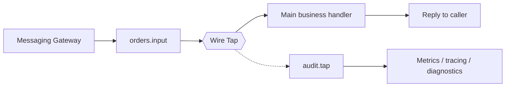
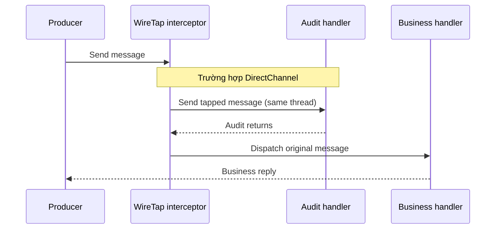
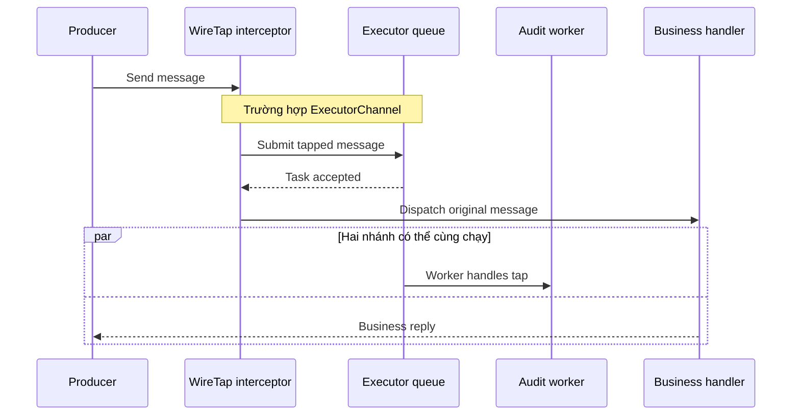

# Tap đồng bộ và bất đồng bộ

## 1. Bài toán: quan sát luồng message nhưng vẫn xử lý nghiệp vụ

Trong một luồng Spring Integration, thông điệp có thể đi qua `Messaging Gateway` hoặc `Channel Adapter`, rồi được `Transformer`, `Filter`, `Router`, `Service Activator` hoặc các endpoint khác xử lý. Khi cần đo độ trễ, ghi trace hoặc kiểm tra thông tin chẩn đoán ở một điểm của luồng, việc đưa logic quan sát trực tiếp vào từng handler khiến nghiệp vụ phụ thuộc vào logging/metrics.

**Wire Tap** là một Enterprise Integration Pattern (EIP) để **lấy thêm một nhánh quan sát thông điệp** khi thông điệp đi qua một channel. Message vẫn tiếp tục đến consumer nghiệp vụ, còn bản chuyển tiếp tới tap channel phục vụ việc quan sát hoặc xử lý phụ trợ. Trong Spring Integration, `WireTap` là một `ChannelInterceptor`; Java DSL hỗ trợ thao tác `wireTap(...)`.

Cần quyết định **tap đồng bộ hay bất đồng bộ**. Nếu tap channel là `DirectChannel` và handler quan sát chậm, thời gian xử lý ở nhánh chính có thể tăng. Nếu tap channel chuyển việc sang `ExecutorChannel`, phần quan sát thường chạy trên thread khác, giảm thời gian chờ trực tiếp, nhưng phát sinh câu hỏi về nghẽn hàng đợi, lỗi xử lý và mất dữ liệu khi tiến trình dừng.

Bài học thuộc chương **Wire tap** của module `SPRING_INTEGRATION_PATTERN`: học triển khai Enterprise Integration Patterns với Spring Integration để tạo các luồng thông điệp ít phụ thuộc và dễ mở rộng, kết hợp Router, Filter, Transformer, Splitter, Aggregator, Gateway, retry, error channel, correlation, kiểm thử và quan sát các nhánh xử lý.

Sau bài học, bạn có thể:

- Giải thích vị trí của Wire Tap trong một integration flow và so sánh với `PublishSubscribeChannel`, `RecipientListRouter` và handler logging thông thường.
- Phân tích sự khác biệt về thread, độ trễ, thứ tự xử lý và lan truyền lỗi khi tap channel là `DirectChannel` hoặc `ExecutorChannel`.
- Tạo ví dụ Spring Integration Java DSL dùng cùng một luồng nghiệp vụ nhưng thay đổi cách thực thi nhánh tap.
- Chọn chiến lược backpressure, giới hạn dữ liệu quan sát, làm sạch payload và giám sát nhánh tap.
- Kiểm thử hiệu ứng trên luồng chính, cùng các tình huống chậm, lỗi, bão hòa executor và restart.

## 2. Vị trí Wire Tap và đường đi thông điệp

Giả sử dịch vụ nhận lệnh `SubmitOrder`. Mỗi lần message đi vào `orders.input`, hệ thống cần thu thập tín hiệu quan sát nhưng vẫn gọi handler xử lý đơn hàng.



Sơ đồ có hai nhánh logic: **nhánh chính** dùng để tính kết quả nghiệp vụ và **nhánh tap** dùng để quan sát. Wire Tap gửi một message sang channel phụ tại điểm được cấu hình; nó **không có trách nhiệm tạo ra reply nghiệp vụ**, không tự làm bản sao bền vững và không tự ghi lại lịch sử giao dịch.

### 2.1. Những thuộc tính cơ bản

| Thuộc tính | Ý nghĩa đối với thiết kế |
| --- | --- |
| Điểm gắn | Một channel hoặc bước trong `IntegrationFlow` được gắn interceptor/tap. |
| Message | Wire Tap chuyển tiếp message để consumer tap quan sát; không tự chuyển đổi payload. |
| Nhánh chính | Vẫn nhận message qua cơ chế dispatch của channel chính. |
| Nhánh tap | Chọn `MessageChannel` và handler riêng; tính chất đồng bộ/bất đồng bộ phụ thuộc loại channel và executor. |
| Thời điểm | Tap quan sát message **tại điểm đi qua channel**; không mặc nhiên là bằng chứng nghiệp vụ downstream đã thành công. |
| Delivery | Không có bảo đảm durable/exactly-once chỉ vì thêm Wire Tap. |
| Phản hồi | Nhánh tap thường one-way; kết quả của handler tap không phải response cho gateway nghiệp vụ. |

**Điểm phân biệt quan trọng:** `DirectChannel` gửi đến một subscriber theo chính sách dispatch của nó. Wire Tap là interceptor tạo đường quan sát phụ; nó không đơn thuần thêm một subscriber thứ hai rồi hy vọng cả hai đều nhận. Nếu muốn fan-out nhiều nhánh đồng cấp theo hợp đồng publish–subscribe, hãy xét `PublishSubscribeChannel` hoặc router phù hợp.

### 2.2. Tap không phải “after successful commit”

Nếu Wire Tap gắn trước handler xử lý đơn, nhánh tap có thể ghi nhận `OrderSubmitted` **trước khi** handler gọi DB và commit. Nếu handler thất bại hoặc transaction rollback, tín hiệu tap vẫn có thể đã được gửi và quan sát. Vì vậy hãy đặt tên sự kiện đúng ngữ nghĩa: `order-request-received` khác `order-committed`.

Một hệ thống cần audit tuân thủ hoặc sự kiện kinh doanh đảm bảo phải dùng cơ chế gắn chặt với commit (chẳng hạn ghi audit trong cùng DB transaction hoặc **transactional outbox**) thay vì suy luận rằng một tap đã gửi nghĩa là giao dịch đã hoàn tất.

## 3. Đồng bộ và bất đồng bộ: khác nhau ở channel đích

**Wire Tap được gọi tại ranh giới gửi message; nhánh tap chạy đồng bộ hay bất đồng bộ chủ yếu do channel đích và cơ chế dispatch của nó.** Bản thân từ “tap” không nói lên threading model.

| Tiêu chí | Tap đến `DirectChannel` | Tap đến `ExecutorChannel` |
| --- | --- | --- |
| Cách dispatch | Handler tap thường chạy ngay trong thread gửi. | Handler tap được giao cho `TaskExecutor` để chạy ở thread khác khi executor nhận việc. |
| Độ trễ trên đường chính | Có thể bao gồm toàn bộ thời gian handler tap. | Thường chịu chi phí enqueue/dispatch; vẫn có thể bị ảnh hưởng khi executor quá tải. |
| Thứ tự tương đối | Handler tap đồng bộ hoàn thành trước khi lời gọi gửi tiếp tục qua điểm interception. | Handler tap có thể hoàn thành trước hoặc sau xử lý chính; không giả định thứ tự kết thúc. |
| Exception | Lỗi ở nhánh tap xảy ra trên đường gửi đồng bộ; tác động cụ thể còn phụ thuộc cơ chế xử lý lỗi của interceptor/channel. | Lỗi tại worker thread cần quan sát bằng error handling, logging/metrics của executor hoặc adapter; có thể không về caller trực tiếp. |
| Context theo thread | Có thể dùng cùng thread-bound context nếu vẫn ở thread đó. | `ThreadLocal`, MDC và transaction không tự chuyển qua thread mới. |
| Độ bền | Không được bảo đảm chỉ bởi `DirectChannel`. | Task queue trong bộ nhớ không phải durable queue. |
| Phù hợp | Kiểm tra hoặc quan sát rất nhanh, phụ thuộc tức thời có chủ ý. | Metrics, trace enrichment, logging phụ trợ không cần chặn nghiệp vụ. |

`ExecutorChannel` không đồng nghĩa “không bao giờ chặn”. Một executor có queue hữu hạn có thể từ chối task khi đầy; một chính sách như `CallerRunsPolicy` có thể chạy handler ngay trên thread caller khi bão hòa. Khi audit sink chậm, ngay cả tap bất đồng bộ cũng có thể tạo áp lực về CPU, RAM, thread và thời gian chờ.

### 3.1. So sánh bằng timeline





Các timeline mô tả luồng thông thường, không thay thế kiểm thử hành vi theo phiên bản framework, cấu hình channel và chính sách lỗi. Đặc biệt, nếu audit được thực thi bằng nhiều worker, các message liên tiếp có thể hoàn thành **không theo thứ tự nhận**.

## 4. Ví dụ Java DSL: tap đồng bộ với DirectChannel

Ví dụ dùng Java 17+, Spring Boot 3.x và Spring Integration 6.x. Một `Messaging Gateway` nhận mã đơn, nhánh chính trả về `ACCEPTED:...`, nhánh tap chỉ tăng bộ đếm quan sát. Việc đếm đơn giản giúp tập trung vào sự khác biệt giữa hai loại channel; hệ thống thật có thể thay bằng Micrometer, trace exporter hoặc sink có kiểm soát dữ liệu nhạy cảm.

### 4.1. Thành phần nghiệp vụ và bộ đếm quan sát

```java
import java.util.concurrent.atomic.AtomicLong;

import org.springframework.stereotype.Component;
import org.springframework.stereotype.Service;

@Service
public class OrderService {
    public String accept(String orderId) {
        if (orderId == null || orderId.isBlank()) {
            throw new IllegalArgumentException("Order ID must not be blank");
        }
        return "ACCEPTED:" + orderId.trim();
    }
}

@Component
public class TapObserver {
    private final AtomicLong observed = new AtomicLong();

    public void onTap(String orderId) {
        // Chỉ đếm sự kiện; không log mã đơn/PII trong ví dụ.
        observed.incrementAndGet();
    }

    public long observedCount() {
        return observed.get();
    }
}
```

`TapObserver` sử dụng `AtomicLong` để bộ đếm an toàn khi thay channel sang executor đa luồng. Nó minh họa tín hiệu quan sát chứ **không phải nhật ký audit bền vững**. Vì hai lớp trong ví dụ đều là `public`, hãy đặt `OrderService` và `TapObserver` trong hai file Java riêng khi đưa vào dự án.

### 4.2. Khai báo channel và hai flow độc lập

```java
import org.springframework.context.annotation.Bean;
import org.springframework.context.annotation.Configuration;
import org.springframework.integration.annotation.IntegrationComponentScan;
import org.springframework.integration.channel.DirectChannel;
import org.springframework.integration.config.EnableIntegration;
import org.springframework.integration.dsl.IntegrationFlow;
import org.springframework.messaging.MessageChannel;

@Configuration
@EnableIntegration
@IntegrationComponentScan
public class WireTapConfiguration {

    @Bean("orders.input")
    MessageChannel ordersInput() {
        return new DirectChannel();
    }

    @Bean("audit.tap")
    MessageChannel auditTap() {
        return new DirectChannel();
    }

    @Bean
    IntegrationFlow orderFlow(OrderService orders) {
        return IntegrationFlow.from("orders.input")
                .wireTap("audit.tap")
                .handle(String.class,
                        (orderId, headers) -> orders.accept(orderId))
                .get();
    }

    @Bean
    IntegrationFlow auditFlow(TapObserver observer) {
        return IntegrationFlow.from("audit.tap")
                .handle(String.class, (orderId, headers) -> {
                    observer.onTap(orderId);
                    return null; // Nhánh quan sát một chiều.
                })
                .get();
    }
}
```

`.wireTap("audit.tap")` gắn tap tại vị trí chỉ định của `orderFlow`. Trong ví dụ này, `orders.input` được khai báo là `DirectChannel`, `audit.tap` cũng là `DirectChannel`. Khi message đi vào flow, nhánh tap chạy đồng bộ theo hành vi dispatch của kênh; nhánh chính tiếp tục gọi `OrderService.accept(...)`.

Phần `auditFlow` được thiết kế **không trả reply**. Không đưa kết quả quan sát trở lại gateway nghiệp vụ, vì một message nghiệp vụ không nên có hai nhánh cùng tranh gửi reply.

### 4.3. Gateway để kiểm chứng hành vi

```java
import org.springframework.integration.annotation.Gateway;
import org.springframework.integration.annotation.MessagingGateway;

@MessagingGateway(defaultRequestChannel = "orders.input")
public interface OrdersGateway {

    @Gateway(replyTimeout = "3000")
    String submit(String orderId);
}
```

Với `submit(" ORD-42 ")`, handler chính trả `ACCEPTED:ORD-42`; bộ đếm tap tăng cho lần message đi qua vị trí gắn interceptor. Vì tap đồng bộ, thời gian của `TapObserver.onTap(...)` thường nằm trên đường gửi message trước khi hoàn tất lời gọi gateway.

Nếu thay `onTap` bằng lời gọi REST hoặc ghi log chặn I/O mất 2 giây, đường xử lý chính có thể bị kéo dài tương ứng. Đây là **tác động hiệu năng** cần xác định ngay khi chọn DirectChannel.

## 5. Biến thể bất đồng bộ: ExecutorChannel + thread pool

Giữ nguyên `orderFlow`, `auditFlow` và `OrdersGateway` ở phần 4. Chỉ **thay bean `audit.tap`** bằng một `ExecutorChannel` sử dụng executor riêng để cách ly nguồn lực cho quan sát. Không khai báo song song hai bean cùng tên `audit.tap` trong một application context.

```java
import org.springframework.context.annotation.Bean;
import org.springframework.integration.channel.ExecutorChannel;
import org.springframework.messaging.MessageChannel;
import org.springframework.scheduling.concurrent.ThreadPoolTaskExecutor;

@Bean("auditExecutor")
ThreadPoolTaskExecutor auditExecutor() {
    ThreadPoolTaskExecutor executor = new ThreadPoolTaskExecutor();
    executor.setCorePoolSize(2);
    executor.setMaxPoolSize(4);
    executor.setQueueCapacity(200);
    executor.setThreadNamePrefix("audit-tap-");
    return executor;
}

@Bean("audit.tap")
MessageChannel auditTap(ThreadPoolTaskExecutor auditExecutor) {
    return new ExecutorChannel(auditExecutor);
}
```

Đoạn trên là **các phương thức bean thay thế** đặt trong lớp `@Configuration`, không phải một file Java độc lập có thể biên dịch khi bỏ qua class wrapper. Spring quản lý việc khởi tạo và hủy `ThreadPoolTaskExecutor` theo lifecycle của bean. Trong ứng dụng có nhiều `ThreadPoolTaskExecutor`, dùng `@Qualifier("auditExecutor")` để chọn đúng bean.

Cách vận hành:

1. Message đến `orders.input` và Wire Tap gửi yêu cầu quan sát sang `audit.tap`.
2. `ExecutorChannel` bàn giao công việc cho executor, thường trả về sau khi task được chấp nhận.
3. Nhánh chính tiếp tục xử lý và tạo reply; audit worker xử lý `TapObserver.onTap` trên thread khác.
4. Nhánh tap có thể hoàn tất **sau** reply nghiệp vụ. Nếu tiến trình chết trước khi worker chạy, dữ liệu quan sát đang ở queue bộ nhớ có thể mất.

**Không dùng một executor vô hạn mà không đo lưu lượng.** Kích thước pool, capacity, thời gian xử lý audit, hành vi khi queue đầy và giới hạn tải cần được thiết kế theo nhu cầu thật. Pool dành riêng cho tap ngăn nhánh quan sát lấy hết thread của nghiệp vụ, nhưng vẫn có thể cạnh tranh CPU, bộ nhớ và kết nối mạng.

### 5.1. Các chính sách khi executor bị bão hòa

| Tình huống | Tác động có thể xảy ra | Hướng xử lý |
| --- | --- | --- |
| Task xử lý chậm, queue còn chỗ | Audit bị trễ, số message chờ tăng. | Theo dõi queue depth, tuổi task, latency và tình trạng sink. |
| Executor hết thread và queue đầy | Task có thể bị từ chối, trả lỗi từ lúc submit hoặc áp dụng chính sách rejection. | Chọn rejection policy và kiểm thử đường lỗi, không giả định silent drop. |
| `CallerRunsPolicy` | Caller có thể thực thi tác vụ audit khi pool đầy. | Dễ tạo độ trễ lớn cho đường nghiệp vụ dù được gọi là tap “async”. |
| Restart/crash khi queue còn việc | Công việc chưa xử lý trong bộ nhớ bị mất. | Với audit bắt buộc, dùng outbox hoặc broker bền vững. |
| Nhiều audit worker | Các message có thể xử lý/hoàn thành không đúng thứ tự nhận. | Chọn serial worker/partition theo key nếu nghiệp vụ cần ordering. |

Nhánh tap không tự có backpressure độc lập với nhánh chính. Một chính sách chấp nhận bỏ bớt **số liệu chẩn đoán không trọng yếu** có thể phù hợp, nhưng cần đo lượng dữ liệu bỏ; không được áp dụng cách này cho nghĩa vụ audit bắt buộc.

### 5.2. QueueChannel: một lựa chọn tách thời điểm xử lý khác

Thay vì ExecutorChannel, có thể đưa tapped message tới `QueueChannel` và dùng một poller tiêu thụ. Lúc này message có thể được xếp đệm và xử lý định kỳ. Tuy nhiên, `QueueChannel` mặc định lưu trong bộ nhớ, cần poller ở phía consumer, và hành vi khi đầy cần được kiểm soát.

```text
WireTap
  -> audit.tap (QueueChannel, capacity hữu hạn)
      -> polling auditFlow
          -> metrics / tracing sink
```

Không coi QueueChannel hoặc ExecutorChannel là thông điệp đã được persist. Nếu tap được dùng làm nguồn sự kiện kinh doanh bền vững, cần một tài nguyên durable thực sự.

## 6. Độ trễ, thứ tự và ngữ nghĩa quan sát

### 6.1. Thời gian phản hồi

Với DirectChannel, một ước lượng để hiểu tác động là:

```text
T_request ≈ T_upstream + T_tap_sync + T_business + T_reply
```

Với ExecutorChannel trong trạng thái không bão hòa:

```text
T_request ≈ T_upstream + T_submit_tap + T_business + T_reply
T_audit   ≈ T_wait_executor_queue + T_audit_handler
```

Các biểu thức này chỉ dùng để phân tích, không phải bảo đảm thời gian chạy. CPU contention, GC, lock, I/O và rejection policy có thể làm `T_request` tăng ngay cả khi tap là async. Đặc biệt, một gateway có `replyTimeout` vẫn có thể chờ một handler đồng bộ bị chặn và **replyTimeout không tự ngắt** I/O đang chạy trong cùng thread.

### 6.2. Không thể dùng thứ tự log để kết luận thứ tự nghiệp vụ

Với tap đồng bộ đặt trước handler, sự kiện “message đi qua input channel” có thể được ghi trước khi xử lý nghiệp vụ. Điều đó **không có nghĩa đơn hàng đã commit**.

Với tap bất đồng bộ, message A có thể được xử lý chính xong trước khi audit A được ghi; audit của message B thậm chí có thể hoàn tất trước audit A nếu executor có nhiều worker. Vì vậy:

- Dùng định danh nguồn như `eventId` hoặc `correlationId` để ghép log/trace; không dựa duy nhất vào timestamp hoặc thứ tự xuất hiện.
- Ghi rõ event quan sát là `received`, `validated`, `attempted` hay `committed`.
- Khi cần trình tự nghiêm ngặt cho mỗi aggregate, dùng thứ tự theo partition/key hoặc một luồng xử lý có quy tắc ordering rõ ràng; Wire Tap không tự bảo đảm thứ tự toàn cục.

### 6.3. Headers, MDC và payload có thể thay đổi

Wire Tap chuyển tiếp message tại điểm được gắn; message có payload và các headers như `correlationId`, `replyChannel`, `errorChannel` hoặc tracing metadata. Với các handler thông thường, nhánh tap có thể đọc headers để giữ liên hệ với luồng chính.

Tuy nhiên:

- `MessageHeaders` được thiết kế bất biến, nhưng **payload có thể là đối tượng mutable**. Chuyển message sang tap không mặc nhiên deep-copy đồ thị đối tượng. Không chỉnh sửa payload chia sẻ từ audit handler.
- `MDC`, security context và các `ThreadLocal` khác **không tự động truyền** từ sender thread sang executor thread. Nếu cần trace context, dùng propagation mechanism được cấu hình cho executor/instrumentation.
- Không log toàn bộ headers một cách vô điều kiện: chúng có thể chứa thông tin nội bộ hoặc đối tượng `replyChannel` và metadata nhạy cảm.
- Nếu Transformer trước/sau điểm tap tạo message mới, các giá trị được quan sát là **snapshot logic tại vị trí tap**, không phải mọi trạng thái của message trong toàn pipeline.

## 7. Xử lý lỗi: lỗi tap có nên ảnh hưởng nghiệp vụ?

Không nên mặc định rằng nhánh tap luôn an toàn hoặc luôn có cùng semantics với nhánh chính. Sự lan truyền exception phụ thuộc chỗ bắt lỗi, `ChannelInterceptor`, loại channel, error handler và framework version. Với DirectChannel, handler tap chạy trên đường gửi đồng bộ và một lỗi chậm có thể gây tác động trực tiếp tới latency; với ExecutorChannel, exception từ worker thường cần xử lý ở hạ tầng async, vì caller đã tiếp tục.

**Chính sách lỗi phải phụ thuộc mục đích tap:**

| Mục đích | Mức độ chấp nhận mất bản ghi | Chính sách phù hợp |
| --- | --- | --- |
| Metrics bổ trợ, debugging sample | Có thể chấp nhận nếu đo được số lần drop. | Ưu tiên luồng chính, giới hạn queue, sampling và cảnh báo sink hỏng. |
| Trace phục vụ điều tra | Hạn chế tối đa nhưng có thể áp dụng sampling/retention. | Gắn correlation và trace context; theo dõi export failure và queue backlog. |
| Audit bắt buộc theo nghiệp vụ | Không chấp nhận mất bản ghi cần tuân thủ. | Ghi trong cùng DB transaction hoặc transactional outbox/broker durable. |
| Sự kiện dùng để kích hoạt nghiệp vụ khác | Không được coi là bản sao chẩn đoán tùy ý. | Dùng event publication/delivery pattern phù hợp với retry, idempotency và DLQ. |

### 7.1. Tại sao `try/catch` rồi chỉ log có thể chưa đủ?

Giả sử nhánh tap gọi audit service qua HTTP. Nếu service này lỗi và handler chỉ ghi log, caller nghiệp vụ có thể vẫn thành công. Điều đó có thể **đúng** với metrics tùy chọn nhưng **sai** với audit bắt buộc. Ngược lại, nếu bắt buộc fail main flow mỗi khi metrics exporter lỗi, một lỗi phụ trợ có thể gây outage dây chuyền.

Hãy viết rõ hợp đồng: sự kiện nào cần delivery bảo đảm, sự kiện nào best-effort; khi gửi thất bại thì drop, retry, buffer hay báo lỗi; việc xử lý tap có được phép ảnh hưởng kết quả chính không.

### 7.2. Error channel và transaction

Trong Spring Integration, `errorChannel` nhận `ErrorMessage` khi có cơ chế publish lỗi phù hợp. Không phải exception nào từ mọi endpoint đều tự động đi về một error channel toàn cục. Đối với đường đồng bộ, lỗi có thể lan trực tiếp về caller/listener; đối với executor, lỗi có thể được xử lý bất đồng bộ bằng cơ chế khác.

Wire Tap không làm cho:

- JDBC transaction ở nhánh chính bao trùm một task chạy sau trên executor thread.
- JMS/Kafka acknowledgment của inbound adapter chờ audit async hoàn tất.
- Publish sang audit sink và commit nghiệp vụ trở thành một transaction atomic.
- Việc gửi message sang tap có khả năng replay sau crash nếu queue chỉ ở bộ nhớ.

Nếu mục tiêu là **“chỉ audit khi DB commit thành công”**, một giải pháp là ghi bản ghi audit/outbox **trong cùng DB transaction** với nghiệp vụ; relay có thể publish sau đó, consumer audit phải idempotent nếu relay phát lại. Wire Tap hữu ích để quan sát, không thay thế atomic commit trên nhiều tài nguyên.

## 8. Chọn vị trí gắn tap và tránh vòng lặp

### 8.1. Tap trước hay sau Transformer?

Một order ID từ gateway có thể đi qua `Transformer` để chuẩn hóa, rồi `Filter` kiểm tra điều kiện:

```text
orders.input
   -> WireTap A: quan sát yêu cầu đầu vào
   -> Transformer: trim / normalize
   -> Filter: validate
   -> WireTap B: quan sát message hợp lệ
   -> Business handler
```

**Tap A** có thể thấy message bị từ chối về sau; **Tap B** chỉ thấy message thực sự đi qua điểm sau validation. Trong một hệ thống thật, placement chính xác phải được định nghĩa theo flow/channel và kiểm tra bằng test. Nếu cần biết nghiệp vụ đã commit, cả A lẫn B vẫn chưa đủ khi chúng ở trước commit.

### 8.2. Không tự tap lại chính channel tap

Một cấu hình sai có thể tạo vòng lặp:

```text
main.channel --WireTap--> audit.tap
audit.tap    --WireTap--> main.channel
```

Khi đó message có thể bị nhân bản vô hạn, loop theo cùng thread hoặc làm queue bùng nổ. Tránh gắn interceptor theo pattern quá rộng bao trùm luôn channel quan sát. Nếu dùng cấu hình global channel interceptor, xác định chính xác patterns và loại trừ các kênh audit, error, DLQ cần thiết.

### 8.3. Lọc và sampling có trách nhiệm

Không phải mỗi message đều cần log toàn bộ payload. Có thể chọn chỉ tap các sự kiện mức độ cao, chỉ thu thập metadata, hoặc sampling theo tỷ lệ/trace policy. Spring Integration có cơ chế `MessageSelector` và cách cấu hình interceptor; lựa chọn bộ lọc cần khớp với version và contract của flow.

Không dùng sampling để loại bỏ sự kiện bắt buộc phải ghi lại. Đối với metrics/tracing, cần đo cả tỷ lệ sampling/drop và tính nhất quán của correlation để tránh đọc dashboard sai.

## 9. Kiểm thử đồng bộ, bất đồng bộ và lỗi

Một bài test chỉ kiểm tra `auditFlow` chạy ít nhất một lần là chưa đủ. Cần chứng minh **đường nghiệp vụ vẫn đúng** và hành vi tap được hiểu rõ khi đổi loại channel.

### 9.1. Test đồng bộ với DirectChannel và WireTap

Có thể kiểm thử ở tầng messaging bằng JUnit 5, không cần chạy toàn bộ ứng dụng:

```java
import java.util.ArrayList;
import java.util.List;

import org.junit.jupiter.api.Test;
import org.springframework.integration.channel.DirectChannel;
import org.springframework.integration.channel.interceptor.WireTap;
import org.springframework.messaging.support.MessageBuilder;

import static org.junit.jupiter.api.Assertions.assertEquals;

class SynchronousWireTapTest {

    @Test
    void directTapObservesMessageBeforeBusinessHandler() {
        DirectChannel main = new DirectChannel();
        DirectChannel tap = new DirectChannel();
        List<String> sequence = new ArrayList<>();

        tap.subscribe(message -> sequence.add("tap"));
        main.addInterceptor(new WireTap(tap));
        main.subscribe(message -> sequence.add("business"));

        main.send(MessageBuilder.withPayload("ORD-42").build());

        assertEquals(List.of("tap", "business"), sequence);
    }
}
```

Test kiểm tra đường dispatch đồng bộ của `DirectChannel` tại điểm gắn interceptor. Nó không chứng minh DB đã commit, không đo độ trễ production và không xác nhận hành vi của phiên bản async. Khi áp dụng thật, cần chú ý sự khác biệt về API/configuration giữa các phiên bản Spring Integration.

### 9.2. Test bất đồng bộ bằng latch, không dùng sleep đoán thời gian

Đối với `ExecutorChannel`, một cách test ổn định là dùng `CountDownLatch`:

- Tap handler báo `started.countDown()` rồi đợi latch `release` trước khi kết thúc.
- Gửi message vào main flow, xác nhận nhánh nghiệp vụ có thể hoàn tất khi tap worker vẫn đang chờ.
- Sau đó `release.countDown()`, chờ `tapDone.await(...)` với timeout hữu hạn để tránh treo test.
- Kiểm tra thread name/identity nếu mục tiêu là chứng minh chạy trên thread khác.
- Chạy thêm test với executor queue nhỏ và rejection policy cụ thể để xem việc bão hòa ảnh hưởng send/caller ra sao.

**Không dùng `Thread.sleep(...)` rồi suy ra async đã đúng**: scheduling khác nhau theo máy khiến test dễ chập chờn. Đồng thời, phải dùng timeouts hữu hạn và giải phóng executor khi kết thúc test.

### 9.3. Ma trận tình huống kiểm thử

| Tình huống | Đường thực thi | Kỳ vọng cần xác nhận |
| --- | --- | --- |
| Tap nhanh | DirectChannel | Tap quan sát message và business vẫn trả reply đúng. |
| Tap cố ý chậm | DirectChannel | Latency của đường gửi chính chịu ảnh hưởng, đo bằng timing có kiểm soát. |
| Tap nhanh | ExecutorChannel | Business trả reply độc lập với thời điểm hoàn tất handler tap trong điều kiện executor khỏe. |
| Tap đang bị block | ExecutorChannel | Task có thể đang chạy khi business đã hoàn tất; không suy ra audit thành công từ reply. |
| Executor bão hòa | ExecutorChannel queue hữu hạn | Rejection/backpressure diễn ra theo policy đã cấu hình và có metrics cảnh báo. |
| Tap handler ném exception | Cả hai biến thể | Ghi nhận đúng đường báo lỗi; xác minh business bị ảnh hưởng hay được cách ly theo contract. |
| Business handler lỗi | Cả hai biến thể | Tín hiệu tap ở đầu flow có thể đã được gửi; không ghi nhãn “đã commit”. |
| Mutable payload | Cả hai biến thể | Nhánh tap không làm thay đổi dữ liệu nhận bởi business handler. |
| Header correlation | Cả hai biến thể | Dữ liệu correlation phù hợp được chuyển qua; MDC async có propagation đúng nếu cần. |
| Crash khi queue tap còn task | ExecutorChannel | Nhận diện nguy cơ mất quan sát trong memory; dùng outbox nếu cần durable audit. |
| Tap quá rộng | Global interception | Không xảy ra loop hoặc nhân bản audit không kiểm soát. |
| Nhiều message liên tiếp | Executor nhiều worker | Không kỳ vọng thứ tự hoàn tất audit; nếu cần ordering thì kiểm thử chính sách riêng. |

## 10. Quan sát vận hành và tối ưu an toàn

Nhánh Wire Tap bản thân cũng cần được quan sát. Một số metrics có ích:

- Số message đi qua điểm tap, số message gửi thành công tới tap channel và số lần không gửi được/được drop (nếu có instrumentation phù hợp).
- Độ trễ xử lý tap và tỉ lệ lỗi của sink quan sát.
- `active threads`, queue depth, độ trễ chờ, số task bị reject và thời gian drain của `auditExecutor`.
- Độ trễ end-to-end của request nghiệp vụ trước/sau khi bật tap, đặc biệt p95/p99.
- Tỷ lệ sampling, lượng dữ liệu log được sinh và chi phí lưu trữ/export.
- Tỷ lệ message tap có trace/correlation đầy đủ; không đưa ID riêng cho từng message vào metric labels gây cardinality cao.

**Bảo vệ dữ liệu:** hạn chế sao chép PII, token xác thực, thông tin thanh toán hoặc nội dung nhạy cảm sang tap. Ưu tiên chỉ ghi loại sự kiện, kết quả, latency và ID được phép sử dụng; áp dụng masking/redaction phù hợp trước khi xuất ra log, tracing hoặc hệ thống thứ ba.

**Không để quan sát trở thành điểm nghẽn:** nếu audit sink cần gọi mạng hoặc ghi storage chậm, tránh thực hiện trực tiếp trong `DirectChannel` của request quan trọng. Dùng executor có giới hạn, batch/exporter thích hợp, sampling có chủ đích, và đo lượng dữ liệu không gửi thành công.

## 11. Checklist chọn kiểu tap cho từng mục tiêu

Trước khi hoàn thiện một flow Spring Integration có Wire Tap, hãy trả lời:

1. **Mục tiêu:** tap phục vụ chẩn đoán/metrics, tracing, hay audit nghiệp vụ bắt buộc?
2. **Vị trí:** tap được gắn trước/sau bước nào; sự kiện quan sát mang nghĩa `received`, `validated` hay `committed`?
3. **Tính đồng bộ:** tap channel là Direct, Executor, Queue hay outbound adapter? Thread và độ trễ thay đổi thế nào?
4. **Lỗi tap:** nếu sink lỗi hoặc queue đầy, đường chính có được tiếp tục không; ai xử lý/giám sát sự cố?
5. **Backpressure:** executor có pool/queue hữu hạn, rejection policy, cảnh báo và capacity planning không?
6. **Dữ liệu:** có che payload nhạy cảm, tránh ghi toàn bộ headers, tránh sửa mutable payload không?
7. **Correlation:** message IDs và tracing context được truyền qua thread mới đúng cách chưa?
8. **Ordering:** có yêu cầu giữ thứ tự với nhiều worker; có cần sequence/partitioning không?
9. **Transaction/durability:** nếu cần bằng chứng sau commit, đã dùng storage/transaction/outbox phù hợp chưa?
10. **Kiểm thử:** đã kiểm tra chậm, lỗi, overload, crash, reply và đồng thời mà không dùng sleep tùy tiện chưa?

**Wire Tap đồng bộ** phù hợp cho một nhánh quan sát rất nhanh hoặc một bước phụ trợ có chủ đích phải thực thi cùng đường gửi. **Wire Tap bất đồng bộ** phù hợp hơn khi cần cách ly độ trễ quan sát khỏi đường nghiệp vụ, với điều kiện đã kiểm soát thread pool, queue, xử lý lỗi và nguy cơ mất task chưa được persist. Trong cả hai trường hợp, Wire Tap là một điểm rẽ để nhìn thấy message, không phải một cam kết rằng mọi xử lý ở phía sau đã thành công hay đã được lưu bền vững.
