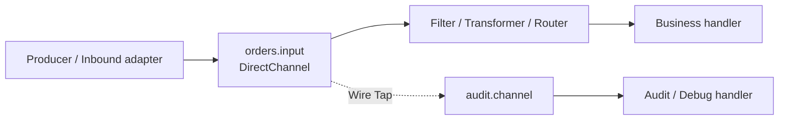
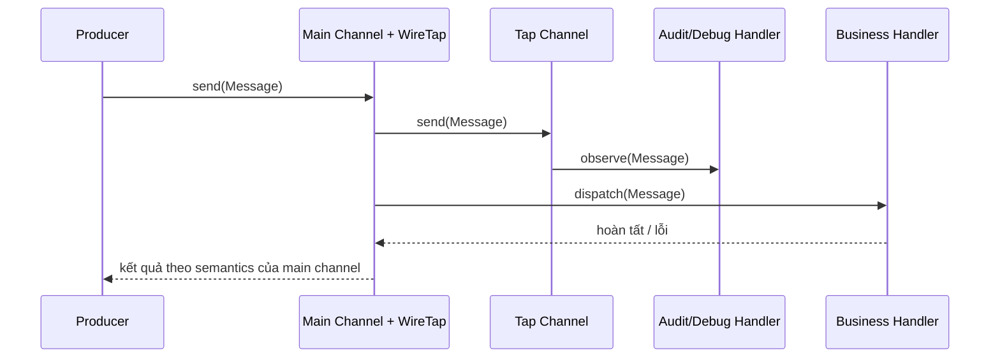
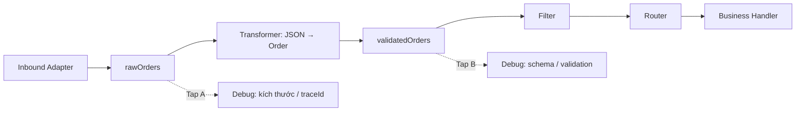
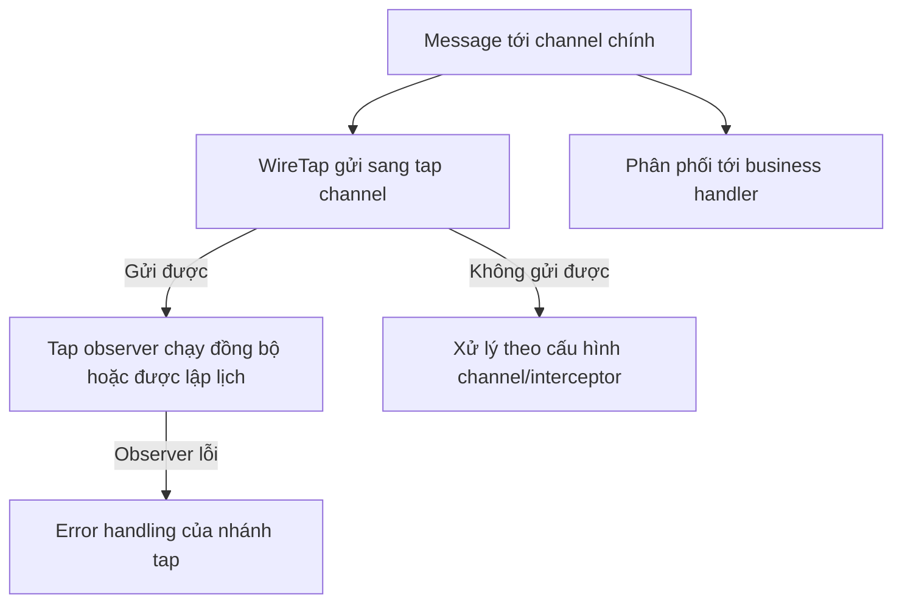
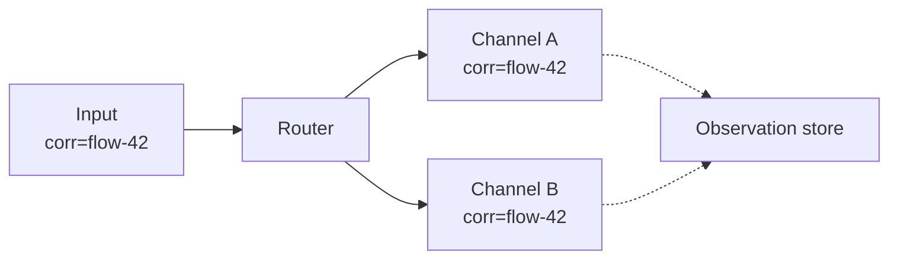

# Wire tap để audit hoặc debug trong Spring Integration

## 1. Wire Tap giải quyết nhu cầu gì?

Trong một integration flow, message thường đi qua nhiều bước: nhận dữ liệu từ adapter, lọc, chuyển đổi, định tuyến rồi gọi nghiệp vụ. Khi một đơn hàng mất thông tin, bị chuyển nhầm nhánh hoặc phát sinh lỗi, người vận hành cần biết **message đã đi qua đâu và có những metadata gì tại thời điểm đó**. Nếu chèn lệnh log trực tiếp vào từng handler, phần xử lý nghiệp vụ sẽ lẫn với việc quan sát và khó thay đổi.

**Wire Tap** là một Enterprise Integration Pattern cho phép **quan sát một bản chuyển tiếp của message** trên đường đi qua channel. Trong Spring Integration, có thể gắn `WireTap` như một `ChannelInterceptor` lên channel nguồn; interceptor gửi message sang một **tap channel** riêng để logging, đo lường, điều tra hoặc ghi nhận audit. Message tiếp tục đi theo **luồng chính** của nó.



Bài **“Wire tap để audit hoặc debug”** nằm trong chương **Wire tap** của module **SPRING_INTEGRATION_PATTERN**. Chủ đề này bổ sung cho các kỹ thuật Router, Filter, Transformer, Splitter, Aggregator, Gateway, retry, error channel và correlation: ta có thể quan sát message khi đi qua những ranh giới quan trọng mà không cần sao chép logic giám sát vào từng endpoint.

### Mục tiêu học tập

Sau bài này, bạn có thể:

- Giải thích Wire Tap là gì, nơi nó quan sát message và cách nhánh tap liên hệ với luồng chính.
- Cấu hình `WireTap` trên `DirectChannel` bằng Java Configuration và xử lý bản quan sát bằng `@ServiceActivator`.
- Phân biệt **debug/observability** với **audit nghiệp vụ có yêu cầu độ tin cậy**.
- Thiết kế thông tin log, correlation ID, quy tắc che dữ liệu nhạy cảm và lưu giữ audit.
- Đánh giá tác động hiệu năng, blocking, lỗi và khả năng giao nhận của tap channel.
- Kiểm thử rằng message ở luồng chính vẫn đến đúng đích và nhánh tap nhận thông tin mong đợi.

## 2. Cơ chế hoạt động của Wire Tap

### 2.1. Chuyển tiếp message sang kênh quan sát

Với cách sử dụng `WireTap` dưới dạng channel interceptor, khi producer gọi `send(message)` tới channel được gắn tap:

1. Interceptor nhận cơ hội quan sát message trong quá trình gửi vào channel, thường ở giai đoạn `preSend`.
2. Wire Tap gửi message sang **tap channel** mà nó được cấu hình.
3. Channel gốc tiếp tục phân phối message tới handler của luồng chính.
4. Handler của tap channel có thể log metadata, tính metric hoặc chuyển dữ liệu sang hệ thống audit.



Sơ đồ trên minh họa **tap channel đồng bộ** như `DirectChannel`. Với channel bất đồng bộ hoặc hàng đợi, việc xử lý ở nhánh tap có thể diễn ra sau đó; không được mặc định hai nhánh luôn hoàn thành theo thứ tự trong sơ đồ.

**Quan trọng:** “Sao một message” ở đây là **tạo nhánh chuyển tiếp**, không có nghĩa Spring Integration luôn deep-copy toàn bộ payload. `Message<?>` có envelope về cơ bản bất biến, nhưng payload hoặc đối tượng nằm trong headers có thể là đối tượng mutable. Nếu cả hai consumer sửa cùng một đối tượng mutable, chúng có thể ảnh hưởng lẫn nhau.

### 2.2. Đặt Wire Tap ở đâu?

Điểm đặt tap quyết định dữ liệu nào được nhìn thấy:

| Điểm đặt tap | Có thể quan sát | Không tự chứng minh |
| --- | --- | --- |
| Trên channel đầu vào | Message đã tới điểm nhận, payload và headers ở đầu luồng | Nghiệp vụ đã xử lý thành công |
| Sau Transformer | Dữ liệu đã qua biến đổi ở đoạn trước tap | Dữ liệu sẽ được lưu thành công |
| Trước Router | Thông tin được dùng làm cơ sở định tuyến | Nhánh downstream đã hoàn tất |
| Sau một bước nghiệp vụ | Message đi qua channel sau bước đó, nếu flow có phát message ra | Toàn bộ quy trình liên dịch vụ đã commit |
| Trên error flow | `ErrorMessage` và metadata lỗi đã đi vào nhánh lỗi | Đã retry thành công hay đã phục hồi hoàn toàn |

Vì Wire Tap quan sát **message tại một channel**, việc thấy message tại đây thường chỉ khẳng định nó đã tới **điểm quan sát đó**. Nếu muốn audit thao tác *thanh toán thành công*, phải ghi lại **sự kiện thành công thực sự** từ thành phần biết kết quả, không suy ra từ việc message thanh toán đi qua channel đầu vào.

### 2.3. So với các endpoint EIP khác

| Thành phần | Câu hỏi nó trả lời | Công dụng |
| --- | --- | --- |
| **Wire Tap** | “Message này có đi qua đây không?” | Gửi message sang nhánh quan sát bên cạnh luồng chính |
| **Filter** | “Message này có được đi tiếp không?” | Chặn hoặc cho thông qua dựa trên điều kiện |
| **Transformer** | “Payload phải đổi thành dạng nào?” | Chuyển đổi dữ liệu và/hoặc headers |
| **Router** | “Message nên đến nhánh nào?” | Định tuyến theo điều kiện |
| **Bridge** | “Làm sao nối hai channel tương thích?” | Chuyển tiếp giữa channel mà không cần đổi nghiệp vụ |
| **Gateway** | “Làm sao gửi yêu cầu và lấy phản hồi?” | Giao tiếp request–reply |

Wire Tap thường đóng vai trò **quan sát phụ**, không thay thế endpoint quyết định hành vi của flow.

## 3. Audit và debug không có cùng hợp đồng

Một tap channel có thể phục vụ nhiều mục tiêu, nhưng yêu cầu cho **debug** và **audit** khác nhau rõ rệt.

| Tiêu chí | Debug / observability | Audit nghiệp vụ |
| --- | --- | --- |
| Mục tiêu | Điều tra, tìm nguyên nhân lỗi, theo dõi đường đi | Trả lời ai làm gì, lúc nào, kết quả nào |
| Dữ liệu | Metadata kỹ thuật, sample payload an toàn, trace ID | Bản ghi sự kiện có cấu trúc và nguồn gốc xác định |
| Mức độ đầy đủ | Có thể sampling hoặc giảm log khi tải lớn | Phải xác định rõ sự kiện nào bắt buộc ghi nhận |
| Thất bại | Thường ưu tiên giữ luồng nghiệp vụ hoạt động | Cần chính sách xử lý rõ ràng khi không thể ghi audit |
| Thời hạn lưu giữ | Ngắn, tùy nhu cầu khắc phục sự cố | Theo chính sách nghiệp vụ, pháp lý và bảo mật |
| Khả năng truy vết | Message ID, correlation ID, span/trace ID | Actor, action, entity, outcome, timestamp, correlation |
| Mức độ tin cậy | Chấp nhận mất một số quan sát tùy hệ thống | Cần thiết kế bền vững, nhất quán và kiểm chứng được |

**Wire Tap là điểm lấy thông tin**, không phải bản thân một hệ thống audit có bảo đảm lưu trữ. Nếu bản ghi audit bắt buộc phải tồn tại tương ứng với một giao dịch, cần thêm cơ chế nhất quán, ví dụ ghi audit trong cùng giao dịch cơ sở dữ liệu nếu phù hợp, hoặc transactional outbox để công bố sự kiện đáng tin cậy.

### Ví dụ hai ý nghĩa khác nhau

- Nhánh debug ghi: “Message `ORDER-42` đã vào `orders.input` lúc 10:05”.
- Audit thành công ghi: “Tài khoản X đã xác nhận đơn `ORDER-42`; giao dịch cập nhật trạng thái đã commit”.

Bản ghi đầu chỉ cho biết **message đã đi qua channel**. Không thể đổi tên nó thành “đơn hàng thành công” nếu hệ thống chưa xác nhận kết quả.

## 4. Ví dụ thực hành: WireTap ghi metadata khi nhận đơn hàng

Giả sử có một ứng dụng Spring Boot nhận message đơn hàng qua `ordersInputChannel`. Nghiệp vụ chính in mã đơn hàng; tap channel ghi **message ID, correlation ID và kiểu payload**, tránh log toàn bộ payload chứa thông tin nhạy cảm.

Ví dụ dùng Java 17+ và dependency management của Spring Boot trong hệ sinh thái Spring Integration tương thích.

### 4.1. Dependencies

Với Maven, thêm:

```xml
<dependencies>
    <dependency>
        <groupId>org.springframework.boot</groupId>
        <artifactId>spring-boot-starter-integration</artifactId>
    </dependency>
</dependencies>
```

Bài thực hành không cần tích hợp broker hay database vì tập trung quan sát message trong channel nội bộ.

### 4.2. Cấu hình WireTap với ChannelInterceptor

Tạo lớp `WireTapConfiguration.java` trong package được Spring Boot component-scan:

```java
package com.example.integration;

import org.springframework.beans.factory.annotation.Qualifier;
import org.springframework.context.annotation.Bean;
import org.springframework.context.annotation.Configuration;
import org.springframework.integration.annotation.ServiceActivator;
import org.springframework.integration.channel.DirectChannel;
import org.springframework.integration.channel.interceptor.WireTap;
import org.springframework.integration.config.EnableIntegration;
import org.springframework.messaging.MessageChannel;
import org.springframework.messaging.MessageHandler;

@Configuration
@EnableIntegration
public class WireTapConfiguration {

    // Channel dành riêng cho việc quan sát.
    @Bean
    public MessageChannel auditChannel() {
        return new DirectChannel();
    }

    // Gắn WireTap lên channel đi vào luồng nghiệp vụ.
    @Bean
    public MessageChannel ordersInputChannel(
            @Qualifier("auditChannel") MessageChannel auditChannel) {

        DirectChannel input = new DirectChannel();
        input.addInterceptor(new WireTap(auditChannel));
        return input;
    }

    // Luồng nghiệp vụ chính vẫn nhận message từ ordersInputChannel.
    @Bean
    @ServiceActivator(inputChannel = "ordersInputChannel")
    public MessageHandler orderHandler() {
        return message -> {
            String orderId = String.valueOf(message.getPayload());
            System.out.println("[BUSINESS] received order=" + orderId);
        };
    }

    // Nhánh tap chỉ ghi metadata an toàn phục vụ điều tra.
    @Bean
    @ServiceActivator(inputChannel = "auditChannel")
    public MessageHandler auditObserver() {
        return message -> System.out.printf(
            "[TAP] messageId=%s, correlationId=%s, payloadType=%s%n",
            message.getHeaders().getId(),
            message.getHeaders().get("correlationId"),
            message.getPayload().getClass().getSimpleName()
        );
    }
}
```

Thêm lớp chạy `WireTapApplication.java`:

```java
package com.example.integration;

import org.springframework.beans.factory.annotation.Qualifier;
import org.springframework.boot.CommandLineRunner;
import org.springframework.boot.SpringApplication;
import org.springframework.boot.autoconfigure.SpringBootApplication;
import org.springframework.context.annotation.Bean;
import org.springframework.messaging.MessageChannel;
import org.springframework.messaging.support.MessageBuilder;

@SpringBootApplication
public class WireTapApplication {

    public static void main(String[] args) {
        SpringApplication.run(WireTapApplication.class, args);
    }

    @Bean
    public CommandLineRunner sendSample(
            @Qualifier("ordersInputChannel") MessageChannel channel) {
        return args -> {
            boolean accepted = channel.send(
                MessageBuilder.withPayload("ORDER-1001")
                    .setHeader("correlationId", "trace-1001")
                    .build()
            );

            System.out.println("[PRODUCER] accepted=" + accepted);
        };
    }
}
```

Khởi động ứng dụng qua `mvn spring-boot:run` trong dự án Maven có cấu hình Spring Boot, hoặc chạy lớp main từ IDE.

Log có thể trông như sau:

```text
[TAP] messageId=<uuid>, correlationId=trace-1001, payloadType=String
[BUSINESS] received order=ORDER-1001
[PRODUCER] accepted=true
```

Ví dụ dùng hai `DirectChannel`, nên tap observer và handler chính được gọi đồng bộ theo đường gửi. Vị trí log quan sát được phụ thuộc các interceptor, scheduler và cấu hình thực tế; không nên dùng thứ tự log như một giao thức nghiệp vụ.

### 4.3. Ý nghĩa từng thành phần

- `ordersInputChannel` là channel chính để producer gửi message và business handler nhận.
- `new WireTap(auditChannel)` tạo interceptor chuyển tiếp message sang nhánh quan sát khi message đi qua channel nguồn.
- `auditChannel` là một channel riêng; business handler không phải gọi thủ công phương thức audit.
- `@ServiceActivator(inputChannel = "auditChannel")` đăng ký observer. Ở ví dụ này observer chỉ ghi metadata, không in nội dung đơn hàng.
- Header `correlationId` do producer tự đặt để liên kết log. `MessageHeaders.getId()` là ID kỹ thuật của message, khác với khóa nghiệp vụ đơn hàng.

Quan sát được một message qua tap là bằng chứng nó **đã tới kênh bị theo dõi**; không phải bằng chứng nó đã được commit trong database, gửi tới broker khác hoặc xử lý hoàn toàn.

## 5. Vị trí tap và cách chọn dữ liệu quan sát

Giả sử một flow chuyển đơn hàng qua các bước:



**Tap A** giúp nhận biết message ban đầu có đến ứng dụng không. **Tap B** cho biết sau Transformer đã có một message đi tới channel dữ liệu đã chuyển đổi. Nếu muốn biết Router thực tế chọn nhánh nào, đặt quan sát ở channel đầu ra của các nhánh hoặc dùng metric/tracing của router.

Không nên gắn tap tràn lan lên tất cả channel rồi log toàn bộ payload. Việc này vừa tạo lưu lượng phụ, vừa khó truy vấn, có thể lặp bản ghi và làm lộ dữ liệu không cần thiết.

### 5.1. Những trường nên cân nhắc ghi

Một bản ghi quan sát kỹ thuật có thể gồm:

| Trường | Ý nghĩa |
| --- | --- |
| `messageId` | Định danh Spring Messaging của message được quan sát |
| `correlationId` | Liên kết message trong một luồng nghiệp vụ hoặc request |
| `traceId` / `spanId` | Liên kết với hệ thống distributed tracing nếu có |
| `channel` hoặc `stage` | Điểm quan sát, ví dụ `orders.input` |
| `eventTime` | Thời điểm observer ghi nhận |
| `eventType` | Loại sự kiện, ví dụ `OrderReceived` |
| `payloadType` / `payloadSize` | Kiểu hoặc kích thước để debug không lộ nội dung |
| `outcome` | Chỉ ghi nếu thành phần phát sự kiện thật sự biết kết quả |

Các trường này phải được **lấy từ nguồn có thẩm quyền**. Nếu message không có `correlationId`, đừng tự giả định luôn có; có thể đặt nó ở boundary phù hợp. Nếu dùng `messageId` cho truy vết, cần hiểu các endpoint có thể tạo message mới với ID mới khi biến đổi.

### 5.2. Giảm dữ liệu nhạy cảm

Không in nguyên payload mặc định, đặc biệt với thông tin cá nhân, thông tin thanh toán, token, mật khẩu, session ID hoặc dữ liệu được mã hóa bảo mật. Cách an toàn hơn là chọn trường đã được cho phép hoặc log giá trị đã che:

```java
String correlation = String.valueOf(
    message.getHeaders().getOrDefault("correlationId", "unknown")
);
String payloadType = message.getPayload().getClass().getSimpleName();

logger.info("tap channel={} correlationId={} payloadType={}",
        "orders.input", correlation, payloadType);
```

Snippet trên minh họa cách **ghi metadata**, giả định biến `message` và `logger` đã có trong ngữ cảnh. Khi cần audit, nên dùng DTO riêng có schema rõ ràng thay vì lưu toàn bộ `Message<?>` vào kho dài hạn.

## 6. Wire Tap có làm chậm hoặc làm hỏng luồng chính không?

**Có thể.** Đây là rủi ro thiết kế quan trọng nhất khi bổ sung một nhánh giám sát.

Với ví dụ ở trên, `auditChannel` là `DirectChannel`: observer của tap thường chạy **đồng bộ** trong lời gọi chuyển tiếp từ interceptor. Nếu observer ghi database chậm, gọi HTTP lâu hoặc ném exception không được xử lý, thời gian gửi hoặc lỗi trên luồng chính có thể bị ảnh hưởng.

| Loại tap channel | Tác động thường gặp | Cần kiểm soát |
| --- | --- | --- |
| `DirectChannel` | Observer thường chạy đồng bộ trên đường gửi | Thời gian xử lý, exception, I/O chậm |
| `ExecutorChannel` | Giao việc cho executor, observer có thể chạy ở thread khác | Kích thước pool/queue, từ chối task, error handling |
| `QueueChannel` | Xếp message vào hàng đợi để consumer poll sau | Capacity, poller, backlog, đầy queue, mất dữ liệu khi restart |
| Broker hoặc store bền vững | Có thể tách và lưu message ngoài process | Xác nhận gửi, retry, duplicate, transaction, chính sách vận hành |

**Không có lựa chọn nào tự bảo đảm “không ảnh hưởng luồng chính”.** Ngay cả với `ExecutorChannel`, việc submit task có thể bị từ chối khi executor đầy; gửi vào `QueueChannel` cũng có thể gặp giới hạn capacity. Hãy định nghĩa cách ứng dụng phản ứng khi nhánh tap chậm hoặc không sẵn sàng.

### 6.1. Thiết kế cho debug best-effort

Nếu mất một vài dòng debug log được chấp nhận:

1. Giới hạn loại message và trường thông tin được thu thập.
2. Chọn nhánh quan sát có giới hạn tài nguyên rõ ràng.
3. Có chiến lược khi nhánh quan sát bị quá tải: giảm sampling, bỏ log debug, hoặc đẩy vào pipeline quan sát chuyên dụng.
4. Đo số sự kiện bị bỏ, độ trễ và lỗi của tap.

Các chính sách bỏ mẫu hoặc giảm log phải có chủ đích và không được áp dụng vô tình cho bản ghi audit bắt buộc.

### 6.2. Thiết kế cho audit bắt buộc

Nếu không được mất bản ghi audit, hãy hỏi:

- Audit được coi là **đã chấp nhận** khi ghi vào đâu: memory queue, local database, broker hay audit store?
- Bản ghi audit và thay đổi nghiệp vụ có phải được commit cùng nhau không?
- Hệ thống sẽ làm gì khi audit store tạm thời ngừng hoạt động?
- Làm sao chống trùng khi producer gửi lại message hoặc consumer xử lý lại?
- Có thể truy vết mọi bản ghi qua correlation ID và định danh nghiệp vụ không?

Trong nhiều hệ thống, cách giải quyết là **tạo sự kiện audit nghiệp vụ sau khi xác định outcome**, rồi ghi cùng transaction hoặc dùng **transactional outbox** để phát sự kiện. Wire Tap vẫn có thể giúp theo dõi đường đi của message, nhưng không nên gán cho nó những bảo đảm không được cấu hình.

## 7. Lỗi, retry và error channel

Một nhánh Wire Tap có thể thất bại độc lập về mặt nghiệp vụ, nhưng **cách lỗi lan truyền** phụ thuộc channel đích, executor và nơi lỗi được bắt.



Sơ đồ tách các trách nhiệm để phân tích; với tap **đồng bộ**, lỗi ở B hoặc C có thể ảnh hưởng việc có tới F hay không. Với tap **bất đồng bộ**, lỗi có thể chỉ xuất hiện sau khi luồng gửi chính đã hoàn thành và cần một đường error reporting riêng.

### 7.1. Retry có thể tạo quan sát trùng

Ví dụ adapter đọc lại message do retry hoặc một handler thất bại rồi được xử lý lại, cùng một nghiệp vụ có thể đi qua channel đặt Wire Tap **nhiều lần**. Vì vậy:

- Log debug có thể có nhiều lần quan sát cùng correlation ID.
- Bản ghi audit phải phân biệt **attempt** với **kết quả nghiệp vụ**.
- Nếu audit store cần không trùng về mặt nghiệp vụ, hãy xác định khóa idempotency và cách deduplicate.

Đừng dùng riêng `messageId` để cam kết exactly-once: message có thể được tạo lại với ID mới dù đại diện cho cùng giao dịch nghiệp vụ.

### 7.2. Error channel không tự biến tap thành audit tin cậy

Spring Integration có `errorChannel` và các cơ chế retry/transaction advice, nhưng việc có sẵn một error channel không đồng nghĩa tất cả lỗi gửi tap đều được retry hoặc mọi lỗi đều quay về caller. Phải kiểm thử điểm phát sinh lỗi, thread thực thi và chính sách lỗi của từng channel/endpoint.

Đối với debug, có thể chấp nhận bỏ quan sát khi hệ thống chịu tải; đối với audit bắt buộc, cần quyết định rõ việc fail business hay xử lý bù khi audit không được ghi.

## 8. Wire Tap và correlation trong một luồng có nhiều nhánh

Khi Router tách message sang nhiều nhánh hoặc Splitter chia một message thành nhiều phần, một giao dịch nghiệp vụ có thể sinh nhiều message kỹ thuật. Nếu chỉ dựa vào ID của message hiện tại, khó ghép chúng thành một câu chuyện hoàn chỉnh.

Thực hành gợi ý:

- Đặt **correlation ID** ở đầu flow và truyền qua các bước có liên quan.
- Dùng **message ID** để biết một message cụ thể đã xuất hiện ở đâu.
- Với Splitter/Aggregator, theo dõi correlation và sequence phù hợp với chiến lược ghép nhóm.
- Ghi **tên channel/stage**, cùng kết quả khi có xác nhận từ handler, để phân biệt “đã quan sát” và “đã xử lý”.
- Khi biến đổi tạo message mới, xác minh headers nào được bảo toàn hoặc tái tạo.



Nếu cần biết **nhánh nào thực sự được thực thi**, đặt tap ở channel của từng nhánh hoặc dùng tracing/metric từ các endpoint. Tap ở trước Router chỉ xác nhận message đã đến Router, không chỉ ra route cuối cùng.

## 9. Cách sử dụng Wire Tap khác

Ngoài `new WireTap(auditChannel)`, Spring Integration hỗ trợ khai báo Wire Tap trong **Java DSL** hoặc XML. Những ví dụ dưới đây là **phương án cấu hình thay thế**, không nên cài đồng thời cùng một tap chỉ để tránh quan sát trùng.

### 9.1. Java DSL

Trong flow DSL, có thể dùng toán tử `wireTap` để gửi message sang kênh quan sát:

```java
@Bean
public IntegrationFlow ordersFlow() {
    return IntegrationFlow.from("ordersInput")
        .wireTap("auditChannel")
        .handle(message -> {
            // Xử lý nghiệp vụ nhận message ở luồng chính.
            processOrder(message.getPayload());
        })
        .get();
}
```

Snippet thể hiện ý tưởng, giả định `auditChannel` đã tồn tại và `processOrder(...)` là phương thức nghiệp vụ do ứng dụng định nghĩa. Import `IntegrationFlow` từ `org.springframework.integration.dsl`. Với ứng dụng đã dùng `WireTap` interceptor gắn trực tiếp trên channel, hãy chọn **một** cấu hình tap phù hợp để không ghi nhận lặp không chủ đích.

### 9.2. XML

Với project dùng cấu hình Spring Integration XML, có thể đặt wire-tap interceptor trên channel:

```xml
<int:channel id="ordersInput">
    <int:interceptors>
        <int:wire-tap channel="auditChannel"/>
    </int:interceptors>
</int:channel>

<int:channel id="auditChannel"/>
```

Ví dụ cần namespace `int` và schema Spring Integration tương ứng trong tệp XML hoàn chỉnh. Handler nhận `auditChannel` phải được cấu hình riêng.

### 9.3. Lọc message cần tap

Không phải mọi message đều cần được theo dõi. Chẳng hạn, trong môi trường sản xuất chỉ quan sát message có loại `OrderRejected` hoặc chỉ thu metadata tại một stage cụ thể. Có thể dùng message selector/filter ở nhánh tap để giới hạn lượng dữ liệu giám sát. Nếu loại bỏ bản ghi theo chính sách, cần chắc chắn rằng chính sách này áp dụng cho **debug**, không vô tình làm mất sự kiện **audit bắt buộc**.

## 10. Kiểm thử một Wire Tap đúng cách

Kiểm thử cần xác nhận **hai nhánh**: message vẫn tới business handler, đồng thời tap observer nhìn thấy đúng thông tin và không vô tình gây thay đổi dữ liệu.

| Tình huống | Kết quả cần xác minh |
| --- | --- |
| Gửi một message bình thường | Business handler nhận payload; tap observer nhận metadata được mong đợi |
| Message có `correlationId` | Cả hai nhánh nhìn thấy cùng giá trị liên kết phù hợp |
| Payload chứa thông tin nhạy cảm | Log của tap không in dữ liệu bị cấm |
| Tap observer xử lý chậm | Đo ảnh hưởng tới latency luồng chính với loại tap channel đang sử dụng |
| Tap observer phát sinh exception | Xác minh chính sách lỗi được chọn và ảnh hưởng thực tế tới main flow |
| Message được retry | Quan sát số lần tap, phân biệt attempt và outcome |
| Tải lớn | Kiểm tra backlog, executor rejection, rate/sampling và metric |
| Restart | Kiểm tra dữ liệu audit cần tồn tại thực sự được lưu theo thiết kế |

### 10.1. Đo đúng những mốc quan trọng

Thay vì chỉ assert số dòng log, bài kiểm thử tích hợp nên thu thập các sự kiện:

1. Producer gửi message lên channel được tap.
2. Tap observer nhận thông tin cần quan sát.
3. Business handler được gọi và hoàn thành hoặc lỗi.

Có thể dùng `CountDownLatch` hoặc một collector dành cho test để chờ sự kiện với timeout. Với nhánh bất đồng bộ, tránh giả định log của tap luôn xuất hiện trước log của business handler.

### 10.2. Điều gì được xác minh, điều gì chưa?

Một test chứng minh tap observer nhận message không đủ để chứng minh audit đã được ghi bền vững. Một test chứng minh log có correlation ID không đủ để chứng minh hệ thống kiểm soát tốt dữ liệu nhạy cảm. Đối với các yêu cầu này, cần kiểm tra riêng audit repository, retention, quyền truy cập, tính idempotent và các trường hợp crash/retry.

## 11. Những nhầm lẫn phổ biến

**“Wire Tap luôn không ảnh hưởng luồng chính.”** Sai. Với tap channel đồng bộ, observer chậm hoặc lỗi có thể làm chậm hoặc ảnh hưởng đường gửi chính. Với kênh bất đồng bộ vẫn có thể gặp quá tải hoặc từ chối nhận task.

**“Wire Tap deep-copy message.”** Không nên giả định. Nhánh tap có thể nhìn thấy cùng payload object mutable; việc sửa payload có thể gây lỗi khó truy vết. Ưu tiên payload immutable và tạo DTO audit riêng nếu cần.

**“Thấy message ở tap tức nghiệp vụ đã thành công.”** Tap ở channel đầu vào quan sát sự kiện **đến channel**. Thành công nghiệp vụ phải được ghi tại điểm xác nhận kết quả.

**“Ghi toàn bộ payload sẽ debug nhanh hơn.”** Log quá nhiều gây chi phí, lộ dữ liệu và tạo nhiễu. Metadata chọn lọc cùng correlation/tracing thường hữu ích hơn.

**“Message có ID thì có exactly-once audit.”** Retry, re-delivery hoặc biến đổi message có thể khiến một nghiệp vụ xuất hiện nhiều lần hoặc nhiều ID. Audit tin cậy cần khóa nghiệp vụ, idempotency và cơ chế lưu trữ.

**“Muốn audit đáng tin cậy chỉ cần QueueChannel.”** Queue trong bộ nhớ có thể mất dữ liệu khi restart. Durability, transaction và cơ chế recovery phải được thiết kế riêng.

## 12. Câu hỏi tự kiểm tra

1. Wire Tap gắn trên channel trước Transformer sẽ thấy message khác gì so với tap gắn sau Transformer?
2. Với `DirectChannel` làm tap channel, chuyện gì có thể xảy ra nếu observer ghi audit vào database bị chậm?
3. Vì sao một message có trong debug log không chứng minh đơn hàng đã được commit?
4. Trong flow có Splitter và Router, bạn sẽ dùng `correlationId` và tên stage như thế nào để truy vết?
5. Trường hợp nào nên dùng Wire Tap để lấy metadata phục vụ observability, và trường hợp nào cần bổ sung transactional outbox hoặc audit store bền vững?

**Ghi nhớ:** Wire Tap cho phép quan sát message một cách tách biệt về cấu trúc khỏi logic nghiệp vụ, nhưng **độ trễ, lỗi và tính tin cậy của nhánh tap vẫn là một phần thiết kế hệ thống**. Với debug, ưu tiên dữ liệu tối thiểu và kiểm soát chi phí; với audit, phải xác định nguồn sự kiện, outcome, tính bền vững, truy vết và quyền truy cập.

**Tham khảo:** [Spring Integration Reference](https://docs.spring.io/spring-integration/reference/) — phần *Wire Tap*, *Message Channels* và *Channel Interceptors*; [Enterprise Integration Patterns — Wire Tap](https://www.enterpriseintegrationpatterns.com/patterns/messaging/WireTap.html).
