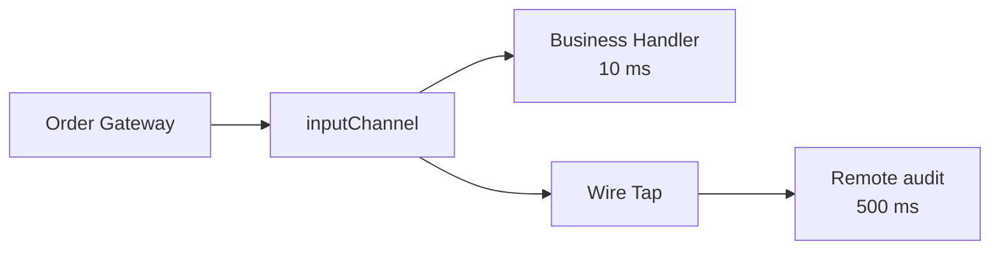
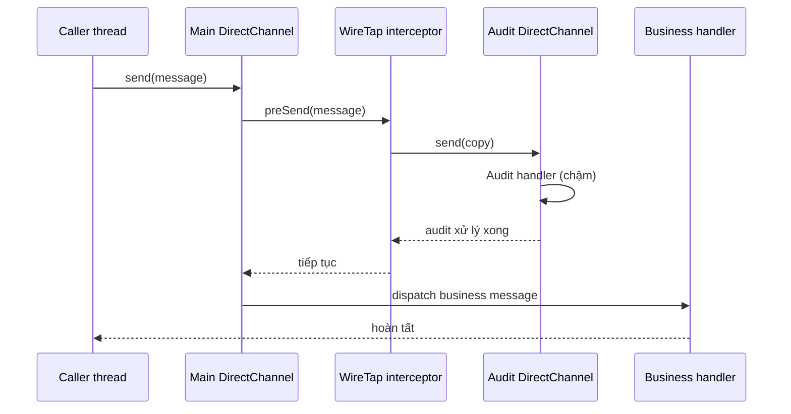
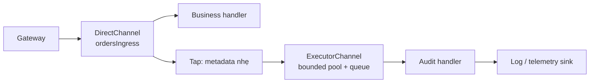
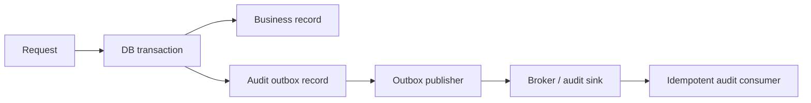
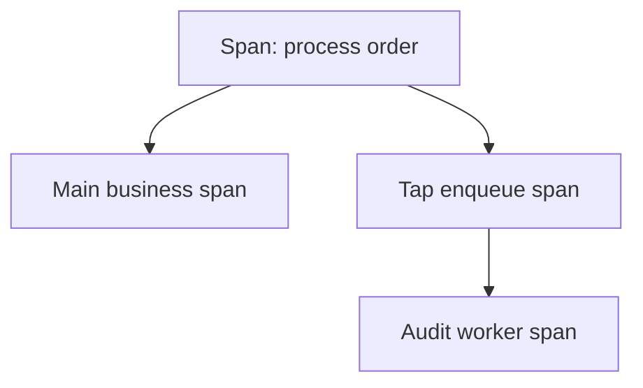

# Không để tap làm chậm flow chính trong Spring Integration

## 1. Bài toán: thêm quan sát nhưng không tăng độ trễ nghiệp vụ

Trong chương **Wire tap** của mô-đun **SPRING_INTEGRATION_PATTERN**, chúng ta sử dụng **Enterprise Integration Patterns** với Spring Integration để nối các luồng thông điệp ít phụ thuộc, dễ mở rộng và có khả năng theo dõi. Các pattern như Router, Filter, Transformer, Splitter, Aggregator, Gateway, retry, error channel và correlation thường tạo thành một chuỗi xử lý. Khi hệ thống cần quan sát chuỗi này, **Wire Tap** là một cách gửi bản sao thông điệp sang nhánh phụ để audit, log, trace hoặc thu thập metric.

Vấn đề xuất hiện khi nhánh quan sát chậm hơn nhánh nghiệp vụ. Ví dụ, đơn hàng đã được xác thực trong 10 ms nhưng tap gọi một dịch vụ audit mất 500 ms. Nếu tap chạy đồng bộ trên thread gửi, thời gian phản hồi của API có thể tăng hàng trăm mili giây, dù nghiệp vụ chính không cần đợi audit.



**Yêu cầu thiết kế:** việc log/quan sát không quan trọng bằng tác vụ nghiệp vụ không được làm tăng tail latency hoặc khiến yêu cầu chính thất bại chỉ vì audit sink tạm quá tải. Đồng thời, nếu audit là nghĩa vụ bắt buộc, ta phải bảo đảm lưu bền và xử lý lỗi một cách khác, thay vì làm mất dấu audit.

Sau bài này, bạn có thể:

1. Giải thích Wire Tap chạy ở đâu trong đường gửi thông điệp và vì sao tap có thể chặn caller.
2. Dùng `ExecutorChannel` cho tap, giới hạn tài nguyên và hiểu hành vi khi executor bị từ chối.
3. Thiết kế một **best-effort tap** có chính sách fail-open, drop metric và payload tối giản.
4. Phân biệt audit để quan sát với audit bắt buộc phải lưu bền; chọn outbox/broker khi cần bảo đảm.
5. Kiểm thử độ trễ flow chính, độ cô lập lỗi, backpressure, sampling, retry và correlation.

## 2. Wire Tap thực sự nằm ở đâu?

### 2.1. Nguyên lý

Wire Tap là pattern sao chép message để một nhánh phụ quan sát hoặc xử lý mà không thay đổi đường đi chính về mặt nghiệp vụ. Trong Spring Integration, Wire Tap thường được triển khai như một **`ChannelInterceptor`**; nó được gọi khi message đi qua channel được gắn interceptor.

```text
                       +--> tapChannel --> Audit / Monitoring
                       |
producer --> mainChannel +--> Main handler --> Business outcome
```

Để chọn đúng chỗ đặt tap, cần phân biệt:

- **Main channel:** channel chứa luồng nghiệp vụ cần theo dõi.
- **Tap interceptor:** thao tác sao chép/forward message tại ranh giới channel.
- **Tap channel:** channel nhận bản sao ở nhánh phụ.
- **Tap handler:** code làm việc thực tế như ghi log, đẩy metric, gọi HTTP, gửi broker.
- **Business handler:** phần xử lý nghiệp vụ gốc vẫn chạy theo topology của main channel.

Tap không thay thế Router, Transformer hoặc Service Activator. Nó là một nhánh quan sát bổ sung; việc nhánh đó thành công hay thất bại cần chính sách riêng.

### 2.2. Gắn tap không đồng nghĩa bất đồng bộ

Xét trường hợp cả main và tap đều dùng `DirectChannel`:



Ở topology này, tap có thể giữ thread gửi trước khi business handler được gọi. Ví dụ audit mất 500 ms, business mất 10 ms thì thời gian caller có thể tăng tương ứng với thời gian audit. Nếu audit ném exception khi đang gửi qua channel, lỗi cũng có thể ảnh hưởng đường gửi chính, tùy interceptor và cấu hình xử lý lỗi.

**Kết luận:** Wire Tap chỉ tạo nhánh phụ; muốn nhánh đó không chờ công việc nặng, phải chọn **ranh giới thực thi bất đồng bộ** cho tap và quy định cách ứng xử khi ranh giới ấy quá tải.

### 2.3. Ba mức độ “tách” cần phân biệt

| Mức | Điều xảy ra | Giới hạn |
| --- | --- | --- |
| Tap qua `DirectChannel` | Handler audit thường chạy trên thread gửi | Có thể tăng latency và lan exception |
| Tap qua `ExecutorChannel` | Việc xử lý audit được giao cho executor | Enqueue/dispatch vẫn chạy trong thread gửi; có thể reject, queue đầy hoặc dùng caller-runs |
| Tap qua broker/outbox | Bản ghi audit có thể được lưu bền và xử lý về sau | Phải thiết kế publish confirmation, transaction, retry và consumer idempotency |

Không có giải pháp “không tốn thời gian tuyệt đối”: tạo metadata, copy message, lấy lock hoặc enqueue đều có chi phí. Mục tiêu thực tế là **đưa thao tác nặng ra khỏi critical path, chặn độ tăng latency và xử lý quá tải có chủ đích**.

## 3. Rủi ro khi tap nằm trên critical path

Một tap có thể làm chậm main flow vì các lý do:

- **I/O đồng bộ:** ghi log qua mạng, gọi API audit hoặc đẩy message lên broker trực tiếp trong interceptor.
- **Serialize payload nặng:** chuyển một object lớn thành JSON ngay trong `preSend`.
- **Chờ capacity:** QueueChannel đầy, thread pool saturated hoặc một loại channel có cơ chế chờ gửi.
- **Executor dùng `CallerRunsPolicy`:** khi hết tài nguyên, handler audit chạy trên thread caller.
- **Contended locks:** logging appender, counter có cardinality cao hoặc tài nguyên dùng chung gây tranh chấp.
- **Exception/retry trực tiếp:** nhánh audit gọi lại HTTP nhiều lần trước khi trả control.
- **Cùng pool với nghiệp vụ:** audit chiếm thread, queue, CPU hoặc connection pool mà business cũng cần.

```text
Ví dụ latency minh họa:

Main business:                     15 ms
Audit HTTP chạy đồng bộ:          450 ms
Thời gian quan sát tại caller:  ~465 ms + overhead

Audit giao sang executor:
Main business:                     15 ms
Handoff audit:                      1 ms (chỉ minh họa)
Thời gian quan sát tại caller:   ~16 ms + overhead

Nếu executor queue đầy:
Handoff có thể reject hoặc chờ; không còn bảo đảm thời gian 1 ms.
```

Các con số trên chỉ minh họa. Cần đo p50/p95/p99 trên tải thực, đặc biệt khi audit sink bị chậm hoặc lỗi.

## 4. Thiết kế kiến trúc: tách đường nghiệp vụ khỏi đường quan sát

Một cấu trúc thường dùng cho audit không bắt buộc:



Luồng nghiệp vụ và audit có hai chính sách tài nguyên khác nhau:

- **Business:** tính đúng đắn, transaction và response contract theo yêu cầu.
- **Audit best-effort:** không chặn nghiệp vụ khi sink hỏng; drop hoặc sampling theo chính sách, đồng thời đếm sự kiện bị bỏ.
- **Audit bắt buộc:** lưu một bản ghi intent bền vững trong cùng transaction hoặc cơ chế tương đương, sau đó publish/consume từ kho bền.

Tách thread bằng ExecutorChannel là một bước hữu ích, nhưng cần giới hạn pool và queue. Một queue vô hạn có thể biến “audit chậm” thành **tăng RAM và độ trễ âm thầm**.

## 5. Ví dụ cơ bản: DSL Wire Tap và ExecutorChannel

Ví dụ dùng Java 17+, Spring Integration Java DSL và Spring Boot để quản lý bean. Các lớp công khai trong ví dụ được trình bày theo từng file Java riêng khi đưa vào dự án.

### 5.1. Giao diện nghiệp vụ

```java
public record OrderCommand(
    String eventId,
    String orderId,
    long amountCents
) {}
```

```java
import org.springframework.integration.annotation.MessagingGateway;

@MessagingGateway(defaultRequestChannel = "ordersIngress")
public interface OrderGateway {
    void submit(OrderCommand command);
}
```

Mục tiêu bài này là **cô lập nhánh audit**; main business handler có thể vẫn đồng bộ. `void submit` không tự mang ý nghĩa durable delivery hoặc hoàn tất tác động ở một hệ thống ngoài.

### 5.2. Định nghĩa executor và audit channel

```java
import java.util.concurrent.ThreadPoolExecutor;

import org.springframework.context.annotation.Bean;
import org.springframework.context.annotation.Configuration;
import org.springframework.integration.channel.ExecutorChannel;
import org.springframework.messaging.MessageChannel;
import org.springframework.scheduling.concurrent.ThreadPoolTaskExecutor;

@Configuration
public class AuditChannelsConfig {

    @Bean
    public ThreadPoolTaskExecutor auditExecutor() {
        ThreadPoolTaskExecutor executor = new ThreadPoolTaskExecutor();
        executor.setCorePoolSize(2);
        executor.setMaxPoolSize(4);
        executor.setQueueCapacity(200);
        executor.setThreadNamePrefix("audit-tap-");
        executor.setRejectedExecutionHandler(
            new ThreadPoolExecutor.AbortPolicy()
        );
        return executor;
    }

    @Bean("auditChannel")
    public MessageChannel auditChannel(
            ThreadPoolTaskExecutor auditExecutor) {
        return new ExecutorChannel(auditExecutor);
    }
}
```

- `auditChannel` sử dụng `ExecutorChannel`, vì vậy việc chạy audit handler thường được đẩy sang worker.
- Pool có giới hạn thread và queue; khi quá tải, `AbortPolicy` có thể ném exception từ lệnh dispatch.
- Vì vậy **chỉ dùng ExecutorChannel chưa đủ để bảo đảm audit luôn vô hại với flow chính**. Cần làm rõ policy khi enqueue bị từ chối.
- Nếu đổi sang `CallerRunsPolicy`, audit có thể chạy ngay trên caller thread khi saturated. Trong bài toán cô lập latency, chính sách này thường không phù hợp.

### 5.3. Gắn Wire Tap vào flow

```java
import org.springframework.context.annotation.Bean;
import org.springframework.context.annotation.Configuration;
import org.springframework.integration.config.EnableIntegration;
import org.springframework.integration.annotation.IntegrationComponentScan;
import org.springframework.integration.dsl.IntegrationFlow;

@Configuration
@EnableIntegration
@IntegrationComponentScan
public class BasicWireTapFlow {

    @Bean
    public IntegrationFlow orderFlow(OrderBusinessHandler business) {
        return IntegrationFlow
            .from("ordersIngress")
            .wireTap("auditChannel")
            .handle(business, "process")
            .get();
    }

    @Bean
    public IntegrationFlow auditFlow(AuditHandler auditHandler) {
        return IntegrationFlow
            .from("auditChannel")
            .handle(auditHandler, "record")
            .get();
    }
}
```

```java
import org.springframework.stereotype.Component;

@Component
public class OrderBusinessHandler {
    public void process(OrderCommand command) {
        // Validate + commit nghiệp vụ theo transaction thực tế.
    }
}

@Component
public class AuditHandler {
    public void record(OrderCommand command) {
        // Tác vụ audit tốn thời gian được chạy trong audit executor.
        // Tránh in toàn bộ payload nhạy cảm.
    }
}
```

Hình thức `.wireTap("auditChannel")` khai báo nhánh quan sát ngay trong DSL. Khi luồng gửi qua tap, nhánh audit sẽ nhận message với payload gốc. Đặc điểm này phù hợp để minh họa, nhưng **không phải lựa chọn tối ưu mặc định cho production**: hàng đợi executor có thể giữ các payload lớn hoặc dữ liệu nhạy cảm, và rejection tại ranh giới dispatch có thể ảnh hưởng đường chính nếu không có chiến lược bắt lỗi rõ ràng.

Để làm cho tap không cản trở business trong trường hợp sink quá tải, phần tiếp theo chủ động giảm dữ liệu audit **trước khi enqueue** và xử lý lỗi giao việc theo chính sách best-effort.

## 6. Best-effort tap có giới hạn: chỉ gửi metadata nhỏ

Trong nhiều hệ thống, audit để quan sát chỉ cần `eventId`, `eventType`, tên bước và timestamp. Không cần giữ nguyên object chứa địa chỉ, thông tin thanh toán hoặc nội dung tài liệu.

Đặt mục tiêu:

1. Không gọi I/O audit từ thread nghiệp vụ.
2. Không serialize payload lớn ngay trong interceptor.
3. Có queue và thread pool **hữu hạn**.
4. Khi không tiếp nhận được audit item, ghi **drop counter** và cho main message tiếp tục.
5. Không tạo loop log trên mỗi drop gây thêm tải.
6. Không biến sự kiện “đã enqueue” thành lời khẳng định “đã lưu audit thành công”.

### 6.1. Định nghĩa audit event tối giản

```java
public record AuditEvent(
    String eventId,
    String eventType,
    String stage,
    long observedAtMillis
) {}
```

Đây là **bản ghi quan sát**, không phải message gốc. Khi dữ liệu quan sát là bắt buộc để tuân thủ quy định hoặc đối soát tài chính, một best-effort record như vậy chưa đủ; xem phần về outbox.

### 6.2. Interceptor fail-open có đếm drop

Spring Integration Wire Tap chuẩn là một interceptor; trong ví dụ này ta dùng **một `ChannelInterceptor` tùy chỉnh có vai trò tap** để kiểm soát rõ việc lọc dữ liệu và bắt lỗi handoff.

```java
import io.micrometer.core.instrument.Counter;
import org.springframework.messaging.Message;
import org.springframework.messaging.MessageChannel;
import org.springframework.messaging.support.ChannelInterceptor;
import org.springframework.messaging.support.MessageBuilder;

public final class BestEffortAuditTap implements ChannelInterceptor {

    private final MessageChannel auditChannel;
    private final Counter auditDropped;
    private final Counter auditAccepted;

    public BestEffortAuditTap(
            MessageChannel auditChannel,
            Counter auditDropped,
            Counter auditAccepted) {
        this.auditChannel = auditChannel;
        this.auditDropped = auditDropped;
        this.auditAccepted = auditAccepted;
    }

    @Override
    public Message<?> preSend(
            Message<?> message,
            MessageChannel channel) {

        // Ranh giới này chỉ nhận OrderCommand.
        OrderCommand command = (OrderCommand) message.getPayload();

        AuditEvent audit = new AuditEvent(
            command.eventId(),
            "OrderCommand",
            "ORDERS_RECEIVED",
            System.currentTimeMillis()
        );

        try {
            boolean queued = auditChannel.send(
                MessageBuilder.withPayload(audit).build(),
                0L
            );

            if (queued) {
                auditAccepted.increment();
            } else {
                auditDropped.increment();
            }
        } catch (RuntimeException dispatchFailure) {
            // Best-effort: sự cố nhánh audit không từ chối nghiệp vụ.
            auditDropped.increment();
        }

        return message;
    }
}
```

Điểm cần hiểu:

- `preSend` vẫn chạy trên thread gửi. Việc tạo một record nhỏ và gọi `send` vẫn có chi phí; chỉ xử lý **nhẹ và có giới hạn** tại đây.
- `send(message, 0L)` đề nghị không chờ khi channel hỗ trợ send timeout; **không bảo đảm giới hạn thời gian thực thi cứng** cho mọi loại channel hoặc executor.
- Bắt exception chỉ bao quanh **việc chuyển audit vào channel**. Nó không bắt exception xảy ra sau này trên worker; worker phải có error flow riêng.
- Counter `auditAccepted` nghĩa là nhánh audit đã **được chấp nhận cho bước tiếp theo**, chưa có nghĩa audit đã được lưu ở sink.
- `auditDropped` đo số lần tap không giao được record quan sát theo policy; không tăng vô hạn tag động.
- `catch (RuntimeException)` là quyết định **chỉ dành cho audit best-effort**. Đừng áp dụng cho các lỗi nghiệp vụ hoặc audit bắt buộc.

Trong hệ thống thực, nên validate kiểu payload hoặc tạo interceptor dành cho một channel với contract rõ ràng; ví dụ ép kiểu trực tiếp vì `ordersIngress` chỉ nhận `OrderCommand`. Nếu có nhiều loại message, hãy cung cấp extractor được kiểm thử hoặc sử dụng selector phù hợp.

### 6.3. Gắn interceptor vào channel nghiệp vụ

```java
import io.micrometer.core.instrument.MeterRegistry;
import org.springframework.beans.factory.annotation.Qualifier;
import org.springframework.context.annotation.Bean;
import org.springframework.context.annotation.Configuration;
import org.springframework.integration.channel.DirectChannel;
import org.springframework.messaging.MessageChannel;

@Configuration
public class BestEffortTapConfiguration {

    @Bean("ordersIngress")
    public MessageChannel ordersIngress(
            @Qualifier("auditChannel") MessageChannel auditChannel,
            MeterRegistry meterRegistry) {

        DirectChannel channel = new DirectChannel();

        channel.addInterceptor(new BestEffortAuditTap(
            auditChannel,
            meterRegistry.counter(
                "app.audit.tap.dropped", "flow", "orders"
            ),
            meterRegistry.counter(
                "app.audit.tap.accepted", "flow", "orders"
            )
        ));

        return channel;
    }
}
```

Khi dùng cấu hình này, hãy bỏ `.wireTap("auditChannel")` khỏi `BasicWireTapFlow.orderFlow(...)` ở phần 5.3; nếu giữ cả hai, bạn sẽ tạo **hai nhánh tap** trên cùng luồng, dễ nhân đôi audit và tăng tải. Cấu hình audit executor và flow `auditFlow` vẫn có thể dùng lại.

Một topology áp dụng cách này là:

```text
OrderGateway
  -> ordersIngress (DirectChannel + BestEffortAuditTap)
      -> metadata AuditEvent -> auditChannel (ExecutorChannel)
                                     -> AuditHandler
      -> OrderBusinessHandler (main path)
```

### 6.4. Handler phía audit nhận AuditEvent

```java
import org.springframework.stereotype.Component;

@Component
public class AuditSinkHandler {

    private final AuditStore store;

    public AuditSinkHandler(AuditStore store) {
        this.store = store;
    }

    public void record(AuditEvent audit) {
        store.write(audit);
    }
}

public interface AuditStore {
    void write(AuditEvent event);
}
```

`AuditStore` là contract ứng dụng cần triển khai cho đích audit. Nếu dùng `AuditSinkHandler` thay cho `AuditHandler` ở phần 5.3, sửa bean `auditFlow` để trỏ tới handler mới; không đăng ký hai subscriber cạnh tranh trên một `ExecutorChannel` trừ khi thực sự muốn phân phối workload.

**Giới hạn rõ ràng:** mẫu này có thể bỏ mất record audit khi queue quá tải, khi tiến trình chết hoặc khi worker thất bại. Nó phù hợp cho **telemetry có thể mất một phần**, không phù hợp với bằng chứng kiểm toán bắt buộc.

## 7. Sizing thread pool và giới hạn độ trễ của tap

### 7.1. Dựa vào tốc độ vào và tốc độ tiêu thụ

Giả sử:

- Main flow nhận khoảng 2.000 message/giây.
- Một audit worker xử lý khoảng 200 record/giây.
- Có 4 worker nên audit có thể xử lý gần 800 record/giây trong điều kiện lý tưởng.
- Chênh lệch 1.200 record/giây làm queue tăng nhanh.

Với queue capacity 200, backlog có thể đầy rất nhanh. Cấu hình lớn hơn chỉ trì hoãn vấn đề; nếu input luôn vượt khả năng xử lý, queue cuối cùng vẫn đầy.

```text
arrivalRate  = 2.000 audit records/s
serviceRate  =   800 audit records/s
backlogGrowth = 1.200 records/s

queueCapacity = 200 records
queueFillTime (ước tính từ queue rỗng) ≈ 200 / 1.200 = 0,167 s
```

Đây là phép tính minh họa dưới giả định tốc độ ổn định, không tính burst và overhead. Với telemetry best-effort, **drop có đo lường** có thể phù hợp hơn chặn request nghiệp vụ. Với audit bắt buộc, phải thay đổi kiến trúc để có lưu bền và công suất đủ.

### 7.2. Chọn rejection policy

| Chính sách | Khi executor đầy | Ảnh hưởng main flow |
| --- | --- | --- |
| `AbortPolicy` | Ném exception từ dispatch | Có thể xử lý như drop nếu interceptor bắt; ranh giới rõ |
| `CallerRunsPolicy` | Có thể chạy audit task trên caller thread | Có nguy cơ làm chậm main flow đáng kể |
| `DiscardPolicy` | Có thể bỏ task mà không báo lỗi | Khó đo mất record, dễ nhầm đã accepted |
| `DiscardOldestPolicy` | Có thể bỏ task cũ và thử đưa task mới vào | Có nguy cơ mất event khó truy vết, ảnh hưởng thứ tự |

Với best-effort tap cần đo drop, `AbortPolicy` cộng xử lý từ chối trong interceptor thường dễ vận hành hơn bỏ task lặng lẽ. Nhưng **không đưa catch-all vào nhánh nghiệp vụ chính**: chỉ cô lập lỗi của nhánh quan sát.

### 7.3. Giữ tài nguyên audit độc lập

Nên tách:

- `auditExecutor` khỏi executor nghiệp vụ.
- Connection pool tới audit sink khỏi connection pool của giao dịch chính nếu có thể.
- Retry/timeout audit khỏi deadline của nghiệp vụ.
- Quota, rate limit và heap budget cho audit.
- Error handling và cảnh báo của audit khỏi exception contract của main flow.

Nếu hai nhánh dùng chung một pool/queue và audit bị chậm, việc “chuyển async” có thể vẫn làm nghẽn business bằng **resource contention**.

### 7.4. Sampling và rate limiting

Đối với trace/log phục vụ quan sát, không phải sự kiện nào cũng cần lưu đầy đủ. Có thể dùng:

- Sampling theo tỷ lệ cố định cho luồng rất nhiều message.
- Head-based sampling theo `traceId` để các span cùng trace có quyết định nhất quán.
- Rate limit theo loại event để không bị log storm.
- Luôn giữ các sự kiện lỗi nghiêm trọng, nhưng phải kiểm soát volume khi toàn hệ thống lỗi.
- Ưu tiên metric tổng hợp thay vì log từng message cho mọi đường thành công.

Sampling là **quyết định về độ đầy đủ dữ liệu quan sát**. Không dùng sampling cho audit bắt buộc phải đầy đủ, ví dụ các thao tác tài chính mà quy định yêu cầu lưu đủ từng giao dịch.

## 8. Payload và header: tap không được thay đổi dữ liệu của main flow

Spring `Message` có payload và headers; các message thường được xem là immutable ở tầng container, nhưng **object payload có thể chứa trạng thái mutable**.

Nếu tap giữ cùng object reference rồi audit handler sửa payload:

```text
Main flow:  Message(payload = mutable Order)
Tap flow:   Message(payload = cùng mutable Order)
```

Hai nhánh có thể ảnh hưởng nhau hoặc gặp data race. Vì thế:

1. Coi payload gốc là dữ liệu **chỉ đọc** tại nhánh tap.
2. Ưu tiên DTO immutable/record, hoặc xây bản snapshot nhỏ có dữ liệu cần thiết.
3. Không biến audit handler thành bước “làm sạch” hoặc sửa dữ liệu nghiệp vụ.
4. Khi copy header, chọn các trường an toàn; không phát tán `Authorization`, cookie, token, password, thông tin cá nhân hoặc nội dung nhạy cảm.
5. Nếu cần snapshot payload lớn, đánh giá chi phí serialize/copy ở critical path và bộ nhớ queue.

Một tap ở mức metadata như `AuditEvent` thường giảm đáng kể nguy cơ cạnh tranh trên mutable payload và rò dữ liệu.

### Correlation và identity

Phân biệt:

| Field | Mục đích | Có thay đổi giữa các lần retry? |
| --- | --- | --- |
| `eventId` | Nhận diện một logical event, dùng để deduplicate | Không |
| `correlationId` | Ghép các nhánh xử lý trong cùng workflow | Theo contract |
| `traceId` | Truy vết một hành trình thực thi | Có thể khác giữa attempt |
| `messageId` | Nhận diện một Spring message instance | Có thể đổi nếu dựng message mới |
| `auditAttempt` | Số lần gửi/ghi audit | Có thể tăng |

Nếu audit record cần liên hệ với một kết quả nghiệp vụ đã commit, chỉ ghi `eventId` tại thời điểm tap là chưa đủ để chứng minh đã commit. Tách các stage như `RECEIVED`, `VALIDATED`, `COMMITTED`; stage cuối chỉ được phát từ nơi có **bằng chứng nghiệp vụ hoàn tất**.

## 9. Xử lý lỗi: tap fail-open hay fail-closed?

Đây là quyết định nghiệp vụ, không phải một thuộc tính ngầm định của Wire Tap.

### 9.1. Best-effort telemetry — fail-open

Dùng khi log/traces chỉ phục vụ chẩn đoán, chấp nhận mất một phần:

- Tap enqueue nhanh vào queue hữu hạn.
- Nếu queue đầy, bỏ audit item và tăng `auditDropped`.
- Nếu worker audit ném exception, ghi metric/error flow riêng.
- Main flow không phải retry nghiệp vụ chỉ vì audit sink lỗi.
- Dashboard hiển thị tỷ lệ mất dữ liệu quan sát, để người vận hành biết chất lượng telemetry giảm.

Một lỗi **sau handoff** trên audit worker không tự trở thành exception trên caller thread. Spring Integration có thể phát `ErrorMessage` thông qua error handler ở async boundary, tùy channel/endpoint cấu hình. Cần xác minh đường lỗi trong phiên bản đang sử dụng và bảo đảm lỗi audit được nhìn thấy bằng metric.

### 9.2. Audit bắt buộc — fail-closed hoặc lưu bền trước khi chấp nhận

Nếu nghiệp vụ/pháp lý yêu cầu mọi quyết định phải có audit record, việc bỏ audit khi executor đầy là **vi phạm contract**. Hai hướng thiết kế:

1. **Ghi audit trong cùng transaction với side effect** vào database/outbox bền vững, sau đó publisher/consumer chuyển tới hệ thống audit riêng.
2. **Từ chối nhận công việc mới** khi không thể ghi nhận intent audit một cách bền vững, nếu chính sách nghiệp vụ đòi điều đó.



Transactional outbox giải quyết khoảng mất audit giữa business DB commit và publish tới broker bằng cách ghi **business state và outbox event trong cùng transaction**. Publisher có thể gửi lặp khi ack/confirm bị mất, nên consumer cần idempotency theo `eventId`.

Điểm quan trọng: **outbox không có nghĩa audit đã đến đích ngay khi transaction commit**. Nó cho thấy ý định audit đã được lưu bền để chuyển đi; theo dõi backlog, retry, dead-letter và trạng thái cuối của audit sink vẫn là trách nhiệm vận hành.

### 9.3. So sánh chính sách

| Tiêu chí | Tap best-effort | Audit bắt buộc qua outbox |
| --- | --- | --- |
| Giữ main latency thấp | Có thể, nếu làm việc nhẹ và drop khi quá tải | Có chi phí ghi DB trong transaction |
| Chấp nhận mất event | Có, theo policy | Không chấp nhận mất intent đã commit |
| Cần durability | Không nhất thiết | Có |
| Khi sink audit down | Drop/đếm hoặc backlog ngắn | Outbox tích backlog, retry về sau |
| Cần deduplication | Hữu ích | Bắt buộc do có thể republish |
| Khi queue đầy | Drop có metric | Backpressure hoặc từ chối nhận theo policy |
| Dùng cho compliance | Không đủ nếu yêu cầu ghi đầy đủ | Phù hợp hơn khi thiết kế/kiểm thử đúng |

## 10. Retry, error channel và tương tác với các EIP khác

### 10.1. Error channel của tap

Một nhánh audit có thể ném exception do database, HTTP hoặc serializer. Với `ExecutorChannel`, exception phát sinh trên worker cần được xử lý ở **ranh giới bất đồng bộ**. Một handler nhận `ErrorMessage` có thể trích ra lỗi, message gốc và correlation:

```java
import org.springframework.integration.annotation.ServiceActivator;
import org.springframework.messaging.MessagingException;
import org.springframework.messaging.Message;
import org.springframework.messaging.support.ErrorMessage;
import org.springframework.stereotype.Component;

@Component
public class AuditErrorObserver {

    @ServiceActivator(inputChannel = "auditErrors")
    public void observe(ErrorMessage errorMessage) {
        Throwable error = errorMessage.getPayload();
        Message<?> original = errorMessage.getOriginalMessage();

        if (original == null && error instanceof MessagingException me) {
            original = me.getFailedMessage();
        }

        // Ghi errorCode, stage, eventId (nếu có), attempt.
        // Không gọi I/O nặng hoặc retry vô hạn ngay tại observer.
    }
}
```

Đoạn code chỉ định nghĩa **consumer của channel `auditErrors`**, chưa cấu hình mọi exception tự đi vào đó. Phải nối đúng error handler của ExecutorChannel/endpoint hoặc error flow theo Spring Integration version và kiểm thử. Một error flow chỉ ghi log không tự bảo đảm recovery.

### 10.2. Retry audit chỉ dành cho lỗi phù hợp

Nếu audit sink tạm thời timeout, retry giới hạn có thể hữu ích, nhưng phải đặt backoff để tránh dồn tải. Với telemetry best-effort, retry trong worker quá lâu có thể khiến queue và thread pool đầy, làm tăng drop. Khi audit là bắt buộc, lưu ý intent trước rồi retry từ một nơi bền vững.

Không nên retry:

- Dữ liệu audit sai schema mà chỉ sửa code mới có thể đọc.
- Quyền truy cập đã bị từ chối do credential sai.
- Một thao tác ghi không idempotent có outcome chưa xác định, nếu không có khóa nghiệp vụ.

Khi retry, giữ nguyên `eventId` hoặc audit record ID; nếu tạo ID mới mỗi lần gửi, downstream có thể ghi trùng audit log.

### 10.3. Router, Filter, Transformer

Một tap có thể nằm trước hoặc sau bước xử lý EIP:

```text
Input --> [Tap A] --> Filter --> Transformer --> Router --> Handler
                                                    |
                                               [Tap B]
```

- **Tap A trước Filter**: nhìn thấy cả message sau đó bị loại.
- **Tap B sau Router**: quan sát thông điệp ở một nhánh cụ thể.
- **Tap sau Transformer**: dữ liệu có thể đã đổi kiểu/schema.
- **Tap trước Aggregator**: thấy từng message thành phần; tap sau Aggregator thấy kết quả nhóm.

Đặt tap dựa trên câu hỏi muốn trả lời. “Đã vào flow” khác “đã qua validation”, và cả hai khác “nghiệp vụ đã commit”.

### 10.4. Splitter/Aggregator và cardinality

Nếu một message được Splitter chia thành 50 phần, tap ở nhánh sau Splitter có thể tạo **50 audit items** cho một event gốc. Sau đó Aggregator có thể lại phát một message kết quả.

Cần đặt metric theo **logical event** hoặc **message attempt** rõ ràng, giữ correlation giữa các nhánh, tránh đếm nhầm 50 thành 50 giao dịch. Nếu mỗi phần có audit riêng, hãy thêm `partIndex`/`sequenceSize` hoặc một khóa ổn định, nhưng không đưa các ID động ấy vào metric tags.

### 10.5. Gateway và request–reply

Nếu tap nằm trên request channel của một Messaging Gateway, caller có thể bị tăng latency khi tap đồng bộ. Nếu gateway đã timeout, audit vẫn có thể đang chạy hoặc ngược lại. `replyTimeout` chỉ liên quan tới chờ reply theo semantics gateway; nó **không phải công cụ giới hạn mọi I/O của Wire Tap**. Giới hạn thời gian và tài nguyên cần đặt tại nơi tap chạy.

## 11. Quan sát chất lượng tap bằng metric và tracing

Một tap được thiết kế tốt cần đo **mức gây ảnh hưởng lên main flow** và **tỷ lệ dữ liệu quan sát được lưu thực tế**.

### 11.1. Các metric thiết yếu

| Metric logic | Ý nghĩa | Cách diễn giải |
| --- | --- | --- |
| `tap_attempted_total` | Số lần cố tạo record audit | Nhu cầu quan sát đầu vào |
| `tap_accepted_total` | Số record đã được nhận vào nhánh async | Chưa đồng nghĩa đã persist |
| `tap_dropped_total` | Số record không enqueue được hoặc bị policy drop | Chất lượng telemetry bị suy giảm |
| `tap_completed_total` | Số record audit sink xác nhận hoàn tất | So với accepted để biết tồn đọng |
| `tap_failed_total` | Số xử lý audit lỗi sau handoff | Cần phân loại root cause |
| `tap_queue_depth` | Số record đang chờ trong queue | Dấu hiệu audit sink không theo kịp |
| `tap_executor_active` | Thread audit đang chạy | Kiểm tra saturation |
| `main_latency_p95/p99` | Độ trễ xử lý nghiệp vụ chính | Đo ảnh hưởng gián tiếp của tap |

Các tên trên là **quy ước metric minh họa**; Spring Integration/Micrometer không tự tạo đúng toàn bộ tên. Trong thực tế hãy xem meter đang được đăng ký và quy định naming/tag thống nhất.

### 11.2. Giới hạn metric cardinality

Nhãn phù hợp: `flow="orders"`, `stage="ingress"`, `outcome="dropped"`. Tránh dùng `eventId`, `orderId`, `traceId`, user ID hoặc full URL làm metric label.

Message ID động nên nằm trong trace/log có chính sách sampling và retention. Một metric có hàng triệu nhãn độc nhất có thể tạo áp lực bộ nhớ/chi phí lớn hơn chính main flow.

### 11.3. Tracing xuyên hai nhánh



Khi tracing qua thread pool, trace context không tự động được truyền đầy đủ nếu executor/instrumentation chưa hỗ trợ. Có thể mang `traceId`/`correlationId` qua header/message hoặc sử dụng Micrometer Observation/Tracing phù hợp; phải kiểm thử. Không giữ một span nghiệp vụ mở chỉ để đợi audit telemetry không cần thiết.

Một timeline ví dụ:

```text
10:00:00.000 eventId=evt-11 stage=RECEIVED
10:00:00.001 eventId=evt-11 stage=AUDIT_ACCEPTED
10:00:00.014 eventId=evt-11 stage=BUSINESS_COMMITTED
10:00:00.230 eventId=evt-11 stage=AUDIT_COMPLETED
```

Audit hoàn tất sau business không phải lỗi nếu contract chỉ yêu cầu telemetry bất đồng bộ. Ngược lại, nếu yêu cầu audit phải được lưu trước business commit, topology cần thay đổi để có cơ chế ghi bền trong transaction.

## 12. Kiểm thử: chứng minh tap không ảnh hưởng tới flow chính

Một unit test kiểm tra có bean `WireTap` chưa chứng minh được độ trễ và khả năng cô lập lỗi. Cần kiểm thử với audit sink chậm, executor quá tải và một đường business có kết quả dễ đo.

### 12.1. Ma trận kiểm thử

| Tình huống | Thiết lập | Kỳ vọng |
| --- | --- | --- |
| Tap đồng bộ | Audit handler `DirectChannel` chờ 500 ms | Main flow tăng latency tương ứng; chứng minh nguy cơ |
| Tap async bình thường | `ExecutorChannel` còn capacity | Main flow trả về mà không cần đợi audit sink hoàn tất |
| Audit sink treo | Worker chờ latch có timeout | Main handler vẫn được gọi và kết thúc theo hợp đồng chính |
| Executor đầy | Queue/worker saturated với `AbortPolicy` | Tap drop có metric; main message vẫn được xử lý |
| Executor dùng caller-runs | Cố ý cấu hình `CallerRunsPolicy` | Test phát hiện audit có thể chạy trên thread caller |
| Audit handler ném exception | Gây lỗi sau handoff | Main flow không bị ném lỗi từ worker; audit error metric tăng |
| Payload lớn | Gửi message nhiều KB/MB | Snapshot nhỏ giữ footprint queue phù hợp |
| Payload mutable | Tap và main chia sẻ object mutable | Tap không sửa đối tượng nghiệp vụ; không có race do tap |
| Logging sink chậm | Tăng độ trễ sink | Queue/backlog/dropped tăng có kiểm soát |
| Nhiều thông điệp burst | Gửi tốc độ cao hơn khả năng audit | Không tăng RAM vô hạn; p99 main flow trong SLO |
| Retry audit | Audit store lỗi tạm | Retry hữu hạn; giữ cùng audit ID |
| Duplicate business event | Gửi lại cùng event ID | Audit phân biệt attempt và business không tạo side effect trùng |
| Stop/restart tiến trình | Có audit items đang chờ | Đánh giá giới hạn durability; không khẳng định đã lưu |
| Outbox bắt buộc | Transaction business commit | Business record và audit intent cùng được ghi bền hoặc rollback |
| Tracing | Tạo event có correlation ID | Main và audit trace liên kết theo cấu hình |

### 12.2. Dùng CountDownLatch thay vì dựa vào sleep

Để kiểm tra audit không giữ main flow, có thể tạo audit handler thử nghiệm:

```java
import java.util.concurrent.CountDownLatch;
import java.util.concurrent.TimeUnit;

public final class BlockingAuditHandler {
    final CountDownLatch started = new CountDownLatch(1);
    final CountDownLatch release = new CountDownLatch(1);
    final CountDownLatch done = new CountDownLatch(1);

    public void record(AuditEvent event) throws InterruptedException {
        started.countDown();
        try {
            if (!release.await(5, TimeUnit.SECONDS)) {
                throw new IllegalStateException("Audit not released");
            }
        } finally {
            done.countDown();
        }
    }
}
```

Kịch bản test:

1. Khởi động flow với audit executor có worker đang hoạt động.
2. Gọi Gateway trên thread test/phụ; chờ `started` xác nhận audit handler đã bắt đầu.
3. Khi `release` chưa mở, xác minh business handler đã chạy và lời gọi gateway đã hoàn tất (nếu contract chính cho phép).
4. Sau đó mở `release` để không giữ thread test.
5. Lặp lại khi audit executor đã đầy, xác minh `tap_dropped` tăng và main flow không lỗi.
6. Đo latency nhiều lần dưới tải phù hợp; so sánh p95/p99 khi tap bật, tắt, sink chậm và saturated.

Nên dùng `try/finally` để mở latch kể cả khi assertion thất bại, tránh treo test suite. Nếu test cần chứng minh absolute performance, hãy chạy benchmark/soak test riêng thay vì dựa vào vài lần đo đơn lẻ trong CI.

### 12.3. Kiểm tra chính sách mất audit

Với best-effort tap, kiểm tra count identity:

```text
attempted = accepted + dropped   (trong cùng cửa sổ, nếu đếm đúng mọi lần)
accepted = completed + failed + pending   (sau khi xử lý và đối soát)
```

Đây là **các bất biến mong muốn do ứng dụng định nghĩa**, không phải công thức tự đúng với mọi metric. Chúng chỉ có ý nghĩa khi không đếm trùng, có định nghĩa cửa sổ thời gian nhất quán và các trạng thái rời nhau. Nếu worker retry hoặc record chưa hoàn tất, cần tính trạng thái trung gian đúng.

Với audit bắt buộc, ngoài metric còn cần test giao dịch: crash sau business commit nhưng trước khi publish phải có outbox record tồn tại để publisher khôi phục; consumer idempotent không ghi đôi khi publish lại.

## 13. Runbook khi main flow đột ngột chậm sau khi thêm tap

**Bước 1 — Xác định ranh giới.** Tap đang gắn vào channel nào? Tap channel là `DirectChannel`, `ExecutorChannel` hay `QueueChannel`? Có handler I/O nào thực sự chạy trên caller thread?

**Bước 2 — Quan sát thread.** Ghi thread name tại `preSend`, business handler và audit handler. Nếu audit chạy trên thread caller khi saturated, kiểm tra executor rejection policy, đặc biệt `CallerRunsPolicy`.

**Bước 3 — Kiểm tra backlog.** Xem active threads, queue capacity, queue depth, drop count, thời gian hoàn tất audit và error rate của sink.

**Bước 4 — Đánh giá dữ liệu.** Tap có serialize/copy payload lớn hoặc log thông tin nhạy cảm trong `preSend` không? Có một channel interceptor khác cũng chặn thread?

**Bước 5 — Cô lập tài nguyên.** Xác minh audit không dùng chung pool/connection/lock với business; giới hạn timeout, retry và concurrency riêng.

**Bước 6 — Áp dụng policy phù hợp.** Với telemetry best-effort, dùng metadata nhỏ, bounded executor và fail-open có metric; với audit bắt buộc, lưu intent bền vững và điều chỉnh capacity.

**Bước 7 — Kiểm thử lại.** So sánh main latency p50/p95/p99 và error rate trước/sau thay đổi, ở tải bình thường và khi audit sink mất kết nối.

### Dấu hiệu dễ hiểu nhầm

| Dấu hiệu | Kết luận vội | Cần kiểm chứng |
| --- | --- | --- |
| Tap dùng `ExecutorChannel` | Tap chắc chắn không chặn main | Enqueue cost, rejection, caller-runs, shared pool |
| Gateway trả về bình thường | Audit đã lưu thành công | Worker completion và kết quả sink |
| Không có error log | Không mất audit | Drop metric, rejected tasks, sampling |
| Main business vẫn chạy nhanh lúc ít tải | Thiết kế chịu tải lớn | Saturation test và p99 latency |
| Queue depth bằng 0 | Không có lỗi audit | Record có thể đã drop hoặc worker đã lỗi |
| Audit có event ID | Business đã commit | Stage và bằng chứng transaction |
| Tăng queue capacity | Đã giải quyết overload | Tốc độ vào và tốc độ xử lý lâu dài |

## 14. Những sai lầm phổ biến

**Gắn Wire Tap rồi gọi REST audit trong handler của `DirectChannel`.** Nhánh phụ chạy ngay trên critical path, có thể làm chậm mọi request.

**Tin rằng ExecutorChannel tự bảo vệ main flow khỏi mọi lỗi.** Khi saturated, dispatch có thể reject; một rejection chưa được cô lập có thể lan ra main path.

**Dùng `CallerRunsPolicy` để “không mất audit” nhưng vẫn hứa main latency thấp.** Khi pool đầy, audit có thể chạy trên caller thread.

**Bỏ task im lặng mà không đo.** Không biết đã mất bao nhiêu quan sát, dashboard trở nên sai lệch.

**Đưa toàn bộ payload lên audit queue.** Tốn RAM, tăng chi phí serialization và tạo nguy cơ lộ dữ liệu; ưu tiên snapshot tối giản.

**Cho audit handler sửa mutable payload.** Hai nhánh có thể chia sẻ object, gây race condition hoặc thay đổi dữ liệu main flow.

**Dùng metric label là `eventId`.** Cardinality tăng không kiểm soát, tác động xấu tới hệ thống quan sát.

**Thực hiện retry vô hạn trong worker.** Khi sink hỏng, queue đầy và audit drop tăng; lỗi có thể ảnh hưởng tài nguyên của main flow.

**Coi best-effort tap là audit tuân thủ bắt buộc.** Cơ chế trong bộ nhớ có thể mất khi crash/reject; cần durable outbox hoặc thiết kế bảo đảm khác.

**Chỉ test log có xuất hiện.** Cần test main latency, saturation, drop/retry, lỗi audit sau handoff và crash.

## 15. Bài thực hành

1. Xây dựng một flow đơn giản: `ordersIngress → BusinessHandler`. Đo độ trễ khi chưa có tap.
2. Gắn Wire Tap sang `DirectChannel` với audit handler bị chậm; xác nhận latency main tăng.
3. Chuyển tap channel sang `ExecutorChannel` với pool và queue hữu hạn; kiểm tra audit handler chạy trên worker.
4. Thêm `BestEffortAuditTap` tạo record nhỏ. Khi executor đầy, bắt rejection và tăng drop counter.
5. Cố ý dùng `CallerRunsPolicy`; quan sát trường hợp audit handler chạy trên thread caller và phân tích hậu quả.
6. Cấu hình sink ném exception trên worker. Kiểm tra error flow và metric thay vì kỳ vọng caller đã nhận exception đó.
7. Thử một payload mutable; sửa audit handler thành chỉ đọc và thay payload audit bằng immutable record.
8. Gửi hàng nghìn event với tốc độ tăng dần; đo main p95/p99 latency, audit queue depth và số drop.
9. Gắn tap trước Filter và sau Transformer; giải thích khác biệt giữa số message được quan sát tại hai vị trí.
10. Thiết kế phiên bản **audit bắt buộc** dùng transactional outbox; mô phỏng crash sau DB commit trước khi publish, kiểm tra khả năng khôi phục.
11. Viết runbook với ngưỡng cảnh báo cho `tap_dropped`, audit backlog, error rate và main latency.

**Câu hỏi tự đánh giá:** Một Wire Tap dùng `ExecutorChannel` có queue capacity 200. Khi audit sink bị treo, queue đầy và executor bắt đầu reject. Làm sao thiết kế để nghiệp vụ chính tiếp tục đáp ứng SLO, vẫn biết đã mất bao nhiêu audit records, và khi nào phải chuyển từ best-effort sang outbox bền vững?

## Ghi nhớ

- **Wire Tap** sao chép message sang nhánh phụ, nhưng bản thân tap không mặc định bất đồng bộ.
- Tap qua `DirectChannel` có thể chặn caller; tap qua `ExecutorChannel` thường chuyển handler sang worker nhưng **handoff vẫn có chi phí và có thể bị reject**.
- Để bảo vệ flow chính, dùng payload audit nhỏ, bounded executor, chính sách drop/fail-open có metric và tách tài nguyên với business.
- `CallerRunsPolicy` có thể đưa công việc audit trở lại thread gửi; không phù hợp với cam kết độ trễ thấp khi sink quá tải.
- Telemetry best-effort có thể chấp nhận mất một phần có đo lường; **audit bắt buộc** cần lưu intent bền vững, recovery và idempotency.
- Đo cả main latency, audit acceptance, completion, failure, drop và queue saturation; dùng correlation ID để truy vết mà không tạo metric cardinality cao.
- Kiểm thử trong tình huống audit chậm, lỗi và quá tải mới chứng minh được tap thực sự được cô lập khỏi flow chính.
