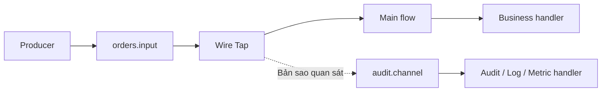
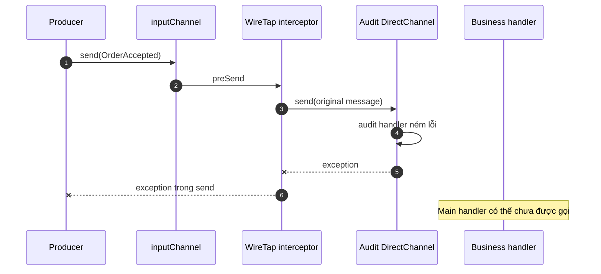
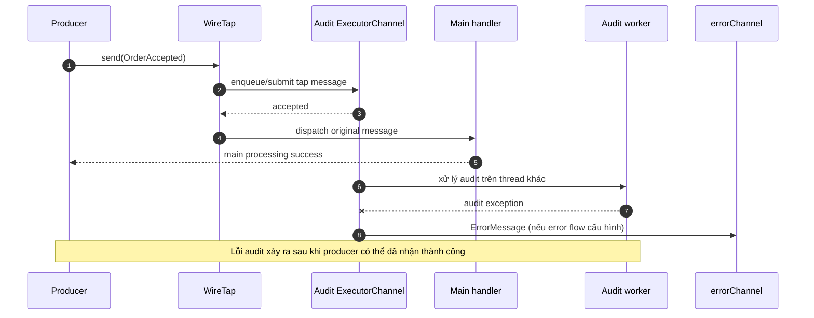
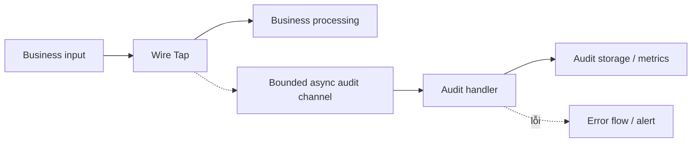
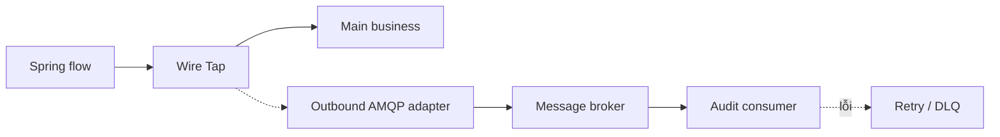

# Lỗi ở tap và ảnh hưởng đến flow trong Spring Integration

## Mục tiêu bài học

Sau bài này, bạn có thể:

- Giải thích cách **Wire Tap pattern** gửi một message sang nhánh quan sát mà không thay thế nhánh nghiệp vụ chính.
- Phân biệt **lỗi của tap đồng bộ**, **lỗi của tap bất đồng bộ** và **lỗi khi bàn giao message sang channel tap**.
- Dự đoán ảnh hưởng của `DirectChannel`, `ExecutorChannel` và `QueueChannel` lên latency, exception propagation và tính sẵn sàng của flow chính.
- Xây dựng luồng Spring Integration dùng Java DSL `.wireTap(...)`, `@ServiceActivator` và `errorChannel` để thử lỗi có kiểm soát.
- Thiết kế tap phục vụ audit, log và metric mà không làm lộ dữ liệu nhạy cảm hay vô tình thay đổi payload nghiệp vụ.
- Kiểm thử khi audit thất bại, executor quá tải, message đến trễ, retry và đối soát theo `requestId`.

Bài thuộc chương **Wire tap** của mô-đun **SPRING_INTEGRATION_PATTERN**. Mô-đun thực hành các *Enterprise Integration Patterns* bằng Spring Integration để xây dựng luồng thông điệp ít phụ thuộc và dễ mở rộng. Khi các message đi qua Router, Filter, Transformer, Splitter, Aggregator, Gateway, retry, error channel và correlation, Wire Tap thường được dùng để quan sát các nhánh. Nhưng nếu tap lỗi, nó có thể trở thành nguồn gây chậm hoặc thậm chí làm thất bại đường xử lý chính: **tap không mặc nhiên được cách ly khỏi business flow**.

## 1. Wire Tap là gì và vì sao lỗi ở tap quan trọng?

**Wire Tap** là một bản sao luồng gửi message tới một kênh phụ để ghi audit, phát metric hoặc quan sát. Message vẫn được chuyển theo đường chính; tap không phải Router thay thế đích, cũng không phải Filter quyết định message có được xử lý tiếp hay không.



Ví dụ một message `OrderAccepted(orderId=O-101)` cần được chuyển tới bộ xử lý hóa đơn, đồng thời gửi dấu vết sang hệ thống audit. Nếu audit chậm hoặc không sẵn sàng, chúng ta phải quyết định **có cho phép hóa đơn tiếp tục được xử lý không**. Hai chính sách phổ biến:

1. **Fail-fast / audit bắt buộc:** ghi audit là một phần của yêu cầu nghiệp vụ hoặc tuân thủ; nếu audit thất bại thì giao dịch có thể cần dừng hoặc được hoàn tác trong transaction phù hợp.
2. **Best-effort / quan sát không chặn:** log, metric hoặc tracing không được làm gián đoạn nghiệp vụ khi nhánh quan sát gặp trục trặc; phải chấp nhận nguy cơ mất dữ liệu quan sát và có metric báo mất.

Chính sách nào đúng tùy yêu cầu nghiệp vụ. **Chỉ cấu hình `.wireTap(...)` không tự xác lập một trong hai chính sách**; kết quả phụ thuộc loại channel tap, cách dispatch và xử lý lỗi.

### 1.1. “Sao chép message” không có nghĩa deep copy

Wire Tap chuyển message để nhánh phụ sử dụng. Với message nội bộ, tap và flow chính có thể cùng tham chiếu tới **payload object** hoặc các object bên trong headers. Không nên:

- Cho handler audit sửa trực tiếp một DTO mutable rồi kỳ vọng flow chính không bị ảnh hưởng.
- Ghi hoặc truyền toàn bộ payload có mật khẩu, token, số thẻ hay dữ liệu cá nhân sang một hệ thống log khác.
- Giả định mọi object trong payload đều đã được clone sâu để mỗi nhánh có thể thay đổi độc lập.

Hãy dùng payload bất biến, chọn lọc các trường cần audit, hoặc tạo một sự kiện audit có schema riêng qua Transformer/adapter được thiết kế rõ ràng.

## 2. Ba nguồn lỗi khác nhau quanh tap

| Nguồn lỗi | Ví dụ | Ảnh hưởng tiềm năng |
| --- | --- | --- |
| **Tap handler** | Handler lưu audit ném `IllegalStateException`, database audit lỗi | Với tap đồng bộ có thể chặn hoặc làm lỗi lan tới producer; với tap async lỗi thường xảy ra sau khi main flow tiếp tục |
| **Bàn giao sang tap channel** | Không có subscriber, executor từ chối task, queue đầy | Có thể thất bại ngay trong lúc Wire Tap đang gửi, **kể cả khi** handler audit dự kiến chạy bất đồng bộ |
| **Hệ thống quan sát bên ngoài** | Broker log ngắt kết nối, HTTP audit timeout, serialize lỗi | Tùy outbound adapter, confirm, timeout, retry và error flow; có thể làm chậm hoặc thất bại nhánh tap |

Một điểm quan trọng: **tap chạy bất đồng bộ không đảm bảo mọi lỗi đều bất đồng bộ**. Ví dụ `ExecutorChannel` có executor đầy và từ chối `execute()` ngay lúc dispatch; lỗi nộp công việc có thể xuất hiện trên thread producer trước khi business flow nhận được message.

### 2.1. Thứ tự và giới hạn quan sát

Với Wire Tap được gắn lên một `DirectChannel`, thao tác đưa message vào nhánh tap diễn ra trong quá trình channel gửi message. Khi tap dùng `DirectChannel`, handler quan sát thường được gọi đồng bộ. Nếu handler ném exception tại điểm đó, thao tác gửi vào channel gốc có thể thất bại và việc dispatch thông thường tới business handler có thể không diễn ra.

Với tap dùng `ExecutorChannel`, thread gọi thường chỉ bàn giao công việc rồi tiếp tục dispatch message gốc. Tuy nhiên không có bảo đảm rằng audit handler chạy trước hay sau business handler; cả hai có thể quan sát những thời điểm khác nhau. Nếu cần thứ tự hoặc cam kết audit trước nghiệp vụ, phải thiết kế một workflow có transaction/ack rõ ràng thay vì dùng tap best-effort.

## 3. Trường hợp A: tap đồng bộ có thể làm lỗi lan về producer

Giả sử đường chính và đường tap đều là `DirectChannel`:



Đây là ví dụ **tap trở thành một phần đường đi đồng bộ**. Khi `DirectChannel` gửi tới audit subscriber ném exception, exception có thể đi ngược lên caller, thường được Spring Messaging/Integration bọc trong `MessagingException` hoặc các lớp con. Một error handler của business flow chưa chắc đã được gọi, vì message có thể không đến business endpoint.

**Kết luận:** tap đồng bộ phù hợp khi muốn nhánh audit là một phần điều kiện thành công của `send()`, hoặc khi audit cực nhẹ và đáng tin cậy. Nó không phù hợp nếu yêu cầu “audit lỗi tuyệt đối không được làm chậm hoặc làm hỏng giao dịch” mà không có cơ chế cách ly.

## 4. Trường hợp B: tap bất đồng bộ tách lỗi xử lý, không tách mọi rủi ro



Nếu `ExecutorChannel` chấp nhận task, exception từ audit handler xảy ra trên worker thread; nó **không tự ném ngược qua lời gọi `send()` đã kết thúc**. Spring Integration có thể tạo `ErrorMessage` gửi vào channel lỗi đã cấu hình hoặc global `errorChannel` theo cơ chế xử lý lỗi của endpoint/channel.

Tuy nhiên cần ba điều kiện vận hành:

- **Executor đủ khả năng tiếp nhận:** có giới hạn thread/queue và chính sách xử lý khi đầy. Một rejection trong pha dispatch vẫn có thể tác động flow chính.
- **Error flow có consumer:** error channel phải có handler ghi nhận/cảnh báo, không chỉ tồn tại trên sơ đồ.
- **Dữ liệu audit có thể mất:** executor/queue trong bộ nhớ không tạo durability sau khi JVM dừng hoặc process crash.

Với `QueueChannel` làm tap channel, Wire Tap có thể gửi vào hàng đợi rồi main flow tiếp tục, còn `PollingConsumer` đọc audit sau. Nhưng queue đầy có thể chặn hoặc từ chối gửi; khi consumer thất bại, việc có retry hay message được đưa lại queue phụ thuộc transaction và cơ chế error handling, không phải do Wire Tap tự đảm bảo.

## 5. Ví dụ thực hành Java Spring Integration

Ví dụ sau dùng **Java 17+, Spring Boot 3.x, Spring Integration 6.x**. Có hai flow độc lập:

- `syncTapIngress → wireTap(syncAudit) → syncBusiness`: tap audit cố ý ném lỗi đồng bộ.
- `asyncTapIngress → wireTap(asyncAudit) → asyncBusiness`: audit chạy trên executor, lỗi gửi về một `QueueChannel` có tên `tapErrors` để kiểm thử.

Các `public class`, `record` nằm ở những file Java riêng trong cùng package. Cần dependency Spring Boot Integration, Spring Integration core và Spring Boot Test tương thích.

### 5.1. Kiểu message bất biến

```java
// OrderAccepted.java
public record OrderAccepted(
        String eventId,
        String orderId,
        long amountMinorUnit
) {}
```

`eventId` định danh một lần phát sự kiện, `orderId` là khóa nghiệp vụ. `amountMinorUnit` giữ tiền ở đơn vị nguyên. Dữ liệu này minh họa cơ chế channel; trong production không nên gửi toàn bộ thông tin tài chính hay PII vào hệ thống quan sát chỉ để làm log.

### 5.2. Khai báo hai flow và các channel

```java
// WireTapErrorConfiguration.java
import org.springframework.beans.factory.annotation.Qualifier;
import org.springframework.context.annotation.Bean;
import org.springframework.context.annotation.Configuration;
import org.springframework.integration.channel.DirectChannel;
import org.springframework.integration.channel.ExecutorChannel;
import org.springframework.integration.channel.QueueChannel;
import org.springframework.integration.config.EnableIntegration;
import org.springframework.integration.dsl.IntegrationFlow;
import org.springframework.messaging.MessageChannel;
import org.springframework.scheduling.concurrent.ThreadPoolTaskExecutor;

@Configuration
@EnableIntegration
public class WireTapErrorConfiguration {
    @Bean("syncTapIngress")
    public MessageChannel syncTapIngress() {
        return new DirectChannel();
    }

    @Bean("syncAudit")
    public MessageChannel syncAudit() {
        return new DirectChannel();
    }

    @Bean("syncBusiness")
    public MessageChannel syncBusiness() {
        return new DirectChannel();
    }

    @Bean
    public IntegrationFlow syncTapFlow() {
        return IntegrationFlow.from("syncTapIngress")
            .wireTap("syncAudit")
            .channel("syncBusiness")
            .get();
    }

    @Bean("auditExecutor")
    public ThreadPoolTaskExecutor auditExecutor() {
        ThreadPoolTaskExecutor pool = new ThreadPoolTaskExecutor();
        pool.setCorePoolSize(2);
        pool.setMaxPoolSize(4);
        pool.setQueueCapacity(20);
        pool.setThreadNamePrefix("audit-tap-");
        return pool;
    }

    @Bean("asyncTapIngress")
    public MessageChannel asyncTapIngress() {
        return new DirectChannel();
    }

    @Bean("asyncAudit")
    public MessageChannel asyncAudit(
            @Qualifier("auditExecutor") ThreadPoolTaskExecutor executor) {
        return new ExecutorChannel(executor);
    }

    @Bean("asyncBusiness")
    public MessageChannel asyncBusiness() {
        return new DirectChannel();
    }

    @Bean("tapErrors")
    public QueueChannel tapErrors() {
        return new QueueChannel(20);
    }

    @Bean
    public IntegrationFlow asyncTapFlow() {
        return IntegrationFlow.from("asyncTapIngress")
            .wireTap("asyncAudit")
            .channel("asyncBusiness")
            .get();
    }
}
```

Trong hai flow, `.wireTap(...)` khai báo nhánh quan sát tại vị trí tương ứng trong tuyến message. Bước `.channel(...)` chỉ định đường đi chính. `Wire Tap` không tự tạo transaction bao gồm cả hai handler và không đợi audit bất đồng bộ thành công rồi mới thông báo cho caller.

### 5.3. Các handler nghiệp vụ và audit

```java
// OrderBusinessHandler.java
import java.util.Set;
import java.util.concurrent.ConcurrentHashMap;
import org.springframework.integration.annotation.ServiceActivator;
import org.springframework.stereotype.Component;

@Component
public class OrderBusinessHandler {
    private final Set<String> handled =
            ConcurrentHashMap.newKeySet();

    @ServiceActivator(inputChannel = "syncBusiness")
    public void syncHandle(OrderAccepted order) {
        handled.add(order.eventId());
    }

    @ServiceActivator(inputChannel = "asyncBusiness")
    public void asyncHandle(OrderAccepted order) {
        handled.add(order.eventId());
    }

    public boolean wasHandled(String eventId) {
        return handled.contains(eventId);
    }
}

// FailingAuditHandler.java
import org.springframework.integration.annotation.ServiceActivator;
import org.springframework.stereotype.Component;

@Component
public class FailingAuditHandler {
    @ServiceActivator(inputChannel = "syncAudit")
    public void auditSynchronously(OrderAccepted order) {
        throw new IllegalStateException(
            "AUDIT_SYNC_FAILED eventId=" + order.eventId());
    }

    @ServiceActivator(inputChannel = "asyncAudit")
    public void auditAsynchronously(OrderAccepted order) {
        throw new IllegalStateException(
            "AUDIT_ASYNC_FAILED eventId=" + order.eventId());
    }
}
```

Hai audit handler đều thất bại **có chủ đích**. Đây là bài học về đường truyền lỗi, không phải một implement audit thật. Handler nghiệp vụ chỉ ghi nhận ID để test; ứng dụng thực tế cần transaction và idempotency nếu có side effect.

### 5.4. Producer gắn error channel cho ca bất đồng bộ

```java
// OrderEventPublisher.java
import org.springframework.beans.factory.annotation.Qualifier;
import org.springframework.integration.channel.QueueChannel;
import org.springframework.messaging.MessageChannel;
import org.springframework.messaging.MessageHeaders;
import org.springframework.messaging.support.MessageBuilder;
import org.springframework.stereotype.Component;

@Component
public class OrderEventPublisher {
    private final MessageChannel syncTapIngress;
    private final MessageChannel asyncTapIngress;
    private final QueueChannel tapErrors;

    public OrderEventPublisher(
            @Qualifier("syncTapIngress") MessageChannel syncTapIngress,
            @Qualifier("asyncTapIngress") MessageChannel asyncTapIngress,
            @Qualifier("tapErrors") QueueChannel tapErrors) {
        this.syncTapIngress = syncTapIngress;
        this.asyncTapIngress = asyncTapIngress;
        this.tapErrors = tapErrors;
    }

    public boolean sendSync(String eventId) {
        return syncTapIngress.send(
            MessageBuilder.withPayload(
                new OrderAccepted(eventId, "ORDER-" + eventId, 120_000L))
                .setHeader("eventId", eventId)
                .build());
    }

    public boolean sendAsync(String eventId) {
        return asyncTapIngress.send(
            MessageBuilder.withPayload(
                new OrderAccepted(eventId, "ORDER-" + eventId, 120_000L))
                .setHeader("eventId", eventId)
                .setHeader(MessageHeaders.ERROR_CHANNEL, tapErrors)
                .build());
    }
}
```

`MessageHeaders.ERROR_CHANNEL` được đặt tường minh để exception của nhánh audit bất đồng bộ có nơi nhận trong ví dụ. Vì handler chính của luồng này là `DirectChannel` và không ném lỗi, bài test phân biệt được lỗi audit. Với một flow thực tế nhiều nhánh, **error channel header có thể được dùng chung bởi các endpoint xử lý cùng message**; phải phân loại theo failed message/endpoint chứ không suy ra rằng mọi `ErrorMessage` nhận trên `tapErrors` đều do tap.

Header giữ một `MessageChannel` object được sử dụng **trong cùng JVM**. Khi chuyển qua AMQP/JMS/Kafka, phải dùng cơ chế mapping và reply/error destination phù hợp; không serialize trực tiếp Java channel object.

## 6. Test 1: tap đồng bộ làm `send()` quan sát thấy lỗi

Spring Boot integration test:

```java
// WireTapErrorFlowTest.java
import static org.assertj.core.api.Assertions.assertThat;
import static org.assertj.core.api.Assertions.catchThrowable;

import org.junit.jupiter.api.Test;
import org.springframework.beans.factory.annotation.Autowired;
import org.springframework.boot.test.context.SpringBootTest;

@SpringBootTest
class WireTapErrorFlowTest {
    @Autowired
    private OrderEventPublisher publisher;

    @Autowired
    private OrderBusinessHandler business;

    private static Throwable rootCause(Throwable error) {
        Throwable current = error;
        while (current.getCause() != null &&
                current.getCause() != current) {
            current = current.getCause();
        }
        return current;
    }

    @Test
    void synchronousTapFailureReachesSender() {
        String eventId = "SYNC-101";
        Throwable failure = catchThrowable(() -> publisher.sendSync(eventId));

        assertThat(failure).isNotNull();
        assertThat(rootCause(failure))
            .isInstanceOf(IllegalStateException.class)
            .hasMessageContaining("AUDIT_SYNC_FAILED");

        // Trong cấu hình tap đồng bộ, lỗi ở preSend xảy ra
        // trước khi business handler nhận message.
        assertThat(business.wasHandled(eventId)).isFalse();
    }
}
```

Test diễn đạt **hợp đồng fail-fast** của cấu hình này. Nếu tap đã thất bại trước khi main handler được dispatch, business handler không ghi nhận `SYNC-101`. Nếu cần một chính sách khác, phải thay đổi loại channel hoặc bố trí error handler tại nhánh tap; không đơn giản bỏ `catch` rồi xem như audit không liên quan.

Lưu ý kiểu exception thực tế có thể có wrapper của Spring Integration. Test kiểm tra **root cause** để không phụ thuộc quá chặt vào một wrapper cụ thể.

## 7. Test 2: tap bất đồng bộ báo lỗi qua `ErrorMessage`

Thêm vào cùng `WireTapErrorFlowTest.java` các import:

```java
import org.springframework.beans.factory.annotation.Qualifier;
import org.springframework.integration.channel.QueueChannel;
import org.springframework.messaging.Message;
import org.springframework.messaging.support.ErrorMessage;
```

Thêm field và phương thức sau vào class test:

```java
@Autowired
@Qualifier("tapErrors")
private QueueChannel tapErrors;

@Test
void asynchronousTapFailureDoesNotStopMainHandler() {
    String eventId = "ASYNC-201";

    boolean accepted = publisher.sendAsync(eventId);
    assertThat(accepted).isTrue();
    assertThat(business.wasHandled(eventId)).isTrue();

    Message<?> error = tapErrors.receive(5_000);
    assertThat(error).isInstanceOf(ErrorMessage.class);
    Throwable failure = ((ErrorMessage) error).getPayload();

    assertThat(rootCause(failure))
        .isInstanceOf(IllegalStateException.class)
        .hasMessageContaining("AUDIT_ASYNC_FAILED");
}
```

Với `ExecutorChannel` ở nhánh audit, worker có thể lỗi **sau** khi đường chính đã xử lý thành công. Test vì vậy xác nhận cả hai điều: business handler vẫn nhận message và error flow nhận lỗi của audit. Test không khẳng định audit được ghi bền, không chứng minh publish sang broker an toàn và không bảo đảm mọi exception thuộc các loại channel khác nhau đều luôn đến đúng queue như trong cấu hình này.

Để test ổn định khi chạy song song, nên dùng `eventId` duy nhất và xác minh ID trong failed/original message (nếu có), hoặc cung cấp một error channel riêng theo từng ca. Đừng lấy `ErrorMessage` đầu tiên trong queue dùng chung rồi suy ra nó chắc chắn thuộc request vừa gửi.

### 7.1. Trường hợp kết quả test không giống kỳ vọng

| Hiện tượng | Điều cần kiểm tra |
| --- | --- |
| `sendAsync()` ném exception ngay | Executor từ chối task, channel thiếu subscriber hoặc lỗi xảy ra trước khi bàn giao; đây không phải lỗi audit worker đã cách ly |
| Main handler không nhận message | Wire Tap đã lỗi trong pha dispatch, hoặc routing/channel chính sai |
| Không thấy `ErrorMessage` | Header `errorChannel` sai, error flow không hoạt động, worker chưa chạy hoặc lỗi đã được handler bắt và nuốt |
| Nhận `ErrorMessage` nhưng không có request ID | Header không được giữ, payload bị thay thế hoặc failed message không thể tra cứu; cần chuẩn hóa correlation |
| Test trễ bất thường | Pool/CI quá tải, queue backlog, handler blocking; phân biệt với lỗi business |

## 8. Khi audit bắt buộc: fail-fast là chưa đủ để đảm bảo nhất quán

Giả sử công ty quy định **không tạo hóa đơn nếu không ghi được audit**. Dùng tap đồng bộ có thể khiến luồng chính dừng khi audit ném lỗi. Nhưng điều đó **không tự tạo transaction nguyên tử** giữa audit database và hóa đơn database:

```text
Trường hợp A:
  ghi audit -> fail
  business chưa chạy                 (dễ quan sát)

Trường hợp B:
  ghi audit -> commit thành công
  business -> fail                   (audit đã tồn tại, hóa đơn chưa tạo)

Trường hợp C:
  business đã commit ở bước trước
  ghi audit ở bước sau -> fail       (hóa đơn tồn tại, audit thiếu)
```

Khi audit thực sự là một yêu cầu nhất quán và bền, cân nhắc:

1. Ghi bản ghi audit cùng transaction với dữ liệu nghiệp vụ nếu hai bản ghi nằm trong cùng một nguồn hỗ trợ transaction phù hợp.
2. Dùng **transactional outbox** để ghi business state và sự kiện audit trong cùng transaction cục bộ; một relay gửi sự kiện ra broker sau đó.
3. Nếu cần điều phối nhiều hệ thống, định nghĩa saga/compensation hoặc cơ chế đối soát, không kỳ vọng Wire Tap tạo distributed transaction.
4. Lưu mã nghiệp vụ ổn định và trạng thái xử lý; retry audit phải **idempotent**.

Nếu audit chỉ để quan sát vận hành, một tap best-effort thường hợp lý hơn. Nhưng với nghiệp vụ có yêu cầu lưu dấu bắt buộc, việc cố nuốt mọi exception của audit có thể vi phạm hợp đồng hệ thống.

## 9. Thiết kế best-effort: cô lập nhưng vẫn quan sát được mất mát

Một kiến trúc best-effort thường tách nhánh audit khỏi thread chính, dùng channel/worker riêng và giới hạn tài nguyên:



Những quy tắc thiết kế quan trọng:

- **Giữ main path độc lập với latency của audit handler:** dùng `ExecutorChannel`, `QueueChannel` với poller hoặc hạ tầng bên ngoài theo yêu cầu.
- **Không tạo queue vô hạn:** giới hạn capacity, concurrency và số attempts; theo dõi số task bị từ chối.
- **Chọn chính sách khi tap đầy:** fail business, bỏ mẫu audit có metric, hay ghi vào buffer bền; quyết định phải được mô tả bằng hợp đồng và được kiểm thử.
- **Không nuốt lỗi âm thầm:** lỗi audit bất đồng bộ phải có nơi ghi nhận để hỗ trợ phục hồi và cảnh báo.
- **Không ghi trùng side effect khi retry:** gửi lại audit có thể tạo bản ghi kép nếu không có `eventId`/`operationId` để dedupe.
- **Không tự nhận rằng async là durable:** `ExecutorChannel` và `QueueChannel` trong bộ nhớ không thay thế broker hoặc outbox.

Nếu yêu cầu “audit không được ảnh hưởng main flow trong mọi tình huống”, chỉ thêm `ExecutorChannel` **chưa đủ** vì lỗi nộp task có thể xảy ra đồng bộ. Phải đặt một ranh giới chấp nhận mất audit hoặc một cơ chế xử lý/recovery riêng, đồng thời kiểm thử tình huống full queue, rejected task, process crash và outage. Cấu hình nào có thể “bỏ log để giữ flow” phải được phê duyệt theo yêu cầu tuân thủ/bảo mật.

### 9.1. Lọc và lấy mẫu dữ liệu trước khi lưu

Không phải message nào cũng cần ghi toàn bộ. Spring Integration Wire Tap có thể được cấu hình với selector/filter phù hợp để chỉ quan sát một số message; sau đó nhánh audit có thể Transformer thành DTO ít thông tin:

```text
OrderAccepted(orderId, customerData, paymentInfo)
          |
        Wire Tap
          |
      Audit projection / Transformer
          |
OrderAuditEvent(eventId, orderId, status, occurredAt)
```

Mục tiêu là **data minimization**: chỉ giữ các trường cần cho đo lường/đối soát, che hoặc loại bỏ thông tin nhạy cảm trước khi lưu. Vì tap có thể cùng tham chiếu payload object, không sửa trực tiếp object đầu vào để “ẩn dữ liệu”; hãy tạo **audit payload mới** với schema giới hạn.

## 10. Correlation, reply channel và những nhánh message phức tạp

Khi message đang nằm trong luồng request–reply, wire tap có thể quan sát cả request hoặc reply:

```text
Caller -> Messaging Gateway -> requestChannel -> Wire Tap -> Service Activator
                                     |
                                     v
                                Audit channel

Business reply -> replyChannel của Gateway -> Caller
```

Bridge, Router, Filter, Transformer, Splitter và Aggregator có thể cùng xuất hiện trong flow. Với mỗi message:

| Header / ID | Dùng cho | Tap cần chú ý |
| --- | --- | --- |
| `requestId` nghiệp vụ | Truy vết yêu cầu và đối soát kết quả | Dùng mã ổn định, không lộ payload nhạy cảm |
| `MessageHeaders.ID` | Phân biệt message cụ thể | Không suy nó là business request ID xuyên nhiều hệ thống |
| `MessageHeaders.CORRELATION_ID` | Gom các message của Splitter/Aggregator | Chỉ ghi nếu phù hợp; có thể khác correlation ID broker |
| `SEQUENCE_NUMBER` / `SEQUENCE_SIZE` | Thứ tự/kích thước nhóm | Hữu ích để tìm nhóm xử lý thiếu reply |
| `replyChannel` | Trả kết quả về Gateway | Không dùng tap như một reply handler nếu nó chỉ để audit |
| `errorChannel` | Định tuyến lỗi từ endpoint hỗ trợ | Có thể được chia sẻ bởi nhiều nhánh; cần phân biệt nguồn lỗi |
| `traceId` / `spanId` | Quan sát phân tán | Không tự dùng làm khóa idempotency |

Nếu tap tự phát một reply không mong đợi vào reply channel của Gateway, caller có thể nhận nhầm kết quả. **Tap quan sát không được trở thành một responder nghiệp vụ** trừ khi hợp đồng flow chủ động yêu cầu điều đó và có correlation/release strategy đúng.

Khi có Splitter/Aggregator, một request có thể tạo nhiều message con. Tap chỉ để ghi log từng message; nó không tự làm tăng số reply được Aggregator chờ, không quyết định release strategy và không sửa nhóm correlation. Nếu error flow của tap làm mất metadata, việc đối soát có thể sai ngay cả khi business flow tiếp tục hoạt động.

### 10.1. Error channel không phải reply channel

Một `ErrorMessage` chứa exception không tự trở thành reply nghiệp vụ. Nếu Gateway cần kết quả trong deadline, một handler lỗi ở nhánh chính có thể cần tạo error response có cấu trúc để caller nhận đúng `requestId`. Ngược lại, lỗi của audit best-effort thường được ghi metric/audit failure riêng, **không nên khiến Gateway tưởng business operation thất bại** khi main handler đã xử lý thành công.

Khi đã đặt một `errorChannel` chung lên message, phải phân loại được lỗi phát sinh từ audit hay business handler. Có thể dùng metadata endpoint, failed message và trace context; không đánh đồng “có ErrorMessage” với “giao dịch nghiệp vụ thất bại”.

## 11. Tap sang broker: lỗi publish và lỗi consumer không cùng giai đoạn



Nếu dùng RabbitMQ/Kafka/JMS ở nhánh tap:

1. **Lỗi mapping/publish:** có thể xảy ra ngay trong outbound adapter hoặc qua confirm/callback về sau; ảnh hưởng main path phụ thuộc kênh tap đồng bộ hay bất đồng bộ.
2. **Broker đã nhận nhưng consumer lỗi:** lỗi consumer ở process khác không tự đi ngược vào Wire Tap trong process producer; cần retry/dead-letter và giám sát riêng.
3. **Redelivery/duplicate:** consumer có thể xử lý lại cùng audit event. Khóa `eventId` cần được dùng để tránh ghi trùng theo chính sách phù hợp.
4. **Dữ liệu và header:** Spring Integration `Message<?>` không tự được truyền nguyên Java object qua mạng. Adapter phải serialize payload và ánh xạ các header cần thiết; không chuyển nguyên `replyChannel` object nội bộ.
5. **Tính nhất quán:** broker confirm/ACK chỉ phản ánh giai đoạn gửi/nhận cụ thể, không chứng minh bản ghi audit đã được commit thành công.

Nếu audit là dữ liệu bắt buộc cho pháp lý/vận hành, cân nhắc outbox thay vì chỉ dựa vào tap gửi best-effort tới broker.

## 12. Kiểm thử các trường hợp biên trước production

| Ca kiểm thử | Cách tạo tình huống | Điều phải xác minh |
| --- | --- | --- |
| Tap `DirectChannel` ném lỗi | Handler audit ném exception | Producer có lỗi; xác định business handler có được gọi không |
| Tap `ExecutorChannel` ném lỗi | Worker audit ném exception | Main flow vẫn xử lý; `ErrorMessage` được ghi nhận |
| Executor từ chối task | Pool/queue đầy, chọn rejection policy có kiểm soát | Lỗi dispatch có thể ảnh hưởng main; policy phải có test |
| Queue tap đầy | Tap tới `QueueChannel` có capacity nhỏ | Xác định chặn, timeout, lỗi hoặc cơ chế drop theo policy |
| Audit chậm | Handler audit trì hoãn nhiều giây | Đo latency main flow; verify best-effort thực sự cách ly |
| Business handler lỗi | Cho business handler ném exception | Phân biệt lỗi business với lỗi audit khi dùng error channel chung |
| Mutable payload | Audit sửa một DTO mutable | Test chứng minh không sửa dữ liệu main bằng reference chia sẻ |
| Broker audit bị ngắt | Tắt broker hoặc adapter mock lỗi | Quan sát publish failure, retry, DLQ và ảnh hưởng main |
| Duplicate audit event | Gửi lại cùng `eventId` | Audit store dùng idempotency nếu hợp đồng yêu cầu |
| Restart giữa lúc audit chờ | Dừng process trước khi worker xử lý | Hệ thống không tuyên bố durable nếu không có store bền |
| Nhiều request đồng thời | Gửi request ID xen kẽ | Không gán audit/error của request khác vào request hiện tại |

**Không chạy kiểm thử học thuật bằng giả định:** test nội bộ với `ExecutorChannel` không chứng minh độ tin cậy của một broker; test tap đồng bộ không chứng minh một transaction phân tán. Khi kiến trúc dùng broker hay database, cần integration test với môi trường có hành vi thật hoặc test container.

## 13. Metric và tracing để đo ảnh hưởng của tap

Đặt tên channel/endpoint rõ ràng và đo riêng:

| Chỉ số | Ý nghĩa |
| --- | --- |
| `main.processing.count` / `main.processing.errors` | Kết quả nghiệp vụ |
| `tap.accepted.count` | Lượng message được bàn giao vào tap theo cơ chế channel |
| `tap.handler.success` / `tap.handler.errors` | Xử lý thực tế của audit consumer |
| `tap.dispatch.rejected` | Executor/queue không nhận thêm message |
| `tap.queue.depth` / `tap.queue.oldest.age` | Độ trễ và backlog audit |
| `tap.handler.latency` | Thời gian ghi audit/metric |
| `main.end_to_end.latency` | Độ trễ nghiệp vụ từ producer tới handler chính |
| `errorChannel.unhandled` | Lỗi audit hoặc business không được tiêu thụ |
| `audit.duplicate.suppressed` | Số event bị bỏ do chống trùng |
| `broker.publish.failure` / `deadletter.count` | Lỗi ở hệ thống ngoài |

Đặc biệt, nếu `main.end_to_end.latency` tăng khi audit storage bị chậm, tap có thể vẫn đang nằm trên đường đồng bộ hoặc đang làm nghẽn thread/CPU/connection pool dùng chung. Không đủ để chỉ nhìn `send() == true`; phải theo dõi **lúc audit hoàn tất**, **lúc business hoàn tất** và tỷ lệ lỗi của từng nhánh.

Thêm `requestId`, `eventId`, `traceId` khi phù hợp nhưng tránh đưa payload chứa thông tin cá nhân vào log. Một chỉ số cảnh báo nên phản ánh dữ liệu audit có thể mất hoặc chậm quá lâu so với SLA, chứ không chỉ tổng số exception.

## 14. Checklist lựa chọn chính sách lỗi cho Wire Tap

1. **Tap dùng để làm gì?** Audit bắt buộc, logging best-effort, metric hay tracing?
2. **Nếu tap lỗi thì business được tiếp tục không?** Quy tắc đã được thống nhất với chủ sở hữu nghiệp vụ/tuân thủ chưa?
3. **Tap channel là gì?** Direct, Executor, Queue hay outbound adapter? Có executor/queue hữu hạn không?
4. **Khi dispatch bị từ chối?** Có chính sách fail-fast, buffer bền hoặc bỏ mẫu có metric rõ ràng không?
5. **ErrorMessage đi đâu?** Có error consumer, cảnh báo và correlation để phân biệt lỗi tap với lỗi main chưa?
6. **Dữ liệu nào được ghi?** Có tránh PII, sao chép tham chiếu mutable và ghi lại header nhạy cảm không?
7. **Có retry không?** Dedupe theo `eventId`/`operationId`, giới hạn attempts và backoff đã được thiết kế chưa?
8. **Nếu hệ thống ngoài chết?** Broker, database audit, process restart và late event có chính sách phục hồi không?
9. **Đã kiểm thử tình huống xấu?** Handler throw, executor reject, queue full, broker outage và nhiều request đồng thời chưa?

## Kết luận

**Lỗi ở tap có thể ảnh hưởng trực tiếp đến flow chính** nếu Wire Tap gửi sang một channel hoặc handler đồng bộ: exception, độ trễ và quá tải của audit đều có thể lan tới producer. Dùng `ExecutorChannel` hoặc `QueueChannel` có thể tách thời điểm xử lý audit khỏi business handler, nhưng không tự bảo đảm rằng dispatch không thất bại, message được lưu bền hay lỗi được ghi nhận. Thiết kế đúng phải bắt đầu từ hợp đồng **fail-fast hay best-effort**, sau đó lựa chọn channel, giới hạn tài nguyên, xử lý `errorChannel`, correlation, retry/idempotency và theo dõi độc lập. Wire Tap tốt giúp quan sát hệ thống; Wire Tap không được kiểm soát có thể trở thành nguyên nhân làm gián đoạn chính hệ thống đó.
