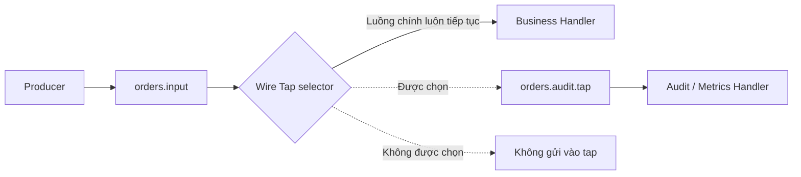
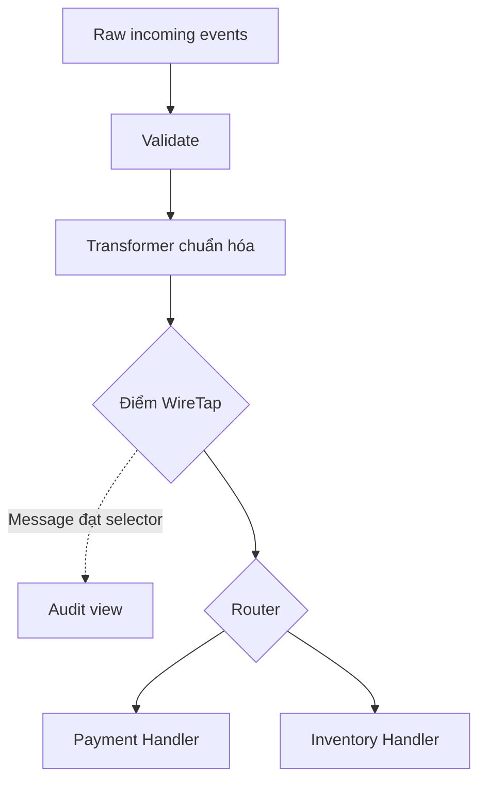
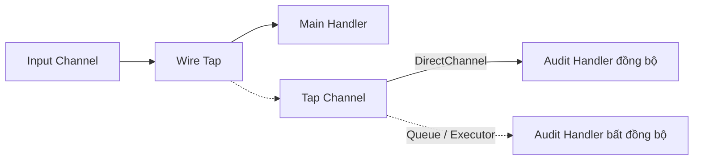
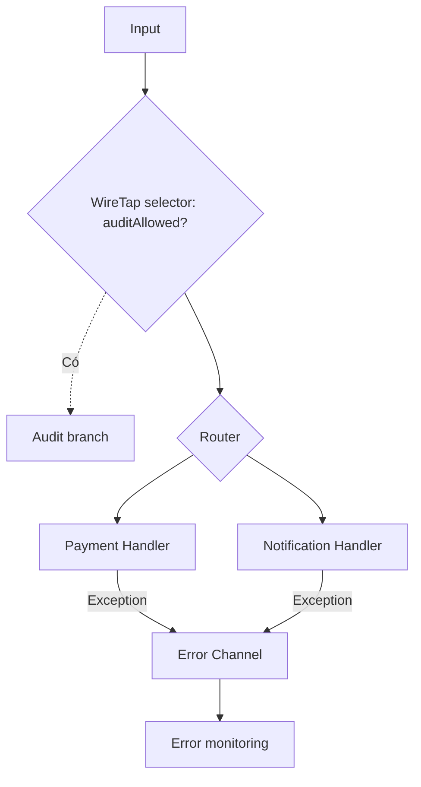
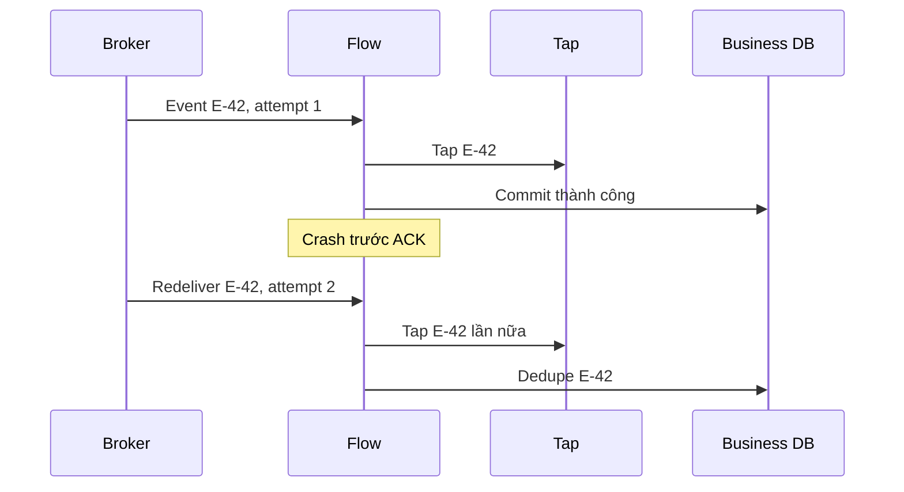

# Lọc message trước khi tap

Trong chương **Wire tap** của module **SPRING_INTEGRATION_PATTERN**, ta học cách quan sát hoặc sao chép một phần luồng thông điệp mà vẫn giữ nguyên mục đích xử lý nghiệp vụ chính. Module sử dụng Spring Integration để triển khai **Enterprise Integration Patterns** như Router, Filter, Transformer, Splitter, Aggregator, Gateway, retry, error channel và correlation, đồng thời kiểm thử, theo dõi các nhánh xử lý. Với **Wire Tap**, vấn đề thực tế thường không phải “làm sao gửi thêm một bản sao”, mà là: **chỉ những message nào được phép và cần thiết mới đi vào nhánh tap?**

Ví dụ, luồng đặt hàng nhận hàng nghìn sự kiện mỗi phút, nhưng nhóm vận hành chỉ muốn ghi nhận các sự kiện `ORDER_ACCEPTED` có cờ cho phép kiểm toán. Nếu sao chép tất cả message sang kênh audit rồi mới loại bỏ, hệ thống vừa chịu tải không cần thiết, vừa có nguy cơ để dữ liệu nhạy cảm xuất hiện ở nhánh quan sát.

**Lọc message trước khi tap** nghĩa là đặt điều kiện lựa chọn *trước thời điểm message được phát vào kênh tap*, thường bằng **MessageSelector của WireTap**. Điều kiện này phải được thiết kế sao cho message không được chọn **vẫn đi qua luồng chính**, trừ khi nghiệp vụ chủ đích lọc cả luồng chính.

Sau bài này, bạn có thể:

- Giải thích thời điểm WireTap kiểm tra điều kiện và phân biệt selector của tap với **Filter** của luồng chính.
- Cấu hình Spring Integration Java DSL chỉ tap sự kiện theo type, header, tenant hoặc tiêu chí nghiệp vụ.
- Thiết kế nhánh tap an toàn: tối thiểu hóa dữ liệu, loại bỏ thông tin nhạy cảm và tránh làm chậm nhánh chính.
- Xem xét callback đồng bộ/bất đồng bộ, channel capacity, lỗi tap, retry và ngữ nghĩa phân phối.
- Viết kiểm thử xác minh message được tap đúng điều kiện và message bị loại khỏi tap **không** bị loại khỏi nghiệp vụ.

## 1. Wire Tap hoạt động ở đâu trong message flow?

Trong EIP, **Wire Tap** gửi thêm một bản sao của message đang đi qua một điểm trong luồng tới một kênh phụ, ví dụ để audit, đo lường hoặc chẩn đoán. Trong Spring Integration, WireTap thường được gắn làm một **ChannelInterceptor**; Java DSL cung cấp cách khai báo `.wireTap(...)` thuận tiện.



Đường liền là đường nghiệp vụ chính; đường nét đứt biểu diễn nhánh phụ. Một message **không đạt selector của tap** vẫn được chuyển đến business handler. Đó là sự khác biệt quan trọng giữa việc *lọc nhánh tap* và *lọc cả message flow*.

WireTap gắn vào một channel nên vị trí channel quyết định những message nào có cơ hội được tap. Nếu gắn trước Router, các message của mọi tuyến đều có thể được chọn. Nếu gắn trên channel chỉ có nhánh `priority.orders`, tap chỉ thấy message đã tới nhánh đó.

**Lưu ý ngữ nghĩa:** WireTap chuyển một `Message<?>` sang kênh phụ; không mặc nhiên deep-copy toàn bộ đồ thị payload. Spring Message thường có headers bất biến ở cấp container, nhưng payload có thể là một đối tượng Java mutable. Handler ở nhánh tap không được sửa trực tiếp payload dùng chung, nếu không có thể ảnh hưởng đến nhánh chính.

## 2. Ba cách “lọc trước khi tap” dễ bị nhầm

| Cách đặt điều kiện | Message không hợp lệ với điều kiện có đi tiếp ở luồng chính? | Có được gửi tới tap? | Dùng khi nào? |
| --- | --- | --- | --- |
| **Filter trước WireTap trong luồng chính** | **Không**, trừ khi cấu hình discard/recovery riêng | Không, vì đã bị loại trước khi đến điểm tap | Nghiệp vụ thật sự không xử lý loại message đó |
| **Selector ngay trên WireTap** | **Có** | **Không** | Chỉ chọn một tập message để audit/metrics/debug |
| **Filter trong nhánh tap sau WireTap** | **Có** | **Có, đã được gửi vào kênh tap**, sau đó mới lọc | Khi cần xử lý/kiểm tra bổ sung trong nhánh audit, hoặc tái sử dụng chung kênh tap |

Xem ba sơ đồ:

**A. Filter luồng chính:**

```text
orders.input -> Filter(accepted?) -> WireTap -> Business
                    |
                    +-- rejected: bị bỏ khỏi cả luồng chính
```

Nếu đặt Filter như trên chỉ với mục đích giảm log, doanh nghiệp có thể **mất yêu cầu hợp lệ** mà không hay biết.

**B. Selector của WireTap:**

```text
orders.input -> WireTap(selector = auditAllowed?)
                      | yes -> audit.tap
                      | no  -> không gửi tới tap
             -> Business (cả yes và no đều tới đây)
```

Đây thường là giải pháp phù hợp nhất cho yêu cầu “chỉ tap message được phép”.

**C. Filter trong nhánh tap:**

```text
orders.input -> WireTap -> Business
                   |
                   +-> audit.tap -> Filter(auditAllowed?) -> AuditSink
```

Ở cách C, message bị loại vẫn đã đi qua một ranh giới tap, có thể đã bị xếp hàng/đi qua interceptor của tap channel. Nếu mục tiêu là giảm tải hoặc hạn chế đưa message nhạy cảm vào nhánh phụ, chọn lọc **ngay tại WireTap** thường hợp lý hơn.

## 3. Xác định tiêu chí selector

Selector trả về boolean theo **message hiện tại**, ví dụ kiểm tra header hoặc payload. Tập tiêu chí nên đơn giản, rẻ, xác định được và đủ tin cậy để đưa ra quyết định tại đường nóng của luồng.

Ví dụ hợp đồng sự kiện:

```json
{
  "eventId": "evt-2026-001",
  "type": "ORDER_ACCEPTED",
  "orderId": "O-100",
  "tenantId": "tenant-a",
  "totalAmount": 280000
}
```

Message mang thêm header nội bộ:

```text
eventType = ORDER_ACCEPTED
auditAllowed = true
source = order-service
traceId = ... (nếu có)
```

Ta chỉ tap khi:

```text
eventType == "ORDER_ACCEPTED"
AND auditAllowed == true
```

Quy tắc này mang ý nghĩa **cho phép audit**, không phải quyền truy cập hay xác thực nguồn. Nếu `auditAllowed` đến từ hệ thống không tin cậy và có thể bị giả mạo, cần tính toán lại tại một bước kiểm tra/định danh đáng tin cậy trước khi selector sử dụng. Không đưa quyết định bảo mật hoàn toàn vào một header do đối tác tự gửi.

### Khi nào chọn bằng header?

- Event type, tenant hoặc classification đã được hệ thống xác nhận.
- Cờ audit/trace đã được tính trong nội bộ.
- Trạng thái nghiệp vụ đã được chuẩn hóa trước khi qua điểm tap.

### Khi nào chọn bằng payload?

- Luồng không có header thích hợp nhưng payload đã được parse/validate.
- Cần chọn dựa trên một trường domain như `OrderEvent.status()`.

Tránh selector quá nặng: không gọi database, không thực hiện HTTP request, không parse lại JSON lớn cho mỗi message nếu có thể chuẩn hóa trước. Selector chạy trên đường send/intercept của channel; nó có thể làm tăng latency của nhánh chính.

## 4. Ví dụ Java DSL: chỉ tap message được chọn

Ví dụ dùng Java 17+, Spring Integration Core và Java DSL. Business flow xử lý mọi sự kiện; một **selector chỉ giới hạn nhánh audit**.

### 4.1. Hợp đồng và gateway gửi message

```java
package example.orders;

public record OrderEvent(
    String eventId,
    String orderId,
    String type,
    String tenantId
) {}
```

Một Messaging Gateway giúp phía gọi gửi message mà không trực tiếp phụ thuộc vào channel:

```java
package example.orders;

import org.springframework.integration.annotation.Gateway;
import org.springframework.integration.annotation.MessagingGateway;
import org.springframework.messaging.handler.annotation.Header;

@MessagingGateway
interface OrderIngress {
    @Gateway(requestChannel = "orders.input")
    void publish(
        OrderEvent event,
        @Header("eventType") String eventType,
        @Header("auditAllowed") boolean auditAllowed
    );
}
```

Ở ứng dụng thực, `auditAllowed` cần được xác định bởi policy phía server, không lấy nguyên từ một request không được xác thực. Gateway ở đây minh họa việc gắn header rõ ràng để selector kiểm tra.

### 4.2. Định nghĩa flow có selector của WireTap

```java
package example.orders;

import org.springframework.context.annotation.Bean;
import org.springframework.context.annotation.Configuration;
import org.springframework.integration.annotation.IntegrationComponentScan;
import org.springframework.integration.config.EnableIntegration;
import org.springframework.integration.dsl.IntegrationFlow;

@Configuration
@EnableIntegration
@IntegrationComponentScan
class OrderWireTapFlow {

    @Bean
    IntegrationFlow orderMainFlow(OrderService orderService) {
        return IntegrationFlow.from("orders.input")
            .wireTap("orders.audit.tap", tap -> tap.selector(
                message ->
                    "ORDER_ACCEPTED".equals(
                        message.getHeaders().get("eventType")
                    )
                    && Boolean.TRUE.equals(
                        message.getHeaders().get("auditAllowed")
                    )
            ))
            .handle(OrderEvent.class, (event, headers) -> {
                orderService.process(event);
                return null; // Luồng sự kiện một chiều.
            })
            .get();
    }

    @Bean
    IntegrationFlow orderAuditFlow(AuditSink auditSink) {
        return IntegrationFlow.from("orders.audit.tap")
            .transform(OrderEvent.class, event -> new AuditRecord(
                event.eventId(),
                event.orderId(),
                event.type()
            ))
            .handle(AuditRecord.class, (record, headers) -> {
                auditSink.record(record);
                return null;
            })
            .get();
    }
}

// Các component nghiệp vụ do ứng dụng cung cấp làm bean.
interface OrderService {
    void process(OrderEvent event);
}

record AuditRecord(String eventId, String orderId, String eventType) {}

interface AuditSink {
    void record(AuditRecord record);
}
```

Đọc cấu hình:

1. `IntegrationFlow.from("orders.input")` mở luồng nhận dữ liệu nghiệp vụ.
2. `.wireTap("orders.audit.tap", ...)` đặt điểm tap trên đường flow.
3. `tap.selector(...)` quyết định message nào **được gửi sang kênh audit**.
4. `.handle(OrderEvent.class, ...)` xử lý mọi message đã tới luồng chính, không bị selector của tap loại khỏi nghiệp vụ.
5. Flow `orderAuditFlow` chuyển event thành `AuditRecord` với số trường tối thiểu rồi mới gửi tới audit sink.

Đoạn mã minh họa API Java DSL thường dùng của Spring Integration; ứng dụng phải có dependency tương ứng và các bean `OrderService`, `AuditSink`. Nếu phiên bản framework có khác biệt về overload của `wireTap` hoặc `selector`, đối chiếu API của phiên bản dự án để điều chỉnh cách khai báo, nhưng **ngữ nghĩa selector** vẫn phải là chỉ chọn message cho nhánh tap.

**Không nên log toàn bộ `OrderEvent`** hoặc gọi `event.toString()` một cách vô điều kiện. Phần record audit chỉ có event ID, order ID và event type; nếu các trường này vẫn thuộc dữ liệu cần bảo vệ, áp dụng masking, retention và quyền truy cập tương ứng.

### 4.3. Kết quả mong đợi

| Message | `eventType` | `auditAllowed` | Main handler | Audit sink |
| --- | --- | --- | --- | --- |
| A | `ORDER_ACCEPTED` | `true` | Có | Có |
| B | `ORDER_ACCEPTED` | `false` | Có | Không |
| C | `ORDER_REJECTED` | `true` | Có | Không |
| D | Không có header | `true` | Có | Không |
| E | `ORDER_ACCEPTED` | `"true"` dạng chuỗi | Có | Không, vì selector đòi boolean `Boolean.TRUE` |

Tính chặt chẽ về kiểu của header giúp tránh vô tình cho phép audit khi upstream gửi sai schema. Trường hợp header thiếu/sai kiểu có thể bổ sung metric hoặc nhánh validation; đừng chỉ dựa vào số liệu audit để phát hiện toàn bộ lỗi nghiệp vụ.

## 5. Dùng MessageSelector độc lập khi điều kiện phức tạp

Khi nhiều flow cùng sử dụng một chính sách, đưa predicate ra thành **MessageSelector** độc lập giúp dễ kiểm thử:

```java
package example.orders;

import org.springframework.integration.core.MessageSelector;
import org.springframework.messaging.Message;

final class OrderAuditSelector implements MessageSelector {
    @Override
    public boolean accept(Message<?> message) {
        Object allowed = message.getHeaders().get("auditAllowed");
        Object type = message.getHeaders().get("eventType");

        return Boolean.TRUE.equals(allowed)
            && "ORDER_ACCEPTED".equals(type);
    }
}
```

Ở cấu hình tap, có thể khai báo selector tương đương trực tiếp bằng lambda hoặc đăng ký bean selector và truyền vào `WireTap` theo API của phiên bản Spring Integration đang sử dụng.

```text
inputChannel
    -> WireTap(
         tapChannel = "orders.audit.tap",
         selector = OrderAuditSelector::accept
       )
    -> business flow
```

Pseudocode trên diễn giải cách ghép hai thành phần, không phải cú pháp Java khởi tạo đối tượng `WireTap`. Khi mã thực thi cần đi qua Java DSL hoặc cấu hình `ChannelInterceptor` được hỗ trợ.

### Kết hợp nhiều điều kiện

Nếu yêu cầu là “tap mọi message `ORDER_ACCEPTED` từ các tenant được cho phép, trừ payload có classification quá nhạy cảm”, có thể viết:

```java
boolean shouldTap(
        Message<?> message,
        java.util.Set<String> allowedTenants) {

    Object type = message.getHeaders().get("eventType");
    Object tenant = message.getHeaders().get("tenantId");
    Object classification = message.getHeaders().get("dataClass");

    return "ORDER_ACCEPTED".equals(type)
        && tenant instanceof String tenantId
        && allowedTenants.contains(tenantId)
        && "PUBLIC".equals(classification);
}
```

Không dùng `tenantId` hay classification từ phía ngoài như một tuyên bố đáng tin cậy nếu chưa có bước xác thực/chuẩn hóa. Tập `allowedTenants` cũng cần được cập nhật đúng theo chính sách triển khai; tránh thực hiện truy vấn mạng đồng bộ ngay trong selector.

## 6. Chọn vị trí tap trước hay sau Transformer, Router hoặc Filter?

Điểm gắn tap quyết định **dữ liệu và tập message** mà tap có thể nhìn thấy. Đây là lựa chọn thiết kế có tác động cả tới chi phí và bảo mật.



| Vị trí | Tap có thể thấy | Ưu điểm | Rủi ro |
| --- | --- | --- | --- |
| **Trước validation** | Cả message hợp lệ lẫn message chưa kiểm chứng | Chẩn đoán lỗi ở đầu vào | Dễ đưa dữ liệu thô/sai schema/nhạy cảm vào audit |
| **Sau Transformer** | DTO đã chuẩn hóa | Selector rẻ và nhất quán hơn | Không thấy lỗi trước Transformer nếu không có kênh lỗi khác |
| **Sau Filter nghiệp vụ** | Chỉ message vượt qua Filter | Ít event hơn, đúng tập đang xử lý | Mất quan sát các message bị Filter loại |
| **Trước Router** | Các nhánh cùng đi qua một điểm tap | Một nơi đo/audit | Có thể cần thêm tag về tuyến dự kiến |
| **Sau Router** | Message đã tới từng channel nhánh | Quan sát đúng tuyến | Có thể cần nhiều WireTap hoặc selector riêng |

Nếu mục tiêu là **audit các tác vụ đã được chấp nhận**, thường đặt tap sau bước validate và chuẩn hóa. Nếu mục tiêu là **điều tra dữ liệu gửi sai**, thiết kế kênh quarantine/error có quyền truy cập riêng thay vì vô điều kiện tap payload thô.

### Nhầm lẫn dễ gây lỗi

```java
// Lọc ở luồng chính: message không đạt sẽ không đến business handler.
.filter(OrderEvent.class, e -> "ORDER_ACCEPTED".equals(e.type()))
.wireTap("orders.audit.tap")
```

Cách trên chỉ đúng nếu nghiệp vụ thực sự không xử lý những event khác. Nếu muốn tiếp tục xử lý mọi event nhưng chỉ audit một số event, dùng selector trên WireTap:

```java
.wireTap("orders.audit.tap", tap -> tap.selector(
    m -> "ORDER_ACCEPTED".equals(m.getHeaders().get("eventType"))
))
```

## 7. Lọc được message chưa đồng nghĩa dữ liệu đã an toàn

Selector chỉ định **message nào được sao chép**, không tự động ẩn trường nhạy cảm trong payload. Nếu chọn một event có email, số điện thoại hoặc token, nhánh tap ban đầu vẫn có thể nhìn thấy những dữ liệu đó.

Một thiết kế audit an toàn cần nhiều lớp:

1. **Giới hạn message:** chỉ chọn event cần thiết ngay tại selector.
2. **Giới hạn dữ liệu:** trong nhánh tap, biến payload thành `AuditRecord` chỉ gồm trường thực sự cần.
3. **Giới hạn nơi nhận:** chỉ gửi record đã giảm dữ liệu sang hệ thống log/monitoring ngoài.
4. **Giới hạn quyền truy cập và thời hạn lưu:** cấu hình ACL, masking, retention và xóa theo policy.
5. **Giới hạn tag:** không dùng email, order ID hoặc access token làm tag của Micrometer; giữ cardinality thấp và tránh rò rỉ.

Ví dụ một luồng audit tối thiểu:

```text
WireTap selector (chỉ ORDER_ACCEPTED/auditAllowed)
    -> Internal trusted tap channel
    -> Transformer: OrderEvent -> AuditRecord(eventId, orderId, type)
    -> Outbound adapter / Audit sink
```

Không đưa raw message từ tap channel trực tiếp tới broker hoặc ứng dụng log bên ngoài rồi mới mong phía nhận tự loại bỏ dữ liệu. Nhánh audit cũng có thể chịu yêu cầu bảo mật tương tự luồng chính.

**Một lưu ý về payload mutable:** nếu handler audit xóa trường nhạy cảm bằng cách sửa trực tiếp đối tượng payload mà hai nhánh cùng chia sẻ, luồng chính có thể nhận dữ liệu đã bị sửa. Hãy **tạo một DTO audit mới** hoặc copy phù hợp thay vì mutate shared payload.

## 8. Selector phải nhanh và có khả năng quan sát

Vì selector có thể chạy trong đường gửi message, điều kiện càng đắt thì chi phí bổ sung cho tất cả message càng cao, kể cả những message không được tap.

| Loại điều kiện | Chi phí thường gặp | Cách giảm chi phí |
| --- | --- | --- |
| So sánh header chuẩn hóa | Nhỏ | Ưu tiên khi có thể |
| Kiểm tra trường DTO đã parse | Nhỏ đến vừa | Không deserialize lại |
| Regex trên payload lớn | Có thể tăng theo kích thước | Parse/chuẩn hóa trước rồi kiểm tra trường |
| Truy vấn database | Có thể chậm/không ổn định | Đưa quyết định vào bước có cache/chính sách trước điểm tap |
| Gọi HTTP/service khác | Độ trễ biến thiên, có thể timeout | Không gọi đồng bộ trong selector của tap |
| Lựa chọn bằng tỷ lệ lấy mẫu | Nhỏ nếu dùng hash ổn định | Dùng thuật toán deterministic theo event ID |

Nếu muốn lấy mẫu 1% event, dùng phép hash ổn định theo `eventId` giúp cùng một event giữ quyết định tap khi bị redelivery, thay vì random cho mỗi attempt. Tỷ lệ mẫu cần được công bố cùng quy tắc lựa chọn; event thiếu ID phải có cách xử lý rõ ràng.

Ví dụ:

```java
static boolean sampleOnePercent(String eventId) {
    if (eventId == null || eventId.isBlank()) {
        return false;
    }

    int bucket = Math.floorMod(eventId.hashCode(), 100);
    return bucket == 0; // Mẫu xác định gần 1% với tập ID phân tán đều.
}
```

Đây là sampling xấp xỉ theo phân phối của khóa, không phải đảm bảo chính xác một event trong mọi 100 event. Không dùng sampling cho yêu cầu kiểm toán bắt buộc phải lưu mọi sự kiện được pháp luật/quy trình yêu cầu.

### Metrics để biết selector hoạt động thế nào

- `tap_eligible_total`: số message đủ điều kiện selector.
- `tap_skipped_total`: số message không được chọn.
- `tap_delivered_total`: số message thực sự tới tap consumer (nếu được instrument).
- `tap_failed_total`: số lỗi gửi/xử lý tại nhánh tap.
- `tap_selector_duration`: thời gian đánh giá điều kiện, khi cần benchmark.
- `main_processed_total`: số message được nghiệp vụ xử lý.

Đừng dùng chỉ số `tap_eligible_total` như bằng chứng audit sink đã ghi bền vững. Cần phân biệt *đủ điều kiện*, *đã gửi tới tap*, *đã ghi audit*.

## 9. Đồng bộ, bất đồng bộ và ảnh hưởng của nhánh tap tới luồng chính

WireTap thường **không tạo một worker thread mới chỉ vì được gắn vào channel**. Tính đồng bộ phụ thuộc loại tap channel và các handler phía sau:



### Tap channel là DirectChannel

Một handler audit chậm có thể làm tăng thời gian `send()` của luồng nguồn, vì việc chuyển tới subscriber có thể diễn ra đồng bộ. Nếu audit sink gọi network và bị timeout, main flow có thể bị ảnh hưởng về latency và cách ngoại lệ lan truyền.

### Tap channel là ExecutorChannel hoặc QueueChannel

Có thể tách việc tiêu thụ audit khỏi thời gian xử lý chính. Tuy nhiên, message có thể bị giữ trong queue/executor, gặp **backpressure**, bị loại nếu queue đầy theo chính sách, hoặc mất khi ứng dụng restart nếu chỉ dùng hàng đợi trong bộ nhớ.

Tùy cấu hình, lỗi tap có thể lan về sender hoặc được xử lý ở nhánh phụ. **Không được mặc định WireTap luôn bỏ qua lỗi gửi**, cũng không được mặc định mọi lỗi tap luôn làm main flow thất bại. Hãy xác định chính xác cơ chế gửi, `ignoreSendFailures` nếu được phiên bản sử dụng hỗ trợ, timeout/error channel và chính sách nghiệp vụ.

### Audit bắt buộc khác diagnostic logging

Nếu audit mang tính **nghiệp vụ bắt buộc**, một WireTap thuần túy tới kênh best-effort có thể không đáp ứng tính bền vững. Cần cân nhắc transactional outbox, lưu trạng thái audit cùng nghiệp vụ hoặc một hệ thống ghi nhận bền vững và có đối soát.

Nếu tap chỉ phục vụ **chẩn đoán/metrics**, có thể chấp nhận bỏ mẫu khi quá tải nhằm bảo vệ luồng chính, nhưng việc mất mẫu phải được đo và công bố. Hai yêu cầu này không nên dùng chung một chính sách lỗi.

## 10. WireTap, Filter và Router khi flow có nhiều nhánh

Một câu hỏi thường gặp là: “Tôi muốn tap tất cả message đi qua Router nhưng chỉ log các message lỗi ở downstream.”

Có hai chiến lược riêng:

- **Tap trước Router:** chọn theo thông tin đã biết ở thời điểm đó, ví dụ event type hoặc header priority. Không thể chọn theo kết quả xử lý *chưa xảy ra*.
- **Tap/error flow sau bước xử lý:** chọn các message hoặc `ErrorMessage` đã có kết quả lỗi, rồi đưa vào kênh giám sát phù hợp.



WireTap không “nhìn thấy tương lai” của message. Nếu một handler sau WireTap thất bại, nhánh tap trước đó đã có thể ghi nhận sự kiện “đã nhận”; không được tự diễn giải nó thành “đã xử lý thành công”.

Với error channel, cần phân biệt lỗi đồng bộ có thể ném về caller và lỗi bất đồng bộ được đóng gói thành `ErrorMessage`. Thiết kế giám sát cần gắn request/event ID, mức độ lỗi và vị trí xử lý; không lưu toàn bộ stack trace cùng payload nhạy cảm khi chưa có kiểm soát.

## 11. Correlation, retry và redelivery: tránh tính trùng là nhiều sự kiện

Một message có thể được nhận lần nữa do broker redelivery hoặc ứng dụng retry, trong khi WireTap nằm trên đường đi của lần xử lý đó. Nếu selector chỉ dựa trên event type, cùng event có thể được tap nhiều lần.



Vì thế:

- Dùng `eventId` hoặc `requestId` bền vững để liên kết các lần gửi, không chỉ dùng `MessageHeaders.ID`.
- Nếu audit lưu **mỗi attempt**, tạo record theo `(eventId, attemptId)` và ghi rõ đó là lần thử.
- Nếu audit lưu **một sự kiện nghiệp vụ**, áp dụng idempotency/deduplication theo `eventId` ở audit sink.
- Không coi số lần tap bằng số lần nghiệp vụ thành công; cần phân biệt `RECEIVED`, `ACCEPTED`, `COMMITTED` và `FAILED`.
- Nếu cần quan sát Splitter/Aggregator, phân biệt correlation ID nhóm message với request ID nghiệp vụ.

Tap selector không thay thế Retry Advice, không xác nhận ACK cho broker và không đảm bảo exactly-once. Những cơ chế đó thuộc các ranh giới khác của luồng.

## 12. Kiểm thử: điều kiện lọc chỉ tác động tới nhánh tap

Kiểm thử cần khẳng định **hai điều cùng lúc**: chỉ message phù hợp được ghi vào tap, và **mọi message cần thiết vẫn được xử lý ở main flow**.

### 12.1. Ma trận tình huống

| Trường hợp | Đầu vào | Main handler | Tap handler |
| --- | --- | --- | --- |
| Hợp lệ, được phép | `ORDER_ACCEPTED`, `auditAllowed=true` | 1 lần | 1 lần |
| Không được phép | `ORDER_ACCEPTED`, `auditAllowed=false` | 1 lần | 0 lần |
| Sai loại sự kiện | `ORDER_REJECTED`, `auditAllowed=true` | 1 lần | 0 lần |
| Header bị thiếu | Không có `eventType` | 1 lần hoặc validation theo policy riêng | 0 lần |
| Header sai kiểu | `auditAllowed="true"` kiểu String | 1 lần hoặc validation theo policy riêng | 0 lần |
| Nhiều message đồng thời | Kết hợp điều kiện khác nhau | Đủ số event | Chỉ event thỏa selector |
| Lỗi audit sink | Handler audit ném exception | Theo chính sách isolation của tap | Có metric/đường lỗi |
| Redelivery | Cùng `eventId` tới lần thứ hai | Nghiệp vụ idempotent | Đếm attempt hoặc dedupe theo hợp đồng |
| Payload mutable | Tap cố tình thử sửa payload | Nội dung main không bị thay đổi khi dùng DTO bất biến | Không mutate shared object |
| Dữ liệu nhạy cảm | Event chứa email/token | Xử lý nghiệp vụ theo policy | Không lộ trường cấm ra sink/log |

### 12.2. Unit test selector không cần khởi tạo Spring context

Tách `OrderAuditSelector` thành class thuần giúp kiểm thử hành vi boolean:

```java
package example.orders;

import static org.assertj.core.api.Assertions.assertThat;

import org.junit.jupiter.api.Test;
import org.springframework.messaging.support.MessageBuilder;

class OrderAuditSelectorTest {

    private final OrderAuditSelector selector = new OrderAuditSelector();

    @Test
    void acceptsOnlyApprovedOrderAccepted() {
        var selected = MessageBuilder.withPayload("event")
            .setHeader("eventType", "ORDER_ACCEPTED")
            .setHeader("auditAllowed", true)
            .build();

        var rejected = MessageBuilder.withPayload("event")
            .setHeader("eventType", "ORDER_ACCEPTED")
            .setHeader("auditAllowed", false)
            .build();

        assertThat(selector.accept(selected)).isTrue();
        assertThat(selector.accept(rejected)).isFalse();
    }

    @Test
    void missingHeadersDoNotOptIn() {
        var message = MessageBuilder.withPayload("event").build();
        assertThat(selector.accept(message)).isFalse();
    }
}
```

Đây là ví dụ JUnit 5/AssertJ trong dự án có các dependency tương ứng; bài học không chạy unit test. Unit test selector **chưa đủ**: cần integration test gửi message qua channel chứa WireTap và kiểm tra cả main/tap.

### 12.3. Integration test ở ranh giới flow

```text
Given:
  orders.input có WireTap selector
  main handler và audit sink là hai spy độc lập
When:
  publish(A: ORDER_ACCEPTED, auditAllowed=true)
  publish(B: ORDER_ACCEPTED, auditAllowed=false)
  publish(C: ORDER_REJECTED, auditAllowed=true)
Then:
  main handler xử lý A, B, C
  audit sink chỉ nhận AuditRecord của A
  audit sink không nhận payload nhạy cảm
  số message được chọn = 1; bỏ qua = 2
```

Nếu tap channel bất đồng bộ, test nên chờ theo điều kiện quan sát được với timeout, ví dụ CountDownLatch hoặc Awaitility, thay vì ngủ cố định. Với tap audit bắt buộc, bổ sung test failure, backpressure, restart và replay. Với tap chẩn đoán best-effort, kiểm thử rằng lỗi tap không làm gián đoạn main flow **nếu đó là chính sách đã được chọn và cấu hình**.

## 13. Những sai lầm thường gặp

**Dùng Filter của main flow chỉ để lọc log.** Message không đạt Filter có thể không tới business handler. Nếu chỉ muốn giảm dữ liệu audit, dùng selector của WireTap.

**Filter sau khi đã đưa dữ liệu ra hệ thống logging ngoài.** Dữ liệu thô đã rời khỏi ranh giới tin cậy. Chọn lọc và thu nhỏ dữ liệu trước khi xuất.

**Nghĩ selector làm payload được ẩn danh.** Nó chỉ chọn message; cần Transformer/masking riêng trên nhánh tap.

**Gọi database hoặc HTTP bên trong selector.** Điều kiện chậm có thể làm chậm mọi lần gửi message và tạo lỗi phụ thuộc mạng trên đường chính.

**Mặc định tap không ảnh hưởng latency.** Tap tới DirectChannel có handler chậm có thể làm tăng thời gian gửi; cần benchmark và chọn loại channel/cơ chế tách phù hợp.

**Tin rằng WireTap luôn luôn bỏ qua lỗi.** Khi tap channel không nhận được message hoặc handler ném exception, kết quả phụ thuộc cấu hình gửi/ignore failures và topology. Phải kiểm tra đường lỗi thực tế.

**Ghi toàn bộ payload vào logs.** Dễ lộ PII/secret, tăng chi phí và làm méo kết quả observability.

**Tap trước khi schema và quyền truy cập được xác thực.** Selector dựa trên header do nguồn ngoài tự khai có thể bị lợi dụng. Chuẩn hóa tại boundary.

**Đếm các lần tap là các giao dịch thành công.** Một event có thể bị retry/redeliver; audit cần xác định đang ghi lần thử hay kết quả nghiệp vụ.

**Không theo dõi số message bị bỏ.** Có thể cấu hình selector quá chặt và không biết audit dữ liệu bị thiếu; phải có tỷ lệ eligible/skipped và tổng message chính.

## 14. Checklist triển khai

1. Xác định mục đích tap: audit bắt buộc, metrics hay debug có thể lấy mẫu.
2. Chọn **điểm đặt tap** sau các bước validate/transform cần thiết và trước/hoặc sau Router theo phạm vi cần quan sát.
3. Viết selector chỉ dựa trên dữ liệu đã đáng tin cậy và đủ rẻ để kiểm tra ở đường nóng.
4. Dùng selector của WireTap khi muốn **lọc nhánh tap nhưng không lọc luồng chính**.
5. Tách DTO audit khỏi payload nghiệp vụ, mask/truncate trường nhạy cảm trước khi xuất tới hệ thống khác.
6. Chọn DirectChannel/ExecutorChannel/QueueChannel cho tap theo yêu cầu latency, độ bền và backpressure.
7. Định nghĩa chính sách khi tap channel lỗi hoặc quá tải; phân biệt audit bắt buộc với diagnostic best-effort.
8. Dùng ID nghiệp vụ để ghép correlation, retry/redelivery và lựa chọn idempotency/attempt logging.
9. Đo cả main throughput/latency, tap selected/skipped/delivered/failed, giới hạn tags cardinality.
10. Kiểm thử message đạt/không đạt selector, header thiếu/sai kiểu, lỗi audit, đồng thời và dữ liệu nhạy cảm.
11. Kiểm tra lại rằng không có Filter trong main flow vô tình loại message nghiệp vụ.
12. Nếu yêu cầu audit không mất dữ liệu, thiết kế nơi lưu bền vững/đối soát; không chỉ dựa vào một WireTap in-memory.

## Kết luận

**Lọc message trước khi tap** là cách giới hạn nhánh quan sát để chỉ message phù hợp được sao chép, trong khi xử lý nghiệp vụ chính tiếp tục bình thường. Trong Spring Integration, **selector của WireTap** thường là công cụ đúng cho yêu cầu này; **Filter trước WireTap trong luồng chính** lại có thể làm loại bỏ luôn message nghiệp vụ, còn **Filter trong nhánh tap** chỉ chạy sau khi bản sao đã được gửi vào nhánh phụ. Kết hợp vị trí đặt tap hợp lý, selector nhanh, dữ liệu audit tối thiểu, chính sách lỗi/latency rõ ràng và kiểm thử cả hai nhánh giúp bảo đảm Wire Tap hỗ trợ quan sát mà không trở thành nguồn rủi ro cho message flow.
