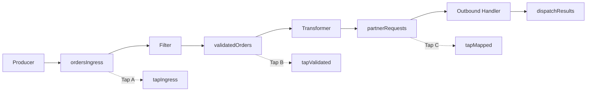
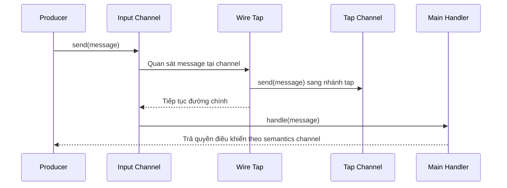
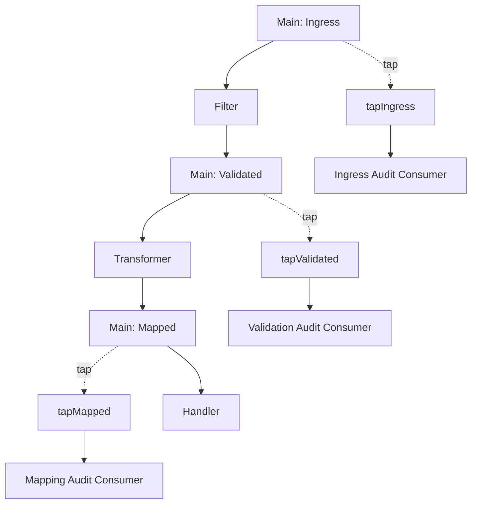
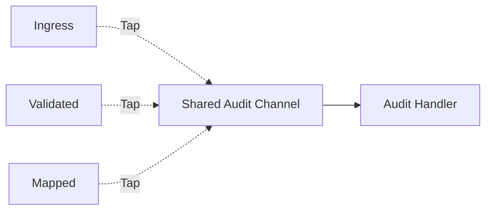
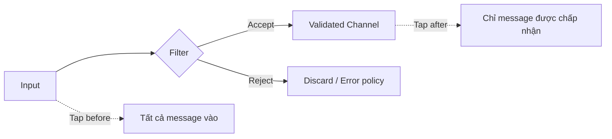
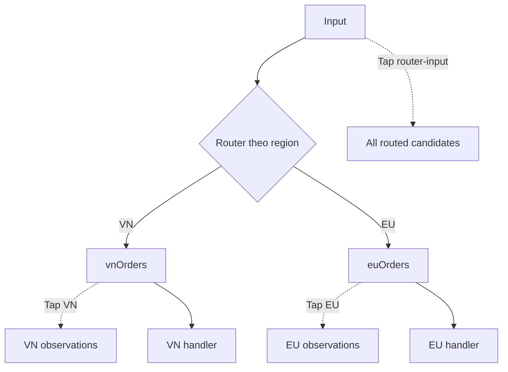
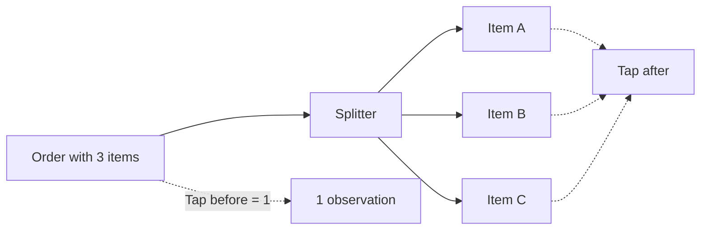
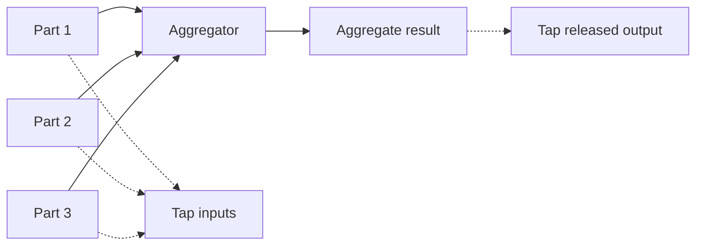
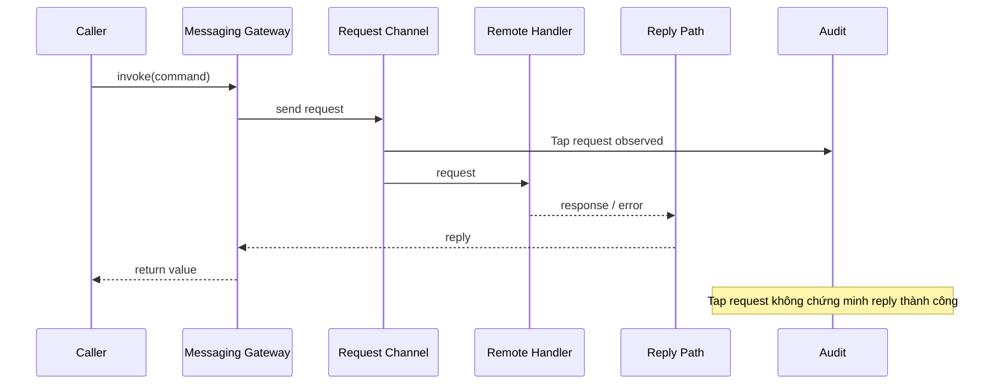

# Tap nhiều điểm trong flow với Spring Integration

## 1. Bài toán: một Wire Tap chưa đủ để hiểu toàn bộ integration flow

Một ứng dụng xử lý đơn hàng thường có nhiều bước:

1. Nhận yêu cầu từ REST API hoặc một message broker.
2. Kiểm tra cấu trúc và điều kiện nghiệp vụ.
3. Lọc những yêu cầu không hợp lệ.
4. Biến đổi DTO nội bộ thành contract của đối tác.
5. Chọn một tuyến xử lý hoặc gọi dịch vụ bên ngoài.
6. Nhận kết quả và ghi nhận trạng thái hoàn tất.

Nếu đặt một **Wire Tap** ngay đầu vào, ta biết rằng message đã vào ứng dụng, nhưng không biết nó có qua Filter hay Transformer không. Nếu chỉ tap trước outbound adapter, ta thấy request sắp gửi, nhưng không có bằng chứng rằng đối tác đã xử lý thành công.

**Tap nhiều điểm trong flow** là kỹ thuật bố trí các Wire Tap tại những channel hoặc ranh giới xử lý có ý nghĩa để theo dõi **các trạng thái trung gian của cùng một yêu cầu**, mà không buộc luồng nghiệp vụ chính thực hiện thêm công việc quan sát.

Bài thuộc chương **Wire tap** trong module **SPRING_INTEGRATION_PATTERN**, nơi người học triển khai Enterprise Integration Patterns bằng Spring Integration nhằm tạo các flow ít phụ thuộc, có thể mở rộng, kiểm thử và quan sát được. Các pattern như Filter, Transformer, Router, Splitter, Aggregator, Gateway, retry, error channel và correlation sẽ được sử dụng để giải thích ý nghĩa của từng điểm tap.

Sau bài học, bạn sẽ biết:

- Chọn vị trí tap dựa trên câu hỏi vận hành, thay vì gắn tap tùy tiện.
- Phân biệt message được **nhận**, **chấp nhận**, **ánh xạ**, **đưa vào handler** và **xử lý thành công**.
- Cấu hình nhiều Wire Tap với các tap channel riêng bằng Spring Integration.
- Ghép các bản quan sát theo một định danh nghiệp vụ xuyên suốt flow.
- Kiểm thử cả đường chính lẫn những điểm quan sát trung gian.
- Kiểm soát chi phí, lỗi, backpressure, ordering, dữ liệu nhạy cảm và vòng đời audit.

## 2. Mỗi tap trả lời một câu hỏi khác nhau

Xem một flow đơn giản:



| Điểm tap | Quan sát được điều gì? | Không được suy ra |
|---|---|---|
| **Tap A — Ingress** | Message đã đi tới channel đầu vào | Đã vượt validation hoặc đã xử lý xong |
| **Tap B — Validated** | Message đã vượt bước Filter trước channel đó | Downstream Transformer và outbound call chắc chắn thành công |
| **Tap C — Mapped** | Request đã được Transformer tạo và gửi vào channel tương ứng | Remote service đã nhận hoặc commit thành công |
| **Tap D — Result** (nếu thêm) | Handler đã tạo kết quả gửi vào result channel | Mọi side effect bên ngoài đều đã commit, trừ khi hợp đồng handler bảo đảm |

Điểm khác biệt quan trọng: **Wire Tap ghi nhận sự kiện tại channel mà nó quan sát, không phải trạng thái thành công của toàn workflow**.

Ví dụ, với đơn hàng `O-42`:

```text
tapIngress:   O-42, OrderCommand, received
tapValidated: O-42, OrderCommand, passed-filter
tapMapped:    O-42, PartnerOrderRequest, ready-for-handler
```

Ba bản quan sát này đại diện cho **ba mốc khác nhau**, không nhất thiết là ba business event độc lập. Nếu đếm chung thành "số đơn hàng" sẽ đếm trùng một yêu cầu.

### Chọn tên stage mang ngữ nghĩa

Thay vì `tap1`, `tap2`, `tap3`, nên dùng:

- `ingress`: tới input channel.
- `validated`: đã vượt validation/filter.
- `mapped`: đã tạo payload theo contract phía nhận.
- `routed-vn` hoặc `routed-eu`: đã được đưa vào nhánh cụ thể.
- `reply-created`: response nghiệp vụ đã được tạo.
- `failure-observed`: một error event đã được nhận ở error path.

Những tên này phải phản ánh **điểm xảy ra việc quan sát**, không được tự ý khẳng định `completed` hoặc `committed` nếu chưa có xác nhận thật.

## 3. Cơ chế Wire Tap trong Spring Integration

Spring Integration có thể gắn Wire Tap vào một `MessageChannel` dưới dạng `ChannelInterceptor`. Khi message được gửi qua channel, Wire Tap gửi bản quan sát sang một tap channel riêng; message trên đường chính vẫn được chuyển đến consumer chính theo semantics của channel đó.



Bản thân Wire Tap:

- Không tự biến `OrderCommand` thành `PartnerOrderRequest`.
- Không sửa nội dung nghiệp vụ hoặc quyết định Filter.
- Không tự tạo reply cho Messaging Gateway.
- Không tự bảo đảm ghi audit bền vững.
- Không tự bảo đảm lỗi hoặc độ trễ của nhánh tap sẽ không ảnh hưởng đường chính.
- Không mặc nhiên deep-copy payload.

Khi bố trí **nhiều tap**, mọi giới hạn này vẫn tồn tại ở **mỗi** điểm. Ba tap đồng nghĩa ba cơ hội tạo thêm công việc quan sát và tiêu thụ bộ nhớ.

### Message và headers tại các stage

Một `Message<?>` mang `payload` và `headers`. Ở các stage khác nhau, kiểu payload có thể thay đổi do Transformer, còn business correlation ID có thể được giữ qua các bước.

Ví dụ:

```text
Ingress:
  payload: OrderCommand(orderId="O-42", sku="BOOK-01", quantity=2)
  headers.businessTraceId: "trace-order-42"

Validated:
  payload: OrderCommand(orderId="O-42", sku="BOOK-01", quantity=2)
  headers.businessTraceId: "trace-order-42"

Mapped:
  payload: PartnerOrderRequest(ref="O-42", product="BOOK-01", units=2)
  headers.businessTraceId: "trace-order-42"
```

Ở đây payload thay đổi **do Transformer**, không phải do Wire Tap. Một integration component có thể tạo message wrapper mới với `id`/`timestamp` khác, vì vậy **không nên lấy `MessageHeaders.ID` làm định danh xuyên suốt tất cả stage**. Hãy đặt một `businessTraceId` hoặc `correlationId` nghiệp vụ ổn định, có quy tắc rõ ràng về cách tạo và truyền.

## 4. Hai kiến trúc phổ biến cho nhiều điểm tap

### Cách A — Tap channel riêng cho từng stage



**Ưu điểm:** mỗi queue/channel đã xác định stage. Consumer có thể tạo audit record gắn `stage=ingress`, `stage=validated` hoặc `stage=mapped` mà **không cần sửa headers của message chính**.

**Nhược điểm:** số channel và consumer tăng theo số điểm quan sát; phải giám sát công suất riêng.

### Cách B — Tap về một kênh audit chung



**Ưu điểm:** một nơi tiêu thụ và gửi log/metrics.

**Rủi ro:** nếu nhiều tap gửi **cùng payload và headers** vào một channel chung, audit consumer có thể **không biết bản quan sát đến từ stage nào**. Wire Tap không tự thêm `stage` vào metadata.

Muốn sử dụng chung kênh một cách an toàn, phải bảo đảm stage được xác định bằng **một trong những cách có chủ đích**:

1. Mỗi nhánh tap đi qua một audit adapter riêng, adapter tạo `AuditEnvelope(stage, metadata)` rồi gửi sang sink chung.
2. Dùng flow quan sát riêng có header enrichment **chỉ trên bản audit**, không đổi message chính.
3. Tổ chức routing/sink biết được nguồn stage từ topology hoặc một contract khác đã định nghĩa.

Không nên thêm header `stage` trực tiếp lên mọi message nghiệp vụ chỉ để phục vụ audit nếu điều đó làm rò rỉ metadata hoặc phá hợp đồng phía downstream.

**Bài thực hành bên dưới dùng Cách A** để đảm bảo rõ ràng vị trí quan sát.

## 5. Ví dụ thực hành: tap đầu vào, sau Filter và sau Transformer

Ta tạo một ứng dụng Spring Integration trong cùng JVM:

- `ordersIngress`: nhận `OrderCommand` trước validation.
- `validatedOrders`: nhận message đã qua Filter.
- `partnerRequests`: nhận DTO sau Transformer.
- `dispatchResults`: nhận kết quả giả lập của main handler.
- Ba `QueueChannel` khác nhau để giữ bản quan sát phục vụ test.

Đoạn mã minh họa phù hợp với Java 17+, Spring Framework 6.x và Spring Integration 6.x. Các API cần được đối chiếu với phiên bản cụ thể khi tích hợp vào dự án thực tế. Chỉ sử dụng một application context, **chưa có broker hoặc HTTP call thật**.

### 5.1. DTO nghiệp vụ và DTO dành cho đối tác

```java
// OrderCommand.java
package com.example.multitap;

public record OrderCommand(
        String orderId,
        String sku,
        int quantity
) {
}
```

```java
// PartnerOrderRequest.java
package com.example.multitap;

public record PartnerOrderRequest(
        String reference,
        String productCode,
        int units
) {
}
```

```java
// DispatchResult.java
package com.example.multitap;

public record DispatchResult(
        String orderId,
        String status
) {
}
```

Ba kiểu này có mục đích khác nhau. Người học sẽ nhận thấy rằng tap tại đầu vào có payload kiểu `OrderCommand`, còn tap sau Transformer có payload kiểu `PartnerOrderRequest`.

### 5.2. Khai báo nhiều Wire Tap ở các named channel

```java
// MultiTapConfiguration.java
package com.example.multitap;

import org.springframework.beans.factory.annotation.Qualifier;
import org.springframework.context.annotation.Bean;
import org.springframework.context.annotation.Configuration;
import org.springframework.integration.channel.DirectChannel;
import org.springframework.integration.channel.QueueChannel;
import org.springframework.integration.channel.interceptor.WireTap;
import org.springframework.integration.config.EnableIntegration;
import org.springframework.integration.dsl.IntegrationFlow;

@Configuration
@EnableIntegration
public class MultiTapConfiguration {

    @Bean
    public QueueChannel tapIngress() {
        return new QueueChannel(20);
    }

    @Bean
    public QueueChannel tapValidated() {
        return new QueueChannel(20);
    }

    @Bean
    public QueueChannel tapMapped() {
        return new QueueChannel(20);
    }

    @Bean
    public QueueChannel dispatchResults() {
        return new QueueChannel(20);
    }

    @Bean
    public DirectChannel ordersIngress(
            @Qualifier("tapIngress") QueueChannel tap) {

        DirectChannel channel = new DirectChannel();
        channel.addInterceptor(new WireTap(tap));
        return channel;
    }

    @Bean
    public DirectChannel validatedOrders(
            @Qualifier("tapValidated") QueueChannel tap) {

        DirectChannel channel = new DirectChannel();
        channel.addInterceptor(new WireTap(tap));
        return channel;
    }

    @Bean
    public DirectChannel partnerRequests(
            @Qualifier("tapMapped") QueueChannel tap) {

        DirectChannel channel = new DirectChannel();
        channel.addInterceptor(new WireTap(tap));
        return channel;
    }

    @Bean
    public IntegrationFlow orderProcessingFlow() {
        return IntegrationFlow.from("ordersIngress")
                .filter(
                    OrderCommand.class,
                    command ->
                        command.orderId() != null
                        && !command.orderId().isBlank()
                        && command.sku() != null
                        && !command.sku().isBlank()
                        && command.quantity() > 0)
                .channel("validatedOrders")
                .transform(
                    OrderCommand.class,
                    command -> new PartnerOrderRequest(
                            command.orderId(),
                            command.sku(),
                            command.quantity()))
                .channel("partnerRequests")
                .handle(
                    PartnerOrderRequest.class,
                    (request, headers) ->
                        new DispatchResult(
                                request.reference(), "READY"))
                .channel("dispatchResults")
                .get();
    }
}
```

**Giải thích từng mốc:**

1. `ordersIngress` có Wire Tap riêng: thấy mọi message đến input, kể cả message về sau bị Filter loại.
2. `filter(...)` chỉ cho các yêu cầu hợp lệ đi tiếp.
3. `validatedOrders` có Wire Tap riêng: thấy message **sau khi vượt Filter**.
4. `transform(...)` đổi DTO nội bộ sang contract của đối tác.
5. `partnerRequests` có Wire Tap riêng: thấy DTO **sau Transformer**, trước handler.
6. `handle(...)` giả lập xử lý thành công và tạo `DispatchResult`.
7. `dispatchResults` là channel kết quả trong bộ nhớ, không phải một điểm tap.

Mỗi channel tap dùng `QueueChannel(20)` để cho phép bài test lấy bản quan sát sau khi main flow chạy. Queue có giới hạn, nhưng vẫn là **in-memory**, không phải audit log bền vững.

**Điều kiện của ví dụ:** những channel được dùng bên trong một ứng dụng. Để chạy production, cần thêm error handling, giới hạn tài nguyên, chính sách dữ liệu và phương án lưu quan sát thực tế.

### 5.3. Gửi một yêu cầu hợp lệ

```java
import org.springframework.messaging.Message;
import org.springframework.messaging.support.MessageBuilder;

OrderCommand command =
        new OrderCommand("O-42", "BOOK-01", 2);

Message<OrderCommand> original = MessageBuilder
        .withPayload(command)
        .setHeader("businessTraceId", "trace-order-42")
        .build();

ordersIngress.send(original);
```

Trong đoạn mã trên, `ordersIngress` là bean được inject vào producer. Vì main path gồm `DirectChannel` và các handler đồng bộ, lời gọi gửi message đi qua các bước xử lý trong cùng đường gọi trước khi kết thúc, trừ khi có thành phần downstream khác thay đổi tính đồng bộ.

Ba bản quan sát dự kiến:

| Kênh tap | Kiểu payload | Ví dụ nội dung |
|---|---|---|
| `tapIngress` | `OrderCommand` | `("O-42", "BOOK-01", 2)` |
| `tapValidated` | `OrderCommand` | `("O-42", "BOOK-01", 2)` |
| `tapMapped` | `PartnerOrderRequest` | `("O-42", "BOOK-01", 2)` theo field mới |

Dù dữ liệu ba trường có giá trị giống nhau, **kiểu dữ liệu và ngữ nghĩa stage khác nhau**.

### 5.4. Kiểm thử cả ba tap và main output bằng JUnit

```java
// MultiTapConfigurationTest.java
package com.example.multitap;

import static org.junit.jupiter.api.Assertions.*;

import org.junit.jupiter.api.Test;
import org.springframework.beans.factory.annotation.Autowired;
import org.springframework.beans.factory.annotation.Qualifier;
import org.springframework.integration.channel.DirectChannel;
import org.springframework.integration.channel.QueueChannel;
import org.springframework.messaging.Message;
import org.springframework.messaging.support.MessageBuilder;
import org.springframework.test.annotation.DirtiesContext;
import org.springframework.test.context.junit.jupiter.SpringJUnitConfig;

@SpringJUnitConfig(MultiTapConfiguration.class)
@DirtiesContext(classMode = DirtiesContext.ClassMode.AFTER_EACH_TEST_METHOD)
class MultiTapConfigurationTest {

    @Autowired
    @Qualifier("ordersIngress")
    DirectChannel ordersIngress;

    @Autowired
    @Qualifier("tapIngress")
    QueueChannel tapIngress;

    @Autowired
    @Qualifier("tapValidated")
    QueueChannel tapValidated;

    @Autowired
    @Qualifier("tapMapped")
    QueueChannel tapMapped;

    @Autowired
    @Qualifier("dispatchResults")
    QueueChannel dispatchResults;

    @Test
    void observesInputValidatedAndMappedStages() {
        OrderCommand order =
                new OrderCommand("O-42", "BOOK-01", 2);

        Message<OrderCommand> original = MessageBuilder
                .withPayload(order)
                .setHeader("businessTraceId", "trace-order-42")
                .build();

        assertTrue(ordersIngress.send(original));

        Message<?> atInput = tapIngress.receive(1000);
        Message<?> afterFilter = tapValidated.receive(1000);
        Message<?> afterTransform = tapMapped.receive(1000);
        Message<?> mainResult = dispatchResults.receive(1000);

        assertNotNull(atInput);
        assertNotNull(afterFilter);
        assertNotNull(afterTransform);
        assertNotNull(mainResult);

        assertEquals(order, atInput.getPayload());
        assertEquals(order, afterFilter.getPayload());

        assertEquals(
                new PartnerOrderRequest("O-42", "BOOK-01", 2),
                afterTransform.getPayload());

        assertEquals(
                new DispatchResult("O-42", "READY"),
                mainResult.getPayload());

        for (Message<?> snapshot :
                new Message<?>[]{atInput, afterFilter, afterTransform}) {
            assertEquals(
                    "trace-order-42",
                    snapshot.getHeaders().get("businessTraceId"));
        }
    }

    @Test
    void rejectedOrderAppearsOnlyAtIngressTap() {
        Message<OrderCommand> invalid = MessageBuilder
                .withPayload(
                        new OrderCommand("O-42", "BOOK-01", 0))
                .setHeader("businessTraceId", "trace-invalid")
                .build();

        assertTrue(ordersIngress.send(invalid));

        assertNotNull(tapIngress.receive(1000));
        assertNull(tapValidated.receive(0));
        assertNull(tapMapped.receive(0));
        assertNull(dispatchResults.receive(0));
    }
}
```

Những kết quả quan trọng:

- Một input hợp lệ xuất hiện tại cả ba mốc quan sát, nhưng vẫn chỉ tạo **một kết quả nghiệp vụ** trên `dispatchResults`.
- Một input bị Filter loại chỉ xuất hiện ở `tapIngress`; sự vắng mặt ở các tap sau Filter là hành vi dự kiến.
- Kiểu payload ở `tapMapped` đã đổi do Transformer.
- `businessTraceId` được dùng để ghép các bản quan sát thành một hành trình logic.

**Không nên khẳng định số lần xử lý bằng tổng số audit records.** Trong ví dụ, một request hợp lệ sinh ba bản quan sát nhưng không có ba lệnh xử lý đơn hàng.

Test sử dụng queue riêng và một Spring context mới cho từng method để tránh các message còn lại của test trước tác động đến kết quả. Các test chỉ chứng minh hành vi của topology này, chưa chứng minh cơ chế audit bền vững hoặc performance isolation trong production.

## 6. Chọn tap đúng vị trí với Filter và Transformer

### Tap trước và sau Filter

Một Filter có thể loại message không đạt điều kiện. Nếu đặt tap trước Filter, các request bị loại vẫn được quan sát. Tap sau Filter chỉ thấy những request đã vượt điều kiện của bước đó.



**Lưu ý:** `Tap before - Tap after` **không đủ để suy ra chính xác số request lỗi** trong mọi hệ thống. Bên cạnh reject, message còn có thể bị exception, retry, redelivery, hoặc được route sang nhánh khác. Để đếm số reject chính xác, nên quan sát `discardChannel` hoặc cơ chế báo lỗi của Filter theo thiết kế.

### Tap trước và sau Transformer

Một Transformer thay payload hoặc headers. Hai tap ở hai phía giúp so sánh:

- DTO đầu vào và DTO đầu ra.
- Kiểu/format dữ liệu trước–sau.
- Trường hợp Transformer ném exception.
- Trường hợp Transformer tạo message mà downstream không tiếp nhận.
- Metadata nào được giữ hoặc bỏ theo contract.

Không nên dùng ID mặc định của `MessageHeaders` để bắt buộc các message trước–sau Transformer phải có cùng ID. Khi component tạo message mới, ID/timestamp có thể thay đổi. Sử dụng business correlation ID ổn định.

**Vấn đề bảo mật:** payload đầu vào đôi khi chứa nhiều thông tin nhạy cảm hơn payload đã transform. Đặt tap trước Transformer có thể thu thập thông tin vượt nhu cầu audit. Chỉ chọn stage được phép và dùng DTO quan sát đã redaction.

## 7. Tap trước và sau Router

Router chọn nhánh theo nội dung hoặc metadata. Tùy câu hỏi vận hành, bạn có thể tap tại:

- Channel trước Router: tổng số message cần được định tuyến.
- Channel đầu vào của từng nhánh sau Router: số message đi vào nhánh cụ thể.
- Channel hợp nhất sau các nhánh: số output đã đi tới điểm hợp nhất.



Nếu Router có `defaultOutputChannel` hoặc `resolutionRequired`, cần theo dõi cả nhánh default/error. Tap trước Router không tự chứng minh Router đã chọn nhánh thành công.

**Không nhầm với Recipient List Router:** một message có thể được gửi tới nhiều nhánh, vì vậy tổng số bản quan sát sau Router có thể lớn hơn số message đầu vào. Phải phân biệt **số message logic** và **số lượt giao đến endpoint**.

### Dùng nhiều tap channel hay một kênh chung?

Với Router, việc có `vnTap` và `euTap` riêng giúp biết một message đã được route tới đâu. Nếu cùng gửi sang một `auditTapChannel` nhưng không bổ sung stage metadata trên nhánh audit, các bản quan sát có thể không xác định được tuyến.

## 8. Tap quanh Splitter và Aggregator

### 8.1. Splitter làm thay đổi cardinality

Một message chứa năm dòng hàng có thể được Splitter tách thành năm message con.

```text
Trước Splitter: 1 request với 5 items
Sau Splitter:   5 item messages
```

Tap trước Splitter quan sát **request gốc**. Tap trên channel sau Splitter quan sát **từng phần tử**.



Nếu chỉ nhìn tổng số bản tap sau Splitter, bạn có thể tưởng hệ thống có ba request độc lập. Để đối soát, mang theo:

- ID request gốc.
- Correlation ID của nhóm.
- Sequence number và sequence size.
- Event ID riêng của từng phần tử nếu có side effect/retry.
- Tên stage đã quan sát.

### 8.2. Aggregator gom nhiều message thành một kết quả

Một Aggregator thường giữ các message trong group rồi phát output khi release strategy đạt điều kiện.



Tap tại input của Aggregator có thể thấy ba phần tử, còn tap tại output có thể chỉ thấy **một** message sau khi nhóm được release. Nếu nhóm chưa đủ message hoặc timeout, tap output có thể chưa nhận gì.

Sự khác nhau giữa số lượng tap trước và sau Aggregator không mặc nhiên là lỗi. Đó là kết quả của **cardinality-changing pattern**.

**Điểm cần hiểu:** correlation ID dùng ghép các message của nhóm; nó không nhất thiết tự đảm bảo thứ tự item trong output. Nếu nghiệp vụ yêu cầu ordering, hãy dùng sequence/version đúng hợp đồng.

## 9. Tap quanh Gateway, outbound adapter và reply

Một Request–Reply Gateway có hai hành trình:

1. **Request:** caller → request channel → handler/outbound gateway.
2. **Reply:** handler/outbound gateway → reply channel → caller.

Nếu chỉ tap request channel, bạn chỉ quan sát việc gửi request. Không có bằng chứng reply đã được tạo.



Muốn quan sát reply, phải chọn một **điểm reply được điều khiển rõ** hoặc một endpoint sau handler có output channel rõ ràng. Một temporary `replyChannel` của Messaging Gateway không phải lúc nào cũng thuận tiện để gắn một named Wire Tap cố định.

Một lựa chọn có thể là thiết kế flow có `responseReady` named channel trước bước gửi reply; sau đó tap channel này. Nhưng cần bảo đảm vẫn bảo toàn `replyChannel`, không phát nhiều reply cho một caller và không làm hỏng request–reply contract.

### Tap trước outbound không phải audit thành công

Tap ngay trước `Http.outboundGateway` chỉ chứng minh outbound handler **sắp nhận request**. Remote API có thể timeout hoặc trả 5xx. Nếu cần trạng thái thành công, log/audit sau khi client xác nhận kết quả theo hợp đồng; với thao tác có side effect, phân biệt "đã nhận response" với "remote đã commit" khi trạng thái không chắc chắn.

## 10. Lỗi và retry khiến số bản tap tăng lên như thế nào?

Retry tạo **nhiều attempts** cho một thao tác logic. Số bản tap phụ thuộc vị trí retry.

Ví dụ:

```text
Request A (logical operationId = op-42)
  -> Tap before retry advice: 1 observation
  -> HTTP call attempt #1: failure
  -> HTTP call attempt #2: failure
  -> HTTP call attempt #3: success
```

Một tap ở channel trước handler có retry advice **không nhất thiết thấy cả ba attempts**, vì advice có thể gọi lại **cùng handler** mà message không đi lại qua channel đã tap.

Ngược lại, nếu retry của broker gửi lại message từ đầu integration flow, tap ingress có thể thấy cùng một event nhiều lần.

| Cơ chế | Khả năng tác động đến tap |
|---|---|
| `RequestHandlerRetryAdvice` quanh handler | Có thể retry nội bộ handler mà không tái gửi qua upstream channel |
| Kafka/RabbitMQ redelivery | Có thể đưa event qua input channel và tap lần nữa |
| Retry topic/queue | Message có thể xuất hiện lại ở một stage khác hoặc lúc khác |
| Recovery callback / DLQ | Tạo thêm đường theo dõi lỗi nếu được cấu hình |
| Caller chủ động gửi lại request | Một thao tác có thể xuất hiện nhiều lần với cùng operation ID |

Để tránh đếm sai, phân biệt:

- `operationId`: một yêu cầu nghiệp vụ logic.
- `eventId`: định danh một sự kiện.
- `deliveryAttempt`: lần broker giao một event.
- `handlerAttempt`: lần retry nội bộ một handler.
- `stage`: vị trí quan sát.
- `observationId`: định danh riêng của một bản ghi quan sát.

Không phải mọi metadata attempt đều tự có trong `MessageHeaders`. Cần thu thập từ đúng thành phần retry/container nếu muốn đo chính xác.

### Tap lỗi ở đâu?

Tap trên `errorChannel` có thể quan sát một `ErrorMessage` chứa exception và failed message. Nhưng error channel có thể được sử dụng ở các đường bất đồng bộ hoặc theo cấu hình cụ thể. Nó không tự nhận **mọi** exception của một flow đồng bộ.

Nếu dùng Tap ở error path:

- Chọn đúng kênh mà lỗi được phát vào.
- Xác định loại lỗi và stage gốc.
- Redact exception, payload và credential trước khi lưu.
- Phân biệt lỗi của nghiệp vụ với lỗi của chính hệ thống quan sát.
- Không tự nuốt exception chỉ để metrics trông đẹp.

## 11. Ghép nhiều bản quan sát thành một timeline

Một bảng audit hợp lý nên lưu **bản ghi quan sát** như một thực thể riêng, không sao chép nguyên `Message<?>` nếu không cần.

Ví dụ schema logic:

| Trường | Ý nghĩa |
|---|---|
| `observationId` | ID của bản ghi tap |
| `businessTraceId` | Ghép mọi stage thuộc một thao tác logic |
| `stage` | Ingress, validated, mapped, outbound-ready... |
| `eventId` | Định danh sự kiện nếu có |
| `observedAt` | Thời điểm hệ thống ghi nhận observation |
| `messageType` | Kiểu payload tại stage |
| `outcome` | Quan sát thành công, bị từ chối, lỗi... theo đúng nguồn |
| `attempt` | Số lần giao/thử nếu có dữ liệu đáng tin |
| `sourceComponent` | Tên endpoint/channel quan sát |
| `safeMetadata` | Chỉ những trường đã được allowlist |

Ví dụ timeline:

```text
businessTraceId = trace-order-42

10:01:00.001  ingress         OrderCommand          observed
10:01:00.003  validated       OrderCommand          observed
10:01:00.004  mapped          PartnerOrderRequest  observed
10:01:00.115  outbound-reply  PartnerResponse      received
10:01:00.118  completed       OrderResult          committed-by-handler
```

Các thời điểm và stage ở đây **chỉ minh họa**. Trong thực tế, tap channel dùng QueueChannel + poller có thể khiến `observedAt` là **thời điểm audit consumer lấy bản sao**, chậm hơn thời điểm message đi qua stage. Nếu muốn đo latency chính xác, cần lấy timestamp tại điểm nhận/sự kiện thực tế, không tự giả định thời điểm audit persistence là thời điểm processing.

### Không dùng Message ID mặc định làm timeline ID

Một Transformer có thể tạo message mới; message ID có thể đổi. Splitter cũng tạo nhiều message con. Vì vậy ID của wrapper `Message<?>` không nhất thiết ổn định xuyên suốt topology.

Nên tạo `businessTraceId` trước khi đi vào flow và bảo toàn nó qua những component được thiết kế phù hợp. Nếu cần distributed tracing, áp dụng công cụ trace context đúng chuẩn; không dùng cùng một giá trị một cách tùy tiện cho correlation, idempotency và trace ID khi ý nghĩa khác nhau.

### Audit envelope thay vì raw message

Nhánh tap có thể chuyển một message thành DTO quan sát riêng:

```java
// AuditObservation.java — DTO minh họa.
package com.example.multitap;

import java.time.Instant;

public record AuditObservation(
        String businessTraceId,
        String stage,
        String messageType,
        Instant recordedAt
) {
}
```

Một observer chuyên trách cho `tapMapped` có thể tạo:

```java
AuditObservation observation = new AuditObservation(
        (String) message.getHeaders().get("businessTraceId"),
        "mapped",
        message.getPayload().getClass().getSimpleName(),
        Instant.now()
);
```

Trong code minh họa, `message` là message đã được nhận từ **tap channel**; `Instant.now()` là thời điểm observer tạo bản ghi, không tự động là thời điểm sự kiện nghiệp vụ xảy ra. DTO audit không chứa toàn bộ payload, token hoặc tham chiếu `replyChannel`.

## 12. Cách ly nhánh quan sát khỏi luồng chính

Khi gắn nhiều tap, một nhánh audit lỗi có thể tạo thêm điểm lỗi và độ trễ. **Wire Tap giữ main business routing theo ý đồ thiết kế, nhưng không tự bảo đảm isolation.**

### Tap vào DirectChannel

Tap consumer có thể chạy đồng bộ trên thread đang gửi vào channel chính. Nếu audit handler chậm, main send có thể bị chậm. Nếu tap handler ném exception, có thể ảnh hưởng main send theo cách xử lý exception của interceptor/channel.

### Tap vào QueueChannel

Tap message được đưa vào queue để xử lý về sau. Khi queue còn chỗ, việc gửi bản quan sát thường ít tốn thời gian hơn một thao tác audit I/O trực tiếp, nhưng:

- Queue có thể đầy.
- Queue trong bộ nhớ có thể mất dữ liệu khi restart.
- Tap send vẫn có overhead và có thể chặn/thất bại theo cấu hình.
- Một consumer chậm làm tồn đọng backlog.
- Nhiều điểm tap có thể cùng tranh tài nguyên CPU/memory.

### Tap vào ExecutorChannel

Audit work chuyển sang thread pool. Điều này có thể giảm blocking nhưng cần giới hạn worker, queue, rejection policy và quan sát saturation. Khi dùng nhiều thread, thứ tự hoàn tất audit có thể khác thứ tự main processing.

### Chọn mục tiêu rõ ràng

| Mục tiêu quan sát | Kiến trúc gợi ý |
|---|---|
| Debug một luồng ít tải | Tap trực tiếp + log đã lọc, biết rõ overhead |
| Metrics best effort | Tap có sampling, bounded buffering và dropped-count |
| Tracing theo correlation | DTO audit tối giản, lưu trace ID và stage |
| Ghi audit cần giữ đủ event | Durable log/outbox hoặc cơ chế giao dịch phù hợp |
| Audit phải hoàn tất trước commit nghiệp vụ | Thiết kế transaction/validation như một yêu cầu nghiệp vụ, không gọi là tap hoàn toàn độc lập |
| Tải cao và nhiều stage | Giới hạn số tap, payload tối giản, đo overhead mỗi stage |

Nếu quy định bắt buộc một audit record cho **mọi** giao dịch đã commit và không được mất, chỉ dùng `QueueChannel` in-memory với Wire Tap là không đủ. Khi đó cân nhắc transactional outbox hoặc audit persistence cùng transaction nghiệp vụ.

## 13. Dữ liệu nhạy cảm xuất hiện ở nhiều tap

Đây là rủi ro đặc biệt của **tap nhiều điểm**: cùng một dữ liệu có thể được sao chép sang nhiều queue, log hoặc hệ thống quan sát, khiến bề mặt rò rỉ mở rộng.

Ví dụ:

- Tap `ingress` nhìn thấy DTO có email và địa chỉ giao hàng.
- Tap `validated` nhìn thấy các trường đó sau validation.
- Tap `mapped` chỉ nhìn thấy mã đơn hàng và mã sản phẩm.
- Tap `outbound` có thể nhìn thấy thêm access token nếu HTTP header đã được gắn không đúng boundary.

Nếu mục đích chỉ đo độ trễ chuyển đổi và số record, không cần lưu toàn bộ payload ở cả ba điểm.

### Nguyên tắc bảo vệ

1. **Tối thiểu hóa:** chỉ lấy metadata cần cho câu hỏi vận hành.
2. **Redaction:** loại bỏ token, password, cookie, personal data theo chính sách.
3. **Stage allowlist:** không cho phép ghi raw payload tại stage chưa được phê duyệt.
4. **Không log nguyên `Message<?>`:** có thể chứa `Authorization`, `replyChannel`, `errorChannel` và dữ liệu nhạy cảm.
5. **Giới hạn truy cập:** phân quyền vào dashboard, logs, DLQ và audit store.
6. **Retention:** đặt thời gian lưu tương ứng nhu cầu và chính sách bảo mật.
7. **Kiểm soát error path:** exception có thể chứa body của remote service hoặc thông tin kết nối.
8. **Kiểm tra tracing baggage:** không đưa PII/token vào tag dùng rộng rãi.

**Cảnh báo về mutable payload:** Wire Tap không phải thao tác deep-copy. Nếu một audit consumer sửa đối tượng payload dùng chung, main handler có thể thấy dữ liệu bị thay đổi. Nhánh quan sát phải coi bản tap là **read-only**; nếu cần redaction, tạo `AuditObservation` mới thay vì xóa trường trên object gốc.

## 14. Quan sát ordering và concurrency

Nhiều điểm tap có thể làm người vận hành hiểu sai thứ tự.

Giả sử main flow xử lý message A rồi B theo thứ tự:

```text
Main:
  A -> validated -> mapped -> handler
  B -> validated -> mapped -> handler

Tap consumers chạy bất đồng bộ:
  tapMapped(B) được ghi log lúc 10:00:01
  tapValidated(A) được ghi log lúc 10:00:02
```

Không thể từ thứ tự **ghi log của các audit consumer** kết luận rằng B đã qua mọi stage trước A. Queue, executor, retry và đồng hồ khác nhau có thể khiến thời điểm ghi observation chênh lệch.

Để điều tra:

- Ghép theo `businessTraceId`.
- Lưu sequence/version của event nếu có.
- Ghi stage/source và thời điểm thực sự quan sát (nếu được thu thập ở interceptor).
- Tách thời điểm enqueue tap với thời điểm audit consumer xử lý.
- Dùng broker partition/offset ở những đoạn dựa trên Kafka.
- Xem xét retry hoặc message được giao lại.

**Không có thứ tự toàn cục** giữa các tap channel độc lập trừ khi bạn xây dựng và kiểm chứng một cơ chế tuần tự hóa riêng.

### Đừng dùng tổng số tap để tính throughput nghiệp vụ

Một message có thể xuất hiện ở nhiều stage; Splitter còn nhân số message. Để tính số lệnh nghiệp vụ, phải đếm theo **operation ID duy nhất tại stage đã định nghĩa**, hoặc lấy metric của endpoint phù hợp.

Ví dụ:

```text
100 requests đầu vào
  90 qua Filter
  90 được Transformer chuyển đổi
  90 vào outbound-ready channel

Tổng observations ở 3 tap = 280
Số requests ban đầu = 100, không phải 280
```

Ví dụ giả định không có retry/redelivery và mỗi request tương ứng một message ở mỗi stage. Trong hệ thống thật, cần chống duplicate trước khi tính số liệu.

## 15. Khi nào nên thêm điểm tap, khi nào nên dừng?

Một Wire Tap có ích khi nó trả lời một câu hỏi mà metric hay log hiện có chưa trả lời được. Gắn tap tại **mọi** endpoint có thể gây:

- Lưu nhiều bản cùng thông tin.
- Tốn CPU, RAM, dung lượng log và băng thông.
- Tăng độ trễ do interceptor hoạt động trên đường gửi.
- Tăng rủi ro bảo mật.
- Tạo timeline nhiễu vì không phân biệt stage/retry.
- Khó quản lý số queue và consumer audit.

**Quy trình chọn tối thiểu:**

1. Xác định câu hỏi: message mất trước hay sau validation?
2. Chọn hai điểm ranh giới quanh bước nghi vấn.
3. Định nghĩa dữ liệu tối thiểu cần quan sát.
4. Quy định stage ID và business correlation ID.
5. Chọn cách tách tải và xử lý tap failure.
6. Đo độ trễ của main path trước và sau khi thêm tap.
7. Bỏ tap không còn phục vụ mục tiêu hoặc thay bằng metric nhẹ hơn.

Nếu chỉ cần số lượt request/latency, có thể dùng Micrometer/observation của endpoint thay vì sao chép toàn bộ message sang các queue phụ.

## 16. Kiểm thử lỗi và tính độc lập của flow

Các test ở mục 5 đã kiểm tra chức năng cơ bản. Khi đưa vào dự án thực, cần thêm kịch bản:

| Kịch bản | Điều cần xác minh |
|---|---|
| Một request hợp lệ | Các tap thấy đúng stage; main output đúng một kết quả |
| Filter từ chối | Chỉ tap trước Filter thấy request; discard/error đúng chính sách |
| Transformer ném exception | Tap trước Transformer có bản ghi, tap sau Transformer không có output |
| Router gửi sang VN | Chỉ tap nhánh VN có quan sát nếu routing là một đích |
| Splitter thành ba phần | Tap sau Splitter có ba bản ghi cùng correlation với sequence phù hợp |
| Aggregator chưa đủ group | Tap output không xuất hiện trước release |
| Broker redelivery | Các stage có thể nhận lại cùng event; không đếm trùng |
| Handler retry nội bộ | Tap trước advice không nhất thiết đếm từng attempt |
| Audit queue đầy | Có chính sách và metric cụ thể; đo main latency |
| Audit consumer gặp exception | Error handling không nuốt lỗi hoặc lây sang main ngoài dự kiến |
| Main handler thất bại sau mapped tap | Không coi mapped observation là xử lý thành công |
| Mutable payload | Audit không thay dữ liệu main xử lý |
| Restart ứng dụng | Hiểu mất mát của tap queue in-memory và cách replay nếu cần |
| Payload có credential | Audit không ghi dữ liệu nhạy cảm trái chính sách |
| Nhiều message đồng thời | Correlation đúng, không suy thứ tự global từ audit timestamp |

### Test "một request — nhiều observation — một kết quả"

Đây là test then chốt khi giới thiệu nhiều điểm tap: ta muốn có nhiều bản quan sát nhưng chỉ một business execution. Có thể dùng counter hoặc mock ở main handler để xác nhận số lần gọi, đồng thời thu đúng một message ở mỗi tap. Nhánh audit tuyệt đối không được route quay về input chính nếu không có mục đích nghiệp vụ rõ, tránh tạo vòng lặp message.

### Test không có audit consumer

Trong ví dụ dùng `QueueChannel`, main path vẫn có thể chạy khi queue tap còn sức chứa dù chưa có người lấy message. Nhưng khi queue đầy, hành vi có thể khác. Không nên dùng kết quả test với queue rỗng để tuyên bố hệ thống cách ly hoàn toàn với audit failure.

## 17. Sai lầm thường gặp khi tap nhiều điểm

**Sai lầm 1 — Dùng một tap channel chung nhưng không lưu stage.** Một bản quan sát không thể hiện rõ nó đến từ vị trí nào. Dùng channel riêng hoặc tạo audit envelope tại nhánh phụ.

**Sai lầm 2 — Coi mỗi tap observation là một business event riêng.** Một yêu cầu đi qua ba stage tạo ba observation, không phải ba đơn hàng.

**Sai lầm 3 — Nhìn thấy message trước outbound rồi kết luận remote thành công.** Tap chỉ chứng minh request đến channel đó.

**Sai lầm 4 — Dùng message ID mặc định để ghép trước và sau Transformer.** Message mới có thể có ID mới; dùng business correlation ID.

**Sai lầm 5 — Quên rằng Filter loại message.** Tap trước và sau Filter có số lượng khác nhau theo thiết kế, không mặc nhiên là thất lạc message.

**Sai lầm 6 — Bỏ qua Splitter/Aggregator.** Cardinality thay đổi nên số bản quan sát không thể so sánh một-một nếu thiếu correlation/sequence.

**Sai lầm 7 — Cho rằng QueueChannel tap luôn không chặn main.** Queue có thể đầy; interceptor vẫn có chi phí và có thể phát sinh lỗi.

**Sai lầm 8 — Audit consumer sửa mutable payload.** Cùng tham chiếu payload có thể được main sử dụng. Hãy tạo DTO quan sát độc lập.

**Sai lầm 9 — Chỉ tap success path, bỏ qua discard/error/retry.** Timeline sẽ có khoảng trống khó giải thích, trong khi các nhánh lỗi không được quan sát.

**Sai lầm 10 — Ghi toàn bộ payload ở tất cả stage.** Điều này tạo dư thừa log và tăng nguy cơ lộ dữ liệu.

**Sai lầm 11 — Diễn giải thời điểm audit persistence là thời điểm message qua stage.** Async audit consumer có thể chậm; cần biết nguồn timestamp.

**Sai lầm 12 — Dùng Wire Tap thay transactional audit.** Wire Tap không thay thế cơ chế lưu trữ có bảo đảm giao dịch và durability.

## 18. Quy trình thiết kế nhiều điểm tap

1. **Vẽ main flow** với input, Filter, Transformer, Router, Splitter, Aggregator, Gateway và outbound adapter.
2. **Xác định câu hỏi cần trả lời** ở mỗi ranh giới.
3. **Chọn stage ID duy nhất, rõ nghĩa** và đặt tên channel tương ứng.
4. **Quyết định kiểu tap**: channel riêng hay shared sink có audit envelope.
5. **Định nghĩa correlation ID** xuyên suốt các bước và quy tắc lưu sequence/attempt.
6. **Quy định dữ liệu được phép ghi** theo từng stage.
7. **Tách audit processing** bằng queue/executor/broker phù hợp tải.
8. **Quy định khi tap thất bại**: best effort hay audit bắt buộc?
9. **Đặt giới hạn**: capacity, timeout, concurrency, sampling và retention.
10. **Thêm quan sát cho discard/error/recovery** nếu cần chẩn đoán vòng đời đầy đủ.
11. **Viết test** cho từng stage cùng main output và trường hợp lỗi.
12. **Đo overhead thực tế**, cân nhắc bỏ các điểm tap dư thừa.

## 19. Câu hỏi ôn tập

1. Vì sao đặt Wire Tap chỉ ở ingress không đủ để biết Filter đã chấp nhận request?
2. Tap trước và sau Transformer khác nhau ở kiểu payload và message ID thế nào?
3. Vì sao một tap channel chung có thể không biết stage của bản quan sát?
4. Có thể gắn stage metadata mà không sửa main message bằng cách nào?
5. Tap tại outbound-ready channel có chứng minh remote service commit thành công không?
6. Một request qua ba tap tạo bao nhiêu business event và bao nhiêu observation?
7. Wire Tap trước và sau Splitter/Aggregator cho số message khác nhau vì sao?
8. Vì sao không thể dùng `MessageHeaders.ID` làm định danh xuyên suốt mọi bước?
9. Khi retry advice gọi lại handler, tap upstream có được gọi lại ở mỗi attempt không?
10. Vì sao timestamps từ ba audit consumer bất đồng bộ có thể gây hiểu sai ordering?
11. Nếu tap queue đầy, main flow có chắc chắn tiếp tục không? Cần kiểm tra gì?
12. Khi nào nên dùng transactional outbox thay vì Wire Tap cho audit?
13. Những dữ liệu nào không nên ghi ở tap đầu vào nếu request chứa credential/PII?
14. Khi nào cần thêm tap ở error/discard path thay vì chỉ ở success path?
15. Kiểm thử nào xác nhận nhiều tap không làm tăng số lần thực thi main handler?

## 20. Checklist triển khai

- [ ] Mỗi điểm tap có mục tiêu quan sát và stage ID rõ ràng.
- [ ] Sơ đồ flow phân biệt message đến channel và kết quả đã commit.
- [ ] Tap trước/sau Filter, Transformer, Router được đặt đúng ranh giới.
- [ ] Có correlation ID ổn định, không phụ thuộc message wrapper ID.
- [ ] Với shared audit channel, stage được bổ sung trên **bản audit**, không sửa main message.
- [ ] Cardinality của Splitter/Aggregator được xét khi tính metric.
- [ ] Retry/redelivery và duplicate không gây đếm sai business operation.
- [ ] Header/payload nhạy cảm được redaction và giới hạn truy cập.
- [ ] Audit consumer không sửa mutable payload đang dùng ở main flow.
- [ ] Queue/executor của tap có capacity và failure policy rõ ràng.
- [ ] Telemetry best effort và audit bắt buộc được phân biệt.
- [ ] Error/discard/recovery path có điểm quan sát khi cần.
- [ ] Test chứng minh main output đúng và mỗi tap nhận đúng stage.
- [ ] Có giám sát tap backlog, dropped observations và overhead lên main.
- [ ] Các tap không còn đem lại giá trị đã được gỡ hoặc thay bằng metric nhẹ hơn.

**Ghi nhớ:** Tap nhiều điểm trong Spring Integration giúp dựng lại **hành trình của một message qua các ranh giới xử lý**. Mỗi Wire Tap phải gắn với một stage có ý nghĩa và không được diễn giải vượt quá điều nó thực sự quan sát. Để theo dõi chính xác mà không làm rối luồng chính, hãy giữ correlation ID ổn định, tách metadata audit khỏi payload nghiệp vụ, kiểm soát số bản quan sát, chi phí tài nguyên, bảo mật và xử lý lỗi.
