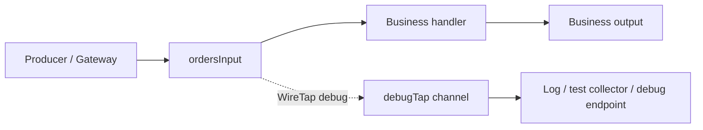
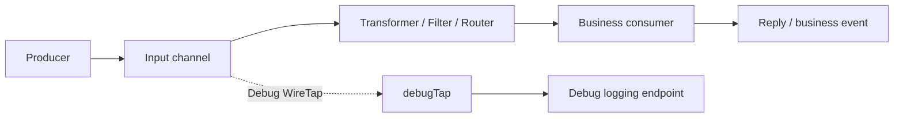
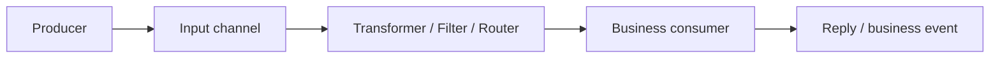
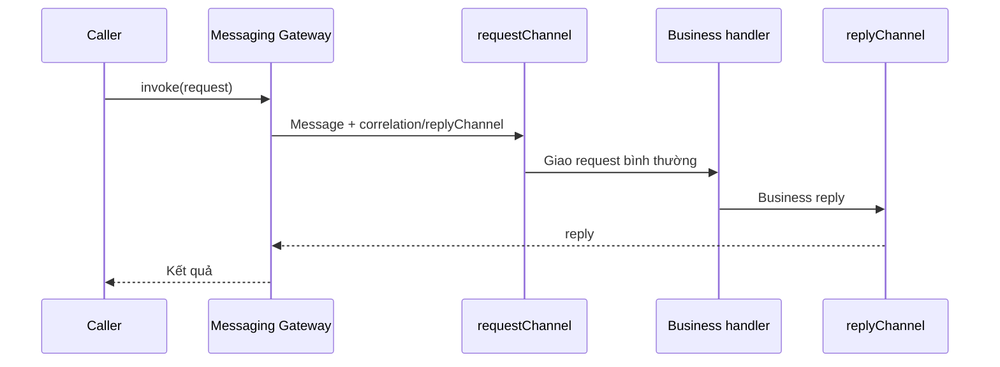

# Wire tap — Gỡ wire tap debug khỏi production trong Spring Integration

## Mục tiêu học tập

Sau bài này, bạn có thể:

- Giải thích vì sao một **Wire Tap phục vụ debug** không nên mặc định tồn tại và sao chép dữ liệu trong môi trường production.
- Tìm đúng vị trí khai báo Wire Tap: `ChannelInterceptor`, Java DSL `.wireTap(...)`, interceptor áp dụng toàn cục, XML hoặc cấu hình được bật có điều kiện.
- Gỡ **nhánh debug** mà vẫn giữ nguyên đường nghiệp vụ chính, `replyChannel`, correlation, Router/Filter/Transformer và những tap phục vụ audit bắt buộc.
- Xây dựng một cấu hình production không còn Wire Tap debug, cùng kiểm thử xác nhận message vẫn được xử lý đúng và không còn interceptor/consumer debug ngoài ý muốn.
- Xác định quy trình rollout, rollback, thu hồi quyền truy cập, xử lý log/bản sao dữ liệu đã thu thập, và đo latency/queue/error sau khi thay đổi.

Bài thuộc chương **Wire tap** của module **SPRING_INTEGRATION_PATTERN**. Module tập trung vào Enterprise Integration Patterns với Spring Integration để tạo các luồng thông điệp ít phụ thuộc và dễ mở rộng; thực hành Router, Filter, Transformer, Splitter, Aggregator, Gateway, retry, error channel, correlation, kiểm thử và theo dõi các nhánh. Ở đây, nhiệm vụ cụ thể là **gỡ Wire Tap dùng để debug khỏi production một cách có kiểm chứng** — không phải gỡ toàn bộ khả năng quan sát của ứng dụng.

## 1. Vì sao phải gỡ Wire Tap debug khỏi production?

Wire Tap là một mẫu integration dùng để **quan sát bản message tại một điểm trong luồng** và gửi một nhánh phụ đến channel/endpoint khác, trong khi message vẫn đi theo đường nghiệp vụ chính.



Trong lúc phát triển, nhánh phụ rất tiện để kiểm tra payload, headers, routing hoặc thời điểm message đi qua một channel. Tuy nhiên, khi triển khai thật, một debug tap có thể tạo các rủi ro:

1. **Rò rỉ dữ liệu**: payload và headers có thể chứa token, dữ liệu khách hàng, định danh giao dịch hoặc trường chưa được làm sạch trước Filter/Transformer.
2. **Tăng latency**: interceptor kích hoạt tại thời điểm gửi message; nếu tap channel hoặc tap endpoint đồng bộ chạy chậm, đường chính có thể chịu tác động.
3. **Tốn tài nguyên**: mỗi message tạo thêm một lượt gửi/ghi; buffer của tap và lượng log có thể tăng theo lưu lượng.
4. **Backpressure ngoài dự kiến**: tap channel có dung lượng hữu hạn có thể bị đầy; cơ chế gửi/lỗi phụ thuộc channel, interceptor và cấu hình cụ thể.
5. **Nhầm lẫn trong vận hành**: số message bị tap không đồng nghĩa số message nghiệp vụ thành công; log debug có thể bị hiểu sai là bằng chứng đã xử lý.
6. **Trùng bản sao**: một flow được thêm Wire Tap bằng DSL và interceptor thủ công cùng lúc có thể tạo nhiều bản quan sát, tăng tải và khó chẩn đoán.

**Mục tiêu đúng** không phải xóa mọi trace và audit, mà là loại bỏ **cơ chế sao chép payload/header phục vụ debug không còn được phê duyệt**. Log có cấu trúc, metric, distributed tracing hoặc một luồng audit đã được thiết kế an toàn vẫn có thể và thường nên tiếp tục hoạt động.

## 2. Phân biệt debug tap, observability và audit bắt buộc

Trước khi gỡ, phải biết tap được tạo để làm gì.

| Loại nhánh | Ví dụ | Quyết định thường phù hợp |
| --- | --- | --- |
| **Debug Wire Tap tạm thời** | Sao chép mọi request vào `debugTap` rồi in payload để tìm lỗi | Gỡ khỏi production sau khi hoàn tất chẩn đoán |
| **Log metadata có kiểm soát** | Ghi `eventId`, `correlationId`, tên endpoint, latency | Giữ nếu được phê duyệt; tránh log payload bí mật |
| **Distributed tracing** | Trace/span qua các endpoint/adapter | Tiếp tục theo chính sách sampling và bảo vệ dữ liệu |
| **Audit bắt buộc** | Ghi bằng chứng thay đổi trạng thái đơn hàng hoặc giao dịch | Không gỡ tùy tiện; phải bảo đảm lưu trữ, kiểm soát truy cập và độ bền |
| **Nhánh nghiệp vụ dạng fan-out** | `PublishSubscribeChannel` phát sự kiện tới thanh toán và thông báo | Đây là luồng nghiệp vụ, không phải debug tap để xóa |
| **Error channel** | Nhận `ErrorMessage` từ endpoint bất đồng bộ | Giữ đường xử lý lỗi và khả năng cảnh báo; không thay bằng Wire Tap |

Điểm khác biệt cốt lõi: **debug tap** quan sát một message khi đi qua channel; **audit nghiệp vụ** cần chứng minh một sự kiện hoặc giao dịch thực sự được ghi nhận. Một message đã tới `ordersInput` có thể vẫn bị Filter loại hoặc handler ném exception sau đó. Vì vậy không thể lấy dữ liệu Wire Tap ở đầu pipeline làm bằng chứng transaction đã commit.

Nếu một Wire Tap đang bị dùng như “audit bắt buộc”, không được chỉ xóa nó rồi coi công việc hoàn thành. Cần chuyển chức năng đó sang thiết kế đã được duyệt: ví dụ một business event bền vững, transactional outbox và idempotent consumer.

## 3. Kiểm kê các cách Wire Tap có thể đang được cài đặt

Một dự án Spring Integration có nhiều cách kích hoạt nhánh debug. Khi review cấu hình **của bài học hoặc hệ thống được phép chỉnh**, cần xem cả khai báo channel và endpoint, không chỉ một chuỗi `wireTap`.

### 3.1. `ChannelInterceptor` trên channel

Ví dụ Wire Tap được thêm trực tiếp vào `DirectChannel`:

```java
@Bean("ordersInput")
DirectChannel ordersInput(
        @Qualifier("debugTap") MessageChannel tapChannel) {
    DirectChannel input = new DirectChannel();
    input.addInterceptor(new WireTap(tapChannel));
    return input;
}
```

Trong cấu hình này:

- `ordersInput` là **channel bị tap**.
- `WireTap` là interceptor gắn vào channel đó.
- `debugTap` là **tap channel**, nhận bản message quan sát.
- Một `@ServiceActivator`, handler logging hoặc polling flow có thể là **tap endpoint** tiêu thụ từ `debugTap`.

Chỉ xóa endpoint đọc `debugTap` mà **không xóa interceptor** không có nghĩa đã tắt tap: message vẫn có thể được đẩy vào kênh debug và tích backlog.

### 3.2. Wire Tap trong Java DSL

Một cách khai báo khác:

```java
@Bean
IntegrationFlow ordersFlow() {
    return IntegrationFlow.from("ordersInput")
        .wireTap("debugTap")
        .transform(String.class, String::trim)
        .handle(String.class, (id, headers) -> "ACCEPTED:" + id)
        .channel("ordersProcessed")
        .get();
}
```

Nhánh tap được khai báo trong luồng DSL. Khi gỡ debug, cần **bỏ đúng toán tử `.wireTap("debugTap")`**, giữ nguyên các bước Transformer/Service Activator, channel đầu vào và output. Nếu trước đó dùng một channel trung gian riêng chỉ để đặt tap, cần kiểm tra rằng việc bỏ channel đó không thay đổi thread boundary, thứ tự hoặc hợp đồng gửi.

### 3.3. Interceptor có phạm vi rộng hoặc bật có điều kiện

Các điểm cần tìm trong phạm vi cấu hình được phép chỉnh:

- Bean `WireTap` hoặc `ChannelInterceptor` được đăng ký qua cơ chế global interceptor, ví dụ chú thích `@GlobalChannelInterceptor` hoặc cách cấu hình tương đương.
- Cấu hình XML `<int:wire-tap>` / channel interceptor khi dự án sử dụng namespace XML của Spring Integration.
- Bean được tạo theo Spring profile, property, feature flag, environment hoặc `@Conditional...`.
- Một `IntegrationFlow` debug riêng, logger endpoint hoặc bridge sang broker chỉ tồn tại để tiêu thụ tap.
- Đường instrument được thêm bởi thư viện/config chung hoặc import vào nhiều application context.
- Những kênh debug có tên khác như `loggingChannel`, `traceTap`, `auditDebug`, `wiretapQueue`.

**Cần phân biệt nguồn cấu hình và runtime thực tế.** Tắt một logger bằng `logging.level=OFF` không nhất thiết tháo `WireTap` khỏi channel: interceptor vẫn có thể gửi message và tap channel vẫn giữ bản sao. Một property đổi trên máy đang chạy cũng không tự bảo đảm cấu hình bean/interceptor được tái tạo hoặc tháo ra. Với cấu hình được quyết định lúc startup, phải kiểm tra bản triển khai và **khởi động lại/rollout** theo quy trình của ứng dụng.

## 4. Quy trình gỡ an toàn: chỉ thay đổi nhánh debug

Trước khi sửa, vẽ được hai đường:



Sau thay đổi mong muốn:



Các bước:

1. **Ghi nhận mục đích và chủ sở hữu.** Xác nhận nhánh là debug tạm thời, không phải audit hợp đồng hoặc subscriber nghiệp vụ.
2. **Xác định điểm gắn tap.** Nó được đặt trên channel nào, trước hay sau Transformer/Filter, trong DSL hay interceptor? Có nhiều khai báo trùng nhau không?
3. **Theo dấu đích của nhánh phụ.** Liệt kê tap channel, endpoint đọc tap, queue/broker output, logger, metric hoặc file sink chỉ phục vụ debug.
4. **Giữ nguyên đường chính.** Không sửa request input, Router, Filter, Transformer, `outputChannel`, `replyChannel` hay Service Activator nếu chúng vẫn cần thiết.
5. **Tháo điểm phát tap.** Xóa đúng `WireTap` interceptor hoặc toán tử `.wireTap(...)`. Sau đó xử lý bean/channel/endpoint **chỉ dành cho debug** nếu không còn consumer nào khác dùng.
6. **Không xóa nhánh đang được chia sẻ.** Nếu `auditTap` vừa nhận debug vừa nhận audit tuân thủ chính sách, cần tách hợp đồng trước; không được xóa nguyên bean vì tên giống “debug”.
7. **Kiểm thử logic và trạng thái runtime.** Xác nhận message nghiệp vụ vẫn đến đúng handler, không còn bản sao debug, và lỗi vẫn được chuyển đến nơi xử lý phù hợp.
8. **Rollout và theo dõi.** Xác nhận debug tap thực sự vắng mặt ở bản deploy; kiểm tra latency, errors, queue depth, log volume và thông số request–reply.

Một thay đổi nhỏ ở dòng cấu hình nhưng sai điểm có thể làm đứt một `IntegrationFlow`. Vì vậy trước/sau phải có kiểm thử minh họa đường chính, chứ không chỉ dựa vào việc ứng dụng khởi động thành công.

## 5. Ví dụ trước khi gỡ: Wire Tap đang được bật để debug

Giả sử ứng dụng nhận mã đơn hàng vào `ordersInput`, chuẩn hóa mã, bỏ chuỗi rỗng và trả trạng thái xử lý qua `ordersProcessed`. Trong quá trình tìm lỗi, nhóm phát triển thêm một `debugTap` để đọc bản message chưa chuẩn hóa.

Đây là **đoạn cấu hình trước khi gỡ**, chỉ trình bày các bean liên quan đến tap:

```java
import org.springframework.beans.factory.annotation.Qualifier;
import org.springframework.context.annotation.Bean;
import org.springframework.integration.channel.DirectChannel;
import org.springframework.integration.channel.QueueChannel;
import org.springframework.integration.channel.interceptor.WireTap;
import org.springframework.messaging.MessageChannel;

@Bean("debugTap")
QueueChannel debugTap() {
    return new QueueChannel(64);
}

@Bean("ordersInput")
DirectChannel ordersInput(
        @Qualifier("debugTap") MessageChannel debugTap) {
    DirectChannel input = new DirectChannel();
    input.addInterceptor(new WireTap(debugTap));
    return input;
}
```

Một endpoint debug có thể poll `debugTap` và ghi log:

```java
@ServiceActivator(
    inputChannel = "debugTap",
    poller = @Poller(fixedDelay = "200", maxMessagesPerPoll = "10")
)
public void debugLog(Message<?> message) {
    // KHÔNG đưa bản logger in payload này lên production.
    System.out.println("DEBUG TAP payload=" + message.getPayload());
}
```

Đoạn endpoint ở trên minh họa **điều cần gỡ**: nó có thể xuất bản payload gốc, kể cả dữ liệu chưa được làm sạch. Nếu các message đến nhanh hơn endpoint ghi log, `QueueChannel(64)` có thể đầy. Đây là code minh họa theo cấu hình cũ, không phải một khuyến nghị để bật trong production.

Khi gỡ, đừng chỉ xóa phương thức `debugLog(...)`. Nếu `WireTap` vẫn gắn ở `ordersInput`, các message vẫn đi vào `debugTap` mà không còn consumer, dẫn tới backlog và nguy cơ làm ảnh hưởng luồng chính.

## 6. Cấu hình sau khi gỡ: đường nghiệp vụ không đổi

`ProductionOrderFlowConfiguration.java`:

```java
import org.springframework.context.annotation.Bean;
import org.springframework.context.annotation.Configuration;
import org.springframework.integration.annotation.EnableIntegration;
import org.springframework.integration.channel.DirectChannel;
import org.springframework.integration.channel.QueueChannel;
import org.springframework.integration.dsl.IntegrationFlow;
import org.springframework.messaging.MessageChannel;

@Configuration
@EnableIntegration
public class ProductionOrderFlowConfiguration {

    @Bean("ordersInput")
    public DirectChannel ordersInput() {
        // Không đăng ký WireTap hoặc debug interceptor.
        return new DirectChannel();
    }

    @Bean("ordersProcessed")
    public QueueChannel ordersProcessed() {
        return new QueueChannel(20);
    }

    @Bean
    public IntegrationFlow ordersFlow() {
        return IntegrationFlow.from("ordersInput")
            .transform(String.class, String::trim)
            .filter(String.class, orderId -> !orderId.isBlank())
            .handle(String.class, (orderId, headers) ->
                "ACCEPTED:" + orderId)
            .channel("ordersProcessed")
            .get();
    }
}
```

Điểm cần lưu ý:

- Bean `ordersInput` vẫn tồn tại và giữ tên, kiểu `DirectChannel` như trước; producer không phải đổi cách gửi.
- `IntegrationFlow` vẫn gọi Transformer, Filter và Service Activator theo cùng thứ tự.
- `ordersProcessed` vẫn nhận kết quả nghiệp vụ sau handler. Nó **không phải** kênh debug.
- Không còn bean `debugTap`, `WireTap` hay debug endpoint trong cấu hình production này.
- Các header nghiệp vụ như `correlationId` vẫn có thể đi theo message qua flow theo quy tắc propagation của các endpoint. Việc xóa Wire Tap không phải là lý do xóa header.
- `QueueChannel(20)` lưu message chờ đọc trong RAM; nó không tự tạo durability qua restart. Đây là lựa chọn demo để kiểm tra output, không phải giải pháp hàng đợi production bền vững.

Nếu ứng dụng đang dùng DSL thay vì interceptor, thao tác tương đương đơn giản hơn:

```java
// TRƯỚC: Có nhánh debug.
IntegrationFlow.from("ordersInput")
    .wireTap("debugTap")
    .transform(String.class, String::trim)
    .handle(String.class, (id, headers) -> "ACCEPTED:" + id)
    .channel("ordersProcessed")
    .get();

// SAU: Giữ nguyên nghiệp vụ, chỉ bỏ toán tử .wireTap(...).
IntegrationFlow.from("ordersInput")
    .transform(String.class, String::trim)
    .handle(String.class, (id, headers) -> "ACCEPTED:" + id)
    .channel("ordersProcessed")
    .get();
```

Hai đoạn DSL là **phương án minh họa thay đổi cấu hình**, không đăng ký đồng thời hai flow trên cùng input trong một application context. Khi đưa vào code thực, hãy giữ cả các bước Filter/Router hiện có — đoạn tối giản này chỉ làm nổi bật dòng `.wireTap(...)`.

## 7. Kiểm thử chứng minh đã gỡ mà không làm hỏng flow

Không nên kết luận “đã gỡ” chỉ vì không còn chữ `debugTap` trong một class. Cần xác minh **trạng thái channel runtime** và **đường nghiệp vụ** trong context thực sự dùng để triển khai.

Ví dụ JUnit 5 + Spring Test cho cấu hình ở mục 6:

`ProductionOrderFlowTest.java`:

```java
import static org.junit.jupiter.api.Assertions.assertEquals;
import static org.junit.jupiter.api.Assertions.assertFalse;
import static org.junit.jupiter.api.Assertions.assertNotNull;
import static org.junit.jupiter.api.Assertions.assertNull;
import static org.junit.jupiter.api.Assertions.assertTrue;

import org.junit.jupiter.api.Test;
import org.springframework.beans.factory.annotation.Autowired;
import org.springframework.beans.factory.annotation.Qualifier;
import org.springframework.context.ApplicationContext;
import org.springframework.integration.channel.DirectChannel;
import org.springframework.integration.channel.QueueChannel;
import org.springframework.integration.channel.interceptor.WireTap;
import org.springframework.messaging.Message;
import org.springframework.messaging.support.MessageBuilder;
import org.springframework.test.context.junit.jupiter.SpringJUnitConfig;

@SpringJUnitConfig(ProductionOrderFlowConfiguration.class)
class ProductionOrderFlowTest {

    @Autowired
    ApplicationContext context;

    @Autowired
    @Qualifier("ordersInput")
    DirectChannel ordersInput;

    @Autowired
    @Qualifier("ordersProcessed")
    QueueChannel ordersProcessed;

    @Test
    void removesDebugTapAndStillProcessesBusinessMessage() {
        // Kiểm tra trên channel thực, không chỉ trên source code.
        assertTrue(ordersInput.getInterceptors()
            .stream()
            .noneMatch(WireTap.class::isInstance));

        assertFalse(context.containsBean("debugTap"));

        Message<String> request = MessageBuilder
            .withPayload("  ORD-42  ")
            .setHeader("correlationId", "req-42")
            .setHeader("eventType", "order.requested")
            .build();

        assertTrue(ordersInput.send(request));

        Message<?> output = ordersProcessed.receive(1_000);
        assertNotNull(output);
        assertEquals("ACCEPTED:ORD-42", output.getPayload());
        assertEquals("req-42",
            output.getHeaders().get("correlationId"));
        assertEquals("order.requested",
            output.getHeaders().get("eventType"));
    }

    @Test
    void keepsFilterBehaviorAfterRemovingTap() {
        assertTrue(ordersInput.send(
            MessageBuilder.withPayload("   ").build()
        ));

        // Chuỗi rỗng sau trim vẫn bị Filter loại.
        assertNull(ordersProcessed.receive(0));
    }
}
```

**Kiểm thử xác nhận:**

1. `ordersInput` không chứa `WireTap` trong danh sách interceptor của channel này.
2. Bean debug `debugTap` không tồn tại trong context thử nghiệm.
3. Payload đầu vào có khoảng trắng vẫn được chuẩn hóa; output nhận `ACCEPTED:ORD-42`.
4. Header `correlationId` và `eventType` vẫn được mang qua đường nghiệp vụ.
5. Filter vẫn loại chuỗi trắng như trước.

**Giới hạn của test:** `@SpringJUnitConfig(ProductionOrderFlowConfiguration.class)` chỉ nạp cấu hình được chỉ định. Trong production thật có thể còn `@GlobalChannelInterceptor`, auto-configuration hoặc module khác thêm Wire Tap. Vì vậy cần thêm **một integration/smoke test với toàn bộ application context và profile production thực tế** để kiểm tra không còn debug interceptor/sink ở runtime.

Nên kiểm tra cả phía phát và phía nhận: producer vẫn gửi thành công; consumer vẫn được gọi đúng; không tạo bản ghi ở debug sink; metrics và error handling không bị tắt ngoài ý muốn.

## 8. Nếu phải giữ tap chỉ ở môi trường dev: bật có điều kiện và fail closed

Gỡ hoàn toàn khỏi production là giải pháp đơn giản nhất. Nếu nhóm vẫn cần debug tap cho phát triển và tái hiện lỗi, hãy đặt nó trong cấu hình **opt-in, chỉ được phép ở dev/local**, với trạng thái mặc định tắt.

Ví dụ tách thành class riêng dùng Spring Boot `@ConditionalOnProperty`:

`OptionalDebugTapConfiguration.java`:

```java
import org.springframework.beans.factory.annotation.Qualifier;
import org.springframework.boot.autoconfigure.condition.ConditionalOnProperty;
import org.springframework.context.annotation.Bean;
import org.springframework.context.annotation.Configuration;
import org.springframework.context.annotation.Profile;
import org.springframework.beans.factory.SmartInitializingSingleton;
import org.springframework.integration.channel.DirectChannel;
import org.springframework.integration.channel.QueueChannel;
import org.springframework.integration.channel.interceptor.WireTap;
import org.springframework.integration.dsl.IntegrationFlow;
import org.springframework.integration.dsl.Pollers;

@Configuration(proxyBeanMethods = false)
@Profile("!prod & (local | dev)")
@ConditionalOnProperty(
    prefix = "diagnostics.wiretap",
    name = "enabled",
    havingValue = "true"
)
public class OptionalDebugTapConfiguration {

    @Bean("debugTap")
    public QueueChannel debugTap() {
        return new QueueChannel(64);
    }

    @Bean
    public SmartInitializingSingleton installDebugTap(
            @Qualifier("ordersInput") DirectChannel input,
            @Qualifier("debugTap") QueueChannel debugTap) {
        // Chỉ đăng ký lúc application context được khởi tạo.
        return () -> input.addInterceptor(new WireTap(debugTap));
    }

    @Bean
    public IntegrationFlow debugTapConsumer() {
        return IntegrationFlow.from(
                "debugTap",
                spec -> spec.poller(Pollers.fixedDelay(200))
            )
            .handle(message -> {
                // Dev only: log metadata, không log payload/secret.
                Object correlation =
                    message.getHeaders().get("correlationId");
                System.out.println("debug corr=" + correlation);
            })
            .get();
    }
}
```

Trong ví dụ này:

- `ProductionOrderFlowConfiguration` luôn tạo business flow nhưng **không đăng ký tap**.
- Class `OptionalDebugTapConfiguration` chỉ được xét khi profile phù hợp, **không có `prod`**, và property `diagnostics.wiretap.enabled=true`.
- Nếu không bật property, không có bean `debugTap` và không có interceptor Wire Tap từ class này.
- Đặt `@Profile` là một lớp bảo vệ thêm, không thay thế kiểm tra cấu hình trong pipeline phát hành. Tên profile phải thống nhất với thực tế của dự án.
- `SmartInitializingSingleton` dùng để minh họa việc gắn interceptor **lúc khởi tạo context**; đổi property sau khi ứng dụng chạy không tự tháo/gắn interceptor. Muốn thay đổi, cần chiến lược reload có kiểm soát hoặc rollout/restart.
- Ví dụ logger chỉ in correlation ID, nhưng production nên dùng logging/tracing được cấu hình an toàn chứ không giữ cơ chế debug ad hoc.

Cấu hình mặc định nên là:

```properties
diagnostics.wiretap.enabled=false
```

Một biện pháp phòng ngừa là kiểm tra profile production trong CI/CD. Không chỉ dựa vào giá trị property khai báo trong repository: environment variable, Config Server hoặc tham số khởi động có thể ghi đè nó.

### Kiểm thử chống bật nhầm ở production

Cần một kiểm thử ứng dụng chạy với **profile production thực tế** và thậm chí bật nhầm property debug để xác minh lớp cấu hình debug vẫn không kích hoạt. Ví dụ ý tưởng:

```java
@SpringJUnitConfig({
    ProductionOrderFlowConfiguration.class,
    OptionalDebugTapConfiguration.class
})
@ActiveProfiles("prod")
@TestPropertySource(properties = {
    "diagnostics.wiretap.enabled=true"
})
class ProductionProfileTapTest {

    @Autowired
    ApplicationContext context;

    @Autowired
    @Qualifier("ordersInput")
    DirectChannel ordersInput;

    @Test
    void neverInstallsDebugTapInProd() {
        assertFalse(context.containsBean("debugTap"));
        assertTrue(ordersInput.getInterceptors()
            .stream()
            .noneMatch(WireTap.class::isInstance));
    }
}
```

Đoạn test này cần các import JUnit/Spring Test tương ứng như ở mục 7, cùng `@ActiveProfiles` và `@TestPropertySource`. Nó xác minh **hai class minh họa**; trong ứng dụng thật, mở rộng kiểm thử cho mọi cấu hình auto-scan/global interceptor và đường gửi tới debug sink.

## 9. Không được gỡ nhầm error channel, correlation hoặc request–reply

Wire Tap có thể nằm trên một request flow có Gateway. Khi tháo tap, đường request–reply phải giữ nguyên:



**Những thứ cần giữ:**

- `requestChannel` mà `@MessagingGateway` gửi message tới.
- Transformer, Filter, Router, Splitter/Aggregator và Service Activator thực hiện xử lý thực.
- Header `replyChannel` / correlation theo giao kèo của flow; một debug Wire Tap không phải đường nhận reply của Gateway.
- `errorChannel` hoặc cấu hình error handler thực sự dùng cho exception, đặc biệt ở poller/async endpoint.
- Timeout, retry, idempotency, trạng thái xử lý và những metric cần để vận hành.

**Những thứ cần bỏ nếu chỉ phục vụ debug:** interceptor Wire Tap, tap channel tạm, endpoint logging payload, subscription/queue/file sink chỉ tạo để chứa bản message quan sát. Nếu tên “audit” được dùng cho cả log debug và nghiệp vụ, phải phân loại trước khi xóa.

Có thể xảy ra lỗi dây chuyền nếu chỉ bỏ một bean nhưng để lại một consumer, ví dụ `@ServiceActivator(inputChannel = "debugTap")` không còn channel tương ứng hoặc không còn message gửi tới. Bước review phải kiểm tra **hai đầu** của nhánh debug; đồng thời không đổi thứ tự các bước trong main flow.

## 10. Tác động của việc gỡ tap đến latency và backpressure

Một Wire Tap là interceptor trên điểm gửi của channel. Tác động của nó phụ thuộc:

| Tap channel/endpoint | Tác động có thể có khi còn bật | Sau khi gỡ |
| --- | --- | --- |
| `DirectChannel` với logger đồng bộ | Tap endpoint có thể chạy trên thread gửi, làm tăng thời gian `send()` | Giảm công việc phụ trong đường gửi |
| `QueueChannel` có capacity | Có thể tích backlog hoặc gặp nghẽn khi đầy | Không còn gửi bản debug vào queue đó |
| `ExecutorChannel` | Tạo tác vụ ở executor, dùng thread/queue và có thể sinh lỗi riêng | Không còn phát sinh tác vụ debug theo điểm tap |
| Broker outbound từ tap | Tăng publish rate, serialization, chi phí lưu trữ và retry | Giảm tải broker nếu không còn producer debug khác |
| Logger ghi full payload | Tăng log volume và rủi ro lộ dữ liệu | Ngừng phát sinh **bản ghi mới** từ đường debug |

**Không hứa chắc hiệu năng tăng một tỷ lệ cụ thể.** Nếu tap vốn không hoạt động hoặc sampling thấp, chênh lệch có thể không đáng kể. Nếu logger đồng bộ đang block, thay đổi có thể cải thiện p95/p99 latency rõ rệt. Hãy so sánh số liệu **trước và sau cùng loại tải** để có kết luận.

Nếu queue debug từng có backlog, việc tháo producer không tự làm các message đã nằm trong queue biến mất hoặc tự xóa log cũ trên hệ thống tập trung. Chúng cần được xử lý theo chính sách retention và bảo mật, tránh xóa nhầm dữ liệu audit hợp lệ.

### Tại sao không chỉ tắt log level?

`logging.level.com.example=OFF` có thể làm một logger ngừng phát text, nhưng **không bảo đảm**:

- Interceptor `WireTap` đã bị tháo khỏi channel.
- Message không còn đi vào `debugTap`.
- Buffer không tiếp tục giữ message.
- Một tap endpoint khác không còn gửi message sang broker, file hoặc database.

Do đó tiêu chí “đã gỡ” là **không còn nhánh sao chép debug hoạt động** trong application context/route production, không chỉ “không thấy dòng DEBUG trên console”.

## 11. Rollout, xác minh và rollback

Một quy trình phát hành phù hợp có thể chia thành các cổng kiểm soát:

### Trước khi merge

- Xác nhận owner của tap và mục đích. Nếu là audit bắt buộc, phải có phương án thay thế đã duyệt.
- Ghi nhận channel/endpoint/sink có liên quan; xác định nhánh nào là debug và nhánh nào phục vụ nghiệp vụ.
- Đảm bảo thay đổi chỉ gỡ debug tap, không làm mất input/output, `replyChannel`, `errorChannel` và Router/Filter/Transformer.
- Chạy unit/integration tests cho payload, header, số lượng message và consumer; kiểm tra cấu hình profile production đầy đủ.
- Kiểm tra log/metric hiện tại để có số liệu baseline.

### Trong lúc rollout

- Triển khai một nhóm instance nhỏ trước nếu hạ tầng hỗ trợ canary hoặc rolling deployment.
- Xác minh instance mới **không đăng ký WireTap debug** và không publish vào debug sink.
- Kiểm tra đường request–reply, xử lý lỗi, độ trễ, throughput, broker metrics và business output.
- Theo dõi instance cũ vẫn có tap trong giai đoạn chuyển tiếp; không kết luận toàn cluster đã tắt khi còn replica cũ.

### Sau rollout

- Đối chiếu tập cấu hình runtime/profiles thực tế với điều kiện trong code.
- Đảm bảo không còn debug channel/consumer/queue bị bỏ quên, hoặc có kế hoạch hạ tầng decommission an toàn.
- Đánh giá log đã tồn tại và thời hạn lưu theo chính sách. **Gỡ Wire Tap không tự xóa dữ liệu cũ**.
- Thu hồi quyền đọc debug sink không còn cần thiết; xử lý nguy cơ dữ liệu bí mật đã bị ghi (ví dụ xoay vòng credential nếu có lộ lọt).
- Cập nhật tài liệu runbook: kênh nào còn được quan sát, metric thay thế nào dùng để chẩn đoán, khi nào được phép bật debug tạm thời.

### Rollback an toàn

Nếu bản phát hành phát sinh regression do vô tình ảnh hưởng main flow, rollback code/config theo quy trình deploy, nhưng **không tự động bật lại log full payload trên production** khi chưa đánh giá rủi ro. Có thể khôi phục chức năng nghiệp vụ mà vẫn giữ debug tap bị tắt, hoặc dùng cách chẩn đoán ít xâm lấn hơn (metrics/tracing/sampling metadata).

Nếu cần điều tra sự cố production, nên ưu tiên một bản quan sát đã được chấp thuận về dữ liệu và retention. “Bật lại Wire Tap như cũ” không phải hành động vô hại nếu đường tap đang nhận thông tin nhạy cảm.

## 12. Lỗi triển khai thường gặp

| Sai lầm | Hệ quả | Cách khắc phục |
| --- | --- | --- |
| Xóa debug logger nhưng để `WireTap` | Queue debug tiếp tục tích message, có thể gây backpressure | Tháo interceptor/toán tử tap trước, rồi dọn sink không dùng |
| Chỉ xóa `.wireTap(...)` ở một flow | Global interceptor hoặc flow khác vẫn copy message | Kiểm kê tất cả nguồn đăng ký và test runtime |
| Dùng `logging.level=OFF` để tuyên bố đã tắt tap | Channel vẫn gửi bản sao, tài nguyên vẫn được dùng | Kiểm tra interceptor và route đến tap sink |
| Xóa `auditTap` không phân biệt mục đích | Mất bằng chứng nghiệp vụ hoặc yêu cầu tuân thủ | Phân loại debug, observability và audit bắt buộc |
| Xóa nhầm `outputChannel` hoặc `replyChannel` | Message không đến consumer/caller | Chỉ thay đổi nhánh tap; kiểm thử request–reply |
| Bỏ error channel cùng debug tap | Lỗi async không còn nơi xử lý quan sát được | Giữ error handler, metric và alert độc lập |
| Chỉ test source config đơn lẻ | Production còn auto-config/global Wire Tap | Test context thật với profile production và canary |
| Bật feature flag tạm rồi quên tắt | Debug capture tiếp tục sau điều tra | Opt-in mặc định false, có owner/deadline và kiểm tra deploy |
| Coi tắt producer là đã xóa dữ liệu | Log cũ vẫn nằm trong broker/log collector/storage | Áp dụng retention, revoke access và xử lý exposure |
| Bật tap lại không giới hạn khi sự cố | Tăng tải, làm vấn đề hiệu năng nặng hơn | Sampling, allowlist, giới hạn thời gian và kênh an toàn |
| Giữ mutable payload trong tap rồi sửa object | Main flow có thể thấy thay đổi ngoài dự kiến | Không sửa dữ liệu ở tap endpoint; dùng audit DTO riêng |
| Đánh giá thành công chỉ bằng “không còn log” | Có thể bỏ lỡ regression hoặc hidden tap | Kiểm tra interceptor, sink, business output và metric |

## 13. Bài tập thực hành

**Bài 1 — Tháo interceptor.** Tạo `DirectChannel` gắn `WireTap` và `QueueChannel` debug. Gửi một message để thấy nhánh quan sát nhận dữ liệu. Sau đó thay bằng `ProductionOrderFlowConfiguration`; xác minh không có `WireTap` và luồng nghiệp vụ vẫn phát `ACCEPTED:...`.

**Bài 2 — Gỡ DSL tap.** Xây dựng một flow có `.wireTap("debugTap")` trước Transformer. Xóa chỉ toán tử này và các bean chỉ dùng cho debug. So sánh payload, `correlationId` và số message ra `ordersProcessed` trước/sau.

**Bài 3 — Kiểm tra Filter.** Gửi `"  ORD-42  "` và `"   "`. Xác minh request hợp lệ được chuẩn hóa, request trống bị loại như trước; thao tác gỡ tap không làm đổi logic Filter.

**Bài 4 — Bật nhầm cờ debug.** Dùng cấu hình profile có điều kiện ở mục 8. Kích hoạt profile `prod` và đặt `diagnostics.wiretap.enabled=true` trong test; xác minh không có `debugTap` và không có `WireTap` do cấu hình này đăng ký.

**Bài 5 — Đường Gateway.** Tạo `@MessagingGateway` gọi một handler sau `ordersInput`, cấu hình reply; gỡ Wire Tap nhưng giữ `replyChannel` và `correlationId`. Kiểm tra caller vẫn nhận đúng reply và timeout/error behavior không đổi ngoài việc giảm debug capture.

**Bài 6 — Overload của tap.** Trước khi gỡ, dùng `QueueChannel(2)` làm debug sink và cố tạo burst; ghi nhận rủi ro block hoặc lỗi. Sau khi gỡ, đo số message được xử lý ở main flow và xác nhận debug backlog không còn được nạp thêm.

**Bài 7 — Dữ liệu đã thu thập.** Giả lập debug sink đã ghi metadata và token giả. Viết kế hoạch giữ/xóa theo retention, thu hồi quyền đọc và xử lý credential lộ lọt; phân biệt dữ liệu debug với audit bắt buộc.

**Bài 8 — Kiểm tra production context.** Tạo một global interceptor debug trong cấu hình test để minh họa rằng chỉ xóa tap trong một `IntegrationFlow` là chưa đủ. Bổ sung kiểm tra toàn bộ context/route và tránh dùng một test cấu hình tối giản làm bằng chứng duy nhất.

**Tiêu chí hoàn thành:** giải thích được tap debug đã được gắn ở đâu, đầu nhận debug là gì, thay đổi nào đã gỡ đúng nhánh phụ, kiểm thử nào chứng minh main flow không đổi và biện pháp nào bảo đảm bản deploy production không còn sao chép dữ liệu ngoài ý muốn.

## 14. Ghi nhớ

- **Gỡ Wire Tap debug khỏi production** nghĩa là tháo **đường sao chép/quan sát tạm thời** khỏi runtime, không chỉ tắt dòng log và không phải xóa metric, tracing hay audit hợp lệ.
- Kiểm kê đủ interceptor trên channel, `.wireTap(...)` trong Java DSL, global interceptor, cấu hình profile/flag, tap channel và tap endpoint.
- Giữ nguyên đường nghiệp vụ, `replyChannel`, correlation, error channel và các bước Router/Filter/Transformer; dùng kiểm thử payload/header và context production để chứng minh.
- Nếu vẫn cần debug ở local/dev, dùng cấu hình **mặc định tắt**, bật có chủ đích và không có hiệu lực trong production. Tránh giả định thay property runtime tự tháo interceptor.
- Sau rollout, xác minh cả trạng thái tap mới, tải hệ thống và dữ liệu debug **đã lưu từ trước**; tuân thủ retention, kiểm soát truy cập và quy trình xử lý thông tin nhạy cảm.
