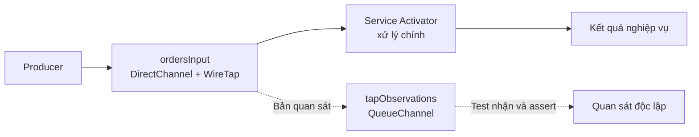
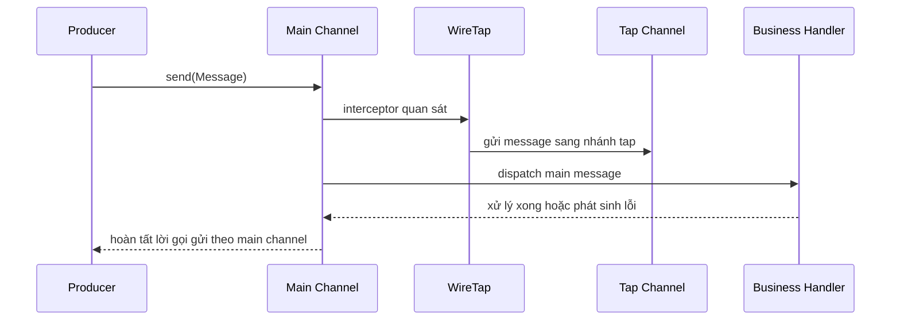
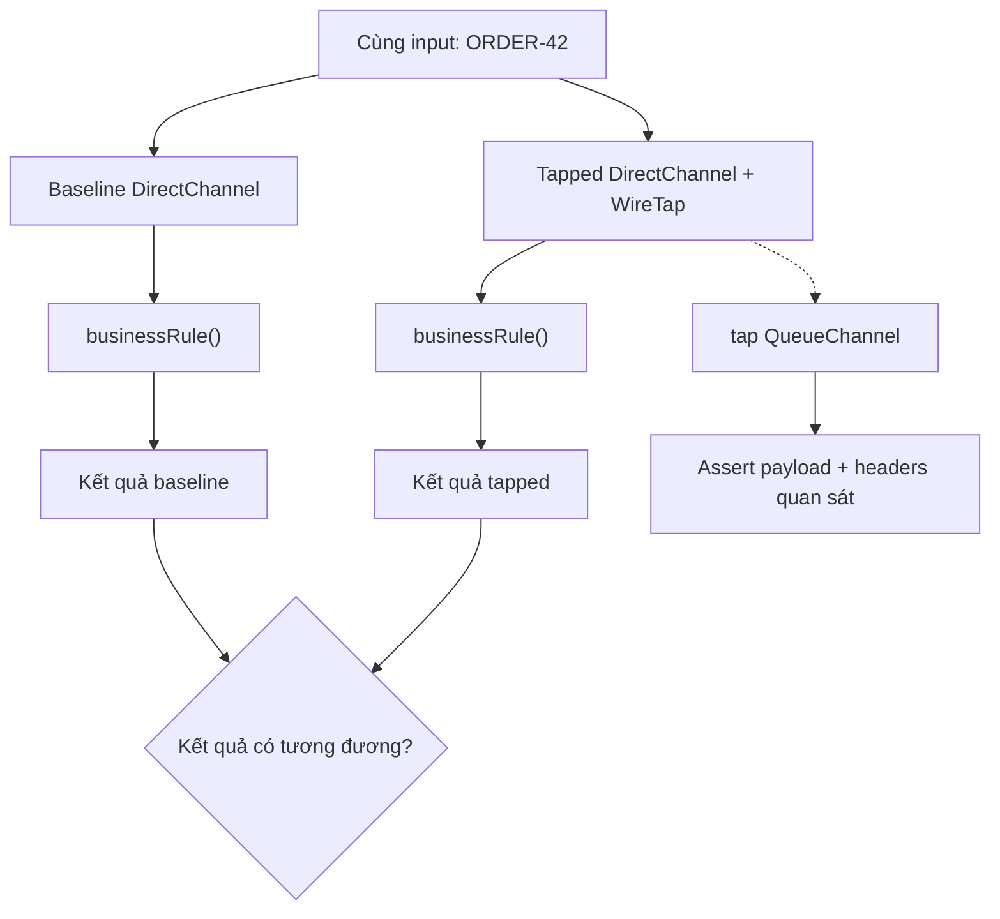
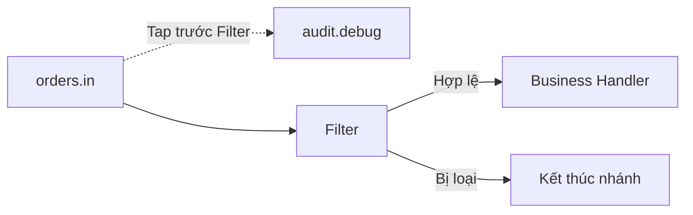

# Kiểm thử Wire Tap không thay đổi kết quả chính trong Spring Integration

## 1. Bài toán: thêm quan sát nhưng giữ nguyên hành vi nghiệp vụ

Khi bổ sung **Wire Tap** để ghi log, audit hoặc debug, chúng ta thường muốn biết một message đi qua channel nào, có correlation ID gì và nội dung ở giai đoạn đó có đúng kỳ vọng hay không. Tuy nhiên, việc thêm một nhánh quan sát cũng đưa vào hệ thống thêm **một thao tác gửi message** và có thể thêm handler, queue hoặc executor. Nếu cấu hình sai, nhánh phụ có thể làm chậm, gây lỗi hoặc làm thay đổi hành vi của luồng chính.

**Mục tiêu của bài “Kiểm thử tap không thay đổi kết quả chính”** là kiểm chứng một hợp đồng rõ ràng:

> Với cùng một đầu vào và điều kiện nghiệp vụ, kết quả xử lý chính khi bật Wire Tap phải tương đương với kết quả khi không bật Wire Tap; những tác động được chấp nhận như độ trễ hoặc thất bại của nhánh quan sát phải được xác định và kiểm thử riêng.

Bài học thuộc chương **Wire tap** trong module **SPRING_INTEGRATION_PATTERN**. Module này thực hành các Enterprise Integration Patterns (EIP) của Spring Integration: Router, Filter, Transformer, Splitter, Aggregator, Gateway, retry, error channel và correlation. Kiểm thử Wire Tap là một trường hợp điển hình của việc bảo toàn hành vi khi thêm khả năng quan sát vào một flow dựa trên message.



Trong sơ đồ, `DirectChannel` chính tiếp tục phân phối message cho Service Activator. Tap gửi message sang `QueueChannel` để test đọc lại bằng `receive()`. Đây là lựa chọn đơn giản để kiểm thử một **nhánh quan sát thụ động** mà chưa cần kết nối database, hệ thống log hay broker bên ngoài.

### Sau bài này, bạn có thể

- Xác định những thuộc tính của luồng chính cần giữ nguyên khi có Wire Tap.
- Tạo kiểm thử **baseline so với tapped** trên cùng đầu vào.
- Xác minh kết quả nghiệp vụ, số lần gọi handler và payload/headers quan sát được.
- Kiểm tra ảnh hưởng của lỗi, độ trễ, hàng đợi đầy và payload mutable.
- Phân biệt tính đúng của business flow với tính tin cậy của logging/audit.
- Thiết kế kiểm thử tích hợp cho flow có Filter, Transformer, Router và correlation.

## 2. Hiểu đúng semantics của Wire Tap trước khi kiểm thử

Trong Spring Integration, `WireTap` thường được sử dụng dưới dạng `ChannelInterceptor`. Nó quan sát message đi qua một `MessageChannel` và gửi message sang **tap channel**. Đường đi chính của message vẫn thuộc channel ban đầu và endpoint nghiệp vụ liên quan.



Sơ đồ trên diễn tả luồng cơ bản. **Không được mặc định nhánh tap luôn bất đồng bộ.** Nếu tap channel là `DirectChannel` và observer ở đó chậm, observer thường chạy trong đường gửi đồng bộ và có thể ảnh hưởng độ trễ. Nếu là `QueueChannel` hoặc `ExecutorChannel`, cần xét capacity, lịch tiêu thụ, executor rejection và error handling.

**Wire Tap không có nghĩa là deep-copy payload.** Message envelope và headers có hợp đồng riêng của Spring Messaging, nhưng payload có thể trỏ đến một đối tượng mutable được cả nhánh chính và nhánh tap nhìn thấy. Việc observer sửa payload có thể làm thay đổi dữ liệu nghiệp vụ. Bởi vậy, kiểm thử đúng phải xét cả *dữ liệu*, *số lần xử lý* và *semantics lỗi/thời gian*, không chỉ việc có hai dòng log.

### 2.1. “Kết quả chính” gồm những gì?

Tùy hệ thống, kết quả chính có thể là:

| Khía cạnh | Ví dụ tiêu chí kiểm thử |
| --- | --- |
| Payload đầu ra | Cùng đầu vào cho cùng đối tượng `OrderResult` hoặc cùng giá trị chuẩn hóa |
| Side effect nghiệp vụ | Số lần lưu đơn hàng, cập nhật tồn kho hoặc gửi sự kiện nghiệp vụ không tăng |
| Routing | Filter và Router vẫn cho qua, loại bỏ hoặc chuyển cùng nhánh như baseline |
| Lỗi nghiệp vụ | Input không hợp lệ vẫn bị từ chối, không bị tap biến thành kết quả thành công |
| Headers quan trọng | `correlationId`, khóa idempotency và metadata theo hợp đồng không bị sửa trái ý |
| Thứ tự cần bảo toàn | Các message cần tuần tự vẫn được xử lý theo yêu cầu đã xác định |
| Response/timeout | Với Gateway, response vẫn đúng và nằm trong giới hạn trễ cho phép |

Không nên đòi hai lần chạy có **cùng timestamp, thread, message ID mới tạo ở các bước khác hoặc độ trễ bằng tuyệt đối**. Những giá trị này có thể khác mà không phải sai nghiệp vụ. Hãy so sánh những trường **thực sự là hợp đồng** của ứng dụng.

### 2.2. Tap nhận message không đồng nghĩa nghiệp vụ thành công

Nếu đặt tap trước Filter, nhánh tap vẫn có thể quan sát message sau đó bị Filter loại. Nếu đặt tap trước Service Activator, nó có thể nhận message trước khi handler chính thất bại. Vì thế:

- “Tap nhận message” chứng minh message đã đến **điểm quan sát**.
- “Business handler hoàn thành” phải được xác minh ở **đầu ra/side effect của business handler**.
- “Audit nghiệp vụ thành công” phải dựa trên **sự kiện hoàn thành có thẩm quyền**, không suy ra từ log của tap đầu vào.

Đây là lý do kiểm thử cần theo dõi cả nhánh chính và nhánh phụ một cách độc lập.

## 3. Thiết kế kiểm thử đối chứng (baseline và tapped)

Cách kiểm thử rõ ràng nhất là tạo **hai channel chính tương đương**:

1. **Baseline:** một `DirectChannel` không có Wire Tap, gửi vào handler xử lý cùng quy tắc nghiệp vụ.
2. **Tapped:** một `DirectChannel` gắn `WireTap` gửi tới `QueueChannel` quan sát; handler chính thực hiện đúng quy tắc như baseline.
3. Gửi cùng đầu vào **bất biến** cho hai nhánh.
4. So sánh kết quả nghiệp vụ và số lần handler được gọi.
5. Đọc từ tap channel để xác minh payload và headers được quan sát, đồng thời kiểm tra không có message quan sát dư trong tình huống đơn giản.



Mỗi channel có đúng **một** business subscriber để kiểm tra số lần gọi. Không subscribe audit handler như một business consumer thứ hai trên chính `DirectChannel`: `DirectChannel` có cơ chế chọn subscriber, không có semantics multicast cho mọi handler như `PublishSubscribeChannel`. Wire Tap interceptor giúp tạo nhánh quan sát riêng.

## 4. Ví dụ JUnit 5: chứng minh kết quả chính giữ nguyên

Ví dụ dùng Java 17+, Spring Boot 3.x và Spring Integration tương thích. Trong một dự án Maven đã có dependency management của Spring Boot, có thể khai báo:

```xml
<dependencies>
    <dependency>
        <groupId>org.springframework.boot</groupId>
        <artifactId>spring-boot-starter-integration</artifactId>
    </dependency>
    <dependency>
        <groupId>org.springframework.boot</groupId>
        <artifactId>spring-boot-starter-test</artifactId>
        <scope>test</scope>
    </dependency>
</dependencies>
```

Bài test bên dưới tạo các channel trực tiếp, do đó không cần khởi động toàn bộ Spring Boot context. Điều này giúp kiểm tra rõ **semantics của channel và interceptor** trước khi đưa vào flow thực tế.

### 4.1. Test đối chiếu kết quả, số lần xử lý và message quan sát

Tạo `src/test/java/com/example/integration/WireTapOutcomeTest.java`:

```java
package com.example.integration;

import java.util.Locale;
import java.util.concurrent.atomic.AtomicInteger;
import java.util.concurrent.atomic.AtomicReference;

import org.junit.jupiter.api.Test;
import org.springframework.integration.channel.DirectChannel;
import org.springframework.integration.channel.QueueChannel;
import org.springframework.integration.channel.interceptor.WireTap;
import org.springframework.messaging.Message;
import org.springframework.messaging.support.MessageBuilder;

import static org.junit.jupiter.api.Assertions.*;

class WireTapOutcomeTest {

    @Test
    void tapKeepsBusinessOutcomeAndInvocationCount() {
        DirectChannel baseline = new DirectChannel();
        DirectChannel tapped = new DirectChannel();

        // Đọc tap sau khi main flow đã gửi xong.
        QueueChannel observations = new QueueChannel(4);
        tapped.addInterceptor(new WireTap(observations));

        AtomicInteger baselineCalls = new AtomicInteger();
        AtomicInteger tappedCalls = new AtomicInteger();
        AtomicReference<String> baselineResult = new AtomicReference<>();
        AtomicReference<String> tappedResult = new AtomicReference<>();

        baseline.subscribe(message -> {
            baselineCalls.incrementAndGet();
            baselineResult.set(businessRule(message.getPayload()));
        });

        tapped.subscribe(message -> {
            tappedCalls.incrementAndGet();
            tappedResult.set(businessRule(message.getPayload()));
        });

        Message<String> input = MessageBuilder
                .withPayload(" order-42 ")
                .setHeader("correlationId", "flow-42")
                .build();

        assertTrue(baseline.send(input));
        assertTrue(tapped.send(input));

        // 1. Kết quả chính không thay đổi.
        assertEquals("ORDER-42", baselineResult.get());
        assertEquals(baselineResult.get(), tappedResult.get());

        // 2. Tap không tạo thêm lần xử lý nghiệp vụ.
        assertEquals(1, baselineCalls.get());
        assertEquals(1, tappedCalls.get());

        // 3. Nhánh tap quan sát đúng dữ liệu của message.
        Message<?> observed = observations.receive(0);
        assertNotNull(observed);
        assertEquals(input.getPayload(), observed.getPayload());
        assertEquals(
                input.getHeaders().get("correlationId"),
                observed.getHeaders().get("correlationId")
        );

        // 4. Với một input và không có retry, không có bản tap dư.
        assertNull(observations.receive(0));
    }

    private static String businessRule(Object payload) {
        return String.valueOf(payload)
                .trim()
                .toUpperCase(Locale.ROOT);
    }
}
```

Khi chạy, test cần thỏa tất cả assertion. Nếu một assertion thất bại, hãy xác định sai lệch thuộc **luồng nghiệp vụ chính**, **lượng lời gọi handler** hay **nhánh quan sát**, rồi kiểm tra cấu hình liên quan.

### 4.2. Vì sao chọn QueueChannel cho tap trong test này?

`QueueChannel(4)` cho phép Wire Tap chuyển message sang vùng đệm dung lượng nhỏ và để chính test lấy message bằng `receive(0)`. Test không cần gắn một audit handler gây thêm side effect. Đầu vào chỉ có một message, nên capacity 4 đủ cho trường hợp thành công.

Việc chọn queue **không tự chứng minh nhánh tap luôn an toàn dưới tải**. Với nhiều message, queue có thể đầy; hệ thống cần policy riêng cho overflow, timeout và lỗi. Test ở mục 4 chỉ khẳng định tính tương đương trong kịch bản đơn giản, khi nhánh quan sát còn sức chứa.

`receive(0)` được dùng để lấy dữ liệu đã có mà không chờ lâu. Không nên dùng một `receive()` chặn vô hạn trong test vì khi tap bị cấu hình sai, test có thể treo.

### 4.3. Kết quả được giữ nguyên có phải cùng object không?

Không nhất thiết. Nếu handler tạo một DTO kết quả mới ở mỗi lần xử lý, hai object có thể khác identity nhưng tương đương theo **business key, trạng thái, số tiền hoặc dữ liệu cần so sánh**. Trong test thực tế, nên dùng assertion trên các trường nghiệp vụ ổn định thay vì `assertSame()` giữa hai result.

Tương tự, khi Transformer tạo message mới, `messageId` và timestamp có thể đổi. Chỉ nên assert ID giữ nguyên ở những chỗ mà hợp đồng của ứng dụng quy định rõ.

## 5. Kiểm thử luồng lỗi: Wire Tap không được che lỗi nghiệp vụ

Một tính chất quan trọng là **bật tap không khiến lỗi thật của handler chính bị báo thành công**.

Trong luồng chính dùng `DirectChannel` và handler xử lý đồng bộ, exception có thể lan qua lời gọi gửi. Ta có thể tạo một test độc lập:

```java
@Test
void tapDoesNotTurnBusinessFailureIntoSuccess() {
    DirectChannel main = new DirectChannel();
    QueueChannel observations = new QueueChannel(2);

    main.addInterceptor(new WireTap(observations));
    main.subscribe(message -> {
        throw new IllegalStateException("Order validation failed");
    });

    Message<String> invalid = MessageBuilder
            .withPayload("INVALID-ORDER")
            .build();

    // RuntimeException có thể được Spring Integration bọc
    // trong một MessagingException, nên không ép kiểu lỗi cụ thể.
    assertThrows(RuntimeException.class, () -> main.send(invalid));

    // Tap được gắn trước handler nên có thể đã quan sát input lỗi.
    assertNotNull(observations.receive(0));
}
```

Đặt test này như một method khác trong cùng lớp `WireTapOutcomeTest`. Các import từ ví dụ trước vẫn dùng được.

Test cho thấy với topology đồng bộ trong ví dụ, handler chính thất bại thì caller vẫn quan sát được một lỗi. Nó **không** chứng minh lỗi tap và lỗi nghiệp vụ có cùng cách xử lý, cũng không mặc định chứng minh một message lỗi đã được retry.

### 5.1. Lỗi ở nhánh tap cần một phép thử riêng

Tiếp theo, giả lập tap observer ném exception hoặc tap destination không nhận message. Kết quả mong đợi phải được xác định theo **chính sách sản phẩm**:

- **Debug best-effort:** hệ thống thường ưu tiên giữ kết quả chính; nhánh debug có thể mất một quan sát, nhưng phải ghi nhận metric về việc mất dữ liệu nếu cần.
- **Audit bắt buộc:** nếu bản ghi audit là điều kiện để chấp nhận giao dịch, hệ thống có thể phải từ chối hoặc điều phối cơ chế bù; phải kiểm thử cả tính nhất quán nghiệp vụ và audit.
- **Tap đồng bộ:** observer chậm hoặc lỗi có thể ảnh hưởng đến đường gửi chính.
- **Tap bất đồng bộ:** phải quan sát xử lý lỗi riêng, chẳng hạn error channel hoặc cơ chế retry của worker/consumer.

Không nên viết một assertion chung rằng “lỗi ở bất kỳ tap nào cũng không thể ảnh hưởng luồng chính”. Đây là một thuộc tính cần **thiết kế và chứng minh với topology thực tế**.

## 6. Kiểm thử bảo toàn dữ liệu và headers

### 6.1. Envelope bất biến không có nghĩa payload luôn bất biến

Ví dụ chính dùng `String` nên payload an toàn khi chia sẻ giữa main và tap. Nhưng nếu payload là `ArrayList<OrderLine>` hoặc một entity mutable, hai nhánh có thể nhìn thấy cùng đối tượng bên trong message.

Giả sử tap observer xóa phần tử đầu tiên của danh sách rồi main handler dùng danh sách đó để tính tiền. Khi tap đồng bộ, kết quả chính có thể bị thay đổi dù Wire Tap không hề gọi Transformer.

Để phòng tránh:

1. Ưu tiên dùng payload immutable, record/DTO bất biến hoặc cấu trúc chỉ đọc.
2. Quy định tap observer **không sửa payload hoặc headers có thể thay đổi**.
3. Khi cần ghi audit, tạo bản snapshot DTO riêng gồm các trường được phép, thay vì chuyển object mutable đến hệ thống audit.
4. Kiểm thử rằng input và dữ liệu handler chính nhìn thấy không bị biến đổi khi tap bật.

Một ví dụ test đơn giản cho kiểu mutable là giữ snapshot giá trị trước gửi và assert rằng các trường nghiệp vụ không thay đổi sau khi observer hoạt động. Nếu có xử lý bất đồng bộ, phải đợi cả hai nhánh hoàn thành trước khi assert.

### 6.2. Header nào cần giữ?

| Header / metadata | Cách kiểm tra |
| --- | --- |
| `correlationId` | Tap quan sát đúng giá trị theo request/flow; downstream nhận giá trị mong đợi |
| `replyChannel` | Với flow request–reply, phản hồi về đúng caller dù có tap |
| Business key / idempotency key | Không bị audit code sửa; handler sử dụng đúng khóa |
| `messageId` | Có thể assert ở đúng điểm tap nếu cần; đừng giả định mọi Transformer giữ cùng ID |
| Timestamp | Kiểm tra phạm vi hợp lý hoặc sự hiện diện, không yêu cầu hai lần chạy tuyệt đối bằng nhau |
| Error/cause metadata | Khi quan sát error flow, xác minh đúng lỗi và tương quan với message gốc |

Đừng để việc test quá chặt vào những header hệ thống có thể tạo mới khiến test thất bại dù kết quả nghiệp vụ vẫn đúng.

## 7. Kiểm thử Wire Tap với các EIP khác

### 7.1. Với Filter



Nếu một message bị Filter loại, **tap đặt trước Filter vẫn có thể thấy message**. Test đúng phải assert:

- Tap quan sát message đến input.
- Business handler **không** được gọi với message bị loại.
- Tap không làm Filter đổi quyết định so với baseline.

Tap sau Filter chỉ thấy những message đã đi qua Filter. Test phải xác định vị trí tap trước khi so sánh số lượng message.

### 7.2. Với Transformer

Nếu Transformer chuyển `String` JSON thành `Order`, tap trước Transformer sẽ thấy kiểu `String`; tap sau Transformer thấy kiểu `Order`. Test kiểm tra output nghiệp vụ vẫn giống baseline và so sánh payload ở **đúng stage**, thay vì mặc định mọi tap đều thấy cùng kiểu.

### 7.3. Với Router

Tap gắn trước Router không chứng minh message đã vào nhánh nào. Để xác minh routing, cần assert channel đích/handler nhận được message phù hợp. Thêm tap vào từng nhánh chỉ để quan sát; business routing phải giữ nguyên.

### 7.4. Với Splitter/Aggregator

Một input có thể được chia thành nhiều message rồi gom lại. Kiểm tra số phần tử, `correlationId`, sequence number và kết quả Aggregator theo hợp đồng. Số sự kiện tap có thể thay đổi theo **điểm đặt tap** (trước Splitter, trên từng nhánh, hoặc sau Aggregator), nhưng kết quả gom nhóm chính không được thay đổi ngoài yêu cầu.

### 7.5. Với Gateway

Trong flow request–reply, chỉ kiểm tra `send()` trả về true là **chưa đủ**. Cần gọi Gateway hoặc `MessagingTemplate.sendAndReceive()` và assert reply payload, lỗi, timeout. Tap không được chiếm reply channel hoặc thay thế endpoint thực sự tạo response. Nếu tap làm tăng latency, đo và so với ngân sách timeout của caller.

## 8. Kiểm thử tốc độ, tải và khả năng cô lập lỗi

Một test với một message là điểm khởi đầu, chưa đánh giá được điều gì xảy ra khi hệ thống nhận hàng nghìn message hoặc tap destination bị nghẽn.

| Tình huống | Đầu ra chính cần kiểm tra | Nhánh tap cần kiểm tra |
| --- | --- | --- |
| Tap handler xử lý chậm | Kết quả vẫn đúng; độ trễ trong mức chấp nhận theo hợp đồng | Có backlog/latency tăng hay không |
| Queue tap đạt capacity | Không tự giả định producer vẫn gửi được mọi message | Chính sách đầy queue, timeout, metric bỏ quan sát |
| Executor từ chối task | Business result theo chính sách đã chọn | Rejection, error handling, khả năng khôi phục |
| Audit store ngừng hoạt động | Chính sách fail-open/fail-closed được thực thi đúng | Retry, ghi bền vững, alert |
| Retry một message nghiệp vụ | Side effect chính không tăng ngoài hợp đồng idempotency | Tap có thể quan sát nhiều attempt |
| Nhiều consumer | Kết quả và ordering theo business key | Tap không làm thay đổi semantics phân phối |
| Ứng dụng restart | Message nghiệp vụ phục hồi theo cơ chế được thiết kế | Quan sát trong memory queue có thể mất |

### 8.1. Đo latency có và không có tap

Thử tải với cùng số request, cùng kích thước message và cùng môi trường. Đo **p50/p95/p99 latency** của main flow khi tắt/bật tap, kèm throughput và số lỗi. Không nên chỉ so sánh tổng thời gian của hai lần chạy đơn lẻ vì JVM warm-up, scheduler, I/O và GC có thể gây nhiễu.

Nếu tap channel là `DirectChannel`, đoạn code observer có thể nằm trực tiếp trên đường gửi đồng bộ. Nếu là `ExecutorChannel` hoặc `QueueChannel`, vẫn phải quan sát áp lực lên executor, queue depth và tác động khi queue đầy. Bất đồng bộ chỉ tạo ranh giới thực thi; nó không tự cấp thêm tài nguyên vô hạn.

### 8.2. Kiểm thử nhiều message và duplicate

Nếu producer gửi 100 message hợp lệ mà không có retry/sampling và tap được cấu hình chuyển tất cả message, test có thể đợi tới khi:

- Main handler đã hoàn tất đúng **100** lần, không nhiều hơn.
- Kết quả nghiệp vụ gắn đúng 100 business ID.
- Tap observer nhận số sự kiện kỳ vọng theo điểm gắn tap.
- Không có side effect nghiệp vụ sinh ra từ nhánh tap.
- Không có hàng đợi vô hạn hoặc kẹt shutdown.

Nếu có sampling hoặc message selector, số message tap sẽ **ít hơn** và phải assert theo chính sách sampling/selector, không ép bằng số message của luồng chính.

## 9. Làm cho kiểm thử ổn định

Với nhánh main dùng `DirectChannel` đồng bộ, các assertion ngay sau `send()` trong ví dụ đơn giản là phù hợp. Khi đổi sang `ExecutorChannel`, `QueueChannel` hoặc hệ thống ngoài, cần đồng bộ theo **sự kiện hoàn thành**.

Các kỹ thuật hữu ích:

- Dùng `CountDownLatch` hoặc một collector thread-safe để chờ handler/observer hoàn tất với timeout hữu hạn.
- Dùng queue test riêng để nhận kết quả thay vì kiểm tra thứ tự xuất hiện của log.
- Gắn correlation ID duy nhất cho từng case để tránh kết quả lẫn nhau.
- Dọn trạng thái trong bộ nhớ của chính test giữa các case; không để một message cũ làm sai assertion của case khác.
- Không dùng `Thread.sleep()` cố định rồi suy đoán tác vụ bất đồng bộ đã chạy.
- Tách test “main result đúng” khỏi test “audit được lưu bền vững”; hai yêu cầu có điều kiện hoàn thành khác nhau.

Ví dụ chờ một handler bất đồng bộ trong kiểm thử:

```java
CountDownLatch completed = new CountDownLatch(1);
AtomicReference<String> outcome = new AtomicReference<>();

// Trong handler được test:
outcome.set("ORDER-42-ACCEPTED");
completed.countDown();

// Trong test:
assertTrue(completed.await(3, TimeUnit.SECONDS));
assertEquals("ORDER-42-ACCEPTED", outcome.get());
```

Snippet giả định đã import `java.util.concurrent.CountDownLatch` và `TimeUnit` cùng các API assertions của JUnit 5. Khi dùng nhiều case song song, mỗi case cần một state hoặc bộ thu thập được phân tách rõ.

## 10. Test nào chứng minh điều gì?

Một lỗi thường gặp là dùng một bài kiểm thử duy nhất để đưa ra kết luận quá rộng.

| Assertion/test | Có thể kết luận | Chưa thể kết luận |
| --- | --- | --- |
| Baseline và tapped cho cùng `OrderResult` | Kết quả chính tương đương trong case đang chạy | Tap không ảnh hưởng hiệu năng/tải |
| Main handler được gọi đúng một lần | Không có lần xử lý nghiệp vụ dư trong case | Exactly-once sau crash/retry |
| Tap nhận đúng payload/header | Tap đã quan sát message tại channel gắn interceptor | Nghiệp vụ đã commit |
| Business exception vẫn được phát hiện | Tap không che lỗi nghiệp vụ trong topology được test | Mọi lỗi tap đều độc lập |
| Tap queue còn sức chứa | Nhánh phụ nhận được message test | Hoạt động khi queue đầy |
| Audit repository có bản ghi | Bản ghi tồn tại ở thời điểm test xác minh | Audit và business commit nguyên tử |
| Load test đạt SLA | Thiết kế đạt mục tiêu trong môi trường và tải kiểm thử | Luôn đạt SLA dưới mọi kiểu tải |

Với yêu cầu **audit nghiêm ngặt**, có thể cần kiểm thử transaction, transactional outbox, idempotency, dead-letter/retry, phân quyền đọc log và retention. Bản thân Wire Tap không sinh ra các bảo đảm này.

## 11. Checklist trước khi chấp nhận Wire Tap trong production

- [ ] Cùng input cho cùng kết quả nghiệp vụ khi tắt và bật tap.
- [ ] Số lần gọi handler chính, số side effect và kết quả định tuyến không tăng ngoài thiết kế.
- [ ] Các headers quan trọng như correlation/idempotency key vẫn đúng.
- [ ] Nhánh tap không sửa payload mutable được sử dụng bởi nghiệp vụ.
- [ ] Đã thử lỗi business handler và kiểm tra không bị báo thành công giả.
- [ ] Đã thử lỗi/chậm/quá tải ở nhánh tap theo chính sách fail-open hoặc fail-closed được chọn.
- [ ] Đã đo latency và throughput của main flow khi bật tap.
- [ ] Log/tap chỉ chứa trường cần thiết; dữ liệu nhạy cảm được che hoặc loại bỏ.
- [ ] Nếu cần audit bền vững, đã kiểm thử riêng durability, retry, duplicate và khôi phục khi restart.
- [ ] Các test bất đồng bộ có điều kiện chờ rõ ràng và không phụ thuộc thời gian sleep tùy ý.

## 12. Tự kiểm tra kiến thức

1. Vì sao `assertEquals(baselineResult, tappedResult)` cần đi kèm assertion về số lần handler chính được gọi?
2. Nếu tap đặt **trước Filter** và thấy một message bị loại sau đó, có được kết luận nghiệp vụ đã nhận message ấy không?
3. Payload là `ArrayList` mutable, observer gọi `clear()`. Kết quả nghiệp vụ có thể bị ảnh hưởng như thế nào, và test nào giúp phát hiện?
4. Nếu `QueueChannel` của nhánh tap đầy, bài test một message có đủ chứng minh main flow an toàn không?
5. Với flow Gateway → Transformer → Router → handler, bạn sẽ kiểm tra những kết quả và headers nào để khẳng định Wire Tap không làm thay đổi output chính?

**Ghi nhớ:** Kiểm thử Wire Tap cần **hai nhóm bằng chứng độc lập**: nhánh chính vẫn đúng kết quả và side effect; nhánh quan sát nhận đúng dữ liệu tại điểm tap. Sau đó phải kiểm tra thêm lỗi, tải, timeout, mutable payload và khả năng hồi phục theo nhu cầu sản phẩm. Một test thành công trong điều kiện bình thường là cơ sở quan trọng, nhưng không thay thế được các kiểm thử của chính sách vận hành.

**Tài liệu tham khảo:** [Spring Integration Reference](https://docs.spring.io/spring-integration/reference/) (Wire Tap, Message Channels, Testing) và [Enterprise Integration Patterns — Wire Tap](https://www.enterpriseintegrationpatterns.com/patterns/messaging/WireTap.html).
