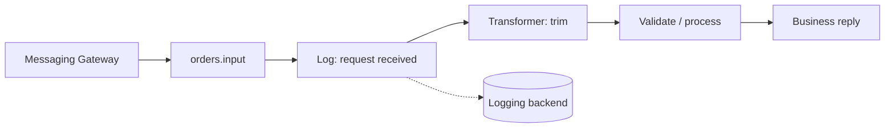
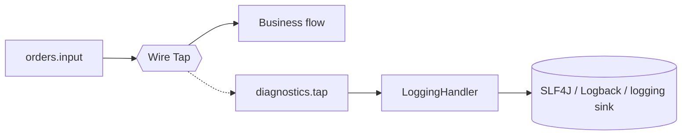
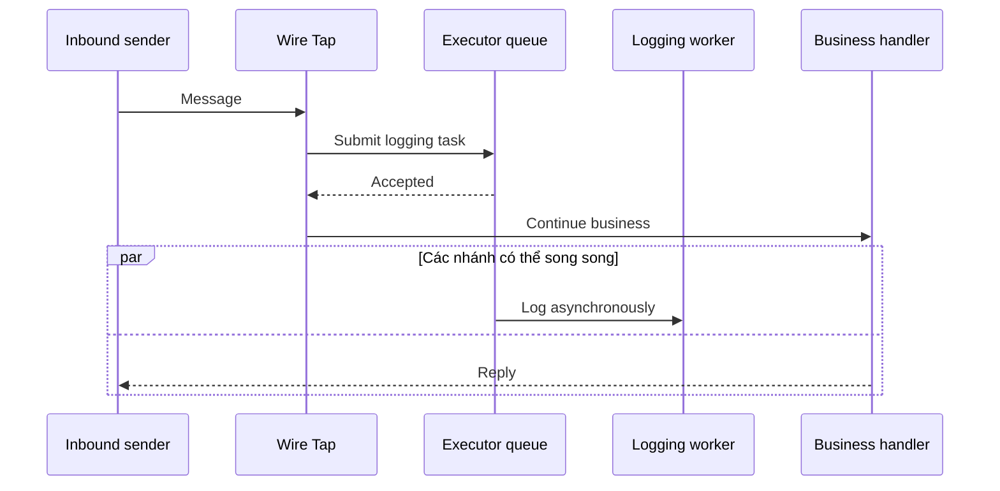

# Logging handler và ghi nhận message

## 1. Vì sao cần ghi nhận message trong một integration flow?

Khi một hệ thống xử lý đơn hàng bằng Spring Integration, cùng một yêu cầu có thể đi qua `Channel Adapter` hoặc `Messaging Gateway`, `Transformer`, `Filter`, `Router`, `Service Activator` rồi mới tạo phản hồi. Nếu chỉ thấy lỗi cuối cùng, người vận hành khó biết message đã đi tới channel nào, payload đã được chuẩn hóa ra sao, có đi nhầm nhánh hay đang chậm ở dependency nào.

**Message Logger** là cách quan sát message tại một điểm cụ thể của luồng bằng logging. Trong Spring Integration, `LoggingHandler` là một message handler chuyên ghi log; Java DSL có thao tác `.log(...)` để đưa thông tin log vào flow mà vẫn giữ đường xử lý chính. Logging có ích khi điều tra lỗi, theo dõi request, xác nhận tuyến xử lý và đối chiếu correlation ID.

Bài thuộc chương **Message logger** của module `SPRING_INTEGRATION_PATTERN`. Mục tiêu của module là thực hành Enterprise Integration Patterns (EIP) bằng Spring Integration để xây dựng luồng thông điệp ít phụ thuộc, dễ mở rộng, có retry, error channel, correlation và khả năng kiểm thử, quan sát Router, Filter, Transformer, Splitter, Aggregator, Gateway. Chủ đề bài này tập trung vào **Logging handler và ghi nhận message**.

Ví dụ đầu vào của một yêu cầu:

```text
Request:  "  ORD-42  "
Channel:  orders.input
Actions:  log received -> normalize -> validate -> process -> reply
Reply:    "ACCEPTED:ORD-42"
```

Nếu log ở điểm `orders.input`, ta biết **đã nhận yêu cầu**, chứ chưa thể kết luận đơn hàng đã được lưu thành công. Muốn biết việc xử lý thực sự thành công, phải có tín hiệu ở đúng điểm hoàn tất nghiệp vụ hoặc sau transaction commit.

Sau bài học, bạn sẽ có khả năng:

- Phân biệt `LoggingHandler`, Java DSL `.log(...)`, Wire Tap, logging trực tiếp trong handler và hệ thống metrics/tracing.
- Chọn vị trí ghi nhận message và các trường log vừa đủ để truy vết mà không lộ dữ liệu nhạy cảm.
- Viết flow Java DSL có logger, Transformer, Service Activator và Messaging Gateway, xác định ý nghĩa log so với reply.
- Cân nhắc thread, log level, latency, logging lỗi, redelivery, correlation và tác động của log sink khi quá tải.
- Kiểm thử nội dung log, nghiệp vụ và các tình huống failure bằng một ma trận kiểm thử rõ ràng.

## 2. LoggingHandler nằm ở đâu trong EIP?

`LoggingHandler` là endpoint nhận message rồi ghi thông tin qua hệ thống logging của ứng dụng. Nó **không phải** Transformer, Router, broker hay message store. Khi dùng handler logging làm **điểm kết thúc** một flow, handler chỉ ghi log; nó không tự tạo ra payload reply cho gateway.

Có hai mô hình thường gặp:

1. **Quan sát trong đường nghiệp vụ:** dùng DSL `.log(...)` để ghi một thông tin tại vị trí cụ thể rồi tiếp tục các bước xử lý.
2. **Nhánh logging riêng:** gửi message sang channel phụ (thường qua `Wire Tap`) rồi kết thúc nhánh đó bằng `LoggingHandler`. Nhánh chính vẫn thực hiện nghiệp vụ.



Điểm `Log: request received` là tín hiệu quan sát. Nó không chứng minh Transformer hoặc nghiệp vụ phía sau đã chạy thành công.

### 2.1. So sánh các công cụ quan sát

| Cơ chế | Mục tiêu | Điều cần chú ý |
| --- | --- | --- |
| `LoggingHandler` | Ghi message hoặc biểu thức đại diện cho message bằng logging framework. | Nếu đặt làm handler cuối, luồng không tự sinh reply. |
| `IntegrationFlow.log(...)` | Khai báo điểm ghi log dễ đọc ngay trong Java DSL. | Nên dùng biểu thức/mapper chỉ lấy trường được phép ghi. |
| `WireTap` | Sao chép đường quan sát sang channel phụ; có thể dùng LoggingHandler ở nhánh đó. | Tính đồng bộ/bất đồng bộ do channel đích quyết định; không tự tạo durability. |
| `log.info(...)` trong `Service Activator` | Ghi sự kiện gắn sát logic nghiệp vụ. | Trộn quan sát với code nghiệp vụ nếu dùng quá nhiều. |
| Micrometer metrics | Theo dõi tỷ lệ lỗi, số lượng, latency, saturation. | Tránh nhãn có số lượng giá trị quá lớn; không thay thế log theo request. |
| Distributed tracing | Nối các span/hop giữa component, process hoặc dịch vụ. | Cần propagation và instrumentation xuyên thread/adapter. |

Một flow có thể dùng cả logging, metrics và tracing, nhưng mỗi tín hiệu phải có ý nghĩa rõ ràng. Log không thay thế transaction, retry, idempotency hoặc xác nhận message của broker.

### 2.2. Logging không đồng nghĩa “đã xử lý”

Ví dụ `orders.input` đã ghi dòng `event=order-received`. Ngay sau đó, handler có thể ném `IllegalArgumentException` vì ID không hợp lệ hoặc DB có thể rollback. Dòng log trước đó vẫn tồn tại.

Các giai đoạn nên phân biệt:

| Stage | Đã biết chắc điều gì? | Không thể suy ra |
| --- | --- | --- |
| `received` | Message đã tới điểm gắn logger. | Nghiệp vụ đã commit. |
| `validated` | Bước validation đã hoàn tất thành công. | Dependency phía sau đã sẵn sàng. |
| `attempted` | Handler đã bắt đầu thử một side effect. | Side effect hoàn tất. |
| `completed` | Handler đã trả kết quả thành công theo hợp đồng cục bộ. | DB/broker độc lập đã cùng commit. |
| `committed` | Transaction được xác nhận thành công tại resource cụ thể. | Toàn hệ thống phân tán đã “exactly once”. |

Đặt tên stage theo sự thật quan sát được, tránh log `order-saved` trước khi commit DB.

## 3. Những khả năng chính của LoggingHandler

`LoggingHandler` thuộc Spring Integration. Nó hỗ trợ ghi log ở mức độ (level) được chọn và có thể định danh logger/category. Trong cấu hình Java DSL, `.log(...)` thuận tiện để chỉ định log level, category và hàm diễn giải message thành chuỗi.

### 3.1. Level và category

| Level | Mục đích gợi ý | Ví dụ |
| --- | --- | --- |
| `ERROR` | Lỗi khiến xử lý thất bại hoặc cần hành động. | Message vào DLQ do vượt chính sách retry. |
| `WARN` | Bất thường nhưng hệ thống vẫn có thể tiếp tục. | Fallback được kích hoạt, payload thiếu trường tùy chọn. |
| `INFO` | Mốc quan trọng có ý nghĩa vận hành. | Đã nhận một request ở bước bắt đầu flow. |
| `DEBUG` | Thông tin cần khi điều tra pipeline. | Stage trước/sau Transformer, route được chọn. |
| `TRACE` | Chi tiết rất sâu về cách message di chuyển. | Metadata từng hop trong môi trường chẩn đoán. |

Category như `integration.orders` giúp bật/tắt logger theo một nhóm flow. Trong Spring Boot, cấu hình level có thể được đặt ở `application.yml`:

```yaml
logging:
  level:
    integration.orders: INFO
    integration.orders.diagnostics: WARN
```

Level được cấu hình ở runtime logging framework quyết định event có được ghi ra sink hay không. Nếu code yêu cầu `DEBUG` nhưng category đang ở `INFO`, event `DEBUG` có thể bị bỏ qua. Đừng phụ thuộc vào thay đổi log level như một cơ chế lưu vết audit bền vững.

### 3.2. Ghi payload, headers hay một thông điệp đã chọn lọc?

Một message Spring Integration có thể gồm:

```text
Message
  payload = OrderRequest(orderId, customerName, deliveryAddress)
  headers = {
    id, timestamp, correlationId, replyChannel, errorChannel,
    trace metadata, custom headers, ...
  }
```

Nếu log toàn bộ `Message.toString()`, ứng dụng có thể vô tình ghi tên khách hàng, địa chỉ, token, nội dung đơn, object channel hoặc metadata nội bộ. Nguyên tắc mặc định an toàn là **cho phép từng trường được ghi (allowlist)**: event/stage, tên flow, loại payload, định danh correlation đã chuẩn hóa, outcome và thời gian xử lý. Với payload nhạy cảm, chỉ dùng thông tin dạng tổng hợp hoặc đã che.

Nên phân biệt:

- `MessageHeaders.ID`: UUID của **message instance** trong Spring Integration, giúp theo dõi một hop, nhưng có thể thay khi message được dựng lại.
- `correlationId`: liên kết nhiều message thuộc cùng một request, Splitter/Aggregator hoặc workflow; không mặc nhiên duy nhất cho mỗi hiệu ứng nghiệp vụ.
- `eventId` hoặc `idempotencyKey`: định danh nghiệp vụ ổn định xuyên retry, redelivery và replay; không phụ thuộc UUID của message mới.
- `traceId` / `spanId`: liên kết với hệ thống distributed tracing; cần propagation qua adapter và thread.

Không đưa giá trị định danh có độ phân biệt lớn vào **metric label**, nhưng có thể đưa ID được phép dùng vào log/tracing theo chính sách bảo vệ dữ liệu.

## 4. Ví dụ Java DSL: ghi log rồi tiếp tục xử lý đơn hàng

Ví dụ dùng Java 17+, Spring Boot 3.x và Spring Integration 6.x. `OrdersGateway` nhận một chuỗi order ID, flow ghi mốc `received`, chuẩn hóa payload rồi gọi `OrderService` trả reply. Đoạn code tập trung vào API Java DSL; trong ứng dụng thực tế cần dependencies Spring Integration, Spring Test và logging backend phù hợp.

### 4.1. Khai báo channel và IntegrationFlow

```java
import org.springframework.context.annotation.Bean;
import org.springframework.context.annotation.Configuration;
import org.springframework.integration.annotation.IntegrationComponentScan;
import org.springframework.integration.channel.DirectChannel;
import org.springframework.integration.config.EnableIntegration;
import org.springframework.integration.dsl.IntegrationFlow;
import org.springframework.integration.handler.LoggingHandler;
import org.springframework.messaging.MessageChannel;

@Configuration
@EnableIntegration
@IntegrationComponentScan
public class OrderLoggerConfiguration {

    @Bean("orders.input")
    MessageChannel ordersInput() {
        return new DirectChannel();
    }

    @Bean
    IntegrationFlow ordersFlow(OrderService service) {
        return IntegrationFlow.from("orders.input")
                .log(LoggingHandler.Level.INFO,
                        "integration.orders",
                        message -> "stage=received" +
                                " payloadType=" +
                                message.getPayload().getClass().getSimpleName() +
                                " messageId=" + message.getHeaders().getId())
                .transform(String.class, String::trim)
                .handle(String.class,
                        (orderId, headers) -> service.accept(orderId))
                .get();
    }
}
```

`.log(...)` đặt điểm ghi nhận **trước** Transformer: log ghi loại payload và message ID của thông điệp khi mới nhận, không ghi order ID thô. Sau logging, flow vẫn thực hiện `String::trim` và handler nghiệp vụ.

```java
import org.springframework.stereotype.Service;

@Service
public class OrderService {

    public String accept(String orderId) {
        if (orderId == null || orderId.isBlank()) {
            throw new IllegalArgumentException("Order ID is required");
        }
        return "ACCEPTED:" + orderId;
    }
}
```

### 4.2. Messaging Gateway tạo request–reply

```java
import org.springframework.integration.annotation.Gateway;
import org.springframework.integration.annotation.MessagingGateway;

@MessagingGateway(defaultRequestChannel = "orders.input")
public interface OrdersGateway {

    @Gateway(replyTimeout = "3000")
    String submit(String orderId);
}
```

Khi caller gọi:

```java
String result = ordersGateway.submit("  ORD-42  ");
// result = "ACCEPTED:ORD-42"
```

Một dòng log minh họa có thể trông như:

```text
INFO integration.orders - stage=received payloadType=String messageId=...
```

Dòng log không chứa mã đơn và không chứng minh đơn đã được lưu vào DB. Nó chỉ ghi message đi qua điểm logger. Việc `OrderService.accept(...)` trả chuỗi thành công là ví dụ nghiệp vụ tối giản; khi thay bằng DB/RPC, cần thiết kế transaction, retry, timeout và outcome log đúng vị trí.

### 4.3. Vì sao không dùng LoggingHandler làm handler duy nhất ở giữa request–reply?

`LoggingHandler` là một handler chuyên ghi log. Nếu flow chỉ gồm:

```java
@Bean
IntegrationFlow logOnlyFlow() {
    return IntegrationFlow.from("logging.in")
            .handle(new LoggingHandler("INFO"))
            .get();
}
```

thì đó là một **terminal logging endpoint**. Nó phù hợp để tiêu thụ một message một chiều phục vụ log, nhưng không tạo ra reply `String` cho gateway đầu vào.

Khi cần **vừa log vừa xử lý tiếp**, dùng `.log(...)` theo Java DSL hoặc một Wire Tap tới logging flow riêng. Tránh mong đợi `.handle(new LoggingHandler(...))` tự động chuyển tiếp message sang handler kế tiếp như Transformer.

## 5. Biến thể: Wire Tap tới một logging channel riêng

Trong một hệ thống lớn, bạn có thể giữ logging flow riêng biệt:



Ví dụ Java DSL minh họa cách tổ chức:

```java
import org.springframework.context.annotation.Bean;
import org.springframework.integration.channel.DirectChannel;
import org.springframework.integration.dsl.IntegrationFlow;
import org.springframework.integration.handler.LoggingHandler;
import org.springframework.messaging.MessageChannel;

@Bean("diagnostics.tap")
MessageChannel diagnosticsTap() {
    return new DirectChannel();
}

@Bean
IntegrationFlow businessWithTap(OrderService service) {
    return IntegrationFlow.from("orders.input")
            .wireTap("diagnostics.tap")
            .transform(String.class, String::trim)
            .handle(String.class,
                    (orderId, headers) -> service.accept(orderId))
            .get();
}

@Bean
IntegrationFlow diagnosticsLoggingFlow() {
    LoggingHandler logging = new LoggingHandler("DEBUG");
    logging.setLoggerName("integration.orders.diagnostics");

    return IntegrationFlow.from("diagnostics.tap")
            .transform(String.class, ignored ->
                    "stage=received payloadType=String")
            .handle(logging)
            .get();
}
```

Đây là **biến thể thay thế** `ordersFlow` ở phần 4: không đăng ký đồng thời hai flow có cùng input `orders.input` và cùng mục tiêu nghiệp vụ nếu không muốn cạnh tranh subscriber. Các phương thức `@Bean` đặt trong lớp `@Configuration` hợp lệ; đoạn code lược bỏ class wrapper để tập trung vào sự khác biệt.

Ở biến thể này, nhánh tap biến đổi **bản message ở nhánh logging** thành chuỗi không chứa payload nhạy cảm rồi mới giao cho `LoggingHandler`. Transformer ở nhánh tap không được thay đổi payload trên đường nghiệp vụ chính.

`LoggingHandler` hoạt động như consumer cuối cùng của channel `diagnostics.tap`. Khi `diagnostics.tap` là `DirectChannel`, việc ghi log có thể tăng độ trễ đường chính vì handler chạy đồng bộ. Để cách ly thread, có thể thay channel tap bằng `ExecutorChannel` cùng pool và queue hữu hạn. Cách này cần quan sát overflow/rejection, propagation trace context và xử lý lỗi async; thread khác không tự đem theo transaction hoặc MDC từ caller.

### 5.1. Log level và vị trí gắn logger

Giả sử log tại đầu vào và log tiếp sau khi normalize:

```text
orders.input
  -> log stage=received
  -> Transformer: trim orderId
  -> log stage=normalized
  -> business handler
```

Hai dòng này mang ý nghĩa khác nhau. Nếu Transformer lỗi, chỉ có log `received`; nếu handler lỗi sau bước normalize, cả hai log có thể tồn tại. Không suy ra rằng có dòng `normalized` là nghiệp vụ đã commit.

Với hệ thống có nhiều stage, hãy xác định danh sách stage ổn định ngay từ đầu; nếu mỗi handler dùng từ ngữ tùy ý, dashboard hoặc truy vấn log sẽ khó phân tích.

## 6. An toàn dữ liệu và cách ghi log có cấu trúc

Đưa message vào log đồng nghĩa chuyển dữ liệu sang **một hệ thống lưu trữ khác** với chính sách truy cập/retention có thể khác DB nguồn. Log có thể được gom từ nhiều service, đẩy sang bên thứ ba hoặc sao lưu lâu hơn mong muốn.

Những thứ **không nên log nguyên vẹn theo mặc định**:

- Mật khẩu, token đăng nhập, API key, `Authorization` / cookie headers.
- Thông tin thanh toán, số định danh cá nhân, email/địa chỉ/số điện thoại khi không thực sự cần.
- Toàn bộ payload/exception message có thể chứa dữ liệu người dùng hoặc nội dung hợp đồng.
- Raw object reference như `replyChannel`, `errorChannel` hoặc object được serialize không kiểm soát.
- Payload kích thước lớn, file binary/Base64 hoặc bất cứ chuỗi nào do người dùng nhập không giới hạn.

Hãy ưu tiên **structured logging**:

```text
event=integration.message_received
flow=orders
stage=received
payloadType=OrderRequest
correlationId=checkout-208
outcome=observed
```

Các cặp `key=value` là biểu diễn đơn giản; có thể sử dụng JSON logging khi pipeline hỗ trợ schema. Không nên dựng JSON bằng nối chuỗi tùy ý nếu giá trị chưa escape hoặc có thể bị kiểm soát từ đầu vào.

### 6.1. Tránh log injection và lộ nội dung không mong muốn

Nếu buộc phải ghi một trường do client cung cấp, hãy giới hạn độ dài, loại bỏ/escape ký tự xuống dòng và ký tự điều khiển, đồng thời che các đoạn nhạy cảm. Nếu không, một payload chứa `\nERROR fake...` có thể gây nhầm lẫn khi truy vấn log hoặc giả mạo nhiều dòng log.

Nếu log được tạo bằng hàm biểu thức SpEL hoặc lambda, biểu thức nên ngắn gọn, không có network I/O và tránh `toString()` của domain object chưa biết mức độ an toàn. Logic redaction phức tạp cần có một thành phần chuyên trách được kiểm thử.

### 6.2. Giới hạn số lượng log

Một Message Logger ở mọi hop có thể phát sinh rất nhiều dữ liệu. Ví dụ một message đi qua 12 endpoint và mỗi endpoint tạo 2 log, hệ thống nhận 10.000 message/giây sẽ tạo hàng trăm nghìn dòng/giây trước khi tính retry hoặc redelivery.

Giải pháp là chọn điểm log có ý nghĩa, level phù hợp, sampling có chủ đích đối với trace/debug, và metrics cho các phép đo tổng hợp. Với quy trình audit bắt buộc, không dựa vào sampling hoặc khả năng lưu trữ best-effort của logger.

## 7. Correlation, retry, redelivery và lỗi

### 7.1. Message ID khác correlation và idempotency key

Khi message đi qua Gateway, Splitter, Aggregator hoặc broker, message có thể được tạo lại. Vì vậy `message.getHeaders().getId()` phù hợp nhận diện một instance tại điểm quan sát, nhưng không thay thế `eventId` do producer cung cấp nếu cần nối nhiều lần redelivery.

Ví dụ một luồng:

```text
requestCorrelationId = checkout-208
eventId             = evt-571
deliveryAttempt     = 1
messageId           = 8c3...  (instance)
```

Khi broker redeliver `evt-571`, message instance có thể có ID mới, attempt tăng nhưng `eventId` phải được giữ. Đối với Splitter, nhiều child message có thể dùng chung correlation ID nhưng mỗi child có sequence number hoặc business key riêng. Điều này rất quan trọng khi đối chiếu log theo một flow có nhiều nhánh.

### 7.2. Retry có thể khiến log lặp

Giả sử một handler ghi DB lỗi tạm thời; retry của Spring Integration hoặc broker gọi lại handler. Nếu logger gắn trước handler, mỗi attempt có thể sinh thêm một dòng `received` hoặc `attempted` tùy vị trí đặt retry advice. Đừng đọc tổng số dòng log thành “tổng số đơn hàng đã tạo”.

Nên có các trường:

| Trường | Dùng để làm gì? | Cần chú ý |
| --- | --- | --- |
| `eventId` | Ghép các lần giao cùng nghiệp vụ. | Giữ nguyên qua retry/replay. |
| `correlationId` | Ghép các nhánh của cùng workflow. | Không dùng làm khóa dedup duy nhất. |
| `attempt` / redelivery count | Phân biệt lần thử đầu và retry. | Nguồn thông tin tùy broker/adapter, không tự bịa nếu thiếu. |
| `stage` | Biết sự kiện xảy ra tại bước nào. | Định nghĩa danh sách stage có ngữ nghĩa thống nhất. |
| `outcome` | Accepted, rejected, retried, failed, committed... | Chỉ log outcome đã thực sự được xác nhận. |
| `dependency` / `latencyMs` | Tìm điểm nghẽn. | Không nhầm timestamp log với thời gian thực thi handler. |

### 7.3. Ghi lỗi đúng chỗ

Một `LoggingHandler` đứng trước nghiệp vụ chỉ thấy đầu vào; nó không tự nhận exception của handler phía sau. Với flow đồng bộ `DirectChannel`, exception có thể lan về gateway/listener; với channel bất đồng bộ, error handling có thể chuyển sang `errorChannel` nếu endpoint/container được cấu hình thích hợp.

Khi muốn log lỗi, có thể thiết kế **error flow** nhận `ErrorMessage`, trích thông tin an toàn (loại exception, stage, correlation, retry attempt) rồi chuyển tới chính sách retry, DLQ hoặc phản hồi lỗi. Đừng chỉ log rồi nuốt exception nếu upstream dựa vào exception để rollback broker/JDBC transaction; việc “log và return success” có thể khiến message được ack dù chưa xử lý xong.

### 7.4. Log không thay thế acknowledgment hoặc transaction

Không có ràng buộc tự động nào bảo đảm “log đã ghi” đồng nghĩa “DB đã commit” hoặc “broker đã nhận ack”. Một async appender có thể ghi ra sink sau khi business trả kết quả; trong trường hợp crash, dòng log có thể không được flush. Ngược lại, logger có thể ghi `attempted` rồi DB rollback.

Nếu audit bắt buộc phải đi cùng commit nghiệp vụ, hãy lưu record audit/outbox trong cùng DB transaction (mẫu **transactional outbox**) hoặc dùng tài nguyên giao dịch phù hợp, rồi xuất log/notification sau. Đây là quyết định về tính nhất quán, vượt phạm vi một LoggingHandler đơn thuần.

## 8. Threading, hiệu năng và độ tin cậy của logger

### 8.1. Chi phí logging đồng bộ

Khi LoggingHandler chạy đồng bộ trên đường gửi, ngay cả việc format chuỗi hoặc serialize payload cũng sử dụng CPU của request thread. Nếu appender chờ I/O, latency của nghiệp vụ có thể tăng mạnh. Để tránh điều này:

- Log các trường ngắn và không thực hiện truy vấn DB/gọi HTTP bên trong mapper log.
- Dùng log level hợp lý; DEBUG/TRACE nên bật có chọn lọc.
- Cấu hình appender, buffer và rotation theo khả năng tiếp nhận thực tế.
- Đo p95/p99 latency của đường chính trước và sau khi bật logging chi tiết.
- Xem xét bất đồng bộ cho logger có sink chậm, nhưng phải chấp nhận rủi ro queue/rejection/mất log khi crash.

### 8.2. Nhánh logging bất đồng bộ

Nếu logging flow được đặt sau `WireTap` tới `ExecutorChannel`, việc ghi nhận có thể chạy trên một thread pool khác:



Các lưu ý:

- `ExecutorChannel` không truyền `ThreadLocal`, MDC hoặc thread-bound DB transaction một cách tự động; tracing cần context propagation.
- Executor có queue hữu hạn có thể từ chối task; chính sách `CallerRunsPolicy` còn có thể đưa việc logging trở lại caller thread. Không mặc nhiên coi “async” là miễn phí.
- Logging worker có thể hoàn thành sau business handler; thứ tự các dòng log khác thứ tự commit nghiệp vụ.
- Queue in-memory hoặc async appender không bảo đảm log còn sau crash. Nếu cần audit durable, dùng outbox hoặc lưu bền vững.
- Nên quan sát cả queue depth, rejected task, log appender failures và thời gian drain khi shutdown.

### 8.3. Log level thay đổi không tạo “chế độ debug miễn rủi ro”

Khi bật DEBUG trên production, lượng log có thể tăng đột ngột, gây CPU/IO pressure, chi phí lưu trữ lớn và lộ dữ liệu mà bình thường không xuất hiện. Cần có phạm vi và thời hạn bật debug rõ ràng, đo tác động, không bật `logFullMessage` trên toàn luồng chứa PII.

## 9. Kiểm thử LoggingHandler và ghi nhận message

Kiểm thử logging có hai mục tiêu độc lập:

1. **Nội dung:** log có stage/category/correlation phù hợp và không chứa dữ liệu bị cấm.
2. **Tính không xâm lấn:** thêm logging không làm thay đổi payload, reply, exception hoặc side effect của nghiệp vụ.

### 9.1. Test request–reply cho flow có logger

Có thể dùng Spring Test và JUnit 5 để kiểm chứng đường nghiệp vụ:

```java
import static org.junit.jupiter.api.Assertions.assertEquals;

import org.junit.jupiter.api.Test;
import org.springframework.beans.factory.annotation.Autowired;
import org.springframework.test.context.junit.jupiter.SpringJUnitConfig;

@SpringJUnitConfig(classes = {
        OrderLoggerConfiguration.class,
        OrderService.class
})
class OrderLoggerFlowTest {

    @Autowired
    private OrdersGateway gateway;

    @Test
    void loggerDoesNotChangeBusinessReply() {
        assertEquals("ACCEPTED:ORD-42",
                gateway.submit("  ORD-42  "));
    }
}
```

Ví dụ kiểm chứng `Gateway → log → Transformer → handler → reply` khi các channel vẫn đồng bộ. Nó không tự chứng minh log được ghi ở log sink, cũng không kiểm thử MDC/async. Hãy kiểm tra test context có đăng ký gateway qua `@IntegrationComponentScan` và không có bean channel trùng tên.

### 9.2. Kiểm thử dòng log bằng appender tạm thời

Nếu dự án dùng Logback, có thể gắn một `ListAppender` vào logger category `integration.orders`, chạy gateway rồi kiểm tra event được ghi:

```java
import static org.junit.jupiter.api.Assertions.assertTrue;

import ch.qos.logback.classic.Level;
import ch.qos.logback.classic.Logger;
import ch.qos.logback.classic.spi.ILoggingEvent;
import ch.qos.logback.core.read.ListAppender;
import org.junit.jupiter.api.Test;
import org.slf4j.LoggerFactory;

@Test
void logContainsStageWithoutRawOrderId() {
    Logger logger = (Logger) LoggerFactory.getLogger("integration.orders");
    Level previousLevel = logger.getLevel();
    ListAppender<ILoggingEvent> appender = new ListAppender<>();
    appender.start();
    logger.addAppender(appender);

    try {
        logger.setLevel(Level.INFO);
        gateway.submit("  ORD-42  ");

        assertTrue(appender.list.stream()
                .anyMatch(e -> e.getFormattedMessage()
                        .contains("stage=received")));
        assertTrue(appender.list.stream()
                .noneMatch(e -> e.getFormattedMessage()
                        .contains("ORD-42")));
    } finally {
        logger.detachAppender(appender);
        logger.setLevel(previousLevel);
        appender.stop();
    }
}
```

Đoạn này là **phương thức test** chèn vào lớp `OrderLoggerFlowTest` ở trên; các import thêm theo đúng môi trường kiểm thử. Trong dự án không dùng Logback, thay bằng appender/capture tương ứng logging backend. Khi chạy nhiều test song song trên cùng logger, cần cách ly logger/appender hoặc tắt chạy song song để không nhiễu dữ liệu.

Kiểm tra category và stage rất hữu ích; tránh test phụ thuộc toàn bộ format của timestamp, thread name hoặc prefix vì cấu hình logging production có thể thay đổi.

### 9.3. Ma trận kiểm thử hành vi

| Kịch bản | Cách kiểm thử | Kết quả cần xác nhận |
| --- | --- | --- |
| Input hợp lệ | Gọi gateway bằng `"  ORD-42  "`. | Reply `ACCEPTED:ORD-42`, có log `received`, không có payload thô. |
| Input không hợp lệ | Gửi chuỗi trắng. | Có log `received`, handler ném exception; không ghi `committed` sai. |
| Logging level bị tắt | Đặt category cao hơn level log. | Không phát sinh log ở level đó, nghiệp vụ vẫn chạy. |
| Retry ba lần | Dùng fake dependency thất bại rồi thành công. | Log attempt phản ánh đúng vị trí logging, không nhầm ba attempt với ba đơn hàng. |
| Error handler/rollback | Gây exception tại handler. | Exception/retry/ack tuân theo chính sách, không bị logger nuốt. |
| PII trong payload | Gửi DTO có thông tin nhạy cảm. | Log chỉ có trường allowlist và không in DTO `toString()`. |
| Log sink chậm | Dùng test appender chậm có kiểm soát. | Phân biệt latency sync/async; tránh gây treo test. |
| Async logging đầy queue | Executor queue nhỏ, sinh nhiều message. | Rejection/backpressure/metrics đúng policy; luồng chính bị ảnh hưởng theo thiết kế đã công bố. |
| Correlation qua Splitter | Gửi request có nhiều child message. | Log ghép được cùng workflow, phân biệt child bằng sequence hoặc ID riêng. |
| Redelivery từ broker | Replay cùng `eventId`. | Log thể hiện nhiều delivery, không suy ra duplicate business effect. |
| App restart trước flush | Dừng tiến trình khi log đang nằm trong buffer. | Nhận ra giới hạn độ bền của logging, không dùng làm bằng chứng audit. |

## 10. Những sai lầm thường gặp

**1. Ghi nguyên message vào INFO.** Một `Message.toString()` có thể chứa toàn bộ payload và nhiều header. Dùng mapper chỉ lấy thông tin an toàn, đặt mức log phù hợp và phân quyền truy cập sink.

**2. Dùng LoggingHandler làm handler giữa flow rồi mong có reply.** LoggingHandler phù hợp cho logging one-way; Java DSL `.log(...)` hoặc Wire Tap phù hợp hơn cho log không làm ngắt đường nghiệp vụ.

**3. Gọi log `success` trước transaction commit.** Log mô tả “handler đã chạy” có ý nghĩa khác “DB đã commit”. Tách các stage nhận, xử lý, commit để không gây sai lệch khi điều tra.

**4. Dựa vào message UUID để dedup sự kiện.** Message instance ID có thể khác giữa redelivery/replay. Dùng event ID do nghiệp vụ phát và khóa idempotency phù hợp.

**5. Không cấu hình log level.** Một dòng `DEBUG` không xuất hiện nếu logger category đang ở `INFO`. Cần hiểu cả level của handler và backend.

**6. Gắn quá nhiều logger trên hot path.** Formatting, locking và I/O có thể khiến latency tăng; đặt điểm log có mục tiêu, theo dõi số log/giây và sampling khi phù hợp.

**7. Chỉ thử happy path.** Khi lỗi retry, broker redeliver hoặc executor bão hòa, nội dung log và khả năng tiếp tục nghiệp vụ có thể khác hẳn. Cần test các điểm lỗi thực tế.

**8. Tưởng async log là durable.** Queue/appender trong bộ nhớ có thể mất khi crash; xử lý bất đồng bộ có thể bị từ chối hoặc đến muộn. Audit bắt buộc cần cơ chế lưu bền vững.

**9. Dùng log làm công cụ điều khiển flow.** Log là tín hiệu quan sát; phân nhánh và biến đổi cần Router/Filter/Transformer, còn retry và rollback cần cơ chế chuyên biệt.

## 11. Checklist trước khi áp dụng Message Logger

Trước khi triển khai trên một flow Spring Integration, hãy trả lời:

1. **Mục đích:** điểm log phục vụ điều tra lỗi, trace, metrics hay audit bắt buộc?
2. **Vị trí:** logger được gắn trước/sau Transformer/Filter/Router/handler/commit nào?
3. **Stage:** dòng log chứng minh điều gì đã xảy ra, và điều gì chưa thể kết luận?
4. **Dữ liệu:** chỉ ghi trường allowlist, che PII/token và giới hạn payload/headers chưa?
5. **Định danh:** có `eventId`/`correlationId` và trace context phù hợp để nối các hop và retry không?
6. **Level/category:** mức INFO/DEBUG/ERROR và logger name đã phù hợp với runtime configuration chưa?
7. **Tác động hiệu năng:** log đồng bộ có ảnh hưởng p95/p99 latency, CPU và log volume không?
8. **Async:** nếu dùng Wire Tap/ExecutorChannel, có queue capacity, rejection policy, trace propagation và cảnh báo backlog không?
9. **Failure semantics:** lỗi logger có làm thay đổi xử lý business/ack/rollback không, và điều này có đúng với hợp đồng ứng dụng không?
10. **Kiểm thử:** đã kiểm tra reply, log content, PII, lỗi, retry, redelivery và log sink quá tải chưa?

**LoggingHandler** và Java DSL `.log(...)` giúp quan sát những message đi qua luồng tích hợp mà không phải rải mã logging vào mọi thành phần nghiệp vụ. Một chiến lược tốt xác định được **ghi cái gì, ghi ở đâu và dòng log chứng minh điều gì**; kết hợp log với correlation, metrics và tracing sẽ giúp theo dõi các nhánh Spring Integration, trong khi transaction và delivery semantics tiếp tục được kiểm soát ở đúng ranh giới xử lý của chúng.
