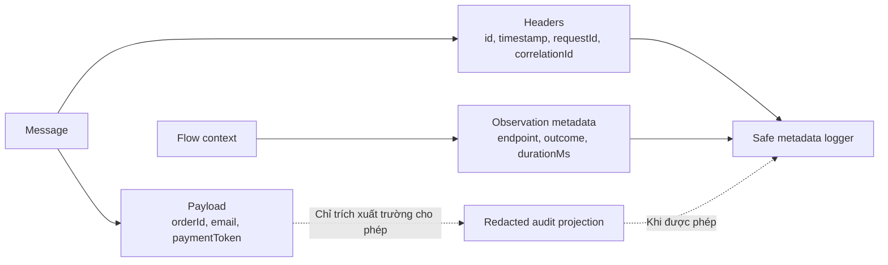
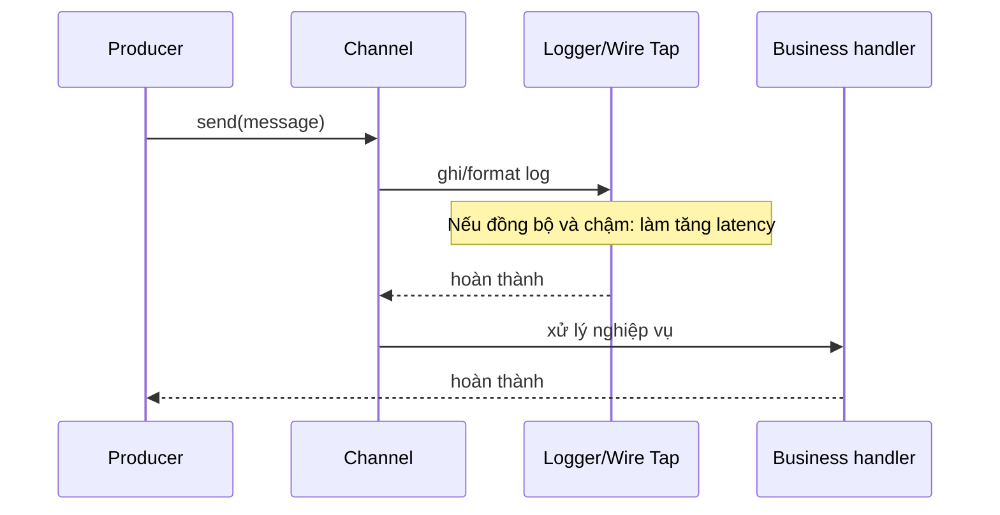
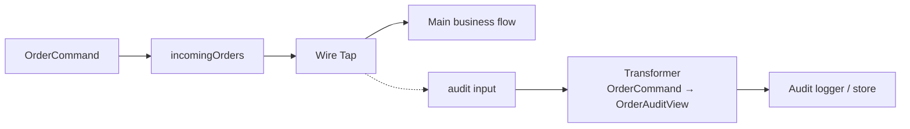
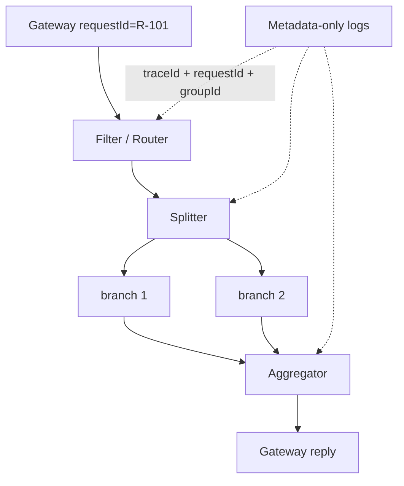

# Log payload hay chỉ metadata trong Spring Integration?

## Mục tiêu bài học

Sau bài này, bạn có thể:

- Phân biệt **payload**, **message headers**, **metadata quan sát** và nội dung exception khi ghi log một luồng message.
- Lựa chọn chính sách **metadata-only**, **payload được chọn lọc/che dữ liệu**, hoặc **full payload** theo độ nhạy, môi trường và nhu cầu điều tra.
- Dùng Spring Integration Java DSL `.log(...)` với biểu thức log an toàn, tránh vô tình gọi `Message.toString()` hoặc `payload.toString()` chứa dữ liệu bí mật.
- Thiết kế **Wire Tap** đưa dữ liệu quan sát sang nhánh riêng mà không thay đổi payload nghiệp vụ của luồng chính.
- Giữ khả năng đối soát bằng `requestId`, `correlationId` và trace context khi message đi qua Router, Filter, Transformer, Splitter, Aggregator hoặc Gateway.
- Kiểm thử log **có đủ metadata cần thiết** và **không rò rỉ email, token, dữ liệu thanh toán**, đồng thời đánh giá độ trễ và lỗi của logger.

Bài thuộc chương **Message logger** trong mô-đun **SPRING_INTEGRATION_PATTERN**. Khi học các *Enterprise Integration Patterns* với Spring Integration, ta cần quan sát luồng thông điệp ít phụ thuộc và dễ mở rộng. Log là công cụ giúp gỡ lỗi Router, Filter, Transformer, Splitter, Aggregator, Gateway, retry, error channel và correlation. Nhưng vì message thường chứa dữ liệu từ người dùng hoặc hệ thống ngoài, câu hỏi **“log payload hay chỉ metadata?”** là một quyết định **về bảo mật, chi phí, khả năng vận hành và hợp đồng nghiệp vụ**, không chỉ về cú pháp `logger.info(...)`.

## 1. Message có những phần dữ liệu nào?

Trong Spring Integration, một message thường được biểu diễn bằng `org.springframework.messaging.Message<T>` gồm:

- **Payload:** dữ liệu nghiệp vụ, ví dụ `OrderCommand` chứa mã đơn, email khách hàng, thông tin giao dịch.
- **Headers:** `MessageHeaders.ID`, thời điểm tạo message, correlation/sequence headers và các header do ứng dụng đặt như `requestId`, `traceId`.
- **Thông tin phát sinh ngoài message:** tên channel/endpoint, loại lỗi, thời gian xử lý, số lần retry, kết quả kiểm tra hoặc số lượng bản ghi.



**Không phải header nào cũng an toàn hơn payload.** Header có thể chứa `Authorization`, cookie, API key, thông tin user, đường dẫn chứa query string hoặc cả `replyChannel`/`errorChannel` là object nội bộ. Log “toàn bộ headers” không đồng nghĩa log metadata an toàn.

### 1.1. Ví dụ payload có dữ liệu nhạy cảm

```java
public record OrderCommand(
        String orderId,
        String customerEmail,
        String paymentToken,
        int itemCount
) {}
```

Nếu viết:

```java
logger.info("Incoming message={}", message);
logger.info("Payload={}", message.getPayload());
```

thì một bản `record` Java có `toString()` mặc định có thể hiển thị cả `customerEmail` và `paymentToken`. Đây là **ví dụ không an toàn**, không nên sao chép vào production. Thêm `logger.isDebugEnabled()` không giải quyết rủi ro nếu khi bật DEBUG, log bí mật vẫn xuất hiện trong nơi lưu log tập trung.

## 2. Bảng quyết định: khi nào log gì?

| Chiến lược | Nội dung | Mức độ phù hợp | Rủi ro cần quản trị |
| --- | --- | --- | --- |
| **Metadata-only** | Event name, endpoint, message ID, request/correlation ID đã kiểm tra, outcome, latency | **Mặc định nên chọn** ở production | ID vẫn có thể là dữ liệu cá nhân hoặc làm lộ hoạt động kinh doanh; header phải có allowlist |
| **Payload projection** | Một DTO quan sát chỉ gồm các trường được phê duyệt: loại tác vụ, số phần tử, trạng thái | Khi cần ngữ cảnh nghiệp vụ để hỗ trợ vận hành | Trường tưởng vô hại có thể nhạy cảm khi kết hợp; cần version, giới hạn giữ log |
| **Redacted payload** | Payload đã được che/loại trường bí mật theo schema | Điều tra ngắn hạn hoặc log có kiểm soát | Regex xóa chuỗi có thể bỏ sót trường lồng nhau, format mới, exception |
| **Full payload** | Toàn bộ dữ liệu nghiệp vụ | Trường hợp đặc biệt, dữ liệu giả lập hoặc môi trường được kiểm soát | Rò rỉ PII, secret, tuân thủ, chi phí lưu trữ và khó xóa dữ liệu |
| **No content log** | Chỉ metric tổng hợp, không lưu từng message | Hệ thống đặc biệt nhạy cảm, throughput rất cao | Mất khả năng truy vết ở mức message nếu không có telemetry khác |

**Quy tắc đề xuất:** production mặc định **metadata-only với allowlist tường minh**; nếu cần nội dung, tạo **projection phù hợp mục đích** thay vì log tự động toàn bộ `Message<?>`.

### 2.1. Lưu ý về phân loại dữ liệu

Không nên coi một trường là an toàn chỉ vì có tên “metadata”:

| Trường | Có thể ghi? | Gợi ý |
| --- | --- | --- |
| `messageId` dạng UUID của framework | Thường có thể | Chỉ làm ID kỹ thuật của message hiện tại |
| `requestId`/`correlationId` nội bộ | Tùy quy tắc dữ liệu | Giới hạn ký tự/độ dài; tránh ID chứa email/số tài khoản |
| `payloadType` | Thường có thể | Dùng tên type/loại sự kiện được phép; không gọi payload `toString()` |
| `channelName`, `endpointName` | Thường có thể | Không gắn dữ liệu người dùng vào tên channel |
| `durationMs`, `status`, `attempt` | Thường có thể | Kiểm soát độ chính xác, tránh số lượng nhãn quá lớn trong metric |
| `Authorization`, `Cookie`, `Set-Cookie` | **Không** | Tuyệt đối không log trực tiếp giá trị |
| `paymentToken`, mật khẩu, API key | **Không** | Đưa vào danh sách cấm cho cả payload, header, exception |
| Email/số điện thoại/địa chỉ | Hạn chế nghiêm ngặt | Chỉ đưa vào log nếu có cơ sở nghiệp vụ và kiểm soát quyền/retention phù hợp |
| `replyChannel`/`errorChannel` object | Không log object thô | Khi cần, log tên đích đã biết hoặc loại channel |
| Stack trace và exception message | Cần xem xét | Thông báo lỗi có thể chứa URL, raw request, token hoặc thông tin cá nhân |

## 3. Vì sao việc log tất cả message thường gây hại?

### 3.1. Rò rỉ dữ liệu và mở rộng bề mặt truy cập

Một service chỉ được phép truy cập dữ liệu thanh toán trong thời gian xử lý. Khi log toàn bộ payload, cùng dữ liệu có thể xuất hiện trong hệ thống log aggregation, dashboard, kho lưu trữ lạnh, bản sao lưu và môi trường hỗ trợ. Quyền truy cập và thời gian lưu của **hệ thống log** có thể khác biệt lớn so với database nghiệp vụ.

### 3.2. Chi phí và hiệu năng

Nếu mỗi message tạo 2 KB log và flow xử lý 20.000 message/giây, lượng dữ liệu thô xấp xỉ **40 MB/giây**, chưa kể index, bản sao, metadata và nén. Ghi log full payload có thể làm CPU tốn thời gian serialize, tạo nhiều object và gây áp lực lên hệ thống log.

Một message có thể đi qua nhiều bước (Router → Transformer → Splitter → Gateway). Log toàn bộ message tại mỗi bước nhân khối lượng lên nhiều lần; một payload nhỏ trước Splitter có thể tạo hàng nghìn bản log khi tách thành các message con.

### 3.3. Log có thể làm thay đổi hành vi flow

`LoggingHandler`/`.log(...)` tham gia vào hệ thống message. Formatting nặng hoặc appender ghi đồng bộ có thể tăng latency. Nếu bước quan sát ném exception hoặc channel tap đầy, nó có thể ảnh hưởng đường chính tùy cấu hình. **Logging không phải hành vi “miễn phí và luôn thành công”.**



Nếu yêu cầu log không được chặn nghiệp vụ, phải định nghĩa ranh giới xử lý bất đồng bộ, capacity, chính sách khi queue đầy và cơ chế ghi nhận log bị mất. Chỉ “đặt Wire Tap” không đủ để bảo đảm cách ly hoàn toàn lỗi của nhánh quan sát.

## 4. Cách Spring Integration hỗ trợ Message Logger

Spring Integration có **LoggingHandler** và các phương án cấu hình log trong flow. Java DSL `.log(...)` giúp thêm bước quan sát thông điệp ở vị trí đã chọn. Wire Tap cũng có thể chuyển message đến một logging channel riêng.

Các điểm cần phân biệt:

- `LoggingHandler` là endpoint chuyên dùng cho việc ghi thông tin về message.
- `.log(...)` trong Integration DSL là cách đặt logging tại một đoạn flow; overload nhận một hàm chuyển `Message<?>` thành **nội dung cho phép ghi log**.
- `.wireTap(...)` sao chép message sang channel khác để thực hiện logging/audit riêng, thuận tiện khi cần biến đổi thành audit projection.
- `@ServiceActivator` cũng có thể nhận message và gọi SLF4J, nhưng cần tránh biến logic quan sát thành logic nghiệp vụ.

**Quan trọng:** đừng đặt `.log()` với cấu hình mặc định ở production rồi tự tin rằng chỉ metadata được ghi. Hãy dùng expression/hàm định dạng tường minh, và kiểm thử nội dung log thật sự được tạo ở phiên bản Spring Integration đang sử dụng.

## 5. Ví dụ 1: Metadata-only logging bằng Java DSL

Ví dụ dành cho **Java 17+, Spring Boot 3.x và Spring Integration 6.x**. Giả sử service nhận một `OrderCommand` có email và payment token, nhưng log chỉ được phép ghi:

```text
event=order.received messageId=... requestId=REQ_101 payloadType=OrderCommand itemCount=2
```

Chúng ta sẽ không gọi `toString()` của message hoặc payload. ID nghiệp vụ trong ví dụ có định dạng chỉ gồm ký tự đã cho phép.

### 5.1. DTO và bộ định dạng an toàn

```java
// OrderCommand.java
public record OrderCommand(
        String orderId,
        String customerEmail,
        String paymentToken,
        int itemCount
) {}
```

```java
// SafeMessageLog.java
import org.springframework.messaging.Message;

public final class SafeMessageLog {
    private SafeMessageLog() {}

    public static String summarize(Message<?> message) {
        Object requestIdHeader =
                message.getHeaders().get("requestId");
        String requestId = safeId(requestIdHeader);

        Object payload = message.getPayload();
        String payloadType = payload instanceof OrderCommand
                ? "OrderCommand"
                : "Other";

        String itemCount = payload instanceof OrderCommand order
                ? Integer.toString(order.itemCount())
                : "n/a";

        return "event=order.received"
                + " messageId=" + message.getHeaders().getId()
                + " requestId=" + requestId
                + " payloadType=" + payloadType
                + " itemCount=" + itemCount;
    }

    public static String safeId(Object value) {
        if (!(value instanceof String id)) {
            return "missing";
        }
        // Allowlist chống newline/log injection và chuỗi quá dài.
        return id.matches("[A-Za-z0-9_-]{1,64}")
                ? id
                : "invalid";
    }
}
```

Điểm chính:

1. Chỉ lấy header `requestId` từ **allowlist**. Không duyệt rồi in tất cả headers.
2. Kiểm tra giá trị string hợp lệ để tránh **log injection** bằng xuống dòng hoặc ký tự điều khiển.
3. Đặt tên `payloadType` từ tập giá trị do ứng dụng kiểm soát; không dùng payload `toString()`.
4. `itemCount` là trường nghiệp vụ đã được xét duyệt cho log theo giả định của ví dụ. Nếu số lượng món hàng cũng nhạy cảm ở domain của bạn, bỏ trường này.
5. Không hề truy cập `customerEmail` hay `paymentToken` trong hàm định dạng.

### 5.2. Cấu hình IntegrationFlow với `.log(...)`

```java
// OrderFlowConfiguration.java
import org.springframework.context.annotation.Bean;
import org.springframework.context.annotation.Configuration;
import org.springframework.integration.channel.DirectChannel;
import org.springframework.integration.config.EnableIntegration;
import org.springframework.integration.dsl.IntegrationFlow;
import org.springframework.integration.handler.LoggingHandler;
import org.springframework.messaging.MessageChannel;

@Configuration
@EnableIntegration
public class OrderFlowConfiguration {
    @Bean
    public MessageChannel incomingOrders() {
        return new DirectChannel();
    }

    @Bean
    public IntegrationFlow orderFlow(OrderProcessor processor) {
        return IntegrationFlow.from("incomingOrders")
            .log(
                LoggingHandler.Level.INFO,
                "app.integration.orders",
                SafeMessageLog::summarize
            )
            .handle(processor, "process")
            .get();
    }
}
```

```java
// OrderProcessor.java
import org.springframework.stereotype.Component;

@Component
public class OrderProcessor {
    public void process(OrderCommand command) {
        if (command.itemCount() <= 0) {
            throw new IllegalArgumentException("INVALID_ITEM_COUNT");
        }
        // Thực hiện xử lý nghiệp vụ; không in command.toString().
    }
}
```

`.log(...)` được đặt trước handler nghiệp vụ để giúp xác định message nào đã tới flow. Hàm `SafeMessageLog.summarize` trả lại **chuỗi metadata có cấu trúc**, không phải toàn bộ message.

**Phân biệt vị trí log:** dòng này cho biết message đã đến checkpoint trước handler; nó **không** chứng minh nghiệp vụ đã commit. Muốn ghi kết quả thành công/thất bại, phải đặt checkpoint phù hợp sau điểm xử lý thành công hoặc phát một event kết quả với trạng thái được định nghĩa rõ.

### 5.3. Producer gửi message với request ID hợp lệ

```java
// OrderSender.java
import org.springframework.beans.factory.annotation.Qualifier;
import org.springframework.messaging.MessageChannel;
import org.springframework.messaging.support.MessageBuilder;
import org.springframework.stereotype.Component;

@Component
public class OrderSender {
    private final MessageChannel incomingOrders;

    public OrderSender(
            @Qualifier("incomingOrders") MessageChannel incomingOrders) {
        this.incomingOrders = incomingOrders;
    }

    public boolean submit() {
        OrderCommand order = new OrderCommand(
            "O-101",
            "customer@example.com",
            "tok_live_secret_example",
            2
        );
        return incomingOrders.send(
            MessageBuilder.withPayload(order)
                .setHeader("requestId", "REQ_101")
                .build()
        );
    }
}
```

Email và token là **dữ liệu giả lập** chỉ để chứng minh rằng log phải bỏ qua chúng. Trong bài kiểm thử sẽ assert cả hai chuỗi **không xuất hiện trong output log**.

## 6. Ví dụ 2: Wire Tap để tách audit projection khỏi luồng chính

Metadata-only log thường phù hợp cho quan sát kỹ thuật; đôi khi một hệ thống cần một **audit event** có trường nghiệp vụ đã kiểm duyệt. Thay vì log toàn bộ `OrderCommand`, có thể tạo projection:

```java
// OrderAuditView.java
public record OrderAuditView(
        String requestId,
        String orderReference,
        int itemCount,
        String action
) {}
```

Trong ví dụ, `orderReference` cũng phải là một ID đã được cấp phép cho môi trường log. Nếu mã đơn có thể truy ngược trực tiếp đến một người, có thể cần pseudonymization hoặc không ghi. Việc đưa `itemCount` vào audit chỉ hợp lệ khi domain cho phép.



Một flow thay thế riêng (không đăng ký đồng thời lên cùng input với ví dụ 1):

```java
// OrderAuditFlowConfiguration.java
import org.springframework.context.annotation.Bean;
import org.springframework.context.annotation.Configuration;
import org.springframework.integration.channel.DirectChannel;
import org.springframework.integration.config.EnableIntegration;
import org.springframework.integration.dsl.IntegrationFlow;
import org.springframework.messaging.MessageChannel;

@Configuration
@EnableIntegration
public class OrderAuditFlowConfiguration {
    @Bean
    public MessageChannel auditIngress() {
        return new DirectChannel();
    }

    @Bean
    public MessageChannel auditEvents() {
        return new DirectChannel();
    }

    @Bean
    public IntegrationFlow auditAwareBusinessFlow(
            OrderProcessor processor) {
        return IntegrationFlow.from("auditIngress")
            .wireTap("auditEvents")
            .handle(processor, "process")
            .get();
    }

    @Bean
    public IntegrationFlow auditProjectionFlow(OrderAuditProjector projector) {
        return IntegrationFlow.from("auditEvents")
            .transform(projector, "project")
            .handle(message -> {
                // Minh họa vị trí writer, không in toàn bộ message.
                OrderAuditView view =
                        (OrderAuditView) message.getPayload();
                // Ghi view vào audit store/log đã kiểm soát quyền.
                if (view.action() == null) {
                    throw new IllegalStateException("AUDIT_VIEW_INVALID");
                }
            })
            .get();
    }
}
```

Lớp Transformer chuyển dữ liệu sang audit view và lấy `requestId` thật từ header sau khi đã kiểm tra:

```java
// OrderAuditProjector.java
import org.springframework.messaging.Message;
import org.springframework.stereotype.Component;

@Component
public class OrderAuditProjector {
    public OrderAuditView project(Message<OrderCommand> message) {
        OrderCommand order = message.getPayload();
        String requestId = SafeMessageLog.safeId(
                message.getHeaders().get("requestId"));

        return new OrderAuditView(
            requestId,
            order.orderId(),
            order.itemCount(),
            "ORDER_RECEIVED"
        );
    }
}
```

`OrderAuditProjector.project` nhận cả `Message<OrderCommand>` để đọc header, thay vì chỉ nhận payload. Với request ID không hợp lệ, ví dụ trả `invalid`; một hệ thống audit bắt buộc có thể **từ chối/lưu trạng thái lỗi** thay vì ghi một ID không định danh được. Không tự hardcode request ID hoặc giả định mọi message luôn có header đó.

Trong cấu hình này, `auditEvents` là `DirectChannel`, tức audit transformer/writer **vẫn có thể làm chậm hoặc làm lỗi luồng chính**. Đổi sang `ExecutorChannel`/broker có thể tách thời gian xử lý, nhưng phải đặt giới hạn queue, error handling và chính sách khi không bàn giao được message. Nếu audit bắt buộc và cần tính nhất quán với transaction nghiệp vụ, ưu tiên một transaction phù hợp hoặc transactional outbox; Wire Tap không tự tạo atomicity.

### 6.1. Log projection không đồng nghĩa với an toàn tuyệt đối

Một projection chỉ giúp **giảm tập dữ liệu được ghi**, không thay thế quy trình kiểm soát:

- Ai được truy cập dữ liệu sau khi đã log?
- Có cơ chế retention, xóa hoặc vô hiệu hóa log truy cập khi hết mục đích không?
- Metadata có đủ để truy ngược một người hoặc một giao dịch nhạy cảm không?
- Có tuân thủ quy định của tổ chức và pháp luật liên quan không?

Tuyệt đối tránh dựa duy nhất vào regex kiểu “tìm chuỗi token và thay bằng `***`”: trường có thể đổi tên, nằm trong JSON lồng nhau hoặc đã bị chuyển sang dạng khác trước khi regex chạy.

## 7. Kiểm thử rằng log không rò rỉ payload

Với ví dụ 1, nên có **test phủ định** bên cạnh test xác minh metadata. Dưới đây là mẫu kiểm thử sử dụng Logback `ListAppender` (chỉ phù hợp nếu ứng dụng dùng Logback; với framework logging khác cần adapter test tương ứng). Ví dụ giả định context kiểm thử có riêng `OrderFlowConfiguration`, `OrderProcessor` và `OrderSender`.

```java
// SafeMessageLoggingTest.java
import static org.assertj.core.api.Assertions.assertThat;

import ch.qos.logback.classic.Level;
import ch.qos.logback.classic.Logger;
import ch.qos.logback.classic.spi.ILoggingEvent;
import ch.qos.logback.core.read.ListAppender;
import java.util.stream.Collectors;
import org.junit.jupiter.api.Test;
import org.slf4j.LoggerFactory;
import org.springframework.beans.factory.annotation.Autowired;
import org.springframework.boot.test.context.SpringBootTest;

@SpringBootTest
class SafeMessageLoggingTest {
    @Autowired
    private OrderSender sender;

    @Test
    void logsMetadataButNotSensitivePayload() {
        Logger logger = (Logger) LoggerFactory.getLogger(
                "app.integration.orders");
        Level previousLevel = logger.getLevel();

        ListAppender<ILoggingEvent> appender = new ListAppender<>();
        appender.start();
        logger.addAppender(appender);
        logger.setLevel(Level.INFO);

        try {
            assertThat(sender.submit()).isTrue();

            String output = appender.list.stream()
                .map(ILoggingEvent::getFormattedMessage)
                .collect(Collectors.joining(" "));

            assertThat(output)
                .contains("event=order.received")
                .contains("requestId=REQ_101")
                .contains("payloadType=OrderCommand");

            assertThat(output)
                .doesNotContain("customer@example.com")
                .doesNotContain("tok_live_secret_example")
                .doesNotContain("customerEmail")
                .doesNotContain("paymentToken");
        } finally {
            logger.detachAppender(appender);
            logger.setLevel(previousLevel);
            appender.stop();
        }
    }
}
```

**Giới hạn của test:** nó xác minh sự kiện log từ logger được đặt ở checkpoint trong ví dụ, không chứng minh tất cả logging ở HTTP client, exception handler, framework DEBUG logs hoặc hệ thống quan sát khác đều an toàn. Cần rà soát cấu hình log ở toàn bộ chuỗi từ inbound adapter đến broker.

Để tránh kiểm thử không ổn định, những test thay đổi logger toàn cục không nên chạy song song với test khác cùng dùng logger đó. Có thể tạo test context và tên logger riêng cho từng test suite.

### 7.1. Những test bổ sung cần có

| Kịch bản | Cách tạo | Kỳ vọng |
| --- | --- | --- |
| Header request ID có xuống dòng | `requestId="ABC\\nFAKE-ERROR"` | Logger dùng `invalid` hoặc định dạng an toàn, không chèn dòng log giả |
| Header chứa secret | Gửi `Authorization`, `Cookie` trong headers | Không xuất hiện trong output |
| Payload không phải `OrderCommand` | Gửi message kiểu khác qua điểm ghi log | Không gọi payload `toString()`; log type cho phép |
| Message có payload lớn | Gửi bản ghi có string/byte array rất dài | Log không tăng theo kích thước payload |
| Formatter ném lỗi | Gây exception có kiểm soát trong log expression | Xác định tác động lên main path và cơ chế error flow |
| Audit async bị quá tải | Executor/queue đầy | Chính sách drop/fail có quan sát; không mặc định business success |
| Splitter tạo nhiều message | Gửi một request tách 100 phần tử | Tần suất log và cardinality được kiểm soát |
| Exception chứa token trong message | Adapter/handler ném lỗi có thông báo nhạy cảm | Không ghi raw exception text nếu chưa kiểm duyệt |

## 8. Correlation khi log ở nhiều bước của flow



Khi ghi log một flow gồm nhiều endpoint, cần phân biệt:

| Khóa | Ý nghĩa | Cách sử dụng trong log |
| --- | --- | --- |
| `MessageHeaders.ID` | ID một message cụ thể | Dùng khi truy vết message tại checkpoint hiện tại; message mới có thể đổi ID |
| `requestId` / `operationId` | ID nghiệp vụ qua nhiều bước | Dùng để tìm log thuộc một tác vụ; phải validate/sanitize |
| `IntegrationMessageHeaderAccessor.CORRELATION_ID` | Correlation của nhóm message trong Spring Integration | Dùng khi Splitter/Aggregator tạo nhóm; không mặc định là broker RPC correlation |
| `SEQUENCE_NUMBER` / `SEQUENCE_SIZE` | Vị trí và kích thước nhóm | Theo dõi nhóm thiếu phần tử |
| `traceId` / `spanId` | Context tracing giữa các endpoint/dịch vụ | Dùng cho log và distributed tracing; không tự dùng làm idempotency key |
| Broker correlation ID | Khóa request–reply ở AMQP/JMS/Kafka theo adapter | Chỉ log khi hợp đồng và chính sách bảo mật cho phép |

Một message được Transformer tạo mới có thể có `MessageHeaders.ID` khác request gốc, còn business request ID vẫn nên giữ qua các hop khi có thể. Log cùng `messageId` và `requestId` giúp phân biệt “message nào đã đi qua endpoint này” với “nó thuộc thao tác nghiệp vụ nào”.

Nếu phần flow đi qua broker, không tự giả định mọi Spring header sẽ được serialize sang transport. Adapter có quy tắc header mapper riêng; correlation của Aggregator và correlation request–reply qua broker có thể khác nhau. Hãy kiểm tra những ID thực sự đến được phía consumer.

### 8.1. Khi nào cần log payload đã rút gọn?

Một số lỗi đòi hỏi ngữ cảnh lớn hơn metadata cơ bản, ví dụ Filter từ chối message vì thiếu mã sản phẩm. Có thể log:

```text
event=order.validation_rejected
requestId=REQ_101
reasonCode=MISSING_PRODUCT_CODE
payloadType=OrderCommand
```

Không nhất thiết phải log toàn bộ order để biết nguyên nhân. Với Router, log **tên nhánh đã chọn** và lý do theo mã enum; với Aggregator, log `groupId`, số phần tử đã nhận và điều kiện release; với retry, log `attempt` và **loại lỗi đã chuẩn hóa**. Những dữ liệu này thường giúp điều tra hơn một bản JSON đầy đủ không có trạng thái endpoint.

## 9. Log lỗi và ErrorMessage mà không làm lộ dữ liệu

Khi Service Activator hoặc adapter ném exception, Spring Integration có thể truyền lỗi đồng bộ hoặc gửi `ErrorMessage` qua `errorChannel` ở những điểm bất đồng bộ được hỗ trợ.

**Tránh thói quen**:

```java
// Ví dụ nguy hiểm khi chưa kiểm tra nội dung lỗi:
logger.error("Integration failed message={}", failedMessage, throwable);
```

`Throwable.getMessage()` và stack trace có thể chứa URL với token, query parameter, payload bị serialize hoặc thông báo SQL bao gồm giá trị nhạy cảm. Một quy tắc an toàn hơn là log thông tin đã phân loại:

```java
// ErrorMetadata.java
public record ErrorMetadata(
        String requestId,
        String errorCategory,
        String failedEndpoint
) {}
```

Ví dụ xử lý lỗi (phần minh họa, channel `operationalErrors` cần được định nghĩa riêng trong flow):

```java
import org.slf4j.Logger;
import org.slf4j.LoggerFactory;
import org.springframework.integration.annotation.ServiceActivator;
import org.springframework.messaging.support.ErrorMessage;
import org.springframework.stereotype.Component;

@Component
public class SafeIntegrationErrorLogger {
    private static final Logger LOG =
            LoggerFactory.getLogger(SafeIntegrationErrorLogger.class);

    @ServiceActivator(inputChannel = "operationalErrors")
    public void handle(ErrorMessage error) {
        Throwable cause = error.getPayload();
        String category = cause instanceof java.util.concurrent.TimeoutException
                ? "TIMEOUT"
                : "PROCESSING_FAILURE";

        LOG.warn("event=integration.failure category={} errorType={}",
                category, cause.getClass().getSimpleName());
        // Với requestId/endpoint, chỉ log sau khi đã trích và kiểm tra
        // từ failedMessage/originalMessage tương ứng nếu chúng tồn tại.
    }
}
```

Đoạn trên cố ý **không log raw `Throwable`, stack trace, message hay headers**. Thực tế có thể cần stack trace để điều tra, nhưng phải xác định cách lọc thông tin nhạy cảm, nơi lưu hạn chế quyền và chính sách retention. Không khẳng định một exception chỉ có kiểu `TimeoutException` là phân loại toàn diện; client HTTP/JMS/AMQP có các lớp timeout khác nhau, cần chuẩn hóa tại adapter.

Một `ErrorMessage` không đảm bảo luôn chứa failed message trong cùng chỗ; mã xử lý lỗi cần kiểm tra loại exception và metadata thực sự có mặt. Không dùng `errorChannel` như một kho audit bền, hoặc coi mọi lỗi đều phát vào đó khi luồng chạy đồng bộ.

## 10. Sampling, level và lưu trữ log

Giữ tất cả log của tất cả message không phải lúc nào cũng cần. Cân nhắc:

| Chính sách | Mục tiêu | Lưu ý |
| --- | --- | --- |
| `INFO` metadata cho checkpoint chính | Theo dõi request và outcome | Chỉ giữ vài checkpoint quan trọng; kiểm soát dung lượng |
| `DEBUG` chọn lọc theo trace/request ID | Điều tra lỗi ngắn hạn | Không nới rộng thành full payload vô điều kiện |
| **Deterministic sampling** theo ID được phép | Chọn mẫu ổn định trên nhiều hop | Hàm hash/key phải đồng nhất; vẫn quan sát riêng lỗi nghiêm trọng |
| **Metrics tổng hợp** | Throughput, latency, retries, errors | Không cần mỗi message tạo một log; không đưa ID duy nhất thành metric tag |
| **Audit event bền** | Tuân thủ, đối soát trạng thái | Dùng lưu trữ và transaction phù hợp; không thay bằng logger thông thường |

Không thêm `requestId`, `userId` hoặc `messageId` vào **metric label** cho từng message: chúng gây *high cardinality* và có thể làm bùng nổ chi phí hệ thống metric. Các ID này hữu ích ở **tracing/log có retention kiểm soát**, không phải ở nhãn metric tổng hợp.

Thời gian lưu và quyền xem log phải tương ứng mức độ nhạy cảm, không mặc định rằng hệ thống log trung tâm có cùng quyền kiểm soát với database nguồn.

## 11. Khi logger gặp lỗi, flow chính sẽ ra sao?

Logging thường được coi là hoạt động phụ, nhưng trong hệ thống message-driven, nó cũng là một bước cần tài nguyên.

| Thiết kế | Khi logger/appender chậm hoặc lỗi | Hướng xử lý |
| --- | --- | --- |
| Log đồng bộ ngay trên `DirectChannel` | Có thể tăng thời gian xử lý hoặc ném lỗi trên thread sender | Dùng formatter nhẹ; giới hạn nội dung; cân nhắc tách nhánh |
| Wire Tap sang `ExecutorChannel` | Handler log có thể lỗi trên worker sau khi main flow tiếp tục | Tạo error flow và metric rejected task; queue/thread pool hữu hạn |
| Wire Tap sang `QueueChannel` | Tap có thể dồn backlog; queue đầy làm dispatch bị chặn hoặc thất bại | Giới hạn dung lượng, poller và chính sách khi đầy |
| Log gửi đến broker | Lỗi adapter/publish/consumer nằm ở các giai đoạn khác nhau | Xác định confirm, retry, dead-letter và nơi lưu audit |
| Audit bắt buộc trong transaction | Log thất bại có thể phải làm transaction fail | Thiết kế consistency/outbox thay vì chỉ dựa vào log best-effort |

**Fail-open hay fail-closed** phải dựa vào mục đích của log. Với diagnostic logging, thường nên ưu tiên flow nghiệp vụ và ghi nhận số log bị mất nếu hệ thống cho phép. Với audit bắt buộc, việc âm thầm bỏ dữ liệu có thể không chấp nhận được. Quyết định này cần được kiểm thử cùng kiến trúc concurrency và transaction.

## 12. Checklist rà soát trước production

1. **Mục đích log đã rõ chưa?** Debug, truy vết, metric hay audit phải có hợp đồng khác nhau.
2. **Log mặc định metadata-only chưa?** Formatter có allowlist thay vì in `Message<?>` hoặc payload thô?
3. **Header đã được kiểm tra chưa?** Có ngăn ghi `Authorization`/`Cookie` và sanitize request ID từ nguồn ngoài?
4. **Payload có dữ liệu nhạy cảm không?** Email, token, số tài khoản, ID truy ngược người dùng, JSON nested?
5. **Error logs có an toàn không?** Exception message và stack trace có khả năng chứa dữ liệu nhận từ request?
6. **Dùng Wire Tap có ảnh hưởng main flow không?** Channel đồng bộ/bất đồng bộ, queue full, rejected task và latency đã được test?
7. **Correlation đủ để điều tra không?** `messageId`, `requestId`, group ID, trace ID được giữ đúng ranh giới?
8. **Có policy sampling, retention và quyền truy cập không?** Không tạo metric tag có cardinality vô hạn.
9. **Test log không rò rỉ đã chạy chưa?** Kiểm thử cả secret trong payload, header, exception và tình huống DEBUG.
10. **Nếu log phải bền vững?** Dùng audit store/outbox/transaction phù hợp, không tuyên bố logger thông thường có exactly-once delivery.

## Kết luận

Với Spring Integration, **nên log metadata có chọn lọc theo mặc định**, không tự động log toàn bộ payload hoặc toàn bộ headers. Một logging checkpoint tốt chỉ ghi trường cần thiết để trả lời: **message nào đi qua endpoint nào, thuộc request/correlation nào, kết quả và độ trễ ra sao**. Khi cần ngữ cảnh nghiệp vụ, hãy tạo audit projection đã kiểm duyệt thay vì in `Message.toString()`. Bảo vệ dữ liệu trong cả exception và các nhánh Wire Tap, kiểm thử trường bị cấm không xuất hiện trong log, và chọn cách ly/retention thích hợp. Làm như vậy vừa giữ khả năng chẩn đoán Router, Filter, Transformer, Splitter, Aggregator, Gateway và error channel, vừa tránh biến hệ thống log thành một bản sao dữ liệu nhạy cảm khó kiểm soát.
