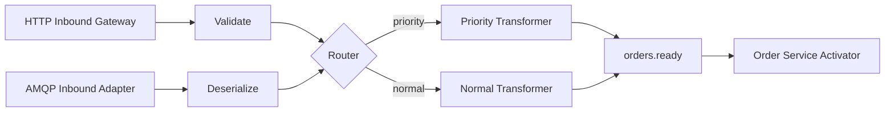
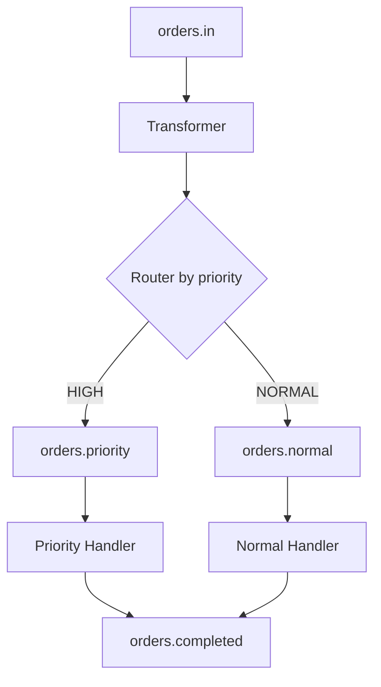
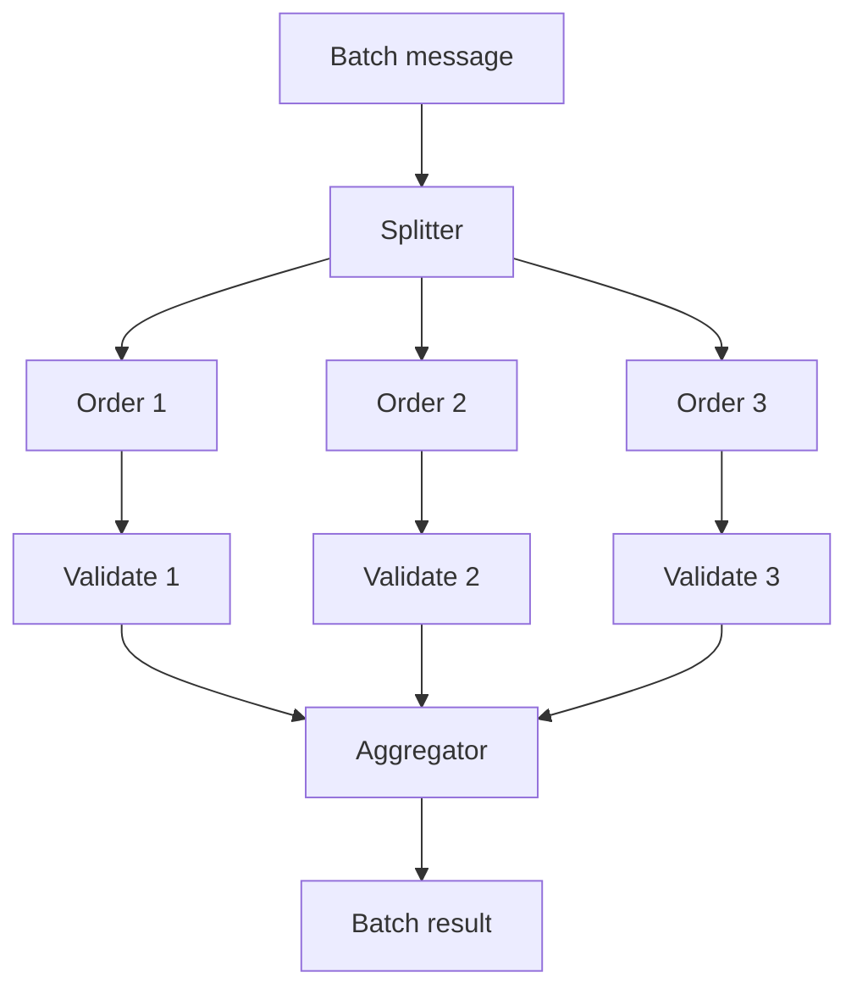
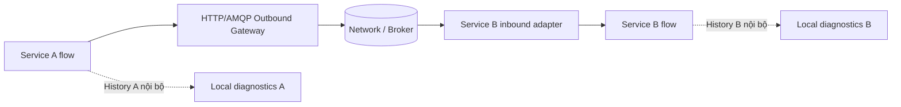

# Message history để theo dõi flow

Trong chương **Message logger** của module **SPRING_INTEGRATION_PATTERN**, một nhu cầu quan trọng khi triển khai Enterprise Integration Patterns là hiểu **một message đã đi qua những thành phần nào trước khi tới điểm xử lý hiện tại**. Khi flow có Router, Filter, Transformer, Splitter, Aggregator, Gateway, retry và error channel, chỉ nhìn log ở bước cuối thường không đủ để biết message đã tới từ nhánh nào, đi qua channel nào hoặc dừng ở đâu.

**Message History** của Spring Integration là cơ chế ghi lại **lịch sử đi qua các thành phần tích hợp** trong metadata của message. Khi được bật và cấu hình phù hợp, các thành phần được theo dõi bổ sung thông tin nhận diện vào header `history`. Tại một handler ở cuối flow, ta có thể đọc header đó để xem đường đi của message trong phạm vi được ghi nhận.

Bài học tập trung vào kỹ thuật dùng Message History để theo dõi flow, đồng thời phân biệt nó với **Message Logger**, **Wire Tap**, **correlation ID**, **Micrometer metrics** và **distributed tracing**. Đây là các công cụ bổ sung cho nhau, không nên dùng thay thế một cách máy móc.

Sau bài học, bạn có thể:

- Giải thích ý nghĩa, cấu trúc và giới hạn của header `history`.
- Bật Message History có chủ đích và đọc bằng `MessageHistory.read(message)`.
- Xây dựng flow Java DSL có Transformer, Filter và Service Activator để xem lịch sử message.
- Dùng history hỗ trợ điều tra Router, Splitter/Aggregator, Gateway và các nhánh lỗi.
- Phát hiện trường hợp history bị mất khi tái tạo message, đi qua adapter hoặc chuyển sang hệ thống khác.
- Thiết kế logging, metrics, kiểm thử và bảo mật sao cho quan sát được flow mà không làm quá tải ứng dụng.

## 1. Vì sao một dòng log cuối flow chưa đủ?

Giả sử ứng dụng nhận một đơn hàng qua hai nguồn: API và message broker. Các message đi qua các bước khác nhau trước khi cùng vào `orderService`:



Log ở `Order Service` có thể chỉ ghi:

```text
requestId=REQ-117 orderId=O-117 status=PROCESSED
```

Dòng log này cho biết đơn hàng đã được xử lý, nhưng chưa trả lời:

1. Message vào từ HTTP hay AMQP?
2. Router chọn nhánh `priority` hay `normal`?
3. Transformer nào đã chạy?
4. Có message nào bị Filter loại trước khi tới bước cuối?
5. Đã có lần retry hoặc một lần xử lý khác của cùng request chưa?

**Message History** giúp trả lời một phần các câu hỏi về **đường đi**. Ví dụ một lịch sử minh họa có thể chứa những entry dạng:

```text
history:
  - name: orders.in
    type: channel
    timestamp: ...
  - name: orders.normalized
    type: channel
    timestamp: ...
  - name: orders.ready
    type: channel
    timestamp: ...
```

Đây là **biểu diễn khái niệm**, không phải cam kết về chuỗi `toString()` hay danh sách entry chính xác ở mọi phiên bản/configuration. Dữ liệu thực tế phụ thuộc vào những thành phần đã được bật ghi lịch sử và cách đặt tên endpoint/channel.

History ghi **đường đi được quan sát**, không tự ghi toàn bộ quyết định của Router, nội dung payload hoặc nguyên nhân một handler bị lỗi. Muốn biết “vì sao router chọn priority”, ta còn cần dữ liệu quyết định hoặc log/metric có cấu trúc ở Router.

## 2. Message History được lưu ở đâu?

Một Spring `Message<T>` gồm:

- **Payload:** dữ liệu nghiệp vụ, ví dụ `OrderEvent` hoặc `String`.
- **Headers:** metadata như `id`, `timestamp`, `correlationId`, `contentType` và header do ứng dụng tự định nghĩa.

Khi bật Message History, Spring Integration có thể ghi một chuỗi thông tin về các thành phần tích hợp vào header có tên gắn với `MessageHistory.HEADER_NAME` (thường là `history`).

```text
Message<String>
  payload:
    "O-117"
  headers:
    id: ...
    timestamp: ...
    requestId: "REQ-117"
    history:
      [component 1 -> component 2 -> component 3 ...]
```

Điểm quan trọng:

- **History nằm trong message**, không phải một cơ sở dữ liệu audit bên ngoài. Khi message bị mất hoặc không được lưu lại, history cũng không trở thành bản ghi bền vững một cách tự động.
- Mỗi entry phản ánh một thành phần được cấu hình để ghi lịch sử, thường gồm **tên** và **loại thành phần**, có thể kèm thời điểm hoặc metadata khác.
- Không phải mọi lời gọi phương thức Java, mọi quyết định Router hoặc mọi dòng xử lý đều tự biến thành một entry.
- Một header history có thể **tăng kích thước** khi message đi qua nhiều thành phần.
- Việc tạo lại message nhưng không giữ headers có thể khiến history bị mất.
- Lịch sử trong message có thể hữu ích ngay cả khi không ghi toàn bộ payload vào application log.

### Lịch sử không phải khóa tương quan

Một message được biến đổi qua nhiều bước có thể có những message ID kỹ thuật khác nhau, nhưng vẫn thuộc **cùng yêu cầu nghiệp vụ**. Vì vậy:

| Dữ liệu | Trả lời câu hỏi gì? |
| --- | --- |
| `MessageHeaders.ID` | Đây là ID của message hiện tại? |
| `requestId`/`eventId` do hệ thống định nghĩa | Message có liên quan tới yêu cầu/sự kiện nghiệp vụ nào? |
| `correlationId` | Những message nào thuộc cùng yêu cầu, reply hoặc nhóm Aggregator? |
| `Message History` | Message đã đi qua những thành phần được ghi nhận nào? |
| `traceId`/`spanId` | Những thao tác trên nhiều thread/process có cùng trace nào? |

Trong production, thường dùng **history + correlation + structured logs/tracing**, chứ không chọn chỉ một trong số đó.

## 3. Bật Message History trong ứng dụng Spring Integration

Message History không nên được giả định luôn bật cho mọi message flow. Ứng dụng cần bật nó một cách có chủ đích. Một phương án Java Configuration phổ biến là dùng `@EnableMessageHistory` cùng Spring Integration.

```java
package example.history;

import org.springframework.context.annotation.Configuration;
import org.springframework.integration.config.EnableIntegration;
import org.springframework.integration.config.EnableMessageHistory;

@Configuration
@EnableIntegration
@EnableMessageHistory
class MessageHistoryConfiguration {
    // Cấu hình theo dõi lịch sử cho message flow.
}
```

Annotation và các tùy chọn cụ thể cần được đối chiếu với phiên bản Spring Integration được sử dụng. Các ứng dụng dùng cấu hình XML hoặc `MessageHistoryConfigurer` có thể áp dụng cách bật khác, nhưng nguyên lý là các thành phần phù hợp sẽ được cấu hình để tham gia cập nhật message history.

### Vì sao cần bật có chủ đích?

Message History đem lại thông tin quan sát nhưng không miễn phí:

- Mỗi entry có thể làm tăng kích thước metadata của message.
- Việc ghi lịch sử tạo thêm thao tác xử lý trên đường gửi message.
- Một flow dài hoặc một quy trình chia/gom message lớn có thể tích lũy nhiều entry.
- Khi message được serialize để đi qua broker, adapter có thể không truyền `history` hoặc việc truyền có thể làm tăng network payload.
- Một số tên channel/endpoint có thể bộc lộ thông tin kiến trúc nội bộ nếu đưa thẳng ra hệ thống ngoài.

Nên quyết định phạm vi ghi dựa trên mục tiêu vận hành và mức tải. Khi cần giới hạn việc theo dõi, xem cấu hình chọn thành phần của phiên bản framework đang dùng và kiểm thử chính xác danh sách component thực sự được ghi; không đoán rằng tất cả endpoint đều được instrument tự động.

## 4. Ví dụ hoàn chỉnh: đọc lịch sử ở cuối một flow

Ví dụ này tập trung vào cách bật history và đọc lịch sử, không phụ thuộc HTTP hay RabbitMQ. Một sự kiện được gửi vào channel `orders.in`, được chuẩn hóa, lọc giá trị trống, rồi đưa tới handler `orders.valid`.

### 4.1. Flow Java DSL

```java
package example.history;

import org.springframework.context.annotation.Bean;
import org.springframework.context.annotation.Configuration;
import org.springframework.integration.config.EnableIntegration;
import org.springframework.integration.config.EnableMessageHistory;
import org.springframework.integration.dsl.IntegrationFlow;

@Configuration
@EnableIntegration
@EnableMessageHistory
class OrderHistoryFlowConfiguration {

    @Bean
    IntegrationFlow orderHistoryFlow() {
        return IntegrationFlow.from("orders.in")
            .transform(String.class, String::trim)
            .filter(String.class, text -> !text.isBlank())
            .channel("orders.valid")
            .get();
    }
}
```

Ý nghĩa:

1. `orders.in` tiếp nhận message đầu vào.
2. **Transformer** loại khoảng trắng thừa.
3. **Filter** chỉ cho message có nội dung không rỗng đi tiếp.
4. `orders.valid` bàn giao message cho consumer cuối.
5. Các thành phần được theo dõi sẽ đóng góp entry vào Message History theo cấu hình.

Bước Filter **loại message khỏi luồng chính** nếu không đạt điều kiện. Nếu không có discard flow, message bị loại sẽ không tới handler cuối; vì vậy không thể kiểm tra history ở handler đó cho message đã bị bỏ.

### 4.2. Đọc lịch sử bằng MessageHistory.read

```java
package example.history;

import java.util.stream.Collectors;

import org.slf4j.Logger;
import org.slf4j.LoggerFactory;
import org.springframework.integration.annotation.ServiceActivator;
import org.springframework.integration.history.MessageHistory;
import org.springframework.messaging.Message;
import org.springframework.stereotype.Component;

@Component
class OrderHistoryObserver {

    private static final Logger log =
        LoggerFactory.getLogger(OrderHistoryObserver.class);

    @ServiceActivator(inputChannel = "orders.valid")
    public void handle(Message<String> message) {
        MessageHistory history = MessageHistory.read(message);

        if (history == null || history.isEmpty()) {
            log.info(
                "requestId={} history=UNAVAILABLE",
                message.getHeaders().get("requestId")
            );
            return;
        }

        String path = history.stream()
            .map(entry -> entry.getProperty("name", "<unnamed>"))
            .collect(Collectors.joining(" -> "));

        log.info(
            "requestId={} path={} payloadType={}",
            message.getHeaders().get("requestId"),
            path,
            message.getPayload().getClass().getSimpleName()
        );

        // Business processing được bổ sung ở đây nếu cần.
    }
}
```

`MessageHistory.read(message)` đọc lịch sử từ header của message. Với các entry biểu diễn bằng `Properties`, có thể truy cập các thuộc tính như `name` và `type`. Ví dụ trên chỉ log đường đi và kiểu payload, không log nội dung đơn hàng.

**Lưu ý khi chạy:** class observer phải được Spring component-scan tạo thành bean; ứng dụng có các dependency Spring Integration, SLF4J và Java 17+. Nếu version thực tế tạo entry theo cấu trúc hoặc tên khác, hãy quan sát cấu hình hiện tại và kiểm tra dựa trên tên component do mình đặt thay vì cố định một chuỗi log minh họa.

### 4.3. Gửi một message có request ID

```java
package example.history;

import org.springframework.beans.factory.annotation.Qualifier;
import org.springframework.messaging.MessageChannel;
import org.springframework.messaging.support.MessageBuilder;
import org.springframework.stereotype.Component;

@Component
class OrderHistorySender {

    private final MessageChannel input;

    OrderHistorySender(@Qualifier("orders.in") MessageChannel input) {
        this.input = input;
    }

    boolean sendOrder(String orderId, String requestId) {
        return input.send(
            MessageBuilder.withPayload("  " + orderId + "  ")
                .setHeader("requestId", requestId)
                .build()
        );
    }
}
```

Ví dụ gọi:

```java
boolean accepted = sender.sendOrder("O-117", "REQ-117");
```

Nếu message không bị Filter loại, observer sẽ nhận payload đã được trim. Trong một flow đồng bộ dựa trên `DirectChannel`, handler thường chạy trong đường gọi `send`; nếu chuyển sang executor/queue, việc xử lý có thể tiếp diễn sau khi `send` trả về.

**Không nhầm `accepted=true` với nghiệp vụ đã commit** trong mọi loại channel. Giá trị này chỉ phản ánh ngữ nghĩa của `send` tới channel cụ thể.

## 5. Đặt tên channel và endpoint giúp history dễ đọc

Khi nhiều endpoint tự sinh tên, lịch sử có thể chứa tên khó đối chiếu với nghiệp vụ hoặc thay đổi khi refactor. Nên dùng tên **ổn định và có ý nghĩa** tại các điểm cần quan sát:

```text
orders.in
orders.valid
orders.priority
orders.normal
orders.persisted
orders.error
```

Ví dụ quy tắc đặt tên:

| Kiểu thành phần | Tên ví dụ | Cách đọc |
| --- | --- | --- |
| Input channel | `orders.in` | Message bắt đầu vào flow đặt hàng |
| Channel sau Transformer | `orders.normalized` | Dữ liệu đã được chuẩn hóa |
| Channel nhánh Router | `orders.priority` | Message được điều hướng sang nhánh ưu tiên |
| Channel tổng hợp | `orders.aggregated` | Message đã tới đầu ra của Aggregator |
| Channel kết quả | `orders.completed` | Message được gửi tới bước kết quả |
| Error channel | `orders.error` | Lỗi được gửi tới đường xử lý lỗi |

Tên này chỉ có tác dụng khi component thực sự xuất hiện trong đoạn flow và được bật ghi history. Đừng thêm hàng loạt channel không cần thiết chỉ để lịch sử dài hơn; mỗi channel cũng là một ranh giới có ảnh hưởng dispatch, lỗi và hiệu năng.

### Tên endpoint và dữ liệu người dùng

Không gắn order ID, email hoặc tenant bí mật trực tiếp vào tên bean/channel. Các tên đó có thể xuất hiện trong history, metrics hoặc monitoring. Đặt tên ổn định theo vai trò, còn định danh nghiệp vụ đặt trong header/log có kiểm soát truy cập.

## 6. Message History trên nhánh Router

Một Router đưa message tới một channel trong số các nhánh, hoặc nhiều channel nếu thiết kế cho phép. History giúp xem **những channel thực tế đã đi qua**:



Giả sử observer ở `orders.completed` nhận hai message:

```text
message A history:
  orders.in -> orders.priority -> orders.completed

message B history:
  orders.in -> orders.normal -> orders.completed
```

Đây là **đường đi minh họa**. Lịch sử thực có thể chứa thêm tên endpoint, Transformer và các thành phần khác theo cấu hình.

### Phân biệt “đã đi qua” với “quyết định tại sao”

History hỗ trợ chứng minh message **đã đi qua** channel `orders.priority`; nó không giải thích tại sao Router chọn `HIGH`. Muốn tìm nguyên nhân, nên kết hợp:

- Header đã được validate như `priority=HIGH`.
- Log của Router ở mức phù hợp, dùng `requestId`/`eventId`.
- Metric số message vào từng nhánh.
- Kiểm thử rule chọn channel.

Nếu message không đến nhánh mong đợi, kiểm tra thêm default output channel, channel mapping, Filter và exception path. History chỉ được đọc ở nơi có message; một message bị drop trước observer sẽ không để lại bản ghi bền vững mặc định.

## 7. Transformer, MessageBuilder và nguy cơ mất history

Các Transformer và handler có thể tạo message mới. Trong Spring Integration, framework thường cố gắng bảo toàn headers phù hợp khi biến đổi payload theo cơ chế chuẩn. Nhưng nếu ứng dụng **tự tạo** một message hoàn toàn mới mà không copy headers, history và correlation có thể bị mất.

Ví dụ mã cần thận trọng:

```java
// Ví dụ không phù hợp nếu muốn giữ headers từ source.
Message<String> newMessage =
    MessageBuilder.withPayload("normalized-value").build();
```

Message mới có payload và headers mặc định, nhưng không mặc nhiên có `requestId`, `correlationId` hoặc history của message trước đó.

Khi phải tự dựng message mới, hãy sử dụng API phù hợp để **sao chép các header được phép bảo toàn**:

```java
import org.springframework.messaging.Message;
import org.springframework.messaging.support.MessageBuilder;

static Message<String> normalize(Message<String> source) {
    return MessageBuilder
        .withPayload(source.getPayload().trim())
        .copyHeaders(source.getHeaders())
        .build();
}
```

Đoạn này minh họa bảo toàn metadata khi chuyển payload. Trong production, cần cân nhắc **những header nào được phép mang tiếp**: không phải mọi header kỹ thuật, đối tượng channel nội bộ hoặc credential đều nên chuyển qua một ranh giới transport. Spring Messaging có quy tắc dành riêng cho một số header bất biến/sinh mới như message ID và timestamp; không nên kỳ vọng copy nguyên vẹn tất cả trường kỹ thuật trong mọi trường hợp.

**Cách xác minh:** tại trước/sau Transformer, đọc `MessageHistory.read(message)` và kiểm tra request/correlation ID. Một test bảo toàn metadata tốt hơn việc giả định vì payload vẫn đúng nên headers cũng đúng.

## 8. Splitter và Aggregator: một message thành nhiều message

Khi một file đơn hàng hoặc batch được Splitter chia thành nhiều phần, mỗi phần có thể mang correlation ID và sequence metadata để Aggregator gom lại:



Điều cần nhớ:

- **Message History** là dấu vết trên từng message, không phải thuật toán ghép các phần.
- **Correlation ID và sequence number** giúp xác định nhóm, thứ tự/điều kiện release của Aggregator theo cấu hình.
- Message đầu ra của Aggregator có thể là message **mới**, với payload và headers được xây dựng theo output processor/strategy.
- Không được giả định Aggregator tự hợp nhất toàn bộ lịch sử của **mọi message con** thành một “lịch sử tổng hợp hoàn hảo”.

Ví dụ:

```text
batch B-10
  child 1: history -> splitter -> validate.normal -> aggregator
  child 2: history -> splitter -> validate.priority -> aggregator
  child 3: history -> splitter -> validate.normal -> aggregator

aggregated result:
  correlationId = B-10
  history = tùy vào cách hình thành message tổng hợp
```

Nếu bài toán đòi hỏi truy vấn đường đi của **tất cả** message con, hãy lưu các event quan sát được theo `(batchId, childId)` ở nơi bền vững hoặc dùng tracing/correlation có cấu trúc, thay vì chỉ đọc history của message aggregate cuối.

## 9. Gateway, remote adapter và ranh giới hệ thống

Message History hoạt động trong **phạm vi message đi qua những thành phần Spring Integration có ghi history**. Khi message ra khỏi JVM qua HTTP, AMQP, JMS hay một adapter khác, có hai tình huống:

1. Adapter serialize payload và một số headers được ánh xạ; lịch sử nội bộ có thể **không** được truyền sang hệ thống đích.
2. Nếu được cấu hình truyền, history có thể tăng kích thước payload/header và lộ tên component hoặc cấu trúc tích hợp nội bộ.

Vì vậy, không coi history là **distributed trace** hoặc một header transport phổ quát.



Để ghép hành trình xuyên dịch vụ, nên dùng:

- `requestId`, `eventId` hoặc mã tương quan nghiệp vụ được truyền theo hợp đồng.
- Trace context (ví dụ trace ID và span ID) khi hệ thống có distributed tracing.
- Structured logs ở mỗi dịch vụ, với chính sách bảo vệ thông tin.
- Message History **cục bộ** để xem đoạn flow bên trong từng dịch vụ.

**Không truyền nguyên toàn bộ header history ra bên ngoài** như một cách nhanh để “có tracing”. Cần đánh giá mapping, privacy, kích thước, version và độ tin cậy của dữ liệu.

## 10. Message History không thay thế Message Logger và Wire Tap

Ba cơ chế thường được dùng cùng nhau nhưng giải quyết các câu hỏi khác nhau:

| Cơ chế | Mục đích chính | Điểm mạnh | Giới hạn |
| --- | --- | --- | --- |
| **Message History** | Ghi các thành phần message đã đi qua vào header | Xem đường đi ngay trên message hiện tại | Không bền vững tự động; không mô tả đầy đủ nguyên nhân và timing |
| **Message Logger / LoggingHandler** | Ghi log có chọn lọc payload, headers hoặc biểu diễn message | Dễ tìm lỗi và giá trị tại một điểm | Có nguy cơ dữ liệu nhạy cảm, log quá lớn, overhead |
| **Wire Tap** | Sao chép message sang nhánh quan sát | Tách một luồng audit/metrics khỏi nhánh chính theo thiết kế | Cần giải quyết lỗi, backpressure, privacy của nhánh phụ |
| **Micrometer Timer/Counter** | Đo lượng message, throughput, latency, lỗi | Hữu ích cho SLO, cảnh báo, so sánh p95/p99 | Không cho biết đường đi từng message nếu không có tracing |
| **Distributed tracing** | Theo dõi các span xuyên thread/process và hệ thống | Điều tra một transaction phức tạp | Cần context propagation, sampling và instrumentation |

Ví dụ một flow có thể:

1. Bật history để ghi những channel/endpoint đã đi qua.
2. Đặt một điểm `.log(...)` hoặc `LoggingHandler` sau Router để ghi type và request ID.
3. Dùng Wire Tap gửi bản ghi audit tối thiểu, không gửi payload nhạy cảm.
4. Dùng Micrometer để đếm message của từng nhánh, đo latency.
5. Dùng trace ID để liên hệ request đi từ HTTP tới broker và DB.

Message History giúp **đọc lộ trình**, không làm thay công việc của các công cụ khác.

## 11. History có đo được độ trễ của từng bước không?

Không nên dùng Message History như công cụ đo chính xác thời gian từng handler chỉ vì entry có thể chứa timestamp.

Lý do:

- Timestamp ở history thường mô tả thời điểm một thành phần ghi dấu vết, không nhất thiết là **thời điểm bắt đầu và kết thúc xử lý**.
- Nếu dùng QueueChannel/ExecutorChannel, khoảng cách hai entry có thể bao gồm **thời gian chờ queue hoặc scheduling**, không phải service time.
- Khi đi qua nhiều process, đồng hồ có thể lệch nhau.
- Độ phân giải và nơi ghi timestamp có thể không đáp ứng bài benchmark microsecond.
- Một message bị Filter loại hoặc lỗi trước điểm cuối có thể không xuất hiện trong số liệu thu ở cuối flow.

Khi cần đo latency, hãy định nghĩa rõ:

```text
producer -> channel input -> queue/poller -> handler -> channel output
           ^                 ^             ^             ^
         arrival          dequeue       processing      departure
```

Rồi dùng Micrometer `Timer`, observation hoặc các điểm đo `System.nanoTime()` trong **cùng JVM**. Báo cáo riêng queue wait, handler time, end-to-end latency và error/drop count. History giúp định vị **điểm cần gắn timer**, chứ không thay thế timer.

## 12. History trong retry, error channel và message bị loại

Một error handler có thể nhận `ErrorMessage` chứa thông tin ngoại lệ và message gốc, tùy loại endpoint và cách thực thi. Trong trường hợp này:

- History của **message lỗi mới** chưa chắc trùng với history của **failed message**.
- Khi điều tra, cần xem message gốc/failed message (nếu được cung cấp và được phép truy cập), đồng thời giữ `requestId`.
- Error flow được kích hoạt từ thread khác có thể ghi lịch sử của một đoạn xử lý khác.
- Retry nội bộ có thể gọi lại cùng handler mà không tạo một entry history cho **mỗi attempt** theo cách người vận hành mong đợi.
- Broker redelivery có thể tạo một Spring Message mới khi nhận lại delivery; đừng mặc định history từ attempt trước được lưu trong broker.

Ví dụ một bảng điều tra:

| Hiện tượng | History hỗ trợ gì? | Cần bổ sung gì? |
| --- | --- | --- |
| Message không tới handler cuối | Xem lịch sử tại điểm gần nhất có quan sát | Log Filter discard, Router mapping, metrics |
| Transformer ném exception | Xem failed message và bước trước lỗi | Error channel, stack trace an toàn |
| Retry xảy ra 3 lần | Xem nơi message đã đi qua | Attempt count và retry logs |
| Broker redeliver | Xem đường đi lần nhận hiện tại | Event ID, redelivery metadata, idempotency record |
| Gateway timeout | Xem message đã tới đâu trước điểm chờ | Latency/deadline/remote tracing |
| Aggregator không release | Xem lịch sử từng message con | Correlation, group state, release strategy |
| Flow thành công nhưng DB sai | Xem tuyến xử lý | Business audit, DB transaction và validation |

Đặc biệt, một message bị Filter loại có thể **không còn đi tới điểm đọc history**. Nếu cần giám sát message bị loại, cấu hình discard channel hoặc một nhánh monitoring có chủ đích; tránh kết luận “không có log ở cuối” đồng nghĩa “chưa từng tới hệ thống”.

## 13. Đặt history cạnh structured logs và metrics trong production

Một log chẩn đoán tốt nên có dữ liệu định danh nhưng không làm lộ payload:

```text
timestamp=2026-11-21T09:00:00Z
service=order-processing
requestId=REQ-117
eventId=EV-117
stage=orders.valid
payloadType=String
historyPath=orders.in -> orders.valid
outcome=PROCESSED
```

Đây là ví dụ định dạng, không phải output mặc định của Spring Integration.

### Những gì nên log

- `requestId` hoặc `eventId` ổn định theo hợp đồng.
- Tên flow/channel/endpoint ở phạm vi dễ truy vết.
- Outcome: `RECEIVED`, `VALIDATED`, `SKIPPED`, `FAILED`, `COMMITTED`.
- Loại payload, schema version, exception class khi lỗi.
- Trace ID (nếu có) để liên hệ với dịch vụ khác.
- History path có giới hạn chiều dài, **chỉ khi thật sự cần**.

### Những gì nên tránh

- Log nguyên payload có thông tin khách hàng, token, dữ liệu thanh toán.
- Gắn `messageId`, `requestId` hay toàn bộ history path làm **metric tags**: số lượng giá trị quá lớn có thể gây cardinality explosion.
- Log history cho mọi message ở mức INFO trên hệ thống throughput cao mà chưa đo chi phí.
- Xem history là một bản ghi audit bất biến; header có thể bị mất, sửa hoặc không được bảo quản sau khi message đi qua transport.

**Phân biệt log và audit:** nếu cần bằng chứng xử lý bền vững, phải dùng kho lưu và chính sách truy cập/retention phù hợp. Message History một mình không đủ để chứng minh giao dịch nghiệp vụ hoàn tất.

## 14. Hiệu năng, dung lượng và lựa chọn phạm vi

Để quyết định bật Message History trong môi trường tải lớn, hãy đánh giá:

| Yếu tố | Ảnh hưởng có thể xảy ra | Cách giảm rủi ro |
| --- | --- | --- |
| Số component trên mỗi flow | Nhiều entry trong header | Chỉ theo dõi phạm vi cần thiết |
| Số message/giây | Tăng chi phí tạo/cập nhật metadata | Benchmark với/không history |
| Splitter tạo nhiều message con | Header được sao chép/tạo nhiều lần | Giới hạn mức ghi và kích thước message |
| Aggregator/Transformer tạo message mới | Lịch sử có thể được giữ hoặc thay đổi | Test header propagation |
| Adapter serialize header | Network/broker message có thể lớn hơn | Chỉ ánh xạ header cần thiết qua ranh giới |
| Logging cả history | I/O log và dữ liệu quan sát tăng mạnh | Sampling, log levels, hạn mức |
| Metric tags lấy từ history | High cardinality | Gắn tag loại flow/channel hữu hạn, không gắn toàn path |
| Queue backlog | Nhiều message giữ header history trong bộ nhớ | Theo dõi queue depth và memory |

Không có một con số overhead cố định áp dụng cho mọi flow. Một lịch sử ba bước trên `DirectChannel` có thể có chi phí rất khác hàng trăm entry trong flow qua queue, Splitter và nhiều adapter.

### Benchmark có đối chứng

1. Tạo workload đại diện với kích thước payload và số bước tương đương production.
2. Warm-up JVM.
3. Chạy khi **không bật history**, đo throughput, p50/p95/p99, GC và memory.
4. Bật history cho phạm vi dự kiến, chạy lại cùng workload.
5. So sánh thêm kích thước message/header, số log và tốc độ xuất telemetry.
6. Kiểm tra lỗi, backlog và các message không tới điểm cuối; đừng chỉ đo những message thành công.

Không nên lấy kết quả từ một máy/lần chạy duy nhất rồi tuyên bố tỷ lệ overhead chắc chắn cho toàn hệ thống.

## 15. Kiểm thử Message History

Kiểm thử cần xác nhận **flow xử lý đúng** và **history hữu ích**, không nhất thiết assert mọi entry nội bộ mà framework tự sinh.

### 15.1. Ma trận test

| Kịch bản | Thiết lập | Kỳ vọng |
| --- | --- | --- |
| History bật | Gửi message qua flow đồng bộ | Ở handler cuối, `MessageHistory.read` không rỗng nếu các thành phần được ghi nhận |
| History tắt | Không bật tính năng | Không giả định header history luôn hiện diện |
| Transformer | Biến đổi payload | History/request ID tiếp tục được truyền theo cấu hình |
| Router priority | Chọn nhánh priority | Có thể nhận ra điểm/channel nhánh được theo dõi |
| Filter loại message | Payload không hợp lệ | Message không tới handler cuối; số discarded được đo riêng |
| Splitter | Một message thành nhiều phần | Xem được history phù hợp ở message con; correlation vẫn đúng |
| Aggregator | Gom nhiều message con | Không mặc định kết quả chứa toàn bộ lịch sử con |
| Message tự tạo | Handler dựng message mới bỏ headers | Test phát hiện mất history/correlation |
| Retry/redelivery | Xử lý lại cùng event | Log attempt và event ID tách biệt history |
| Channel bất đồng bộ | Dùng ExecutorChannel | History qua điểm async được giữ đúng; không đo thời gian qua clock của hai host |
| Remote adapter | Đưa message qua HTTP/broker | Header mapping theo hợp đồng, không lộ history nội bộ |
| Volume cao | Gửi nhiều message | Không vượt ngưỡng latency/memory đã xác định |

### 15.2. Ví dụ unit test đọc history

```java
package example.history;

import static org.assertj.core.api.Assertions.assertThat;

import org.junit.jupiter.api.Test;
import org.springframework.integration.history.MessageHistory;
import org.springframework.messaging.support.MessageBuilder;

class HistoryReaderTest {

    @Test
    void messageWithoutHistoryIsHandledSafely() {
        var message = MessageBuilder.withPayload("example").build();

        MessageHistory history = MessageHistory.read(message);

        assertThat(history == null || history.isEmpty()).isTrue();
    }
}
```

Test này minh họa cách viết code đọc history không gây `NullPointerException` khi header vắng mặt. Nó **không** kiểm tra các component đã ghi history; để làm điều đó phải chạy **integration test với Spring context có bật Message History**.

### 15.3. Integration test nên kiểm gì?

Trong một context bật `@EnableMessageHistory`, gửi message qua `orders.in` và dùng test handler thu message cuối cùng:

```text
Given:
  Message History được bật cho flow
  input message có requestId=REQ-117
  flow: orders.in -> Transformer -> Filter -> orders.valid
When:
  gửi payload "  O-117  "
Then:
  observer nhận payload "O-117"
  requestId vẫn là REQ-117
  MessageHistory.read(message) không rỗng
  history có ít nhất những điểm quan sát đã cấu hình
  message không bị ghi lộ payload nhạy cảm vào log
```

Nên assert các tên **component do ứng dụng đặt và cấu hình để ghi** thay vì assert đúng mọi entry tự động do Java DSL tạo. Khi bật hoặc tắt một endpoint, số entry có thể thay đổi mà logic nghiệp vụ vẫn đúng.

### 15.4. Kiểm thử an toàn và lỗi

- Một message bị Filter loại phải được đếm ở nhánh discard nếu policy yêu cầu; không “mất dấu” mà không giám sát.
- Khi Transformer tạo message mới, kiểm tra history và correlation còn đúng.
- Khi lỗi chuyển sang error channel, xem history của failed message theo khả năng cung cấp của framework.
- Khi sang broker/HTTP, kiểm tra payload và header mapping, đồng thời chắc chắn không xuất lịch sử nội bộ ngoài ý muốn.
- Khi số message lớn, đo throughput/latency/GC để xác nhận việc bật history không vượt ngân sách vận hành.

## 16. Những lỗi triển khai thường gặp

**Không bật Message History nhưng vẫn đọc header history.** Kết quả có thể trống; cần cấu hình và test với runtime thực.

**Nhầm Message History với logging payload.** History ghi dấu thành phần, không tự thay thế log giá trị hoặc exception tại từng bước.

**Dùng history để chứng minh DB đã commit.** Đi qua `orders.persist` không đồng nghĩa giao dịch đã thành công; cần outcome/transaction audit.

**Đánh đồng Message ID với request ID.** Message mới có thể có ID khác; phải dùng ID nghiệp vụ ổn định.

**Tạo message mới bỏ hết headers.** Làm mất history/correlation và gây khó điều tra khi flow đi qua Transformer tùy biến.

**Đọc history chỉ ở điểm cuối.** Message bị drop hoặc lỗi trước đó sẽ không tới; cần điểm quan sát/lỗi bổ sung.

**Xem lịch sử Aggregator là tổng hợp của mọi nhánh.** Header output có thể không chứa toàn bộ đường đi của từng phần; cần correlation và log con riêng.

**Đưa history qua broker như distributed trace.** Có thể không được ánh xạ, tốn dung lượng hoặc lộ kiến trúc nội bộ.

**Dùng timestamp history để tính latency microsecond.** Không phải các cặp thời điểm bắt đầu/kết thúc chuẩn; dùng Timer/Observation.

**Log nguyên history và payload ở INFO với throughput cao.** Tăng I/O và rủi ro PII; cần sampling và chính sách dữ liệu.

**Dùng full path làm metric tag.** Cardinality cao làm hệ thống monitoring khó vận hành.

## 17. Checklist triển khai

1. Xác định câu hỏi cần trả lời: **message đi qua đâu**, **vì sao định tuyến**, **mất ở bước nào**, hay **mất bao lâu**.
2. Bật Message History theo phạm vi và phiên bản Spring Integration được dùng.
3. Đặt tên channel/endpoint ổn định, không chứa dữ liệu người dùng hoặc bí mật.
4. Đọc history tại các điểm có giá trị, ví dụ sau Router hoặc trước service xử lý cuối.
5. Giữ `requestId`/`eventId` và correlation đúng khi Transformer tạo message mới.
6. Đối với Splitter/Aggregator, theo dõi từng message con và nhóm bằng khóa tương quan.
7. Thiết kế kênh discard/error để không bỏ sót các message không tới điểm cuối.
8. Không dựa vào history để suy ra transaction commit, retry attempt hay kết quả remote.
9. Không truyền lịch sử nội bộ qua giao thức ngoài nếu không có hợp đồng và đánh giá bảo mật.
10. Dùng Message Logger/Wire Tap/metrics/tracing để bổ sung những thông tin history không có.
11. Kiểm thử cả history tồn tại, history thiếu, header propagation, lỗi và xử lý bất đồng bộ.
12. Benchmark overhead trước/sau khi bật; giới hạn log, kích thước header và metric cardinality.

## Kết luận

**Message History** giúp theo dõi đường đi của message qua những thành phần Spring Integration đã được ghi nhận. Trong chương **Message logger**, đây là công cụ hữu ích để hiểu một flow nhiều nhánh mà không phải ghi lại toàn bộ payload ở mọi điểm. Tuy nhiên, history là metadata gắn với message, **không tự là audit bền vững, log lỗi chi tiết, timer độ trễ hay distributed trace**. Hãy kết hợp nó với tên channel rõ ràng, correlation ID, error/discard flow, structured logging, Micrometer và kiểm thử header propagation. Khi biết chính xác history trả lời được câu hỏi gì và **không** trả lời được câu hỏi gì, việc quan sát các luồng Router, Filter, Transformer, Splitter, Aggregator và Gateway sẽ trở nên đáng tin cậy và dễ bảo trì hơn.
