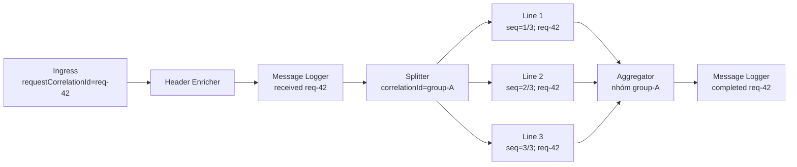

# Correlation ID trong log

Trong hệ thống tích hợp, một yêu cầu có thể đi qua nhiều `MessageChannel`, `Filter`, `Router`, `Transformer`, `Splitter`, `Aggregator` và cơ chế retry trước khi hoàn tất. Mỗi bước có thể ghi log riêng; nếu log chỉ chứa câu “đã xử lý đơn hàng”, người vận hành khó biết những dòng nào thuộc cùng một yêu cầu.

Bài này thuộc chương **Message logger** của module **SPRING_INTEGRATION_PATTERN**. Mục tiêu là thực hành Enterprise Integration Patterns với Spring Integration để xây dựng luồng thông điệp ít phụ thuộc, dễ mở rộng; đồng thời theo dõi các nhánh xử lý, lỗi và việc tương quan thông điệp bằng một mã định danh nhất quán.

Sau bài học, bạn có thể:

- Phân biệt mã theo dõi một yêu cầu xuyên suốt hệ thống với mã nhóm thông điệp mà `Aggregator` sử dụng.
- Gắn và duy trì mã theo dõi trong `MessageHeaders`; ghi log theo từng giai đoạn với `IntegrationFlow.log()` hoặc `LoggingHandler`.
- Đưa mã theo dõi vào MDC khi dùng logger thông thường, nhận diện giới hạn của MDC qua các ranh giới bất đồng bộ.
- Kiểm tra được log của các nhánh Router, Filter, Splitter, Aggregator, retry và error channel mà không để lộ dữ liệu nhạy cảm.

## 1. Vấn đề: các dòng log thuộc về yêu cầu nào?

Giả sử dịch vụ nhận một lệnh `ORD-42` gồm ba dòng hàng. Luồng xử lý có thể gồm:

1. Gateway nhận lệnh và chuyển thành `Message`.
2. Filter kiểm tra tính hợp lệ, Router chọn nhánh xử lý.
3. Splitter phát ba thông điệp con để xử lý từng dòng hàng.
4. Một nhánh gặp lỗi tạm thời và được retry.
5. Aggregator thu đủ kết quả trước khi phát trạng thái cuối.

Khi nhiều đơn hàng chạy đồng thời, các dòng log xen kẽ theo thời gian:

```text
INFO  Received order ORD-42
INFO  Processing item A
INFO  Received order ORD-43
WARN  Retrying item B
INFO  Order completed
```

Dòng “Retrying item B” và “Order completed” không cho biết chúng thuộc đơn nào. Nếu tất cả các bước đều ghi một `requestCorrelationId` ổn định, ta có thể lọc chính xác:

```text
INFO  event=received  requestCorrelationId=req-42 orderId=ORD-42
INFO  event=item     requestCorrelationId=req-42 lineNo=1
INFO  event=received  requestCorrelationId=req-43 orderId=ORD-43
WARN  event=retry    requestCorrelationId=req-42 lineNo=2 attempt=2
INFO  event=complete requestCorrelationId=req-42 result=ACCEPTED
```

`requestCorrelationId` ở đây là **quy ước của ứng dụng**, giúp tìm log từ đầu đến cuối yêu cầu. Spring Integration còn có một header `correlationId` với mục đích quan trọng khác: gom các thông điệp có liên hệ thành một nhóm.

## 2. Phân biệt các loại ID

| ID / metadata | Nguồn thường gặp | Ý nghĩa | Có nên dùng làm khóa log xuyên suốt? |
| --- | --- | --- | --- |
| `requestCorrelationId` | Header ứng dụng tự định nghĩa | Liên kết các sự kiện thuộc cùng một yêu cầu/đơn vị công việc | **Có**, nếu được duy trì qua các bước |
| `MessageHeaders.ID` (`messageId`) | Spring Messaging tạo cho từng `Message` | Định danh một đối tượng thông điệp; thông điệp mới có thể có ID mới | Không nên dùng làm khóa duy nhất của cả luồng |
| `IntegrationMessageHeaderAccessor.CORRELATION_ID` (`correlationId`) | Splitter, thành phần tạo sequence hoặc ứng dụng | Khóa nhóm để Aggregator/Resequencer tương quan các thông điệp | Hữu ích để theo dõi **nhóm**, nhưng không mặc nhiên ổn định xuyên toàn bộ luồng |
| `SEQUENCE_NUMBER` và `SEQUENCE_SIZE` | Các thành phần tạo sequence, đặc biệt Splitter | Vị trí và tổng số phần tử trong nhóm | Dùng **kèm** ID nhóm khi chẩn đoán |
| `traceId` / `spanId` | Hệ thống distributed tracing/observability | Liên kết các span và thao tác giữa những thành phần đã được instrument | Có ích để tra trace; không đồng nhất với correlation ID ứng dụng |
| `orderId` / `customerId` | Nghiệp vụ | Nhận diện thực thể nghiệp vụ, có thể được nhiều yêu cầu khác nhau sử dụng | Chỉ dùng làm trường bổ sung nếu phù hợp chính sách dữ liệu |

Điểm quan trọng: **Đừng tự gán `correlationId` của Spring Integration làm mã yêu cầu rồi giả định nó giữ nguyên qua mọi Splitter/Aggregator.** Đây là header mà framework và các chiến lược gom nhóm có thể dùng hoặc thay đổi theo ngữ cảnh. Để theo dõi yêu cầu xuyên luồng, ta dùng tên khác, chẳng hạn `requestCorrelationId`; để chẩn đoán một nhóm Splitter/Aggregator, ta ghi thêm `correlationId` và các số thứ tự.

Ví dụ, một yêu cầu `req-42` có thể được tách thành ba thông điệp. Cả ba đều mang `requestCorrelationId=req-42`, nhưng có `correlationId=group-A` cùng các `sequenceNumber` lần lượt là `1`, `2`, `3`. Khi luồng có nhiều tầng split/aggregate, mỗi tầng còn có ngữ cảnh nhóm riêng.

## 3. Đặt ID tại ranh giới đầu vào và truyền trong message

Một quy ước thực tế:

1. Tại HTTP controller, messaging gateway, consumer hoặc inbound adapter, đọc mã do hệ thống gọi truyền vào **nếu được phép**.
2. Kiểm tra độ dài, tập ký tự và nguồn tin cậy; nếu thiếu hoặc không hợp lệ, tạo UUID mới. Không sử dụng email, số điện thoại, token hoặc dữ liệu cá nhân làm mã theo dõi.
3. Ghi mã đã chuẩn hóa vào header ứng dụng `requestCorrelationId` trước khi đi vào luồng.
4. Giữ nguyên header đó qua các bước Transform/Route/Split; nếu tự tạo `Message` mới, chép lại các header cần thiết một cách chủ động.
5. Khi gửi sang dịch vụ hoặc broker khác, ánh xạ mã qua header/metadata phù hợp với giao thức và xác minh ở đầu nhận. Không giả định mọi adapter đều truyền mọi header.

Ví dụ chuẩn hóa một ID đầu vào bằng Java (quy tắc ký tự chỉ mang tính minh họa):

```java
import java.util.UUID;

static String normalizeCorrelationId(String candidate) {
    if (candidate != null && candidate.matches("[A-Za-z0-9._-]{1,64}")) {
        return candidate;
    }
    return UUID.randomUUID().toString();
}
```

Nếu hệ thống cần sự duy nhất do chính mình kiểm soát, hãy **luôn sinh ID mới tại ranh giới tin cậy**, đồng thời lưu mã đối tác ở một header khác để đối soát. Kiểm tra cú pháp không chứng minh ID bên ngoài là duy nhất hay đáng tin.

Sơ đồ dưới đây minh họa sự khác biệt giữa mã theo dõi yêu cầu và mã nhóm do Splitter tạo ra:



Trong sơ đồ, `req-42` và `group-A` là giá trị rút gọn để dễ đọc; ID thực tế có thể là UUID hoặc kiểu đối tượng khác.

## 4. Ví dụ Spring Integration Java DSL: ghi log mà không làm đổi luồng

Ví dụ dưới đây dùng Spring Integration Java DSL, SLF4J và một `DirectChannel`. Giả định ứng dụng đã cấu hình Spring Integration, Spring Context và logging. Đầu vào là một chuỗi đại diện cho đơn hàng để người học tập trung vào cơ chế correlation.

```java
import java.util.UUID;

import org.slf4j.Logger;
import org.slf4j.LoggerFactory;
import org.slf4j.MDC;
import org.springframework.context.annotation.Bean;
import org.springframework.context.annotation.Configuration;
import org.springframework.integration.channel.DirectChannel;
import org.springframework.integration.dsl.IntegrationFlow;
import org.springframework.integration.handler.LoggingHandler;
import org.springframework.messaging.MessageChannel;

@Configuration
public class OrderLogFlowConfig {

    public static final String REQUEST_ID = "requestCorrelationId";

    private static final Logger log =
            LoggerFactory.getLogger(OrderLogFlowConfig.class);

    @Bean
    public MessageChannel ordersInput() {
        return new DirectChannel();
    }

    @Bean
    public IntegrationFlow ordersFlow() {
        return IntegrationFlow.from("ordersInput")
                // Bổ sung ID khi message đầu vào chưa có header này.
                .enrichHeaders(h -> h.headerFunction(
                        REQUEST_ID, message -> UUID.randomUUID().toString()))

                // Logger của flow đọc trực tiếp header, không phụ thuộc MDC.
                .log(LoggingHandler.Level.INFO, "orders.flow", message ->
                        "event=received requestCorrelationId="
                                + message.getHeaders().get(REQUEST_ID)
                                + " messageId=" + message.getHeaders().getId())

                // Ví dụ một handler có log ứng dụng thông thường.
                .handle(message -> {
                    String requestId =
                            String.valueOf(message.getHeaders().get(REQUEST_ID));
                    try (MDC.MDCCloseable ignored =
                                 MDC.putCloseable("requestCorrelationId", requestId)) {
                        log.info("event=processed payloadType={}",
                                message.getPayload().getClass().getSimpleName());
                    }
                })
                .get();
    }
}
```

Ý nghĩa của từng chặng:

- `enrichHeaders(...headerFunction(...))` thêm header khi chưa có. Theo cấu hình mặc định của Header Enricher, header có sẵn **không bị ghi đè**; vì vậy phải chuẩn hóa đầu vào trước khi gửi vào `ordersInput`.
- `log(level, category, function)` tạo một điểm quan sát của luồng bằng logging operator (dựa trên Wire Tap/`LoggingHandler`). Đoạn mã chỉ chọn các trường cần ghi, không log toàn bộ payload và headers.
- `handle(...)` xử lý thông điệp. `MDC.putCloseable` đặt ID cho logger thông thường trong phạm vi khối `try` và xóa key khi thoát phạm vi, kể cả khi có ngoại lệ.
- `get()` hoàn tất định nghĩa `IntegrationFlow`; `handle` là consumer cuối trong ví dụ.

Bên gửi có thể đưa thông điệp vào kênh như sau (với biến `ordersInput` là `MessageChannel` được inject hoặc lấy từ Spring context):

```java
import org.springframework.messaging.support.MessageBuilder;

String trustedId = normalizeCorrelationId(incomingCorrelationId);
ordersInput.send(MessageBuilder.withPayload("order:ORD-42")
        .setHeader(OrderLogFlowConfig.REQUEST_ID, trustedId)
        .build());
```

Hai điểm kiểm tra nhanh: (1) log từ `orders.flow` có giá trị `requestCorrelationId` chính xác; (2) log từ `OrderLogFlowConfig` cũng có ID trong MDC **nếu** cấu hình định dạng log hiển thị MDC.

Với Spring Boot dùng Logback, có thể đưa trường MDC vào pattern, ví dụ:

```yaml
logging:
  pattern:
    level: "%5p [requestCorrelationId=%X{requestCorrelationId:-none}]"
```

Lưu ý: dòng `.log(...)` nằm ngoài phạm vi `try` của handler, nên nó ghi ID bằng cách truy cập **message header**. Pattern MDC chỉ hiển thị giá trị khi thread đang có key `requestCorrelationId`; không tự làm đầy giá trị cho mọi log phát sinh trong flow.

## 5. Ghi log hữu ích tại các Enterprise Integration Patterns

Một correlation ID có ích khi được ghi tại **các quyết định quan trọng**, kèm sự kiện, nhánh, kết quả và thời gian xử lý; ghi cùng một dòng ở mọi chặng chỉ làm tăng nhiễu.

| Thành phần | Sự kiện nên ghi | Trường hữu ích bên cạnh `requestCorrelationId` |
| --- | --- | --- |
| Gateway / inbound adapter | Nhận và xác thực đầu vào | `event=received`, `source`, `messageId` |
| Filter | Chấp nhận hoặc loại | `event=accepted/rejected`, `reasonCode` |
| Router | Quyết định chuyển nhánh | `event=routed`, `route=priority/standard` |
| Transformer | Chuyển đổi thành công/thất bại | `event=transformed`, `sourceType`, `targetType` |
| Splitter | Bắt đầu/tạo từng phần | `event=split`, `correlationId`, `sequenceNumber`, `sequenceSize` |
| Aggregator | Thu đủ nhóm hoặc hết thời hạn | `event=aggregated/timeout`, `correlationId`, `groupSize` |
| Retry / recoverer | Thử lại, hết số lần thử | `event=retry/exhausted`, `attempt`, `errorCode` |
| Error channel | Nhận và xử lý lỗi | `event=failed`, `errorType`, `failedMessageId` |

Với `Filter`, thông điệp bị loại có thể không đến logger đặt **sau** Filter. Nếu yêu cầu audit các quyết định loại bỏ, bố trí logging tại discard flow hoặc tại nơi quyết định. Với `Router`, có thể đặt logger ở từng nhánh để xác nhận nhánh thực tế.

Spring Integration cung cấp toán tử `.log(...)` để chèn điểm quan sát vào Java DSL; một cách khác là cấu hình logging channel adapter và Wire Tap. Cần kiểm soát mức log, category, tần suất và dữ liệu được phép ghi. Không bật log full message trên đường chứa thông tin nhạy cảm.

### Minh họa khi Splitter và Aggregator cùng xuất hiện

Spring Integration Splitter thường tự điền các header liên quan đến sequence, gồm `correlationId`, `sequenceNumber` và `sequenceSize`. Aggregator mặc định dựa vào `correlationId` để gom nhóm và thông tin sequence để quyết định khi nào có thể phát kết quả. Do đó, khi xử lý lỗi “Aggregator chờ mãi”, hãy kiểm tra ID nhóm, số thứ tự và tổng số phần tử trước khi chỉ nhìn request ID.

```text
INFO event=split-item requestCorrelationId=req-42 correlationId=group-A sequenceNumber=1 sequenceSize=3
INFO event=split-item requestCorrelationId=req-42 correlationId=group-A sequenceNumber=2 sequenceSize=3
WARN event=retry      requestCorrelationId=req-42 correlationId=group-A sequenceNumber=3 attempt=2
INFO event=split-item requestCorrelationId=req-42 correlationId=group-A sequenceNumber=3 sequenceSize=3
INFO event=aggregated requestCorrelationId=req-42 groupSize=3
```

Đây là log **minh họa**, không phải kết quả mặc định tự phát sinh từ Spring Integration. Bạn phải chủ động cấu hình những điểm log tương ứng. Giá trị `correlationId` có thể thay đổi qua các tầng split/aggregate; sau khi Aggregator phát kết quả, framework có thể gỡ thông tin sequence của tầng tương ứng. Vì thế, log từng nhánh **trước** Aggregator nếu cần đối chiếu phần tử.

Chú ý thêm: khi Splitter phát từ `Iterator`/`Iterable` mà framework không biết trước số lượng, `sequenceSize` có thể là `0`. Khi đó chiến lược release mặc định theo tổng số phần tử sẽ không đủ để tự xác định nhóm hoàn thành; cần thiết kế release/timeout phù hợp.

## 6. Correlation ID và MDC: hai cơ chế bổ sung nhau

**Header nằm trong `Message`; MDC nằm trong ngữ cảnh của thread.** Spring Integration có thể đi từ `DirectChannel` đồng bộ sang `ExecutorChannel`, `QueueChannel`, poller hay broker bên ngoài. Một handler ở thread khác không mặc nhiên nhận MDC của thread trước đó.

Quy trình dùng MDC an toàn:

1. Lấy `requestCorrelationId` từ header của message đang được xử lý.
2. Đặt vào MDC **ngay trong phạm vi thực thi** cần ghi log.
3. Dùng `try-with-resources` (hoặc `try/finally` với khôi phục trạng thái phù hợp) để dọn MDC sau khi xử lý; tránh để ID của yêu cầu trước “dính” vào thread trong pool.
4. Tại consumer/handler sau ranh giới bất đồng bộ, lấy lại ID từ header và đặt MDC mới. Nếu dùng tracing/observation instrumentation, cấu hình cơ chế truyền context theo thư viện đang triển khai.

Ví dụ sai về mặt giả định:

```java
MDC.put("requestCorrelationId", "req-42");
executor.execute(() -> log.info("async step")); // Không được giả định sẽ có req-42.
MDC.remove("requestCorrelationId");
```

Hãy gắn ID với công việc được chuyển giao và tạo scope MDC tại nơi công việc thực sự chạy. Chẳng hạn, khi consumer nhận `Message<?>` từ queue, gọi một hàm xử lý có khối `MDC.putCloseable` như ví dụ trước; điều này không phụ thuộc việc thread nào nhận message.

**Distributed tracing** là cơ chế khác. Với Micrometer Observation/Tracing, thông tin trace có thể được truyền qua message headers khi cấu hình observation cho channel và consumer phù hợp. Dùng `traceId` để điều tra các span xuyên dịch vụ; dùng `requestCorrelationId` để tra cứu vòng đời nghiệp vụ. Có thể ghi cả hai trường trong log nếu quy mô hệ thống cần.

## 7. Lỗi, retry và các nhánh không thành công

Trong xử lý bất đồng bộ, Spring Integration có thể gửi một `ErrorMessage` đến error channel thay vì ném ngoại lệ về caller. Payload của `ErrorMessage` là `Throwable`; với `MessagingException`, có thể truy cập thông điệp thất bại qua `getFailedMessage()` nếu thông tin đó có sẵn:

```java
import org.springframework.messaging.Message;
import org.springframework.messaging.MessagingException;
import org.springframework.messaging.support.ErrorMessage;

static Object findFailedRequestId(ErrorMessage errorMessage) {
    Throwable cause = errorMessage.getPayload();
    if (cause instanceof MessagingException messagingException) {
        Message<?> failed = messagingException.getFailedMessage();
        if (failed != null) {
            return failed.getHeaders().get("requestCorrelationId");
        }
    }
    return null; // Trường hợp không có failedMessage: cần nguồn metadata khác.
}
```

Đây là hàm minh họa để **trích ID**, chưa phải cấu hình một error flow hoàn chỉnh. Tùy vị trí lỗi và cách tạo `ErrorMessage`, `failedMessage` có thể không tồn tại hoặc không mang đủ headers. Vì vậy, nên thiết kế đường lỗi có metadata cần thiết và kiểm chứng bằng bài test gây lỗi thực tế.

Khi retry, hãy bảo đảm các lần thử của cùng công việc vẫn giữ `requestCorrelationId`, đồng thời ghi thêm số lần thử hoặc mã lỗi. Không dùng số lần retry làm ID, không tạo ID nghiệp vụ mới cho mỗi lần thử nếu mục tiêu là theo dõi một yêu cầu thống nhất.

## 8. Những điểm dễ mất hoặc nhầm correlation

| Hiện tượng | Nguyên nhân có thể gặp | Cách kiểm tra/khắc phục |
| --- | --- | --- |
| Log đầu có ID, log sau mất ID | Tạo `Message` mới nhưng không truyền header, header bị lọc, hoặc adapter không map header | Kiểm tra headers ở **hai phía** điểm chuyển; truyền có chọn lọc `requestCorrelationId` |
| Log `.log(...)` có ID nhưng `log.info(...)` không có | Chỉ chèn ID vào header, chưa đặt MDC ở handler hoặc pattern không hiển thị MDC | Đọc header tại handler, đặt MDC có scope, cấu hình pattern |
| Log đồng thời hiển thị nhầm ID | Thread pool tái sử dụng thread nhưng MDC không được dọn | Dọn/khôi phục MDC sau mỗi message; test nhiều yêu cầu xen kẽ |
| Aggregator không phát kết quả | Thiếu hoặc sai `correlationId`, `sequenceSize`, release strategy, timeout | In thông tin nhóm và sequence ngay trước Aggregator, rà soát chiến lược release |
| Tìm bằng `messageId` chỉ ra vài dòng | Message mới được tạo ở các bước tiếp theo | Dùng `requestCorrelationId` để tìm theo yêu cầu; giữ `messageId` để truy vết một message |
| Một ID lạ chứa ký tự xuống dòng hoặc dữ liệu nhạy cảm | Tin ngay header do bên ngoài cung cấp | Xác thực/chuẩn hóa input, hạn chế trường log, lọc dữ liệu nhạy cảm |
| Có trace nhưng không thấy ID nghiệp vụ | Trace context được truyền độc lập với custom header | Ghi riêng `traceId` và `requestCorrelationId`, cấu hình truyền cả hai theo mục tiêu |

Khi log trên hệ thống phân tán, nên dùng log có cấu trúc (JSON hoặc key-value) với tên trường thống nhất như `timestamp`, `level`, `service`, `event`, `requestCorrelationId`, `messageId`, `traceId`, `errorCode`. Tránh log nguyên payload, token, credentials hoặc headers không được phân loại.

## 9. Bài thực hành và tiêu chí xác minh

**Tình huống:** Gateway nhận hai yêu cầu `req-A` và `req-B` gần như đồng thời. `req-A` được Splitter tách thành ba phần; phần thứ hai thất bại lần đầu, được thử lại rồi hoàn tất. `req-B` bị Filter loại.

Thực hiện:

1. Tạo hoặc truyền `requestCorrelationId` ở đầu vào. Log `event=received` khi nhận mỗi yêu cầu.
2. Tại Filter, log `event=accepted` và `event=rejected` (kèm mã lý do) đúng nhánh. Xác minh `req-B` không xuất hiện ở nhánh xử lý tiếp theo.
3. Với `req-A`, log `correlationId`, `sequenceNumber`, `sequenceSize` tại mỗi phần sau Splitter; ghi rõ `attempt` của phần được retry.
4. Sau Aggregator, ghi `event=aggregated` và số phần tử đã gom. Kiểm tra cùng một `requestCorrelationId` xuất hiện ở tất cả các điểm phù hợp.
5. Chuyển một điểm xử lý sang executor/queue để kiểm tra lại cách đặt MDC; không để `req-A` và `req-B` lẫn vào log của nhau.
6. Cố tình ném một lỗi để quan sát error channel. Kiểm tra ID của message lỗi có xuất hiện trong log lỗi hay không, và bổ sung metadata nếu thiếu.

Một kết quả đạt yêu cầu phải cho phép trả lời rõ: **yêu cầu nào**, **đi nhánh nào**, **chia thành bao nhiêu phần**, **phần nào được retry**, **có gom đủ hay không**, **lỗi xuất hiện ở đâu**.

### Câu hỏi tự kiểm tra

1. Vì sao `message.getHeaders().getId()` không bảo đảm theo dõi được toàn bộ một luồng có nhiều Transformer và Splitter?
2. Vì sao nên phân biệt `requestCorrelationId` với `IntegrationMessageHeaderAccessor.CORRELATION_ID`?
3. Nếu log trong `ExecutorChannel` thiếu MDC, cần sửa ở đâu và vì sao?
4. Điều gì xảy ra khi Aggregator dùng release strategy theo `sequenceSize` nhưng Splitter không biết trước số lượng phần tử?
5. Làm thế nào để một ID đầu vào giúp tra cứu mà không tạo lỗ hổng log injection hoặc rò rỉ dữ liệu?

## 10. Tài liệu tham khảo

- Spring Integration Reference — [Logging Channel Adapter](https://docs.spring.io/spring-integration/reference/logging-adapter.html): cấu hình `LoggingHandler` và cách chọn nội dung log.
- Spring Integration Reference — [Java DSL `log()` operator](https://docs.spring.io/spring-integration/reference/dsl/java-log.html): hành vi của logging operator trong integration flow.
- Spring Integration Reference — [Splitter](https://docs.spring.io/spring-integration/reference/splitter.html) và [Aggregator](https://docs.spring.io/spring-integration/reference/aggregator.html): `correlationId`, thông tin sequence và chiến lược gom nhóm.
- Spring Integration Reference — [Message](https://docs.spring.io/spring-integration/reference/message.html): các header của `Message` và `IntegrationMessageHeaderAccessor`.
- Spring Integration Reference — [Metrics and Management](https://docs.spring.io/spring-integration/reference/metrics.html): observability và truyền observation context qua message.
- Spring Integration Reference — [Error Handling](https://docs.spring.io/spring-integration/reference/error-handling.html): error channel và `ErrorMessage`.

**Ghi nhớ:** mã theo dõi trong log chỉ thật sự hữu ích khi có ngữ nghĩa rõ, được truyền qua các bước của luồng, xuất hiện nhất quán tại những điểm cần quan sát và được kiểm chứng khi có lỗi hoặc đổi thread.
