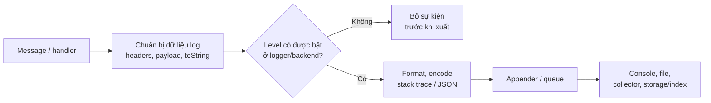
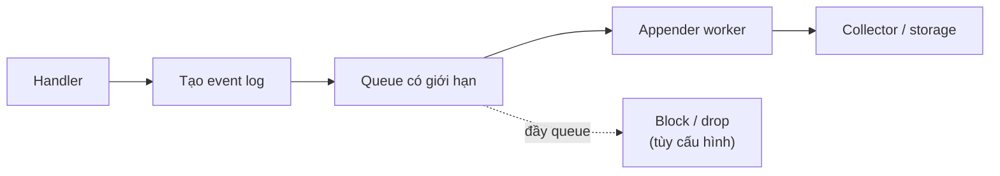

# Log level và chi phí tạo log

Một luồng Spring Integration có thể ghi log khi Gateway nhận yêu cầu, Filter quyết định loại hay giữ, Router chuyển nhánh, Transformer đổi dữ liệu, Splitter tách thông điệp, Aggregator gom nhóm và error channel tiếp nhận lỗi. Các log này giúp điều tra sự cố, nhưng mỗi dòng đều có chi phí xử lý, xuất dữ liệu và lưu trữ. Đặc biệt khi một yêu cầu sinh ra hàng trăm thông điệp con, log ở từng bước có thể lớn hơn nhiều so với lượng dữ liệu nghiệp vụ ban đầu.

Bài thuộc chương **Message logger** của module **SPRING_INTEGRATION_PATTERN**, tập trung vào việc triển khai Enterprise Integration Patterns bằng Spring Integration để tạo các luồng thông điệp ít phụ thuộc, dễ mở rộng. Việc chọn mức log và kiểm soát chi phí quan sát là một phần của thiết kế Router, Filter, Transformer, Splitter, Aggregator, Gateway, retry, error channel và correlation.

Sau khi học, bạn có thể:

- Chọn `ERROR`, `WARN`, `INFO`, `DEBUG`, `TRACE` theo **sự kiện và nhu cầu vận hành**, không dựa đơn thuần vào số lượng dòng log.
- Phân biệt việc **không xuất một dòng log** với việc **không tốn chi phí tạo dữ liệu cho dòng log**.
- Cấu hình mức log cho logger của ứng dụng và điểm `.log(...)` trong Spring Integration Java DSL.
- Ước lượng log volume khi có Splitter, Aggregator, retry hoặc luồng xử lý song song.
- Đo tác động thực tế đến độ trễ, CPU, GC, I/O và log pipeline, đồng thời giữ đủ thông tin để truy vết lỗi.

## 1. Log level là quyết định về mức độ quan trọng

Các hệ thống dựa trên SLF4J cùng backend như Logback hoặc Log4j2 thường sử dụng những mức log sau:

| Mức | Ý nghĩa thực hành | Ví dụ trong Spring Integration |
| --- | --- | --- |
| `ERROR` | Thất bại cần được xử lý hoặc điều tra; luồng không thể hoàn thành như kỳ vọng | Retry hết số lần, ErrorMessage không được recover, không thể ghi kết quả quan trọng |
| `WARN` | Bất thường có thể phục hồi hoặc có nguy cơ ảnh hưởng chức năng | Broker chập chờn, retry đang diễn ra, Aggregator chờ nhóm lâu bất thường |
| `INFO` | Sự kiện nghiệp vụ hoặc trạng thái đáng quan sát trong vận hành thông thường | Đã tiếp nhận yêu cầu, đã hoàn tất nhóm, đã xử lý một đơn quan trọng |
| `DEBUG` | Chi tiết giúp tìm nguyên nhân lỗi, thường bật có chọn lọc | Router chọn nhánh theo điều kiện nào, số thứ tự phần tử sau Splitter, header đã chuẩn hóa |
| `TRACE` | Diễn biến rất chi tiết, phù hợp khi khoanh vùng sự cố khó | Các bước nội bộ mức hạt nhỏ, diễn biến một message qua nhiều adapter |

Không phải tất cả sự kiện Filter loại bỏ đều là `WARN`: nếu việc loại bỏ nằm trong thiết kế, nên ghi `DEBUG`, dùng metric đếm hoặc ghi sự kiện nghiệp vụ riêng với mức phù hợp. Tương tự, một retry đơn lẻ có thể là `DEBUG`; `WARN` thường dành cho độ trễ hoặc tỷ lệ retry đáng chú ý.

**Quy tắc nền tảng:** một sự kiện được gắn mức log theo ý nghĩa của nó. Nếu tăng mức log chỉ để nhìn thêm thông tin khi điều tra, hãy chọn lọc theo category/luồng; đừng biến toàn bộ xử lý từng phần tử thành `INFO` vĩnh viễn.

### Mức log được lọc ở đâu?

Một thông điệp log có thể đi qua nhiều lớp:



Sơ đồ là mô hình tư duy về chi phí, không phải thứ tự gọi hàm của mọi thư viện. **Mọi biểu thức Java dùng để tạo đối số của lời gọi logger đã được tính trước khi phương thức logger nhận được các đối số**, trừ khi ta chủ động trì hoãn bằng điều kiện hoặc supplier. Logger/backend có thể chặn các bước format, ghi I/O và indexing khi mức bị tắt, nhưng không đảo ngược được công việc ứng dụng đã làm trước đó.

Trong Spring Integration, mức được chọn tại `LoggingHandler`/`.log(...)` và cấu hình của backend theo category đều liên quan đến việc một bản ghi có được xuất hay không. Không nên giả định việc giảm log level ở backend sẽ loại bỏ mọi chi phí đánh giá biểu thức của một cấu hình logging bất kỳ; hãy xác minh theo thư viện và phiên bản đang chạy.

## 2. Chi phí tạo log đến từ đâu?

Có thể chia chi phí thành năm nhóm:

1. **Tạo dữ liệu:** đọc headers, tính toán chuỗi, chạy `toString()`, serialize JSON/XML, chuẩn hóa exception hoặc tạo bản sao payload.
2. **Tạo bản ghi:** chọn category và level, format placeholders, lấy thông tin thời gian/thread, đưa MDC hoặc trace context vào output.
3. **Truyền bản ghi:** ghi vào stdout/file, đẩy vào queue, chuyển qua mạng đến collector.
4. **Xử lý ở hệ thống log:** parse, index các trường, lưu trữ, nén, giữ lại theo chính sách retention.
5. **Tác động gián tiếp:** cấp phát bộ nhớ, GC, tranh chấp tài nguyên, chờ I/O, đầy queue, làm tăng độ trễ xử lý message.

Chi phí không chỉ tăng theo **số request**, mà còn theo **số message trung gian** và **số điểm log trên mỗi message**. Với một Splitter phát `N` phần tử và mỗi phần tử đi qua `K` logger, phần log của nhánh tách thường tăng xấp xỉ `N × K` bản ghi trên mỗi yêu cầu; retry làm số bản ghi tăng tiếp.

### Ví dụ: log bị tắt nhưng biểu thức vẫn chạy

```java
// Dễ gây tốn CPU: hàm serialize chạy trước khi gọi logger.
log.debug("event=transformed payload={}",
        expensiveJsonSerialization(message.getPayload()));

// Tương tự: phép nối chuỗi thực hiện trước lời gọi logger.
log.debug("event=transformed " + buildExpensiveSummary(message));
```

Ngay cả khi `DEBUG` đang bị tắt, Java vẫn đánh giá lời gọi `expensiveJsonSerialization(...)` và `buildExpensiveSummary(...)` để truyền đối số cho `debug(...)`. Nếu đối số khởi tạo một chuỗi lớn, công việc này có thể tạo allocation và GC đáng kể.

Cách thông dụng hơn:

```java
// Với đối số đơn giản: cơ chế placeholder tránh format sớm.
log.debug("event=transformed messageId={} payloadType={}",
        message.getHeaders().getId(),
        message.getPayload().getClass().getSimpleName());

// Với biểu thức tốn kém: kiểm tra trước khi tính.
if (log.isDebugEnabled()) {
    String summary = expensiveJsonSerialization(message.getPayload());
    log.debug("event=transformed summary={}", summary);
}
```

Placeholder `{}` thường hoãn định dạng/toString của **đối tượng đã truyền** cho đến khi backend thực sự xử lý bản ghi, nhưng không hoãn việc đánh giá các biểu thức tạo đối số. Ví dụ, nếu viết `log.debug("{}", expensiveJsonSerialization(payload))`, hàm serialize vẫn được chạy trước.

Với **SLF4J 2.x** có thể dùng Fluent API với supplier để chỉ tính toán chi tiết khi mức phù hợp:

```java
log.atDebug()
        .addArgument(() -> expensiveJsonSerialization(message.getPayload()))
        .log("event=transformed summary={}");
```

Đoạn trên đòi hỏi phiên bản SLF4J hỗ trợ Fluent API; nếu dự án đang dùng SLF4J 1.x, hãy dùng `isDebugEnabled()`. Supplier phải thuần về mặt logic: không sửa dữ liệu nghiệp vụ và không phụ thuộc vào việc logger chắc chắn gọi nó.

### Khi nào nên format payload?

Với mục tiêu điều tra luồng, thông thường có thể log `messageId`, `requestCorrelationId`, `route`, `payloadType`, `elapsedMs` và `errorCode`. Ghi nguyên `Message<?>` hoặc toàn bộ payload có thể gây cả ba vấn đề: tốn chi phí serialize, tăng kích thước log và vô tình lộ thông tin nhạy cảm.

Đặc biệt với payload lớn hoặc có cấu trúc lồng nhau, `toString()` có thể tốn nhiều thời gian, đôi khi kích hoạt lazy loading hoặc code tùy chỉnh. Không mặc định đưa mọi header vào log vì headers có thể chứa token, thông tin định tuyến riêng, hoặc dữ liệu người dùng.

## 3. Ghi log trong Spring Integration Java DSL

Spring Integration cho phép thêm điểm ghi log qua toán tử `.log(...)`. Có thể truyền mức log, category và hàm tính nội dung cần ghi. Ví dụ sau chỉ log metadata, không xuất toàn bộ payload.

```java
import org.slf4j.Logger;
import org.slf4j.LoggerFactory;
import org.springframework.context.annotation.Bean;
import org.springframework.context.annotation.Configuration;
import org.springframework.integration.channel.DirectChannel;
import org.springframework.integration.dsl.IntegrationFlow;
import org.springframework.integration.handler.LoggingHandler;
import org.springframework.messaging.MessageChannel;

@Configuration
class OrderLoggingFlowConfig {

    private static final Logger log =
            LoggerFactory.getLogger(OrderLoggingFlowConfig.class);

    @Bean
    MessageChannel ordersInput() {
        return new DirectChannel();
    }

    @Bean
    IntegrationFlow ordersFlow() {
        return IntegrationFlow.from("ordersInput")
                .log(LoggingHandler.Level.DEBUG, "demo.orders.flow", m ->
                        "event=received"
                                + " messageId=" + m.getHeaders().getId()
                                + " requestCorrelationId="
                                + m.getHeaders().getOrDefault(
                                        "requestCorrelationId", "unknown"))
                .filter(String.class, payload -> !payload.isBlank())
                .transform(String.class, String::trim)
                .log(LoggingHandler.Level.INFO, "demo.orders.flow", m ->
                        "event=accepted"
                                + " messageId=" + m.getHeaders().getId()
                                + " payloadType=" + m.getPayload().getClass().getSimpleName())
                .handle(m -> {
                    log.debug("event=handled messageId={}",
                            m.getHeaders().getId());
                })
                .get();
    }
}
```

Ở đây:

- Logger `demo.orders.flow` là category dành cho các điểm quan sát trong flow. Dễ chỉnh mức log cho riêng luồng này.
- Điểm `DEBUG` ghi nhận message đầu vào và mã theo dõi (nếu có) để điều tra. Điểm `INFO` chỉ xuất hiện khi message vượt qua Filter.
- `Filter` loại bỏ chuỗi rỗng hoặc trắng; nếu cần theo dõi cả thông điệp bị loại, hãy thiết kế `discardFlow`/discard channel hoặc metric cho nhánh đó.
- Điểm `.log(...)` không thay thế message business logic; nó là điểm quan sát. Handler cuối minh họa logger SLF4J thông thường.
- Trong một flow có nhiều mức log, số bản ghi thực tế phụ thuộc vào đường đi và cấu hình ngưỡng logger.

Ví dụ dùng Spring Boot với `application.yml`:

```yaml
logging:
  level:
    root: INFO
    org.springframework.integration: WARN
    demo.orders.flow: INFO
    com.example.orders: INFO
```

Ở cấu hình trên, các bản ghi `INFO` từ category `demo.orders.flow` được phép xuất, còn bản ghi `DEBUG` trong cùng category bị chặn. Để điều tra luồng cụ thể:

```yaml
logging:
  level:
    demo.orders.flow: DEBUG
```

Đây là **hai cấu hình thay thế nhau**, không phải hai khối cần đặt liên tiếp. Nếu muốn ghi cả `log.debug(...)` trong handler, phải bật `DEBUG` cho category của class handler nữa, ví dụ `com.example.orders` (tùy package thực tế). Cấu hình `logging.level` trên là cơ chế của Spring Boot; ứng dụng không dùng Spring Boot cần cấu hình Logback/Log4j2 tương ứng.

Khi cần bật tạm thời log để khoanh vùng sự cố, hệ thống có thể dùng cấu hình logging runtime, chẳng hạn Spring Boot Actuator `loggers` endpoint nếu đã được kích hoạt và bảo vệ đúng cách. Ghi rõ thời điểm bật/tắt và khôi phục ngưỡng ban đầu sau khi điều tra.

### Logging operator so với logger thủ công

| Tình huống | Công cụ thường phù hợp | Lưu ý về chi phí |
| --- | --- | --- |
| Quan sát message tại một mốc trong IntegrationFlow | `.log(level, category, expression)` / `LoggingHandler` | Không log payload toàn bộ; theo dõi số lần message đi qua mốc |
| Log kết quả logic bên trong service/handler | `org.slf4j.Logger` | Guard phép tính đắt đỏ; dùng placeholders |
| Ghi chi tiết ngữ cảnh xuyên nhiều thread | Message headers kết hợp MDC có scope | MDC không tự truyền theo thread; phải đưa ID vào context ở nơi xử lý |
| Theo dõi số lượng message, tỷ lệ lỗi, thời gian xử lý | Micrometer metrics/observation | Metric có tính gộp, thường tiết kiệm hơn một dòng log cho mỗi message |

Logging operator có thể dùng Wire Tap/LoggingHandler để quan sát luồng. Bất kể cơ chế cụ thể, nên coi **mỗi điểm log** là một phần của thiết kế lưu lượng và đo hiệu ứng trong môi trường thực tế.

## 4. Số lượng log tăng thế nào theo từng pattern?

Bảng sau minh họa nên ghi gì ở mức thường trực và những chi tiết chỉ bật khi điều tra:

| Pattern | Log vận hành có ích | Log chi tiết khi điều tra | Nguy cơ tăng số lượng |
| --- | --- | --- | --- |
| Gateway | Nhận yêu cầu quan trọng, kết quả lỗi | Header định tuyến đã được làm sạch | Một bản ghi trên mỗi request |
| Filter | Lý do loại bất thường, số lượng reject qua metric | Điều kiện lọc, mã lý do từng message | Tăng mạnh nếu phần lớn message bị loại là bình thường |
| Router | Chuyển sang nhánh quan trọng bất thường | Từng quyết định chọn nhánh | Nhiều nhánh + nhiều bước có thể nhân số dòng |
| Transformer | Lỗi ánh xạ/validate | Kiểu dữ liệu nguồn/đích, schema version | Serialize đầu vào/đầu ra gây chi phí lớn |
| Splitter | Bắt đầu/kết thúc tách theo nhóm, số phần tử | Mỗi phần với `correlationId`, `sequenceNumber` | **Một request trở thành N message** |
| Aggregator | Phát đủ nhóm, timeout, partial group | Kích thước và tình trạng từng nhóm | Group chờ lâu có thể tạo nhiều sự kiện nếu log theo mỗi lần cập nhật |
| Retry | Hết retry, số lần thử bất thường | Mỗi attempt và loại lỗi | Số lần retry × số phần tử |
| Error channel | Sự cố cuối cùng, mã lỗi và nhóm liên quan | Stack trace có kiểm soát, metadata lỗi | Stack trace lớn và lỗi lặp lại làm phình log |

**Correlation ID** đặc biệt có ích khi giảm số log: thay vì in payload ở mọi chặng, gắn `requestCorrelationId` của ứng dụng vào các sự kiện có giá trị, rồi dùng mã đó để truy theo các bước. Phân biệt mã theo dõi yêu cầu này với `correlationId` mà Spring Integration sử dụng cho nhóm Splitter/Aggregator. Log chi tiết nhóm thêm `sequenceNumber`/`sequenceSize` khi cần.

Một nguyên tắc khác là đặt logger **sau điểm quyết định** nếu chỉ cần biết kết quả. Ví dụ Filter loại một message thì logger sau Filter sẽ không nhận message đó; nếu cần quan sát nhánh loại, phải đo/log tại discard flow. Không tăng log level để bù cho vị trí đặt logger không đúng.

## 5. Tính thử log volume và chi phí lưu trữ

Một mô hình ước lượng ban đầu:

\[
V_{\text{ngày}} = R \times E \times B \times 86\,400
\]

Trong đó:

- `R`: số message hoặc request đi qua các điểm log trong một giây;
- `E`: số sự kiện log trung bình trên mỗi đơn vị vừa chọn (nếu R là request/s thì tính theo log/request; nếu R là message/s thì tính theo log/message);
- `B`: số byte trung bình mỗi bản ghi sau khi encode;
- `V`: byte log tạo ra trong một ngày, **trước** compression/index replication/overhead của hệ thống lưu trữ.

Ví dụ cùng một hệ thống có 1.000 request/s, mỗi request tạo trung bình bốn bản ghi, mỗi bản ghi khoảng 500 byte:

```text
1.000 request/s × 4 log/request × 500 B/log
= 2.000.000 B/s ≈ 2 MB/s
= 172.800.000.000 B/ngày ≈ 172,8 GB/ngày
= 5.184 GB trong 30 ngày (chưa tính overhead)
```

Nếu request sau Splitter sinh mười message con và ta thêm một dòng `DEBUG` cho mỗi message con:

```text
1.000 request/s × 10 log/request × 500 B/log
= 5 MB/s bổ sung
≈ 432 GB/ngày bổ sung nếu luôn bật DEBUG
```

Các con số là **ví dụ giả định để luyện cách tính**, không phải benchmark của Spring Integration. Kích thước thực sẽ phụ thuộc JSON, độ dài stack trace, header, mã hóa, thời gian lưu, cách batch và số bản sao ở log pipeline.

Ngoài dung lượng lưu trữ, cần theo dõi `events/s`, bytes/s từ appender, số bản ghi bị drop, bộ nhớ queue, CPU, GC và độ trễ xử lý. Một lỗi lặp 1.000 lần/s kèm stack trace lớn có thể tốn tài nguyên hơn nhiều so với hàng nghìn INFO metadata ngắn.

### Tránh đếm sai số lượng

- Với Router, một request đi một nhánh thông thường; nếu dùng publish-subscribe hoặc fan-out thì một message có thể xuất hiện ở nhiều handler.
- Với Splitter, tính log theo số **message con** và các tầng splitter lồng nhau; đừng chỉ nhân số request gốc.
- Với retry, đếm cả attempt thất bại và attempt thành công. Nếu một lỗi phát sinh log tại handler, advice và error channel, một attempt có thể sinh nhiều dòng cùng nội dung.
- Với Aggregator, phân biệt log khi **nhận từng phần** với log khi **phát kết quả**.
- Khi scale nhiều instance, tính tổng lưu lượng toàn cụm và lưu ý collector có thể thêm bản sao, metadata và chỉ mục.

Chi phí tiền bạc có thể ước lượng theo lượng ingest, storage và retention theo bảng giá của hệ thống thực tế. Không nên lấy số GB/ngày nhân trực tiếp với một đơn giá giả định nếu pipeline còn tính phí theo số event, index hoặc truy vấn.

## 6. Ghi log đồng bộ, bất đồng bộ và ảnh hưởng độ trễ

Một logger đồng bộ có thể khiến thread xử lý message phải chờ thao tác append (tùy backend và appender). Với `DirectChannel`, handler và phần lớn các bước đồng bộ chạy ngay trên thread gửi; I/O logging chậm có thể kéo dài thời gian xử lý request.

Async appender giảm thời gian chờ ghi đích trong luồng chính bằng cách đưa log vào queue, nhưng **không loại bỏ** chi phí tạo dữ liệu và enqueue. Nó còn tạo thêm CPU/memory và một quyết định vận hành: khi queue đầy, hệ thống nên block, bỏ bớt các mức thấp, hay từ chối ghi? Hành vi cụ thể tùy Logback/Log4j2 và cấu hình.



Nếu log mang tính audit bắt buộc, không thể mặc định chấp nhận cơ chế drop của async appender. Cần có cơ chế bền vững, chiến lược retry/recovery và mức đảm bảo riêng; log quan sát thông thường và audit nghiệp vụ có yêu cầu khác nhau.

### Phân biệt độ trễ của từng lớp

- `.log(...)` ở các channel đồng bộ có thể làm tăng xử lý trước khi message đến bước tiếp theo.
- `ExecutorChannel` chuyển xử lý sang thread khác; vẫn phải trả chi phí log trên thread nhận message và tính toán context lại nếu dùng MDC.
- Poller/`QueueChannel` tách thời điểm enqueue và xử lý; đo độ trễ tổng từ đầu vào đến kết quả thay vì chỉ đo thời gian trong một handler.
- Khi mạng hoặc collector chậm, queue và retry của log pipeline có thể ảnh hưởng tài nguyên mà ứng dụng nghiệp vụ cũng dùng.

Không thể khẳng định “async logging luôn nhanh hơn” bằng một con số cố định: kết quả phụ thuộc backend, kích thước event, queue, thiết bị ghi, CPU và tỷ lệ log bật.

## 7. Chiến lược giảm chi phí nhưng vẫn quan sát được

**Chọn sự kiện thay vì ghi mọi bước.** Giữ INFO cho các cột mốc quan trọng và lỗi cần thiết; bật DEBUG theo category khi điều tra. Đối với luồng có throughput cao, metric đếm tổng số xử lý/thất bại và histogram độ trễ thường hiệu quả hơn in một dòng log cho từng message.

**Ghi metadata tối thiểu.** Với log luồng, ưu tiên `event`, `service`, `requestCorrelationId`, `messageId`, `route`, `errorCode`, `elapsedMs`. Log đối tượng lớn chỉ khi thật sự cần và đã được giới hạn kích thước, phân loại dữ liệu, che thông tin nhạy cảm. Không ghi access token, secret, dữ liệu cá nhân hoặc toàn bộ message headers không kiểm soát.

**Giảm log lặp lại có chủ đích.** Có thể sampling những sự kiện thành công thường gặp hoặc rate-limit các cảnh báo lặp cùng nguyên nhân. Tuy nhiên, nếu lấy mẫu 1% mà không ghi rõ tỷ lệ, không thể dùng số log thu được để suy trực tiếp số message đã xử lý. Với lỗi nghiêm trọng, audit bắt buộc hoặc tình huống cần điều tra đầy đủ, chính sách lấy mẫu phải được đánh giá riêng.

**Thiết kế correlation đủ tốt.** Giữ mã theo dõi yêu cầu qua Router, Filter, Transformer, Splitter, Aggregator và error flow. Ở tầng Splitter, log nhóm và sequence tại điểm điều tra. Có thể kết hợp distributed tracing để hiểu các span, nhưng không thay thế log nghiệp vụ ở các điểm có quyết định.

**Giới hạn độ chi tiết và thời gian lưu.** Đặt một thời gian bật DEBUG/TRACE phục vụ sự cố, giám sát log volume sau khi bật, rồi khôi phục ngưỡng. Quy định retention và quyền truy cập phù hợp với giá trị vận hành của từng nhóm log.

## 8. Chẩn đoán một số vấn đề thực tế

| Dấu hiệu | Giả thuyết cần kiểm chứng | Hành động |
| --- | --- | --- |
| Tắt DEBUG nhưng CPU vẫn cao | Code serialize/log summary nằm trong đối số logger trước khi kiểm tra level | Tìm hàm tạo chuỗi tốn kém, thêm guard/supplier, đo lại allocation |
| CPU/GC tăng sau khi thêm `.log(...)` | Log nhiều message con, hàm log expression đắt, backend format/encode | Đếm events/s theo mốc, kiểm tra payload logging và mức cấu hình |
| Chuyển sang async appender nhưng log bị thiếu | Queue đầy, chính sách discard hoặc appender lỗi | Kiểm tra queue/drop metrics và chính sách ghi, phân loại event quan trọng |
| Log của Splitter quá nhiều | Ghi INFO ở từng phần tử trong khi N rất lớn | Chỉ giữ INFO khi kết thúc nhóm; dùng DEBUG có chọn lọc cho từng phần |
| Có nhiều stack trace trùng | Cùng exception được log ở handler, advice, error channel | Xác định một điểm ghi lỗi cuối, các điểm khác ghi sự kiện ngắn hoặc metrics |
| Log không khớp request sau khi đổi thread | Chỉ dùng MDC của thread trước hoặc mất header correlation | Truyền ID bằng message header, tạo scope MDC khi xử lý ở thread mới |
| Không nhìn thấy log của Filter loại message | Logger đặt sau Filter, message đã bị discard | Đưa quan sát vào discard flow/counter |
| Collector tăng phí đột ngột | Thay đổi level, deploy thêm điểm log, retry loop, tăng request/s | So sánh events/s, bytes/s và category trước/sau deploy |

Trong Spring Integration, bật log framework `org.springframework.integration` ở `TRACE` thường tạo lượng thông tin rất lớn. Nếu vấn đề nằm trong một flow của ứng dụng, ưu tiên tăng level cho category của flow trước. Khi phải tăng log cho framework, chỉ bật trong khoảng thời gian cần thiết và quan sát tài nguyên.

## 9. Bài thực hành: đo chi phí trước và sau

**Tình huống:** dịch vụ nhận nhiều đơn hàng qua Gateway, dùng Filter để loại đầu vào rỗng, Router chọn nhánh, Splitter tạo nhiều dòng hàng, Aggregator tổng hợp, và retry một nhánh có lỗi tạm thời. Mục tiêu là phân biệt lợi ích điều tra và chi phí của ba chiến lược logging.

Chuẩn bị cùng một bộ message đầu vào và một tập kịch bản có lỗi kiểm soát; giữ cùng cấu hình JVM, mức tải, số instance, backend và thời gian chạy khi so sánh.

1. **Cấu hình A — INFO tối thiểu.** Chỉ ghi sự kiện nhận yêu cầu, hoàn tất nhóm và lỗi cuối. Log metadata ngắn và request correlation ID.
2. **Cấu hình B — DEBUG theo từng phần tử.** Thêm log khi Router chọn nhánh, Splitter phát mỗi message con, retry và Aggregator nhận từng phần. Bật DEBUG cho category của flow.
3. **Cấu hình C — chi phí khi DEBUG bị tắt.** Giữ các điểm log DEBUG như B nhưng tắt mức DEBUG. Bổ sung một phép xây dựng summary lớn vào đối số của logger để quan sát chi phí tạo dữ liệu sớm; sau đó thêm guard/supplier và đo lại trong cùng điều kiện.

Quan sát ít nhất:

- Số message đã xử lý và số sự kiện log trên mỗi message/request.
- Throughput (message/s), độ trễ `p50`/`p95`/`p99` từ đầu vào đến kết quả.
- CPU, allocation/GC, kích thước log theo byte, mức sử dụng queue và bản ghi bị drop (nếu có).
- Khả năng trả lời câu hỏi: “Yêu cầu nào đi nhánh nào, phần tử nào retry, nhóm nào hoàn tất, lỗi ở đâu?” thông qua log được giữ lại.

Tính số log kỳ vọng dựa trên số yêu cầu, số phần tử Splitter và retry trước khi chạy. Sau khi chạy, đối chiếu con số thực tế với ước lượng và tìm nguồn chênh lệch (chẳng hạn log trong discard flow hay retry advice).

Một bảng kết quả tham khảo để tự điền:

| Thước đo | A: INFO ít sự kiện | B: DEBUG mỗi phần tử | C: DEBUG tắt, đo trước/sau guard |
| --- | --- | --- | --- |
| Events/s | Đo thực tế | Đo thực tế | Đo thực tế |
| Bytes/s | Đo thực tế | Đo thực tế | Đo thực tế |
| CPU và allocation | Đo thực tế | Đo thực tế | Đo trước/sau guard |
| `p95` latency | Đo thực tế | Đo thực tế | Đo thực tế |
| Độ đầy queue/drop | Đo thực tế | Đo thực tế | Đo thực tế |
| Khả năng tra cứu một yêu cầu | Kiểm chứng | Kiểm chứng | Kiểm chứng |

Không dùng con số giả định ở mục 5 làm kết quả benchmark. Cũng không nên kết luận riêng DEBUG là nguyên nhân nếu giữa các lần đo có thay đổi workload, collector, network hoặc tình trạng JVM.

### Kiểm tra hành vi tạo dữ liệu khi tắt DEBUG

Đoạn Java sau minh họa một phép kiểm thử nhỏ cho logger SLF4J, không phụ thuộc việc có kết nối hệ thống log tập trung:

```java
import java.util.concurrent.atomic.AtomicInteger;
import org.slf4j.Logger;

static String expensiveSummary(AtomicInteger calls) {
    calls.incrementAndGet();
    return "some summary";
}

static void unsafeDebug(Logger logger, AtomicInteger calls) {
    logger.debug("summary={}", expensiveSummary(calls));
}

static void guardedDebug(Logger logger, AtomicInteger calls) {
    if (logger.isDebugEnabled()) {
        logger.debug("summary={}", expensiveSummary(calls));
    }
}
```

Khi `DEBUG` bị tắt, `unsafeDebug` **vẫn** tăng `calls` thêm một, còn `guardedDebug` không tăng. Đây là tính chất đánh giá đối số của Java, không phải số đo hiệu năng và không cần giả định gì về implementation của Spring Integration.

## 10. Câu hỏi tự kiểm tra

1. Vì sao `log.debug("payload={}", serialize(payload))` vẫn có thể tốn CPU khi DEBUG bị tắt? Hãy đưa ra hai cách sửa.
2. Tại sao `ERROR` không phải mức thích hợp cho mọi message bị Filter loại?
3. Khi một Splitter tạo 20 phần tử và mỗi phần tử đi qua ba điểm log, số bản ghi có thể tăng thế nào?
4. Nếu cần theo dõi một yêu cầu xuyên Gateway, Router, Splitter, Aggregator và error channel, nên ghi những ID nào và ở đâu?
5. Async appender làm giảm loại chi phí nào, và có thể đánh đổi điều gì khi queue đầy?
6. Nếu bật DEBUG xong chi phí storage tăng gấp nhiều lần, bạn sẽ đo những chỉ số nào trước khi thay đổi code?
7. Khi log bị lấy mẫu, tại sao không thể dùng số dòng log để kết luận trực tiếp số yêu cầu đã xử lý?

## 11. Tài liệu tham khảo

- [Spring Integration — Logging Channel Adapter](https://docs.spring.io/spring-integration/reference/logging-adapter.html): cấu hình `LoggingHandler` và cách ghi nội dung message.
- [Spring Integration — Java DSL `log()`](https://docs.spring.io/spring-integration/reference/dsl/java-log.html): điểm log trong integration flow.
- [Spring Integration — Message](https://docs.spring.io/spring-integration/reference/message.html): cấu trúc message và headers.
- [Spring Boot — Logging](https://docs.spring.io/spring-boot/reference/features/logging.html): cấu hình logger/category và mức log.
- [SLF4J Manual](https://www.slf4j.org/manual.html): placeholder, mức log, Fluent API và supplier.
- [Logback — Appenders](https://logback.qos.ch/manual/appenders.html): hành vi appender, AsyncAppender và giới hạn queue.
- [OWASP — Logging Cheat Sheet](https://cheatsheetseries.owasp.org/cheatsheets/Logging_Cheat_Sheet.html): thông tin nên/không nên ghi và cân bằng chất lượng log với an toàn.

**Điểm cần nhớ:** log level chỉ quyết định phần sự kiện được xuất sau khi qua bộ lọc; chi phí tạo đối số trước lời gọi logger vẫn do code ứng dụng quyết định. Với Spring Integration, hãy tính cả số message con, retry và các nhánh xử lý khi đặt điểm log, ưu tiên metadata ngắn và đo tác động bằng workload thực.
