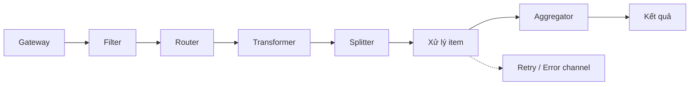

# Lọc hoặc che dữ liệu nhạy cảm

Spring Integration thường vận chuyển payload chứa email, số điện thoại, thông tin đơn hàng, token truy cập hoặc dữ liệu nội bộ. Khi điều tra Router, Filter, Transformer, Splitter, Aggregator, Gateway, retry hay error channel, lập trình viên dễ có xu hướng ghi toàn bộ message. Cách này giúp xem trạng thái nhanh nhưng cũng khiến bí mật xuất hiện trong console, file log, hệ thống thu thập tập trung và công cụ giám sát.

Bài thuộc chương **Message logger** của module **SPRING_INTEGRATION_PATTERN**. Trong quá trình học Enterprise Integration Patterns với Spring Integration để xây dựng luồng thông điệp ít phụ thuộc, dễ mở rộng, yêu cầu quan sát từng nhánh phải đi cùng việc kiểm soát dữ liệu được xuất ra log.

Sau bài học, bạn có thể phân loại trường nhạy cảm, xây dựng bản ghi log theo danh sách cho phép, che hoặc giả danh hóa giá trị có chủ đích, ghi metadata an toàn trong Java DSL và kiểm thử các đường log thông thường lẫn đường lỗi.

## 1. Rủi ro khi ghi toàn bộ message

Hệ thống xử lý một đơn hàng qua nhiều bước:



Một câu lệnh ngắn như:

```java
log.debug("incoming message={}", message);
```

có thể làm lộ cả payload và `MessageHeaders` qua `toString()`, tùy kiểu message và đối tượng payload. Sau khi được phát, bản ghi còn có thể đi qua stdout, sidecar/agent, hàng đợi, collector, hệ thống indexing và bản sao lưu; mỗi nơi có cách phân quyền và lưu trữ riêng.

Không chỉ logger tự viết mới có rủi ro. Các vị trí cần rà soát còn gồm `IntegrationFlow.log()`, `LoggingHandler`, Wire Tap, logger HTTP/broker, discard flow, retry advice, exception handler, error channel, MDC và tracing exporter.

### Phân loại dữ liệu trước khi ghi

| Nhóm | Ví dụ | Chính sách mặc định |
| --- | --- | --- |
| Bí mật truy cập | Password, token, API key, cookie phiên, private key | **Không ghi**, kể cả một phần |
| Dữ liệu xác thực/thanh toán | OTP, CVV, số thẻ đầy đủ, credentials | **Không ghi** |
| Dữ liệu cá nhân | Email, số điện thoại, địa chỉ, định danh cá nhân | Bỏ khỏi log; chỉ che khi có nhu cầu và quyền truy cập phù hợp |
| Nội dung nghiệp vụ riêng | Giá hợp đồng, ghi chú đơn hàng, nội dung hồ sơ | Chỉ xuất metadata được duyệt |
| Trường kỹ thuật đã kiểm soát | `event`, `messageId`, `route` thuộc enum, `itemCount`, `durationMs` | Có thể ghi với kiểu và độ dài được xác minh |
| ID tương quan | `requestCorrelationId` do ứng dụng cấp | Có thể ghi nếu không mang thông tin cá nhân/bí mật |

Tên trường không tự quyết định tính an toàn. Chẳng hạn, `customerId` hoặc `accountId` vẫn có thể là dữ liệu nhạy cảm; đánh giá dựa trên mục đích, quyền truy cập, thời hạn lưu và chính sách bảo vệ dữ liệu.

## 2. Lựa chọn chiến lược bảo vệ

### 2.1. Loại bỏ trường không cần thiết

Đây là lựa chọn mặc định. Thay vì ghi payload đơn hàng, tạo một bản ghi tối thiểu với dữ liệu phục vụ điều tra:

```text
KHÔNG NÊN:
event=received email=an@example.com phone=0901234567
authorization=Bearer eyJ... note="Địa chỉ giao hàng riêng"

NÊN:
event=order_received requestCorrelationId=req_42
messageId=6d5dc7c3-4066-4aa8-a394-3970d6789acd itemCount=3
```

Một logger được kiểm soát vẫn cho phép xác định yêu cầu nào, đã qua bước nào, bao nhiêu phần tử được xử lý và lỗi xuất hiện ở đâu.

### 2.2. Che một phần (masking) khi được cho phép

Masking giữ một phần để đối chiếu, ví dụ một hệ thống hỗ trợ có chính sách cho phép hiển thị **ba chữ số cuối** của số điện thoại:

```text
0901234567 -> [MASKED]***567
```

Thông tin đã che **chưa chắc vô danh**: nó có thể vẫn giúp liên kết hoặc nhận diện cá nhân khi kết hợp dữ liệu khác. Đối với token, password, OTP và CVV, tránh ghi cả phiên bản “chỉ hiện vài ký tự cuối” nếu không có kiểm soát đặc biệt.

### 2.3. Dùng mã thay thế hoặc giả danh hóa

Khi cần liên kết sự kiện mà không cần giá trị thật, dùng một ID ngẫu nhiên được quản lý hoặc HMAC có khóa bí mật được bảo vệ. Hash không khóa của email/số điện thoại dễ bị dò bằng từ điển. HMAC cũng tạo dữ liệu có thể liên kết nên vẫn phải xét quyền truy cập, lưu trữ và việc xoay vòng khóa. Không lưu khóa bí mật trong source hoặc log.

## 3. Phân biệt lọc message với lọc dữ liệu log

| Cơ chế | Đối tượng | Kết quả |
| --- | --- | --- |
| `.filter(...)` của IntegrationFlow | Message nghiệp vụ | Có thể ngăn message đi đến các handler tiếp theo |
| Biểu diễn log an toàn (allowlist projection) | Các trường đưa vào log | Giữ nguyên message được dùng trong nghiệp vụ |
| Bộ lọc level/backend logger | Sự kiện log | Có thể không ghi một bản ghi ra appender |
| Redaction tại collector | Bản ghi đã được phát ra | Hạn chế dữ liệu ở nơi lưu nhưng không ngăn nó đi qua nguồn/trung gian |

Nếu downstream cần token để xác thực, không tự xóa token khỏi business message chỉ để bảo vệ logger. Hãy giữ payload trong vùng xử lý được phép và tạo **bản sao biểu diễn chỉ chứa metadata an toàn** khi ghi log.

Nên ưu tiên **allowlist** hơn việc chỉ tìm và thay các từ `password` hoặc `secret`. Payload có thể bổ sung `refreshToken`, nested object, field đặt tên khác hoặc giá trị chứa trong exception. Một bộ lọc chỉ dựa vào tên trường có thể bỏ sót.

## 4. Java: chỉ tạo chuỗi log từ trường được duyệt

Ví dụ dùng Java 17+, Spring Messaging và payload giả định `OrderCommand`. Payload có email và token, nhưng bản ghi log chỉ cho phép correlation ID, message ID và số phần tử.

```java
import java.util.List;
import java.util.regex.Pattern;
import org.springframework.messaging.Message;

record OrderCommand(
        String orderId,
        String customerEmail,
        String accessToken,
        List<String> productCodes) {
}

final class SafeLogView {
    private static final Pattern REQUEST_ID =
            Pattern.compile("[A-Za-z0-9_-]{1,64}");

    private SafeLogView() {
    }

    static String requestId(Message<?> message) {
        Object raw = message.getHeaders().get("requestCorrelationId");
        if (raw instanceof String id && REQUEST_ID.matcher(id).matches()) {
            return id;
        }
        return "missing";
    }

    static String received(Message<?> message) {
        int itemCount = -1;
        if (message.getPayload() instanceof OrderCommand command) {
            itemCount = command.productCodes() == null
                    ? 0 : command.productCodes().size();
        }
        return "event=order_received"
                + " requestCorrelationId=" + requestId(message)
                + " messageId=" + message.getHeaders().getId()
                + " itemCount=" + itemCount;
    }

    static String routed(Message<?> message, String route) {
        String safeRoute = switch (route) {
            case "priority" -> "priority";
            case "standard" -> "standard";
            default -> "unknown";
        };
        return "event=order_routed"
                + " requestCorrelationId=" + requestId(message)
                + " route=" + safeRoute;
    }
}
```

Hàm `received` không gọi `OrderCommand.toString()`, không serialize JSON, không đọc `customerEmail`, `accessToken` hoặc in toàn bộ headers. Khi thêm trường mới vào `OrderCommand`, logger vẫn chỉ xuất những trường đã được duyệt.

Regex của `requestId` chỉ giới hạn độ dài và tập ký tự, ngăn xuống dòng/ký tự tùy ý qua trường đó. **Nó không chứng minh ID do đối tác gửi là đáng tin hoặc duy nhất.** Cần cấp hoặc chuẩn hóa ID ở ingress, không sinh ID mới trong từng logger vì sẽ làm đứt khả năng tương quan.

Nếu chính sách thật sự cho phép hiển thị ba số cuối của số điện thoại, hàm sau là một ví dụ masking; khi không cần đối chiếu số, bỏ hẳn trường sẽ tốt hơn:

```java
static String maskPhone(String phone) {
    if (phone == null || !phone.matches("\\+?[0-9]{9,15}")) {
        return "[REDACTED]";
    }
    return "[MASKED]***" + phone.substring(phone.length() - 3);
}
```

Hàm chỉ hỗ trợ định dạng minh họa; không tái sử dụng cho token, password, OTP hoặc bất kỳ dữ liệu nào chưa được phép ghi.


## 5. Đưa biểu diễn an toàn vào Spring Integration Java DSL

Điểm ghi log của Java DSL có thể dùng `LoggingHandler.Level`, category và hàm tạo nội dung. Ví dụ sau chỉ ghi metadata từ `SafeLogView`:

```java
import org.springframework.context.annotation.Bean;
import org.springframework.context.annotation.Configuration;
import org.springframework.integration.channel.DirectChannel;
import org.springframework.integration.dsl.IntegrationFlow;
import org.springframework.integration.handler.LoggingHandler;
import org.springframework.messaging.MessageChannel;

@Configuration
class SafeOrderFlowConfig {

    @Bean
    MessageChannel ordersInput() {
        return new DirectChannel();
    }

    @Bean
    IntegrationFlow ordersFlow() {
        return IntegrationFlow.from("ordersInput")
                .log(
                        LoggingHandler.Level.INFO,
                        "app.orders.safe",
                        SafeLogView::received)
                .filter(OrderCommand.class,
                        command -> command.productCodes() != null
                                && !command.productCodes().isEmpty())
                .handle(message -> {
                    // Nơi gọi xử lý nghiệp vụ thực tế.
                    // Không in message, payload hoặc toàn bộ headers.
                })
                .get();
    }
}
```

Đây là **khung minh họa**: thay phần thân handler bằng dịch vụ xử lý đơn hàng tương ứng khi tích hợp vào ứng dụng. `OrderCommand` và `SafeLogView` được định nghĩa ở mục trước.

- `.log(...)` đặt một điểm quan sát trong IntegrationFlow, dùng hàm tạo nội dung đã được kiểm soát.
- `app.orders.safe` là category riêng để cấu hình mức log và điều tra mà không phải bật toàn bộ logger của framework.
- `.filter(...)` ở đây loại đơn hàng không có sản phẩm; nó **lọc message nghiệp vụ**, không phải xóa field nhạy cảm.
- Message đến handler vẫn mang payload cần cho nghiệp vụ. Chỉ bản ghi log được hạn chế.
- Khi cần biết message nào bị Filter loại, cấu hình discard flow ghi `reasonCode` đã định nghĩa; không đưa raw payload bị loại vào log.

Một số cấu hình logging handler có thể tạo nội dung mặc định chứa payload, headers hoặc biểu diễn toàn bộ message. Luôn chỉ định rõ biểu thức an toàn tại các điểm log nhạy cảm. Giảm log level không thay thế redaction: khi bật DEBUG/TRACE để xử lý sự cố, nội dung có vấn đề vẫn có thể được phát ra.

### SLF4J: không truyền đối tượng nguyên vẹn

Trong handler hoặc service, chỉ ghi field được duyệt:

```java
log.info(
        "event=order_accepted requestCorrelationId={} itemCount={}",
        SafeLogView.requestId(message),
        approvedItemCount);
```

Tránh những đoạn sau:

```java
log.debug("order={}", orderCommand);          // record.toString() chứa email/token
log.warn("headers={}", message.getHeaders()); // Có thể lộ Authorization
log.error("processing failed: " + ex);        // ex.toString() có thể lộ input
```

Với SLF4J 2.x, có thể gắn field dạng key-value:

```java
log.atInfo()
        .addKeyValue("event", "order_accepted")
        .addKeyValue("requestCorrelationId", SafeLogView.requestId(message))
        .addKeyValue("itemCount", approvedItemCount)
        .log("order accepted");
```

Backend/encoder quyết định key-value hiển thị trong output thế nào. Phải cấu hình và kiểm chứng định dạng cuối cùng tại nơi nhận. **Structured logging không tự redact**: một field `password` trong JSON vẫn là dữ liệu rò rỉ dù nó được encode đúng.

## 6. Headers, MDC và correlation ID

Một message Spring Integration có thể chứa:

| Header / context | Mục đích | Cách ghi log |
| --- | --- | --- |
| `MessageHeaders.ID` | Nhận diện một message | Thường có thể ghi ở dạng UUID được tạo bởi framework |
| `requestCorrelationId` (ứng dụng tự đặt) | Theo dõi một yêu cầu qua nhiều bước | Chỉ ghi ID đã được ứng dụng cấp/kiểm soát và chuẩn hóa |
| `correlationId` | Liên kết các message trong nhóm Splitter/Aggregator | Dùng khi điều tra nhóm; kiểm tra kiểu và định dạng hoặc ánh xạ thành group ref an toàn |
| `sequenceNumber`, `sequenceSize` | Thứ tự/số phần của nhóm | Có thể ghi dưới dạng số hợp lệ |
| `traceId`, `spanId` | Truy vết các span nếu có tracing | Chỉ ghi metadata tracing đã được cho phép |
| Header không phân loại | Authorization, cookie, dữ liệu riêng của adapter | **Không in toàn bộ headers** |

`requestCorrelationId` và `correlationId` không có cùng ngữ nghĩa. ID thứ nhất có thể theo dõi vòng đời nghiệp vụ; ID thứ hai giúp Aggregator gom nhóm và có thể thay đổi theo các tầng split/aggregate.

Ví dụ về một message con đã được chọn trường:

```text
event=split_item requestCorrelationId=req_42
messageId=c4e8... groupRef=grp_17 sequenceNumber=2 sequenceSize=5
```

`groupRef` minh họa là giá trị được chuẩn hóa để đưa vào log, không nhất thiết là chuỗi nguyên thủy trong header `correlationId`. Đừng ép `toString()` cho một đối tượng header bất kỳ vì implementation tùy chỉnh có thể đưa dữ liệu không mong muốn vào chuỗi.

**MDC** là ngữ cảnh trên thread. Khi đi qua `ExecutorChannel`, poller, queue hoặc broker, nó không tự động đi theo `Message`. Tại handler cần log, có thể đặt context từ ID đã xác minh rồi dọn khi thoát:

```java
import org.slf4j.MDC;

String safeId = SafeLogView.requestId(message);

try (MDC.MDCCloseable ignored =
             MDC.putCloseable("requestCorrelationId", safeId)) {
    log.info("event=order_processed");
}
```

Không đưa email, số điện thoại, access token, raw payload hoặc địa chỉ khách hàng vào MDC, trace attributes hoặc baggage chỉ để tiện tìm kiếm: những context này cũng có thể được gửi đến hệ thống observability.

## 7. Bảo vệ đường lỗi, retry và exception

Đường lỗi có nguy cơ rò rỉ cao vì exception có thể chứa URL có token, SQL parameter, nội dung response upstream hoặc một phần payload. Dữ liệu đó có thể nằm trong `getMessage()`, `toString()`, cause chain và stack trace.

Với Spring Integration, lỗi bất đồng bộ có thể được chuyển thành `ErrorMessage` gửi tới error channel. Payload của `ErrorMessage` là `Throwable`; trong một số tình huống `MessagingException` cung cấp `getFailedMessage()`. Chỉ trích metadata đã cho phép:

```java
import org.springframework.messaging.Message;
import org.springframework.messaging.MessagingException;
import org.springframework.messaging.support.ErrorMessage;

static String safeFailureSummary(ErrorMessage errorMessage) {
    Throwable error = errorMessage.getPayload();
    String requestId = "missing";

    if (error instanceof MessagingException messagingException) {
        Message<?> failed = messagingException.getFailedMessage();
        if (failed != null) {
            requestId = SafeLogView.requestId(failed);
        }
    }

    return "event=processing_failed"
            + " requestCorrelationId=" + requestId
            + " errorType=" + error.getClass().getSimpleName();
}
```

Đoạn này tạo chuỗi log, chưa phải cấu hình error flow đầy đủ. Tùy nguồn lỗi, `failedMessage` có thể không có hoặc không đủ headers; phải kiểm tra các đường lỗi thực tế và thiết kế cách truyền correlation khi cần.

Không phải stack trace nào cũng chứa bí mật, nhưng không nên coi mọi stack trace là an toàn. Nếu cần stack trace để điều tra sâu, sử dụng một logger/kênh riêng có phân quyền, thời hạn lưu và cơ chế kiểm soát nội dung phù hợp. Đừng ghi exception message và cause nguyên dạng vào logger có quyền truy cập rộng.

Với retry, ưu tiên các trường `attempt`, `requestCorrelationId`, `errorCode` và `event=retry`. Một lỗi có thể được ghi nhiều lần tại handler, advice, recoverer và error flow; kiểm tra toàn bộ các logger đó để tránh lặp lại payload hoặc response nhạy cảm.

Trong các pattern khác:

- **Gateway:** ghi mã sự kiện, route, trạng thái và request ID thay cho body/header request.
- **Filter:** ghi reason code từ tập giá trị nội bộ, không cần ghi raw message bị loại.
- **Router:** ghi nhánh dưới dạng enum thay vì điều kiện chứa dữ liệu người dùng.
- **Transformer:** ghi source/target schema, số record và mã lỗi thay vì nội dung trước/sau.
- **Splitter:** ghi ID nhóm đã kiểm soát và sequence; tránh lặp dữ liệu của từng phần tử.
- **Aggregator:** ghi số phần đã gom, trạng thái hoàn tất/timeout và mã nhóm, không in toàn bộ group payload.

## 8. Ngăn log injection và phá vỡ định dạng log

Một chuỗi đầu vào có thể chứa xuống dòng hoặc ký tự điều khiển nhằm tạo ra dòng log giả:

```text
userNote = "hello\nERROR authentication bypassed"
```

Nếu ghi trực tiếp `userNote` vào log dạng text, dòng thứ hai có thể bị hiểu nhầm là sự kiện của hệ thống. Giá trị rất dài còn gây tốn I/O, lưu trữ và làm chậm công cụ hiển thị.

Biện pháp phòng tránh theo thứ tự ưu tiên:

1. **Không ghi trường free-text** như `comment`, `note`, request/response body nếu không thật sự cần.
2. Với trường phải ghi, kiểm tra kiểu, tập ký tự, độ dài; dùng enum/allowlist cho `event`, `route` và `errorCode`.
3. Chặn hoặc escape CR, LF, các ký tự điều khiển và ký tự phân tách dòng khi ghi định dạng text.
4. Nếu ghi JSON, sử dụng serializer/encoder phù hợp để giữ cấu trúc; escape JSON không thay thế việc loại bỏ dữ liệu nhạy cảm.
5. Không cho phép các trường do khách hàng gửi quyết định trực tiếp level log, tên category hoặc quyền truy cập.

Ví dụ `SafeLogView.requestId` ở mục 4 giới hạn 64 ký tự ASCII trong tập ký tự quy định. Điều đó ngăn chèn xuống dòng qua ID, nhưng không bảo đảm ID do client cấp là đáng tin; vẫn cần chuẩn hóa/gán ID tại ingress.


## 9. Kiểm tra các vị trí ghi log trong hệ thống

Chỉ sửa một logger ở Gateway có thể chưa đủ: thông tin nhạy cảm vẫn xuất hiện tại Wire Tap, error handler hoặc thư viện HTTP client. Khi thiết kế chính sách, rà soát từng ranh giới:

| Vị trí | Nguy cơ thường gặp | Cách hạn chế |
| --- | --- | --- |
| Inbound HTTP/Gateway | Request body, query string, cookie, Authorization | Chỉ ghi route, HTTP status, request ID đã kiểm soát |
| `.log(...)` / `LoggingHandler` | Biểu thức mặc định hoặc hàm log trả payload/headers | Dùng biểu thức chọn trường an toàn |
| Wire Tap | Sao chép message đến nhánh ghi log | Kiểm tra handler của nhánh tap; không in raw message |
| Filter discard flow | Dữ liệu bị loại thường được in để “làm bằng chứng” | Log reason code và message ID, không in nội dung bị loại |
| Transformer / Mapper | Ghi nội dung trước/sau đổi dạng | Chỉ ghi schema, kiểu, kích thước, trạng thái |
| Splitter / Aggregator | Mỗi message con và nhóm đều có thể bị log | Chỉ ghi ID nhóm an toàn, sequence và trạng thái gom |
| Retry advice / Error channel | Exception và failed message chứa dữ liệu đầu vào | Ghi error code/loại lỗi; kiểm soát stack trace |
| Outbound HTTP/Broker | Client logger có thể in URL, request headers, body | Kiểm tra category của thư viện, cấu hình header mapping |
| MDC / Distributed tracing | Baggage/span attributes chứa PII | Chỉ gắn metadata đã phân loại |
| Log collector | Collector mới xóa bí mật sau khi đã qua stdout/agent | Redact tại nguồn; collector là lớp bảo vệ bổ sung |

Khi điều tra, tránh bật DEBUG/TRACE cho toàn bộ framework, thư viện HTTP hoặc serialization trên môi trường chứa dữ liệu thật mà chưa đánh giá các event có thể được phát. Nên giới hạn category cần thiết và xác định cách tắt lại sau khi điều tra.

Một chính sách ứng dụng hữu ích thường có: chủ sở hữu trường log, danh sách trường được phép, quy tắc che, ngưỡng log level, thời gian lưu, nhóm được truy cập và bộ test kiểm tra. Những quyết định đó giúp tránh việc người bảo trì thêm một dòng `log.debug(message)` vô tình làm thay đổi mức độ phơi lộ dữ liệu.

## 10. Kiểm thử dữ liệu nhạy cảm không lọt vào log

Tạo dữ liệu thử **giả** có dấu hiệu dễ nhận biết:

- `FAKE_TOKEN_DO_NOT_LOG_123` và `FAKE_PASSWORD_DO_NOT_LOG_456`.
- `student@example.invalid`, số điện thoại giả hợp lệ theo định dạng mà hệ thống chấp nhận.
- Ghi chú dài, nested JSON, ký tự xuống dòng, ký tự điều khiển, header tên lạ.
- Exception cố tình chứa một canary giả trong message để thử error channel.

Một unit test nhỏ kiểm tra riêng biểu diễn an toàn:

```java
import static org.junit.jupiter.api.Assertions.assertFalse;
import static org.junit.jupiter.api.Assertions.assertTrue;

import java.util.List;
import org.junit.jupiter.api.Test;
import org.springframework.messaging.support.MessageBuilder;

class SafeLogViewTest {

    @Test
    void logProjectionDoesNotExposeSensitiveFields() {
        String token = "FAKE_TOKEN_DO_NOT_LOG_123";
        String email = "student@example.invalid";

        OrderCommand command = new OrderCommand(
                "ord_42", email, token, List.of("itemA", "itemB"));

        var message = MessageBuilder.withPayload(command)
                .setHeader("requestCorrelationId", "req_42")
                .setHeader("Authorization", "Bearer " + token)
                .build();

        String logText = SafeLogView.received(message);

        assertTrue(logText.contains("requestCorrelationId=req_42"));
        assertTrue(logText.contains("itemCount=2"));
        assertFalse(logText.contains(email));
        assertFalse(logText.contains(token));
        assertFalse(logText.contains("Authorization"));
    }
}
```

Test trên chỉ chứng minh **hàm `SafeLogView.received`** không chứa những giá trị đã đặt vào payload/header. Nó chưa chứng minh tất cả logger trong ứng dụng an toàn. Với integration test, dùng test appender của backend để bắt các sự kiện được phát rồi xác minh:

1. Log tại Gateway, nhánh thành công, Filter discard, Router, Splitter/Aggregator và error channel không chứa bất kỳ canary nào.
2. Bật INFO rồi DEBUG cho category của flow; log chi tiết không vô tình thêm payload hoặc headers.
3. Với retry, các lần thử có cùng request ID nhưng không ghi lại request body hoặc thông báo lỗi chứa secret.
4. Trong nhánh async, MDC không lẫn giá trị giữa hai yêu cầu; correlation vẫn xuất hiện khi cần.
5. Structured fields, stack trace và output thực tế của collector không chứa những trường ngoài allowlist.
6. Các trường cần cho điều tra như `event`, `requestCorrelationId`, `route`, `sequenceNumber`, `attempt` và `errorCode` vẫn hiện đúng vị trí.

Không dùng secret hoặc thông tin người dùng thật trong test. Nếu cần kiểm tra tính an toàn của cấu hình log pipeline, sử dụng hệ thống thử nghiệm với dữ liệu canary và quyền truy cập được kiểm soát.

### Bảng chẩn đoán

| Hiện tượng | Nguyên nhân có thể | Hướng xử lý |
| --- | --- | --- |
| Bật DEBUG thấy access token | Logger đang biểu diễn raw message/header | Thay biểu thức bằng `SafeLogView` và kiểm tra tất cả điểm log |
| INFO đã sạch nhưng stack trace còn email | Exception message hoặc cause giữ input | Kiểm soát đường lỗi, log mã lỗi thay vì message |
| Regex che password nhưng lọt refresh token | Blacklist dựa tên trường, không hiểu nested payload | Dùng allowlist projection dựa trên schema |
| Log bị mất khả năng tra cứu sau khi bỏ payload | Không giữ correlation ID | Tạo và truyền ID an toàn từ ingress |
| Tracing vẫn mang thông tin cá nhân | Email/token bị đưa vào baggage/span attribute | Rà soát instrumentation, chỉ truyền metadata được phép |
| Dòng log giả có level ERROR | Giá trị đầu vào chứa CR/LF, control characters | Tránh free-text, validate/escape và giới hạn độ dài |
| Dữ liệu đã che nhưng quá nhiều nơi có thể xem | Chỉ xử lý nội dung, chưa kiểm soát quyền truy cập và retention | Phân quyền collector, giới hạn retention, đánh giá mức che |

## 11. Bài thực hành: ghi log an toàn cho luồng đơn hàng

**Tình huống:** Gateway nhận `OrderCommand` có email, token và địa chỉ; Filter kiểm tra hợp lệ; Router chọn `priority` hoặc `standard`; Splitter tách danh sách sản phẩm; một phần tử retry; Aggregator gom kết quả và error channel tiếp nhận thất bại nếu có.

Thực hiện:

1. Lập bảng phân loại dữ liệu. Chỉ cho phép `event`, `requestCorrelationId`, `messageId`, `route` (enum), `sequenceNumber`, `sequenceSize`, `attempt`, `errorCode` và `elapsedMs`; bỏ email, địa chỉ, token và ghi chú tự do.
2. Tạo `requestCorrelationId` tại ingress từ giá trị do hệ thống kiểm soát. Truyền header này qua Router, Filter, Transformer, Splitter và Aggregator; phân biệt với `correlationId` dùng để gom nhóm.
3. Ghi log sau Gateway và tại quyết định Router/Filter bằng biểu thức tạo metadata an toàn. Cấu hình discard flow cho trường hợp bị loại, chỉ ghi `reasonCode`.
4. Trước Aggregator, ghi metadata của từng phần tử để theo dõi sequence mà không xuất dữ liệu sản phẩm. Sau Aggregator, ghi trạng thái gom nhóm và số lượng phần tử.
5. Tạo một lỗi tạm thời ở handler, quan sát retry và error channel. Đưa canary vào message của exception giả để thử khả năng rò rỉ.
6. Bật lần lượt INFO và DEBUG cho category luồng. Dùng test appender kiểm tra mọi canary đều vắng mặt; đồng thời xác minh vẫn tra cứu được sự kiện theo request ID.
7. Kiểm tra luồng đổi thread bằng ExecutorChannel hoặc QueueChannel. Bảo đảm MDC được dọn và không rò ID giữa hai yêu cầu.
8. Đo số dòng và dung lượng log phát sinh; đánh giá mức quan sát vừa đủ cho vận hành. Nếu cần log có chi tiết đặc biệt, thiết kế luồng riêng giới hạn quyền truy cập và thời hạn lưu.

**Tiêu chí hoàn thành:** người vận hành trả lời được yêu cầu nào đi nhánh nào, phần tử nào retry, nhóm nào hoàn tất và lỗi ở đâu, nhưng không thể đọc email, token, địa chỉ hoặc payload nguyên vẹn từ log. Kiểm tra cả nhánh lỗi, adapter và logger ở mức DEBUG.

### Câu hỏi tự kiểm tra

1. Vì sao dùng `.filter(...)` để xóa token khỏi log có thể thay đổi hành vi nghiệp vụ?
2. Tại sao allowlist projection an toàn hơn việc tìm từ `password` rồi thay bằng dấu sao?
3. Khi nào nên bỏ hẳn một trường, khi nào có thể dùng masking hoặc HMAC?
4. Vì sao redaction tại collector vẫn có thể để dữ liệu rò rỉ ở những nơi trước collector?
5. Dùng `requestCorrelationId` thế nào để theo dõi Splitter/Aggregator mà không log toàn bộ payload?
6. Tại sao `log.error("failed", exception)` có thể đưa dữ liệu nhạy cảm vào log?
7. Để phát hiện dữ liệu nhạy cảm ở nhánh retry hoặc error channel, bạn sẽ viết các kịch bản kiểm thử gì?

## 12. Tài liệu tham khảo

- [Spring Integration — Logging Channel Adapter](https://docs.spring.io/spring-integration/reference/logging-adapter.html): `LoggingHandler` và nội dung message được xuất ra.
- [Spring Integration — Java DSL log operator](https://docs.spring.io/spring-integration/reference/dsl/java-log.html): sử dụng logging operator trong `IntegrationFlow`.
- [Spring Integration — Message](https://docs.spring.io/spring-integration/reference/message.html): payload và các headers.
- [Spring Integration — Error Handling](https://docs.spring.io/spring-integration/reference/error-handling.html): `ErrorMessage` và error channel.
- [OWASP Logging Cheat Sheet](https://cheatsheetseries.owasp.org/cheatsheets/Logging_Cheat_Sheet.html): dữ liệu nên tránh ghi, log injection và các biện pháp bảo vệ.
- [SLF4J User Manual](https://www.slf4j.org/manual.html): API logger, mức log và structured logging.
- [OpenTelemetry — Baggage](https://opentelemetry.io/docs/concepts/signals/baggage/): truyền ngữ cảnh xuyên thành phần và cân nhắc thông tin nhạy cảm.

**Ghi nhớ:** biện pháp nền tảng là **chỉ tạo và phát bản ghi có những trường được phép**. Masking, filter ở backend và redaction ở collector là các lớp bổ sung. Trong Spring Integration, cần kiểm soát đồng bộ các nhánh thông thường, Splitter/Aggregator, retry, error channel và observability để dữ liệu nhạy cảm không vượt khỏi phạm vi xử lý nghiệp vụ.
