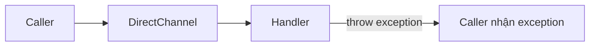
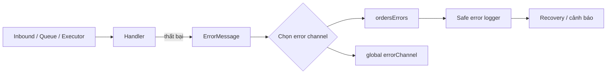

# Log exception và failed message

Trong Spring Integration, một yêu cầu có thể qua Gateway, Filter, Router, Transformer, Splitter, Aggregator và nhiều handler trước khi kết thúc. Khi một handler thất bại, chỉ ghi `"Processing failed"` thường không đủ để xác định bước nào lỗi và thông điệp nào bị ảnh hưởng. Ngược lại, ghi nguyên exception cùng toàn bộ message có thể phát tán token, dữ liệu khách hàng hoặc payload lớn vào hệ thống log.

Bài thuộc chương **Message logger** của module **SPRING_INTEGRATION_PATTERN**. Mục tiêu là học triển khai Enterprise Integration Patterns với Spring Integration để xây dựng các luồng thông điệp ít phụ thuộc, dễ mở rộng; đồng thời quan sát các nhánh xử lý, retry, error channel và correlation bằng log có cấu trúc, đủ thông tin để chẩn đoán sự cố.

**Kết quả học tập:**

- Phân biệt ngoại lệ Java, `MessagingException`, `ErrorMessage` và `failedMessage`.
- Hiểu khi nào lỗi được ném về caller và khi nào được gửi đến error channel.
- Tìm metadata của message thất bại mà không giả định `failedMessage` luôn tồn tại.
- Viết một error handler chọn lọc trường log, bảo vệ dữ liệu nhạy cảm và tránh ghi trùng.
- Kiểm thử tình huống lỗi ở Filter, Router, Transformer, Splitter, Aggregator, retry và handler bất đồng bộ.

## 1. Vì sao lỗi cần được gắn với message?

Xét hai yêu cầu đến gần như đồng thời:

```text
15:01:02 INFO  event=received requestCorrelationId=req_A
15:01:02 INFO  event=received requestCorrelationId=req_B
15:01:03 ERROR Processing failed
15:01:03 WARN  Retrying message
```

Không thể biết lỗi thuộc `req_A` hay `req_B`. Thêm thông tin về stage, request correlation, message và loại lỗi sẽ hữu ích hơn:

```text
15:01:03 WARN  event=retry requestCorrelationId=req_A
               stage=inventory attempt=2 errorCode=UPSTREAM_TIMEOUT
15:01:04 ERROR event=processing_failed requestCorrelationId=req_A
               stage=inventory messageId=ae6c... errorType=MessageHandlingException
               errorCode=RETRY_EXHAUSTED
```

Những log trên là **đầu ra minh họa**, không phải các dòng Spring Integration tự tạo. Ứng dụng cần chủ động chọn trường, ghi tại đúng điểm và bảo đảm mã tương quan được truyền qua các message trung gian.

Phân biệt một số khái niệm:

| Khái niệm | Vai trò | Điểm cần nhớ khi log |
| --- | --- | --- |
| `Throwable` / `Exception` | Nguyên nhân kỹ thuật hoặc nghiệp vụ khiến xử lý thất bại | Nội dung `getMessage()` và stack trace có thể chứa dữ liệu nhạy cảm |
| `MessagingException` | Ngoại lệ có thêm ngữ cảnh Spring Messaging | Có thể chứa `failedMessage`, nhưng không được giả định là luôn có |
| `ErrorMessage` | Một `Message<Throwable>` mang thông tin lỗi | Payload là exception; có headers riêng và có thể giữ original message |
| `failedMessage` | Message gắn với thất bại, truy xuất được qua một số `MessagingException` | Có thể vắng mặt; có thể là message tại bước lỗi, không nhất thiết là request đầu vào |
| `requestCorrelationId` | Header ứng dụng dùng theo dõi một yêu cầu | Cần tạo/chuẩn hóa ở ingress và duy trì qua các bước |
| `correlationId` | Header hỗ trợ gom nhóm Splitter/Aggregator | Phục vụ nhóm message; không mặc định bằng request correlation ID |

## 2. Lỗi đồng bộ và lỗi bất đồng bộ đi theo đường khác nhau

Với `DirectChannel`, handler thường chạy trên thread của bên gửi. Nếu handler ném exception và không có cơ chế xử lý tại chỗ, ngoại lệ có thể được chuyển về caller:



Với một số thành phần bất đồng bộ như poller hoặc handler chạy qua executor, caller có thể đã trả về trước khi lỗi xảy ra. Nếu thành phần đó được cấu hình để publish lỗi, Spring Integration đóng gói ngoại lệ thành `ErrorMessage` và gửi qua error channel:



Hai sơ đồ minh họa **hai cách xử lý điển hình**. Đường đi cụ thể phụ thuộc thành phần, channel, advice, gateway, poller, executor và cấu hình error handler. Không có quy tắc rằng cứ ném exception trong bất kỳ flow nào thì một `ErrorMessage` chắc chắn sẽ tự động đến channel tùy chọn.

Thứ tự xác định kênh lỗi thường chịu ảnh hưởng bởi header `errorChannel` của message, cấu hình error channel của endpoint/inbound adapter và channel mặc định của context. Kiểm tra cấu hình thực tế của từng endpoint, nhất là khi phối hợp nhiều inbound adapter.

### Hệ quả đối với logging

- Với đường **đồng bộ**, có thể log một bản ghi an toàn tại boundary/controller/gateway nơi bắt exception, rồi trả lỗi về caller.
- Với đường **bất đồng bộ**, đặt handler trên error channel thích hợp để ghi thất bại, đồng thời quyết định retry/recovery/đưa sang hàng chờ lỗi.
- Không vừa log stack trace ở mọi handler vừa log toàn bộ stack trace thêm lần nữa tại error flow; việc này gây nhiễu, tăng dung lượng và nguy cơ lộ dữ liệu.
- Lỗi được recover thành công ở tầng retry có thể chỉ cần log `DEBUG`/`WARN` tại từng attempt; lỗi cuối khi hết retry mới thường cần `ERROR` và cảnh báo tương ứng.

## 3. Cấu trúc ErrorMessage và nguồn failed message

Trong Spring Messaging, `ErrorMessage` là một message có **payload là `Throwable`**. Nó có message headers riêng của sự kiện lỗi; các headers này không đồng nghĩa với headers của message thất bại.

Có thể lấy các nguồn thông tin sau:

```java
import org.springframework.messaging.Message;
import org.springframework.messaging.MessagingException;
import org.springframework.messaging.support.ErrorMessage;

void inspect(ErrorMessage errorMessage) {
    Throwable exception = errorMessage.getPayload();

    // Đây là ID của ErrorMessage, không nhất thiết là ID business message.
    Object errorMessageId = errorMessage.getHeaders().getId();

    // Có thể null, tùy cách tạo ErrorMessage.
    Message<?> original = errorMessage.getOriginalMessage();

    // Có thể null nếu Throwable không phải MessagingException,
    // hoặc nếu exception không được gắn failedMessage.
    Message<?> failed = null;
    if (exception instanceof MessagingException messagingException) {
        failed = messagingException.getFailedMessage();
    }
}
```

Một `ErrorMessage` có thể giữ `originalMessage` do thành phần tạo lỗi cung cấp; `MessagingException` có thể mang `failedMessage` là message tại nơi exception xảy ra. Chúng **có thể khác nhau** khi Transformer đã tạo message mới, Splitter đã phát message con hoặc handler đã thay headers.

Không được mặc định:

- `errorMessage.getPayload()` chính là payload nghiệp vụ;
- `errorMessage.getHeaders().getId()` là ID của failed message;
- `errorMessage.getHeaders()` đã chứa tất cả headers nghiệp vụ;
- `getFailedMessage()` luôn khác null;
- mọi exception đều là `MessagingException`.

Nếu một exception bên ngoài được bọc qua nhiều lớp nguyên nhân, `MessagingException` chứa failed message có thể nằm trong cause chain thay vì là exception ngoài cùng. Phần sau có một hàm tìm theo các trường hợp phổ biến.

## 4. Quyết định ghi gì vào log lỗi

Một bản ghi lỗi có thể có cấu trúc:

```text
event=processing_failed
requestCorrelationId=req_42
messageId=0ab4...
stage=paymentRoute
errorType=MessageHandlingException
errorCode=HANDLER_FAILED
attempt=3
recovered=false
```

Thông thường nên ghi các trường đã kiểm soát sau:

| Trường | Lợi ích | Lưu ý |
| --- | --- | --- |
| `event` | Phân biệt attempt thất bại, hết retry, recovery thành công | Sử dụng tập giá trị định sẵn |
| `requestCorrelationId` | Gom log thuộc cùng một yêu cầu | Không chứa email, token, dữ liệu cá nhân |
| `messageId` | Xác định message tại giai đoạn lỗi | Có thể khác ID message đầu vào |
| `stage` | Xác định endpoint/handler liên quan | Lấy từ enum/tên endpoint do ứng dụng quản lý |
| `errorType` | Phân loại exception để điều tra | Dùng loại đã chuẩn hóa; không cần in `getMessage()` |
| `errorCode` | Thống kê lỗi và phân loại hành động | Giá trị ổn định, do ứng dụng định nghĩa |
| `attempt` | Giúp hiểu retry | Số attempt không thay thế ID yêu cầu |
| `sequenceNumber` / `sequenceSize` | Tìm message con lỗi ở Splitter | Ghi cùng ID nhóm an toàn khi cần |
| `elapsedMs` | Đo thời gian xử lý trước khi lỗi | Sử dụng phép đo tại các stage tương ứng |

Nên tránh xuất nguyên `Message<?>`, payload, mọi headers, request body, access token, cookie, SQL parameters, HTTP response body và exception message chứa đầu vào. Nếu stack trace là yêu cầu bắt buộc để điều tra, cần một kênh log riêng được phân quyền, giới hạn retention, rà soát các chuỗi nhạy cảm và theo dõi tần suất phát log.

**Điểm quan trọng:** ghi `log.error("...", throwable)` thường phát stack trace và message theo cấu hình backend. Không nên mặc định lời gọi đó an toàn với dữ liệu khách hàng. Ngay cả khi dùng JSON log, việc serialize đầy đủ exception hoặc failed message vẫn có thể làm lộ dữ liệu.

## 5. Java: tìm failed message và tạo bản ghi an toàn

Ví dụ dưới đây dùng Java 17+, Spring Messaging và SLF4J. Nó không cố log payload hoặc exception text. Khi không tìm được failed message, hàm trả `"unknown"` thay vì bịa một ID.

```java
import java.util.regex.Pattern;

import org.springframework.messaging.Message;
import org.springframework.messaging.MessagingException;
import org.springframework.messaging.support.ErrorMessage;

final class SafeErrorLog {

    private static final Pattern SAFE_ID =
            Pattern.compile("[A-Za-z0-9._-]{1,64}");

    private SafeErrorLog() {
    }

    static Message<?> findFailedMessage(ErrorMessage error) {
        Throwable current = error.getPayload();

        // Giới hạn độ sâu để tránh cause chain bất thường.
        for (int depth = 0; current != null && depth < 16; depth++) {
            if (current instanceof MessagingException messagingException) {
                Message<?> failed = messagingException.getFailedMessage();
                if (failed != null) {
                    return failed;
                }
            }
            Throwable next = current.getCause();
            if (next == current) {
                break;
            }
            current = next;
        }
        return error.getOriginalMessage();
    }

    static String safeRequestId(Message<?> message) {
        if (message == null) {
            return "unknown";
        }
        Object value = message.getHeaders().get("requestCorrelationId");
        if (value instanceof String id && SAFE_ID.matcher(id).matches()) {
            return id;
        }
        return "unknown";
    }

    static String line(ErrorMessage error) {
        Message<?> failed = findFailedMessage(error);
        String messageId = failed == null
                ? "unknown"
                : String.valueOf(failed.getHeaders().getId());

        Throwable cause = error.getPayload();

        return "event=processing_failed"
                + " requestCorrelationId=" + safeRequestId(failed)
                + " messageId=" + messageId
                + " errorType=" + cause.getClass().getSimpleName()
                + " errorCode=HANDLER_FAILED";
    }
}
```

Giải thích các lựa chọn:

1. `getFailedMessage()` được ưu tiên khi tìm thấy trong `MessagingException` vì thường là message tại nơi lỗi. Nếu không thấy, mới thử `ErrorMessage.getOriginalMessage()`.
2. `safeRequestId` chỉ nhận ID dạng ngắn, có ký tự cho phép; không dùng trực tiếp giá trị tự do từ header.
3. `messageId` lấy từ message thất bại, khác với ID của `ErrorMessage`. Nếu thiếu message, ghi `unknown`; không làm mất correlation bằng cách sinh ID mới ngay tại logger.
4. `cause.getClass().getSimpleName()` cho biết loại exception, còn `cause.getMessage()` không được xuất vì nó có thể chứa input.
5. `errorCode=HANDLER_FAILED` là mã mặc định minh họa. Hệ thống thực có thể phân loại exception bằng bảng ánh xạ code cố định, chẳng hạn `UPSTREAM_TIMEOUT`, `INVALID_FORMAT` hoặc `RETRY_EXHAUSTED`.

Hàm có chủ đích **không** đọc `error.getHeaders()` để suy ra ID nghiệp vụ vì headers của ErrorMessage và failed message là hai ngữ cảnh khác nhau. Nếu luồng của bạn có thêm metadata được gắn rõ vào error message và đã phân loại an toàn, có thể bổ sung logic đọc theo schema đó.

### Hạn chế cần nắm

- Nếu stage đầu tiên thất bại trước khi message được tạo, có thể không có `failedMessage`.
- Nếu exception bị bọc ngoài `MessagingException`, chúng ta duyệt cause chain; vẫn không bảo đảm mọi framework custom đều lưu được message.
- Với Splitter, failed message có thể chỉ là một **message con**, do đó payload và ID message khác request gốc.
- Với custom exception chứa một reference khác, cần adapter riêng; không tự parse exception message để tìm ID.
- Không gán nhãn `HANDLER_FAILED` cho mọi lỗi trong production nếu đã có các mã lỗi nghiệp vụ riêng; ví dụ chỉ là fallback đơn giản.

## 6. Ghi log từ một error channel riêng

Một cách tổ chức là tạo channel cho lỗi của luồng đơn hàng và gắn một flow tiêu thụ các `ErrorMessage` từ channel này.

```java
import org.slf4j.Logger;
import org.slf4j.LoggerFactory;

import org.springframework.context.annotation.Bean;
import org.springframework.context.annotation.Configuration;
import org.springframework.integration.channel.DirectChannel;
import org.springframework.integration.dsl.IntegrationFlow;
import org.springframework.messaging.MessageChannel;
import org.springframework.messaging.support.ErrorMessage;

@Configuration
class OrderErrorLoggingConfiguration {

    private static final Logger log =
            LoggerFactory.getLogger(OrderErrorLoggingConfiguration.class);

    @Bean
    MessageChannel ordersErrors() {
        return new DirectChannel();
    }

    @Bean
    IntegrationFlow ordersErrorFlow() {
        return IntegrationFlow.from("ordersErrors")
                .handle(message -> {
                    if (message instanceof ErrorMessage error) {
                        log.error("{}", SafeErrorLog.line(error));
                    }
                })
                .get();
    }
}
```

Khi hệ thống có một endpoint **được cấu hình để publish lỗi** tới `ordersErrors`, flow trên sẽ nhận `ErrorMessage` và ghi một dòng metadata. Mã trên chỉ tạo channel/handler; nó **chưa tự nối** mọi lỗi của ứng dụng tới channel đó. Cần cấu hình error channel tại inbound adapter, poller hoặc metadata của message tùy nguồn lỗi.

Chẳng hạn, có thể đặt header định tuyến lỗi trên message đầu vào (giả sử `ordersInput` và `ordersErrors` là `MessageChannel` được inject):

```java
import org.springframework.messaging.MessageHeaders;
import org.springframework.messaging.support.MessageBuilder;

ordersInput.send(
        MessageBuilder.withPayload("order:ORD-42")
                .setHeader("requestCorrelationId", "req_42")
                .setHeader(MessageHeaders.ERROR_CHANNEL, ordersErrors)
                .build());
```

Header `errorChannel` nói nơi **có thể** gửi lỗi khi một thành phần dùng cơ chế error publishing; nó không bắt mọi exception đồng bộ phải chuyển qua channel đó. Ví dụ, nếu `DirectChannel` ném exception về người gọi, code gọi vẫn cần cơ chế bắt và xử lý phù hợp. Trong sản phẩm thực tế, lựa chọn error channel phải gắn với chính xác endpoint và cơ chế dispatch đang dùng.

Đối với việc thay đổi hoặc tái sử dụng `errorChannel` toàn cục, cần kiểm tra các subscriber mặc định và cách xử lý khi có nhiều subscriber, tránh tạo hai đường log trùng hoặc vô tình bỏ sự kiện lỗi. Đừng thay cấu hình mặc định trên toàn ứng dụng chỉ vì muốn log một luồng.

## 7. Correlation khi lỗi ở Router, Splitter hoặc Aggregator

Một request có thể tách thành nhiều message; mỗi message có ID riêng trong khi vẫn thuộc cùng request. Nếu chỉ log `messageId` của một phần tử lỗi, người vận hành khó tìm được toàn bộ hành trình. Vì vậy nên duy trì một header ứng dụng `requestCorrelationId` an toàn từ Gateway đến các nhánh tiếp theo.

Ví dụ:

```text
INFO  event=received requestCorrelationId=req_42 messageId=in_1
DEBUG event=split_item requestCorrelationId=req_42
      messageId=part_2 groupRef=group_9 sequenceNumber=2 sequenceSize=3
WARN  event=retry requestCorrelationId=req_42
      messageId=part_2 groupRef=group_9 attempt=2
ERROR event=processing_failed requestCorrelationId=req_42
      messageId=part_2 groupRef=group_9 errorCode=RETRY_EXHAUSTED
```

Đây là log được ứng dụng tạo ra để minh họa, không phải mặc định của framework. Trong thực tế, `MessageHeaders.ID` thường là UUID; các giá trị `in_1` và `part_2` ở đây chỉ để dễ đọc.

| Vị trí | Dữ liệu nên giữ | Cách xử lý khi có lỗi |
| --- | --- | --- |
| Gateway | `requestCorrelationId`, nguồn và message ID | Nếu lỗi trước khi tạo message, giữ correlation ở boundary logging |
| Filter | ID và mã lý do loại | Loại hợp lệ không mặc nhiên là exception; log `rejected` theo ý nghĩa |
| Router | ID và tên nhánh hợp lệ | Ghi nhánh đã chọn; lỗi định tuyến ghi mã lỗi rõ |
| Transformer | ID, source/target type | Không in payload trước/sau khi chuyển |
| Splitter | Request ID, group ID, sequence | Xác định chính xác phần tử bị lỗi |
| Aggregator | Group ID, số phần tử, timeout | Phân biệt timeout nhóm với exception của handler |
| Gateway hồi đáp | Request ID và kết quả | Lỗi đồng bộ có thể được trả về caller |
| Retry / error channel | Request ID, attempt, error code | Xem failed message cuối và kiểm tra mã nhóm nếu cần |

Header `correlationId` của Spring Integration có vai trò chính trong việc gom nhóm; nó có thể khác header `requestCorrelationId` của ứng dụng. Đừng dùng `correlationId` để đồng nhất toàn bộ request khi có nhiều tầng Splitter/Aggregator. Không sao chép tùy tiện mọi header cũ sang message mới; hãy kiểm tra metadata nào cần duy trì và header nào do framework quản lý.

## 8. Retry, recovery, dead-letter và tránh ghi lỗi trùng lặp

Một luồng có retry có thể gặp nhiều lần thất bại trước khi thành công. Không nên ghi một stack trace `ERROR` ở từng attempt rồi thêm một stack trace giống hệt tại error channel.

Một chính sách thường dùng:

- **Attempt thất bại tạm thời:** ghi `DEBUG` hoặc `WARN` với `attempt`, `errorCode` và mã tương quan, tùy mức bất thường.
- **Retry thành công:** ghi sự kiện `recovered` hoặc metric tổng số retry; tránh báo lỗi cuối cùng khi nghiệp vụ đã hoàn tất.
- **Hết retry:** ghi một sự kiện `ERROR` có mã `RETRY_EXHAUSTED` và thông tin phục hồi/đẩy tới kênh lỗi.
- **Chuyển sang dead-letter:** ghi sự kiện `dead_lettered`, request ID, loại lỗi, lý do và định danh record ở hàng lỗi đã được kiểm soát; không log toàn bộ bản ghi.
- **Recovery thất bại:** cần chính sách rõ ràng cho lỗi thứ cấp, tránh handler của error channel liên tục ném lỗi và tạo vòng lặp.

Error channel **không đồng nghĩa** một cơ chế retry hay dead-letter queue. Spring Integration có những thành phần/advice và endpoint riêng cho retry, recoverer và việc gửi tới kênh khác; hành vi cụ thể phải được cấu hình. Nếu cần replay, hãy quản lý định danh nghiệp vụ, trạng thái, số lần thử và tính idempotent của handler; một ID log chỉ giúp tra cứu, không bảo đảm exactly-once.

Một bản ghi có thể được xử lý bởi nhiều endpoint và mỗi nơi đều có logger. Chọn rõ **điểm chịu trách nhiệm ghi lỗi cuối**, đồng thời dùng log cấp thấp hoặc metrics ở các điểm trung gian. Trước khi chọn `ERROR`, xác định liệu lỗi đã được xử lý hay là thất bại cuối cùng.

## 9. Cẩn trọng với dữ liệu nhạy cảm trong exception

Các ngoại lệ thường chứa thông tin từ dữ liệu đầu vào:

```text
java.lang.IllegalArgumentException:
  Invalid Authorization header: Bearer SECRET_TOKEN_ABC
```

Ngay cả khi code không log payload, câu lệnh:

```java
log.error("Cannot process message", exception);
```

có thể đưa secret trong exception message và stack trace vào log. Tương tự, ghi `ErrorMessage` qua `toString()` có thể kéo theo phần lỗi và metadata gốc.

Cách tiếp cận an toàn:

1. Tạo log từ **danh sách trường cho phép** gồm event, stage, request ID, message ID, error type/code và attempt.
2. Không ghi raw payload, toàn bộ headers, token, cookie, SQL parameters, error response body hoặc exception message từ hệ thống bên ngoài.
3. Nếu bắt buộc giữ stack trace, dùng logger/kho lưu riêng có giới hạn quyền truy cập và retention; kiểm tra dữ liệu thực sự được xuất.
4. Chặn log injection bằng cách kiểm tra độ dài, tập ký tự và nguồn các trường như request ID, stage, error code.
5. Với lỗi lặp lại, dùng metric đếm, hạn chế tần suất và chỉ log những mẫu sự kiện quan trọng.

Ví dụ, một `requestCorrelationId` có newline do client gửi có thể làm giả dòng `ERROR`. Hãy tạo ID ở ingress hoặc giới hạn ký tự, độ dài trước khi gắn vào header. Phần mã `SafeErrorLog` ở trên là lớp bảo vệ khi ghi, không thay thế bước cấp ID đáng tin tại ranh giới.

### Phân biệt log điều tra với audit

Log kỹ thuật dùng để chẩn đoán exception; audit nghiệp vụ thường cần tính đầy đủ và khả năng kiểm chứng cao hơn. Không nên coi mọi dòng error logger là audit event hoặc dựa vào async logging có thể drop để lưu dấu vết bắt buộc. Khi cần audit, thiết kế kho lưu và chính sách đảm bảo bền vững riêng.

## 10. Kiểm thử: failedMessage có và không có

Cần kiểm tra cả khi exception cung cấp failed message và khi metadata vắng mặt. Unit test sau dùng dữ liệu **giả** có token trong payload và exception message; yêu cầu `SafeErrorLog` không để token rò vào log.

```java
import static org.junit.jupiter.api.Assertions.assertFalse;
import static org.junit.jupiter.api.Assertions.assertTrue;

import org.junit.jupiter.api.Test;
import org.springframework.messaging.Message;
import org.springframework.messaging.MessagingException;
import org.springframework.messaging.support.ErrorMessage;
import org.springframework.messaging.support.MessageBuilder;

class SafeErrorLogTest {

    @Test
    void logsFailedMessageMetadataWithoutPayloadOrExceptionText() {
        String canary = "FAKE_SECRET_DO_NOT_LOG_123";

        Message<String> failed = MessageBuilder.withPayload(
                        "order=ORD-42 token=" + canary)
                .setHeader("requestCorrelationId", "req_42")
                .build();

        MessagingException exception =
                new MessagingException(failed, "upstream returned " + canary);
        ErrorMessage error = new ErrorMessage(exception);

        String line = SafeErrorLog.line(error);

        assertTrue(line.contains("requestCorrelationId=req_42"));
        assertTrue(line.contains("event=processing_failed"));
        assertFalse(line.contains(canary));
        assertFalse(line.contains("token="));
    }

    @Test
    void supportsErrorWithoutFailedMessage() {
        ErrorMessage error = new ErrorMessage(
                new IllegalStateException("FAKE_SECRET_DO_NOT_LOG_123"));

        String line = SafeErrorLog.line(error);

        assertTrue(line.contains("requestCorrelationId=unknown"));
        assertFalse(line.contains("FAKE_SECRET_DO_NOT_LOG_123"));
    }
}
```

Các unit test xác minh **hàm tạo chuỗi log**, chưa kiểm chứng cách error channel được kích hoạt hoặc các logger khác trong framework. Với integration test, cần đưa một message qua endpoint gây lỗi và capture log của hệ thống thực, bao gồm mức INFO/DEBUG và đường retry.

Tập tình huống kiểm thử đề xuất:

| Tình huống | Điều cần xác nhận |
| --- | --- |
| Handler đồng bộ ném exception | Caller nhận lỗi đúng; không mặc định phát ErrorMessage nếu chưa cấu hình |
| Poller/executor xử lý lỗi với error publishing | ErrorMessage đến đúng error channel; logger an toàn nhận được |
| `MessagingException` có failedMessage | ID của failed message và request ID được ghi chính xác |
| Throwable thường, không có failedMessage | Log có `unknown` và error type; không ném lỗi thứ cấp |
| Exception được bọc nhiều lớp | Hàm tìm được failedMessage khi nó nằm trong cause chain |
| Splitter phát ba phần, phần hai lỗi | Log nhận diện request và sequence phù hợp; không nhầm ID nhóm |
| Retry rồi thành công | Không có error cuối giả; các attempt có cùng request ID |
| Retry hết số lần | Log cuối có `RETRY_EXHAUSTED` hoặc mã tương đương do ứng dụng quy định |
| Exception chứa token giả | Log cuối và log từ framework/collector không làm lộ canary |
| Hai request chạy song song | MDC/correlation không bị lẫn giữa các thread |

Khi error channel dùng channel đồng bộ, lỗi ném **ngay trong error handler** có thể tiếp tục ảnh hưởng cơ chế phát lỗi. Vì vậy handler log nên đơn giản, có fallback khi thiếu metadata, tránh serialize message lớn và kiểm thử riêng trường hợp lỗi thứ cấp.

## 11. Chẩn đoán nhanh các vấn đề thường gặp

| Triệu chứng | Nguyên nhân khả dĩ | Hướng kiểm tra |
| --- | --- | --- |
| ErrorMessage không đến handler | Lỗi vẫn ném đồng bộ; error channel chưa được gắn vào endpoint đúng | Xem loại channel, advice, poller và cấu hình error channel |
| Log chỉ hiện `ErrorMessage` ID | Logger đọc headers của ErrorMessage | Truy xuất failed/original message rồi lấy ID phù hợp |
| `getFailedMessage() == null` | Throwable không phải MessagingException hoặc không giữ message | Dùng originalMessage nếu có, fallback `unknown` |
| Không thấy request correlation | Header mất khi tạo message mới hoặc chưa cấp tại ingress | So header trước/sau điểm chuyển, truyền metadata được phép |
| Log lộ token | Log toàn bộ Message, Throwable, headers hoặc HTTP response | Dùng allowlist và kiểm thử canary |
| Nhiều stack trace giống nhau | Handler, retry, error channel cùng log `ERROR` | Chọn điểm log cuối, đo/summarize attempt bằng metrics |
| Aggregator có lỗi nhưng không biết phần nào | Thiếu group/sequence metadata ở log trước Aggregator | Ghi nhóm, sequence tại Splitter và handler của từng phần |
| Error handler cũng thất bại | Có nhánh log phức tạp, parse exception hoặc phụ thuộc dịch vụ ngoài | Làm log handler đơn giản và có fallback; kiểm tra failure path |

## 12. Bài thực hành

**Bối cảnh:** Gateway nhận yêu cầu tạo đơn hàng. Filter kiểm tra dữ liệu, Router chọn nhánh tiêu chuẩn hoặc ưu tiên, Splitter tạo ba thông điệp con. Một handler gọi dịch vụ tồn kho và có lúc timeout. Retry thử lại hai lần; nếu hết retry, thông điệp được gửi tới error channel riêng. Aggregator chỉ hoàn thành khi nhóm đáp ứng điều kiện release.

Yêu cầu thực hiện:

1. Cấp `requestCorrelationId` tại Gateway, đưa vào message header. Ghi log nhận request, chọn nhánh, xử lý từng phần và hoàn tất nhóm.
2. Tạo `ordersErrors` và một error logger dùng `SafeErrorLog`. Cấu hình error publishing ở endpoint xử lý bất đồng bộ; kiểm chứng bằng bài test gây lỗi.
3. Với một phần tử timeout, ghi `attempt` và `errorCode` theo từng lần thử; khi thất bại cuối, ghi một sự kiện `processing_failed`.
4. Làm hỏng cố ý exception message bằng canary `FAKE_SECRET_DO_NOT_LOG_123`. Capture log từ flow/error channel và xác minh canary không xuất hiện.
5. Thử lỗi trước khi message được tạo, và lỗi khi `MessagingException.getFailedMessage()` null; bảo đảm logger không ném exception khác.
6. Chạy song song hai request, kiểm tra `requestCorrelationId` không lẫn. Đối chiếu `messageId`, `correlationId`, `sequenceNumber` khi Splitter tạo nhiều message.
7. Phân biệt log lỗi cuối với retry đang phục hồi; kiểm tra có hay không log trùng giữa advice, handler và error channel.

**Điều kiện đạt:** từ log có thể trả lời yêu cầu nào, bước nào lỗi, message con nào liên quan, đã retry mấy lần và recovery có thành công không; dữ liệu nhạy cảm không bị in ra; lỗi đồng bộ/bất đồng bộ đều được kiểm soát theo cấu hình.

### Câu hỏi tự kiểm tra

1. `ErrorMessage` có payload là gì, và khác message nghiệp vụ như thế nào?
2. Vì sao `ErrorMessage.getHeaders().getId()` không mặc nhiên là ID của message xử lý thất bại?
3. Khi `MessagingException.getFailedMessage()` null, có những lựa chọn fallback nào?
4. Vì sao một exception đồng bộ trên `DirectChannel` có thể không đi qua error channel?
5. Log đầy đủ `Throwable` có nguy cơ gì dù mã ứng dụng không ghi payload?
6. Làm sao tìm lỗi của phần tử thứ hai trong một nhóm ba thông điệp mà không trộn request ID với group correlation ID?
7. Khi retry thành công, có nên tiếp tục coi lỗi attempt đầu tiên là thất bại cuối của nghiệp vụ?
8. Những trường hợp nào cần thêm integration test ngoài unit test của hàm tạo log?

## 13. Tài liệu tham khảo

- [Spring Integration Reference — Error Handling](https://docs.spring.io/spring-integration/reference/error-handling.html): ErrorMessage, error channel, cơ chế dispatch lỗi.
- [Spring Integration Reference — Message](https://docs.spring.io/spring-integration/reference/message.html): Message và headers.
- [Spring Integration Reference — Logging Channel Adapter](https://docs.spring.io/spring-integration/reference/logging-adapter.html): LoggingHandler và lựa chọn nội dung ghi log.
- [Spring Integration Reference — Java DSL log operator](https://docs.spring.io/spring-integration/reference/dsl/java-log.html): đặt điểm log trong flow.
- [Spring Integration Reference — Splitter](https://docs.spring.io/spring-integration/reference/splitter.html) và [Aggregator](https://docs.spring.io/spring-integration/reference/aggregator.html): correlation và sequence của nhóm.
- [Spring Messaging `MessagingException` API](https://docs.spring.io/spring-framework/docs/current/javadoc-api/org/springframework/messaging/MessagingException.html): thông điệp thất bại gắn với exception.
- [Spring Messaging `ErrorMessage` API](https://docs.spring.io/spring-framework/docs/current/javadoc-api/org/springframework/messaging/support/ErrorMessage.html): exception payload và original message.
- [OWASP Logging Cheat Sheet](https://cheatsheetseries.owasp.org/cheatsheets/Logging_Cheat_Sheet.html): thông tin nhạy cảm, cấu trúc log và log injection.

**Ghi nhớ:** `ErrorMessage` cho biết **một lỗi đã được đóng gói thành message**, còn `failedMessage` là ngữ cảnh **có thể** truy xuất từ exception hoặc original message. Hãy xác định đường lỗi thực tế, chọn trường an toàn để ghi log và duy trì mã tương quan qua các nhánh thay vì dựa vào việc in toàn bộ exception hoặc payload.
