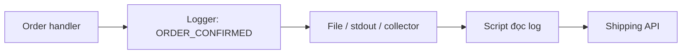
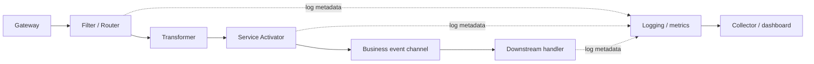
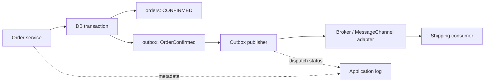
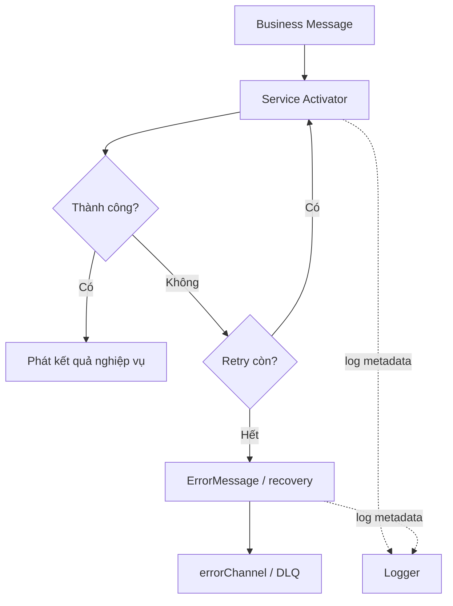

# Không dùng log làm cơ chế giao tiếp

Trong một hệ thống tích hợp, thông điệp nghiệp vụ đi qua Gateway, Channel, Router, Filter, Transformer, Splitter, Aggregator và các handler để hoàn thành một tác vụ. Song song với luồng đó, message logger ghi lại những gì đã xảy ra để người vận hành phân tích lỗi và theo dõi hiệu năng. Hai luồng này có mục đích và yêu cầu độ tin cậy khác nhau.

**Nguyên tắc của bài:** không dùng nội dung log ứng dụng làm lệnh, sự kiện nghiệp vụ bắt buộc hoặc nguồn sự thật để hệ thống khác tiếp tục xử lý. Một dòng như `INFO Order ready` chỉ là thông tin quan sát; nó không thay thế việc gửi một `Message` có cấu trúc qua `MessageChannel` hoặc hệ thống messaging thích hợp.

Bài thuộc chương **Message logger** của module **SPRING_INTEGRATION_PATTERN**. Module tập trung triển khai Enterprise Integration Patterns bằng Spring Integration để xây dựng luồng thông điệp ít phụ thuộc, dễ mở rộng, thực hành Router, Filter, Transformer, Splitter, Aggregator, Gateway, retry, error channel và correlation, đồng thời kiểm thử và quan sát các nhánh. Chủ đề này giúp đặt việc logging vào đúng vị trí của kiến trúc đó.

## 1. Nhận diện anti-pattern: đọc log để kích hoạt nghiệp vụ

Giả sử hệ thống đặt hàng cần gửi yêu cầu giao hàng khi đơn đã được xác nhận. Cách thiết kế dễ phát sinh khi làm thử nghiệm:

1. Service xử lý đơn và ghi `INFO ORDER_CONFIRMED orderId=...`.
2. Một script hoặc dịch vụ khác đọc file log hay truy vấn hệ thống tập trung log.
3. Khi thấy chuỗi `ORDER_CONFIRMED`, dịch vụ đó gọi API giao hàng.



Luồng này có vẻ đơn giản nhưng thiếu một **hợp đồng giao tiếp nghiệp vụ**. Script phải biết chính xác định dạng log; log có thể bị tắt theo level, lấy mẫu, rút gọn, ghi trễ hoặc mất khi quá tải. Khi đổi câu chữ log để dễ đọc hơn, nghiệp vụ giao hàng có thể dừng mà không có lỗi ở service đặt hàng.

Các biến thể của cùng vấn đề:

- Dịch vụ thanh toán chờ dòng `payment_success` trong log để ghi trạng thái `PAID`.
- Tác vụ cron dùng `grep` tìm thông báo `Retry later` rồi gửi lại message.
- Một handler đọc log của Aggregator để biết đã đủ phần tử và phát kết quả.
- Service khác lấy request ID từ MDC trong log thay vì header/metadata của message.
- Hệ thống bật `DEBUG` để “bật tính năng” vì một consumer chỉ hoạt động nếu nhìn thấy dòng DEBUG.

Đây là những dấu hiệu cần thay cơ chế giao tiếp. Việc một công cụ giám sát tạo **cảnh báo vận hành** từ log lại là tình huống khác: thông báo để con người kiểm tra có thể dựa trên tín hiệu log, miễn không xem đó là cam kết thực hiện giao dịch nghiệp vụ.

## 2. Log quan sát khác message nghiệp vụ như thế nào?

| Tiêu chí | Application log | Message/event nghiệp vụ |
| --- | --- | --- |
| Mục đích chính | Chẩn đoán, vận hành, điều tra và phân tích | Truyền dữ liệu, thông báo sự kiện hoặc yêu cầu một xử lý cụ thể |
| Người tiêu thụ | Người vận hành, công cụ log/tracing/SIEM, phân tích offline | Handler/service có hợp đồng message |
| Cấu trúc | Text hoặc structured log, có thể đổi để dễ đọc | Schema/payload và metadata có quy tắc phiên bản |
| Đảm bảo giao nhận | Phụ thuộc logger, appender và collector; có thể mất/drop/sampling | Được thiết kế theo cơ chế transport, ack, retry, persistence cụ thể |
| Thứ tự | Có thể xen kẽ, ghi trễ hoặc hiển thị không theo xử lý thực tế | Có thể quy định ordering theo key/partition hay channel thích hợp |
| Xử lý trùng | Thường không có semantics xử lý nghiệp vụ | Consumer có thể dùng ID và idempotency để xử lý trùng |
| Retention | Chính sách log phục vụ quan sát, có thể xóa hoặc tổng hợp | Chính sách lưu/bù/truy phát lại tùy yêu cầu nghiệp vụ |
| Thay đổi nội dung | Mức log, thông điệp và field có thể được điều chỉnh | Thay đổi contract phải xét tương thích producer/consumer |
| Lỗi phía consumer | Logger thường không biết script đọc log có xử lý thành công không | Có thể có ack, error channel, retry/recovery hoặc DLQ |
| Bảo vệ dữ liệu | Log thường bị hạn chế payload và che thông tin nhạy cảm | Message có thể chứa dữ liệu nghiệp vụ cần thiết, được truyền có kiểm soát |

**Chú ý:** gọi một thành phần là message broker không tự động mang lại exactly-once, persistence hay thứ tự toàn cục. Những đặc tính đó phụ thuộc công nghệ, chế độ cấu hình, phạm vi transaction và chiến lược xử lý của ứng dụng. Khác biệt nằm ở việc giao tiếp nghiệp vụ được thiết kế và kiểm chứng bằng một transport có hợp đồng rõ ràng.

### Dòng log không đồng nghĩa với sự kiện đã commit

```text
INFO event=order_confirmed orderId=ORD-42
```

Dòng log có thể được ghi **trước khi** transaction cơ sở dữ liệu commit, ngay sau một bước nghiệp vụ, hoặc trước khi một nhánh sau đó ném exception. Nếu transaction rollback nhưng log vẫn được lưu, consumer đọc log có thể thực hiện giao hàng cho đơn chưa được xác nhận. Ngược lại, transaction có thể commit nhưng tiến trình chết trước khi log được flush.

Vì thế, log không phải bằng chứng giao dịch đã hoàn tất theo đúng ranh giới commit. Nếu cần công bố một business event đáng tin cậy gắn với thay đổi dữ liệu, hãy cân nhắc **transactional outbox** hoặc một cơ chế giao tiếp giao dịch được thiết kế phù hợp.

## 3. Kiến trúc phù hợp: channel truyền nghiệp vụ, logger quan sát

Spring Integration cung cấp các Enterprise Integration Patterns để xây dựng tuyến xử lý. Message vẫn chạy qua `MessageChannel`; logging chỉ quan sát mốc đã chọn.



Khi cần định tuyến nhánh, dùng `Router`. Khi cần loại message theo điều kiện, dùng `Filter`. Khi cần đổi payload, dùng `Transformer`. Khi cần gọi phương thức xử lý, dùng `Service Activator` hoặc `Gateway`. Khi cần gom các phần tử, dùng `Aggregator`. Khi cần báo lỗi, dùng `errorChannel` và cơ chế retry/recovery. Logger không thực hiện chức năng của các pattern này.

Một số lựa chọn thực tế:

| Nhu cầu | Cơ chế phù hợp | Vai trò của logger |
| --- | --- | --- |
| Gửi lệnh xử lý trong ứng dụng | `DirectChannel`/`ExecutorChannel` cùng handler | Ghi thời điểm nhận, kết quả và lỗi |
| Hỏi–đáp đồng bộ | Messaging Gateway có request/reply | Ghi correlation, thời gian và mã kết quả |
| Phát cho nhiều subscriber | Publish-subscribe channel hoặc broker pub/sub | Ghi số subscriber/nhánh và sự cố |
| Chuyển dữ liệu qua hệ thống khác | Outbound channel adapter/gateway và giao thức thích hợp | Ghi metadata vận chuyển, không làm transport |
| Cần lưu khi service tạm ngừng | Broker bền vững hoặc queue/persistence được thiết kế | Ghi thống kê enqueue/dequeue và lỗi |
| Công bố event cùng thay đổi DB | Transactional outbox và publisher | Ghi trạng thái outbox/dispatch |
| Retry, xử lý lỗi cuối | Retry advice, recoverer, error channel, DLQ phù hợp | Ghi attempt, error code và ID |
| Quan sát hoạt động | Log, metrics, traces | Chính là nhiệm vụ của logger |

## 4. Ví dụ Spring Integration Java DSL

Tình huống: Gateway tiếp nhận đơn, Filter loại yêu cầu thiếu sản phẩm, handler thực hiện nghiệp vụ. Dòng log ghi sự kiện chấp nhận, nhưng tiến trình thực sự diễn ra nhờ channel và handler.

Ví dụ tối giản dùng Spring Integration Java DSL và Java 17+:

```java
import org.springframework.context.annotation.Bean;
import org.springframework.context.annotation.Configuration;
import org.springframework.integration.annotation.Gateway;
import org.springframework.integration.annotation.MessagingGateway;
import org.springframework.integration.channel.DirectChannel;
import org.springframework.integration.dsl.IntegrationFlow;
import org.springframework.integration.handler.LoggingHandler;
import org.springframework.messaging.MessageChannel;
import org.springframework.stereotype.Service;

record OrderSubmitted(String orderId, int itemCount) { }

@MessagingGateway
interface OrderGateway {
    @Gateway(requestChannel = "ordersInput")
    void submit(OrderSubmitted order);
}

@Service
class FulfillmentHandler {
    public void fulfill(OrderSubmitted order) {
        // Gọi nghiệp vụ fulfillment thực tế ở đây.
        // Kết quả xử lý đến từ lời gọi này, không dựa vào text log.
    }
}

@Configuration
class OrderIntegrationConfig {

    @Bean
    MessageChannel ordersInput() {
        return new DirectChannel();
    }

    @Bean
    MessageChannel fulfillmentRequests() {
        return new DirectChannel();
    }

    @Bean
    IntegrationFlow ordersIngressFlow() {
        return IntegrationFlow.from("ordersInput")
                .filter(OrderSubmitted.class,
                        order -> order.itemCount() > 0)
                .log(
                        LoggingHandler.Level.INFO,
                        "app.orders.flow",
                        message -> "event=order_accepted messageId="
                                + message.getHeaders().getId())
                .channel("fulfillmentRequests")
                .get();
    }

    @Bean
    IntegrationFlow fulfillmentFlow(FulfillmentHandler handler) {
        return IntegrationFlow.from("fulfillmentRequests")
                .handle(handler, "fulfill")
                .get();
    }
}
```

Các lớp trong ví dụ có thể tách thành nhiều file Java theo quy ước của dự án. Đây là khung học tập; nghiệp vụ `fulfill` cần được triển khai, và cách xử lý message không hợp lệ cần phản hồi rõ tùy yêu cầu.

Điểm chính:

1. `OrderGateway.submit(...)` gửi một message đến `ordersInput`, không tạo dòng log để handler khác tự đọc.
2. `Filter` quyết định cho message đi tiếp theo dữ liệu nghiệp vụ `itemCount`.
3. `.log(...)` tạo log quan sát ở category `app.orders.flow`. Bản ghi chỉ chứa event và message ID, không phụ thuộc việc một script có đọc được log hay không.
4. `.channel("fulfillmentRequests")` gửi **message nghiệp vụ** tới channel tiếp theo.
5. `FulfillmentHandler.fulfill(...)` là nơi thực thi công việc. Tắt logging cho category này không được làm vô hiệu hóa nghiệp vụ.

Ví dụ sử dụng `DirectChannel` nên xử lý đồng bộ, chủ yếu để học **sự tách biệt chức năng**; nó chưa cung cấp lưu trữ bền vững, retry sau process crash hay cơ chế giao nhận qua mạng. Các yêu cầu đó cần adapter/broker/outbox phù hợp ở bước thiết kế hệ thống thực tế.

Nếu cần log correlation ID xuyên nhiều bước, hãy cấp một mã theo dõi ở ingress và truyền qua `MessageHeaders`; logging operator đọc giá trị đã được chuẩn hóa. Không dùng việc parse giá trị từ dòng log để dựng header cho message tiếp theo.

## 5. Tại sao logging operator không phải endpoint nghiệp vụ?

Trong Spring Integration Java DSL, `.log(...)` là một cách quan sát flow qua cơ chế logging/Wire Tap. Mục đích của nó là xuất thông tin chẩn đoán theo cấu hình, không phải chuyển message sang một business consumer dựa trên text log.

Cần phân biệt ba cách viết:

```java
// 1. Ghi log quan sát.
.log(LoggingHandler.Level.DEBUG, "app.flow", m ->
        "event=transformed messageId=" + m.getHeaders().getId())

// 2. Chuyển message đến channel nghiệp vụ.
.channel("fulfillmentRequests")

// 3. Gọi handler nghiệp vụ (tại đoạn flow tương ứng).
.handle(fulfillmentHandler, "fulfill")
```

Những đoạn này minh họa **các operator trong ngữ cảnh định nghĩa flow**, không phải một đoạn Java độc lập để chạy riêng.

Có thể đặt logging channel adapter như một subscriber chỉ quan sát, hoặc dùng Wire Tap để lấy bản sao message đi qua channel. Nhưng không nên xây dựng flow nghiệp vụ downstream bằng cách **đọc bản ghi mà logger xuất ra**. Nếu cần một subscriber thực sự xử lý message, đăng ký handler/channel adapter phù hợp với payload và giao thức.

Một điểm thực tế: logging vẫn tiêu thụ CPU, bộ nhớ và I/O; backend chậm có thể ảnh hưởng hiệu năng hoặc phát sinh lỗi tùy cấu hình. Vì thế không nên coi logging luôn không ảnh hưởng đến luồng. Tuy nhiên, **ý nghĩa nghiệp vụ của luồng** phải độc lập với việc một bản ghi có được xuất, lưu hay truy vấn thành công hay không.

## 6. Vì sao dựa vào text log dễ làm hệ thống sai?

| Rủi ro | Điều có thể xảy ra | Hậu quả nghiệp vụ |
| --- | --- | --- |
| Thay đổi log level | DEBUG bị tắt ở production | Consumer không nhận “lệnh” |
| Sampling/giới hạn tần suất | Collector bỏ một phần log | Xử lý thiếu đơn hàng |
| Queue log đầy | Async appender drop hoặc block | Mất tín hiệu, tăng latency |
| Format thay đổi | Chuyển từ text sang JSON hoặc sửa câu chữ | Regex/parser consumer hỏng |
| Ghi log nhiều lần | Retry/restart ghi lại cùng event | Consumer gửi lệnh trùng |
| Đảo thứ tự | Nhiều thread, service hoặc collector xuất log lệch thời gian | Bước sau chạy trước khi nghiệp vụ sẵn sàng |
| Log trước commit | DB rollback sau khi logger ghi success | Consumer xử lý sự kiện không tồn tại |
| Commit trước khi flush | Process crash sau commit | Consumer không thấy sự kiện đã xảy ra |
| Giới hạn retention | File xoay vòng, collector xóa bản ghi cũ | Không replay khi consumer phục hồi |
| Redaction | Trường bị che vì chính sách bảo mật | Consumer không còn đủ dữ liệu để thực hiện nghiệp vụ |
| Thay đổi quyền truy cập | Consumer mất quyền đọc log tập trung | Giao tiếp nghiệp vụ dừng vì chính sách quan sát |

Một hệ thống messaging cũng cần xử lý chuyện mất kết nối, trùng message, thứ tự và retry; điểm khác là các tình huống này được mô hình hóa như một phần của hợp đồng giao tiếp và được kiểm thử chủ động.

## 7. Chọn cơ chế giao tiếp theo yêu cầu độ tin cậy

### Giao tiếp trong cùng ứng dụng

Nếu chỉ chuyển một message sang handler khác trong cùng tiến trình, có thể dùng `DirectChannel` (đồng bộ) hoặc `ExecutorChannel` (xử lý bất đồng bộ). Hãy cân nhắc xử lý exception, thread pool và nhu cầu phản hồi; hai channel này không tự động tạo độ bền qua process crash.

### Giao tiếp qua service và broker

Khi các service cần độc lập triển khai, tích hợp message broker như RabbitMQ, Kafka hoặc JMS thông qua adapter phù hợp có thể giúp tổ chức producer/consumer theo contract. Cần xác định:

- Định dạng/schema, phiên bản và kiểu event/command.
- Message ID, correlation ID và idempotency key.
- Ack, retry/backoff, timeout, dead-letter, khả năng replay.
- Đảm bảo thứ tự trong phạm vi cần thiết và cách xử lý trùng.
- Quyền truy cập, bảo mật dữ liệu và thời gian lưu.

Đây là các thuộc tính của **transport nghiệp vụ**, không được đảm bảo bởi dòng `INFO` trong log ứng dụng.

### Transactional outbox khi phải công bố event sau commit

Nếu service cần vừa cập nhật bảng `orders` vừa phát `OrderConfirmed`, phương án thường dùng là ghi thay đổi trạng thái và một bản ghi `outbox_events` trong **cùng một transaction DB**. Một publisher riêng đọc outbox và gửi message đến broker, đánh dấu trạng thái đã phát sau khi có kết quả phù hợp.



Transaction bảo đảm trạng thái đơn và outbox cùng commit hoặc cùng rollback, còn publisher có thể thử lại khi broker chưa sẵn sàng. Outbox **không tự loại bỏ hoàn toàn duplicate**: consumer vẫn cần idempotency vì một sự kiện có thể được gửi lại khi publisher crash giữa bước gửi và ghi nhận thành công.

Logging tiếp tục giúp quan sát `outbox_enqueued`, `publish_retry` và `consumer_processed` theo ID sự kiện; consumer không dựa vào những dòng log để thực hiện nghiệp vụ.

## 8. Khi nào log được dùng làm nguồn dữ liệu hợp lệ?

Phủ định “không dùng log làm giao tiếp” cần được hiểu **đúng phạm vi**.

Có những tình huống log phù hợp làm đầu vào cho hệ thống **quan sát hoặc phân tích**:

- SIEM dùng log để phát hiện đăng nhập đáng ngờ và tạo cảnh báo an ninh.
- Nhóm vận hành đặt cảnh báo khi tỷ lệ `ERROR` tăng bất thường.
- Công cụ phân tích offline xử lý log lịch sử để thống kê xu hướng.
- Hệ thống hỗ trợ tìm log bằng `requestCorrelationId` để điều tra một request.

Những hoạt động này có thể chấp nhận kết quả không đầy đủ, báo trễ hoặc cần xác minh thêm theo chính sách vận hành. Nếu một cảnh báo kích hoạt hành động tự động có tác động lớn, cũng phải thiết kế xác nhận, chống trùng, phân quyền và đường xử lý lỗi tương ứng.

Cũng có một số khái niệm chứa chữ “log” nhưng **khác application logging**:

| Tên | Bản chất |
| --- | --- |
| Application log của SLF4J/Logback | Bản ghi chẩn đoán và vận hành |
| Commit log/transaction log của cơ sở dữ liệu | Cấu trúc lưu thay đổi phục vụ tính nhất quán/khôi phục |
| Kafka partition log | Cấu trúc dữ liệu của message broker, có offset và cơ chế consumer riêng |
| Event store trong event sourcing | Kho sự kiện nghiệp vụ có schema, quy tắc phiên bản và khả năng tái dựng trạng thái |

Không phải mọi hệ thống có chữ “log” đều là phản ví dụ. Điểm cần tránh là **dùng bản ghi chẩn đoán của logger như một thông điệp nghiệp vụ đáng tin cậy**, vì nó không được thiết kế với những bảo đảm đó.

## 9. Logging, metrics và tracing có vai trò khác nhau

Mục tiêu giám sát luồng không yêu cầu biến log thành bus giao tiếp. Có thể kết hợp ba nguồn quan sát:

- **Log:** trả lời “đã xảy ra sự kiện gì tại bước nào?”, dùng `event`, `requestCorrelationId`, `messageId`, `route`, `errorCode`.
- **Metrics:** trả lời “có bao nhiêu message đã xử lý, tỷ lệ lỗi và độ trễ ra sao?”, dùng counter, gauge và histogram.
- **Tracing:** trả lời “một request đi qua những service/span nào và chậm ở đâu?”, dùng trace context đã được truyền đúng.

Ví dụ một luồng có Retry và Aggregator:

```text
INFO event=received requestCorrelationId=req_42 messageId=...
WARN event=retry requestCorrelationId=req_42 stage=inventory attempt=2
INFO event=aggregated requestCorrelationId=req_42 groupSize=3
INFO event=fulfilled requestCorrelationId=req_42
```

Những bản ghi này giúp điều tra, không tự tạo tác vụ fulfillment. Handler nhận message qua channel và thực hiện nghiệp vụ theo contract.

`requestCorrelationId` nên được truyền trong message header hoặc cơ chế context propagation được thiết kế, không tái tạo bằng cách đọc log cũ. Với Splitter/Aggregator, phân biệt request ID dùng theo dõi vòng đời và `correlationId` do framework dùng để gom message thành nhóm.

## 10. Retry và error channel là đường xử lý, không phải parser log

Khi handler thất bại, **exception và message** là đầu vào cho cơ chế retry/error handling. Đừng viết job tìm dòng `WARN Retrying order` rồi gửi lại cùng đơn.

Trong Spring Integration, đường xử lý có thể gồm:

1. Handler nhận một `Message` từ channel.
2. Retry advice thực hiện lại lời gọi phù hợp với giới hạn attempt và backoff.
3. Nếu retry hết và có cấu hình recovery, recoverer hoặc error flow tiếp nhận lỗi.
4. Tùy endpoint, lỗi có thể được chuyển thành `ErrorMessage` và gửi đến một `errorChannel`.
5. Một handler quyết định khôi phục, gửi message tới DLQ, cảnh báo hoặc trả thất bại.



Sơ đồ là logic khái quát: `ErrorMessage`, recovery và DLQ phụ thuộc vào cách cấu hình endpoint, retry advice, channel và adapter. Lỗi đồng bộ trên `DirectChannel` có thể ném về caller thay vì tự động đi qua error channel.

Logger nên ghi `attempt`, `stage`, `errorCode` và request ID đã chuẩn hóa. Đừng dùng thời điểm xuất dòng log để xác định chính xác số attempt còn lại hoặc trạng thái recovery; dùng retry state/metadata thật.

## 11. Kiểm thử để phát hiện phụ thuộc sai vào log

Một bài kiểm thử quan trọng là **thay đổi cấu hình logging mà không đổi đầu vào**, rồi xác minh kết quả nghiệp vụ không đổi.

Các kịch bản nên có:

| Kịch bản | Kết quả mong đợi |
| --- | --- |
| Đặt category `app.orders.flow` thành `OFF` | Handler vẫn nhận và xử lý message hợp lệ |
| Đặt category thành `DEBUG` | Có thêm thông tin quan sát, không có thêm tác vụ nghiệp vụ |
| Collector log tạm ngừng | Giao tiếp nghiệp vụ không đòi hỏi collector đã nhận log; đo riêng rủi ro appender làm chậm |
| Filter loại message không hợp lệ | Handler không chạy; discard/rejection được xử lý đúng, không dựa vào log |
| Router chọn hai nhánh khác nhau | Message đến đúng handler theo route, bất kể text log |
| Splitter tạo N phần tử | N message được xử lý theo contract, không đếm bằng số dòng log |
| Retry một handler thất bại | Attempt do retry advice quản lý, không do job đọc log |
| Aggregator đủ nhóm | Kết quả được phát theo release strategy, không theo câu `group complete` trong log |
| Message bị gửi trùng từ broker | Consumer có chiến lược idempotency phù hợp |
| Transaction DB rollback | Không công bố `OrderConfirmed` như một giao dịch đã commit |
| Exception bất đồng bộ | Đi theo error channel/recovery đã cấu hình, không phụ thuộc logger `ERROR` |

### Một test định hướng hành vi

Giả sử `FulfillmentHandler` được thay bằng một mock trong test Spring Integration. Gửi message hợp lệ qua `OrderGateway.submit(...)`, rồi xác minh `fulfill(...)` được gọi đúng số lần mong đợi khi logger category ở mức `OFF` và `INFO`. Không kiểm tra “có dòng `order_accepted` thì mới gọi fulfillment”; dòng đó chỉ là bằng chứng quan sát phụ.

Với flow đồng bộ và `DirectChannel`, có thể kiểm tra handler ngay sau lời gọi Gateway. Với executor, broker hoặc outbox, dùng cơ chế đợi có giới hạn và kiểm tra trạng thái/ack của đường message tương ứng. Đồng thời có thể kiểm tra log chứa metadata an toàn và không chứa payload nhạy cảm.

Một tiêu chí thiết kế tốt là: **tháo bỏ logger hoặc đổi text log không làm thay đổi quyết định nghiệp vụ**. Nếu điều này không đúng, rất có thể một thành phần đang dùng log như giao thức ẩn.

## 12. Bài tập: sửa thiết kế phụ thuộc vào log

**Bối cảnh:** một cửa hàng có service `orders` và `shipping`. Khi đơn được xác nhận, `orders` ghi:

```text
INFO ORDER_READY orderId=ORD-42 customerEmail=an@example.com
```

Một script quét log mỗi phút, lấy `orderId` và gọi `shipping.createShipment`. Trong giờ cao điểm, script có lúc gọi trùng hoặc bỏ sót đơn. Khi đội vận hành đổi log sang JSON, script dừng.

Hãy thiết kế lại theo các bước:

1. Xác định rõ **sự kiện nghiệp vụ** `OrderConfirmed` hoặc **lệnh** `CreateShipment`, payload/schema cần thiết và ID duy nhất.
2. Nếu xử lý trong cùng ứng dụng, sử dụng `MessageChannel`/handler; nếu qua nhiều service và cần bền vững, chọn broker/adapter phù hợp.
3. Nếu việc xác nhận đơn cần được lưu cùng event, dùng transactional outbox hoặc cơ chế giao dịch đã thiết kế, không xuất sự kiện trước commit.
4. Cho consumer `shipping` xử lý idempotent theo event ID/order ID, ghi trạng thái và phản hồi lỗi theo hợp đồng.
5. Dùng retry/backoff và dead-letter hoặc error channel theo cách cấu hình của transport. Định nghĩa cách phục hồi và replay.
6. Giữ log `event=order_confirmed`, `event=shipment_requested`, `event=shipment_created` với correlation ID, nhưng không ghi email hoặc token.
7. Thực hiện kiểm thử thay log level, đổi format log, ngắt collector, gửi duplicate và mô phỏng producer crash trước/sau commit.

Đầu ra mong đợi là một sơ đồ mới trong đó `shipping` nhận **business message/event**, có xử lý trùng và lỗi rõ ràng. Hệ thống log vẫn cho phép điều tra từng bước, nhưng không xuất hiện trong đường bắt buộc để giao hàng.

### Câu hỏi tự kiểm tra

1. Vì sao một dòng `INFO ORDER_READY` không chứng minh transaction xác nhận đơn đã commit?
2. Có thể xảy ra điều gì nếu consumer nghiệp vụ chỉ hoạt động khi logger DEBUG được bật?
3. `Wire Tap` và `LoggingHandler` khác với business subscriber như thế nào?
4. Khi nào dùng `DirectChannel` là đủ, và khi nào cần broker hoặc outbox?
5. Outbox giải quyết vấn đề gì và vì sao consumer vẫn phải xử lý idempotency?
6. Tại sao Kafka partition log không đồng nghĩa với text log do SLF4J ghi ra?
7. Làm sao dùng log, metrics và tracing để theo dõi retry mà không sử dụng chúng làm bộ đếm retry?
8. Tại sao test “tắt logger mà nghiệp vụ vẫn chạy” là một phép kiểm tra kiến trúc hữu ích?

## 13. Tài liệu tham khảo

- [Spring Integration Reference — Messaging Channels](https://docs.spring.io/spring-integration/reference/channel.html): các channel và đặc điểm truyền message.
- [Spring Integration Reference — Java DSL](https://docs.spring.io/spring-integration/reference/dsl.html): xây dựng flow từ channel, handler và adapter.
- [Spring Integration Reference — Logging Channel Adapter](https://docs.spring.io/spring-integration/reference/logging-adapter.html): mục đích và cấu hình logger.
- [Spring Integration Reference — Java DSL `log()` operator](https://docs.spring.io/spring-integration/reference/dsl/java-log.html): ghi log tại một điểm trong flow.
- [Spring Integration Reference — Gateway](https://docs.spring.io/spring-integration/reference/gateway.html): request/reply và interface hướng tới message.
- [Spring Integration Reference — Error Handling](https://docs.spring.io/spring-integration/reference/error-handling.html): `ErrorMessage` và error channel.
- [Enterprise Integration Patterns](https://www.enterpriseintegrationpatterns.com/): các pattern truyền, định tuyến, chuyển đổi và quan sát message.
- [Transactional Outbox Pattern — microservices.io](https://microservices.io/patterns/data/transactional-outbox.html): công bố event gắn với thay đổi DB theo transaction.

**Ghi nhớ:** log là **tín hiệu để con người và hệ thống quan sát hiểu chuyện gì đã xảy ra**. Hãy sử dụng message, channel, event và hợp đồng xử lý để các thành phần giao tiếp nghiệp vụ. Nhờ vậy, việc thay đổi log level, format, retention hoặc collector không trở thành thay đổi ngầm của luồng chức năng.
