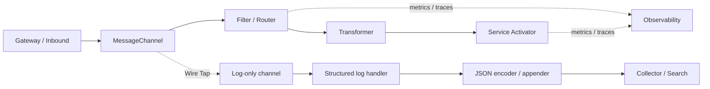

# Structured logging cho integration flow

Khi một yêu cầu đi qua Gateway, Filter, Router, Transformer, Splitter, Aggregator rồi đến handler, log dạng văn bản tự do thường khó tổng hợp. Một dòng ghi “đã nhận đơn hàng” và dòng khác ghi “route priority thành công” có thể mô tả cùng một yêu cầu nhưng không có trường chung để lọc hoặc tính toán. **Structured logging** giải quyết vấn đề đó bằng cách biểu diễn sự kiện log với các trường có tên, kiểu và ý nghĩa nhất quán, thường xuất dưới dạng JSON.

Bài này thuộc chương **Message logger** trong module **SPRING_INTEGRATION_PATTERN**. Module tập trung triển khai Enterprise Integration Patterns bằng Spring Integration để xây dựng luồng thông điệp ít phụ thuộc, dễ mở rộng; thực hành Router, Filter, Transformer, Splitter, Aggregator, Gateway, retry, error channel và correlation, đồng thời kiểm thử, theo dõi các nhánh xử lý. Structured logging giúp những bước đó có thể quan sát và phân tích được trên nhiều thread hoặc service mà không cần in toàn bộ message.

Sau khi học, bạn có thể:

- Thiết kế schema log chung cho từng giai đoạn của integration flow.
- Gắn `requestCorrelationId`, `messageId`, route, stage, error code và sequence metadata phù hợp vào log.
- Phân biệt log text có dạng `key=value`, structured fields của API logger và JSON do encoder/backend tạo ra.
- Cấu hình một Wire Tap và handler ghi structured event bằng Spring Integration Java DSL với SLF4J 2.x.
- Biết cách theo dõi Filter, Router, Splitter/Aggregator, retry và error channel mà không lộ payload nhạy cảm.
- Kiểm thử cả nội dung và định dạng log ở điểm phát, cùng yêu cầu truy vấn thực tế tại collector.

## 1. Từ log văn bản đến log có cấu trúc

Ví dụ ứng dụng ghi ba dòng text:

```text
INFO  Received order ORD-42
INFO  Routed order to priority
ERROR Timeout while calling inventory for ORD-42
```

Muốn trả lời “bao nhiêu đơn hàng theo nhánh priority bị timeout trong năm phút qua?”, hệ thống phân tích thường phải dùng regex hoặc phụ thuộc vào câu chữ. Một thay đổi từ `Routed order` sang `Order selected route` có thể làm truy vấn sai.

Structured logging dùng các trường ổn định:

```json
{
  "timestamp": "2026-11-21T08:15:30.321Z",
  "level": "WARN",
  "logger": "app.integration.orders",
  "service": "orders",
  "event": "integration.retry",
  "flow": "orderFulfillment",
  "stage": "inventoryGateway",
  "requestCorrelationId": "req_42",
  "messageId": "5b8f7d3b-69e3-4d32-94c3-d8c6bd13e0db",
  "attempt": 2,
  "errorCode": "UPSTREAM_TIMEOUT",
  "durationMs": 1500
}
```

Đây là **JSON mẫu do ứng dụng và encoder định nghĩa**, không phải schema được Spring Integration tự động phát theo hình dạng trên. Logger backend có thể dùng tên trường khác, chẳng hạn `@timestamp`, `log.level` hoặc `message`. Điều quan trọng là đội ngũ thống nhất schema và cấu hình encoder để collector hiểu đúng.

### Đặc điểm của structured event

| Đặc điểm | Log text tự do | Structured log |
| --- | --- | --- |
| Tên trường | Ngầm trong câu chữ | Rõ ràng: `event`, `stage`, `errorCode` |
| Kiểu dữ liệu | Thường phải parse từ chuỗi | Có thể là số, boolean, string, object |
| Truy vấn | Dựa regex/toàn văn | Lọc và tổng hợp theo field |
| Thay đổi message | Có thể làm hỏng parser | Có thể đổi lời mô tả mà giữ schema ổn định |
| Correlation | Cần trích ID từ text | Trường `requestCorrelationId` nhất quán |
| Chi phí | Dễ đọc ở console, khó phân tích tổng hợp | Có chi phí encode/index và cần quản trị schema |

Structured logging **không tự bảo đảm** log được giao đủ, có thứ tự, hoặc chính xác sau khi database rollback. Nó là công cụ quan sát. Message/event dùng cho giao tiếp nghiệp vụ vẫn phải đi theo `MessageChannel`, broker hoặc cơ chế persistence được thiết kế riêng.

## 2. Thiết kế schema thống nhất trước khi đặt logger

Bắt đầu từ câu hỏi người vận hành muốn trả lời: yêu cầu nào đang xử lý, đi qua bước nào, chuyển nhánh ra sao, nhóm message đã gom đủ chưa, lỗi nằm ở đâu, mất bao lâu? Từ đó chọn tập trường nhỏ, có ý nghĩa rõ.

### Các trường nền tảng

| Trường | Kiểu đề xuất | Ý nghĩa |
| --- | --- | --- |
| `timestamp` | Chuỗi ISO 8601 có timezone | Thời điểm tạo bản ghi; thường do encoder thêm |
| `level` | Enum/string | `INFO`, `WARN`, `ERROR`, `DEBUG`… |
| `service` | String được cấu hình | Tên service phát log |
| `environment` | String được cấu hình | Môi trường vận hành, chẳng hạn `staging` |
| `logger` | String | Category/class nguồn log |
| `event` | String enum | Tên sự kiện ổn định, như `integration.received` |
| `flow` | String enum | Flow đang xử lý, như `orderFulfillment` |
| `stage` | String enum | Bước như `router` hoặc `inventoryGateway` |
| `requestCorrelationId` | String đã chuẩn hóa | Liên kết các sự kiện thuộc một yêu cầu |
| `messageId` | UUID/string | Định danh message hiện tại |
| `traceId` / `spanId` | String | Context từ hệ thống tracing nếu đã cấu hình |
| `route` | String enum, tùy chọn | Nhánh thực tế Router đã chọn |
| `durationMs` | Number, tùy chọn | Thời gian của một stage đã đo |
| `errorCode` | String enum, tùy chọn | Lỗi được phân loại bởi ứng dụng |
| `attempt` | Number, tùy chọn | Lần thử xử lý/retry |
| `groupId`, `sequenceNumber`, `sequenceSize` | String/số, tùy chọn | Thông tin nhóm Splitter/Aggregator đã kiểm tra |

Không cần lặp mọi field trong mọi sự kiện. Ví dụ `attempt` chỉ có khi có retry; `route` chỉ cần sau quyết định định tuyến. Đồng thời, một JSON logger có thể tự thêm timestamp, level, logger và thread; ứng dụng không phải tự tạo bản sao cho các trường đó.

### Đặt tên và phiên bản sự kiện

Đặt tên event theo quy ước thống nhất, chẳng hạn:

```text
integration.received
integration.filtered
integration.routed
integration.transformed
integration.split
integration.aggregate_completed
integration.retry
integration.failed
integration.recovered
```

`event` là **mã ổn định**, không phải lời diễn đạt tự do. Có thể thêm `schemaVersion`, ví dụ `1`, nếu nhiều hệ thống tiêu thụ log hoặc một thay đổi tên/kiểu field có thể làm hỏng dashboard. Khi thêm trường mới tương thích, không nhất thiết cần đổi toàn bộ schema; khi đổi ý nghĩa hoặc kiểu dữ liệu, hãy có kế hoạch chuyển đổi truy vấn.

Một quy ước thực tế là dùng `durationMs` luôn là số mili giây và `attempt` bắt đầu từ `1`. Đừng để service A ghi `duration=1.2s` còn service B ghi `duration=1200` mà không rõ đơn vị.

## 3. Kiến trúc observability trong integration flow

Một message nghiệp vụ giữ payload và headers cần thiết khi đi qua các endpoint. Điểm quan sát nên tạo **biểu diễn an toàn** từ message và chuyển thành log event, không thay nội dung nghiệp vụ hoặc yêu cầu downstream phân tích text log.



Sơ đồ minh họa Wire Tap tại một mốc. Khi cần quan sát trạng thái **sau** Router hoặc Transformer, đặt thêm điểm quan sát ở vị trí tương ứng. Một Wire Tap đặt trước Filter sẽ không tự biết Filter đã accept hay reject; cần ghi ở discard flow hoặc nhánh sau Filter.

Các khái niệm cần phân biệt:

- **`MessageChannel`** chuyển message giữa các endpoint.
- **`LoggingHandler`** hoặc `IntegrationFlow.log(...)` ghi thông tin đã chọn tại mốc quan sát.
- **Wire Tap** chuyển một bản message đến nhánh phụ, thường để log/monitor mà không khiến handler chính phải hiểu nội dung logger.
- **SLF4J fluent API** có thể gắn các key-value vào event log.
- **JSON encoder/backend** quyết định các key-value, MDC, timestamp, severity và stack trace được serialize ra output như thế nào.

Khi Wire Tap gửi đến channel đồng bộ, nhánh log vẫn có thể tốn thời gian trên thread gửi. Khi dùng channel bất đồng bộ, phải cân nhắc queue, backpressure và khả năng mất log. “Nhánh quan sát” không có nghĩa là hoàn toàn miễn phí hay độc lập khỏi tài nguyên của luồng chính.

## 4. Ví dụ Java DSL: Wire Tap ghi key-value vào logger

Ví dụ dùng **Spring Integration Java DSL, Java 17+ và SLF4J 2.x**. Nó nhận một đơn hàng, Filter kiểm tra số dòng hàng, chuyển cho handler nghiệp vụ, đồng thời dùng Wire Tap để tạo structured event có trường được kiểm soát.

```java
import java.util.regex.Pattern;

import org.slf4j.Logger;
import org.slf4j.LoggerFactory;
import org.springframework.context.annotation.Bean;
import org.springframework.context.annotation.Configuration;
import org.springframework.integration.channel.DirectChannel;
import org.springframework.integration.dsl.IntegrationFlow;
import org.springframework.messaging.Message;
import org.springframework.messaging.MessageChannel;
import org.springframework.stereotype.Service;

record OrderSubmitted(String orderId, int itemCount, String customerEmail) { }

@Service
class OrderProcessor {
    public void process(OrderSubmitted order) {
        // Xử lý nghiệp vụ thực tế, ví dụ chuyển đơn sang fulfillment.
        // Không sử dụng dòng log như tín hiệu kích hoạt nghiệp vụ.
    }
}

@Configuration
class OrderStructuredLogConfig {

    private static final Logger flowLog =
            LoggerFactory.getLogger("app.integration.orders");

    private static final Pattern SAFE_ID =
            Pattern.compile("[A-Za-z0-9_-]{1,64}");

    @Bean
    MessageChannel ordersInput() {
        return new DirectChannel();
    }

    @Bean
    MessageChannel ordersLogTap() {
        return new DirectChannel();
    }

    @Bean
    IntegrationFlow ordersFlow(OrderProcessor processor) {
        return IntegrationFlow.from("ordersInput")
                .wireTap("ordersLogTap")
                .filter(OrderSubmitted.class, order -> order.itemCount() > 0)
                .handle(processor, "process")
                .get();
    }

    @Bean
    IntegrationFlow ordersLogFlow() {
        return IntegrationFlow.from("ordersLogTap")
                .handle(message -> logReceived(message))
                .get();
    }

    private static void logReceived(Message<?> message) {
        String requestId = safeRequestId(message);

        flowLog.atInfo()
                .addKeyValue("event", "integration.received")
                .addKeyValue("flow", "orderFulfillment")
                .addKeyValue("stage", "ordersInput")
                .addKeyValue("requestCorrelationId", requestId)
                .addKeyValue("messageId", message.getHeaders().getId())
                .addKeyValue("payloadType",
                        message.getPayload().getClass().getSimpleName())
                .log("order accepted for routing");
    }

    private static String safeRequestId(Message<?> message) {
        Object raw = message.getHeaders().get("requestCorrelationId");
        if (raw instanceof String id && SAFE_ID.matcher(id).matches()) {
            return id;
        }
        return "missing";
    }
}
```

Các thành phần `OrderSubmitted`, `OrderProcessor` và `OrderStructuredLogConfig` có thể được đặt trong những file Java theo quy ước dự án. Handler `process` là vị trí thay bằng xử lý nghiệp vụ thực tế.

**Cơ chế hoạt động:**

1. `ordersInput` là đầu vào của flow. Gateway, adapter hoặc mã gửi message sẽ gọi channel này.
2. `.wireTap("ordersLogTap")` chuyển cùng message đến một flow quan sát. Trong ví dụ dùng `DirectChannel` nên nhánh log đồng bộ.
3. `ordersLogFlow` đọc các trường cần thiết, đưa chúng vào logger qua `addKeyValue`.
4. `Filter` và `OrderProcessor` tiếp tục xử lý message theo chức năng nghiệp vụ; business handler không chờ một consumer parse text log.
5. Mã theo dõi `requestCorrelationId` được kiểm tra độ dài và ký tự trước khi ghi. Hãy cấp hoặc chuẩn hóa ID ở ingress để bảo đảm nguồn tin cậy; hàm ở đây chỉ là lớp bảo vệ bổ sung.
6. `customerEmail` **không được đưa vào log** dù nó có trong payload.

**Một lưu ý về event:** Wire Tap được đặt **trước Filter**, vì vậy sự kiện ở ví dụ phải có nghĩa là “message đã đến đầu vào”, không chứng minh message được chấp nhận. Nếu muốn ghi `integration.accepted`, hãy đặt điểm log *sau* Filter; để ghi `integration.rejected`, dùng discard flow hoặc handler quan sát quyết định lọc.

### Gửi message với correlation ID

Với biến `ordersInput` là một `MessageChannel` được inject, có thể gửi:

```java
import org.springframework.messaging.support.MessageBuilder;

ordersInput.send(MessageBuilder
        .withPayload(new OrderSubmitted("ORD-42", 3, "student@example.invalid"))
        .setHeader("requestCorrelationId", "req_42")
        .build());
```

Một hệ thống thực tế phải **cấp/chuẩn hóa** ID từ ranh giới đầu vào. Không tạo correlation ID mới ở mỗi bước vì sẽ phá khả năng truy vết xuyên Gateway, Splitter, Aggregator, retry hoặc error channel.

### Chú ý về version và khả năng hiển thị

`atInfo().addKeyValue(...)` là fluent API của **SLF4J 2.x**. Backend cần hỗ trợ và cấu hình trình xuất log phù hợp để key-value thực sự xuất hiện dưới dạng các field JSON riêng. Nếu encoder chỉ in `message`, các key-value có thể không hiển thị như mong đợi; hãy kiểm tra output cuối, không suy từ code Java.

Nếu project dùng SLF4J 1.x, có thể sử dụng MDC có scope hoặc API riêng của backend, nhưng phải kiểm soát truyền context qua thread và xóa/khôi phục MDC. Không nên chọn việc nối một chuỗi JSON bằng tay để thay thế encoder.

## 5. Cấu hình backend xuất JSON

SLF4J là facade ghi log; JSON thực tế thường do Logback, Log4j2 hoặc hệ thống logging của Spring Boot tạo. Ví dụ đối với phiên bản **Spring Boot có hỗ trợ structured logging tích hợp (3.4 trở lên)**, có thể cấu hình một formatter cho console:

```yaml
logging:
  level:
    app.integration.orders: INFO
  structured:
    format:
      console: logstash
```

Đây là **ví dụ cấu hình theo phiên bản hỗ trợ**. Nếu project dùng Spring Boot phiên bản cũ hoặc backend riêng, sử dụng JSON encoder/appender tương thích với phiên bản ấy và kiểm thử output. Tên các field trong JSON và cách đưa `addKeyValue` vào output có thể khác nhau theo formatter.

Một output **kỳ vọng về mặt ý nghĩa**, không cam kết đúng chính tả field của mọi backend:

```json
{
  "@timestamp": "2026-11-21T08:15:30.321Z",
  "level": "INFO",
  "logger_name": "app.integration.orders",
  "message": "order accepted for routing",
  "event": "integration.received",
  "flow": "orderFulfillment",
  "stage": "ordersInput",
  "requestCorrelationId": "req_42",
  "messageId": "5b8f7d3b-69e3-4d32-94c3-d8c6bd13e0db",
  "payloadType": "OrderSubmitted"
}
```

Mỗi bản ghi nên là một JSON object độc lập trên một dòng (nếu pipeline dùng JSON Lines). Cần phân biệt:

- **Message text:** `"order accepted for routing"` chỉ dành cho người đọc, có thể đổi câu chữ.
- **Event code:** `integration.received` được dashboard và truy vấn dùng, nên ổn định.
- **Structured fields:** những key-value mà Java bổ sung, còn timestamp/level/logger thường do encoder bổ sung.
- **MDC/tracing:** backend có thể xuất thêm traceId/spanId hoặc MDC. Việc đó phải được cấu hình và kiểm chứng; không giả định auto-propagation qua mọi loại channel.

Không phải mọi string dạng `event=... requestCorrelationId=...` đều là structured logging đúng nghĩa. Nếu toàn bộ nằm trong field JSON `message`, collector vẫn phải parse text. Tốt hơn là ghi từng thuộc tính thành field JSON độc lập.

## 6. Đặt structured event ở đúng bước của flow

Không cần in log ở mọi endpoint. Chọn các mốc đủ để điều tra đường đi và kết quả.

| Pattern | Event đề xuất | Trường bổ sung hữu ích |
| --- | --- | --- |
| Inbound/Gateway | `integration.received` | `source`, `messageId`, request ID |
| Filter chấp nhận | `integration.accepted` | `reasonCode` nếu cần |
| Filter loại | `integration.rejected` | `reasonCode` từ enum, không phải raw payload |
| Router | `integration.routed` | `route` từ tập định nghĩa |
| Transformer | `integration.transformed` | `sourceType`, `targetType`, `schemaVersion` |
| Splitter | `integration.split` | `groupId`, `sequenceNumber`, `sequenceSize` |
| Aggregator | `integration.aggregate_completed` | `groupId`, `groupSize`, `durationMs` |
| Retry | `integration.retry` | `attempt`, `errorCode`, `stage` |
| Error channel | `integration.failed` | `errorType`, `errorCode`, failed message ID |
| Recovery | `integration.recovered` | `recoveryAction`, `attempt` |

Ví dụ hai request `req_A` và `req_B` có log xen kẽ. Có `requestCorrelationId` ổn định, truy vấn vẫn lọc được các sự kiện của một request. Nếu stage xử lý nhiều message song song, `messageId` giúp phân biệt từng message và `groupId` giúp biết chúng thuộc một nhóm Splitter/Aggregator nào.

Một dòng log `integration.routed` phải ghi **nhánh đã được Router chọn**, không suy luận chỉ từ việc handler cuối được gọi. Với Filter, điểm log sau Filter sẽ không thấy message bị loại; cần có discard flow hoặc metric cho nhánh đó nếu yêu cầu theo dõi.

## 7. Correlation, messageId, groupId và traceId khác nhau

Dễ mắc lỗi khi dùng một tên `correlationId` cho nhiều ngữ cảnh.

- **`requestCorrelationId`** là ID ứng dụng tạo/kiểm soát để theo dõi một yêu cầu nghiệp vụ xuyên các bước.
- **`MessageHeaders.ID`** là ID của `Message` hiện tại; message mới có thể được cấp ID khác.
- **`IntegrationMessageHeaderAccessor.CORRELATION_ID`**, thường là header `correlationId`, phục vụ tương quan nhóm của Splitter/Aggregator và các thành phần tương tự.
- **`sequenceNumber` và `sequenceSize`** là thông tin thứ tự và kích thước nhóm, hữu ích để tìm thiếu phần tử.
- **`traceId` và `spanId`** thuộc hệ thống distributed tracing nếu đã cài và cấu hình; khác với request ID nghiệp vụ.

Ví dụ structured event cho message con thứ hai:

```json
{
  "event": "integration.split",
  "flow": "orderFulfillment",
  "requestCorrelationId": "req_42",
  "messageId": "7c1097b8-edfa-4d6c-aa78-996c9934a27f",
  "groupId": "grp_9",
  "sequenceNumber": 2,
  "sequenceSize": 3
}
```

Trong ví dụ, `groupId` là mã đã được chuẩn hóa từ ngữ cảnh nhóm, **không mặc nhiên là chuỗi nguyên thủy của header**. Nếu `correlationId` là object hoặc lấy từ nguồn không tin cậy, đừng đưa kết quả `toString()` tùy ý vào log; hãy chọn trường được phép hoặc ánh xạ thành ID an toàn.

Khi đi qua `ExecutorChannel`, queue hoặc poller, MDC không tự động đi theo thread. Message header vẫn là nguồn metadata ứng dụng cần duy trì; trong handler mới, có thể tạo MDC scope từ ID đã kiểm tra, rồi dọn khi xử lý xong. Với Micrometer Tracing/Observation, việc truyền trace context cần cấu hình phù hợp với channel và instrumentation thực tế.

## 8. Ghi lỗi dưới dạng structured event

Error channel của Spring Integration có thể nhận `ErrorMessage`; payload là `Throwable`, và một số `MessagingException` chứa `failedMessage`. Event lỗi nên nêu rõ request, message bị lỗi, stage và loại/mã lỗi; không đưa raw exception message, token hoặc payload vào mọi log.

Ví dụ hàm ghi lỗi với SLF4J 2.x:

```java
import org.slf4j.Logger;
import org.springframework.messaging.Message;
import org.springframework.messaging.MessagingException;
import org.springframework.messaging.support.ErrorMessage;

static void logError(Logger log, ErrorMessage error) {
    Throwable cause = error.getPayload();
    Message<?> failed = error.getOriginalMessage();

    if (cause instanceof MessagingException messagingException
            && messagingException.getFailedMessage() != null) {
        failed = messagingException.getFailedMessage();
    }

    String requestId = failed == null
            ? "missing" : sanitizeId(failed.getHeaders().get("requestCorrelationId"));

    log.atError()
            .addKeyValue("event", "integration.failed")
            .addKeyValue("flow", "orderFulfillment")
            .addKeyValue("stage", "inventoryGateway")
            .addKeyValue("requestCorrelationId", requestId)
            .addKeyValue("errorType", cause.getClass().getSimpleName())
            .addKeyValue("errorCode", "HANDLER_FAILED")
            .log("integration step failed");
}

static String sanitizeId(Object raw) {
    if (raw instanceof String id && id.matches("[A-Za-z0-9_-]{1,64}")) {
        return id;
    }
    return "missing";
}
```

Hai hàm là phần minh họa đặt trong lớp chứa mã logging; cần import đúng theo môi trường và gọi chúng từ error-flow handler được cấu hình. Lưu ý:

1. `ErrorMessage` và failed message có ID/headers khác nhau; dùng `failedMessage` khi có, fallback `originalMessage` nếu phù hợp.
2. `MessagingException` có thể nằm trong cause chain thay vì là exception ngoài cùng; code production có thể mở rộng tìm kiếm có giới hạn.
3. Không phải mọi lỗi đồng bộ tự động trở thành `ErrorMessage`; error publishing tùy endpoint, channel và cấu hình.
4. `errorCode` là mã do ứng dụng phân loại. Không lấy trực tiếp message từ exception hoặc response upstream làm field truy vấn.
5. Nếu cần stack trace, cấu hình kênh log chi tiết có quyền truy cập và thời gian lưu phù hợp. Bản ghi metadata trên không tự động đính kèm Throwable để tránh phát thông tin nhạy cảm.

Sự kiện `integration.retry` nên giữ request ID và `attempt`; khi retry thành công, ghi `integration.recovered` hoặc metric phù hợp. Khi hết retry, ghi `integration.failed` cuối cùng. Không phát một `ERROR` kèm stack trace đầy đủ ở mỗi attempt nếu không có lý do vận hành rõ ràng.

## 9. Kiểm soát dữ liệu nhạy cảm và kích thước log

Structured logging giúp chọn trường chính xác nhưng **không tự động redact**. Một JSON object chứa `"authorization": "Bearer ..."` vẫn là log nhạy cảm.

Không nên ghi:

```java
log.atDebug()
        .addKeyValue("headers", message.getHeaders())
        .addKeyValue("payload", message.getPayload())
        .log("debug message");
```

Nên ghi các thuộc tính đã được duyệt, chẳng hạn `payloadType`, `itemCount`, `route` từ enum, `errorCode` và ID đã chuẩn hóa.

Các quy tắc thực hành:

- **Allowlist fields:** mặc định chỉ xuất trường đã được phép; đừng serialize toàn bộ `Message<?>` hoặc `Throwable`.
- **Giới hạn kích thước:** tránh lưu response body hoặc object lớn vào log. Trong Splitter, một request có thể sinh hàng trăm bản ghi.
- **Kiểm tra dữ liệu đầu vào:** giới hạn độ dài, tập ký tự và kiểu của request ID; ngăn xuống dòng và các ký tự phá cấu trúc.
- **Che dữ liệu có mục đích:** token, password, OTP, CVV thường nên bỏ hoàn toàn; masking một phần của dữ liệu cá nhân vẫn có thể là dữ liệu nhạy cảm.
- **Tránh PII trong context:** không đưa email/token vào MDC, tracing baggage, span attributes hoặc tag metric có cardinality cao.
- **Quyền truy cập và retention:** xác định ai xem log, bao lâu, nơi nào được sao chép; collector-side redaction chỉ là lớp bảo vệ bổ sung.

Khi kiểm tra log injection, ưu tiên để JSON encoder escape giá trị theo cấu trúc thay vì tự ghép JSON bằng chuỗi. Escape giúp giữ JSON hợp lệ nhưng không biến dữ liệu nhạy cảm thành an toàn.

## 10. Chi phí, cardinality và chọn mức log

Structured log có thể tạo nhiều trường, làm tăng byte ingest, CPU encode và kích thước chỉ mục. Đặc biệt với Splitter:

\[
\text{events/request} \approx E_{\mathrm{ingress}} + N \times E_{\mathrm{item}} + E_{\mathrm{aggregate}} + E_{\mathrm{retry}}
\]

Trong đó `N` là số phần tử của Splitter, `E_item` là số điểm log trên mỗi phần tử. Với một request tách thành 20 message con, nếu log 3 event cho mỗi message con thì riêng phần này có thể tạo 60 dòng.

Ưu tiên `INFO` cho các cột mốc nghiệp vụ/điều phối quan trọng, `DEBUG` cho từng quyết định nhánh hoặc phần tử khi điều tra, `WARN` cho bất thường có thể phục hồi và `ERROR` cho lỗi cuối cần xử lý. Một quyết định Filter loại hợp lệ không mặc nhiên là `ERROR`.

**Cardinality:** trường có nhiều giá trị khác nhau như `requestCorrelationId` và `messageId` rất hữu ích để tìm log của một request, nhưng có thể gây chi phí indexing lớn ở hệ thống log. Nên quyết định trường nào được lập chỉ mục; không đưa các ID có cardinality cao vào **metric labels**. Với metrics, nên dùng nhãn hữu hạn như `route`, `result`, `errorCode`.

Nếu pipeline cần sampling log thành công, phải xác định tỷ lệ và trách nhiệm giữ đầy đủ sự kiện quan trọng. Không dùng số dòng log sau sampling để suy trực tiếp tổng số request. Log không thay thế message bus có độ tin cậy được cấu hình.

## 11. Kiểm thử structured logging ở cả ứng dụng và collector

Không chỉ test rằng code gọi `log.atInfo()`; cần kiểm tra các field thực sự xuất ra JSON và có thể truy vấn. Chuẩn bị các request giả gồm một yêu cầu hợp lệ, một yêu cầu bị Filter loại, một yêu cầu Splitter tạo nhiều phần và một yêu cầu gặp retry rồi lỗi.

### Các mức kiểm thử

| Mức | Cách thực hiện | Điều cần xác nhận |
| --- | --- | --- |
| Unit test schema | Test hàm chuẩn hóa request ID, chọn enum và phân loại error code | Đúng kiểu, không lộ dữ liệu nhạy cảm |
| Integration test flow | Gửi message qua channel/gateway, capture logger của flow | Mỗi stage phát event đúng ngữ nghĩa |
| Test JSON encoder | Capture một bản ghi thật do backend tạo ra và parse JSON | Field thực nằm ngoài `message` text; giá trị số là number |
| Test error channel | Chủ động gây lỗi với ErrorMessage và failedMessage | ID, error code đúng; không in raw exception/payload |
| Test async/correlation | Hai request xen kẽ qua executor/poller | Không trộn request ID hoặc MDC |
| Test collector | Gửi JSON đến môi trường thử nghiệm và query | Có thể lọc `event`, `flow`, `requestCorrelationId` và thống kê mã lỗi |
| Test cấu hình level | Tắt/bật DEBUG cho category flow | Chỉ thay độ chi tiết quan sát, không thay kết quả nghiệp vụ |

Một đoạn kiểm thử logic phân loại ID (JUnit 5) có thể viết khi hàm `sanitizeId` được đặt trong utility class phù hợp:

```java
import static org.junit.jupiter.api.Assertions.assertEquals;

import org.junit.jupiter.api.Test;

class SafeIdTest {

    @Test
    void onlyAcceptsExpectedCorrelationIdFormat() {
        assertEquals("req_42", sanitizeId("req_42"));
        assertEquals("missing", sanitizeId("bad\ninjected"));
        assertEquals("missing", sanitizeId(null));
    }
}
```

Đây là đoạn minh họa kiểm tra utility method; cần đặt hàm vào đúng lớp và điều chỉnh phạm vi truy cập khi tích hợp. Test schema JSON phải dựa trên **encoder đang dùng** vì mỗi backend có cấu hình và tên field khác nhau.

Một test chống rò rỉ hữu ích: cho payload chứa chuỗi `FAKE_TOKEN_DO_NOT_LOG_123` và email giả, bật mức DEBUG, rồi đảm bảo chuỗi này vắng mặt trong log thực tế, kể cả error flow và các logger của HTTP/broker adapter. Đừng sử dụng token thật trong test.

## 12. Tình huống thực hành: truy dấu một đơn hàng nhiều nhánh

**Bối cảnh:** Gateway nhận đơn hàng `ORD-42` với `requestCorrelationId=req_42`. Router chuyển vào nhánh `priority`; Splitter tạo ba phần tử. Phần thứ hai thất bại một lần rồi retry thành công; Aggregator gom ba kết quả và Gateway trả kết quả cuối.

Hãy thực hiện:

1. Xác định schema event `integration.received`, `integration.routed`, `integration.split`, `integration.retry`, `integration.aggregate_completed` và `integration.replied`. Nêu trường bắt buộc và kiểu dữ liệu từng loại.
2. Gắn request ID tại ingress; xác minh nó được giữ ở tất cả message con. Ghi thêm `messageId` và `groupId` đã kiểm soát ở các điểm cần chẩn đoán.
3. Đặt Wire Tap/`.log(...)` sau các quyết định quan trọng. Với Filter reject, thiết kế discard flow hoặc counter thay vì dựa vào logger đặt phía sau Filter.
4. Dùng SLF4J fluent API để ghi event và các key-value. Cấu hình encoder JSON và kiểm tra một bản ghi thật.
5. Gây lỗi tạm thời trong một handler, xác minh `attempt` và `errorCode` được phát; nếu hết retry, error flow ghi một event thất bại cuối.
6. Viết truy vấn trên collector theo `requestCorrelationId` để dựng timeline và theo `event` + `errorCode` để tổng hợp tỷ lệ lỗi. Kiểm tra thời gian và timezone.
7. Bật/tắt DEBUG và so sánh lượng log, tốc độ xử lý, kích thước ingest; đảm bảo nghiệp vụ không thay đổi.
8. Dùng canary giả trong email/token của payload, kiểm tra mọi bản ghi ở mức INFO/DEBUG không tiết lộ chúng.

**Tiêu chí hoàn thành:** truy ra được yêu cầu đi nhánh nào, phần tử nào retry, Aggregator gom bao nhiêu phần, kết quả cuối là gì; query các field độc lập không cần regex; các trường bị cấm không lọt vào log; thay đổi log level không làm thay đổi hành vi nghiệp vụ.

### Câu hỏi tự kiểm tra

1. Vì sao một dòng `event=integration.routed route=priority` nằm bên trong JSON `message` chưa chắc là structured logging tốt?
2. Các field `event`, `flow`, `stage`, `requestCorrelationId` và `messageId` khác nhau thế nào?
3. Tại sao đặt Wire Tap trước Filter không thể tự kết luận message đã được chấp nhận?
4. Vì sao cần xác minh JSON encoder dù code đã gọi `addKeyValue` của SLF4J?
5. Những trường nào cần có khi log lỗi của một message con trong Splitter?
6. Làm sao phân biệt `traceId` của distributed tracing với `correlationId` của Aggregator?
7. Khi nào nên ghi `DEBUG` theo từng phần tử và tại sao điều này làm tăng ingest?
8. Vì sao `requestCorrelationId` phù hợp để tìm log nhưng không nên là metric label?

## 13. Tài liệu tham khảo

- [Spring Integration Reference — Logging Channel Adapter](https://docs.spring.io/spring-integration/reference/logging-adapter.html): `LoggingHandler` và lựa chọn nội dung log.
- [Spring Integration Reference — Java DSL log operator](https://docs.spring.io/spring-integration/reference/dsl/java-log.html): ghi log tại một mốc của IntegrationFlow.
- [Spring Integration Reference — Wire Tap](https://docs.spring.io/spring-integration/reference/channel/wire-tap.html): tạo nhánh quan sát từ message channel.
- [Spring Integration Reference — Message](https://docs.spring.io/spring-integration/reference/message.html): `Message` và `MessageHeaders`.
- [Spring Integration Reference — Error Handling](https://docs.spring.io/spring-integration/reference/error-handling.html): `ErrorMessage`, lỗi đồng bộ và bất đồng bộ.
- [Spring Boot Reference — Structured Logging](https://docs.spring.io/spring-boot/reference/features/logging.html#features.logging.structured): cấu hình JSON structured logging tùy phiên bản.
- [SLF4J Manual](https://www.slf4j.org/manual.html): fluent API, `addKeyValue` và các mức log.
- [OWASP Logging Cheat Sheet](https://cheatsheetseries.owasp.org/cheatsheets/Logging_Cheat_Sheet.html): bảo vệ dữ liệu nhạy cảm và tránh log injection.
- [OpenTelemetry Semantic Conventions](https://opentelemetry.io/docs/specs/semconv/): tham khảo khi thống nhất tên thuộc tính và observability đa dịch vụ.

**Ghi nhớ:** structured logging hiệu quả khi **event có schema ổn định, field đúng kiểu, correlation xuyên flow và encoder tạo đầu ra truy vấn được**. Dùng MessageChannel và handler để truyền nghiệp vụ; dùng log, metrics, traces để quan sát. Chọn những trường cần thiết ở mỗi stage và kiểm chứng cả nhánh thành công lẫn retry/error channel trước khi triển khai.
