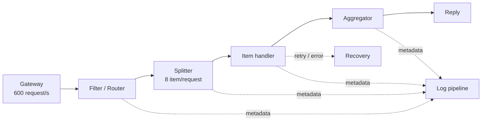
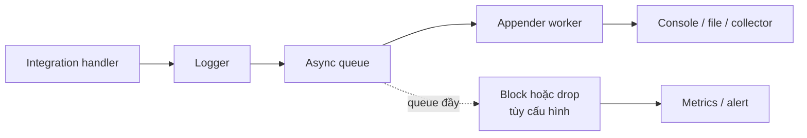

# Giới hạn message log trong production

Ở môi trường phát triển, in từng message giúp dễ thấy Filter loại gì, Router chọn nhánh nào và Transformer trả về payload ra sao. Trong production, một request có thể qua nhiều kênh, tách thành hàng chục hoặc hàng nghìn phần bằng Splitter, gọi dịch vụ ngoài rồi retry trước khi được Aggregator tổng hợp. Nếu mỗi bước ghi toàn bộ message, tốc độ tạo log có thể lớn hơn rất nhiều so với tốc độ request đầu vào.

**Giới hạn message log trong production** nghĩa là xác định sự kiện thật sự cần quan sát, mức chi tiết, số lượng tối đa có thể chấp nhận và cách xử lý khi pipeline log quá tải. Việc giảm log phải giữ đủ tín hiệu để phát hiện lỗi và điều tra yêu cầu cụ thể, nhưng không được làm thay đổi luồng nghiệp vụ.

Bài thuộc chương **Message logger** của module **SPRING_INTEGRATION_PATTERN**. Module học triển khai Enterprise Integration Patterns với Spring Integration nhằm xây dựng luồng thông điệp ít phụ thuộc, dễ mở rộng; thực hành Router, Filter, Transformer, Splitter, Aggregator, Gateway, retry, error channel và correlation, đồng thời kiểm thử và theo dõi các nhánh xử lý.

Sau bài học, bạn có thể:

- Ước lượng lượng log tạo ra từ request, message con và retry; thiết lập ngân sách cho events/s, bytes/s và retention.
- Chọn mức `ERROR`, `WARN`, `INFO`, `DEBUG`, `TRACE` và logger category theo nhu cầu vận hành.
- Giảm log bằng chọn điểm quan sát, sampling, giới hạn tần suất và tổng hợp sự kiện nhưng không làm mất message nghiệp vụ.
- Hiểu rủi ro khi async appender hoặc collector đầy hàng đợi, và cách giám sát việc drop/block.
- Cấu hình điểm log trong Spring Integration Java DSL và tạo nhánh chẩn đoán có sampling.
- Kiểm tra tính an toàn của dữ liệu, correlation, hiệu năng và hành vi khi logging bị tắt hoặc suy giảm.

## 1. Vì sao production cần giới hạn log?

Giả sử một luồng nhận đơn hàng:



Nếu đặt hai logger trên đường đi của **mỗi message con**, một request tạo ra ít nhất `8 × 2 = 16` dòng log tại nhánh Splitter/handler, chưa tính Gateway, Router, Aggregator, retry và exception. Khi request tăng, log tăng theo số message trung gian, không chỉ theo số API call.

Giới hạn log giúp kiểm soát bốn nhóm tác động:

1. **Tài nguyên ứng dụng:** format chuỗi, serialize payload, cấp phát bộ nhớ, lock, CPU và garbage collection.
2. **Độ trễ và backpressure:** ghi file/console có thể block; hàng đợi async appender có giới hạn, đôi khi drop log.
3. **Chi phí vận hành:** network egress, ingest, indexing, storage, retention và khả năng truy vấn.
4. **Bảo mật và khả năng điều tra:** càng nhiều payload/header bị phát ra, càng khó quản lý dữ liệu nhạy cảm; quá nhiều dòng trùng còn che khuất tín hiệu lỗi.

Không phải ít log hơn luôn tốt hơn. Một hệ thống không giữ sự kiện lỗi cuối hoặc không có correlation ID có thể tiết kiệm chi phí ingest nhưng khiến việc phục hồi kéo dài. Cần xác định **ngân sách log và mức quan sát tối thiểu** ngay trong thiết kế flow.

## 2. Xác định log budget và mức cần giữ

Một budget thực tế nên có những giới hạn đo được:

| Chỉ số | Câu hỏi vận hành | Ví dụ chính sách |
| --- | --- | --- |
| `events/s` | Mỗi instance và toàn cụm phát bao nhiêu dòng? | Có biểu đồ theo service, logger category và event |
| `bytes/s` | Đường truyền và collector phải nhận bao nhiêu dữ liệu? | Cảnh báo khi vượt ngưỡng đã đo từ tải thực |
| `bytes/request` | Một yêu cầu bình thường tạo bao nhiêu log? | Giữ INFO ở các mốc đầu/cuối; chi tiết qua DEBUG |
| `logs/error` | Một lỗi được ghi bao nhiêu lần? | Một bản ghi thất bại cuối, attempt ghi ngắn |
| `queue occupancy` | Appender còn bao nhiêu dung lượng đệm? | Theo dõi hàng đợi và số sự kiện bị drop |
| `p95/p99 latency` | Bật log có làm chậm xử lý message? | Đo trước/sau với cùng workload |
| `retention` | Giữ log bao lâu, ở tier nào? | Phụ thuộc chính sách dữ liệu và nhu cầu điều tra |

Không dùng một ngưỡng số dòng/s cố định cho mọi dự án. Đầu tiên cần đo lưu lượng hiện tại, độ lớn bản ghi, đặc điểm Splitter/Retry, yêu cầu audit và sức chứa collector; sau đó đặt ngưỡng phù hợp với kiến trúc.

### Phân loại log theo giá trị

- **Tín hiệu tối thiểu cần cho vận hành:** hệ thống nhận/hoàn tất công việc quan trọng, lỗi cuối, timeout nhóm, tình trạng recovery; nên có chính sách giữ rõ ràng.
- **Chi tiết điều tra:** từng quyết định Router, message con, header an toàn, bước Transformer, retry attempt; thường đặt ở `DEBUG` hoặc sampling có chủ đích.
- **Thông tin quá hạt:** ghi mọi lần gọi hàm, mọi payload, toàn bộ headers, stack trace lặp lại; chỉ bật tạm thời trong phạm vi hẹp khi có nhu cầu hợp lệ.

Nếu luật hoặc nghiệp vụ yêu cầu một nhật ký **audit** đầy đủ, đừng mặc định dùng application logging có thể bị sampling/drop làm kho bằng chứng. Thiết kế audit với hợp đồng, độ bền, phân quyền và thời gian lưu riêng.

## 3. Ước lượng dung lượng log trước khi thêm logger

Có thể bắt đầu với mô hình gần đúng:

\[
V_{\text{ngày}} = R \times E \times B \times 86\,400
\]

Trong đó:

- `R` là request/s hoặc message/s tại ranh giới bạn đang tính.
- `E` là số bản ghi trung bình trên **mỗi đơn vị của R**. Nếu `R` là request/s thì `E` phải là log/request.
- `B` là kích thước trung bình một bản ghi tính bằng byte sau encode.
- `V` là lượng byte log thô trong một ngày, chưa tính nén, index, replication và metadata của collector.

Ví dụ **giả định**, không phải benchmark: 600 request/s, mỗi request sinh tám item; hai điểm log trong nhánh item; mỗi dòng JSON trung bình 350 byte.

```text
Events/s = 600 request/s × 8 item/request × 2 log/item
         = 9.600 log/s

Bytes/s  = 9.600 × 350 B = 3.360.000 B/s ≈ 3,36 MB/s

Bytes/day = 3.360.000 × 86.400
          = 290.304.000.000 B/ngày ≈ 290,3 GB/ngày
```

Nếu chỉ ghi hai sự kiện INFO ngắn trên **mỗi request**, vẫn cùng giả định 350 byte/log:

```text
600 × 2 × 350 × 86.400 = 36.288.000.000 B/ngày
                       ≈ 36,3 GB/ngày
```

Trong mô hình đó, log theo từng phần tử tạo khoảng tám lần dung lượng log so với hai mốc request. Nếu chỉ lấy mẫu 5% request cho log DEBUG theo từng item, **phần log DEBUG được chọn** giảm từ khoảng 290,3 xuống 14,5 GB/ngày, nhưng các sự kiện INFO, WARN và ERROR được giữ theo chính sách riêng vẫn tạo dung lượng bổ sung.

Cần tính lại khi có:

- Splitter nhiều tầng hoặc fan-out đến nhiều subscriber;
- Retry nhiều attempt cho cùng message con;
- Aggregator chờ và ghi log mỗi lần nhóm thay đổi;
- Exception stack trace dài hơn nhiều so với bản ghi bình thường;
- Nhiều instance, collector sao chép hoặc indexing cùng một event;
- Bật thêm fields JSON, MDC hoặc tracing.

**Lưu ý:** lấy mẫu 5% request không nhất thiết tạo đúng 5% byte log. Request dài có thể tạo nhiều item hơn; số lần retry và độ dài bản ghi cũng khác nhau. Hãy đo thực tế.

## 4. Chọn log level và logger category cho production

Bảng chính sách tham khảo:

| Level | Dùng cho | Tránh |
| --- | --- | --- |
| `ERROR` | Thất bại cuối, dữ liệu không thể xử lý, recovery không thành công | Ghi cùng stack trace ở mọi attempt retry |
| `WARN` | Bất thường có thể phục hồi hoặc cần theo dõi | Xem mọi Filter reject hợp lệ là cảnh báo |
| `INFO` | Mốc bắt đầu/kết thúc quan trọng, kết quả nghiệp vụ được chấp nhận | Ghi mỗi item của Splitter tại tải lớn |
| `DEBUG` | Nhánh Router, ID nhóm/sequence, payload type, quyết định Transformer | Bật thường trực cho toàn framework |
| `TRACE` | Điều tra chi tiết luồng message ở phạm vi rất hẹp | Bật toàn cục trong thời gian dài |

Spring Boot có thể cấu hình mức cho từng category:

```yaml
logging:
  level:
    root: INFO
    org.springframework.integration: WARN
    app.integration.orders: INFO
    app.integration.diagnostic: WARN
```

Khi cần điều tra một flow, có thể tạm đổi **riêng** `app.integration.diagnostic` sang `DEBUG`, sau đó khôi phục mức ban đầu. Nếu dự án dùng Spring Boot Actuator `loggers` endpoint để đổi runtime, phải kích hoạt và phân quyền endpoint phù hợp. Đừng để mọi người có thể bật TRACE hoặc phát dữ liệu nhạy cảm tùy ý.

Hai nguyên tắc quan trọng:

1. **Mức ở điểm log và mức của backend đều liên quan.** Một điểm `.log(LoggingHandler.Level.DEBUG, ...)` có thể bị lọc khi category chỉ bật INFO.
2. **Tắt level không bảo đảm mọi công việc chuẩn bị dữ liệu biến mất.** Java vẫn đánh giá biểu thức truyền làm đối số logger trước khi gọi phương thức. Với dữ liệu tốn kém, dùng guard hoặc supplier hỗ trợ bởi thư viện; đối với `.log(...)` trong flow, đo cụ thể theo phiên bản Spring Integration.

Ví dụ SLF4J:

```java
// Sai về chi phí: expensiveJson() chạy trước khi logger quyết định ghi.
log.debug("payload={}", expensiveJson(message.getPayload()));

// Tốt hơn khi thật sự cần tính nội dung đắt đỏ.
if (log.isDebugEnabled()) {
    log.debug("payloadSummary={}", approvedSummary(message.getPayload()));
}
```

Chỉ đưa `approvedSummary` chứa field đã được phép vào log; bật DEBUG không đồng nghĩa được phép ghi full payload.

## 5. Chọn vị trí log theo Enterprise Integration Pattern

Giới hạn log hiệu quả bắt đầu từ **bỏ điểm quan sát ít giá trị**, rồi mới nghĩ đến sampling.

| Pattern | Log thường trực nên cân nhắc | Log chi tiết khi điều tra |
| --- | --- | --- |
| Gateway / inbound | `received` hoặc kết quả cuối, request ID | Adapter metadata, loại payload |
| Filter | Lỗi validate thực sự bất thường, số reject qua metric | `accepted/rejected` và mã lý do |
| Router | Nhánh rủi ro cao hoặc thay đổi tuyến quan trọng | Quyết định mỗi message, enum route |
| Transformer | Lỗi chuyển đổi và schema không tương thích | Source/target type, schema version |
| Splitter | Bắt đầu/kết thúc nhóm, số phần tử | Mỗi item với `groupId` và sequence |
| Aggregator | Hoàn thành/timeout nhóm | Số message nhận, trạng thái nhóm từng lần cập nhật |
| Retry | Hết retry, tỷ lệ retry bất thường | `attempt` của từng lần thử và mã lỗi |
| Error channel | Thất bại cuối, recovery action | Ngữ cảnh failed message đã được lọc |
| Outbound adapter | Thành công/thất bại quan trọng, mã đích | Chi tiết request đã che, độ trễ |

Ví dụ, logger đặt **sau Filter** không thấy message bị loại; nếu cần theo dõi reject, đặt discard flow hoặc counter phù hợp. Với Router, log nhánh thực tế đã chọn thay vì suy từ tên handler sau đó. Với Aggregator, không log toàn bộ nhóm payload để biết kích thước; ghi `groupSize` và `groupId` là đủ cho đa số tình huống.

Nếu một item được retry ba lần, event `retry` có thể là ba dòng; đừng cộng thêm ba stack trace từ advice, handler và error channel. Chọn điểm chịu trách nhiệm ghi lỗi cuối, còn các điểm khác ghi trạng thái ngắn/metric.

## 6. Ví dụ Java DSL: log theo mốc, giới hạn chi tiết ở nhánh quan sát

Ví dụ sau dùng Java 17+, Spring Integration Java DSL và **SLF4J 2.x**. Business flow nhận `OrderSubmitted`, Filter đơn hàng không hợp lệ rồi chuyển sang service. Một Wire Tap gửi bản message sang nhánh chẩn đoán. **Chỉ nhánh chẩn đoán** được lấy mẫu; message nghiệp vụ không bị Filter theo tỷ lệ sampling.

```java
import java.util.regex.Pattern;

import org.slf4j.Logger;
import org.slf4j.LoggerFactory;
import org.springframework.context.annotation.Bean;
import org.springframework.context.annotation.Configuration;
import org.springframework.integration.channel.DirectChannel;
import org.springframework.integration.dsl.IntegrationFlow;
import org.springframework.integration.handler.LoggingHandler;
import org.springframework.messaging.Message;
import org.springframework.messaging.MessageChannel;
import org.springframework.stereotype.Service;

record OrderSubmitted(String orderId, int itemCount) { }

@Service
class OrderProcessor {
    public void process(OrderSubmitted order) {
        // Xử lý nghiệp vụ thực tế (cần triển khai trong ứng dụng).
    }
}

@Configuration
class OrderLoggingFlowConfig {

    private static final Logger diagnosticLog =
            LoggerFactory.getLogger("app.integration.diagnostic");

    private static final Pattern SAFE_REQUEST_ID =
            Pattern.compile("[A-Za-z0-9_-]{1,64}");

    @Bean
    MessageChannel ordersInput() {
        return new DirectChannel();
    }

    @Bean
    MessageChannel diagnosticTap() {
        return new DirectChannel();
    }

    @Bean
    IntegrationFlow ordersFlow(OrderProcessor processor) {
        return IntegrationFlow.from("ordersInput")
                // Chỉ quan sát; không điều khiển quyết định nghiệp vụ.
                .wireTap("diagnosticTap")
                .filter(OrderSubmitted.class, order -> order.itemCount() > 0)
                .log(LoggingHandler.Level.INFO, "app.integration.orders",
                        message -> "event=order_accepted messageId="
                                + message.getHeaders().getId())
                .handle(processor, "process")
                .get();
    }

    @Bean
    IntegrationFlow sampledDiagnosticFlow() {
        return IntegrationFlow.from("diagnosticTap")
                .handle(message -> sampledLog(message))
                .get();
    }

    private static void sampledLog(Message<?> message) {
        String requestId = safeRequestId(message);

        // Mẫu minh họa: chọn ổn định khoảng 5% ID hợp lệ.
        // Không áp dụng chọn mẫu này cho lỗi cuối/audit bắt buộc.
        if (!diagnosticLog.isDebugEnabled()
                || "missing".equals(requestId)
                || Math.floorMod(requestId.hashCode(), 100) >= 5) {
            return;
        }

        diagnosticLog.atDebug()
                .addKeyValue("event", "integration.message_seen")
                .addKeyValue("requestCorrelationId", requestId)
                .addKeyValue("messageId", message.getHeaders().getId())
                .addKeyValue("payloadType",
                        message.getPayload().getClass().getSimpleName())
                .log("diagnostic message observed");
    }

    private static String safeRequestId(Message<?> message) {
        Object raw = message.getHeaders().get("requestCorrelationId");
        if (raw instanceof String id
                && SAFE_REQUEST_ID.matcher(id).matches()) {
            return id;
        }
        return "missing";
    }
}
```

**Cách đọc ví dụ:**

1. `ordersInput` nhận message từ Gateway hoặc inbound adapter; `OrderProcessor` là nơi làm nghiệp vụ.
2. `wireTap("diagnosticTap")` tạo nhánh quan sát mà không lọc message khỏi đường chính. Với `DirectChannel`, nhánh tap được gọi đồng bộ nên bản thân việc lấy mẫu vẫn có chi phí; nếu muốn cô lập thời gian xử lý cần thiết kế channel/queue riêng và đo backpressure.
3. `.log(... INFO ...)` sau Filter ghi một mốc chấp nhận; để biết reject hãy thêm discard flow hoặc metric. Không phải mọi message đi qua tap đều vượt qua Filter.
4. `sampledLog` chỉ ghi một số message tại `DEBUG`, chọn ổn định theo `requestCorrelationId` nên các điểm chẩn đoán dùng cùng quy tắc có thể chọn cùng yêu cầu.
5. `hashCode()` là ví dụ định tuyến mẫu nhẹ, **không phải hàm băm bảo mật hay bảo đảm phân phối hoàn hảo**. ID nên được tạo ngẫu nhiên hoặc kiểm soát tại ingress; nếu đối tác có thể chọn ID để né sampling, dùng cơ chế chọn mẫu tin cậy hơn.
6. Đưa ID đã kiểm tra và tên loại payload vào log; không dùng `message.toString()` hay ghi nguyên headers.
7. Đặt level `DEBUG` cho category `app.integration.diagnostic` khi cần điều tra. Structured key-value yêu cầu encoder/backend hỗ trợ để hiển thị thành trường riêng.

Đây là khung học tập; cần bổ sung xử lý trường hợp Filter loại, kết quả nghiệp vụ, timeout, error flow, metrics và yêu cầu triển khai thực tế. Các event `ERROR` cuối, audit bắt buộc và sự kiện an toàn quan trọng phải có đường ghi/giám sát **riêng với chính sách sampling**.

### Sampling theo request khác sampling theo message

Nếu chỉ lấy mẫu 5% **message**, các phần tử của cùng một request có thể được chọn không đồng bộ: có dòng ở Splitter nhưng thiếu dòng ở Aggregator. Chọn dựa trên một `requestCorrelationId` ổn định giúp lấy toàn bộ các điểm debug của những request được chọn, dễ dựng timeline. Tuy nhiên, request có số phần tử không đều có thể khiến tổng log khác 5%.

Sampling cho log cũng **không** thay thế sampling của distributed tracing, và không thay đổi kết quả truyền message qua Channel, Router, Filter hay Aggregator.

## 7. Rate limiting và gộp sự kiện log lặp

Sampling và rate limiting giải quyết hai vấn đề khác nhau:

| Kỹ thuật | Cách hoạt động | Khi nào hữu ích | Giới hạn |
| --- | --- | --- | --- |
| Sampling theo request | Chọn một phần yêu cầu để ghi chi tiết | Luồng có nhiều message con, cần timeline | Có thể bỏ sót sự cố hiếm |
| Sampling xác suất mỗi event | Chọn ngẫu nhiên một số event | Thống kê tương đối trên lượng lớn | Khó khôi phục chính xác một request |
| Rate limiting log | Giới hạn số event có thể ghi mỗi khoảng | Lỗi lặp dày, cảnh báo cùng nguyên nhân | Có thể ẩn sự gia tăng nếu không đếm số bị bỏ |
| Gộp/tóm tắt | Ghi `count=...` trong một cửa sổ | Thông báo lặp giống nhau | Mất chi tiết từng message |
| Điều chỉnh level/category | Bật/tắt nhóm log theo nhu cầu | Khống chế thường trực và điều tra | Bật rộng có thể tăng tải rất nhanh |

Ví dụ thay vì tạo một ngàn dòng WARN giống nhau về việc upstream tạm ngừng, có thể ghi một số cảnh báo đầu tiên rồi một bản ghi dạng:

```json
{
  "event": "integration.upstream_unavailable_summary",
  "stage": "inventoryGateway",
  "errorCode": "UPSTREAM_TIMEOUT",
  "windowSeconds": 60,
  "observedFailures": 1200,
  "suppressedLogEvents": 1190
}
```

Dữ liệu trên là **ví dụ minh họa**, không phải output tự động của framework. Số `observedFailures` phải lấy từ counter/nguồn đo tin cậy và `suppressedLogEvents` phải được đo trong chính sách rate limiting; không tự suy từ số log còn lại.

**Phân biệt:** Rate Limiter dùng trong Enterprise Integration Patterns để giới hạn **tốc độ xử lý message nghiệp vụ**; rate limiter dùng cho logging chỉ điều tiết **sự kiện quan sát**. Đừng áp dụng Filter hoặc throttle lên business channel khi mục tiêu duy nhất là giảm log.

Các lỗi cuối cần điều tra, sự kiện bảo mật và audit bắt buộc không nên bị cắt theo cùng quy tắc với debug thành công. Nếu phải giới hạn cảnh báo lặp, hãy giữ tổng số lỗi qua metrics và một cơ chế cảnh báo không phụ thuộc vào số dòng còn lại.

## 8. Async appender, queue đầy và backpressure

Ứng dụng có thể ghi log đồng bộ hoặc dùng async appender/queue. Bất đồng bộ giảm thời gian chờ ghi đích trên một số workload, nhưng vẫn tốn chi phí tạo event, encode/enqueue và dùng bộ nhớ.



Có ba tình huống cần thiết kế rõ:

- **Block khi queue đầy:** giữ được nhiều log hơn nhưng tăng độ trễ hoặc làm nghẽn worker xử lý message.
- **Drop event:** giúp tránh block ứng dụng nhưng có thể mất dấu vết sự cố; hành vi có thể phụ thuộc level và cấu hình appender.
- **Collector hoặc ổ đĩa chậm:** queue tăng, RAM bị sử dụng, việc flush/shutdown có thể không hoàn tất trước khi process dừng.

Với Logback `AsyncAppender`, các thuộc tính như `queueSize`, `discardingThreshold` và `neverBlock` ảnh hưởng đến cách đệm/chặn/bỏ sự kiện. Đừng sao chép một cấu hình queue “mặc định an toàn” cho mọi production: kiểm tra backend, version, sức chứa, chính sách drop và loại log cần bảo đảm. Async logging **không tự biến application log thành kênh durable messaging**.

Nếu log cần làm audit hoặc sự kiện tuân thủ có yêu cầu giữ toàn bộ, thiết kế một cơ chế lưu trữ bền vững riêng. Đừng trông cậy vào hàng đợi appender có thể mất dữ liệu khi crash.

### Hành vi khi thay đổi cấu hình

Bật `TRACE` cho toàn bộ `org.springframework.integration` có thể nhân nhiều lần số bản ghi, nhất là trong flow có Splitter. Trước khi bật runtime, cần xác định category cần thiết, đối tượng bị ảnh hưởng, thời gian giới hạn, khả năng tắt lại và chỉ số giám sát. Sau khi hết nhu cầu, khôi phục level đã định.

## 9. Correlation và observability khi giảm log

Giảm số dòng chỉ hữu ích khi người vận hành vẫn có thể tìm đúng chuỗi sự kiện. Nên giữ metadata nhất quán:

- `requestCorrelationId`: mã do ứng dụng cấp để theo dõi một yêu cầu xuyên flow.
- `messageId`: ID của message hiện tại, có thể thay đổi khi tạo message mới.
- `correlationId` hoặc `groupId`: khóa gom nhóm Splitter/Aggregator, có thể khác request ID.
- `sequenceNumber` và `sequenceSize`: vị trí và kích thước nhóm khi phù hợp.
- `traceId`/`spanId`: context của distributed tracing nếu đã instrument.
- `event`, `stage`, `route`, `errorCode`, `attempt`, `durationMs`: trường chẩn đoán có tên và kiểu ổn định.

Một mẫu log INFO tối thiểu có thể là:

```json
{"event":"integration.received","requestCorrelationId":"req_42","stage":"ordersInput"}
{"event":"integration.aggregate_completed","requestCorrelationId":"req_42","groupSize":8}
{"event":"integration.replied","requestCorrelationId":"req_42","result":"ACCEPTED"}
```

Nếu cần điều tra sâu một request, kích hoạt DEBUG đúng category và theo chính sách sampling hoặc chẩn đoán tạm thời được kiểm soát. Log quan sát không làm thay đổi `requestCorrelationId`, không phải nguồn để tái tạo state nghiệp vụ.

**MDC và thread:** đặt ID trong MDC có scope và dọn khi kết thúc handler. Với `ExecutorChannel`, poller hoặc broker, MDC không mặc nhiên đi theo message; lấy lại correlation từ header đã được chuẩn hóa. Tránh dùng email hoặc token làm ID dễ tìm vì dữ liệu đó có thể lan sang logger và tracing.

## 10. Bảo vệ dữ liệu nhạy cảm trước khi phát log

Giới hạn số lượng log **không thay thế** việc lọc dữ liệu nhạy cảm. Một request hiếm được chọn mẫu vẫn có thể chứa password hoặc token. Khi log toàn bộ message, headers hoặc stack trace, sampling chỉ làm giảm xác suất lộ chứ không loại bỏ rủi ro.

Nguyên tắc thực hành:

1. **Allowlist** trường an toàn như `event`, `stage`, `requestCorrelationId` đã kiểm soát, `messageId`, `route` thuộc enum, `groupSize`, `durationMs`, `errorCode`.
2. **Không** serialize toàn bộ `Message<?>`, payload, `MessageHeaders`, request/response body hoặc token trong debug thông thường.
3. Chỉ dùng thông báo exception/stack trace khi có chính sách rõ về quyền truy cập, redaction và retention; `Throwable.getMessage()` có thể chứa dữ liệu người dùng.
4. Giới hạn độ dài và ký tự của trường đến từ bên ngoài để tránh log injection và tăng kích thước bất thường.
5. Đảm bảo logger thư viện HTTP, broker và framework không tự in headers nhạy cảm khi bật DEBUG/TRACE.
6. Dùng structured JSON encoder để giữ kiểu field và escaping phù hợp; JSON đúng cú pháp **không có nghĩa** thông tin bên trong được phép ghi.

Ví dụ một error flow có thể ghi `event=integration.failed`, `requestCorrelationId`, `errorType` và `errorCode` từ bảng ánh xạ thay vì `log.error("{}", failedMessage)`.

## 11. Đo tải và phát hiện mất log

Để biết việc giới hạn log có hiệu quả và không che mất sự cố, theo dõi song song **metrics của ứng dụng** và **metrics của logging pipeline**:

| Chỉ số | Ý nghĩa | Điều cần kiểm tra |
| --- | --- | --- |
| Request/message processed | Lưu lượng nghiệp vụ thực | Không dựa vào số dòng log để ước lượng khi có sampling |
| Success/failure/retry counters | Tỷ lệ thành công, lỗi, retry | Có cảnh báo ngay cả khi WARN bị rate-limit |
| Log events/s và bytes/s | Tải phát ra từ ứng dụng | Phân tích theo service/category/level |
| Queue depth / occupancy | Hàng đợi appender hoặc collector sắp đầy | Cảnh báo và capacity planning |
| Dropped log events | Số log bị bỏ bởi appender hoặc pipeline | Không hiểu nhầm sự giảm dòng là hệ thống hết lỗi |
| Error log volume | Độ lớn stack trace và lỗi lặp | Xem có log nhiều lần cho cùng attempt không |
| CPU, memory, GC | Chi phí logging tại ứng dụng | So sánh trước/sau khi thêm điểm log |
| `p50/p95/p99` latency | Tác động lên thời gian xử lý | Kiểm tra cả trường hợp collector bị chậm |
| Ingest/index/storage/retention | Chi phí ở hệ thống log | Kiểm tra chính sách index và thời gian lưu |

Ví dụ: sau một đợt deploy, INFO log giảm 70%, nhưng `failure_counter` tăng và `dropped_events` tăng cùng lúc. Đó có thể là dấu hiệu logger/collector quá tải, **không phải** ứng dụng đã ổn hơn.

Với hệ thống phân tán, đồng bộ timestamp/timezone và lưu các ID đã kiểm soát để dựng timeline. Có thể sử dụng traces cho luồng xuyên service và metrics để theo dõi tần suất lỗi; không cần biến mỗi stage thành một dòng INFO.

## 12. Kiểm thử chính sách log trong production

Các bài kiểm thử nên mô phỏng thay đổi level, lưu lượng, lỗi, retry và chậm I/O. Giữ cùng workload, cấu hình JVM, số instance, backend và chính sách collector khi so sánh.

| Kịch bản | Cách làm | Kết quả mong đợi |
| --- | --- | --- |
| DEBUG tắt | Gửi nhiều message hợp lệ | Không in detail DEBUG; nghiệp vụ vẫn hoạt động |
| DEBUG bật riêng category | Bật trong khoảng kiểm thử giới hạn | Có detail đúng flow, không có payload nhạy cảm |
| Nhiều request qua Splitter | Tạo request có 1, 8, 100 item | Events/s tăng theo vị trí logger; quan sát đúng budget |
| Sampling ổn định theo request | Gửi nhiều message chung request ID | Các điểm dùng cùng chính sách chọn nhất quán |
| Filter loại message | Đưa payload không hợp lệ | Nhánh reject có counter/reasonCode, business handler không chạy |
| Retry rồi thành công | Tạo lỗi giả một vài attempt | Attempt và recovery được đếm; không ghi failure cuối giả |
| Hết retry | Tạo lỗi luôn thất bại | Sự kiện lỗi cuối được giữ; correlation không mất |
| Async queue đầy | Mô phỏng đích log chậm trong môi trường thử | Biết policy block/drop, đo p95 latency và dropped events |
| Collector không sẵn sàng | Ngắt collector trong môi trường test | Hành vi nghiệp vụ và logging suy giảm theo thiết kế |
| Payload chứa token giả | Bật các mức log đang hỗ trợ | Token canary không có trong output, kể cả lỗi và stack trace |
| Hai request chạy song song | Chuyển qua executor/poller | MDC và request ID không lẫn giữa các thread |

### Đo chi phí đánh giá đối số Java

Một cách kiểm tra đơn giản cho log debug:

```java
import java.util.concurrent.atomic.AtomicInteger;
import org.slf4j.Logger;

static String buildDebugSummary(AtomicInteger counter) {
    counter.incrementAndGet();
    return "summary";
}

static void unguarded(Logger logger, AtomicInteger counter) {
    logger.debug("summary={}", buildDebugSummary(counter));
}

static void guarded(Logger logger, AtomicInteger counter) {
    if (logger.isDebugEnabled()) {
        logger.debug("summary={}", buildDebugSummary(counter));
    }
}
```

Khi DEBUG tắt, `unguarded` vẫn gọi `buildDebugSummary`; `guarded` không gọi. Phép kiểm tra này chứng minh hành vi đánh giá đối số của Java, **không phải benchmark** của Spring Integration. Với logging operator, Wire Tap và async appender, cần đo trên pipeline thật.

Trong thử tải, nên ghi rõ số request, số message sau Splitter, số attempt, số bản ghi phát ra, số byte, CPU, GC và latency trước/sau. Đừng chỉ nhìn dung lượng file khi collector có nén, sampling hoặc giới hạn bản ghi.

## 13. Bài thực hành: đặt giới hạn log cho luồng đơn hàng

**Tình huống:** một Gateway nhận 600 request/s, Filter loại request không hợp lệ, Router chia `priority` và `standard`, Splitter tạo từ 1 đến 20 item, một số item cần retry, Aggregator gom kết quả. Mục tiêu là giới hạn log production nhưng vẫn phát hiện và điều tra lỗi.

Thực hiện:

1. Vẽ đường message từ Gateway đến Aggregator và error channel. Đánh dấu điểm nào đang log theo request, điểm nào log theo item, điểm nào ghi stack trace.
2. Đặt một log budget ban đầu: events/request ở trạng thái thường, bytes/day kỳ vọng, mức tối đa khi tăng tải và chính sách giữ log lỗi.
3. Chỉ giữ `INFO` ở mốc chấp nhận/hoàn tất quan trọng; dùng metric cho reject và retry; đặt `DEBUG` cho quyết định Router và các item trong Splitter.
4. Giữ `requestCorrelationId` xuyên flow và log ID nhóm/sequence tại nhánh được chọn để điều tra; tránh đưa payload vào log.
5. Thiết lập sampling cho sự kiện chẩn đoán: 5% request hợp lệ theo ID do ứng dụng cấp. Đảm bảo Filter business **không** phụ thuộc vào việc request được lấy mẫu hay không.
6. Bật thử logger DEBUG đúng category rồi so events/s và byte ingest với ước tính; kiểm tra các request nhiều item có tạo lượng log đột biến không.
7. Tạo lỗi timeout, retry thành công và retry hết số lần; xác minh sự kiện lỗi cuối vẫn được ghi đầy đủ theo chính sách dù detail DEBUG được lấy mẫu.
8. Mô phỏng queue appender/collector chậm trong môi trường kiểm thử; kiểm tra block/drop, độ trễ, CPU và các chỉ số cảnh báo.
9. Dùng token canary giả trong message; xác minh không lộ ở INFO, DEBUG, error channel và formatter.
10. Ghi kết quả, giới hạn thực tế và quy trình tạm bật/tắt log khi sự cố; khôi phục category level mặc định sau thử nghiệm.

**Tiêu chí hoàn thành:** throughput và xử lý nghiệp vụ giữ đúng; có thể tìm request lỗi qua correlation; error cuối được quan sát; log theo item được khống chế theo budget; có số liệu về dropped events và queue; dữ liệu nhạy cảm không xuất hiện trong log.

### Câu hỏi tự kiểm tra

1. Vì sao 600 request/s có thể tạo gần 10.000 dòng log/s sau Splitter?
2. Sự khác nhau giữa sampling theo message và sampling theo `requestCorrelationId` là gì?
3. Vì sao không nên đặt Filter business để loại 95% message khi chỉ muốn giảm DEBUG log?
4. Tắt DEBUG có loại bỏ mọi chi phí tạo dữ liệu cho log hay không?
5. Với async appender, queue đầy có thể ảnh hưởng gì đến độ trễ hoặc tính đầy đủ của log?
6. Vì sao rate-limit WARN lặp lại cần đi kèm counter số lỗi thật?
7. Làm thế nào phân biệt request ID với `correlationId` của Aggregator và `traceId`?
8. Nếu số log ERROR giảm nhưng metric failure tăng, bạn sẽ kiểm tra những gì?
9. Khi nào cần dùng một kênh audit bền vững riêng thay vì application logging?
10. Làm sao kiểm thử tính bí mật dữ liệu khi DEBUG/TRACE chỉ bật trong thời gian ngắn?

## 14. Tài liệu tham khảo

- [Spring Integration Reference — Logging Channel Adapter](https://docs.spring.io/spring-integration/reference/logging-adapter.html): `LoggingHandler` và lựa chọn nội dung.
- [Spring Integration Reference — Java DSL log operator](https://docs.spring.io/spring-integration/reference/dsl/java-log.html): logging trong `IntegrationFlow`.
- [Spring Integration Reference — Wire Tap](https://docs.spring.io/spring-integration/reference/channel/wire-tap.html): tạo nhánh quan sát từ channel.
- [Spring Integration Reference — Splitter](https://docs.spring.io/spring-integration/reference/splitter.html) và [Aggregator](https://docs.spring.io/spring-integration/reference/aggregator.html): ảnh hưởng message nhóm và sequence.
- [Spring Integration Reference — Error Handling](https://docs.spring.io/spring-integration/reference/error-handling.html): error channel và lỗi đồng bộ/bất đồng bộ.
- [Spring Boot Reference — Logging](https://docs.spring.io/spring-boot/reference/features/logging.html): cấu hình logger và log level.
- [SLF4J Manual](https://www.slf4j.org/manual.html): tham số log và fluent API.
- [Logback Manual — Appenders](https://logback.qos.ch/manual/appenders.html): synchronous/async appender và queue.
- [OWASP Logging Cheat Sheet](https://cheatsheetseries.owasp.org/cheatsheets/Logging_Cheat_Sheet.html): giới hạn nội dung nhạy cảm, log injection và chất lượng log.

**Ghi nhớ:** giới hạn message log trong production là **giữ đúng các tín hiệu quan sát cần thiết trong một ngân sách tài nguyên rõ ràng**. Chọn điểm log theo pattern, giảm chi tiết từng item, sampling chỉ ở nhánh chẩn đoán, giữ metric lỗi và sự kiện thất bại cuối. Đo việc queue block/drop, bảo vệ dữ liệu nhạy cảm và đảm bảo các quyết định nghiệp vụ vẫn diễn ra độc lập với logging.
