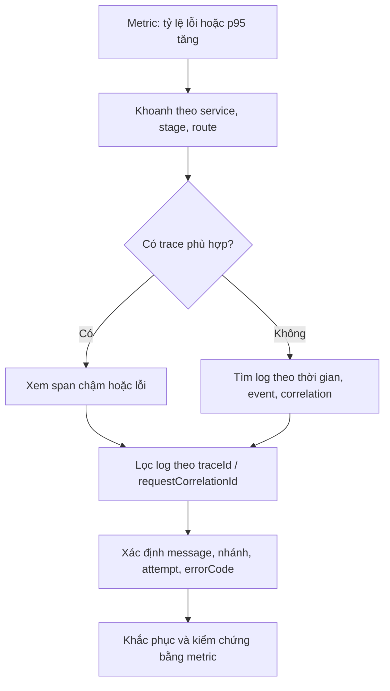
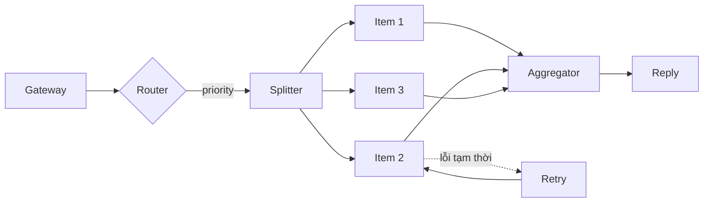

# Đối chiếu log với metric và trace

Một luồng Spring Integration có thể đi qua Gateway, Filter, Router, Transformer, Splitter, Aggregator rồi gọi nhiều dịch vụ bên ngoài. Khi kết quả cuối chậm hoặc sai, đọc từng dòng log không nhất thiết cho biết **mức độ ảnh hưởng**; một chỉ số tổng hợp về thời gian xử lý cũng không chỉ ra **yêu cầu nào gặp lỗi**. Distributed trace giúp thấy các chặng trong một lượt xử lý, nhưng có thể bị lấy mẫu và không có đầy đủ quyết định nghiệp vụ.

Vì thế, cần **đối chiếu log, metric và trace** thay vì chọn một nguồn thay thế tất cả:

- **Metric** cho biết *bao nhiêu, nhanh hay chậm, thay đổi từ lúc nào*.
- **Trace** cho biết *một lần xử lý đi qua các bước nào, mất thời gian ở đâu*.
- **Log** cho biết *sự kiện cụ thể nào đã xảy ra, quyết định định tuyến và lỗi có ngữ cảnh gì*.

Bài thuộc chương **Message logger** trong module **SPRING_INTEGRATION_PATTERN**. Phạm vi là triển khai Enterprise Integration Patterns với Spring Integration để xây dựng luồng thông điệp ít phụ thuộc, dễ mở rộng; thực hành Router, Filter, Transformer, Splitter, Aggregator, Gateway, retry, error channel và correlation, đồng thời kiểm thử và theo dõi các nhánh xử lý.

Sau bài học, bạn có thể lựa chọn tín hiệu phù hợp cho từng câu hỏi vận hành, dùng ID nhất quán để liên hệ log với trace, tránh dùng request ID làm nhãn metric có cardinality cao, đo độ trễ và lỗi bằng Micrometer, và kiểm thử một kịch bản có Splitter, retry, Aggregator cùng error channel.

## 1. Ba loại tín hiệu giải quyết ba câu hỏi khác nhau

| Tín hiệu | Đơn vị thường gặp | Trả lời tốt nhất | Hạn chế quan trọng |
| --- | --- | --- | --- |
| **Log** | Sự kiện có thời gian và các trường | “Message nào bị loại? Router chọn nhánh gì? Error code là gì?” | Có thể rất nhiều, không đầy đủ do level, sampling, queue/drop |
| **Metric** | Counter, timer/histogram, gauge | “Lỗi tăng bao nhiêu? p95 trễ thế nào? Queue đang đầy không?” | Đã tổng hợp, thường không truy trực tiếp một request cụ thể |
| **Trace** | Trace gồm các span có quan hệ | “Yêu cầu này chậm ở adapter nào? Đi qua dịch vụ nào?” | Trace có thể không được lấy mẫu, propagation có thể đứt, không tự chứa mọi quyết định nghiệp vụ |

Giả sử một API xử lý 1.000 đơn/phút, trong đó 25 đơn thất bại ở adapter tồn kho. Một dashboard metric có thể báo tỷ lệ lỗi tăng từ 0,5% lên 2,5%. Một trace được ghi lại có thể cho thấy 1,3 giây nằm ở HTTP client gọi tồn kho. Log theo cùng request ID sẽ cho biết Router chọn nhánh nào, item thứ mấy phải retry và error code đã được phân loại.

**Không suy ra chính xác tổng số lỗi từ số dòng `ERROR`**: một exception có thể ghi nhiều lần, một lần retry được phục hồi không phải lỗi cuối, một số bản ghi bị sampling/drop, và có những lỗi được xử lý bằng metric mà không ghi stack trace.

### Ví dụ ba tín hiệu cho cùng một sự cố

```text
METRIC:
  integration_orders_total{stage="inventory", outcome="failure"} tăng
  integration_step_duration p95 tại inventory tăng

TRACE:
  HTTP inbound -> ordersFlow -> inventoryGateway (1,3 s) -> reply ERROR

LOG:
  event=integration.retry requestCorrelationId=req_42
  stage=inventory attempt=2 errorCode=UPSTREAM_TIMEOUT

  event=integration.failed requestCorrelationId=req_42
  stage=inventory errorCode=RETRY_EXHAUSTED
```

Đây là **đầu ra minh họa**. Tên metric, trường log và span không tự xuất hiện nguyên dạng nếu chưa cấu hình instrumentation và exporter.

## 2. Khung tư duy: phát hiện, khoanh vùng, giải thích

Một quy trình điều tra hiệu quả thường bắt đầu từ tín hiệu tổng quát và đi dần vào trường hợp cụ thể.



Không nhất thiết phải bắt đầu bằng metric trong mọi trường hợp. Khi người dùng cung cấp request ID của một giao dịch cụ thể, có thể tra log trước rồi mở trace liên quan. Khi alert báo cả hệ thống có độ trễ tăng, metric là điểm xuất phát phù hợp hơn.

Một vòng đối chiếu hoàn chỉnh gồm:

1. **Phát hiện:** dùng counter tỷ lệ lỗi, timer p95/p99 hoặc độ sâu queue.
2. **Phân đoạn:** xem stage, route, outcome, dependency theo các nhãn có tập giá trị hữu hạn.
3. **Khoanh vùng:** tìm trace còn được lưu, hoặc log trong cửa sổ thời gian tương ứng.
4. **Điều tra:** xác minh request ID, message ID, nhóm Splitter/Aggregator, số lần retry, error code.
5. **Khắc phục:** thay đổi cấu hình/logic hạ tầng hoặc nghiệp vụ.
6. **Xác nhận:** metric trở về ngưỡng bình thường; log lỗi cuối giảm; trace mới cho thấy thời gian chặng cải thiện.

## 3. Những ID nào cần phân biệt?

Tên gần giống nhau không có nghĩa là cùng phạm vi.

| Trường | Thuộc về | Cách sử dụng |
| --- | --- | --- |
| `requestCorrelationId` | Ứng dụng | Theo dõi toàn bộ yêu cầu/đơn hàng qua các bước và nhánh |
| `MessageHeaders.ID` | Spring Messaging | Nhận diện **message hiện tại**, có thể đổi khi tạo message mới |
| `correlationId` | Spring Integration / nhóm message | Gom message trong Splitter/Aggregator; có thể chỉ đúng cho một nhóm |
| `sequenceNumber`, `sequenceSize` | Nhóm được tách | Xác định message con, thứ tự và quy mô nhóm khi có |
| `traceId` | Distributed tracing | Liên kết các span trong một trace, nếu context được truyền đầy đủ |
| `spanId` | Distributed tracing | Nhận diện một chặng cụ thể trong trace |
| `businessId` / `orderId` | Nghiệp vụ | Tùy chính sách có thể nhạy cảm; không thay thế trace ID |

Ví dụ một request `req_42` chia thành ba message con. Cả ba nên giữ `requestCorrelationId=req_42`, nhưng mỗi message có `messageId` khác nhau. Header `correlationId` và `sequenceNumber` phục vụ việc Aggregator gom nhóm; chúng không tự động trở thành trace/span ID.

Một log chẩn đoán ở message con có thể được thiết kế như sau:

```json
{
  "event": "integration.item_retry",
  "flow": "orderFulfillment",
  "stage": "inventory",
  "requestCorrelationId": "req_42",
  "messageId": "54c314f3-62df-485f-a85e-f028df69531d",
  "groupRef": "grp_9",
  "sequenceNumber": 2,
  "attempt": 2,
  "errorCode": "UPSTREAM_TIMEOUT",
  "traceId": "a32d7b72c5734295a1c3b403b90d3a23",
  "spanId": "9f1a32c74d5bc680"
}
```

Đây là **schema do ứng dụng và backend quyết định**. `groupRef` minh họa mã nhóm đã chuẩn hóa, không phải ngầm định rằng header `correlationId` luôn là string an toàn. `traceId` và `spanId` chỉ có khi tracing đã được instrument và context tương ứng hiện diện.

### Mã tương quan không thay thế propagation

Tự thêm `requestCorrelationId` vào message headers giúp tra log và liên kết nghiệp vụ, nhưng **không tự tạo quan hệ cha–con giữa các span**. Trace cần ngữ cảnh tracing và propagation tương ứng của Micrometer Tracing/OpenTelemetry hoặc công nghệ đã chọn. Ngược lại, một trace có thể nối được các span nhưng vẫn thiếu group ID hoặc sequence của Aggregator.

Khi message đi qua `ExecutorChannel`, poller hoặc broker, thread thay đổi. SLF4J MDC thường gắn với thread nên không tự nhiên truyền theo message. Đừng giả định `MDC.put("traceId", ...)` ở Gateway sẽ xuất hiện trong mọi worker; cần context propagation được cấu hình, và scope MDC phải được dọn.

## 4. Chọn tín hiệu cho từng Enterprise Integration Pattern

| Pattern | Metric nên theo dõi | Trace nên thể hiện | Log nên ghi |
| --- | --- | --- | --- |
| Gateway/inbound | Requests, outcome, latency | Span vào luồng, chặng gọi | Nhận yêu cầu, ID, mã kết quả |
| Filter | Accepted/rejected counter | Span xử lý nếu có giá trị | `reasonCode` cho reject bất thường |
| Router | Counter theo route | Nhánh đã đi qua | `route` đã chọn, dùng enum |
| Transformer | Số lỗi map/schema | Chặng chuyển đổi tốn thời gian | Source/target type, mã lỗi |
| Splitter | Số message con, phân bố số phần/request | Fan-out hoặc chặng xử lý item | Group/sequence được kiểm soát khi cần |
| Aggregator | Group hoàn tất, timeout, thời gian chờ, số nhóm tồn | Chặng chờ nhóm nếu được instrument | `groupRef`, kích thước, release/timeout |
| Service Activator | Success/failure, timer | Span business/dependency | Kết quả hoặc error code |
| Retry | Counter số attempt, retry exhausted | Chặng gọi lại và độ trễ phụ thuộc | Attempt, error code, request ID |
| Error channel | Terminal failure counter, recovery outcome | Span lỗi/recovery nếu có | `integration.failed`, failed message ID |
| Outbound adapter | Throughput, latency, timeout | Span lời gọi ra dịch vụ | Destination loại đã duyệt, status, latency |

Tránh tạo một span cho mỗi phép xử lý rất nhỏ mà không có giá trị chẩn đoán: trace quá chi tiết có thể gây overhead như logging quá nhiều. Đặt instrumentation ở các ranh giới đáng quan sát như inbound, outbound, chờ queue, business stage và nhánh lỗi.

### Một message qua nhiều nhánh không nhất thiết là một timeline tuyến tính



Một trace có thể biểu diễn sự rẽ nhánh, nhưng cấu trúc span và liên kết giữa các phần tử phụ thuộc instrumentation; nếu asynchronous context bị mất, trace có thể bị chia thành nhiều trace riêng. Các message con đi qua Router/Splitter/Aggregator vẫn phải mang metadata nghiệp vụ phù hợp để log có thể đối chiếu dù trace thiếu một chặng.

## 5. Micrometer trong Spring Integration: vai trò và điều kiện

Spring Integration có các khả năng quản lý/thu thập số liệu và quan sát; Spring Boot có thể tích hợp Micrometer Metrics, Micrometer Observation và Micrometer Tracing. Tuy nhiên, **không nên giả định chỉ cần thêm dependency thì mọi channel/handler tự có đúng metric, trace và log correlation mong muốn**.

Cần phân biệt:

- **MeterRegistry:** nơi tạo/ghi các meter như `Counter`, `Timer`, `Gauge`. Registry và exporter phải phù hợp với hệ thống metric đang dùng.
- **ObservationRegistry:** điều phối các Observation với vòng đời bắt đầu/kết thúc và context. Khi đăng ký ObservationHandler phù hợp, Observation có thể trở thành metric hoặc trace.
- **Micrometer Tracing:** tạo và quản lý span, context propagation với bridge/exporter tương ứng; khi được cấu hình, có thể thêm trace/span ID vào MDC/log output.
- **Instrumentation Spring Integration:** tùy phiên bản, endpoint và cấu hình management/observation. Phải xác nhận những điểm được instrument, tên observation/metric, propagation và cardinality trong ứng dụng thực.

**Hệ quả:** gọi `Observation.start(...)` mà không có handler thích hợp có thể chỉ tạo đối tượng vòng đời, **không** đồng nghĩa rằng một trace sẽ xuất hiện trong backend. Tương tự, tạo Counter không bảo đảm dashboard thấy nó nếu exporter hoặc scrape endpoint chưa được cấu hình.

Có thể dùng các công cụ của Spring Boot để kiểm tra endpoint/metric/trace được phát, nhưng việc kích hoạt và phân quyền Actuator phụ thuộc chính sách bảo mật. Đừng mở tùy tiện endpoints quản trị ra Internet.

## 6. Ví dụ: một handler tạo metric, observation và log cùng ngữ nghĩa

Ví dụ dưới đây dùng **Java 17+, Spring Integration Java DSL, Micrometer và SLF4J 2.x**. Gateway/adapter sẽ gửi `Message<OrderSubmitted>` vào channel. Handler ghi counter theo kết quả, tạo Observation cho stage và log một sự kiện an toàn có request ID.

**Mục tiêu của ví dụ:** thể hiện cách cùng một công việc có ba tín hiệu độc lập nhưng cùng ngữ nghĩa. Việc Observation thành metric/trace và cách traceId xuất ra log phụ thuộc vào ObservationHandler, tracer, MDC và encoder trong ứng dụng.

```java
import io.micrometer.core.instrument.Counter;
import io.micrometer.core.instrument.MeterRegistry;
import io.micrometer.observation.Observation;
import io.micrometer.observation.ObservationRegistry;

import org.slf4j.Logger;
import org.slf4j.LoggerFactory;
import org.springframework.context.annotation.Bean;
import org.springframework.context.annotation.Configuration;
import org.springframework.integration.channel.DirectChannel;
import org.springframework.integration.dsl.IntegrationFlow;
import org.springframework.messaging.Message;
import org.springframework.messaging.MessageChannel;
import org.springframework.stereotype.Service;

record OrderSubmitted(String orderId, int itemCount) { }

@Service
class FulfillmentProcessor {
    private static final Logger log =
            LoggerFactory.getLogger("app.integration.fulfillment");

    private final ObservationRegistry observations;
    private final Counter successCount;
    private final Counter failureCount;

    FulfillmentProcessor(ObservationRegistry observations,
                         MeterRegistry meters) {
        this.observations = observations;
        this.successCount = Counter.builder("integration.orders.fulfill")
                .tag("stage", "fulfillment")
                .tag("outcome", "success")
                .register(meters);
        this.failureCount = Counter.builder("integration.orders.fulfill")
                .tag("stage", "fulfillment")
                .tag("outcome", "failure")
                .register(meters);
    }

    void process(Message<?> message) {
        String requestId = safeRequestId(message);

        Observation observation =
                Observation.createNotStarted("orders.fulfill", observations)
                        .lowCardinalityKeyValue("stage", "fulfillment");
        observation.start();

        try (Observation.Scope scope = observation.openScope()) {
            try {
                OrderSubmitted order = (OrderSubmitted) message.getPayload();

                // Công việc nghiệp vụ thực tế, có thể gọi outbound Gateway.
                fulfill(order);

                successCount.increment();
                log.atInfo()
                        .addKeyValue("event", "integration.fulfilled")
                        .addKeyValue("stage", "fulfillment")
                        .addKeyValue("requestCorrelationId", requestId)
                        .addKeyValue("messageId", message.getHeaders().getId())
                        .log("order fulfillment completed");
            } catch (RuntimeException ex) {
                observation.error(ex);
                failureCount.increment();
                log.atError()
                        .addKeyValue("event", "integration.failed")
                        .addKeyValue("stage", "fulfillment")
                        .addKeyValue("requestCorrelationId", requestId)
                        .addKeyValue("errorCode", "HANDLER_FAILED")
                        .log("order fulfillment failed");
                throw ex;
            }
        } finally {
            observation.stop();
        }
    }

    private void fulfill(OrderSubmitted order) {
        // Thay bằng xử lý nghiệp vụ thật.
        // Không in toàn bộ order hoặc dữ liệu xác thực.
    }

    private static String safeRequestId(Message<?> message) {
        Object raw = message.getHeaders().get("requestCorrelationId");
        if (raw instanceof String id
                && id.matches("[A-Za-z0-9_-]{1,64}")) {
            return id;
        }
        return "missing";
    }
}

@Configuration
class FulfillmentIntegrationConfig {

    @Bean
    MessageChannel ordersInput() {
        return new DirectChannel();
    }

    @Bean
    IntegrationFlow ordersFlow(FulfillmentProcessor processor) {
        return IntegrationFlow.from("ordersInput")
                .filter(OrderSubmitted.class,
                        order -> order.itemCount() > 0)
                .handle(message -> processor.process(message))
                .get();
    }
}
```

Các lớp `OrderSubmitted`, `FulfillmentProcessor` và `FulfillmentIntegrationConfig` là những cấu phần minh họa; trong dự án thật chúng có thể nằm ở các file Java khác nhau. `fulfill(...)` cần được thay bằng nghiệp vụ thực tế. Ví dụ giả định đã có `ObservationRegistry`, `MeterRegistry`, ObservationHandler và log backend tương thích được cấu hình khi cần xuất metric/trace.

**Nhìn từng tín hiệu:**

1. **Metric:** counter `integration.orders.fulfill` có nhãn `stage=fulfillment` và `outcome=success/failure`. Nhãn thuộc tập giá trị hữu hạn; **không** gắn `requestCorrelationId` hay `orderId` vào Counter.
2. **Observation/trace:** `orders.fulfill` bao một lần xử lý. Observation được đánh dấu error nếu code ném ngoại lệ, và được stop trong `finally`. Khi có tracing handler, nó có thể tạo span; khi có metrics handler, nó có thể tạo thêm metric thời gian. Tên chính xác ở backend phụ thuộc convention/exporter.
3. **Log:** record thành công/thất bại chứa event và request ID cho một trường hợp cụ thể; không ghi exception text hoặc raw payload. Khi MDC tracing được cấu hình, log encoder có thể thêm `traceId`/`spanId`.
4. **Nghiệp vụ:** ngoại lệ vẫn được ném để Spring Integration áp dụng đường xử lý lỗi/retry đã cấu hình; log không thay message hay recovery.
5. **Vị trí đo:** trong ví dụ Filter nằm trước handler, nên counter của handler **không** đại diện tổng số message đầu vào hoặc số message bị Filter loại. Muốn đo reject, thêm counter/discard flow riêng.

**Lưu ý tránh double counting:** nếu ứng dụng đã có counter/timer tự động cho đúng stage/outcome, không nên thêm một meter thủ công với cùng mục đích mà vẫn cộng hai lần trong dashboard. Đặt tên rõ cho meter “attempt” hay “terminal request” để phân biệt và đánh giá lại instrumentation tự động đã có.

### Mã correlation nên đi theo message

Ví dụ gửi một yêu cầu tới `ordersInput` (biến được inject):

```java
import org.springframework.messaging.support.MessageBuilder;

ordersInput.send(MessageBuilder
        .withPayload(new OrderSubmitted("ORD-42", 3))
        .setHeader("requestCorrelationId", "req_42")
        .build());
```

Đây là cách minh họa việc truyền header. Trong production, mã tương quan phải được tạo/chuẩn hóa ở boundary tin cậy (inbound Gateway hoặc adapter), không lấy nguyên email, token hay dữ liệu cá nhân làm ID.

## 7. Metric nên đếm cái gì để không đối chiếu sai?

Trong một flow có retry và Splitter, các đơn vị đếm khác nhau dễ gây hiểu nhầm.

| Metric | Đơn vị đếm | Ý nghĩa |
| --- | --- | --- |
| `integration.requests.received` | Request | Số yêu cầu đầu vào |
| `integration.messages.handled` | Message | Số message qua handler, kể cả các phần được Splitter phát |
| `integration.handler.attempts` | Attempt | Tổng số lần gọi handler kể cả retry |
| `integration.handler.failures` | Attempt thất bại | Số lần gọi handler ném lỗi, có thể được phục hồi sau đó |
| `integration.requests.failed` | Request kết thúc lỗi | Số request cuối cùng không hoàn thành |
| `integration.groups.completed` | Nhóm | Số nhóm được Aggregator phát kết quả |
| `integration.groups.timed_out` | Nhóm | Số nhóm timeout theo chính sách |
| `integration.step.duration` | Đơn vị thời gian | Thời gian đo của stage đã định nghĩa |

Các tên trên là **ví dụ về bộ chỉ số có thể thiết kế**, không phải lời khẳng định rằng Spring Integration tự tạo đầy đủ và đúng tên như vậy.

Một request có 10 phần tử; handler mỗi phần chạy một lần, riêng phần thứ hai retry hai lần rồi thành công. Khi ấy có thể quan sát:

```text
requests.received:       +1
messages.handled:        +10 (nếu đếm message logic)
handler.attempts:        +12 (10 lần đầu + 2 retry)
handler.failures:        +2 (2 attempt thất bại)
requests.failed:         +0 (request cuối cùng thành công)
groups.completed:        +1
```

Số liệu đúng tùy **vị trí đặt Counter**. Nếu `messages.handled` đếm mỗi invocation của handler thì nó sẽ là `12`, không phải `10`. Vì thế cần tài liệu hóa chính xác ranh giới metric, đơn vị và ý nghĩa label.

### Timer và độ trễ

Timer/histogram giúp xem p50/p95/p99 và phân bố độ trễ; `Counter` chỉ cho biết số lượng, không thể hiện thời gian. Khi đo timeout hoặc retry, cần xác định:

- **Thời gian attempt:** một lần gọi dịch vụ.
- **Thời gian stage:** tổng thời gian ở một khâu, có thể gồm nhiều attempt/backoff.
- **End-to-end latency:** từ Gateway/inbound đến kết quả cuối, gồm chờ queue và Aggregator nếu có.
- **Group wait time:** khoảng thời gian Aggregator chờ đủ thành viên.

Không cộng các p95 của từng stage để suy ra p95 end-to-end: các percentile tổng hợp không có tính cộng đơn giản. Đo trực tiếp end-to-end nếu đó là SLO đang được giám sát.

## 8. Thiết kế label metric: cardinality và chi phí

Một lỗi phổ biến là gắn `requestCorrelationId`, `messageId`, `orderId` hoặc giá trị exception message làm tag metric. Trong luồng có 1 triệu request, việc đó có thể tạo số chuỗi thời gian rất lớn, gây tăng bộ nhớ, CPU, lưu trữ và giảm khả năng truy vấn.

**Nhãn phù hợp** thường là những giá trị có tập hữu hạn:

```text
service = orders
stage   = gateway | routing | inventory | aggregation
route   = standard | priority | fallback
outcome = success | failure | rejected
reason  = invalid_input | timeout | upstream_unavailable
```

**Không phù hợp** làm metric label thông thường:

```text
requestCorrelationId = req_00001, req_00002, ...
messageId            = UUID khác nhau cho mỗi message
email                = địa chỉ khách hàng
exceptionMessage     = chuỗi lỗi tự do
fullUrl              = URL có query string tùy biến
```

Request ID, trace ID, message ID có giá trị rất cao ở **log hoặc trace attributes**, nhưng không nên trở thành metric label có cardinality không giới hạn. Khi cần chuyển từ điểm dữ liệu metric sang một trace cụ thể, có thể dùng **exemplar** nếu backend/exporter và cấu hình hỗ trợ. Exemplar chỉ xuất hiện khi đáp ứng điều kiện triển khai, không bảo đảm mỗi điểm trên biểu đồ có một trace liên kết.

## 9. Sampling: vì sao log và trace không khớp một–một?

Có nhiều nguồn lấy mẫu độc lập:

- **Log level:** DEBUG có thể tắt trong production; chỉ một số category được bật.
- **Log sampling:** ứng dụng hoặc collector có thể chỉ giữ một tỷ lệ event/request.
- **Trace sampling:** tracer có thể ghi một số trace, nhất là dưới tải lớn.
- **Error/retry logging:** có thể giới hạn tần suất cảnh báo lặp.
- **Queue/appender:** có thể drop log khi quá tải.

Vì thế, việc có **một log nhưng không tìm được trace** không nhất thiết là lỗi instrumentation. Trace có thể chưa được lấy mẫu, bị mất propagation hoặc exporter gặp sự cố. Tương tự, trace có thể tồn tại mà một số log DEBUG không xuất hiện vì logger đã tắt.

Một số hệ thống hỗ trợ lấy mẫu trace theo xác suất hoặc theo quy tắc ở collector; ngữ nghĩa và thời điểm ra quyết định tùy công nghệ. Không nên giả định mọi span thuộc cùng trace chắc chắn được giữ đầy đủ nếu chưa kiểm tra cấu hình sampler và backend.

### Quy trình đối chiếu khi thiếu dữ liệu

1. Xác minh log có `requestCorrelationId` an toàn và timestamp đúng.
2. Kiểm tra log có `traceId` không; nếu không, xác minh MDC/tracing bridge và encoder.
3. Nếu có `traceId` nhưng không thấy trace, kiểm tra sampling, exporter, lỗi gửi và retention.
4. Nếu thấy nhiều trace cho một request, kiểm tra propagation qua executor, poller, broker và việc tạo message mới.
5. Nếu metric báo nhiều lỗi hơn log, kiểm tra log level, rate limit, sampling và định nghĩa metric (attempt hay terminal failure).
6. Nếu log báo nhiều lỗi hơn metric, kiểm tra việc log trùng ở handler/advice/error channel, retry phục hồi hoặc metric không đếm đúng chặng.

Không biến số lượng log hoặc trace được giữ lại thành “tổng số request” khi không có bảo đảm lấy mẫu/độ đầy đủ.

## 10. Đối chiếu một sự cố retry trong luồng Splitter/Aggregator

**Tình huống:** Gateway nhận `req_42`, Router chọn nhánh priority, Splitter tạo ba phần tử. Phần thứ hai gọi inventory bị timeout hai lần; lần thứ ba thành công. Aggregator gom đủ ba phần và trả kết quả.

### A. Nhìn metric

Dashboard có thể cho thấy:

```text
integration.requests.received     +1
integration.item.attempts        +5  (3 lần đầu + 2 retry)
integration.item.attempt_errors  +2
integration.groups.completed     +1
integration.requests.failed      +0
inventory.client.duration        p95 tăng trong 5 phút gần đây
```

Số trên là **dữ liệu minh họa**. Nếu tính attempt theo stage và không gồm các lần khác, cần mô tả đúng. Không thể xem hai attempt lỗi là hai request cuối cùng thất bại.

### B. Nhìn trace

```text
traceId=a32d...  requestCorrelationId=req_42
  Gateway (15 ms)
    Router (2 ms) -> priority
    Splitter (1 ms)
      inventory item 1 (30 ms)
      inventory item 2 (attempt 1: 1.000 ms timeout)
      inventory item 2 (attempt 2: 1.000 ms timeout)
      inventory item 2 (attempt 3: 35 ms success)
      inventory item 3 (28 ms)
    Aggregator (group complete)
  Reply (success)
```

Cây trace trên chỉ minh họa ý nghĩa cần quan sát. Span thực tế phụ thuộc cách instrument retry, fan-out, thread/queue và context. Khi một nhóm được xử lý song song, hình dạng span tree có thể phức tạp hơn và một số thao tác phải biểu diễn bằng span links hoặc trace khác.

### C. Nhìn log

```text
INFO  event=integration.received requestCorrelationId=req_42
INFO  event=integration.routed requestCorrelationId=req_42 route=priority
DEBUG event=integration.split requestCorrelationId=req_42
      groupRef=grp_9 sequenceNumber=2 sequenceSize=3
WARN  event=integration.retry requestCorrelationId=req_42
      stage=inventory attempt=2 errorCode=UPSTREAM_TIMEOUT
INFO  event=integration.recovered requestCorrelationId=req_42
      stage=inventory attempt=3
INFO  event=integration.aggregate_completed requestCorrelationId=req_42
      groupRef=grp_9 groupSize=3
```

Nếu `DEBUG` tắt, không nhất thiết có dòng sequence cho từng phần. Vẫn có thể dựa vào metric và log terminal/recovery để điều tra mức tổng quát. Khi phát hiện vấn đề lặp, tăng mức chi tiết có kiểm soát theo category và thời gian.

**Kết luận đối chiếu:** hai attempt lỗi là dấu hiệu upstream đang chập chờn, không phải hai đơn hàng bị thất bại. Metric phản ánh tỷ lệ/độ trễ, trace giúp tìm chặng chậm, log chứng minh request đã retry và được Aggregator hoàn tất.

## 11. Error channel và failed message dưới ba góc nhìn

Khi retry hết và một handler cuối thất bại, Spring Integration có thể phát `ErrorMessage` trên error channel nếu endpoint được cấu hình để publish lỗi. Payload của `ErrorMessage` là `Throwable`; với `MessagingException`, có thể truy ra `getFailedMessage()`, nhưng không phải lúc nào cũng có.

Ở cấp **metric**, nên đếm lỗi cuối theo `stage` và `errorCode`, phân biệt với counter attempt. Ở cấp **trace**, mark span error và xác định dependency, tránh tự động gán lỗi cuối cho toàn bộ request nếu recovery còn có thể thành công. Ở cấp **log**, ghi event `integration.failed` và metadata đã được chọn.

```json
{
  "event": "integration.failed",
  "stage": "inventory",
  "requestCorrelationId": "req_42",
  "messageId": "54c314f3-62df-485f-a85e-f028df69531d",
  "errorCode": "RETRY_EXHAUSTED",
  "errorType": "MessageHandlingException",
  "terminal": true
}
```

Các trường `errorCode`, `stage` và `terminal` do ứng dụng định nghĩa. Không tự động giả định `MessagingException.getFailedMessage()` trả về message gốc từ Gateway: sau Transformer và Splitter, đó có thể là message ở bước hiện tại. Để đối chiếu toàn hành trình, giữ request ID ứng dụng trong headers và ghi group/sequence khi cần.

### Lưu ý về dữ liệu nhạy cảm

Không đưa toàn bộ `ErrorMessage`, `failedMessage`, `Throwable.getMessage()`, HTTP headers hay raw payload vào structured log. Những giá trị đó có thể chứa token, số điện thoại, thông tin thanh toán hoặc response riêng. Structured JSON không tự loại bỏ dữ liệu nhạy cảm; cần allowlist và quy tắc redaction tại nguồn.

## 12. Dashboard và cảnh báo: tránh đếm hai lần

Một dashboard phục vụ on-call có thể bố trí:

| Bảng | Nguồn | Câu hỏi |
| --- | --- | --- |
| Requests/s, success/failure | Counter metric | Tổng quan tình trạng |
| End-to-end p50/p95/p99 | Timer/histogram metric | SLO độ trễ |
| Retry attempts và exhausted | Counter theo stage/outcome | Dependency nào chập chờn? |
| Aggregator timeout và group backlog | Meter/gauge phù hợp | Có nhóm nào đang mắc kẹt? |
| Queue depth hoặc poller lag | Gauge/metric hạ tầng | Có tồn đọng/backpressure? |
| Các trace chậm nhất được giữ | Trace backend | Stage nào chiếm thời gian? |
| Log lỗi cuối theo `errorCode` | Search/log backend | Có trường hợp cụ thể nào cần điều tra? |

Nguyên tắc quan trọng: **alert chính về tỷ lệ lỗi hoặc độ trễ nên dựa trên metric** khi có metric đáng tin cậy; không nên đặt alert duy nhất dựa trên số dòng ERROR đã qua sampling. Log có thể hỗ trợ cảnh báo sự kiện đặc biệt nhưng phải hiểu giới hạn giao nhận.

Một hệ thống có ba điểm log cho cùng exception sẽ tạo ba bản ghi `ERROR`, trong khi terminal failure metric chỉ nên tăng **một lần theo định nghĩa**. Các biểu đồ phải thể hiện rõ đơn vị: request, message, attempt, group hoặc span. Không cộng các số này với nhau như cùng đơn vị.

## 13. Kiểm thử khả năng đối chiếu ba nguồn dữ liệu

Các bài test nên tách hai phạm vi: **đúng nghiệp vụ** và **đúng observability**. Không để việc thiếu log/trace ảnh hưởng kết quả của business handler.

| Kịch bản | Metric cần khớp | Trace cần kiểm tra | Log cần kiểm tra |
| --- | --- | --- | --- |
| Một request thành công | 1 request thành công | Có span khi được lấy mẫu và có instrumentation | Request ID, event kết quả |
| Filter reject | Counter reject tăng | Nhánh Filter nếu được instrument | Reason code, không raw payload |
| Router rẽ priority | Counter route phù hợp | Nhánh đúng nếu có span | `route=priority` |
| Splitter tạo 3 phần | Counter item/group đúng | Xử lý fan-out phù hợp | Sequence/group ID khi DEBUG |
| Retry 2 lần rồi thành công | +2 attempt errors, 0 terminal failures | Chặng retry nếu được instrument | Retry/recovered, không có lỗi cuối giả |
| Retry hết số lần | Terminal failure tăng một lần | Error span được ghi | `integration.failed` và mã lỗi cuối |
| Aggregator timeout | Timeout/group backlog phản ánh | Chặng chờ nếu có | Group ID và timeout code |
| Đổi sang ExecutorChannel | Counter giữ ngữ nghĩa | Không mất propagation ngoài ý muốn | ID không lẫn giữa hai request |
| Tắt DEBUG | Metric không thay đổi | Trace theo sampling độc lập | Chỉ giảm log chi tiết |
| Tắt tracing/exporter | Metric và nghiệp vụ vẫn hợp lệ | Traces thiếu theo thiết kế thử nghiệm | Log vẫn có request ID |
| Queue log đầy | Meter nghiệp vụ vẫn phản ánh kết quả | Không thay contract message | Kiểm tra dropped events và latency |
| Payload chứa token giả | Metric không mang secret | Span attributes không mang secret | Không có canary trong output |

### Test bằng một request ID có thể dự đoán

Với `req_test_42` và ba message con, bạn có thể tạo một kịch bản test trong môi trường thử nghiệm:

1. Gửi message có header `requestCorrelationId=req_test_42`.
2. Đo counter trước/sau; chỉ đối chiếu giá trị tăng thêm, tránh ảnh hưởng từ request song song.
3. Thu log bằng test appender; khẳng định event, request ID, error code đúng và không có canary nhạy cảm.
4. Dùng in-memory tracing/test span exporter nếu đã cấu hình; khẳng định span có quan hệ mong đợi hoặc xác nhận cách sampling hoạt động.
5. Chuyển luồng qua executor/poller; kiểm chứng propagation và việc MDC được dọn, không có request ID của test trước lọt sang test sau.
6. Gây retry rồi recovery thành công; xác minh attempt errors khác terminal request failures.
7. Lặp lại với TRACE/DEBUG bị tắt; business result và counter không thay đổi.

Nếu mock/tracer không thu được span vì instrumentation chưa được cấu hình, test phải phản ánh điều đó thay vì giả định mọi Spring Integration endpoint phát span tự động. Bước thử nghiệm ở collector cần kiểm tra exporter, tên field JSON, metrics labels và khả năng truy vấn thực tế.

## 14. Các lỗi đối chiếu hay gặp

| Triệu chứng | Nguyên nhân có thể | Cách kiểm tra |
| --- | --- | --- |
| Metric báo nhiều lỗi hơn log ERROR | Log sampling/rate limit, log bị drop, lỗi không ghi ERROR | Xem counter attempt/terminal, logger level và drop metrics |
| Log có lỗi nhưng metric không tăng | Log trung gian/retry phục hồi, counter đặt sai stage | Rà soát định nghĩa “failure” và vị trí increment |
| Có log traceId nhưng tìm không thấy trace | Tracing sampling, exporter lỗi, retention | Kiểm tra sampler/exporter/backend và thời gian lưu |
| Một request xuất hiện nhiều trace | Không truyền context qua thread/queue/broker | Kiểm tra instrumentation và propagation theo endpoint |
| Trace không có item thứ hai | Chặng item chưa instrument hoặc span bị thiếu | Đối chiếu group/sequence metadata và log |
| Dashboard có quá nhiều time series | Dùng requestId/orderId làm metric label | Thay bằng route/stage/outcome enum |
| p95 stage tốt nhưng p95 end-to-end xấu | Chờ queue/Aggregator chưa được đo | Thêm phép đo end-to-end và thời gian chờ |
| MDC lẫn request giữa worker | Không đóng scope, tái sử dụng thread | Dùng `try/finally` hoặc scope quản lý context |
| ERROR log nhân ba nhưng chỉ một giao dịch lỗi | Handler/advice/error channel đều ghi stack trace | Chọn điểm ghi lỗi cuối, attempt dùng metric/log ngắn |
| Bật tracing làm chi phí tăng mạnh | Span quá nhiều, attributes quá lớn hoặc exporter nghẽn | Giảm độ hạt, giới hạn field, đo CPU/queue/sampling |

Không sửa vấn đề đối chiếu bằng cách in toàn bộ message vào log ở mọi bước. Việc đó dễ gây tăng ingest, rò rỉ dữ liệu và trùng lặp, trong khi chưa chắc sửa được context propagation.

## 15. Bài thực hành: điều tra luồng đơn hàng đa nhánh

**Đề bài:** Gateway nhận 100 request, Router chia priority/standard, mỗi request được Splitter tách 1–5 item. Một số item gọi inventory timeout và retry; Aggregator chỉ trả kết quả khi nhóm đầy đủ hoặc theo release strategy đã định. Hệ thống thu metric, log structured và trace qua bộ công cụ Micrometer/observability phù hợp.

Yêu cầu thực hiện:

1. Lập bảng các stage và định nghĩa **đơn vị metric**: request, item message, attempt, group. Tách `attempt_failure` khỏi `request_failure` cuối cùng.
2. Chọn low-cardinality metric tags: `stage`, `route`, `outcome`, `errorCode`. Không thêm request ID hay email vào tags.
3. Chọn structured log fields: `event`, `requestCorrelationId`, `messageId`, `groupRef`, `sequenceNumber`, `attempt`, `errorCode`, `traceId` khi có.
4. Bọc một handler bằng Observation, cấu hình MeterRegistry và tracing handler/exporter nếu cần. Kiểm tra observation nào đã được Spring Integration instrument tự động để không đếm hai lần.
5. Gây hai retry rồi thành công trên một item. So sánh số request thành công, attempt lỗi và thông điệp log recovery.
6. Tạo một lỗi terminal khác dẫn đến error channel. Kiểm chứng metric tăng đúng, log metadata lỗi an toàn và trace có đánh dấu error nếu đã được ghi.
7. Thay `DirectChannel` bằng điểm xử lý bất đồng bộ thử nghiệm, kiểm tra propagation của trace và request ID qua thread mới.
8. Bật sampling trace hoặc giảm log DEBUG; chứng minh metric vẫn mô tả đúng tổng số request/attempt theo điểm đo.
9. Tạo payload chứa canary giả `FAKE_SECRET_DO_NOT_LOG_123`; xác minh log, trace attributes và metric labels không chứa bí mật.
10. Ghi kết quả bằng một bảng gồm cửa sổ thời gian, số requests, message items, attempts, failures cuối, groups completed, p95, số log và số trace được giữ; nêu lý do các con số không nhất thiết bằng nhau.

**Tiêu chí hoàn thành:** từ metric phát hiện được lỗi hoặc độ trễ tăng, từ trace xác định được dependency/chặng chậm khi trace còn lưu, và từ log tìm được request, nhánh, group/sequence, attempt cùng mã lỗi. Hệ thống vẫn xử lý message đúng khi tắt DEBUG hoặc tracer, và không có dữ liệu nhạy cảm trong telemetry.

### Câu hỏi tự kiểm tra

1. Vì sao không thể dùng số dòng `ERROR` để tính chính xác tỷ lệ request thất bại?
2. `requestCorrelationId` khác `traceId` và `correlationId` của Aggregator như thế nào?
3. Vì sao một request có hai retry thất bại nhưng metric terminal failure vẫn có thể bằng không?
4. Trường nào phù hợp làm metric label, và vì sao `messageId` thường không phù hợp?
5. Khi có log `traceId` nhưng không có trace, cần kiểm tra những gì trước khi kết luận mất propagation?
6. Vì sao p95 của các handler không thể cộng để tính p95 end-to-end?
7. Khi chuyển sang `ExecutorChannel`, cần kiểm chứng điều gì đối với MDC và span context?
8. Vì sao ObservationRegistry có thể không phát trace nếu chưa có handler/exporter phù hợp?
9. Với một Splitter tạo nhiều message con, vì sao một trace không luôn là cây tuyến tính?
10. Khi metric và log mâu thuẫn, làm sao kiểm tra lại định nghĩa đơn vị đếm?

## 16. Tài liệu tham khảo

- [Spring Integration — Micrometer Support](https://docs.spring.io/spring-integration/reference/metrics.html): đo lường và management cho Spring Integration (đối chiếu với phiên bản đang sử dụng).
- [Spring Integration — Message](https://docs.spring.io/spring-integration/reference/message.html): cấu trúc message và headers.
- [Spring Integration — Error Handling](https://docs.spring.io/spring-integration/reference/error-handling.html): error channel, `ErrorMessage` và lỗi bất đồng bộ.
- [Spring Integration — Splitter](https://docs.spring.io/spring-integration/reference/splitter.html) và [Aggregator](https://docs.spring.io/spring-integration/reference/aggregator.html): correlation, sequence và release.
- [Spring Boot — Observability](https://docs.spring.io/spring-boot/reference/actuator/observability.html): Observation, metrics và traces trong Spring Boot.
- [Micrometer — Concepts](https://docs.micrometer.io/micrometer/reference/concepts.html): Counter, Timer, Observation và cấu trúc registry.
- [Micrometer Tracing — Reference](https://docs.micrometer.io/tracing/reference/): spans, tracer bridge và context propagation.
- [OpenTelemetry — Traces](https://opentelemetry.io/docs/concepts/signals/traces/) và [Metrics](https://opentelemetry.io/docs/concepts/signals/metrics/): khái niệm và cách đối chiếu tín hiệu.
- [SLF4J Manual](https://www.slf4j.org/manual.html): logging API và structured key-value.
- [OWASP Logging Cheat Sheet](https://cheatsheetseries.owasp.org/cheatsheets/Logging_Cheat_Sheet.html): trường log an toàn và kiểm soát thông tin nhạy cảm.

**Ghi nhớ:** **metric phát hiện xu hướng, trace khoanh vùng hành trình, log giải thích sự kiện cụ thể**. Đối chiếu đúng cần metadata nhất quán, định nghĩa đơn vị đếm rõ ràng, instrumentation và context propagation phù hợp, cùng nhận thức rằng log/trace có thể bị lấy mẫu. Giữ request ID trong log và message headers, không đưa nó vào metric labels có cardinality cao; dùng cả ba tín hiệu để hiểu Spring Integration flow mà không thay thế message nghiệp vụ.
