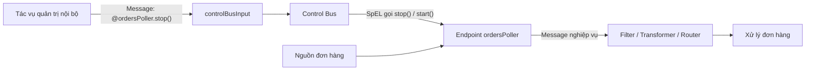

# Control Bus điều khiển endpoint bằng message

## 1. Mục tiêu và bối cảnh

Trong hệ thống dùng **Enterprise Integration Patterns (EIP)**, các luồng thông điệp thường được thiết kế để chạy liên tục: nhận dữ liệu từ hệ thống ngoài, lọc, biến đổi, định tuyến, chia nhỏ rồi tổng hợp kết quả. Tuy nhiên, vận hành thực tế cần khả năng **bật hoặc tạm dừng một endpoint ngay khi ứng dụng vẫn chạy**. Ví dụ:

- Tạm dừng polling dữ liệu từ đối tác khi phía đối tác bảo trì.
- Khởi động lại bộ nhận thông điệp sau khi đã khắc phục sự cố kết nối.
- Kiểm tra một endpoint hiện có đang chạy hay không mà không khởi động lại toàn bộ ứng dụng.
- Cho phép một thao tác quản trị trong hệ thống phát ra thông điệp điều khiển, giống cách các luồng nghiệp vụ trao đổi thông điệp.

**Control Bus** là mẫu EIP dành cho kênh điều khiển và giám sát các thành phần của hệ thống nhắn tin. Với **Spring Integration**, Control Bus nhận một message chứa biểu thức **Spring Expression Language (SpEL)**, đánh giá biểu thức trong ngữ cảnh Spring và có thể gọi phương thức quản lý của một bean, chẳng hạn `start()` hoặc `stop()` của endpoint triển khai `Lifecycle`.

Kết thúc bài, bạn có thể cấu hình Control Bus, điều khiển polling endpoint bằng message, kiểm tra trạng thái, viết bài kiểm thử và xác định những ranh giới vận hành cần chú ý.

## 2. Control Bus nằm ở đâu trong luồng Integration?

Giả sử ứng dụng nhận đơn hàng định kỳ từ một hàng đợi nội bộ, sau đó gửi qua Transformer, Router và các kênh xử lý. Khi nguồn upstream đang bảo trì, ta muốn tạm dừng **đầu nhận đơn hàng** mà các luồng khác vẫn hoạt động.



Có **hai loại message khác nhau**:

| Loại | Mục đích | Ví dụ payload | Nơi xử lý |
| --- | --- | --- | --- |
| Message nghiệp vụ | Vận chuyển dữ liệu cần tích hợp | `ORDER-001` | Filter, Transformer, Router, Aggregator… |
| Message điều khiển | Thay đổi hoặc hỏi trạng thái thành phần | `@ordersPoller.stop()` | Control Bus |

Control Bus là một **endpoint xử lý message** ở phía điều khiển; nó không tự động thay thế các endpoint nghiệp vụ, không dừng JVM và cũng không tạo cơ chế quản trị phân tán giữa mọi instance.

Một vài thuật ngữ cần phân biệt:

- **Channel** là đường chuyển message; kênh như `DirectChannel` không tự có thao tác `start()/stop()`.
- **Endpoint** là thành phần gắn với việc gửi/nhận hoặc xử lý message. Một số endpoint, đặc biệt *polling inbound adapter*, triển khai `Lifecycle`/`SmartLifecycle` và có thể được bật/tắt.
- **Bean name / endpoint id** là tên Control Bus dùng để tìm đối tượng trong `ApplicationContext`; tên này phải đúng và nên được đặt ổn định.

## 3. Cơ chế thực thi lệnh

Quy trình điển hình:

1. Một thành phần được cấp quyền phát message có payload là một chuỗi SpEL đến channel đầu vào của Control Bus.
2. Control Bus đánh giá chuỗi này, tra cứu bean bằng cú pháp `@beanName` và gọi phương thức tương ứng.
3. Endpoint thay đổi trạng thái, ví dụ từ *stopped* sang *running*. Poller sẽ bắt đầu phát các lần poll theo lịch cấu hình.
4. Bên vận hành xác nhận trạng thái thực tế và theo dõi log/metrics của luồng.

Các biểu thức thường dùng với endpoint có bean id `ordersPoller`:

```text
@ordersPoller.start()
@ordersPoller.stop()
@ordersPoller.isRunning()
```

`start()` và `stop()` là thao tác thay đổi trạng thái. `isRunning()` là thao tác truy vấn trạng thái; nếu muốn lấy giá trị trả về qua message, cần cấu hình đường trả lời hoặc messaging gateway phù hợp. Ví dụ dưới đây dùng `SmartLifecycle` để kiểm tra trực tiếp, giúp phân biệt rõ lệnh điều khiển và phép quan sát.

Nếu bean id chứa dấu gạch nối, chẳng hạn `orders-poller`, có thể tham chiếu tên bean qua cú pháp SpEL:

```text
@'orders-poller'.start()
```

**Điều kiện tiên quyết:** endpoint đích phải tồn tại trong chính `ApplicationContext` mà Control Bus nhìn thấy và phải hỗ trợ phương thức được gọi. Không phải mọi message handler đều có API lifecycle tương ứng.

## 4. Ví dụ hoàn chỉnh với Spring Integration Java DSL

Tình huống: ứng dụng Spring Boot có một hàng đợi đơn hàng trong bộ nhớ. Một polling endpoint lấy đơn hàng mỗi 2 giây rồi chuyển vào handler. Endpoint **khởi tạo ở trạng thái dừng** và được bật thông qua Control Bus.

Dự án cần thư viện Spring Integration, chẳng hạn dependency Gradle sau trong ứng dụng Spring Boot có quản lý version tương thích:

```gradle
implementation("org.springframework.boot:spring-boot-starter-integration")
```

Tạo lớp cấu hình `ControlBusConfiguration.java`:

```java
package example.controlbus;

import java.time.Duration;
import java.util.concurrent.BlockingQueue;
import java.util.concurrent.LinkedBlockingQueue;

import org.springframework.context.annotation.Bean;
import org.springframework.context.annotation.Configuration;
import org.springframework.integration.annotation.IntegrationComponentScan;
import org.springframework.integration.channel.DirectChannel;
import org.springframework.integration.config.EnableIntegration;
import org.springframework.integration.core.MessageSource;
import org.springframework.integration.dsl.IntegrationFlow;
import org.springframework.integration.dsl.Pollers;
import org.springframework.messaging.MessageChannel;
import org.springframework.messaging.support.GenericMessage;

@Configuration
@EnableIntegration
@IntegrationComponentScan
public class ControlBusConfiguration {

    @Bean
    public MessageChannel controlBusInput() {
        return new DirectChannel();
    }

    @Bean
    public IntegrationFlow controlBusFlow() {
        return IntegrationFlow.from("controlBusInput")
                .controlBus()
                .get();
    }

    @Bean
    public BlockingQueue<String> pendingOrders() {
        return new LinkedBlockingQueue<>();
    }

    @Bean
    public MessageSource<String> orderSource(BlockingQueue<String> pendingOrders) {
        return () -> {
            String orderId = pendingOrders.poll();
            return orderId == null ? null : new GenericMessage<>(orderId);
        };
    }

    @Bean
    public IntegrationFlow ordersFlow(MessageSource<String> orderSource) {
        return IntegrationFlow
                .from(orderSource, endpoint -> endpoint
                        .id("ordersPoller")
                        .autoStartup(false)
                        .poller(Pollers.fixedDelay(Duration.ofSeconds(2))))
                .handle(message ->
                        System.out.println("Received order: " + message.getPayload()))
                .get();
    }
}
```

Các dòng có vai trò quan trọng:

| Cấu hình | Ý nghĩa |
| --- | --- |
| `controlBusInput()` | Channel chỉ dành cho lệnh điều khiển. |
| `.controlBus()` | Gắn handler hiểu payload là biểu thức điều khiển. |
| `.id("ordersPoller")` | Đặt tên ổn định để SpEL tìm đúng endpoint. |
| `.autoStartup(false)` | Không tự khởi chạy nguồn polling khi ứng dụng bắt đầu. |
| `Pollers.fixedDelay(Duration.ofSeconds(2))` | Lịch polling **khi** endpoint đang chạy. |
| `MessageSource.receive()` trả `null` | Báo hiện chưa có đơn hàng; không gửi message mới. |

`DirectChannel` gửi lệnh đến handler trong luồng gọi của bên gửi ở cấu hình này. Vì thế, lỗi đánh giá lệnh thường có thể phản hồi trực tiếp cho bên gọi. Nếu thay bằng channel bất đồng bộ, cần thiết kế cơ chế xác nhận và nhận lỗi riêng.

Tạo messaging gateway `ControlCommands.java` để những thành phần nội bộ có thể gửi lệnh mà không phải tự tạo `Message<?>`:

```java
package example.controlbus;

import org.springframework.integration.annotation.MessagingGateway;

@MessagingGateway(defaultRequestChannel = "controlBusInput")
public interface ControlCommands {
    void execute(String expression);
}
```

`@IntegrationComponentScan` trong cấu hình trên giúp phát hiện giao diện gateway nằm trong package được quét. Đối với ứng dụng có nhiều package, cần bảo đảm cấu hình quét bao gồm package của gateway.

Gói lệnh vào một dịch vụ quản trị chỉ cung cấp các thao tác được phép:

```java
package example.controlbus;

import org.springframework.context.ApplicationContext;
import org.springframework.context.Lifecycle;
import org.springframework.stereotype.Service;

@Service
public class OrderPollingAdminService {
    private final ControlCommands commands;
    private final ApplicationContext applicationContext;

    public OrderPollingAdminService(
            ControlCommands commands,
            ApplicationContext applicationContext) {
        this.commands = commands;
        this.applicationContext = applicationContext;
    }

    public void start() {
        commands.execute("@ordersPoller.start()");
    }

    public void stop() {
        commands.execute("@ordersPoller.stop()");
    }

    public boolean isRunning() {
        Lifecycle endpoint =
                applicationContext.getBean("ordersPoller", Lifecycle.class);
        return endpoint.isRunning();
    }
}
```

Dịch vụ này **không nhận chuỗi SpEL tùy ý từ người gọi**. Nó chỉ phát hai lệnh cố định tương ứng với chức năng bật/tắt polling.

### Chạy thử theo trình tự

Giả sử ứng dụng Spring Boot đã khởi động và `OrderPollingAdminService` được inject vào một tác vụ nội bộ:

```java
// pendingOrders là BlockingQueue<String> đã được inject.
pendingOrders.offer("ORDER-001");

// Ban đầu false vì autoStartup(false).
System.out.println(adminService.isRunning());

adminService.start(); // gửi "@ordersPoller.start()"

// Sau khi bắt đầu, poller lấy ORDER-001 ở kỳ poll kế tiếp.
// Handler in: Received order: ORDER-001
System.out.println(adminService.isRunning());

adminService.stop();  // gửi "@ordersPoller.stop()"
System.out.println(adminService.isRunning());
```

Nếu nguồn vẫn có dữ liệu, `stop()` ngăn **các lần poll mới** sau khi endpoint ngừng. Lệnh dừng không bảo đảm thu hồi message mà một lần poll đã lấy ra hoặc hủy tác vụ downstream đang chạy. Hãy đợi việc đang xử lý hoàn tất nếu quy trình cần điểm dừng an toàn.

## 5. Kiểm thử hành vi điều khiển

Kiểm thử tích hợp nên xác minh thay đổi trạng thái thực của endpoint, không chỉ xác minh gateway đã được gọi. Với Spring Boot Test và AssertJ:

```java
package example.controlbus;

import static org.assertj.core.api.Assertions.assertThat;

import org.junit.jupiter.api.Test;
import org.springframework.beans.factory.annotation.Autowired;
import org.springframework.boot.test.context.SpringBootTest;
import org.springframework.context.ApplicationContext;
import org.springframework.context.Lifecycle;

@SpringBootTest
class ControlBusIntegrationTest {

    @Autowired
    ControlCommands commands;

    @Autowired
    ApplicationContext context;

    @Test
    void canStartAndStopPollingEndpointByMessage() {
        Lifecycle poller = context.getBean("ordersPoller", Lifecycle.class);

        assertThat(poller.isRunning()).isFalse();

        commands.execute("@ordersPoller.start()");
        assertThat(poller.isRunning()).isTrue();

        commands.execute("@ordersPoller.stop()");
        assertThat(poller.isRunning()).isFalse();
    }
}
```

Bài kiểm thử tập trung vào trạng thái lifecycle. Để kiểm tra **hiệu quả nghiệp vụ**, nên có thêm phép thử đưa một đơn hàng vào queue, chờ có giới hạn cho tới khi handler nhận được nó, dừng poller, thêm đơn hàng tiếp theo và xác nhận không có lần poll mới trong khoảng quan sát. Các phép thử dùng thời gian cần thời hạn chờ hợp lý thay vì gọi `Thread.sleep()` rồi giả định hệ thống chắc chắn đã xử lý xong.

Với hệ thống production, nên xác minh cả ba lớp sau: **message lệnh được nhận**, **endpoint chuyển trạng thái**, và **lưu lượng nghiệp vụ biến đổi đúng mong đợi**.

## 6. Kết hợp với Router, Filter, Splitter và Aggregator

Control Bus hữu ích khi một luồng tích hợp gồm nhiều nhánh, nhưng phạm vi điều khiển cần được xác định rõ:

- **Router:** dừng inbound adapter của một nguồn giúp ngừng message *mới* đến từ nguồn đó; các nguồn khác vẫn có thể đi qua router.
- **Filter / Transformer:** khi chỉ muốn bỏ qua hoặc thay đổi cách xử lý message, có thể dùng quy tắc filter/router thay vì dừng một endpoint. Tắt endpoint xử lý trung gian có thể khiến upstream không tìm được consumer.
- **Splitter / Aggregator:** dừng đầu nhận khi một nhóm message đang gom có thể để lại các group chưa hoàn thành. Cần chính sách timeout, giải phóng group và giám sát correlation key.
- **Retry / error channel:** tắt poller không xóa message lỗi, không thay thế retry và cũng không bảo đảm rollback công việc đang thực thi. Vẫn cần cơ chế retry, dead-letter hoặc xử lý sự cố phù hợp.

Ví dụ khi đối tác A bảo trì: thay vì dừng toàn bộ hệ thống, dùng Control Bus dừng riêng endpoint `partnerAPoller`. Các flow nhận dữ liệu từ B và C vẫn tiếp tục; các message A đã vào channel trước thời điểm dừng vẫn được xử lý theo chính sách hiện hành.

## 7. Vận hành an toàn và quan sát trạng thái

### 7.1. Không công khai quyền thực thi SpEL

Payload Control Bus là biểu thức được đánh giá với quyền truy cập các bean của ứng dụng. Nếu nhận trực tiếp từ HTTP, queue công khai hoặc người dùng không đáng tin cậy, đây là bề mặt tấn công nghiêm trọng.

Thiết kế khuyến nghị:

1. Chỉ cho các tác vụ quản trị **đã xác thực và được phân quyền** gọi dịch vụ điều khiển.
2. Chuyển lựa chọn của người dùng thành **lệnh định sẵn** (`startOrders`, `stopOrders`); không ghép chuỗi SpEL từ input tự do.
3. Giữ channel điều khiển ở phạm vi nội bộ, kiểm tra quyền, lưu audit gồm người yêu cầu, endpoint, thao tác, thời điểm và kết quả.
4. Giới hạn tập endpoint được điều khiển, tránh thay đổi các bean hệ thống không liên quan.

Khi triển khai API quản trị, API chỉ nên gọi `OrderPollingAdminService.start()/stop()` sau khi được cấp quyền. Không thiết kế endpoint kiểu `POST /control` nhận body là một biểu thức SpEL.

### 7.2. Phân biệt trạng thái với kết quả xử lý

| Tình huống | Điều thực sự được bảo đảm | Điều **chưa** được bảo đảm |
| --- | --- | --- |
| `start()` thành công | Endpoint được yêu cầu chuyển sang running | Dữ liệu upstream sẵn sàng hoặc message chắc chắn đã xử lý |
| `stop()` thành công | Endpoint được yêu cầu dừng lịch nhận/xử lý mới theo lifecycle | Mọi xử lý đang chạy đã kết thúc hay được rollback |
| `isRunning() == true` | Bean báo trạng thái running | Kết nối từ xa khỏe mạnh, không backlog, không lỗi nghiệp vụ |
| Lệnh phát vào channel | Message lệnh đã được gửi theo cấu hình channel | Mọi instance khác cũng được điều khiển |

Để giám sát thực tế, kết hợp trạng thái lifecycle với metrics, log có correlation id, lượng message vào/ra, số lần retry, độ trễ, backlog và các cảnh báo lỗi. Spring Boot Actuator và Micrometer có thể bổ sung tín hiệu quan sát; Control Bus không thay thế hệ thống monitoring.

### 7.3. Lỗi và hệ thống nhiều instance

Lỗi thường gặp gồm: bean id sai, endpoint không triển khai phương thức cần gọi, biểu thức SpEL sai cú pháp hoặc không đủ quyền truy cập. Với đường gửi đồng bộ như `DirectChannel`, exception thường truyền về caller; caller nên bắt lỗi, ghi audit và báo trạng thái thất bại. Nếu dùng `ExecutorChannel` hay một đường bất đồng bộ, cần thiết kế đường nhận lỗi, chẳng hạn `errorChannel` hoặc cơ chế xác nhận riêng.

Nếu ứng dụng có nhiều replica, mỗi replica có `ApplicationContext` riêng. Lệnh đi vào instance nào thì điều khiển bean của **instance đó**; không mặc nhiên broadcast cho tất cả. Muốn quản trị toàn cụm cần định tuyến lệnh tới đúng instance, hoặc có tầng phối hợp phân tán và ghi nhận trạng thái từng instance. Không giả định `stop()` trên một node đã dừng mọi consumer khác.

## 8. Các lỗi dễ gặp và cách khắc phục

| Hiện tượng | Nguyên nhân thường gặp | Cách xác minh |
| --- | --- | --- |
| Lệnh báo không tìm được bean | Dùng tên channel/flow thay vì endpoint id hoặc sai bean name | Kiểm tra id được gắn trực tiếp cho endpoint trong DSL và bean tồn tại trong context |
| Gửi `start()` nhưng không thấy đơn hàng | Queue trống, poller chưa đến kỳ, lỗi nguồn hoặc downstream | Kiểm tra `isRunning()`, nguồn dữ liệu, lịch poll và log handler |
| `stop()` rồi vẫn thấy một message xử lý | Message đã được nhận trước lúc dừng | Theo dõi tác vụ đang xử lý và ngữ nghĩa hoàn tất của flow |
| Gateway không được tạo | Package của `@MessagingGateway` chưa nằm trong vùng quét | Kiểm tra `@IntegrationComponentScan` |
| Lệnh thành công ở một replica nhưng replica khác vẫn poll | Mỗi instance có context và lifecycle riêng | Kiểm tra topology và target instance |
| Lỗi SpEL hoặc lỗi handler | Payload không hợp lệ hoặc phương thức target không hỗ trợ | Ghi exception, truy vết lệnh và kiểm tra bean đích |
| Mất dữ liệu trong lúc dừng nguồn bên ngoài | Nguồn không lưu backlog hoặc không hỗ trợ replay | Xác định tính bền vững, checkpoint và cơ chế bù dữ liệu của nguồn |

## 9. Bài tập thực hành

**Bài tập 1 — Bật/tắt một adapter.** Dùng ví dụ trên, thêm hai lệnh quản trị cố định `start` và `stop`; ghi log thay đổi trạng thái. Quan sát rằng order được đưa vào queue trước khi bật poller sẽ được xử lý sau khi bật.

**Bài tập 2 — Kiểm tra lỗi.** Gửi lệnh tới một bean id không tồn tại trong môi trường kiểm thử. Ghi nhận exception và bảo đảm dịch vụ quản trị trả kết quả thất bại rõ ràng, không khẳng định endpoint đã chuyển trạng thái.

**Bài tập 3 — Hai nguồn độc lập.** Tạo thêm `partnerBPoller` và hai luồng xử lý riêng. Dừng `ordersPoller` và chứng minh `partnerBPoller` vẫn chạy. Sau đó nối cả hai vào một Router và quan sát lưu lượng từng nhánh.

**Bài tập 4 — Điều kiện vận hành.** Mô tả kế hoạch dừng một upstream đang có message trong Aggregator. Xác định cách kiểm tra group chưa hoàn thành, timeout, retry và cách khôi phục sau khi khởi động lại.

Tiêu chí hoàn thành: giải thích được **message lệnh → Control Bus → bean endpoint → thay đổi lifecycle**, phân biệt được trạng thái endpoint và kết quả nghiệp vụ, kiểm thử được `start()/stop()`, đồng thời xác định đúng phạm vi instance và quyền truy cập.

## 10. Ghi nhớ

Control Bus biến thao tác quản trị thành **message** để các thành phần Integration có thể được điều khiển ngay trong runtime. Trong Spring Integration, cách dùng tiêu biểu là gửi payload SpEL như `@ordersPoller.start()` hoặc `@ordersPoller.stop()` tới channel gắn với `.controlBus()`. Đặt **endpoint id ổn định**, quản lý lifecycle có chủ đích, xác minh trạng thái thực, và chỉ cho phép những lệnh đã kiểm soát từ phía nội bộ.
