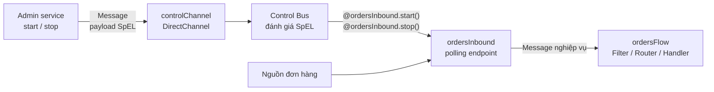

# Gửi lệnh lifecycle qua control channel

## 1. Tình huống và kết quả cần đạt

Trong một ứng dụng tích hợp doanh nghiệp, việc nhận dữ liệu từ hệ thống bên ngoài đôi khi phải tạm dừng mà ứng dụng vẫn tiếp tục phục vụ các luồng khác. Chẳng hạn, nhà cung cấp đang bảo trì API: ta muốn dừng polling đơn hàng, giữ nguyên các message đã có trong hệ thống, rồi tiếp tục nhận khi kết nối ổn định.

Với **Spring Integration**, có thể gửi một **message điều khiển** vào kênh riêng, để **Control Bus** thực thi lệnh `start()` hoặc `stop()` trên endpoint có hỗ trợ lifecycle. Cách làm này phù hợp với mục tiêu của module **SPRING_INTEGRATION_PATTERN**: triển khai Enterprise Integration Patterns để các thành phần Router, Filter, Transformer, Splitter, Aggregator, Gateway, retry và error channel phối hợp qua các message với mức phụ thuộc thấp và dễ quan sát.

Bài học tập trung vào chuỗi thao tác cụ thể: **tạo control channel → đăng ký Control Bus → đặt ID cho endpoint → gửi lệnh lifecycle dưới dạng message → xác minh trạng thái và tác động đến luồng nghiệp vụ**.

Sau bài học, bạn có thể:

- Gửi lệnh `start()`, `stop()` và truy vấn `isRunning()` đối với một endpoint hỗ trợ `Lifecycle`.
- Phân biệt **channel mang lệnh** với **endpoint được điều khiển** và với channel mang dữ liệu nghiệp vụ.
- Dùng Java DSL và `MessageChannel.send()` để gửi lệnh; bọc thao tác trong dịch vụ quản trị chỉ cho phép các lệnh cố định.
- Viết kiểm thử trạng thái endpoint, phân tích trường hợp lệnh thất bại, ngắt poller đang bận và triển khai nhiều instance.

## 2. Ba thành phần của luồng điều khiển



| Thành phần | Vai trò | Điều cần nhớ |
| --- | --- | --- |
| `controlChannel` | Kênh đưa lệnh vận hành đến Control Bus | Chứa **message điều khiển**; không cần được định danh là endpoint có lifecycle |
| Control Bus | Handler đọc biểu thức từ message và gọi bean tương ứng | Cần được gắn với đúng channel đầu vào |
| `ordersInbound` | Polling inbound endpoint cần bật/tắt | Phải có bean id ổn định và triển khai API lifecycle |

Cú pháp lệnh dùng **Spring Expression Language (SpEL)**. Tiền tố `@` là tham chiếu tới một bean trong Spring `ApplicationContext`; phần sau là phương thức gọi trên bean đó:

```text
@ordersInbound.start()
@ordersInbound.stop()
@ordersInbound.isRunning()
```

`start()` chuyển endpoint sang trạng thái chạy; `stop()` yêu cầu endpoint ngừng chạy; `isRunning()` hỏi trạng thái đang được bean báo cáo. Các lệnh này có ý nghĩa khi bean đích thực sự hỗ trợ `org.springframework.context.Lifecycle` hoặc `SmartLifecycle`. Không nên giả định mọi router, filter, message channel hoặc service activator đều có cùng các phương thức.

**Quan trọng:** dừng polling endpoint là dừng việc thu thập message **mới** theo lịch của nó. Lệnh không tự động xóa message đã nhận, không hủy một tác vụ xử lý đang chạy và không có tác dụng đến các instance khác của ứng dụng.

## 3. Cấu hình control channel và endpoint có lifecycle

Ví dụ dùng Spring Boot, Spring Integration Java DSL và một queue trong bộ nhớ để tập trung vào cách gửi lệnh. Trong dự án Spring Boot có cơ chế quản lý version, cần starter Integration:

```gradle
dependencies {
    implementation("org.springframework.boot:spring-boot-starter-integration")
    testImplementation("org.springframework.boot:spring-boot-starter-test")
}
```

Tạo lớp `ControlChannelConfiguration.java`. Ví dụ hoàn chỉnh dưới đây giả định ứng dụng đã có lớp `@SpringBootApplication` ở package bao trùm `example.integration`.

```java
package example.integration;

import java.time.Duration;
import java.util.concurrent.BlockingQueue;
import java.util.concurrent.LinkedBlockingQueue;

import org.springframework.context.annotation.Bean;
import org.springframework.context.annotation.Configuration;
import org.springframework.integration.channel.DirectChannel;
import org.springframework.integration.config.EnableIntegration;
import org.springframework.integration.core.MessageSource;
import org.springframework.integration.dsl.IntegrationFlow;
import org.springframework.integration.dsl.Pollers;
import org.springframework.messaging.MessageChannel;
import org.springframework.messaging.support.GenericMessage;

@Configuration
@EnableIntegration
public class ControlChannelConfiguration {

    // Kênh riêng nhận message điều khiển.
    @Bean
    public MessageChannel controlChannel() {
        return new DirectChannel();
    }

    // Đầu nhận lệnh: Control Bus đánh giá payload SpEL.
    @Bean
    public IntegrationFlow controlBusFlow() {
        return IntegrationFlow.from("controlChannel")
                .controlBus()
                .get();
    }

    // Nguồn dữ liệu mô phỏng, để thử bật/tắt polling.
    @Bean
    public BlockingQueue<String> orderQueue() {
        return new LinkedBlockingQueue<>();
    }

    @Bean
    public MessageSource<String> orderSource(
            BlockingQueue<String> orderQueue) {

        return () -> {
            String orderId = orderQueue.poll();
            return orderId == null ? null : new GenericMessage<>(orderId);
        };
    }

    // Endpoint được điều khiển phải có id riêng: ordersInbound.
    @Bean
    public IntegrationFlow ordersFlow(MessageSource<String> orderSource) {
        return IntegrationFlow
                .from(orderSource, spec -> spec
                        .id("ordersInbound")
                        .autoStartup(false)
                        .poller(Pollers.fixedDelay(Duration.ofSeconds(1))))
                .handle(message -> System.out.println(
                        "Processed order: " + message.getPayload()))
                .get();
    }
}
```

Trong cấu hình này:

1. `controlChannel` là `DirectChannel`: message được chuyển đồng bộ tới subscriber của channel khi gửi. Điều này giúp theo dõi ngoại lệ ngay trong lời gọi gửi.
2. `controlBusFlow` nhận message trên `controlChannel`; handler `.controlBus()` đánh giá chuỗi SpEL mà message mang theo.
3. `ordersFlow` lấy đơn hàng từ `orderSource` mỗi giây **khi poller đang chạy**; lần poll trả `null` nếu queue không có phần tử.
4. `.id("ordersInbound")` đặt tên cho **polling endpoint**, tức đối tượng mà Control Bus tìm qua `@ordersInbound`.
5. `.autoStartup(false)` khiến endpoint không tự nhận đơn hàng ngay khi khởi động ứng dụng. Trạng thái ban đầu của endpoint là stopped để kiểm chứng tác động của lệnh start.

Đây là ví dụ nội bộ để học lifecycle. Với nguồn dữ liệu thật, adapter có thể là inbound file, JDBC, FTP hoặc một nguồn hỗ trợ polling khác; cần đối chiếu chức năng lifecycle của adapter đó trước khi áp dụng.

## 4. Gửi message điều khiển qua `MessageChannel`

Một lệnh Control Bus thường được biểu diễn bằng **payload String**. API Java `MessageChannel.send(Message<?>)` có thể gửi message đến `controlChannel`:

```java
package example.integration;

import org.springframework.beans.factory.annotation.Qualifier;
import org.springframework.context.ApplicationContext;
import org.springframework.context.Lifecycle;
import org.springframework.messaging.MessageChannel;
import org.springframework.messaging.support.MessageBuilder;
import org.springframework.stereotype.Service;

@Service
public class OrdersPollingControl {

    private final MessageChannel controlChannel;
    private final ApplicationContext context;

    public OrdersPollingControl(
            @Qualifier("controlChannel") MessageChannel controlChannel,
            ApplicationContext context) {
        this.controlChannel = controlChannel;
        this.context = context;
    }

    public void start() {
        sendCommand("@ordersInbound.start()");
    }

    public void stop() {
        sendCommand("@ordersInbound.stop()");
    }

    public boolean isRunning() {
        Lifecycle endpoint = context.getBean(
                "ordersInbound", Lifecycle.class);
        return endpoint.isRunning();
    }

    private void sendCommand(String expression) {
        boolean accepted = controlChannel.send(
                MessageBuilder.withPayload(expression).build());

        if (!accepted) {
            throw new IllegalStateException(
                    "Control command was not accepted");
        }
    }
}
```

Cách gửi quan trọng nhất là:

```java
controlChannel.send(
    MessageBuilder.withPayload("@ordersInbound.stop()").build()
);
```

Payload là **chuỗi biểu thức**, không phải một đối tượng kiểu `Runnable` hay lệnh HTTP. Control Bus đọc chuỗi đó, tìm bean `ordersInbound` và gọi `stop()`.

Lý do dịch vụ `OrdersPollingControl` chỉ có `start()` và `stop()`: người gọi không được cung cấp chuỗi SpEL tùy ý. Đây là một biện pháp ngăn truy cập ngoài ý muốn đến những bean khác trong Spring context.

**Giới hạn của kết quả gửi:** giá trị `true` từ `send()` cho biết message đã được chấp nhận trên channel theo hợp đồng `MessageChannel`. Nó không phải bằng chứng độc lập rằng toàn bộ xử lý nghiệp vụ đã kết thúc. Với `DirectChannel`, handler thực thi trong luồng gọi và lỗi từ handler thường được ném ngược cho caller; vẫn phải kiểm tra `isRunning()` và tín hiệu vận hành phù hợp.

### Luồng gọi thử từ ứng dụng

Ví dụ một tác vụ quản trị nội bộ được inject cả `OrdersPollingControl` lẫn queue:

```java
orderQueue.offer("ORDER-1001");

// Poller chưa tự khởi động.
System.out.println(control.isRunning()); // false

control.start();
System.out.println(control.isRunning()); // true

// Trong kỳ poll kế tiếp:
// Processed order: ORDER-1001

control.stop();
System.out.println(control.isRunning()); // false
```

Khi stopped, dữ liệu mới còn trong queue sẽ chưa được `orderSource` đọc; khi start lại, poller tiếp tục lấy dữ liệu có sẵn. Ví dụ queue này chỉ nằm trong bộ nhớ, không bảo đảm dữ liệu được lưu lại nếu tiến trình dừng.

## 5. Gửi qua Messaging Gateway khi không muốn phụ thuộc `MessageChannel`

Ở một ứng dụng lớn, code nghiệp vụ có thể phát lệnh qua giao diện Java, trong khi Spring Integration chịu trách nhiệm tạo message và gửi đúng channel:

```java
package example.integration;

import org.springframework.integration.annotation.MessagingGateway;

@MessagingGateway(defaultRequestChannel = "controlChannel")
public interface LifecycleCommandGateway {
    void send(String expression);
}
```

Cần bật quét gateway trong vùng package tương ứng, chẳng hạn thêm `@IntegrationComponentScan` vào cấu hình Integration (hoặc cấu hình quét tương đương). Khi đó, phần gửi từ một dịch vụ quản trị có thể là:

```java
gateway.send("@ordersInbound.start()");
gateway.send("@ordersInbound.stop()");
```

Gateway giúp giảm code tạo message, nhưng **không tự động giới hạn biểu thức**. Không được chuyển nguyên văn payload HTTP, dữ liệu queue không tin cậy hoặc biểu thức do người dùng nhập thẳng tới `gateway.send(...)`. Nên để gateway nằm bên trong dịch vụ quản trị có tập lệnh cố định giống `OrdersPollingControl`.

Có thể chọn cách dùng `MessageChannel.send()` **hoặc** gateway tùy nhu cầu. Hai đoạn mã ở các phần trên thể hiện hai cách gửi một message đến cùng một `controlChannel`, không yêu cầu có hai Control Bus.

## 6. Lệnh truy vấn trạng thái và xác nhận kết quả

Bên cạnh `start()` và `stop()`, Control Bus có thể đánh giá biểu thức:

```text
@ordersInbound.isRunning()
```

Đây là biểu thức truy vấn vì `isRunning()` trả về kiểu boolean. Tuy nhiên, **cách lấy kết quả từ message** phụ thuộc vào cách cấu hình đường trả lời, gateway và tính chất kênh. Với trường hợp chỉ cần bật/tắt, ví dụ trên lựa chọn cách xác minh đơn giản hơn: lấy endpoint bean bằng `ApplicationContext` và gọi `isRunning()` trực tiếp ngay sau khi gửi lệnh.

Nếu dùng mẫu request-reply để hỏi qua Control Bus, cần cấu hình sender có nhận reply, đồng thời kiểm tra loại payload trả về, timeout, điều kiện route reply và xử lý exception. Không giả định mọi `send()` đều trả lại kết quả của biểu thức; `MessageChannel.send()` chỉ trả một boolean liên quan đến việc gửi message.

Có ba điều cần xác minh riêng:

| Câu hỏi | Tín hiệu quan sát | Ý nghĩa |
| --- | --- | --- |
| Lệnh có được gửi tới channel không? | `send()` trả `true` hoặc không phát sinh lỗi trong đường đồng bộ | Message được chấp nhận theo hợp đồng channel |
| Endpoint có đổi trạng thái không? | `isRunning()` trên đúng bean | Endpoint đang báo running hoặc stopped |
| Luồng dữ liệu có hoạt động đúng không? | Message thực tế vào handler, backlog, retry, error và metrics | Tác động vận hành lên dữ liệu nghiệp vụ |

Trong hệ thống có retry hoặc Aggregator, trạng thái endpoint không thể thay thế quan sát về các message đang xử lý. Một lệnh dừng poller thành công không đồng nghĩa mọi group correlation đã hoàn tất hoặc error channel đã trống.

## 7. Kiểm thử hành vi start/stop qua message

Đặt kiểm thử trong `src/test/java/example/integration/ControlChannelTest.java`. Với `spring-boot-starter-test`, có thể chạy JUnit Jupiter và AssertJ; dùng `@SpringJUnitConfig` để dựng context chỉ từ cấu hình bài học:

```java
package example.integration;

import static org.assertj.core.api.Assertions.assertThat;

import org.junit.jupiter.api.Test;
import org.springframework.beans.factory.annotation.Autowired;
import org.springframework.beans.factory.annotation.Qualifier;
import org.springframework.context.ApplicationContext;
import org.springframework.context.Lifecycle;
import org.springframework.messaging.MessageChannel;
import org.springframework.messaging.support.MessageBuilder;
import org.springframework.test.context.junit.jupiter.SpringJUnitConfig;

@SpringJUnitConfig(ControlChannelConfiguration.class)
class ControlChannelTest {

    @Autowired
    ApplicationContext context;

    @Autowired
    @Qualifier("controlChannel")
    MessageChannel controlChannel;

    @Test
    void startsAndStopsEndpointUsingControlMessages() {
        Lifecycle endpoint = context.getBean(
                "ordersInbound", Lifecycle.class);

        assertThat(endpoint.isRunning()).isFalse();

        try {
            assertThat(controlChannel.send(MessageBuilder
                    .withPayload("@ordersInbound.start()")
                    .build())).isTrue();
            assertThat(endpoint.isRunning()).isTrue();
        } finally {
            controlChannel.send(MessageBuilder
                    .withPayload("@ordersInbound.stop()")
                    .build());
        }

        assertThat(endpoint.isRunning()).isFalse();
    }
}
```

Bài kiểm thử xác minh chuỗi **gửi message → Control Bus gọi lifecycle → trạng thái endpoint thay đổi**. Nó không khẳng định hiệu quả đầu cuối của việc nhận và xử lý đơn hàng.

Một phép kiểm thử tích hợp sâu hơn có thể:

1. Đặt `ORDER-2001` vào queue khi endpoint stopped; xác minh chưa có message được xử lý.
2. Gửi `@ordersInbound.start()`; dùng cơ chế chờ có timeout (ví dụ Awaitility nếu dự án có thư viện) cho đến khi handler ghi nhận `ORDER-2001`.
3. Gửi `@ordersInbound.stop()`, đợi trạng thái stopped; thêm `ORDER-2002` và quan sát trong một cửa sổ thời gian hợp lý rằng không có poll mới.
4. Gửi start trở lại và xác minh `ORDER-2002` được xử lý. Dọn sạch queue và trạng thái endpoint sau thử nghiệm.

Tránh dựa vào một lệnh `Thread.sleep()` cố định rồi kết luận tuyệt đối; thời điểm poll có thể thay đổi theo tải hệ thống. Với adapter thật, kiểm thử cần xét cả timeout, transaction, ack/nack và khả năng replay của nguồn.

## 8. Các trường hợp lỗi thường gặp

| Hiện tượng | Nguyên nhân có thể xảy ra | Cách xử lý |
| --- | --- | --- |
| `@ordersInbound.start()` không tìm thấy bean | ID đặt trên flow/channel thay vì endpoint, hoặc sai tên | Kiểm tra `.id("ordersInbound")` ở cấu hình endpoint và bean trong context |
| Lệnh gửi nhưng không thấy thay đổi | Endpoint không hỗ trợ lifecycle hoặc route lệnh tới nhầm channel | Kiểm tra subscriber của `controlChannel`, kiểu bean và trạng thái `isRunning()` |
| `start()` thành công nhưng không có message | Queue rỗng, chưa đến kỳ poll, upstream lỗi, downstream đang retry | Kiểm tra nguồn, backlog, poller, log và error channel |
| `stop()` đã trả về nhưng vẫn thấy một message xử lý | Message đã được lấy ra trước khi dừng hoặc còn tác vụ đang chạy | Phân biệt dừng nhận mới với hoàn tất xử lý đang tồn tại |
| Exception khi gửi lệnh | Biểu thức SpEL sai hoặc method không tồn tại/không được phép | Bắt và ghi lỗi ở caller; audit lệnh và xác minh bean đích |
| Gateway không inject được | Thiếu quét `@MessagingGateway` | Thêm `@IntegrationComponentScan` vào cấu hình phù hợp |
| Một node stopped nhưng node khác vẫn poll | Các instance có `ApplicationContext` riêng | Gửi đến đúng instance hoặc triển khai cơ chế điều phối cụm |

Với `DirectChannel`, ngoại lệ xử lý lệnh thường truyền về luồng gửi. Khi chuyển sang `ExecutorChannel` hoặc queue bất đồng bộ, kết quả gửi có thể đến **trước** lúc handler thực thi; cần xây dựng cơ chế phản hồi, theo dõi lỗi hoặc dùng `errorChannel` theo đặc điểm topology.

## 9. Bảo mật và giới hạn phạm vi lệnh

Payload Control Bus là một **biểu thức SpEL được đánh giá bên trong ứng dụng**. Nó có thể truy cập các bean khác ngoài endpoint dự kiến nếu hệ thống cho phép người gửi tùy ý chọn biểu thức. Vì vậy đây là một khả năng quản trị có quyền cao.

Một thiết kế vận hành an toàn cần:

- Tách `controlChannel` khỏi các channel nhận message nghiệp vụ; không nối trực tiếp một inbound adapter công khai tới Control Bus.
- Xác thực và phân quyền thao tác quản trị. Các API chỉ nên nhận hành động đã biết, chẳng hạn `START_ORDERS` hay `STOP_ORDERS`.
- Map hành động đó sang chuỗi biểu thức **được viết cố định trong code**, không ghép tên bean hay tên method từ input.
- Ghi audit gồm người khởi tạo, đích, thao tác, thời điểm, kết quả và instance chịu tác động.
- Kiểm tra lại trạng thái endpoint và metrics sau lệnh; không coi HTTP 200 hay `send() == true` là bằng chứng toàn bộ luồng đã khôi phục.

Trong môi trường nhiều replica, gửi lệnh đến Control Bus của instance A chỉ tác động đến context của **A**. Để dừng toàn bộ các poller của một nguồn, phải có cơ chế định tuyến và xác nhận trên từng replica hoặc điều phối bằng một dịch vụ chung. Nếu mỗi instance tự động bật lại endpoint khi restart, cần có chính sách vận hành để tránh nguồn bất ngờ được poll trở lại.

## 10. Ảnh hưởng đến các mẫu EIP còn lại

**Router / Filter / Transformer:** Dừng inbound endpoint giúp ngăn message *mới* đi vào một nhánh. Nếu chỉ muốn loại một loại sự kiện hoặc đổi nhánh xử lý, nên cấu hình routing/filtering phù hợp hơn là dừng một thành phần trung gian có thể làm nghẽn cả flow.

**Splitter / Aggregator và correlation:** Message đã tách và đang chờ gom vẫn tồn tại theo chính sách lưu trữ group. Dừng đầu vào có thể khiến một số group thiếu mảnh; cần xem timeout, expiration, correlation key và quy trình xử lý group chưa đầy đủ.

**Gateway:** Có thể dùng messaging gateway để gửi lệnh điều khiển; cần phân biệt gateway nội bộ gửi lệnh với một API bên ngoài có quyền không giới hạn.

**Retry / error channel:** Dừng polling không thay thế cơ chế retry và không xử lý lỗi cũ. Khi bật lại, các message bị trì hoãn hoặc gửi lại có thể xuất hiện, vì vậy handler nên hỗ trợ idempotency nếu upstream có khả năng gửi trùng.

Các yếu tố này giúp xác định tác dụng thực tế của một lệnh lifecycle trong hệ thống tích hợp, thay vì chỉ nhìn vào trạng thái running/stopped của một bean.

## 11. Bài tập thực hành

**Bài 1 — Gửi lệnh và quan sát trạng thái.** Dùng `controlChannel` phát lần lượt `@ordersInbound.start()`, `@ordersInbound.stop()` và kiểm tra `isRunning()`. Ghi lại trạng thái trước và sau mỗi lệnh.

**Bài 2 — Bật lại và xử lý backlog.** Dừng poller, đưa thêm hai đơn hàng vào `orderQueue`, xác minh chúng chưa được đọc; bật lại rồi kiểm tra cả hai được nhận. Giải thích vì sao kết quả sẽ khác nếu queue không giữ dữ liệu bền vững.

**Bài 3 — Xử lý lệnh không hợp lệ.** Trong môi trường thử nghiệm, gửi một biểu thức tham chiếu bean không tồn tại. Quan sát ngoại lệ trong đường đồng bộ và thiết kế phản hồi cho người vận hành; không ghi nhận thao tác là thành công.

**Bài 4 — Điều khiển từng nguồn độc lập.** Tạo thêm inbound endpoint `partnerBInbound`. Dừng `ordersInbound` và xác minh dữ liệu từ partner B vẫn được xử lý qua nhánh Router tương ứng. Ghi rõ các trạng thái của từng endpoint.

**Bài 5 — Thiết kế API quản trị.** Xây dựng bảng ánh xạ `START_ORDERS`/`STOP_ORDERS` thành hai biểu thức cố định. Nêu cách phân quyền, lưu audit và xác nhận hiệu quả khi triển khai nhiều replica.

## 12. Tự kiểm tra kiến thức

1. Vì sao message chứa `@ordersInbound.stop()` phải đi vào channel gắn với Control Bus thay vì channel nghiệp vụ?
2. Lệnh lifecycle tham chiếu **bean id** nào, và id phải đặt ở đâu trong cấu hình Java DSL?
3. `send()` trả `true` và `isRunning()` trả `false` có thể đồng thời đúng không? Trường hợp nào cần kiểm tra thêm?
4. Điều gì xảy ra với message đã vào Aggregator khi inbound poller bị dừng?
5. Vì sao không nên để HTTP request truyền SpEL trực tiếp vào `controlChannel`?
6. Khi hệ thống có ba instance, cần làm gì để xác minh cả ba đã dừng cùng một nguồn polling?

Nắm được những điểm này, bạn có thể triển khai điều khiển lifecycle bằng message mà vẫn giữ khả năng kiểm thử, theo dõi các nhánh và giới hạn quyền quản trị trong một hệ thống Spring Integration.

