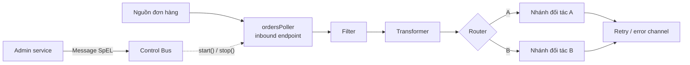
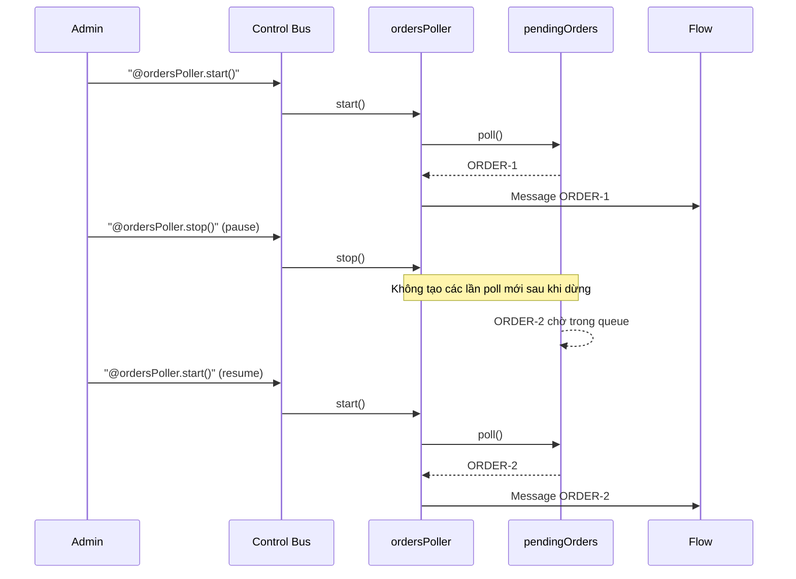

# Start, stop và pause flow

## 1. Bài toán điều khiển luồng trong Spring Integration

Hệ thống tích hợp doanh nghiệp có thể chạy nhiều luồng song song: nhận đơn hàng theo lịch, phân loại bằng Router, kiểm tra bằng Filter, chuẩn hóa dữ liệu qua Transformer, chia lô bằng Splitter, ghép kết quả bằng Aggregator và xử lý lỗi qua retry hoặc error channel. Trong vận hành, đôi lúc ta phải **khởi động**, **dừng** hoặc **tạm ngưng** một luồng nhận message mà không khởi động lại toàn bộ ứng dụng.

Ví dụ: đối tác A thông báo bảo trì 15 phút. Nếu poller tiếp tục đọc đơn hàng rồi chuyển vào bước gọi API của A, số lần retry và message lỗi có thể tăng mạnh. Ta cần ngăn **message mới** đi vào nhánh này, đợi bảo trì kết thúc rồi cho nhận tiếp các đơn hàng còn chờ.

Với Spring Integration, một số **endpoint** triển khai `Lifecycle` hoặc `SmartLifecycle`, cho phép gọi `start()` và `stop()`. **Control Bus** giúp gọi các phương thức đó bằng message chứa biểu thức SpEL. Tuy nhiên, **`pause()` không phải phương thức lifecycle chung cho mọi `IntegrationFlow`**; cần xác định rõ nghiệp vụ muốn tạm ngưng phần nào, dữ liệu đang chờ ở đâu, và cách tiếp tục không làm mất message.

Bài này thuộc chương **Control bus** của module **SPRING_INTEGRATION_PATTERN**, tập trung vào việc điều khiển endpoint một cách an toàn khi luồng có Router, Filter, Transformer, Splitter, Aggregator, Gateway, retry, error channel và correlation.

Sau bài học, bạn có thể:

- Chọn đúng đối tượng để `start()` hoặc `stop()`: inbound endpoint, polling adapter hay thành phần hỗ trợ lifecycle.
- Thực hiện thao tác qua Control Bus và kiểm tra `isRunning()`.
- Cài đặt ý nghĩa **pause/resume** khi nguồn dữ liệu có thể giữ backlog.
- Phân biệt dừng nhận mới với dừng tất cả xử lý đang chạy.
- Kiểm thử trạng thái endpoint và việc message tiếp tục lưu chuyển sau khi resume.

## 2. Phân biệt start, stop và pause

| Thao tác | Mục tiêu vận hành | Cơ chế thường dùng | Lưu ý |
| --- | --- | --- | --- |
| **Start** | Cho endpoint bắt đầu nhận hoặc phát message | `Lifecycle.start()` | Không bảo đảm nguồn khỏe mạnh hay message đã xử lý thành công |
| **Stop** | Ngăn endpoint tiếp tục công việc mới theo vòng đời của nó | `Lifecycle.stop()` | Công việc đã nhận trước đó có thể vẫn đang xử lý |
| **Pause** | Tạm ngưng có chủ đích, với kế hoạch tiếp tục từ trạng thái còn chờ | Có thể **stop một inbound poller** rồi start lại; hoặc dùng chức năng pause riêng của adapter | Phải biết dữ liệu chờ nằm ở đâu và có bền vững hay không |
| **Resume** | Tiếp tục nhận message sau khi pause | Thường gọi lại `start()` hoặc API resume đặc thù | Cần xem backlog, thứ tự message và khả năng trùng lặp |

**Điểm cốt lõi:** `IntegrationFlow` mô tả cấu trúc kết nối các thành phần; nó không mặc nhiên là một đối tượng duy nhất có đủ `start()`, `stop()` và `pause()`. Khi nói “dừng flow”, trước tiên phải xác định **endpoint nào cần dừng**. Một channel chứa message, Router hay Transformer không nhất thiết có cùng API lifecycle.

Spring Framework cung cấp:

```java
public interface Lifecycle {
    void start();
    void stop();
    boolean isRunning();
}
```

`SmartLifecycle` mở rộng hợp đồng lifecycle bằng các khả năng như tự khởi động và phối hợp thứ tự khởi động/dừng của các bean. Tùy adapter hoặc endpoint, ý nghĩa chính xác của `stop()` còn phụ thuộc implementation và cấu hình.

Đặc biệt, không nên mặc định viết biểu thức `@someFlow.pause()`: bean có tên `someFlow` có thể không tồn tại, hoặc không có phương thức `pause()`. Cần dùng một API pause chuyên biệt đã được adapter hỗ trợ, hoặc xây dựng chiến lược pause có kiểm soát ở tầng hệ thống.

## 3. Chọn đúng vị trí điều khiển

Một luồng đơn hàng điển hình:



Trong ví dụ trên:

- **Dừng `ordersPoller`:** ngừng các lần nhận mới từ nguồn chung; có thể ảnh hưởng cả nhánh A và B nếu hai nhánh dùng cùng một đầu vào.
- **Dừng một inbound endpoint riêng của đối tác A:** có thể chỉ ảnh hưởng A nếu kiến trúc đã tách nguồn.
- **Đổi quy tắc Router hoặc Filter:** phù hợp nếu cần tiếp tục nhận message nhưng điều hướng/giữ lại một nhóm riêng. Phải có nơi lưu an toàn; Filter loại bỏ message có thể gây mất dữ liệu nếu dùng sai mục đích.
- **Dừng một handler ở giữa luồng:** cần kiểm tra điều gì xảy ra với message upstream. Luồng đồng bộ có thể trả lỗi vì không còn consumer, còn channel bất đồng bộ có thể tích backlog.

Muốn **pause mà không mất dữ liệu**, nguồn cần hỗ trợ lưu backlog hoặc checkpoint, hoặc hệ thống phải có queue bền vững để giữ message. Ví dụ tiếp theo sử dụng `BlockingQueue` trong bộ nhớ cho dễ quan sát; cấu trúc đó chỉ minh họa trong một tiến trình, không phải giải pháp lưu trữ bền vững cho production.

## 4. Cấu hình mẫu: polling endpoint có thể start/stop

Dùng Spring Boot với Spring Integration Java DSL. Khi dùng Gradle trong dự án Spring Boot đã có quản lý phiên bản:

```gradle
dependencies {
    implementation("org.springframework.boot:spring-boot-starter-integration")
    testImplementation("org.springframework.boot:spring-boot-starter-test")
}
```

Tạo `OrderFlowConfiguration.java`:

```java
package example.controlbus;

import java.time.Duration;
import java.util.concurrent.BlockingQueue;
import java.util.concurrent.LinkedBlockingQueue;

import org.springframework.context.annotation.Bean;
import org.springframework.context.annotation.Configuration;
import org.springframework.integration.channel.DirectChannel;
import org.springframework.integration.channel.QueueChannel;
import org.springframework.integration.config.EnableIntegration;
import org.springframework.integration.core.MessageSource;
import org.springframework.integration.dsl.IntegrationFlow;
import org.springframework.integration.dsl.Pollers;
import org.springframework.messaging.MessageChannel;
import org.springframework.messaging.support.MessageBuilder;

@Configuration
@EnableIntegration
public class OrderFlowConfiguration {

    // Channel dành riêng cho lệnh điều khiển.
    @Bean
    public MessageChannel controlChannel() {
        return new DirectChannel();
    }

    // Control Bus đánh giá payload SpEL nhận từ controlChannel.
    @Bean
    public IntegrationFlow controlBusFlow() {
        return IntegrationFlow.from("controlChannel")
                .controlBus()
                .get();
    }

    @Bean
    public BlockingQueue<String> pendingOrders() {
        return new LinkedBlockingQueue<>();
    }

    // Nguồn mô phỏng: có đơn hàng thì trả message; nếu trống trả null.
    @Bean
    public MessageSource<String> orderSource(
            BlockingQueue<String> pendingOrders) {
        return () -> {
            String orderId = pendingOrders.poll();
            return orderId == null
                    ? null
                    : MessageBuilder.withPayload(orderId).build();
        };
    }

    // Hàng đợi kết quả để kiểm tra message đã qua flow.
    @Bean
    public QueueChannel processedOrders() {
        return new QueueChannel();
    }

    // Gắn lifecycle vào inbound polling endpoint có id ordersPoller.
    @Bean
    public IntegrationFlow ordersFlow(MessageSource<String> orderSource) {
        return IntegrationFlow
                .from(orderSource, endpoint -> endpoint
                        .id("ordersPoller")
                        .autoStartup(false)
                        .poller(Pollers.fixedDelay(Duration.ofMillis(250))))
                .channel("processedOrders")
                .get();
    }
}
```

Giải thích các điểm cần giữ đúng:

| Dòng cấu hình | Tác động |
| --- | --- |
| `IntegrationFlow.from("controlChannel").controlBus()` | Nối channel nhận lệnh với handler Control Bus |
| `.id("ordersPoller")` | Đặt ID **cho inbound endpoint** để Control Bus tìm được bean |
| `.autoStartup(false)` | Endpoint bắt đầu ở trạng thái stopped; dễ kiểm tra lệnh start |
| `Pollers.fixedDelay(...)` | Chạy các lần poll có khoảng cách khi endpoint đang running |
| `MessageSource.receive()` trả `null` | Chưa có message mới; không phát message xuống flow |
| `QueueChannel processedOrders` | Lưu các message đã được chuyển thành công qua flow trong ví dụ |

Có thể thay `QueueChannel` bằng Filter, Transformer, Router và handler nghiệp vụ thật. Việc điều khiển `ordersPoller` vẫn dựa trên bean id của endpoint đầu vào.

## 5. Gửi lệnh start/stop bằng Control Bus

Control Bus nhận một message có **payload là biểu thức SpEL**, ví dụ:

```text
@ordersPoller.start()
@ordersPoller.stop()
@ordersPoller.isRunning()
```

Hai lệnh đầu thay đổi trạng thái endpoint. Lệnh thứ ba đọc trạng thái; muốn nhận kết quả `isRunning()` **qua message**, cần đường request-reply được cấu hình phù hợp. `MessageChannel.send()` không trả về giá trị boolean của biểu thức; nó chỉ báo trạng thái gửi message.

Để ứng dụng gửi lệnh có kiểm soát, tạo dịch vụ `OrderFlowAdmin.java`:

```java
package example.controlbus;

import org.springframework.beans.factory.annotation.Qualifier;
import org.springframework.context.ApplicationContext;
import org.springframework.context.Lifecycle;
import org.springframework.messaging.MessageChannel;
import org.springframework.messaging.support.MessageBuilder;
import org.springframework.stereotype.Service;

@Service
public class OrderFlowAdmin {

    private final MessageChannel controlChannel;
    private final ApplicationContext context;

    public OrderFlowAdmin(
            @Qualifier("controlChannel") MessageChannel controlChannel,
            ApplicationContext context) {
        this.controlChannel = controlChannel;
        this.context = context;
    }

    public void start() {
        send("@ordersPoller.start()");
    }

    public void stop() {
        send("@ordersPoller.stop()");
    }

    public boolean isRunning() {
        return context.getBean("ordersPoller", Lifecycle.class)
                .isRunning();
    }

    private void send(String expression) {
        boolean accepted = controlChannel.send(
                MessageBuilder.withPayload(expression).build());
        if (!accepted) {
            throw new IllegalStateException(
                    "Control Bus did not accept the command");
        }
    }
}
```

Tại sao tra cứu `Lifecycle` trực tiếp cho `isRunning()`? Vì ví dụ cần đọc trạng thái sau khi gửi lệnh, không cần cấu hình request-reply cho Control Bus. Lệnh vẫn đi qua **message**; việc quan sát trạng thái qua bean giúp kiểm chứng rõ hơn.

Với `DirectChannel`, việc chuyển message và thực thi handler thường diễn ra đồng bộ trong luồng gửi, nên lỗi đánh giá biểu thức thường phát sinh trở lại cho phía gọi. Nếu thay bằng channel bất đồng bộ, `send() == true` chưa bảo đảm lệnh đã được thực thi; cần cơ chế acknowledgment, timeout và xử lý lỗi riêng.

Không được ghép chuỗi SpEL từ input không đáng tin cậy. Dịch vụ trên chỉ cho phép đúng hai lệnh cố định, tránh việc bên gọi thao tác vào bean ngoài ý muốn.

## 6. Triển khai pause và resume có chủ đích

### 6.1. Pause một polling inbound endpoint

Với nguồn polling và queue giữ dữ liệu, cách đơn giản là định nghĩa:

- **Pause**: gọi `@ordersPoller.stop()` để ngừng các kỳ poll mới.
- **Resume**: gọi `@ordersPoller.start()` để cho phép poll tiếp.
- **Stop**: cũng có thể gọi `stop()` nhưng mang ý nghĩa vận hành khác, ví dụ kết thúc phiên làm việc hoặc chuẩn bị shutdown.

Một lớp bao bọc có thể diễn đạt ý nghĩa này:

```java
package example.controlbus;

import org.springframework.stereotype.Service;

@Service
public class OrderFlowPauseService {

    private final OrderFlowAdmin admin;

    public OrderFlowPauseService(OrderFlowAdmin admin) {
        this.admin = admin;
    }

    public void pause() {
        admin.stop();
    }

    public void resume() {
        admin.start();
    }

    public boolean isAcceptingNewOrders() {
        return admin.isRunning();
    }
}
```

Chú ý: trong ví dụ này `pause()` là **phương thức của dịch vụ nghiệp vụ** do ta tự định nghĩa. Nó chỉ gửi lệnh `stop()` đến một polling endpoint; không phải API `pause()` có sẵn cho mọi bean Spring Integration.

Nếu áp dụng cho adapter đặc thù (ví dụ một message listener hoặc broker consumer), cách pause có thể cần hỗ trợ từ adapter, thay vì `stop()`. Khi đó phải đọc đúng hợp đồng của adapter về consumer assignment, offset/ack, tái cân bằng, thông điệp đang xử lý và khả năng resume.

### 6.2. Vòng đời của message trước và sau pause



Một lệnh pause **không tự động đợi toàn bộ xử lý đang chạy hoàn tất**. Nếu có message đã được poll nhưng còn đang đi qua Transformer, Retry hoặc Aggregator, message đó có thể tiếp tục xử lý. Vì vậy:

1. Dừng hoặc pause nguồn nhận mới.
2. Xác minh endpoint đã chuyển trạng thái.
3. Theo dõi số message đang xử lý, message chưa ack, queue và các nhóm Aggregator chưa hoàn tất.
4. Nếu cần thời điểm an toàn để bảo trì, đợi các tác vụ đang chạy hoàn tất hoặc sử dụng cơ chế drain/quiesce do hệ thống thiết kế riêng.

**Pause không phải rollback.** Nếu một message đã gây side effect ở downstream trước lúc pause, start lại không đảo ngược side effect đó.

### 6.3. Kiểm tra khả năng giữ backlog

Trong ví dụ, `pendingOrders` là `LinkedBlockingQueue`. Khi poller stopped, dữ liệu thêm vào queue sẽ còn đó trong cùng một tiến trình. Tuy nhiên, nếu JVM bị dừng, queue trong bộ nhớ không bảo đảm giữ dữ liệu.

Trong production, tùy nguồn mà cần xem:

- Broker có giữ message chưa ack hay chưa đọc không?
- File/JDBC source có lưu checkpoint hoặc trạng thái đã xử lý không?
- Có nhiều consumer hoặc instance cùng lấy message không?
- Source có gửi lại message dẫn đến trùng lặp khi resume không?
- Có đủ dung lượng lưu backlog và chiến lược xử lý dồn sau bảo trì không?

Khi cần không mất dữ liệu, nên dựa vào nguồn hoặc hàng đợi bền vững, xác nhận/ack đúng thời điểm và handler có khả năng idempotent.

## 7. Kiểm thử cả lifecycle lẫn hành vi của flow

Một phép thử chỉ kiểm tra `isRunning()` giúp biết endpoint đã đổi trạng thái, nhưng chưa chứng minh message bị giữ lại trong thời gian pause. Ví dụ sau kiểm tra cả hai.

Tạo `OrderFlowLifecycleTest.java` trong thư mục kiểm thử:

```java
package example.controlbus;

import static org.assertj.core.api.Assertions.assertThat;

import java.util.concurrent.BlockingQueue;

import org.junit.jupiter.api.Test;
import org.springframework.beans.factory.annotation.Autowired;
import org.springframework.beans.factory.annotation.Qualifier;
import org.springframework.context.ApplicationContext;
import org.springframework.context.Lifecycle;
import org.springframework.integration.channel.QueueChannel;
import org.springframework.messaging.Message;
import org.springframework.messaging.MessageChannel;
import org.springframework.messaging.support.MessageBuilder;
import org.springframework.test.context.junit.jupiter.SpringJUnitConfig;

@SpringJUnitConfig(OrderFlowConfiguration.class)
class OrderFlowLifecycleTest {

    @Autowired
    ApplicationContext context;

    @Autowired
    @Qualifier("controlChannel")
    MessageChannel controlChannel;

    @Autowired
    @Qualifier("processedOrders")
    QueueChannel processedOrders;

    @Autowired
    BlockingQueue<String> pendingOrders;

    private void command(String expression) {
        assertThat(controlChannel.send(
                MessageBuilder.withPayload(expression).build()))
                .isTrue();
    }

    @Test
    void pausesAndResumesPollingWithoutConsumingNewOrders() {
        Lifecycle poller = context.getBean(
                "ordersPoller", Lifecycle.class);

        // autoStartup(false): ban đầu chưa nhận đơn hàng.
        assertThat(poller.isRunning()).isFalse();

        try {
            pendingOrders.offer("ORDER-1");
            assertThat(processedOrders.receive(400)).isNull();

            command("@ordersPoller.start()");
            assertThat(poller.isRunning()).isTrue();

            Message<?> first = processedOrders.receive(2000);
            assertThat(first).isNotNull();
            assertThat(first.getPayload()).isEqualTo("ORDER-1");

            // pause được biểu diễn bằng stop inbound poller.
            command("@ordersPoller.stop()");
            assertThat(poller.isRunning()).isFalse();

            pendingOrders.offer("ORDER-2");
            assertThat(processedOrders.receive(600)).isNull();
            assertThat(pendingOrders).contains("ORDER-2");

            // resume bằng start; backlog được xử lý sau đó.
            command("@ordersPoller.start()");
            assertThat(poller.isRunning()).isTrue();

            Message<?> second = processedOrders.receive(2000);
            assertThat(second).isNotNull();
            assertThat(second.getPayload()).isEqualTo("ORDER-2");
        } finally {
            command("@ordersPoller.stop()");
        }

        assertThat(poller.isRunning()).isFalse();
    }
}
```

Kiểm thử minh họa này có một số giả định rõ ràng: chỉ một poller đọc queue; không có nguồn thêm message song song; channel kết quả rỗng từ đầu; số message đang chờ nhỏ; context của bài test không bị các bài test khác dùng chung và làm thay đổi trạng thái. Trong một bộ test lớn, nên tạo context cô lập, dọn queue và bảo đảm stop ở cuối test.

Timeout `receive(400)` và `receive(600)` là khoảng **quan sát có giới hạn**, không phải chứng minh tuyệt đối rằng một hệ thống phân tán sẽ không xử lý message trễ. Khi kiểm thử hệ thống thật, nên bổ sung sự kiện xử lý, latch hoặc công cụ chờ điều kiện (ví dụ Awaitility), cùng kiểm thử lỗi nguồn, retry và checkpoint.

Để xác nhận pause an toàn khi có tác vụ đang chạy, cần thêm test với handler xử lý chậm: gửi message đầu tiên, đợi handler bắt đầu, pause poller, sau đó xác minh message đầu được hoàn tất theo hợp đồng và message mới không bị nhận cho đến khi resume.

## 8. Stop một flow có nhiều endpoint: phạm vi và tác dụng phụ

Một IntegrationFlow có thể có nhiều endpoint ở nhiều nhánh. Dừng một poller đầu vào không đồng nghĩa mọi thành phần trong flow đều stopped.

| Cấu trúc | Khi dừng inbound poller | Điểm cần quan sát |
| --- | --- | --- |
| `poller → Filter → Transformer → Router` | Không nhận thêm message mới từ poller sau khi dừng | Message đã đi vào Router vẫn có thể chạy tiếp |
| `splitter → aggregator` | Các group đã mở có thể thiếu mảnh | Correlation key, timeout, message store và group expiration |
| `retry → errorChannel` | Retry của message đã nhận có thể tiếp tục | Số lần retry, backoff, dead-letter, error flow |
| `QueueChannel → worker` | Dừng đầu nhận không tự dừng consumer downstream | Backlog và sức chứa của queue |
| Nhiều inbound adapter dùng chung downstream | Chỉ dừng adapter được chỉ định | Nguồn khác vẫn có thể đẩy vào handler chung |

Nếu cần tạm ngưng **toàn bộ một nhánh** sau Router, hãy thiết kế rõ cơ chế chấp nhận message và nơi giữ message trong thời gian tạm ngưng. Không dùng Filter bỏ message rồi gọi đó là pause, vì Filter có thể loại dữ liệu vĩnh viễn nếu không có luồng discard và lưu trữ phù hợp.

Các flow được đăng ký động qua `IntegrationFlowContext` có cơ chế quản lý đăng ký và vòng đời riêng. Đây là khả năng khác với việc gửi SpEL tới một inbound endpoint; không nên áp một lệnh duy nhất lên mọi topology khi chưa biết các endpoint thực tế được tạo ra.

## 9. Xử lý lỗi và điều khiển trong môi trường nhiều instance

Các lỗi thường gặp:

| Hiện tượng | Khả năng gây ra | Cách kiểm tra |
| --- | --- | --- |
| SpEL báo không tìm thấy `ordersPoller` | Sai id, hoặc id đặt lên channel/flow khác | Kiểm tra bean id của **inbound endpoint** trong context |
| `start()` đã chạy nhưng không có message | Queue trống, chưa đến kỳ poll, nguồn lỗi, handler lỗi | Kiểm tra nguồn, `isRunning()`, log và metrics |
| `stop()` trả về nhưng log vẫn xuất hiện xử lý | Message đã vào pipeline từ trước | Theo dõi in-flight và khoảng thời gian drain |
| Resume tạo message trùng | Nguồn gửi lại hoặc checkpoint/ack chưa hoàn tất | Dùng idempotency key và cơ chế deduplication |
| Pause làm backlog tăng không kiểm soát | Nguồn tiếp tục sinh dữ liệu; queue có giới hạn hoặc không giới hạn | Đo backlog, sức chứa, thời gian drain và cảnh báo |
| Một instance stopped, instance khác vẫn nhận | Mỗi JVM có Spring context riêng | Định tuyến lệnh tới đúng instance và xác nhận từng instance |
| Lệnh thất bại khi đi qua channel | Handler ném exception hoặc channel không có consumer | Ghi nguyên nhân lỗi, audit thao tác và trả trạng thái thất bại |

Nếu dùng `DirectChannel`, exception khi thực thi Control Bus thường trả về luồng gọi. Trong luồng bất đồng bộ, việc gửi message có thể thành công trước khi lệnh được thực thi; cần thiết kế reply/ack, timeout và xử lý lỗi qua error channel phù hợp.

Control Bus xử lý bean trong **ApplicationContext của instance nhận lệnh**. Nếu có ba instance đang chạy, một lệnh `@ordersPoller.stop()` gửi tới instance A không tự động dừng endpoint tương ứng trên B và C. Khi cần pause ở quy mô cụm, hãy chọn rõ instance đích, ghi nhận lệnh, xác nhận trạng thái từng node và tránh hai bộ điều khiển phát lệnh mâu thuẫn.

## 10. Bảo mật điều khiển lifecycle

Message của Control Bus chứa SpEL, có thể tương tác với bean khác nếu nguồn gửi lệnh được phép gửi biểu thức tùy ý. Vì vậy phải coi control channel là **giao diện quản trị có quyền cao**.

Các nguyên tắc cần áp dụng:

1. Không nối một HTTP inbound adapter công khai, một queue chứa message từ người dùng hoặc dữ liệu đối tác trực tiếp tới `controlChannel`.
2. Chỉ nhận một tập hành động định nghĩa sẵn, chẳng hạn `START_ORDERS`, `PAUSE_ORDERS`, `RESUME_ORDERS`; ánh xạ hành động sang những lệnh cố định trong code.
3. Xác thực, phân quyền và ghi audit: ai yêu cầu, endpoint nào, tại instance nào, thời điểm, trạng thái trước/sau và lỗi nếu có.
4. Duy trì cơ chế giám sát độc lập, bao gồm `isRunning()`, thông lượng, backlog, lỗi, số lần retry và nhóm Aggregator còn chờ.
5. Không coi `send() == true` hay phản hồi HTTP thành công là bằng chứng toàn bộ pipeline đã thoát trạng thái lỗi.

Nếu ứng dụng khởi động lại, `autoStartup(false)` trong ví dụ khiến poller vẫn stopped cho đến khi được bật. Với hệ thống cần lưu ý định “pause” qua restart, phải xác định nguồn cấu hình trạng thái vận hành và quy trình khôi phục thay vì chỉ dựa vào trạng thái trong bộ nhớ.

## 11. Bài tập vận dụng

**Bài tập 1 — Start/stop một nguồn.** Dùng `orderSource`, `ordersPoller` và `controlChannel`. Gửi lệnh start rồi stop bằng message, ghi lại ba dữ kiện: lệnh có được chấp nhận không, `isRunning()` báo gì và có message đi qua `processedOrders` hay không.

**Bài tập 2 — Pause/resume và backlog.** Gọi `pause()` từ `OrderFlowPauseService`, thêm ít nhất năm đơn hàng vào queue, kiểm tra chúng chờ đến khi resume. Đo thời gian drain backlog và giải thích giới hạn của queue trong bộ nhớ.

**Bài tập 3 — In-flight và retry.** Đưa vào một handler xử lý chậm có khả năng fail rồi retry. Pause khi handler đang chạy. Xác nhận trạng thái endpoint đã dừng nhưng công việc cũ vẫn chịu chính sách retry hiện hành; thiết kế cơ chế graceful drain khi cần bảo trì.

**Bài tập 4 — Splitter/Aggregator.** Thiết kế một luồng nhận lô, tách thành nhiều phần và gom theo correlation key. Giả sử pause trước khi đủ các phần, hãy chỉ rõ message store, timeout và điều kiện resume để không bỏ quên group đang chờ.

**Bài tập 5 — Nhiều nguồn, nhiều instance.** Có hai poller riêng cho A/B và hai replica ứng dụng. Mô tả cách pause riêng A trên cả hai replica trong khi B vẫn xử lý bình thường. Nêu rõ những tín hiệu cần thu thập để xác minh.

## 12. Câu hỏi tự kiểm tra

1. Vì sao `@ordersPoller.stop()` không đồng nghĩa “toàn bộ IntegrationFlow đã dừng và không còn tác vụ nào đang xử lý”?
2. Điểm khác biệt giữa `pause()` trong `OrderFlowPauseService` và một API pause riêng do adapter hỗ trợ là gì?
3. Vì sao muốn resume mà không mất message phải biết backlog và checkpoint/ack nằm ở đâu?
4. Khi Filter, Router và Aggregator vẫn hoạt động, stop inbound poller có thể còn những message nào đang được xử lý?
5. Làm sao kiểm thử riêng trạng thái lifecycle và tác động lên dữ liệu nghiệp vụ?
6. Khi đang có nhiều instance, tại sao một lệnh Control Bus không đủ để khẳng định toàn cụm đã pause?

Năng lực quan trọng nhất là xác định **phạm vi lifecycle**, chủ động thiết kế **ngữ nghĩa pause/resume** theo loại nguồn và kiểm chứng kết quả bằng cả trạng thái endpoint lẫn lưu lượng message. Nhờ đó, việc vận hành luồng Spring Integration có thể linh hoạt mà vẫn kiểm soát được retry, error handling, correlation và nguy cơ mất hoặc trùng dữ liệu.

