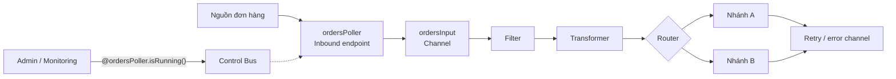
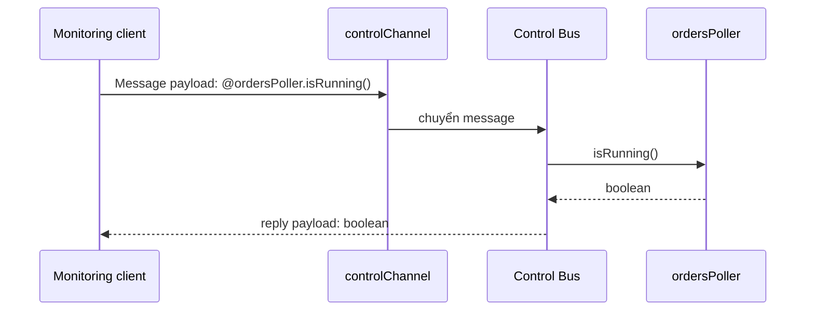
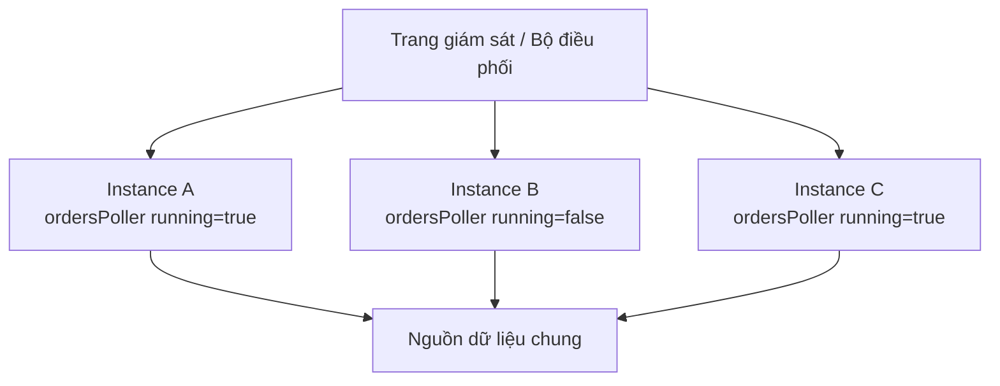

# Đọc trạng thái endpoint

## 1. Vì sao cần đọc trạng thái endpoint?

Trong một hệ thống dùng **Enterprise Integration Patterns (EIP)**, cùng một ứng dụng Spring Integration có thể chứa nhiều nguồn nhận thông điệp, các nhánh Router, Filter, Transformer, Splitter, Aggregator, Gateway và các cơ chế retry hoặc error channel. Khi cần bảo trì, vận hành hoặc kiểm thử, câu hỏi thường gặp là:

- Poller lấy đơn hàng từ nguồn ngoài **đã được khởi động** chưa?
- Sau khi gửi lệnh dừng qua Control Bus, endpoint **đã báo stopped** chưa?
- Khi khởi động lại một endpoint, làm sao phân biệt nó đang **running** với việc nó **thực sự nhận và xử lý message thành công**?
- Trong nhiều instance của ứng dụng, trạng thái vừa đọc thuộc instance nào?

**Control Bus** cho phép gửi message chứa biểu thức **Spring Expression Language (SpEL)** để gọi hoặc đọc thuộc tính/phương thức của bean, chẳng hạn `@ordersPoller.isRunning()`. Nếu đang ở cùng Spring `ApplicationContext`, ứng dụng cũng có thể tra cứu bean endpoint và gọi trực tiếp `Lifecycle.isRunning()`.

Bài học này thuộc chương **Control bus** của module **SPRING_INTEGRATION_PATTERN**. Mục tiêu là đọc trạng thái endpoint chính xác, kết hợp quan sát message và lỗi để phục vụ việc xây dựng những luồng tích hợp ít phụ thuộc, dễ mở rộng và có thể kiểm thử.

Sau khi hoàn thành, bạn có thể:

1. Xác định đúng **endpoint id** và bean cần kiểm tra.
2. Đọc trạng thái bằng `Lifecycle.isRunning()` hoặc gửi một truy vấn qua Control Bus.
3. Phân biệt trạng thái vòng đời với sức khỏe kết nối, lưu lượng và backlog.
4. Kiểm thử sự thay đổi trạng thái sau các lệnh `start()`, `stop()`.
5. Thiết kế kết quả kiểm tra có ý nghĩa khi hệ thống có nhiều endpoint, nhiều nhánh và nhiều replica.

## 2. Endpoint, flow và channel: phải hỏi đúng đối tượng

Giả sử luồng xử lý đơn hàng có cấu trúc:



Ba khái niệm rất dễ bị nhầm:

| Đối tượng | Chức năng | Có nên gọi `isRunning()`? |
| --- | --- | --- |
| **Inbound endpoint** `ordersPoller` | Nhận hoặc chủ động poll dữ liệu rồi tạo message | **Có**, khi bean triển khai `Lifecycle`/`SmartLifecycle` |
| **Channel** `ordersInput` | Chuyển message giữa các thành phần | Không giả định channel có trạng thái lifecycle |
| **IntegrationFlow** `ordersFlow` | Khai báo cách các endpoint và channel kết nối | Không mặc định coi flow bean là một endpoint duy nhất có `isRunning()` |

Tên `ordersPoller` phải là **id của endpoint thực tế**. Đặt tên cho flow hoặc channel không có nghĩa bean đó trở thành đúng mục tiêu kiểm tra. Trong Java DSL, đối với một polling inbound endpoint, có thể gán id trong cấu hình `.from(source, endpoint -> endpoint.id("ordersPoller")...)`.

Ở cấp Spring Framework, API cơ bản là:

```java
public interface Lifecycle {
    void start();
    void stop();
    boolean isRunning();
}
```

Một số endpoint triển khai thêm `SmartLifecycle`. Interface này hỗ trợ các thông tin liên quan đến lifecycle như `isAutoStartup()` và `getPhase()`, nhưng **running** vẫn là một tín hiệu trạng thái của bean, không phải kết quả health check hoàn chỉnh.

**Lưu ý:** không phải mọi thành phần của Spring Integration đều hỗ trợ `Lifecycle`. Nếu tra cứu một bean bằng tên và kiểu `Lifecycle.class` thất bại, trước tiên cần kiểm tra bean id và loại endpoint; không nên cố gọi `isRunning()` trên một message channel hoặc handler không có API này.

## 3. Hai cách đọc trạng thái

### 3.1. Đọc trực tiếp từ Spring context

Khi logic quản trị chạy trong cùng instance với endpoint, cách rõ ràng là lấy bean theo tên và interface:

```java
Lifecycle endpoint = applicationContext.getBean(
        "ordersPoller", Lifecycle.class);

boolean running = endpoint.isRunning();
```

Cách này hữu ích cho phép kiểm thử, dịch vụ quản trị nội bộ hoặc endpoint giám sát riêng. Nó tránh phải cấu hình một request-reply qua Control Bus cho một truy vấn đơn giản. Tuy nhiên, nó tạo phụ thuộc vào `ApplicationContext` và chỉ đọc được bean **thuộc context mà code đang truy cập**.

### 3.2. Đọc thông qua message gửi tới Control Bus

Control Bus nhận message có payload là biểu thức SpEL, ví dụ:

```text
@ordersPoller.isRunning()
```

Đường đi của một truy vấn có phản hồi:



Để nhận được giá trị trả về, bên gửi phải sử dụng **request-reply** và có đường nhận reply phù hợp. `MessageChannel.send(Message<?>)` chỉ trả một giá trị `boolean` biểu thị kết quả **gửi message**, không trả giá trị của biểu thức `isRunning()`.

Ví dụ:

```java
// Giá trị accepted nói về việc gửi lệnh tới channel.
boolean accepted = controlChannel.send(
        MessageBuilder.withPayload("@ordersPoller.isRunning()").build());

// Không được hiểu accepted là trạng thái chạy của ordersPoller.
```

Nếu cần nhận kết quả trực tiếp từ Control Bus, dùng `MessagingTemplate` hoặc messaging gateway được cấu hình cho request-reply. Phần ví dụ tiếp theo minh họa một phép hỏi như vậy và phân biệt rõ nó với việc gọi trực tiếp `Lifecycle`.

## 4. Ví dụ Java DSL có endpoint điều khiển được

Ta xây một ứng dụng Spring Integration đơn giản: queue trong bộ nhớ chứa mã đơn hàng; polling endpoint `ordersPoller` chuyển các mã đơn sang `processedOrders`. Ban đầu poller stopped, sau đó gửi lệnh qua Control Bus để kiểm tra trạng thái trước và sau khi bật.

Ví dụ giả định dự án Spring Boot đã có dependency và quản lý version tương thích:

```gradle
dependencies {
    implementation("org.springframework.boot:spring-boot-starter-integration")
    testImplementation("org.springframework.boot:spring-boot-starter-test")
}
```

Nội dung lớp `EndpointStatusConfiguration.java`:

```java
package example.endpointstatus;

import java.time.Duration;
import java.util.concurrent.BlockingQueue;
import java.util.concurrent.LinkedBlockingQueue;

import org.springframework.context.annotation.Bean;
import org.springframework.context.annotation.Configuration;
import org.springframework.integration.channel.DirectChannel;
import org.springframework.integration.channel.QueueChannel;
import org.springframework.integration.config.EnableIntegration;
import org.springframework.integration.core.MessageSource;
import org.springframework.integration.dsl.IntegrationFlow;
import org.springframework.integration.dsl.Pollers;
import org.springframework.messaging.MessageChannel;
import org.springframework.messaging.support.MessageBuilder;

@Configuration
@EnableIntegration
public class EndpointStatusConfiguration {

    // Channel chỉ dành cho lệnh và truy vấn quản trị.
    @Bean
    public MessageChannel controlChannel() {
        return new DirectChannel();
    }

    // Control Bus đánh giá biểu thức SpEL trong message.
    @Bean
    public IntegrationFlow controlBusFlow() {
        return IntegrationFlow.from("controlChannel")
                .controlBus()
                .get();
    }

    @Bean
    public BlockingQueue<String> pendingOrders() {
        return new LinkedBlockingQueue<>();
    }

    @Bean
    public MessageSource<String> ordersSource(
            BlockingQueue<String> pendingOrders) {
        return () -> {
            String orderId = pendingOrders.poll();
            return orderId == null
                    ? null
                    : MessageBuilder.withPayload(orderId).build();
        };
    }

    @Bean
    public QueueChannel processedOrders() {
        return new QueueChannel();
    }

    @Bean
    public IntegrationFlow ordersFlow(MessageSource<String> ordersSource) {
        return IntegrationFlow
                .from(ordersSource, endpoint -> endpoint
                        .id("ordersPoller")
                        .autoStartup(false)
                        .poller(Pollers.fixedDelay(Duration.ofMillis(300))))
                .channel("processedOrders")
                .get();
    }
}
```

Giải thích những thiết lập quyết định kết quả đọc trạng thái:

- `.id("ordersPoller")` đặt tên bean của polling endpoint. Control Bus sử dụng đúng tên này khi gọi `@ordersPoller.isRunning()`.
- `.autoStartup(false)` khiến poller không tự chạy sau khi context khởi động, vì vậy có thể quan sát trạng thái ban đầu là `false`.
- `.poller(...)` khai báo lịch nhận message; các lần poll mới xảy ra khi endpoint đang running.
- `controlChannel` là `DirectChannel`: nó chuyển message tới Control Bus trong ngữ cảnh gọi đồng bộ ở ví dụ này.
- `processedOrders` giữ các message đã đi vào flow để phục vụ kiểm thử. Nó **không phải** nguồn xác nhận trạng thái của poller.

Trong production, nguồn dữ liệu có thể là JDBC, file, FTP hoặc một hệ thống khác. Tính chất `start/stop`, độ bền và khả năng phát lại message phải được xác định theo adapter và nguồn thực tế.

## 5. Dịch vụ đọc trạng thái: local và qua Control Bus

Tạo `EndpointStatusService.java`. Lớp này cung cấp hai cách đọc trạng thái và hai thao tác điều khiển cố định:

```java
package example.endpointstatus;

import org.springframework.beans.factory.annotation.Qualifier;
import org.springframework.context.ApplicationContext;
import org.springframework.context.Lifecycle;
import org.springframework.messaging.Message;
import org.springframework.messaging.MessageChannel;
import org.springframework.messaging.core.GenericMessagingTemplate;
import org.springframework.messaging.support.MessageBuilder;

public class EndpointStatusService {

    private final ApplicationContext context;
    private final MessageChannel controlChannel;

    public EndpointStatusService(
            ApplicationContext context,
            @Qualifier("controlChannel") MessageChannel controlChannel) {
        this.context = context;
        this.controlChannel = controlChannel;
    }

    // Cách 1: đọc bean endpoint ngay trong ApplicationContext hiện tại.
    public boolean isRunningLocally() {
        Lifecycle endpoint = context.getBean(
                "ordersPoller", Lifecycle.class);
        return endpoint.isRunning();
    }

    // Cách 2: gửi biểu thức truy vấn tới Control Bus và đọc reply.
    public boolean isRunningViaControlBus() {
        GenericMessagingTemplate template = new GenericMessagingTemplate();
        template.setReceiveTimeout(3_000);

        Message<?> reply = template.sendAndReceive(
                controlChannel,
                MessageBuilder
                        .withPayload("@ordersPoller.isRunning()")
                        .build());

        if (reply == null) {
            throw new IllegalStateException(
                    "No reply from Control Bus within timeout");
        }
        if (!(reply.getPayload() instanceof Boolean)) {
            throw new IllegalStateException(
                    "Unexpected status reply payload: "
                            + reply.getPayload().getClass().getName());
        }
        return (Boolean) reply.getPayload();
    }

    public void start() {
        send("@ordersPoller.start()");
    }

    public void stop() {
        send("@ordersPoller.stop()");
    }

    private void send(String expression) {
        boolean accepted = controlChannel.send(
                MessageBuilder.withPayload(expression).build());

        if (!accepted) {
            throw new IllegalStateException(
                    "Lifecycle command was not accepted");
        }
    }
}
```

**Phân biệt kết quả:** `isRunningLocally()` nhận boolean trực tiếp từ bean, trong khi `isRunningViaControlBus()` nhận một **reply message** có payload boolean. Phương thức `send()` dùng cho `start/stop` chỉ kiểm tra message được chấp nhận trên channel.

Nếu cấu hình Control Bus thực tế không gửi reply, hoặc endpoint không có `isRunning()`, hàm request-reply phải báo lỗi rõ ràng. Không diễn giải `null` hoặc timeout thành `false`, vì `false` có nghĩa là endpoint đã trả lời rằng nó đang stopped.

Để đăng ký dịch vụ làm Spring bean khi cần inject, thêm vào `EndpointStatusConfiguration`:

```java
@Bean
public EndpointStatusService endpointStatusService(
        org.springframework.context.ApplicationContext context,
        @org.springframework.beans.factory.annotation.Qualifier(
                "controlChannel") MessageChannel controlChannel) {
    return new EndpointStatusService(context, controlChannel);
}
```

Đoạn `@Bean` trên được đặt **bên trong** lớp `EndpointStatusConfiguration`. Nó dùng chính `ApplicationContext` và `controlChannel` của instance đang chạy.

## 6. Minh họa truy vấn trước và sau start/stop

Với một đối tượng `EndpointStatusService statusService` và `BlockingQueue<String> pendingOrders` đã inject, chuỗi thao tác mẫu là:

```java
// autoStartup(false): poller chưa tự chạy.
System.out.println(statusService.isRunningLocally());       // false
System.out.println(statusService.isRunningViaControlBus()); // false

pendingOrders.offer("ORDER-101");

// Control Bus gọi Lifecycle.start() trên endpoint.
statusService.start();
System.out.println(statusService.isRunningLocally());       // true
System.out.println(statusService.isRunningViaControlBus()); // true

// Sau kỳ poll tiếp theo, ORDER-101 tới processedOrders.

statusService.stop();
System.out.println(statusService.isRunningLocally());       // false
System.out.println(statusService.isRunningViaControlBus()); // false
```

Đây là một chuỗi thao tác **trên cùng instance**. Khi `isRunning()` trả về `true`, điều đó chưa có nghĩa đơn hàng đã được nhận. Queue có thể trống, poller đang chờ kỳ tiếp theo hoặc downstream vẫn đang lỗi. Ngược lại, khi trạng thái là `false`, một message đã được lấy trước khi stop vẫn có thể đang xử lý tiếp.

Trạng thái cũng có tính **thời điểm**: ngay sau khi đọc, một luồng quản trị khác có thể gọi start hoặc stop. Nếu cần xác nhận một thay đổi đáng tin cậy, hãy gắn kết trạng thái với thời điểm đọc, kết quả lệnh, id instance và các chỉ số của flow.

## 7. Trạng thái lifecycle không phải health check

Ba nhóm tín hiệu nên quan sát riêng:

| Nhóm | Ví dụ | Trả lời câu hỏi |
| --- | --- | --- |
| **Lifecycle** | `isRunning()`, `isAutoStartup()`, `getPhase()` | Endpoint có báo đang chạy? Nó được cấu hình tự khởi động và có thứ tự lifecycle ra sao? |
| **Nguồn / kết nối** | Kết nối tới broker/DB, lần nhận thành công gần nhất, timeout | Có thể lấy dữ liệu từ nguồn không? |
| **Luồng nghiệp vụ** | Số message qua Filter/Router, backlog, retry, error channel, correlation group | Message có đi qua và xử lý đúng mong đợi không? |

Ví dụ, `ordersPoller.isRunning() == true` nhưng nguồn JDBC bị lỗi xác thực. Poller vẫn có thể chạy theo lịch và liên tục gặp lỗi; đó không phải dấu hiệu ứng dụng đang hoạt động tốt.

Tương tự, `isRunning() == false` là kết quả dự kiến khi vận hành cố ý tạm dừng nguồn để bảo trì. Nếu health endpoint đánh dấu toàn bộ ứng dụng “unhealthy” chỉ vì trạng thái stopped có chủ đích, hệ thống giám sát có thể cảnh báo sai.

Mô hình thực tế có thể đưa ra các trường dữ liệu riêng:

```json
{
  "instanceId": "orders-service-1",
  "endpointId": "ordersPoller",
  "running": true,
  "desiredState": "RUNNING",
  "lastSuccessfulMessageAt": "2026-11-21T08:00:00Z",
  "pendingMessageCount": 12,
  "errorCountLast5Minutes": 0,
  "observedAt": "2026-11-21T08:00:05Z"
}
```

Đây chỉ là **ví dụ cấu trúc dữ liệu giám sát do ứng dụng tự xây dựng**. Những trường như `desiredState`, `lastSuccessfulMessageAt`, `pendingMessageCount` và `errorCountLast5Minutes` không tự xuất hiện khi chỉ gọi `isRunning()`; chúng phải lấy từ nguồn cấu hình vận hành, bộ đếm, message store, metrics hoặc log tương ứng.

Khi nhiều nhánh xử lý, nên thống kê theo endpoint hoặc nhánh cụ thể. Chẳng hạn Filter loại bỏ message theo quy tắc vẫn có thể là hành vi hợp lệ; còn một nhánh Router không nhận message dù đang running có thể do quy tắc định tuyến, không hẳn do lỗi lifecycle.

## 8. Kiểm thử: đọc trạng thái và kiểm tra dữ liệu thực

Dùng `@SpringJUnitConfig` với cấu hình ở phần 4. Đây là phép kiểm thử tập trung vào Control Bus và trạng thái bean, không cần chạy cả ứng dụng web.

Tạo `EndpointStatusTest.java`:

```java
package example.endpointstatus;

import static org.assertj.core.api.Assertions.assertThat;

import java.util.concurrent.BlockingQueue;

import org.junit.jupiter.api.Test;
import org.springframework.beans.factory.annotation.Autowired;
import org.springframework.context.ApplicationContext;
import org.springframework.context.Lifecycle;
import org.springframework.integration.channel.QueueChannel;
import org.springframework.messaging.Message;
import org.springframework.test.context.junit.jupiter.SpringJUnitConfig;

@SpringJUnitConfig(EndpointStatusConfiguration.class)
class EndpointStatusTest {

    @Autowired
    ApplicationContext context;

    @Autowired
    EndpointStatusService statusService;

    @Autowired
    BlockingQueue<String> pendingOrders;

    @Autowired
    QueueChannel processedOrders;

    @Test
    void readsEndpointStatusBeforeAndAfterControlCommands() {
        Lifecycle poller = context.getBean(
                "ordersPoller", Lifecycle.class);

        assertThat(poller.isRunning()).isFalse();
        assertThat(statusService.isRunningLocally()).isFalse();
        assertThat(statusService.isRunningViaControlBus()).isFalse();

        try {
            statusService.start();

            assertThat(poller.isRunning()).isTrue();
            assertThat(statusService.isRunningLocally()).isTrue();
            assertThat(statusService.isRunningViaControlBus()).isTrue();

            // Running không chứng minh đã có message.
            pendingOrders.offer("ORDER-201");
            Message<?> processed = processedOrders.receive(3_000);

            assertThat(processed).isNotNull();
            assertThat(processed.getPayload()).isEqualTo("ORDER-201");
        } finally {
            statusService.stop();
        }

        assertThat(poller.isRunning()).isFalse();
        assertThat(statusService.isRunningViaControlBus()).isFalse();
    }
}
```

Bài test có hai lớp kiểm chứng:

1. **Trạng thái lifecycle**: cùng một bean trả `false → true → false` sau khi điều khiển qua Control Bus.
2. **Thông điệp nghiệp vụ**: một order được đưa vào queue và xuất hiện ở `processedOrders` khi poller chạy.

`QueueChannel.receive(3_000)` chờ tối đa 3 giây; đây là giới hạn kiểm thử, không phải cam kết tốc độ của production. Nếu test thất bại do timeout, cần kiểm tra lịch poll, nguồn dữ liệu và handler thay vì chỉ tăng thời gian chờ. Phép thử giả định một context test cô lập, queue đầu vào và đầu ra ban đầu rỗng, không có thread ngoài can thiệp.

Một biến thể kiểm thử nên bổ sung:

- Gửi truy vấn SpEL tới bean id **không tồn tại** trong môi trường thử nghiệm và xác minh lỗi được báo rõ, không suy diễn là trạng thái `false`.
- Tắt poller rồi đưa thêm message vào nguồn; xác minh không có **lần poll mới** trong khoảng quan sát, sau đó start và kiểm tra backlog được đọc.
- Nếu có Retry/Aggregator, tách phép kiểm tra in-flight message ra khỏi kết quả `isRunning()`.

## 9. Đọc trạng thái từ nhiều instance và nhiều endpoint

Trong hệ thống có nhiều replica, mỗi instance thường có một `ApplicationContext` riêng:



Khi gọi `@ordersPoller.isRunning()` thông qua Control Bus trong instance B, giá trị `false` chỉ cho biết **endpoint ở B** đang stopped. Điều đó không có nghĩa toàn cụm đã ngừng lấy đơn hàng: A và C có thể vẫn tiếp tục chạy.

Muốn trả lời “nguồn này đã được dừng ở tất cả replica chưa?”, bộ điều phối cần truy vấn từng instance, gắn nhãn instance ID, xử lý timeout hoặc instance mất kết nối, rồi tổng hợp kết quả. Ví dụ:

| Instance | Trạng thái endpoint | Kết luận cục bộ |
| --- | --- | --- |
| A | `true` | Poller đang running ở A |
| B | `false` | Poller đang stopped ở B |
| C | Không nhận được phản hồi | **Không xác định**, không được coi là stopped |

Nếu cần kiểm soát việc chỉ một replica được phép poll, nên dùng cơ chế coordination/locking hoặc phân công consumer phù hợp với nguồn dữ liệu. Trạng thái lifecycle đơn lẻ không giải quyết tính độc quyền của một job phân tán.

## 10. Thực hành an toàn khi công bố trạng thái

Control Bus đánh giá biểu thức SpEL có thể truy cập các bean của ứng dụng. Vì vậy không nên dùng một API công khai nhận payload do người dùng nhập rồi chuyển nguyên văn vào `controlChannel`, kể cả khi mục đích chỉ là “xem trạng thái”.

Một giao diện quản trị an toàn hơn:

1. Chỉ cho người dùng được xác thực và phân quyền yêu cầu trạng thái của **endpoint nằm trong danh sách cho phép**.
2. Với mỗi endpoint cho phép, dịch vụ tạo **biểu thức cố định**, ví dụ `@ordersPoller.isRunning()`, hoặc trực tiếp tra cứu bean `Lifecycle`.
3. Ghi lại ai hỏi trạng thái nào, ở instance nào, thời điểm nào; không tiết lộ tùy ý cấu trúc bean hoặc thông tin nội bộ ra ngoài.
4. Phân biệt **lỗi truy vấn**, **không có reply**, **bean không tồn tại** và **running=false**. Không gộp tất cả thành stopped.
5. Giữ thời hạn chờ rõ ràng và giám sát cả đường điều khiển. Khi Control Bus bất đồng bộ hoặc kênh reply cấu hình sai, dữ liệu hiển thị có thể stale.

Nếu đồng thời có thao tác thay đổi trạng thái, nên có cơ chế xác nhận sau lệnh, tránh hiển thị “đã khởi động” chỉ vì message `start()` đã được gửi thành công.

## 11. Lỗi thường gặp và cách khắc phục

| Triệu chứng | Khả năng gây ra | Cách xử lý |
| --- | --- | --- |
| `NoSuchBeanDefinitionException` khi đọc `ordersPoller` | Sai endpoint id hoặc sai context | Kiểm tra `.id("ordersPoller")` và context đang dùng |
| Không lấy được bean kiểu `Lifecycle` | Bean được hỏi là channel/handler không hỗ trợ lifecycle | Xác định đúng inbound endpoint và loại adapter |
| `send() == true` nhưng màn hình hiển thị running | Hiểu sai boolean của thao tác send thành kết quả `isRunning()` | Dùng request-reply hoặc gọi trực tiếp `Lifecycle.isRunning()` |
| Truy vấn Control Bus không có reply | Chưa cấu hình request-reply phù hợp, lỗi xử lý hoặc timeout | Kiểm tra reply channel, handler, exception và thời hạn chờ |
| `isRunning() == true` nhưng không có dữ liệu | Nguồn rỗng, lỗi kết nối, lịch poll chưa tới, nhánh downstream bị lỗi | Quan sát nguồn, log, metrics, error channel và backlog |
| `isRunning() == false` nhưng vẫn thấy message xử lý | Message đã được nhận trước lệnh stop | Theo dõi số in-flight, Retry và Aggregator đang chờ |
| Trạng thái trên các node không giống nhau | Mỗi replica có context/lifecycle riêng | Truy vấn từng instance và hiển thị kèm instance ID |
| Trạng thái thay đổi ngay sau khi đọc | Có lệnh quản trị khác hoặc restart đồng thời | Hiển thị `observedAt` và trạng thái mong muốn nếu có |

## 12. Bài tập vận dụng

**Bài 1 — Đọc bằng hai cơ chế.** Chạy cấu hình ví dụ, gọi `isRunningLocally()` và `isRunningViaControlBus()` trước và sau lệnh start/stop. Giải thích vì sao `MessageChannel.send()` không thay thế phép đọc này.

**Bài 2 — Phân biệt running với healthy.** Cho endpoint chạy nhưng giữ queue trống; ghi lại trạng thái lifecycle và số message xử lý. Sau đó đưa một message vào queue và kiểm tra chỉ số nào thay đổi.

**Bài 3 — Truy vấn sai đối tượng.** Thử đọc trạng thái bean channel và một endpoint không tồn tại trong test. Phân loại lỗi để giao diện quản trị không hiển thị nhầm stopped.

**Bài 4 — Splitter/Aggregator.** Thiết kế một phép đo ngoài `isRunning()` để biết còn bao nhiêu correlation group chưa hoàn tất khi đầu nhận đã stopped. Nêu cách giám sát timeout, retry và message store.

**Bài 5 — Nhiều replica.** Có ba instance với kết quả `true`, `false` và timeout. Thiết kế JSON trạng thái theo từng instance và một phép tổng hợp “đã dừng toàn cụm chưa?” mà không kết luận sai khi có node không trả lời.

## 13. Câu hỏi tự kiểm tra

1. Vì sao phải tra cứu đúng bean endpoint thay vì chỉ dùng tên của `IntegrationFlow`?
2. `Lifecycle.isRunning()` trả lời điều gì và không trả lời điều gì?
3. Sự khác nhau giữa `controlChannel.send(...)` và request-reply với `@ordersPoller.isRunning()`?
4. Nếu `isRunning()` là `true` nhưng error channel nhận nhiều lỗi, kết luận vận hành nên như thế nào?
5. Nếu `isRunning()` là `false`, các message đã qua Splitter hoặc đang chờ Aggregator có biến mất không?
6. Tại sao trạng thái của một instance không đủ để mô tả trạng thái toàn cụm?

**Ghi nhớ:** Đọc trạng thái endpoint là đọc **lifecycle của đúng bean tại đúng thời điểm và instance**. Kết hợp truy vấn `isRunning()` với metrics, backlog, retry/error và correlation giúp hiểu liệu toàn bộ luồng Spring Integration có đang hoạt động theo mục đích hay không.

