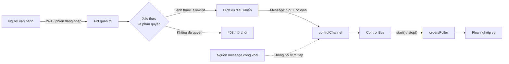

# Quyền truy cập control bus

## 1. Vì sao Control Bus cần kiểm soát quyền truy cập?

Trong module **SPRING_INTEGRATION_PATTERN**, Spring Integration được dùng để triển khai các mẫu Enterprise Integration Patterns (EIP): Router, Filter, Transformer, Splitter, Aggregator, Gateway, retry, error channel và correlation. Các flow trao đổi dữ liệu qua message để giảm phụ thuộc giữa các thành phần. Nhưng trong hệ thống đang hoạt động, người vận hành cũng cần gửi những **message điều khiển** như bật hoặc tắt polling endpoint, kiểm tra trạng thái và điều phối việc bảo trì.

**Control Bus** thực hiện việc đó bằng cách xử lý một message có payload là biểu thức **Spring Expression Language (SpEL)**. Ví dụ:

```text
@ordersPoller.start()
@ordersPoller.stop()
@ordersPoller.isRunning()
```

Những lệnh này được đánh giá trong ngữ cảnh ứng dụng Spring, nên quyền gửi message tới Control Bus phải được xem là **quyền quản trị nhạy cảm**. Nếu một nguồn không đáng tin cậy được gửi biểu thức SpEL tùy ý, nguồn đó có thể thử truy cập những bean ngoài phạm vi dự kiến và gây thay đổi trạng thái ứng dụng.

Bài học thuộc chương **Control bus**, tập trung giải quyết câu hỏi: **ai được phép yêu cầu thao tác nào trên endpoint nào, qua kênh nào và bằng cách nào có thể xác nhận thao tác thực sự đã xảy ra?**

Sau bài học, bạn có thể:

1. Phân tích ranh giới tin cậy giữa API quản trị, control channel, Control Bus và endpoint.
2. Xây dựng danh sách lệnh được phép (**allowlist**) và phân quyền đọc/truy vấn khác với quyền thay đổi lifecycle.
3. Bảo vệ lời gọi bằng Spring Security, giữ SpEL cố định ở phía ứng dụng và kiểm thử quyền.
4. Thiết kế audit, ghi nhận kết quả và xử lý tình huống nhiều instance.
5. Tránh các lỗi bảo mật liên quan đến biểu thức tự do, bean name do người dùng nhập và kết quả gửi message bị hiểu sai.

## 2. Control Bus có quyền gì?

Giả sử một hệ thống có endpoint nhận đơn hàng từ đối tác A, endpoint nhận thanh toán từ đối tác B và một nhánh gửi thông báo. Khi hệ thống muốn tạm dừng tiếp nhận đơn hàng, người vận hành có thể gửi:

```text
@ordersPoller.stop()
```

Control Bus tìm bean `ordersPoller` trong `ApplicationContext` mà nó đang hoạt động và cố gọi phương thức `stop()`. Khi bean đó có hỗ trợ `Lifecycle`, thao tác có thể thay đổi trạng thái của polling endpoint.

Khác với message chứa một đơn hàng hay một sự kiện nghiệp vụ, **payload của Control Bus là một biểu thức được thực thi**. Vì vậy, nó cần được xử lý như một giao diện có khả năng gọi phương thức lên bean, không phải một kênh dữ liệu thông thường.



Ở đây, quyết định phân quyền phải diễn ra **trước khi message đến Control Bus**. Chỉ tách một `DirectChannel` riêng ra là chưa đủ: channel không tự biến thành bộ máy phân quyền theo vai trò. Việc Spring Integration đánh giá SpEL cũng không có nghĩa biểu thức đã được kiểm soát theo quyền nghiệp vụ của người gọi.

### Những ranh giới cần giữ

| Ranh giới | Điều cần kiểm tra | Nguy cơ nếu bỏ qua |
| --- | --- | --- |
| Người dùng → API | Danh tính, quyền đọc/điều khiển, endpoint được phép | Người không có quyền dừng một nguồn quan trọng |
| API → dịch vụ quản trị | Lệnh thuộc tập định sẵn; dữ liệu đầu vào hợp lệ | Dữ liệu người dùng bị ghép thành biểu thức SpEL |
| Dịch vụ → control channel | Chỉ những nhà phát lệnh được tin cậy mới có thể gửi | Một flow nghiệp vụ có thể chuyển nội dung không đáng tin đến Control Bus |
| Control Bus → bean endpoint | Bean id đúng, phương thức hỗ trợ lifecycle | Tác động nhầm bean hoặc gọi phương thức ngoài dự kiến |
| Lệnh → trạng thái vận hành | Có xác nhận thay đổi và audit | Gửi thành công nhưng endpoint vẫn lỗi hoặc sai instance |

**Nguyên tắc cốt lõi:** người dùng chỉ chọn **hành động nghiệp vụ đã được phê duyệt**; ứng dụng quyết định **biểu thức SpEL nào** được phép gửi.

## 3. Phân quyền theo thao tác và endpoint

Không phải ai xem trạng thái cũng nên có quyền dừng endpoint. Một chính sách đơn giản cho hệ thống nhiều đội vận hành có thể là:

| Vai trò ví dụ | Xem trạng thái | Start/stop nguồn đơn hàng | Start/stop nguồn thanh toán | Cấp quyền |
| --- | --- | --- | --- | --- |
| Observer | Có | Không | Không | Không |
| Order operator | Có | Có | Không | Không |
| Payment operator | Có | Không | Có | Không |
| Platform administrator | Có | Theo chính sách quản trị | Theo chính sách quản trị | Qua quy trình riêng |

Bảng này là **chính sách minh họa**, không phải hệ vai trò sẵn có do Spring Integration cung cấp. Khi triển khai, cần ánh xạ quyền của nhà cung cấp danh tính (Identity Provider) sang các authority mà ứng dụng thực sự kiểm tra.

Có thể tách quyền thành:

- `integration.control.read` — đọc trạng thái endpoint được phép.
- `integration.orders.write` — start/stop endpoint nhận đơn hàng.
- `integration.payments.write` — start/stop endpoint thanh toán.

Nếu dùng JWT Resource Server của Spring Security với cấu hình chuyển đổi scope mặc định, các scope thường được ánh xạ thành authority có tiền tố `SCOPE_`; chẳng hạn scope `integration.orders.write` trở thành `SCOPE_integration.orders.write`. Với token sử dụng claim khác hoặc ánh xạ tùy chỉnh, phải cấu hình converter tương ứng.

Hai nguyên tắc quan trọng:

1. **Default deny:** hành động hoặc endpoint không có trong chính sách sẽ bị từ chối.
2. **Least privilege:** quyền đọc không tự cho phép thực thi biểu thức; quyền điều khiển đơn hàng không mặc nhiên cho phép dừng thanh toán.

Nếu quyền hạn phụ thuộc vào tổ chức, môi trường, tenant hoặc vùng triển khai, hãy kiểm tra các yếu tố đó cùng với role/authority. Một scope “có thể điều khiển” chung không đủ để giới hạn endpoint của từng tenant.

## 4. Ví dụ cấu hình Spring Integration có control channel riêng

Để minh họa, xây một polling flow đơn hàng có ID ổn định `ordersPoller`. Endpoint ban đầu stopped; thao tác điều khiển chỉ đi qua một channel nội bộ.

Với dự án Spring Boot quản lý version phụ thuộc:

```gradle
dependencies {
    implementation("org.springframework.boot:spring-boot-starter-integration")
    implementation("org.springframework.boot:spring-boot-starter-security")
    implementation("org.springframework.boot:spring-boot-starter-web")
    implementation("org.springframework.boot:spring-boot-starter-validation")
    testImplementation("org.springframework.boot:spring-boot-starter-test")
    testImplementation("org.springframework.security:spring-security-test")
}
```

Tạo cấu hình `ControlBusAccessConfiguration.java`:

```java
package example.controlbus;

import java.time.Duration;
import java.util.concurrent.BlockingQueue;
import java.util.concurrent.LinkedBlockingQueue;

import org.springframework.context.annotation.Bean;
import org.springframework.context.annotation.Configuration;
import org.springframework.integration.channel.DirectChannel;
import org.springframework.integration.config.EnableIntegration;
import org.springframework.integration.core.MessageSource;
import org.springframework.integration.dsl.IntegrationFlow;
import org.springframework.integration.dsl.Pollers;
import org.springframework.messaging.MessageChannel;
import org.springframework.messaging.support.MessageBuilder;
import org.springframework.security.config.annotation.method.configuration.EnableMethodSecurity;

@Configuration
@EnableIntegration
@EnableMethodSecurity
public class ControlBusAccessConfiguration {

    @Bean
    public MessageChannel controlChannel() {
        return new DirectChannel();
    }

    @Bean
    public IntegrationFlow controlBusFlow() {
        return IntegrationFlow.from("controlChannel")
                .controlBus()
                .get();
    }

    @Bean
    public BlockingQueue<String> pendingOrders() {
        return new LinkedBlockingQueue<>();
    }

    @Bean
    public MessageSource<String> orderSource(
            BlockingQueue<String> pendingOrders) {
        return () -> {
            String id = pendingOrders.poll();
            return id == null
                    ? null
                    : MessageBuilder.withPayload(id).build();
        };
    }

    @Bean
    public IntegrationFlow ordersFlow(MessageSource<String> orderSource) {
        return IntegrationFlow
                .from(orderSource, endpoint -> endpoint
                        .id("ordersPoller")
                        .autoStartup(false)
                        .poller(Pollers.fixedDelay(Duration.ofSeconds(1))))
                .handle(message -> System.out.println(
                        "Processed order: " + message.getPayload()))
                .get();
    }
}
```

Các chi tiết cần phân biệt:

- `controlChannel` là kênh nhận lệnh, **không phải** endpoint cần điều khiển.
- `.controlBus()` khiến message gửi đến kênh đó được xử lý như một biểu thức điều khiển.
- `ordersPoller` là ID của **polling inbound endpoint**, nên biểu thức `@ordersPoller.start()` hoặc `@ordersPoller.stop()` nhắm đến đúng thành phần.
- `.autoStartup(false)` giúp tránh polling trước khi có lệnh khởi động; đây là cấu hình ví dụ, không phải chính sách bắt buộc cho mọi hệ thống.
- `@EnableMethodSecurity` bật việc áp dụng các annotation như `@PreAuthorize` trên phương thức của Spring bean được gọi qua proxy.

**Lưu ý về ranh giới tin cậy:** dù code trên khai báo một channel riêng, bất kỳ thành phần nào trong cùng ứng dụng có khả năng lấy bean `controlChannel` vẫn có thể thử gửi message đến đó. Việc bảo vệ ở tầng dịch vụ/API phải được kết hợp với kiểm soát những nhà phát message được kết nối, cấu hình ứng dụng và quyền truy cập nội bộ.

## 5. Không nhận SpEL tự do: tạo tập lệnh cố định

API bên ngoài không nên nhận body kiểu:

```json
{
  "expression": "@ordersPoller.stop()"
}
```

Vì hợp đồng “expression” cho phép bên gọi quyết định nội dung sẽ được đánh giá, rất khó bảo đảm nó chỉ nhắm đến đối tượng hợp lệ. Cũng không nên ghép chuỗi từ input:

```java
// Không áp dụng cho dữ liệu đến từ người dùng:
String expression = "@" + beanName + "." + methodName + "()";
```

Thay vào đó, định nghĩa **một enum thao tác** và ánh xạ từng lựa chọn sang biểu thức cố định.

Tạo `ControlCommand.java`:

```java
package example.controlbus;

public enum ControlCommand {
    START_ORDERS,
    STOP_ORDERS
}
```

Tạo dịch vụ `SecureControlBusService.java`:

```java
package example.controlbus;

import java.util.Objects;

import org.springframework.beans.factory.annotation.Qualifier;
import org.springframework.context.ApplicationContext;
import org.springframework.context.Lifecycle;
import org.springframework.messaging.MessageChannel;
import org.springframework.messaging.support.MessageBuilder;
import org.springframework.security.access.prepost.PreAuthorize;
import org.springframework.stereotype.Service;

@Service
public class SecureControlBusService {

    private final MessageChannel controlChannel;
    private final ApplicationContext context;

    public SecureControlBusService(
            @Qualifier("controlChannel") MessageChannel controlChannel,
            ApplicationContext context) {
        this.controlChannel = controlChannel;
        this.context = context;
    }

    @PreAuthorize("hasAuthority('SCOPE_integration.orders.write')")
    public void execute(ControlCommand command) {
        Objects.requireNonNull(command, "command");

        // Mọi biểu thức đều được kiểm soát tại đây, không ghép từ input.
        String expression = switch (command) {
            case START_ORDERS -> "@ordersPoller.start()";
            case STOP_ORDERS  -> "@ordersPoller.stop()";
        };

        boolean accepted = controlChannel.send(
                MessageBuilder.withPayload(expression).build());

        if (!accepted) {
            throw new IllegalStateException(
                    "Control channel rejected the command");
        }
    }

    @PreAuthorize(
        "hasAnyAuthority('SCOPE_integration.control.read', "
        + "'SCOPE_integration.orders.write')")
    public boolean isOrdersRunning() {
        Lifecycle endpoint =
                context.getBean("ordersPoller", Lifecycle.class);
        return endpoint.isRunning();
    }
}
```

Ở thiết kế này:

1. Người gọi chỉ được chọn `START_ORDERS` hoặc `STOP_ORDERS`.
2. `@PreAuthorize` chặn người gọi không có authority tương ứng trước khi vào phương thức.
3. Bean id và tên phương thức trong SpEL được định nghĩa cố định phía server.
4. Truy vấn trạng thái được phân quyền riêng, đồng thời có thể được cấp cho operator.
5. Dịch vụ trả lỗi nếu channel không nhận lệnh; bên vận hành vẫn cần đọc lại trạng thái và kiểm tra tác động thực tế.

Trong cùng Spring context, gọi `Lifecycle.isRunning()` trực tiếp là một cách gọn để đọc trạng thái. Nếu cần truy vấn qua Control Bus, biểu thức `@ordersPoller.isRunning()` có thể được gửi bằng cơ chế request-reply, nhưng vẫn phải bảo vệ quyền phát biểu thức và phân biệt **reply boolean** với boolean trả về từ `MessageChannel.send()`.

**Ranh giới của `@PreAuthorize`:** annotation chỉ có hiệu lực khi Spring Security method security được bật và phương thức được gọi qua Spring proxy. Lời gọi nội bộ `this.execute(...)` từ chính bean có thể bỏ qua interceptor. Hơn nữa, các thành phần có thể gửi trực tiếp vào `controlChannel` sẽ không tự đi qua `SecureControlBusService`. Vì vậy cần bảo đảm tất cả đầu vào không tin cậy đi qua điểm kiểm tra quyền, đồng thời giới hạn việc truy cập trực tiếp đến channel ở phạm vi code được tin cậy.

## 6. Bảo vệ API quản trị

Một controller có thể cung cấp hợp đồng nghiệp vụ hẹp thay vì nhận SpEL thô.

```java
package example.controlbus;

import jakarta.validation.Valid;
import jakarta.validation.constraints.NotNull;

import org.springframework.http.HttpStatus;
import org.springframework.web.bind.annotation.GetMapping;
import org.springframework.web.bind.annotation.PostMapping;
import org.springframework.web.bind.annotation.RequestBody;
import org.springframework.web.bind.annotation.RequestMapping;
import org.springframework.web.bind.annotation.ResponseStatus;
import org.springframework.web.bind.annotation.RestController;

@RestController
@RequestMapping("/internal/integration")
public class IntegrationControlController {

    private final SecureControlBusService service;

    public IntegrationControlController(SecureControlBusService service) {
        this.service = service;
    }

    public record CommandRequest(@NotNull ControlCommand command) {}

    public record StatusResponse(String endpoint, boolean running) {}

    @PostMapping("/control")
    @ResponseStatus(HttpStatus.NO_CONTENT)
    public void execute(@Valid @RequestBody CommandRequest request) {
        service.execute(request.command());
    }

    @GetMapping("/endpoints/orders/status")
    public StatusResponse status() {
        return new StatusResponse(
                "ordersPoller", service.isOrdersRunning());
    }
}
```

Ví dụ request hợp lệ:

```http
POST /internal/integration/control
Content-Type: application/json
Authorization: Bearer <access-token>

{"command":"STOP_ORDERS"}
```

Các trường hợp cần có kết quả rõ ràng:

| Request | Kết quả mong đợi |
| --- | --- |
| Người có quyền điều khiển gửi `STOP_ORDERS` | Lệnh được gửi đến Control Bus; trả thành công nếu thao tác đồng bộ không lỗi |
| Người chỉ có quyền đọc gửi `STOP_ORDERS` | Bị từ chối, thông thường HTTP 403 |
| Không có xác thực | Bị từ chối, thông thường HTTP 401 |
| `command` không có trong enum | Lỗi xác thực/giải mã request, thường là HTTP 400 |
| `command` là `null` | Lỗi validation, thường là HTTP 400 |
| Bean endpoint không tồn tại | Lỗi thực thi cần được ghi nhận và chuyển thành phản hồi an toàn; không giả vờ thao tác thành công |

Ngoài `@PreAuthorize`, đường HTTP phải được **xác thực bởi SecurityFilterChain**, với chính sách ủy quyền nhất quán. Ví dụ API chỉ dùng bearer token (JWT) có thể kiểm tra scope trước khi đến controller. Một ứng dụng đã có bảo mật cần hợp nhất quy tắc này vào cấu hình hiện hữu:

```java
// Ví dụ phần luật authorizeHttpRequests trong SecurityFilterChain
.authorizeHttpRequests(auth -> auth
    .requestMatchers(
        org.springframework.http.HttpMethod.POST,
        "/internal/integration/control"
    ).hasAuthority("SCOPE_integration.orders.write")
    .requestMatchers(
        org.springframework.http.HttpMethod.GET,
        "/internal/integration/endpoints/orders/status"
    ).hasAnyAuthority(
        "SCOPE_integration.control.read",
        "SCOPE_integration.orders.write")
    .anyRequest().authenticated()
)
```

Để xử lý token bearer, cần cấu hình Resource Server, xác minh chữ ký, issuer/audience, thời hạn của token và ánh xạ scope/authority đúng với chính sách. Nếu API có phiên đăng nhập dựa trên cookie, cần bảo vệ CSRF cho thao tác thay đổi trạng thái; không tắt bảo vệ này một cách tùy tiện. Với một API thuần bearer token, stateless, chính sách CSRF có thể được điều chỉnh riêng sau khi xác nhận không dựa vào cookie.

**Không coi đường dẫn chứa `/internal/` là một biện pháp bảo mật.** Phải bảo vệ bằng xác thực, phân quyền, cấu hình mạng và kênh kết nối phù hợp; nếu có reverse proxy hoặc service mesh, chính sách ở đó là lớp bổ sung chứ không thay thế kiểm tra quyền trong ứng dụng.

## 7. Kiểm thử người có quyền và không có quyền

Một kiểm thử quan trọng là xác minh người dùng chỉ có quyền đọc **không thể tác động** đến endpoint. Dùng `spring-security-test` để mô phỏng authority và gọi vào **Spring bean đã được bảo vệ bằng proxy**.

```java
package example.controlbus;

import static example.controlbus.ControlCommand.START_ORDERS;
import static example.controlbus.ControlCommand.STOP_ORDERS;
import static org.assertj.core.api.Assertions.assertThat;
import static org.assertj.core.api.Assertions.assertThatThrownBy;

import org.junit.jupiter.api.Test;
import org.springframework.beans.factory.annotation.Autowired;
import org.springframework.context.ApplicationContext;
import org.springframework.context.Lifecycle;
import org.springframework.security.access.AccessDeniedException;
import org.springframework.security.test.context.support.WithMockUser;
import org.springframework.test.context.junit.jupiter.SpringJUnitConfig;

@SpringJUnitConfig({
    ControlBusAccessConfiguration.class,
    SecureControlBusService.class
})
class ControlBusPermissionTest {

    @Autowired
    SecureControlBusService service;

    @Autowired
    ApplicationContext context;

    @Test
    @WithMockUser(authorities = "SCOPE_integration.control.read")
    void observerCanReadButCannotStopOrders() {
        Lifecycle poller =
                context.getBean("ordersPoller", Lifecycle.class);

        assertThat(service.isOrdersRunning()).isFalse();

        assertThatThrownBy(() -> service.execute(STOP_ORDERS))
                .isInstanceOf(AccessDeniedException.class);

        // Lệnh trái quyền không được thay đổi trạng thái.
        assertThat(poller.isRunning()).isFalse();
    }

    @Test
    @WithMockUser(authorities = "SCOPE_integration.orders.write")
    void authorizedOperatorCanStartAndStopOrders() {
        Lifecycle poller =
                context.getBean("ordersPoller", Lifecycle.class);

        try {
            service.execute(START_ORDERS);
            assertThat(poller.isRunning()).isTrue();
            assertThat(service.isOrdersRunning()).isTrue();
        } finally {
            service.execute(STOP_ORDERS);
        }

        assertThat(poller.isRunning()).isFalse();
    }
}
```

Bài test tập trung vào **chính sách cấp quyền trên service**, không giả lập đầy đủ việc xác thực một HTTP request. Với API REST, nên bổ sung kiểm thử `MockMvc` hoặc kiểm thử tích hợp để xác minh:

- Request chưa xác thực bị từ chối.
- Token chỉ có scope đọc được phép xem trạng thái nhưng không được gửi lệnh.
- Token có scope điều khiển gửi lệnh hợp lệ thành công.
- Request có giá trị enum lạ, trường thiếu hoặc token sai không được chạm đến control channel.
- Khi Control Bus ném exception, API không trả về thành công giả.

Một bộ test HTTP dùng bảo mật JWT cũng cần kiểm tra mapping claims thực tế sang authorities, vì `@WithMockUser` tự đặt authority được chỉ định và không chứng minh việc ánh xạ token của môi trường production.

Nếu có nhiều test cùng sử dụng một Spring context, trạng thái `ordersPoller` và dữ liệu queue có thể bị ảnh hưởng lẫn nhau. Dùng context cô lập hoặc cleanup để tránh kết quả phụ thuộc thứ tự chạy test.

## 8. Quyền truy cập khi có nhiều endpoint và nhiều instance

Trong một ứng dụng lớn có thể tồn tại:

- `ordersPoller` để nhận đơn hàng.
- `paymentsPoller` để nhận thanh toán.
- `notificationsPoller` để nhận sự kiện gửi thông báo.

Không nên thay các hằng cố định bằng chuỗi `"@" + endpointName + "." + action` khi bổ sung nhiều endpoint. Thay vào đó, mở rộng enum hoặc bản đồ chính sách **được định nghĩa trong code**, trong đó mỗi lựa chọn gắn với endpoint và quyền riêng.

Ví dụ chính sách:

| Lệnh công khai | Biểu thức cố định ở server | Quyền yêu cầu |
| --- | --- | --- |
| `START_ORDERS` | `@ordersPoller.start()` | `integration.orders.write` |
| `STOP_ORDERS` | `@ordersPoller.stop()` | `integration.orders.write` |
| `START_PAYMENTS` | `@paymentsPoller.start()` | `integration.payments.write` |
| `STOP_PAYMENTS` | `@paymentsPoller.stop()` | `integration.payments.write` |

Khi thêm lệnh, cần cập nhật cả policy, kiểm thử quyền và audit. Không cho phép một operator có quyền quản lý đơn hàng tác động đến bean thanh toán chỉ bằng cách đổi chuỗi tên bean.

Trong môi trường nhiều replica, lệnh Control Bus chỉ ảnh hưởng đến **bean thuộc ApplicationContext của instance nhận message**. Nếu muốn dừng polling trên toàn cụm:

1. Phân quyền cả **tài nguyên đích** (endpoint) và **phạm vi tác động** (instance, nhóm instance, cluster).
2. Gửi lệnh đến đúng instance hoặc một tầng điều phối được quản trị.
3. Kiểm tra `isRunning()` của từng instance và ghi rõ node không phản hồi là **không xác định**, không mặc định là stopped.
4. Đảm bảo retry hoặc việc gửi lại lệnh không tạo trạng thái mâu thuẫn; xác định quyền của các bộ điều phối khác nhau.

Một operator có quyền điều khiển endpoint tại môi trường thử nghiệm không mặc nhiên có quyền điều khiển cùng endpoint ở production. Cần ràng buộc môi trường trong chính sách cấp quyền và cách định tuyến.

## 9. Audit và xác minh sau thao tác

Thao tác quản trị phải có khả năng truy vết. Tối thiểu nên ghi:

| Trường audit | Ví dụ | Mục đích |
| --- | --- | --- |
| `actor` | `operator-42` | Ai yêu cầu |
| `action` | `STOP_ORDERS` | Thao tác nghiệp vụ được phê duyệt |
| `target` | `ordersPoller` | Endpoint bị tác động |
| `instanceId` | `orders-service-2` | Bean thuộc instance nào |
| `requestedAt` | Thời điểm theo UTC | Thời điểm yêu cầu |
| `result` | `SUCCEEDED` / `FAILED` / `UNKNOWN` | Kết quả kiểm tra được |
| `observedRunning` | `false` | Trạng thái endpoint đọc sau lệnh |
| `correlationId` | ID yêu cầu quản trị | Kết nối log, lệnh và phản hồi |

Không cần lưu biểu thức SpEL thô do người dùng đưa vào vì API đúng thiết kế không nhận loại dữ liệu đó. Nên lưu **mã lệnh đã được định nghĩa sẵn**, kết quả và các định danh liên quan; tránh ghi token, bí mật hoặc dữ liệu nhạy cảm vào log.

**Phân biệt ba mức thành công:**

1. **Được phép:** danh tính đã vượt qua kiểm tra quyền.
2. **Được chấp nhận/thực thi:** message đi qua control channel, handler đánh giá lệnh mà không báo lỗi.
3. **Đạt trạng thái mong muốn:** endpoint xác nhận lifecycle mới; nếu cần bảo trì an toàn, các tác vụ đang chạy và backlog cũng được xử lý theo chính sách.

Giá trị `true` từ `MessageChannel.send()` chỉ liên quan đến việc chấp nhận message theo hợp đồng channel. Với `DirectChannel`, handler chạy đồng bộ trong luồng gửi nên exception thường có thể quay về caller; tuy nhiên thao tác thành công không có nghĩa hệ thống nghiệp vụ đã khỏe mạnh, nguồn đã sẵn sàng hay mọi message đang xử lý đã hoàn tất.

Khi gửi lệnh qua kênh bất đồng bộ, việc nhận message và việc endpoint đổi trạng thái có thể diễn ra ở các thời điểm khác nhau. Lúc đó cần cơ chế acknowledgment, timeout, correlation và kiểm tra trạng thái độc lập. Audit cũng cần thể hiện kết quả `UNKNOWN` hoặc `TIMED_OUT` khi không có bằng chứng đầy đủ.

## 10. Nguyên tắc kết hợp với các mẫu EIP khác

**Router và Filter:** người có quyền dừng một inbound endpoint không đương nhiên có quyền sửa định tuyến hoặc quy tắc lọc. Khi Filter bỏ message, đó có thể là hành vi nghiệp vụ bình thường; không nên dùng Filter để mô phỏng phân quyền Control Bus nếu nó vẫn chuyển tiếp payload SpEL không đáng tin.

**Gateway:** một messaging gateway nội bộ có thể gửi lệnh đến `controlChannel`. Nếu gateway cho phép gọi phương thức nhận `String expression`, nó vẫn là điểm rủi ro. Cần bọc gateway bằng dịch vụ có allowlist và chính sách quyền.

**Splitter/Aggregator và correlation:** stop endpoint không xóa những phần message đã chia hoặc các group đang gom. Nếu thao tác quản trị phục vụ bảo trì, cần quan sát group chưa hoàn tất, timeout và message store; quyền dừng nguồn phải đi cùng quy trình xử lý dữ liệu tồn đọng.

**Retry và error channel:** lệnh dừng không thay thế retry, không tự động đưa message lỗi ra dead-letter và không rollback side effect trước đó. Một endpoint đã stopped vẫn có thể có công việc in-flight; khi khởi động lại, nguồn có thể gửi trùng message nên handler cần bảo đảm idempotency phù hợp.

**Observability:** cần giám sát riêng trạng thái lifecycle, kết nối nguồn, throughput, độ trễ, backlog, số lần retry, lỗi và kết quả audit. `isRunning() == true` không có nghĩa tất cả các yếu tố này đều bình thường.

## 11. Lỗi thường gặp và cách xử lý

| Hiện tượng | Nguyên nhân thường gặp | Hành động cần làm |
| --- | --- | --- |
| Người chỉ có quyền đọc vẫn dừng được nguồn | Endpoint API hoặc service thiếu kiểm tra quyền; luồng khác gửi trực tiếp vào channel | Kiểm tra mọi đường đi tới Control Bus; áp dụng policy và giới hạn nhà phát lệnh |
| API từ chối dù token có scope | Tên authority có hoặc không có tiền tố `SCOPE_`, ánh xạ claims không trùng | Kiểm tra issuer, JWT converter và chính sách Spring Security |
| `@PreAuthorize` không chạy | Chưa bật `@EnableMethodSecurity` hoặc gọi nội bộ bỏ qua proxy | Bật method security và gọi service qua Spring bean proxy |
| Lệnh hợp lệ làm thay đổi nhầm thành phần | Bean id hoặc biểu thức trỏ nhầm endpoint | Dùng mapping cố định, kiểm thử đúng bean và audit target |
| API trả thành công nhưng poller chưa dừng | Nhầm `send()` với trạng thái, hoặc xử lý bất đồng bộ | Đọc `isRunning()`, xác nhận instance và ghi trạng thái quan sát |
| Một node dừng nhưng node khác vẫn chạy | Lệnh chỉ tới ApplicationContext của một replica | Kiểm tra topology và xác nhận từng node |
| Tất cả endpoint báo running nhưng luồng lỗi | Nguồn mất kết nối, retry/backlog cao hoặc error channel đầy | Kết hợp health check, metrics và kiểm tra dữ liệu |
| Một lệnh quản trị không có kết quả | Timeout, exception SpEL, thiếu subscriber hoặc lỗi điều phối | Phân biệt `FAILED`, `UNKNOWN` và `STOPPED`; không coi timeout là stopped |

Nếu triển khai giải pháp phát hiện lệnh bất thường, có thể giới hạn tần suất thao tác start/stop, phát cảnh báo khi liên tục chuyển trạng thái và yêu cầu phê duyệt riêng cho lệnh ảnh hưởng nhiều endpoint hoặc cả cluster. Đây là chính sách vận hành bổ sung, cần được thiết kế theo yêu cầu hệ thống chứ không phải tính năng tự động của Control Bus.

## 12. Bài tập thực hành

**Bài 1 — Quyền chỉ đọc.** Tạo một tài khoản hoặc security context chỉ có `SCOPE_integration.control.read`. Xác minh tài khoản này xem được `isOrdersRunning()` nhưng gọi `execute(STOP_ORDERS)` bị từ chối và endpoint giữ nguyên trạng thái.

**Bài 2 — Tập lệnh cố định.** Mở rộng `ControlCommand` thêm thao tác bật/tắt một endpoint riêng cho thông báo. Thiết kế quyền `integration.notifications.write`, mapping SpEL cố định và test bảo đảm operator đơn hàng không thể điều khiển thông báo.

**Bài 3 — Kiểm thử HTTP.** Gửi các request: không xác thực, token chỉ đọc, token được phép điều khiển, enum không hợp lệ và body thiếu `command`. Phân biệt 401, 403, 400 và phản hồi khi lỗi thực thi. Kiểm tra log audit cho từng kết quả.

**Bài 4 — Ranh giới nội bộ.** Giả sử một adapter nhận message từ đối tác được cấu hình chuyển thẳng payload vào `controlChannel`. Vẽ lại topology để bảo đảm đối tác không thể gửi SpEL; xác định những thành phần duy nhất được phép tạo lệnh quản trị.

**Bài 5 — Nhiều replica.** Ba instance A/B/C cùng có `ordersPoller`. Thiết kế quyền dừng riêng A và quyền dừng toàn cụm; nêu rõ cách kiểm tra trạng thái từng node, audit, timeout và tác động lên backlog.

## 13. Câu hỏi tự kiểm tra

1. Vì sao một control channel riêng không tự động giải quyết được việc xác thực và phân quyền?
2. Điểm nguy hiểm của API nhận trực tiếp chuỗi `expression` hoặc ghép `beanName`, `methodName` từ input là gì?
3. Vì sao quyền `integration.control.read` không nên đồng nghĩa với quyền `integration.orders.write`?
4. `@PreAuthorize` có kiểm soát được một thành phần bất kỳ trong cùng context gửi thẳng message vào Control Bus không?
5. Sự khác nhau giữa `send() == true`, `isRunning() == false` và “luồng đã dừng an toàn” là gì?
6. Nếu một replica không phản hồi truy vấn trạng thái, tại sao không được kết luận toàn cụm đã stopped?

**Ghi nhớ:** Control Bus là đường điều khiển có quyền tác động đến bean trong ứng dụng. Thiết kế an toàn bắt đầu từ **nguồn lệnh đáng tin cậy, hành động thuộc allowlist, phân quyền theo endpoint và thao tác**, rồi mới gửi biểu thức cố định tới Control Bus. Sau mỗi lệnh, xác minh trạng thái thực tế, ghi audit và quan sát các message còn đang xử lý để vận hành Spring Integration an toàn trong cả hệ thống đơn instance lẫn phân tán.

