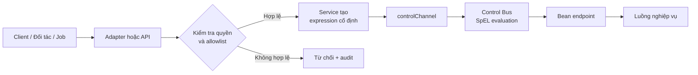
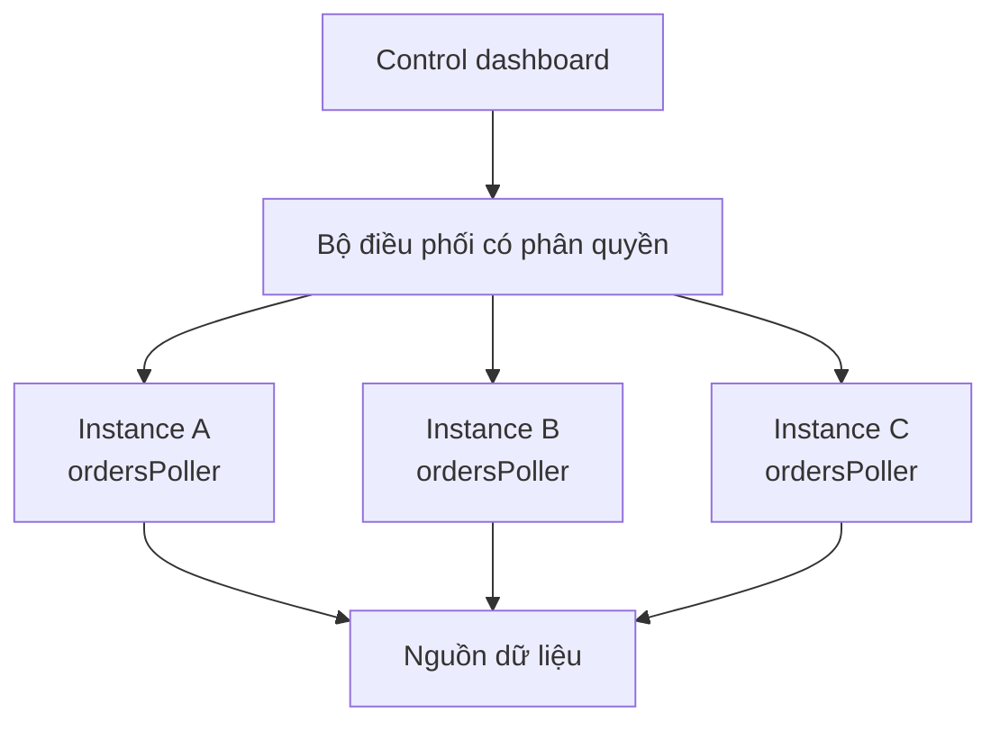

# Rủi ro thực thi expression điều khiển

## 1. Tại sao expression của Control Bus là một bề mặt tấn công?

**Control Bus** là mẫu Enterprise Integration Patterns (EIP) cho phép quản lý các thành phần của hệ thống tích hợp thông qua message. Trong Spring Integration, message gửi vào Control Bus thường mang một biểu thức **Spring Expression Language (SpEL)** để gọi phương thức hoặc truy vấn một bean, ví dụ:

```text
@ordersPoller.stop()
@ordersPoller.start()
@ordersPoller.isRunning()
```

Điểm khác biệt quan trọng: payload ở đây không chỉ là dữ liệu nghiệp vụ. Nó được **đánh giá như một biểu thức trong ngữ cảnh ứng dụng**, nên có khả năng tác động đến bean mà Control Bus truy cập được. Tập cú pháp và thao tác thực sự được cho phép phụ thuộc vào phiên bản Spring Integration, `EvaluationContext`, bộ phân giải bean, quyền truy cập phương thức và cấu hình runtime. Không được mặc định rằng một biểu thức đầu vào đã được cô lập an toàn chỉ vì nó đi qua một message channel.

Trong module **SPRING_INTEGRATION_PATTERN**, người học triển khai các mẫu Router, Filter, Transformer, Splitter, Aggregator, Gateway, retry, error channel và correlation để xây dựng luồng thông điệp ít phụ thuộc, dễ mở rộng. Khả năng quản trị luồng là cần thiết, nhưng nếu đưa một message chưa được tin cậy vào Control Bus thì chính cơ chế tích hợp theo message có thể trở thành đường thực thi thao tác ngoài ý muốn.

**Bài học thuộc chương Control bus** và tập trung trả lời:

- Ai có thể gửi một expression đến Control Bus?
- Expression có thể truy cập tới bean và phương thức nào?
- Những hậu quả nào có thể xảy ra cho tính bí mật, toàn vẹn và tính sẵn sàng?
- Cần thiết kế kênh điều khiển, API và kiểm thử thế nào để chỉ thực thi thao tác được phép?
- Vì sao một lệnh hợp lệ vẫn cần được xác nhận trạng thái và giám sát tác động lên message đang xử lý?

Đây là bài phân tích và phòng ngừa rủi ro. Các ví dụ chỉ sử dụng lệnh quản trị hợp lệ trên endpoint mô phỏng; việc đánh giá biểu thức tùy ý cần được **ngăn chặn** ngay tại ranh giới tin cậy.

## 2. Cơ chế khiến expression nhạy cảm

Một Control Bus trong Spring Integration có thể được cấu hình qua Java DSL:

```java
@Bean
public MessageChannel controlChannel() {
    return new DirectChannel();
}

@Bean
public IntegrationFlow controlBusFlow() {
    return IntegrationFlow.from("controlChannel")
            .controlBus()
            .get();
}
```

Khi message có payload `@ordersPoller.stop()` tới channel này, Control Bus cố đánh giá biểu thức, tìm bean `ordersPoller` trong ngữ cảnh cho phép rồi gọi `stop()`. Trên một endpoint hỗ trợ `Lifecycle`, lệnh có thể dừng việc nhận message mới.



Nếu bỏ qua điểm kiểm tra ở giữa, một chuỗi do bên ngoài kiểm soát có thể đi trực tiếp tới bộ đánh giá expression. Đó là **expression injection** ở ranh giới hệ thống: input đáng lẽ chỉ là dữ liệu lại được dùng để quyết định thao tác thực thi.

Một số tính chất làm tăng mức độ rủi ro:

1. **Bean resolution:** cú pháp tham chiếu bean có thể dẫn tới thành phần khác với endpoint dự định.
2. **Method invocation:** expression có thể dẫn tới lời gọi phương thức; hậu quả phụ thuộc bean, phương thức và cấu hình đánh giá.
3. **Ngữ cảnh quyền rộng:** Control Bus chạy trong ứng dụng có kết nối tới queue, database, file hoặc dịch vụ ngoài. Một lời gọi sai có thể tác động đến tài nguyên của chính ứng dụng.
4. **Tính động:** expression được quyết định lúc nhận message; review mã Java tĩnh không đủ để biết mọi chuỗi sẽ được gửi.
5. **Khả năng định tuyến linh hoạt:** Spring Integration cho phép bridge, Router, Gateway và inbound adapter kết nối channel. Một kết nối nhầm có thể mở đường cho nguồn không đáng tin.

**Không phải mọi deployment đều cho phép cùng một tập thao tác SpEL.** Khi đánh giá rủi ro, phải kiểm tra chính xác cấu hình evaluation context, version thư viện và các bean được truy cập, đồng thời bảo vệ hệ thống như thể đầu vào Control Bus là một quyền quản trị nhạy cảm.

## 3. Phân biệt dữ liệu nghiệp vụ với lệnh điều khiển

Trong EIP, cả hai loại đều là message nhưng cần ranh giới khác nhau:

| Thuộc tính | Message nghiệp vụ | Message điều khiển |
| --- | --- | --- |
| Payload tiêu biểu | JSON đơn hàng, trạng thái thanh toán, thông báo | `@ordersPoller.stop()` |
| Mục đích | Mang dữ liệu giữa các bước tích hợp | Thao tác/truy vấn trạng thái bean |
| Nguồn | Đối tác, broker, HTTP endpoint, scheduler | Dịch vụ quản trị được ủy quyền |
| Nơi tiếp nhận | Transformer, Filter, Router, handler | Control Bus |
| Điều cần kiểm soát | Schema, tính hợp lệ dữ liệu, idempotency | Danh tính, phân quyền, endpoint đích, tập lệnh cố định |
| Tác hại khi xử lý sai | Dữ liệu sai, lỗi nghiệp vụ, gửi trùng | Gọi nhầm phương thức, dừng nguồn, truy cập ngoài phạm vi |

Ví dụ tuyến không an toàn về mặt thiết kế:

```text
HTTP inbound adapter (body là String)
    -> DirectChannel
    -> Control Bus
```

Ở tuyến này, body từ request bên ngoài trở thành một expression cần đánh giá. Việc người dùng chỉ được cung cấp một URL “nội bộ” hoặc channel có tên “control” không bảo đảm payload đã được ủy quyền.

Tuyến có kiểm soát:

```text
HTTP API: {"action":"STOP_ORDERS"}
    -> authentication
    -> authorization
    -> enum allowlist
    -> server-side mapping: STOP_ORDERS = "@ordersPoller.stop()"
    -> controlChannel
    -> Control Bus
```

Đầu vào từ client chỉ thể hiện **ý định nghiệp vụ**. Ứng dụng quyết định và sở hữu expression tương ứng.

## 4. Mô hình đe dọa: nguồn, tài sản và hậu quả

Khi rà soát một topology tích hợp, hãy liệt kê những nguồn có khả năng ảnh hưởng đến payload Control Bus.

| Nguồn hoặc điểm vào | Câu hỏi kiểm tra | Sai sót có thể xảy ra |
| --- | --- | --- |
| HTTP API quản trị | Có xác thực và giới hạn các hành động không? | Client gửi expression tự do |
| Messaging Gateway | Interface có nhận tham số `String expression` từ bên ngoài không? | Caller điều khiển trực tiếp SpEL |
| Broker queue / topic | Có message từ đối tác hoặc tenant khác không? | Payload không tin cậy bị nối vào Control Bus |
| Router hoặc Bridge | Có đường dữ liệu nghiệp vụ đi sang control channel không? | Nhầm tuyến khiến dữ liệu thành lệnh |
| Scheduler / workflow engine | Job có được phép chọn bean và method động không? | Cấu hình job bị sửa để gọi bean ngoài phạm vi |
| Admin dashboard | Nút điều khiển có phân quyền theo endpoint không? | Người chỉ có quyền xem có thể thao tác |
| Công cụ vận hành tự động | Token, secret và phạm vi instance được quản lý thế nào? | Rò rỉ quyền hoặc gửi lệnh sai cụm |

Các tài sản cần bảo vệ gồm trạng thái endpoint, kết nối tới hệ thống bên ngoài, message đang xử lý, dữ liệu trong message store, cấu hình vận hành, thông tin nhạy cảm mà bean có thể truy cập và tính sẵn sàng của toàn hệ thống.

### 4.1. Tác động đến tính toàn vẹn

Một lời gọi không được phép có thể thay đổi trạng thái endpoint hoặc tác động vào bean ngoài ý muốn. Ví dụ dừng `paymentsPoller` thay vì `ordersPoller` khiến quy trình thanh toán ngừng nhận dữ liệu mới. Trong một flow có Splitter/Aggregator, message đã chia có thể bị treo chờ đủ phần; retry và error channel có thể tiếp tục xử lý tác vụ đã được nhận trước lệnh stop.

**Nguy cơ không kết thúc ở một boolean running/stopped.** Thay đổi lifecycle có thể gây hậu quả nghiệp vụ gián tiếp như backlog tăng, vi phạm thời hạn xử lý, thiếu nhóm correlation hoặc nhận dữ liệu trùng khi khôi phục.

### 4.2. Tác động đến tính sẵn sàng

Một chuỗi lệnh `start/stop` lặp lại liên tục có thể tạo ra biến động và lỗi vận hành, nhất là với adapter tạo/hủy kết nối khi chuyển trạng thái. Expression nặng hoặc gọi phương thức mất nhiều thời gian cũng có thể làm nghẽn thread xử lý kênh đồng bộ.

Với `DirectChannel`, handler thường xử lý trên thread của phía gửi. Một thao tác kéo dài có thể chiếm thread request nếu API gọi trực tiếp. Với channel bất đồng bộ, tác động có thể bị trì hoãn và backlog lệnh có thể tăng; sự chấp nhận message không đồng nghĩa nó đã được thực thi.

### 4.3. Tác động đến tính bí mật

Một biểu thức được phép truy cập bean hoặc thuộc tính không phù hợp có thể khiến dữ liệu nội bộ xuất hiện trong reply, log hoặc thông báo lỗi. Tùy cấu hình đánh giá, phạm vi truy cập của expression có thể rộng hơn các thao tác lifecycle dự định.

Do đó, kể cả một API “chỉ đọc trạng thái” cũng không nên cho nhập expression tùy ý. Quyền **đọc trạng thái của endpoint nằm trong allowlist** khác với quyền **đánh giá SpEL tùy ý trong ApplicationContext**.

### 4.4. Lệnh hợp lệ được dùng sai thời điểm

Ngay cả lệnh `@ordersPoller.stop()` cũng có thể gây sự cố khi:

- Được gửi khi hệ thống đang xử lý một batch quan trọng.
- Không ghi rõ instance hoặc environment đích.
- Có hai bộ điều phối gửi start và stop gần như đồng thời.
- Được thử lại sau timeout mà không biết lệnh trước đã chạy chưa.
- Được kích hoạt từ một tài khoản đã bị thu hồi quyền nhưng token cũ còn hiệu lực.

Cần kết hợp **phân quyền**, **quy trình vận hành** và **xác minh trạng thái**. Một expression đúng cú pháp không đủ để chứng minh thao tác được phép hay an toàn.

## 5. Anti-pattern cần tránh

### 5.1. Ghép bean và method từ input

```java
// KHÔNG dùng cho dữ liệu từ HTTP, broker hoặc người dùng:
String expression =
        "@" + requestedBean + "." + requestedMethod + "()";

controlChannel.send(
        MessageBuilder.withPayload(expression).build());
```

Mặc dù developer có thể dự định chỉ hỗ trợ `start()` và `stop()`, đoạn mã này khiến input quyết định bean và phương thức. Kiểm tra bằng blacklist một vài từ khóa SpEL cũng dễ bỏ sót biến thể cú pháp.

### 5.2. Mở endpoint nhận expression nguyên văn

```json
{
  "expression": "@ordersPoller.stop()"
}
```

Một API như vậy đẩy trách nhiệm xác thực biểu thức sang server mà không có hợp đồng nghiệp vụ hẹp. Nên đổi body thành hành động có cấu trúc, ví dụ `{"action":"STOP_ORDERS"}` và thực hiện phép ánh xạ cố định phía server.

### 5.3. Giả định tên channel đã bảo vệ được nó

`controlChannel` chỉ là tên bean của một channel. Cùng một ứng dụng vẫn có thể có nhiều thành phần khác gửi vào channel đó. Nếu inbound adapter được nối trực tiếp tới channel, mọi quy tắc phân quyền ở REST controller sẽ bị bỏ qua.

### 5.4. Tin vào kết quả `send()`

`MessageChannel.send()` trả về boolean cho việc gửi message theo hợp đồng channel. Nó **không phải** kết quả của biểu thức `@ordersPoller.isRunning()` và cũng không xác nhận mọi side effect downstream đã hoàn tất.

Với handler đồng bộ, exception có thể truyền ngược về caller. Với handler bất đồng bộ, lệnh có thể được nhận trước và thực thi sau. Cần phân biệt **accepted**, **executed** và **desired state observed**.

### 5.5. Tin rằng một instance đại diện toàn cụm

Control Bus đánh giá expression trong ngữ cảnh instance nhận message. Dừng `ordersPoller` tại instance A không mặc định dừng cùng bean ở B hoặc C. Một API quản trị toàn cụm cần định tuyến, theo dõi và xác nhận riêng từng instance.

## 6. Thiết kế giảm rủi ro theo nhiều lớp

Một thiết kế có thể dùng các lớp kiểm soát sau:

| Lớp | Mục tiêu | Cơ chế |
| --- | --- | --- |
| Xác thực | Biết chủ thể gửi yêu cầu | JWT/mTLS/phiên đăng nhập theo kiến trúc |
| Phân quyền | Chỉ cho phép thao tác với endpoint phù hợp | Scope/authority, kiểm tra tenant và environment |
| Validate contract | Không nhận cú pháp SpEL tự do | Enum action, schema/DTO đóng |
| Server-side mapping | Chỉ phát lệnh đã review | Ánh xạ action sang expression hằng |
| Giới hạn nguồn gửi | Không nối message không tin cậy vào Control Bus | Channel nội bộ, kiểm soát topology và quyền nhà phát |
| Kiểm soát thao tác | Tránh spam và cạnh tranh | Rate limit, idempotency key, serializing theo endpoint khi cần |
| Quan sát | Xác nhận kết quả và phát hiện bất thường | `isRunning()`, audit, metrics, timeout |
| Quản trị hạ tầng | Giảm hậu quả khi ứng dụng bị tác động | Least privilege cho service account, network segmentation |

**Allowlist theo action** hiệu quả hơn cố “lọc an toàn” một chuỗi SpEL bất kỳ. Nguyên tắc là chỉ biến những action đã định nghĩa sẵn thành biểu thức, thay vì cố tạo một bộ parser bảo mật từ đầu.

Nếu yêu cầu không bắt buộc dùng Control Bus, một API quản trị nội bộ cũng có thể gọi thẳng phương thức lifecycle trên bean đã được chỉ định. Khi đó không cần mở đường thực thi biểu thức tại boundary đó. Nếu vẫn dùng Control Bus để giữ cách điều khiển bằng message, cần thực hiện đầy đủ các kiểm soát như dưới đây.

## 7. Ví dụ tự chứa: gửi command an toàn qua Control Bus

Giả định ứng dụng Spring Boot 3.x với Java 17+ và phiên bản Spring Integration do Spring Boot quản lý.

```gradle
dependencies {
    implementation("org.springframework.boot:spring-boot-starter-integration")
    implementation("org.springframework.boot:spring-boot-starter-security")
    implementation("org.springframework.boot:spring-boot-starter-web")
    testImplementation("org.springframework.boot:spring-boot-starter-test")
    testImplementation("org.springframework.security:spring-security-test")
}
```

### 7.1. Khai báo endpoint và control channel

```java
package example.controlbus;

import java.time.Duration;
import java.util.concurrent.BlockingQueue;
import java.util.concurrent.LinkedBlockingQueue;

import org.springframework.context.annotation.Bean;
import org.springframework.context.annotation.Configuration;
import org.springframework.integration.channel.DirectChannel;
import org.springframework.integration.config.EnableIntegration;
import org.springframework.integration.core.MessageSource;
import org.springframework.integration.dsl.IntegrationFlow;
import org.springframework.integration.dsl.Pollers;
import org.springframework.messaging.MessageChannel;
import org.springframework.messaging.support.MessageBuilder;
import org.springframework.security.config.annotation.method.configuration.EnableMethodSecurity;

@Configuration
@EnableIntegration
@EnableMethodSecurity
public class SafeControlBusConfiguration {

    @Bean
    public MessageChannel controlChannel() {
        return new DirectChannel();
    }

    @Bean
    public IntegrationFlow controlBusFlow() {
        return IntegrationFlow.from("controlChannel")
                .controlBus()
                .get();
    }

    @Bean
    public BlockingQueue<String> pendingOrders() {
        return new LinkedBlockingQueue<>();
    }

    @Bean
    public MessageSource<String> orderSource(
            BlockingQueue<String> pendingOrders) {
        return () -> {
            String id = pendingOrders.poll();
            return id == null
                    ? null
                    : MessageBuilder.withPayload(id).build();
        };
    }

    @Bean
    public IntegrationFlow ordersFlow(MessageSource<String> orderSource) {
        return IntegrationFlow.from(orderSource, spec -> spec
                        .id("ordersPoller")
                        .autoStartup(false)
                        .poller(Pollers.fixedDelay(Duration.ofSeconds(1))))
                .handle(message ->
                        System.out.println("Order: " + message.getPayload()))
                .get();
    }
}
```

**Giải thích:** `ordersPoller` là ID của polling inbound endpoint và là đối tượng mà Control Bus sẽ điều khiển. Channel `controlChannel` chỉ nhận message điều khiển. `autoStartup(false)` giúp bài thử dễ kiểm tra trạng thái đầu tiên. Cấu hình này phục vụ minh họa; nếu nguồn là broker, JDBC hoặc adapter khác, phải xét hợp đồng ack, polling và stop riêng.

### 7.2. Chỉ cho phép action cố định

Định nghĩa những hành động công khai:

```java
package example.controlbus;

public enum OrderControlAction {
    START,
    STOP
}
```

Tạo dịch vụ chứa biểu thức do **ứng dụng kiểm soát**, không nhận chuỗi SpEL từ caller:

```java
package example.controlbus;

import java.util.Objects;

import org.springframework.beans.factory.annotation.Qualifier;
import org.springframework.context.ApplicationContext;
import org.springframework.context.Lifecycle;
import org.springframework.messaging.MessageChannel;
import org.springframework.messaging.support.MessageBuilder;
import org.springframework.security.access.prepost.PreAuthorize;
import org.springframework.stereotype.Service;

@Service
public class OrderControlService {

    private final MessageChannel controlChannel;
    private final ApplicationContext context;

    public OrderControlService(
            @Qualifier("controlChannel") MessageChannel controlChannel,
            ApplicationContext context) {
        this.controlChannel = controlChannel;
        this.context = context;
    }

    @PreAuthorize("hasAuthority('SCOPE_integration.orders.control')")
    public boolean execute(OrderControlAction action) {
        Objects.requireNonNull(action, "action");

        // Chỉ hai expression cố định đã được review.
        String expression = switch (action) {
            case START -> "@ordersPoller.start()";
            case STOP  -> "@ordersPoller.stop()";
        };

        boolean accepted = controlChannel.send(
                MessageBuilder.withPayload(expression).build());

        if (!accepted) {
            throw new IllegalStateException(
                    "Control command was not accepted");
        }

        // Xác minh trạng thái sau xử lý đồng bộ trong ví dụ.
        boolean running = poller().isRunning();
        boolean expectedRunning = (action == OrderControlAction.START);
        if (running != expectedRunning) {
            throw new IllegalStateException(
                    "Endpoint did not reach the requested state");
        }
        return running;
    }

    @PreAuthorize(
        "hasAnyAuthority('SCOPE_integration.orders.read', "
        + "'SCOPE_integration.orders.control')")
    public boolean isRunning() {
        return poller().isRunning();
    }

    private Lifecycle poller() {
        return context.getBean("ordersPoller", Lifecycle.class);
    }
}
```

Điểm cần chú ý:

- Phương thức `execute(...)` nhận enum, không nhận `String expression`.
- Chỉ người có authority điều khiển đơn hàng mới được gọi `execute(...)`; người có quyền đọc có thể gọi `isRunning()`.
- Mã chỉ tham chiếu một bean đã chọn: `ordersPoller`. Không dùng input để tạo tên bean hoặc method.
- `@EnableMethodSecurity` giúp `@PreAuthorize` có hiệu lực trên **lời gọi đi qua Spring proxy**; tự gọi `this.execute(...)` từ bên trong cùng bean có thể bỏ qua kiểm tra.
- Việc xác minh `isRunning()` ngay sau lệnh phù hợp với `DirectChannel` đồng bộ ở ví dụ. Trên kênh bất đồng bộ, cần quy trình nhận phản hồi và xác nhận eventual state có timeout.
- Trạng thái có thể bị một controller khác thay đổi sau khi đọc; không coi boolean một lần đọc là một giao dịch quản trị nguyên tử.

**Giới hạn bảo vệ:** code này kiểm tra quyền ở phương thức dịch vụ. Một component khác trong cùng ứng dụng nếu trực tiếp lấy bean `controlChannel` và gửi message sẽ không đi qua `@PreAuthorize` của dịch vụ. Phải kiểm soát mọi adapter, bridge, flow và gateway nối tới Control Bus, đồng thời chỉ cho phép code tin cậy phát lệnh.

### 7.3. API chỉ chấp nhận action

Ví dụ controller cho môi trường có cơ chế authentication và HTTP SecurityFilterChain được cấu hình đầy đủ:

```java
package example.controlbus;

import org.springframework.web.bind.annotation.GetMapping;
import org.springframework.web.bind.annotation.PostMapping;
import org.springframework.web.bind.annotation.RequestBody;
import org.springframework.web.bind.annotation.RequestMapping;
import org.springframework.web.bind.annotation.RestController;

@RestController
@RequestMapping("/internal/operations/orders")
public class OrderControlController {

    private final OrderControlService service;

    public OrderControlController(OrderControlService service) {
        this.service = service;
    }

    public record CommandRequest(OrderControlAction action) {}
    public record StatusResponse(boolean running) {}

    @PostMapping
    public StatusResponse execute(@RequestBody CommandRequest request) {
        if (request == null || request.action() == null) {
            throw new IllegalArgumentException("action is required");
        }
        return new StatusResponse(service.execute(request.action()));
    }

    @GetMapping
    public StatusResponse status() {
        return new StatusResponse(service.isRunning());
    }
}
```

Request minh họa:

```http
POST /internal/operations/orders
Authorization: Bearer <access-token>
Content-Type: application/json

{"action":"STOP"}
```

Controller này chỉ minh họa hợp đồng **không chứa expression**. Đối với ứng dụng thật, hãy thêm Bean Validation, exception handler trả lỗi 400 cho request sai, xử lý 403 khi thiếu quyền và phản hồi lỗi có kiểm soát khi Control Bus thất bại. Cấu hình HTTP SecurityFilterChain phải xác thực request và chỉ mở những route được phép; method security là lớp kiểm tra bổ sung. Nếu dùng bearer JWT, phải cấu hình Resource Server, bộ xác minh token và ánh xạ claim sang authority phù hợp. Tên `SCOPE_integration.orders.control` trong ví dụ giả định scope đã được ánh xạ thành authority có tiền tố `SCOPE_`.

Không công khai endpoint này chỉ vì đường dẫn có từ “internal”. Khi có cookie-based authentication, cần bảo vệ CSRF cho thao tác POST; với token-based API cần áp dụng chính sách tương ứng với cách xác thực thực tế.

## 8. Kiểm thử ranh giới quyền

Mục tiêu kiểm thử an toàn là chứng minh một người không đủ quyền **không thể làm thay đổi trạng thái** endpoint, thay vì cố thực thi các payload phá hoại.

Với `spring-security-test` và `@EnableMethodSecurity`:

```java
package example.controlbus;

import static org.assertj.core.api.Assertions.assertThat;
import static org.assertj.core.api.Assertions.assertThatThrownBy;

import org.junit.jupiter.api.Test;
import org.springframework.beans.factory.annotation.Autowired;
import org.springframework.context.ApplicationContext;
import org.springframework.context.Lifecycle;
import org.springframework.security.access.AccessDeniedException;
import org.springframework.security.test.context.support.WithMockUser;
import org.springframework.test.context.junit.jupiter.SpringJUnitConfig;

@SpringJUnitConfig({
    SafeControlBusConfiguration.class,
    OrderControlService.class
})
class ControlExpressionSecurityTest {

    @Autowired
    OrderControlService service;

    @Autowired
    ApplicationContext context;

    @Test
    @WithMockUser(authorities = "SCOPE_integration.orders.read")
    void observerCannotChangeEndpointState() {
        Lifecycle poller = context.getBean(
                "ordersPoller", Lifecycle.class);

        assertThat(poller.isRunning()).isFalse();
        assertThat(service.isRunning()).isFalse();

        assertThatThrownBy(() ->
                service.execute(OrderControlAction.START))
                .isInstanceOf(AccessDeniedException.class);

        assertThat(poller.isRunning()).isFalse();
    }

    @Test
    @WithMockUser(authorities = "SCOPE_integration.orders.control")
    void operatorMayStartAndStopEndpoint() {
        Lifecycle poller = context.getBean(
                "ordersPoller", Lifecycle.class);

        try {
            assertThat(service.execute(OrderControlAction.START))
                    .isTrue();
            assertThat(poller.isRunning()).isTrue();
        } finally {
            service.execute(OrderControlAction.STOP);
        }
        assertThat(poller.isRunning()).isFalse();
    }
}
```

Bài test kiểm tra phân quyền tại **Spring service proxy**. Khi kiểm thử API, cần bổ sung những trường hợp khác bằng MockMvc hoặc kiểm thử tích hợp:

| Tình huống | Kỳ vọng |
| --- | --- |
| Không có authentication | Request bị từ chối |
| Chỉ có quyền đọc gửi START/STOP | HTTP 403; không gửi lệnh |
| Có quyền điều khiển gửi START/STOP | Thao tác hợp lệ được chuyển tới dịch vụ |
| Enum action lạ, null hoặc body không hợp lệ | HTTP 400; không gửi lệnh |
| Token không hợp lệ hoặc sai audience/issuer | Bị từ chối tại lớp xác thực |
| Service không tìm thấy bean đích | Báo lỗi có kiểm soát và ghi audit; không trả thành công giả |
| Client cố gửi trường `expression` tự do | Trường không được sử dụng; nên cấu hình DTO validation nghiêm ngặt để từ chối thuộc tính lạ |
| Gửi lệnh tới environment/tenant không được cấp quyền | Bị từ chối và ghi nhận đích bị yêu cầu |

`@WithMockUser` mô phỏng authority trực tiếp, chưa xác minh cách JWT thật được chuyển thành authority. Cần kiểm thử riêng token, route security và mọi adapter nội bộ có thể gửi message vào Control Bus. Một test service thành công **không** chứng minh các đường nhánh khác trong topology đã được kiểm soát.

## 9. Audit, phát hiện bất thường và xác nhận kết quả

Với những lệnh thay đổi lifecycle, nên ghi audit có cấu trúc:

```json
{
  "requestId": "ops-20261121-0042",
  "actor": "operator-17",
  "action": "STOP",
  "targetEndpoint": "ordersPoller",
  "instanceId": "orders-instance-a",
  "requestedAt": "2026-11-21T08:00:00Z",
  "result": "SUCCEEDED",
  "observedRunning": false
}
```

Đây là **mẫu dữ liệu audit do ứng dụng tự thiết kế**, không phải payload mà Control Bus tự sinh. Trong hệ thống thật, phải có nguồn định danh actor đáng tin cậy, thời gian từ đồng hồ thống nhất và correlation ID để liên kết request, message lệnh, log và kết quả quan sát.

Một quy trình audit phù hợp có thể gồm:

1. Ghi **đã nhận yêu cầu** sau khi xác thực, với action và endpoint đích.
2. Kiểm tra quyền; nếu từ chối, ghi `DENIED` mà không phát message Control Bus.
3. Nếu được phép, phát expression cố định, ghi `ACCEPTED` khi channel chấp nhận.
4. Xác nhận `isRunning()` hoặc tín hiệu tương đương; đánh dấu `SUCCEEDED` khi đã quan sát trạng thái mong muốn.
5. Nếu có lỗi đánh giá, timeout hoặc instance không phản hồi, ghi `FAILED` hoặc `UNKNOWN`; không tự chuyển thành `SUCCEEDED`.

Các tín hiệu phát hiện bất thường gồm một actor phát lệnh start/stop liên tục, lệnh ngoài khung bảo trì, số lần từ chối tăng, yêu cầu điều khiển nhiều instance bất thường, thao tác vào endpoint nhạy cảm và trạng thái thực khác với trạng thái mong muốn. Có thể áp dụng giới hạn tần suất và serializing theo endpoint khi cần tránh thao tác cạnh tranh.

Không ghi bearer token, secret, expression do bên ngoài nhập hoặc dữ liệu message nghiệp vụ vào log audit. Chỉ lưu các trường cần thiết để truy vết và kiểm tra quyền, phù hợp quy định lưu giữ dữ liệu của tổ chức.

## 10. Rủi ro khi kết hợp các mẫu EIP

Control Bus ảnh hưởng đến hoạt động của những thành phần khác trong pipeline, kể cả khi expression chỉ gọi một phương thức lifecycle hợp lệ.

| Thành phần EIP | Điều có thể xảy ra sau một lệnh điều khiển | Biện pháp quan sát |
| --- | --- | --- |
| **Router** | Dừng nguồn chung khiến nhiều nhánh ngừng nhận message mới | Thông lượng và trạng thái từng inbound endpoint |
| **Filter** | Nếu chặn nguồn ở vị trí không phù hợp, dữ liệu có thể bị bỏ thay vì giữ lại | Tỷ lệ discard, channel giữ backlog |
| **Transformer** | Message đã đi vào pipeline tiếp tục được chuyển đổi | Số in-flight và lỗi biến đổi |
| **Splitter** | Một batch đã tách có thể đang xử lý dở khi nguồn dừng | Batch ID và số phần đã xử lý |
| **Aggregator** | Correlation group chưa đủ phần có thể chờ timeout | Group store, expiration và các nhóm còn mở |
| **Gateway** | Gateway bên ngoài có thể gửi hoặc nhận yêu cầu trong thời gian endpoint dừng | Timeout, số request đang mở, reply channel |
| **Retry / error channel** | Retry của message cũ vẫn có thể diễn ra; stop không xóa lỗi | Retry count, backoff, dead-letter/error flow |
| **Polling adapter** | Poll mới dừng, dữ liệu bên nguồn có thể tiếp tục tích tụ | Backlog, checkpoint, khả năng replay |

Điểm quan trọng khi thiết kế kiểm soát expression là **ngăn thao tác trái quyền** và **xác định hệ quả của thao tác đúng quyền**. Không nên hứa rằng một lệnh `stop()` sẽ hủy tác vụ đang chạy hoặc xóa toàn bộ nhóm Aggregator chưa xong. Nếu cần bảo trì an toàn, phải có quy trình *quiesce/drain* cho công việc in-flight và cơ chế bảo toàn message ở nguồn hoặc message store.

## 11. Khi triển khai nhiều replica

Giả sử ba instance của ứng dụng đều có bean `ordersPoller`. Mỗi instance có `ApplicationContext` riêng:



Một lệnh chạy trong A không tự động dừng poller ở B hay C. Bộ điều phối cần quy định rõ **target** (instance cụ thể hay toàn cụm), quyền được điều khiển target đó, cách gửi lệnh và cơ chế xác nhận.

Nếu operator được phép dừng một instance trong staging, hệ thống không nên suy ra họ được dừng toàn bộ instance production. Phân quyền cần xem xét **tài nguyên, môi trường và phạm vi ảnh hưởng**. Đồng thời, mọi kết quả phải ghi rõ instance ID; timeout hay mất kết nối được coi là `UNKNOWN` cho instance đó.

Khi cần phối hợp toàn cụm, nên có cơ chế điều phối được thiết kế cụ thể: idempotency key, tránh bộ điều khiển cạnh tranh, xác minh sau lệnh và retry có giới hạn. Đừng đặt niềm tin vào một lệnh SpEL duy nhất gửi đến một gateway load-balanced rồi kết luận cả cụm đã dừng.

## 12. Checklist phòng ngừa trước khi phát hành

Trước khi đưa Control Bus vào môi trường thật, có thể dùng checklist sau để tự đánh giá:

- [ ] Không có HTTP endpoint hoặc inbound adapter nhận chuỗi SpEL không tin cậy rồi chuyển thẳng vào Control Bus.
- [ ] API chỉ nhận action thuộc danh sách định nghĩa sẵn và kiểm tra endpoint, tenant, environment.
- [ ] Mọi expression gửi từ nguồn bên ngoài đều được tạo từ hằng phía server; không ghép bean hoặc method từ input.
- [ ] Quyền **xem trạng thái** và quyền **điều khiển** được tách riêng.
- [ ] HTTP authentication, method security và các đường nội bộ dẫn tới control channel đều được xem xét.
- [ ] Trường hợp request không hợp lệ hoặc không đủ quyền không tạo message điều khiển.
- [ ] Gửi lệnh và xác minh trạng thái có timeout, phân biệt `FAILED`, `UNKNOWN` và `SUCCEEDED`.
- [ ] Có audit với actor, action, endpoint, instance, thời điểm, correlation ID và kết quả.
- [ ] Có giám sát in-flight, backlog, retry, error channel và các nhóm Aggregator.
- [ ] Quy trình nhiều instance không đánh đồng trạng thái một node với toàn cụm.
- [ ] Quyền của tài khoản chạy ứng dụng đối với broker, database và hệ thống ngoài được giới hạn hợp lý.
- [ ] Kiểm thử tình huống bị từ chối, lỗi bean, lỗi kênh, điều khiển đồng thời và khôi phục sau stop/start.

Checklist là công cụ rà soát cho nhóm triển khai; mức độ bảo đảm cuối cùng phụ thuộc phiên bản thư viện, cấu hình thực tế và toàn bộ đường dữ liệu đi vào Control Bus.

## 13. Bài tập thực hành

**Bài tập 1 — Tìm ranh giới tin cậy.** Cho một topology có HTTP adapter, Router, Gateway, control channel và Control Bus. Hãy đánh dấu tất cả đường có thể đưa message từ client bên ngoài vào control channel, sau đó thiết kế điểm kiểm tra quyền trước khi expression được tạo.

**Bài tập 2 — Chuyển API sang action cố định.** Giả sử API cũ nhận `{"expression":"..."}`. Thiết kế API mới nhận `{"action":"START"}` hoặc `{"action":"STOP"}`, chỉ cho phép quản lý `ordersPoller` và trả lỗi khi action không thuộc enum.

**Bài tập 3 — Phân quyền theo vai trò.** Tạo hai security context: một chỉ có quyền đọc, một có quyền điều khiển. Kiểm thử rằng người có quyền đọc có thể truy vấn `isRunning()` nhưng không thể start/stop endpoint.

**Bài tập 4 — Quan sát hậu quả nghiệp vụ.** Dùng một poller nối tới Splitter và Aggregator. Dừng poller khi một group đang chờ đủ phần; mô tả các metric và message store cần xem trước khi tuyên bố hệ thống đã an toàn để bảo trì.

**Bài tập 5 — Điều phối toàn cụm.** Có ba replica với kết quả stop lần lượt `SUCCEEDED`, `FAILED` và `UNKNOWN`. Thiết kế JSON audit và quy tắc quyết định liệu thao tác “dừng toàn cụm” đã thành công chưa.

## 14. Câu hỏi tự kiểm tra

1. Vì sao payload của Control Bus phải được xem là **biểu thức có tác động**, không phải dữ liệu thông thường?
2. Tại sao kiểm tra blacklist những từ “nguy hiểm” không thay thế được một allowlist action?
3. `@PreAuthorize` trên một service có bảo vệ được mọi component gửi trực tiếp vào `controlChannel` không?
4. Sự khác nhau giữa `send() == true`, `isRunning() == false` và “dừng flow an toàn” là gì?
5. Nếu endpoint đang stopped, tại sao retry hoặc correlation group vẫn có thể hoạt động?
6. Khi một lệnh chạy thành công trong instance A, cần những bằng chứng nào để kết luận toàn cụm đã thực hiện cùng thao tác?

**Ghi nhớ:** Control Bus đem khả năng quản lý runtime vào mô hình message của Spring Integration, nhưng expression điều khiển là một **bề mặt thực thi có quyền cao**. Bảo vệ đúng cách là ngăn input không tin cậy trở thành SpEL, chỉ phát những lệnh cố định đã được phân quyền, quản lý mọi đường vào channel và xác minh tác động trên đúng endpoint, đúng instance cùng những message đang xử lý.

