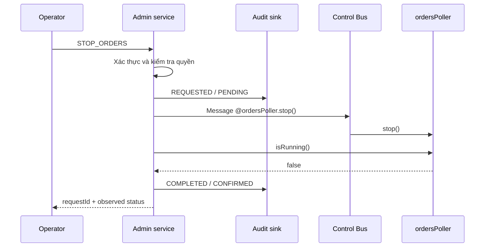
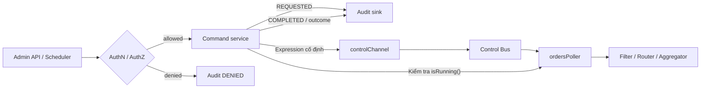
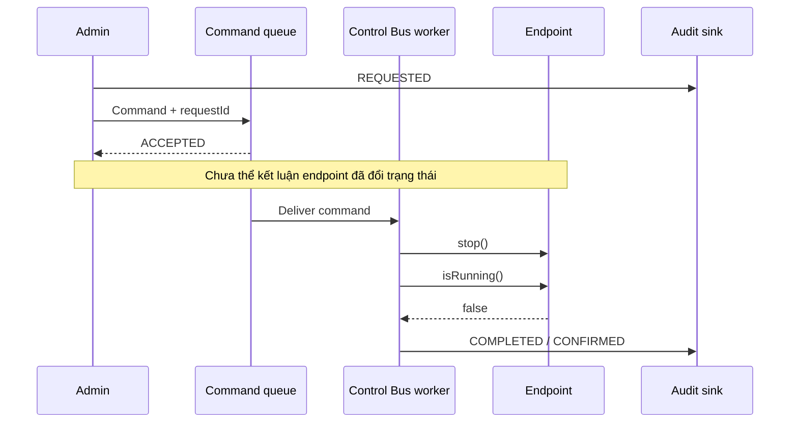

# Audit lệnh vận hành

## 1. Vì sao phải audit lệnh điều khiển?

Trong Spring Integration, **Control Bus** cho phép gửi message chứa biểu thức **Spring Expression Language (SpEL)** để điều khiển bean của ứng dụng. Ví dụ:

```text
@ordersPoller.start()
@ordersPoller.stop()
@ordersPoller.isRunning()
```

Các thao tác này hữu ích khi cần tạm dừng nguồn dữ liệu để bảo trì, khởi động lại polling hoặc đọc trạng thái endpoint. Tuy nhiên, một lệnh `stop()` có thể làm backlog tăng và ảnh hưởng nhiều nhánh phía sau Router; message đã vào Splitter, Aggregator hoặc retry vẫn có thể đang được xử lý.

Trong module **SPRING_INTEGRATION_PATTERN**, người học triển khai Enterprise Integration Patterns để xây dựng luồng thông điệp ít phụ thuộc và dễ mở rộng, gồm Router, Filter, Transformer, Splitter, Aggregator, Gateway, retry, error channel và correlation. Vì thế, audit lệnh điều khiển phải trả lời được **ai đã yêu cầu, nhắm đến endpoint nào, lệnh đi qua đâu, đã thực thi hay chưa và trạng thái thực tế được xác minh như thế nào**.

Bài này thuộc chương **Control bus**, tập trung vào việc tạo dấu vết có thể truy xuất cho lệnh vận hành, không chỉ vào việc gọi thành công phương thức Java.

Sau khi học, bạn có thể:

1. Thiết kế bản ghi audit gồm actor, action, endpoint, instance, request ID, thời điểm và kết quả.
2. Phân biệt **yêu cầu được ghi nhận**, **message được tiếp nhận** và **trạng thái endpoint được xác nhận**.
3. Ghi rõ các outcome `DENIED`, `REJECTED`, `CONFIRMED`, `MISMATCH` và `UNKNOWN`.
4. Gắn audit vào dịch vụ gửi lệnh Control Bus, đồng thời tránh nhận SpEL tùy ý từ nguồn không tin cậy.
5. Kiểm thử audit trước/sau lệnh, bảo vệ quyền, vận hành bất đồng bộ và nhiều instance.

## 2. Phân biệt audit với log kỹ thuật

Một dòng log `Received STOP_ORDERS` cho biết code đã nhận hành động. Nó chưa chứng minh endpoint đã dừng. Một dòng `controlChannel.send() == true` cũng chưa đủ: với `MessageChannel.send()`, boolean trả về biểu thị kết quả gửi message theo hợp đồng của channel, không phải giá trị `isRunning()` và không phải xác nhận mọi side effect nghiệp vụ đã kết thúc.

Một vòng đời lệnh lý tưởng có các mốc:



Một **message lệnh** và một **message nghiệp vụ** đều có thể đi qua channel, nhưng mục đích khác nhau. Control Bus là điểm thực thi expression; dữ liệu đơn hàng nên đi qua Filter, Transformer, Router hay handler tương ứng.

| Mốc audit | Bằng chứng | Chưa được khẳng định |
| --- | --- | --- |
| `REQUESTED` | Người gọi được xác định và yêu cầu được ghi lại | Control Bus đã chạy |
| `ACCEPTED` | Channel/queue chấp nhận message | Bean đã đổi trạng thái |
| `EXECUTED` | Handler được ghi nhận đã thực thi | Toàn flow hết message đang chạy |
| `CONFIRMED` | Endpoint báo trạng thái mong muốn tại thời điểm kiểm tra | Mọi replica và nhánh đã đạt trạng thái đó |

**Stop endpoint khác với drain toàn flow.** Lệnh stop có thể ngăn lần poll mới, nhưng message đã nhận trước đó vẫn có thể đang ở retry, Aggregator hoặc downstream. Vì vậy audit lệnh lifecycle phải được xem cùng metrics, backlog và số message in-flight.

## 3. Schema audit có cấu trúc

Thay vì ghi log tự do, thiết kế một sự kiện có đủ trường để đối soát nhiều lần gửi, nhiều instance và các lần retry.

| Trường | Ví dụ | Vai trò |
| --- | --- | --- |
| `requestId` | `c71b...` | Nối các giai đoạn của cùng một yêu cầu |
| `occurredAt` | `2026-11-21T08:30:00Z` | Thời điểm sự kiện theo UTC |
| `actor` | `operator-17` | Chủ thể xác thực, lấy từ security context |
| `action` | `STOP_ORDERS` | Mã thao tác thuộc allowlist |
| `targetEndpoint` | `ordersPoller` | Bean endpoint đích |
| `instanceId` | `orders-node-a` | Instance có Spring context chứa bean |
| `phase` | `REQUESTED` / `COMPLETED` | Giai đoạn audit |
| `outcome` | `CONFIRMED` | Kết luận ở giai đoạn đó |
| `observedRunning` | `false` | Trạng thái lifecycle quan sát được; có thể null |
| `errorType` | `MessageHandlingException` | Loại lỗi đã rút gọn |
| `traceId` (tùy chọn) | `trace-42` | Liên kết với tracing và log khác |

Ví dụ một sự kiện hoàn tất:

```json
{
  "requestId": "c71b33f1-8f0e-4b28-b242-66e6fa5b99a0",
  "occurredAt": "2026-11-21T08:30:00Z",
  "actor": "operator-17",
  "action": "STOP_ORDERS",
  "targetEndpoint": "ordersPoller",
  "instanceId": "orders-node-a",
  "phase": "COMPLETED",
  "outcome": "CONFIRMED",
  "observedRunning": false,
  "errorType": null
}
```

Đây là **schema do ứng dụng định nghĩa**, không phải sự kiện do Spring Integration tự động sinh với toàn bộ trường trên. Nếu cần `tenantId`, `environment`, `changeTicket` hoặc `policyVersion`, ứng dụng phải tự bổ sung từ nguồn có thể tin cậy.

Không ghi toàn bộ JWT, password, connection string, nội dung message nghiệp vụ hoặc expression SpEL chưa được kiểm soát vào audit. Các trường như actor và endpoint cũng phải tuân theo chính sách lưu giữ và quyền xem dữ liệu.

## 4. Phân loại kết quả một cách trung thực

| Outcome | Khi nào ghi | Cách diễn giải |
| --- | --- | --- |
| `DENIED` | Yêu cầu bị từ chối trước khi gửi lệnh do thiếu quyền | Đường gọi đã chặn thao tác |
| `REJECTED` | Channel từ chối message; ví dụ `send()` trả `false` | Chưa có bằng chứng handler xử lý |
| `CONFIRMED` | Đã kiểm tra đúng endpoint và trạng thái khớp đích | Instance đó báo trạng thái mong muốn khi đọc |
| `MISMATCH` | Đọc được trạng thái nhưng khác trạng thái đích | Chưa đạt kết quả yêu cầu tại lần quan sát |
| `UNKNOWN` | Exception/timeout/mất kết nối khiến kết quả không xác định | Không suy diễn endpoint đã dừng hay đang chạy |

Một lỗi timeout có thể xảy ra **sau khi** Control Bus đã gọi `stop()`. Vì vậy `UNKNOWN` phải được giữ nguyên cho đến khi có bằng chứng mới. Việc retry lệnh cần xét tính idempotent của adapter, các tác vụ in-flight và lệnh có thể được gửi đồng thời.

`CONFIRMED` cũng là kết luận theo **thời điểm**. Nếu bộ điều phối khác gọi `start()` ngay sau khi lệnh stop được xác nhận, trạng thái sẽ thay đổi; audit phải lưu cả hai sự kiện thay vì viết đè lịch sử.

## 5. Kiến trúc audit trong đường điều khiển



Các trách nhiệm cần tách rõ:

- **Bộ xác thực và phân quyền:** biết ai yêu cầu và quyết định có được điều khiển endpoint đó hay không.
- **Command service:** nhận action đã xác thực, tạo request ID, phát expression cố định và thu kết quả.
- **Control Bus:** đánh giá expression trên bean đích.
- **Audit sink:** ghi sự kiện có cấu trúc vào kho tập trung, có chính sách truy cập và lưu giữ.
- **Monitoring:** cung cấp thêm trạng thái nguồn, thông lượng, backlog, retry/error và group correlation.

Nên ghi `REQUESTED` **trước khi thực thi lệnh**. Với thao tác có tác động lớn, chính sách có thể yêu cầu từ chối gửi lệnh nếu không lưu được sự kiện bắt đầu. Nếu bản ghi hoàn tất không lưu được sau khi lệnh đã chạy, không thể hoàn tác bằng cách chỉ ném exception: phải phát cảnh báo và đối soát trạng thái thực tế.

## 6. Cấu hình Spring Integration Java DSL

Ví dụ dùng Spring Boot, Java 17+ và phiên bản Spring Integration do Spring Boot quản lý. Trong Gradle:

```gradle
dependencies {
    implementation("org.springframework.boot:spring-boot-starter-integration")
    implementation("org.springframework.boot:spring-boot-starter-security")
    testImplementation("org.springframework.boot:spring-boot-starter-test")
    testImplementation("org.springframework.security:spring-security-test")
}
```

Tạo `ControlBusAuditConfiguration.java`:

```java
package example.audit;

import java.time.Duration;
import java.util.concurrent.BlockingQueue;
import java.util.concurrent.LinkedBlockingQueue;

import org.springframework.context.annotation.Bean;
import org.springframework.context.annotation.Configuration;
import org.springframework.integration.channel.DirectChannel;
import org.springframework.integration.config.EnableIntegration;
import org.springframework.integration.core.MessageSource;
import org.springframework.integration.dsl.IntegrationFlow;
import org.springframework.integration.dsl.Pollers;
import org.springframework.messaging.MessageChannel;
import org.springframework.messaging.support.MessageBuilder;
import org.springframework.security.config.annotation.method.configuration.EnableMethodSecurity;

@Configuration
@EnableIntegration
@EnableMethodSecurity
public class ControlBusAuditConfiguration {

    @Bean
    public MessageChannel controlChannel() {
        return new DirectChannel();
    }

    @Bean
    public IntegrationFlow controlBusFlow() {
        return IntegrationFlow.from("controlChannel")
                .controlBus()
                .get();
    }

    @Bean
    public BlockingQueue<String> pendingOrders() {
        return new LinkedBlockingQueue<>();
    }

    @Bean
    public MessageSource<String> orderSource(
            BlockingQueue<String> pendingOrders) {
        return () -> {
            String id = pendingOrders.poll();
            return id == null
                    ? null
                    : MessageBuilder.withPayload(id).build();
        };
    }

    @Bean
    public IntegrationFlow ordersFlow(MessageSource<String> orderSource) {
        return IntegrationFlow
                .from(orderSource, spec -> spec
                        .id("ordersPoller")
                        .autoStartup(false)
                        .poller(Pollers.fixedDelay(Duration.ofSeconds(1))))
                .handle(message ->
                        System.out.println("Order: " + message.getPayload()))
                .get();
    }
}
```

`controlChannel` là kênh dành riêng cho message điều khiển. Bean `ordersPoller` là **inbound polling endpoint** được đặt id ổn định để SpEL tìm tới; nó không phải tên channel hay tên toàn flow. `autoStartup(false)` giúp test thấy trạng thái ban đầu là stopped.

Trong ví dụ, queue chỉ nằm trong bộ nhớ để minh họa; nếu ứng dụng dừng, dữ liệu có thể mất. Với nguồn thật như broker, JDBC hoặc file, cần xét chính sách ack, checkpoint, retry và bảo toàn backlog.

## 7. Định nghĩa event và AuditSink

Tạo `ControlAuditRecord.java`:

```java
package example.audit;

import java.time.Instant;

public record ControlAuditRecord(
        String requestId,
        Instant occurredAt,
        String actor,
        String action,
        String targetEndpoint,
        String instanceId,
        String phase,
        String outcome,
        Boolean observedRunning,
        String errorType) {
}
```

Interface `ControlAuditSink` cho phép đổi nơi lưu mà không sửa dịch vụ điều khiển:

```java
package example.audit;

public interface ControlAuditSink {
    void append(ControlAuditRecord event);
}
```

Để minh họa, triển khai bằng structured logging:

```java
package example.audit;

import org.slf4j.Logger;
import org.slf4j.LoggerFactory;
import org.springframework.stereotype.Component;

@Component
public class StructuredLogAuditSink implements ControlAuditSink {
    private static final Logger log =
            LoggerFactory.getLogger(StructuredLogAuditSink.class);

    @Override
    public void append(ControlAuditRecord e) {
        log.info(
            "controlAudit requestId={} at={} actor={} action={} " +
            "endpoint={} instance={} phase={} outcome={} running={} error={}",
            e.requestId(), e.occurredAt(), e.actor(), e.action(),
            e.targetEndpoint(), e.instanceId(), e.phase(), e.outcome(),
            e.observedRunning(), e.errorType());
    }
}
```

**Giới hạn:** đây là ví dụ về **định dạng**, chưa phải kho audit bền vững. Log có thể bị mất khi tiến trình chết, disk đầy hoặc hệ thống đẩy log gặp lỗi. Với yêu cầu truy vết nghiêm ngặt, `ControlAuditSink` cần lưu tới kho append-only hoặc cơ chế durable queue/outbox, có giám sát lỗi ghi, phân quyền đọc/ghi và cơ chế đối soát.

## 8. Service gửi Control Bus message và ghi audit

Không nhận expression String tùy ý từ API. Chỉ chấp nhận thao tác thuộc enum:

```java
package example.audit;

public enum OrderCommand {
    START_ORDERS,
    STOP_ORDERS
}
```

Dịch vụ sau ghi `REQUESTED` trước khi gửi lệnh, rồi quan sát lifecycle của đúng endpoint. Nó dùng `DirectChannel` đồng bộ như cấu hình ở trên.

```java
package example.audit;

import java.time.Instant;
import java.util.Objects;
import java.util.UUID;

import org.springframework.beans.factory.annotation.Qualifier;
import org.springframework.beans.factory.annotation.Value;
import org.springframework.context.ApplicationContext;
import org.springframework.context.Lifecycle;
import org.springframework.messaging.MessageChannel;
import org.springframework.messaging.support.MessageBuilder;
import org.springframework.security.access.prepost.PreAuthorize;
import org.springframework.security.core.Authentication;
import org.springframework.security.core.context.SecurityContextHolder;
import org.springframework.stereotype.Service;

@Service
public class AuditedOrderControlService {

    private final MessageChannel controlChannel;
    private final ApplicationContext context;
    private final ControlAuditSink auditSink;
    private final String instanceId;

    public AuditedOrderControlService(
            @Qualifier("controlChannel") MessageChannel controlChannel,
            ApplicationContext context,
            ControlAuditSink auditSink,
            @Value("${app.instance-id:local}") String instanceId) {
        this.controlChannel = controlChannel;
        this.context = context;
        this.auditSink = auditSink;
        this.instanceId = instanceId;
    }

    @PreAuthorize("hasAuthority('SCOPE_integration.orders.control')")
    public CommandReceipt execute(OrderCommand command) {
        Objects.requireNonNull(command, "command");

        Authentication auth =
                SecurityContextHolder.getContext().getAuthentication();
        if (auth == null || !auth.isAuthenticated()) {
            throw new IllegalStateException("No authenticated actor");
        }

        String actor = auth.getName();
        String requestId = UUID.randomUUID().toString();
        boolean desiredRunning = command == OrderCommand.START_ORDERS;

        // Ghi trước khi phát message: nếu audit lỗi, không gửi lệnh.
        auditSink.append(record(requestId, actor, command,
                "REQUESTED", "PENDING", null, null));

        String expression = switch (command) {
            case START_ORDERS -> "@ordersPoller.start()";
            case STOP_ORDERS  -> "@ordersPoller.stop()";
        };

        String outcome = "UNKNOWN";
        Boolean observedRunning = null;
        String errorType = null;
        RuntimeException commandError = null;

        try {
            boolean accepted = controlChannel.send(
                    MessageBuilder.withPayload(expression).build());

            if (!accepted) {
                outcome = "REJECTED";
                throw new IllegalStateException(
                        "Control command was not accepted");
            }

            Lifecycle poller = context.getBean(
                    "ordersPoller", Lifecycle.class);
            observedRunning = poller.isRunning();

            if (observedRunning != desiredRunning) {
                outcome = "MISMATCH";
                throw new IllegalStateException(
                        "Endpoint did not reach desired state");
            }

            outcome = "CONFIRMED";
            return new CommandReceipt(requestId, observedRunning);
        } catch (RuntimeException ex) {
            commandError = ex;
            errorType = ex.getClass().getSimpleName();
            throw ex;
        } finally {
            ControlAuditRecord completed = record(
                    requestId, actor, command, "COMPLETED",
                    outcome, observedRunning, errorType);
            try {
                auditSink.append(completed);
            } catch (RuntimeException auditError) {
                // Nếu lệnh đã lỗi, giữ exception gốc để chẩn đoán.
                if (commandError != null) {
                    commandError.addSuppressed(auditError);
                } else {
                    throw auditError;
                }
            }
        }
    }

    @PreAuthorize(
        "hasAnyAuthority('SCOPE_integration.orders.read', " +
        "'SCOPE_integration.orders.control')")
    public boolean isRunning() {
        return context.getBean("ordersPoller", Lifecycle.class)
                .isRunning();
    }

    private ControlAuditRecord record(
            String requestId, String actor, OrderCommand command,
            String phase, String outcome,
            Boolean observedRunning, String errorType) {
        return new ControlAuditRecord(
                requestId, Instant.now(), actor, command.name(),
                "ordersPoller", instanceId,
                phase, outcome, observedRunning, errorType);
    }

    public record CommandReceipt(String requestId, boolean running) {}
}
```

Ở đường thành công:

1. `@PreAuthorize` kiểm tra authority khi caller gọi qua Spring bean proxy.
2. `REQUESTED/PENDING` được ghi trước khi đánh giá expression.
3. Message mang `@ordersPoller.stop()` hoặc `@ordersPoller.start()` được gửi đến Control Bus.
4. Dịch vụ đọc `Lifecycle.isRunning()` của `ordersPoller` trong instance hiện tại.
5. Khi kết quả đúng trạng thái mong muốn, audit ghi `COMPLETED/CONFIRMED` với cùng `requestId`.

Ở đường lỗi:

- `send()` trả `false`: ghi `REJECTED`.
- Không tìm thấy bean, handler ném exception hoặc mất khả năng đọc kết quả: ghi `UNKNOWN` cùng loại lỗi.
- Đọc được trạng thái nhưng khác trạng thái mong muốn: ghi `MISMATCH`.
- Ghi `REQUESTED` thất bại: phương thức dừng trước khi gửi Control Bus message.
- Ghi `COMPLETED` thất bại: lệnh **có thể đã chạy**; không được tự động gửi lại khi chưa kiểm tra trạng thái.

Đoạn mã minh họa cách ghi audit trên đường đồng bộ. Trong production, cần kế hoạch riêng cho việc kho audit mất kết nối hoặc tiến trình chết giữa hai sự kiện, vì không thể bảo đảm “không mất audit” chỉ bằng `try/finally`.

## 9. Ghi lại yêu cầu bị từ chối quyền

Một điểm rất quan trọng: `@PreAuthorize` có thể chặn lời gọi **trước khi thân phương thức `execute()` chạy**. Vì vậy yêu cầu thiếu quyền không được ghi trong `auditSink.append(REQUESTED)` của service này.

Để có sự kiện `DENIED`, cần ghi ở nơi quyết định quyền, chẳng hạn:

- `SecurityFilterChain` / `AccessDeniedHandler` cho REST API.
- Authorization event hoặc interceptor tương ứng của Spring Method Security.
- Bộ kiểm tra quyền ở ingress của scheduler, gateway hoặc message adapter nếu không đi qua HTTP.

Ví dụ sự kiện bị từ chối:

```json
{
  "requestId": "req-301",
  "actor": "observer-3",
  "action": "STOP_ORDERS",
  "targetEndpoint": "ordersPoller",
  "instanceId": "orders-node-a",
  "phase": "AUTHORIZATION",
  "outcome": "DENIED",
  "observedRunning": null,
  "errorType": "ACCESS_DENIED"
}
```

Danh tính actor phải lấy từ cơ chế xác thực đáng tin cậy, không lấy từ field `actor` trong JSON request. Nên thống nhất request ID xuyên qua HTTP, service và message headers nếu có nhiều tầng. Đồng thời tránh ghi trùng `DENIED` ở nhiều interceptor cho cùng một quyết định.

Cần lưu ý rằng `@PreAuthorize` chỉ bảo vệ lời gọi đi qua Spring proxy. Một component gửi thẳng vào bean `controlChannel` sẽ không tự đi qua `AuditedOrderControlService`; phải rà soát tất cả nguồn có thể kết nối tới Control Bus và không cho nhập SpEL tùy ý.

## 10. Kiểm thử dấu vết audit

Trong kiểm thử, dùng một sink trong bộ nhớ để xác nhận thứ tự và nội dung event. Đây là test double, không phải sink dùng trong production.

```java
package example.audit;

import java.util.List;
import java.util.concurrent.CopyOnWriteArrayList;

public class InMemoryAuditSink implements ControlAuditSink {
    private final List<ControlAuditRecord> events =
            new CopyOnWriteArrayList<>();

    @Override
    public void append(ControlAuditRecord event) {
        events.add(event);
    }

    public List<ControlAuditRecord> snapshot() {
        return List.copyOf(events);
    }

    public void clear() {
        events.clear();
    }
}
```

Tạo `AuditedOrderControlTest.java`:

```java
package example.audit;

import static org.assertj.core.api.Assertions.assertThat;
import static org.assertj.core.api.Assertions.assertThatThrownBy;

import org.junit.jupiter.api.BeforeEach;
import org.junit.jupiter.api.Test;
import org.springframework.beans.factory.annotation.Autowired;
import org.springframework.context.ApplicationContext;
import org.springframework.context.Lifecycle;
import org.springframework.context.annotation.Bean;
import org.springframework.context.annotation.Configuration;
import org.springframework.security.access.AccessDeniedException;
import org.springframework.security.test.context.support.WithMockUser;
import org.springframework.test.context.junit.jupiter.SpringJUnitConfig;

@SpringJUnitConfig({
    ControlBusAuditConfiguration.class,
    AuditedOrderControlService.class,
    AuditedOrderControlTest.TestAuditConfig.class
})
class AuditedOrderControlTest {

    @Autowired
    AuditedOrderControlService service;

    @Autowired
    InMemoryAuditSink auditSink;

    @Autowired
    ApplicationContext context;

    @BeforeEach
    void clearAudit() {
        auditSink.clear();
    }

    @Test
    @WithMockUser(username = "operator-17",
                  authorities = "SCOPE_integration.orders.control")
    void writesRequestedAndConfirmedWithSameRequestId() {
        Lifecycle poller = context.getBean("ordersPoller", Lifecycle.class);
        assertThat(poller.isRunning()).isFalse();

        try {
            var receipt = service.execute(OrderCommand.START_ORDERS);
            assertThat(receipt.running()).isTrue();
            assertThat(poller.isRunning()).isTrue();

            var events = auditSink.snapshot();
            assertThat(events).hasSize(2);
            assertThat(events.get(0).phase()).isEqualTo("REQUESTED");
            assertThat(events.get(1).phase()).isEqualTo("COMPLETED");
            assertThat(events.get(1).outcome()).isEqualTo("CONFIRMED");
            assertThat(events.get(1).actor()).isEqualTo("operator-17");
            assertThat(events.get(1).observedRunning()).isTrue();
            assertThat(events.get(0).requestId())
                    .isEqualTo(events.get(1).requestId());
        } finally {
            service.execute(OrderCommand.STOP_ORDERS);
        }
        assertThat(poller.isRunning()).isFalse();
    }

    @Test
    @WithMockUser(username = "observer-3",
                  authorities = "SCOPE_integration.orders.read")
    void observerCannotSendControlCommand() {
        Lifecycle poller = context.getBean("ordersPoller", Lifecycle.class);
        assertThat(poller.isRunning()).isFalse();

        assertThatThrownBy(() ->
                service.execute(OrderCommand.START_ORDERS))
                .isInstanceOf(AccessDeniedException.class);

        assertThat(poller.isRunning()).isFalse();
        // Body service không chạy khi @PreAuthorize từ chối.
        assertThat(auditSink.snapshot()).isEmpty();
    }

    @Configuration
    static class TestAuditConfig {
        @Bean
        InMemoryAuditSink auditSink() {
            return new InMemoryAuditSink();
        }
    }
}
```

Test xác minh **hai giai đoạn audit cùng request ID**, actor đúng với security context và outcome chỉ được ghi `CONFIRMED` sau khi quan sát endpoint. Test người chỉ có quyền đọc xác nhận không gửi được lệnh và không đổi trạng thái.

Test này không kiểm tra toàn bộ bảo mật HTTP hoặc cách JWT được ánh xạ sang authority. Nếu ứng dụng cung cấp API REST, cần kiểm thử thêm 401, 403, body sai schema, scope/tenant/environment không hợp lệ và ghi `DENIED` tại tầng authorization. Với những lỗi gửi message hoặc lỗi AuditSink, nên có test riêng xác minh outcome và xử lý exception.

## 11. Khi lệnh chạy bất đồng bộ

Ở ví dụ trên, `DirectChannel` làm handler thường chạy đồng bộ với lời gọi gửi. Nếu chuyển qua `ExecutorChannel`, queue hoặc broker, `send() == true` có thể xảy ra **trước khi** endpoint nhận lệnh.



Cần bổ sung cơ chế nhận kết quả:

- Truyền `requestId` qua message headers hoặc envelope của lệnh.
- Ghi riêng `ACCEPTED`, `EXECUTED` và `CONFIRMED` nếu topology cần ba mốc.
- Có timeout để chuyển yêu cầu chưa xác nhận sang `UNKNOWN`, thay vì `CONFIRMED`.
- Thiết kế deduplication và idempotency khi message có thể được phát lại.
- Ghi audit ở **worker thực thi/quan sát**, hoặc tại bộ điều phối có bằng chứng tương ứng.
- Dùng durable queue/outbox và cơ chế đối soát cho lệnh chưa có kết quả cuối cùng.

Nếu command worker nhận một message lặp, audit cần phân biệt **cùng một operation được giao lại** với **hai yêu cầu độc lập**. Có thể dùng event ID và request ID để chống ghi trùng khi cần; không dùng mỗi timestamp để suy ra hai event là trùng nhau.

## 12. Nhiều replica và thao tác toàn cụm

Mỗi Spring Boot instance có `ApplicationContext` riêng. Lệnh `@ordersPoller.stop()` gửi tới instance A không tự dừng cùng bean ở B hoặc C. Audit phải cho biết **đích cụ thể**.

| Instance | Bằng chứng sau lệnh STOP | Outcome |
| --- | --- | --- |
| `orders-a` | `isRunning() == false` | `CONFIRMED` |
| `orders-b` | Không nhận được phản hồi | `UNKNOWN` |
| `orders-c` | `isRunning() == true` | `MISMATCH` |

Khi thao tác toàn cụm, nên có một **operation ID cha** liên kết với các **request ID con theo instance**. Kết quả tổng hợp không được báo SUCCESS khi vẫn còn node UNKNOWN hoặc MISMATCH.

```json
{
  "operationId": "cluster-stop-27",
  "action": "STOP_ORDERS",
  "cluster": "orders-prod",
  "outcome": "PARTIAL",
  "instances": [
    {"id": "orders-a", "outcome": "CONFIRMED", "running": false},
    {"id": "orders-b", "outcome": "UNKNOWN", "running": null},
    {"id": "orders-c", "outcome": "MISMATCH", "running": true}
  ]
}
```

Nếu hai bộ điều phối gửi start và stop gần nhau, kết quả cũ có thể đúng tại thời điểm ghi nhưng không còn đúng ngay sau đó. Audit phải giữ lịch sử và nếu cần ghi thêm `desiredState`, sequence number, version hoặc thông tin người sở hữu quyền điều phối.

## 13. Đảm bảo tính toàn vẹn và an toàn của audit

Audit thường chứa thông tin về người vận hành, endpoint và cấu trúc ứng dụng nên bản thân nó cần được bảo vệ.

| Rủi ro | Biện pháp |
| --- | --- |
| Mất event khi JVM crash hoặc network lỗi | Durable sink, outbox, retry có giới hạn và đối soát request PENDING |
| Bị xóa hoặc sửa lịch sử | Kho append-only, quyền ghi/đọc tách biệt, cảnh báo truy cập bất thường |
| Ghi trùng do retry | Event ID, request ID và thao tác append idempotent |
| Rò rỉ secret hoặc payload nghiệp vụ | Chỉ log metadata cần thiết, không log token hay expression do client nhập |
| Actor do client giả mạo | Lấy actor từ authentication context/IdP |
| Clock giữa node lệch | Dùng UTC, đồng bộ đồng hồ, lưu instance ID và sequence nếu cần |
| Hệ thống log nghẽn | Giám sát độ trễ/lỗi sink, backpressure, dung lượng và chính sách retention |
| Truy cập audit không phù hợp | Phân quyền đọc theo tenant, môi trường, vai trò và mục đích |

Với thao tác nhạy cảm, có thể yêu cầu xác nhận lưu sự kiện `REQUESTED` trước khi tiếp tục. Nếu sự kiện `COMPLETED` thất bại sau một lệnh thành công, cần phân biệt lỗi audit với kết quả lifecycle và **không gửi lại command chỉ để tạo thêm log**.

## 14. Liên hệ với Router, Aggregator và error channel

Một lệnh vận hành có thể gây tác động ngoài phạm vi endpoint trực tiếp:

- **Router / Filter:** dừng inbound endpoint chung có thể ngăn message mới đến nhiều nhánh; audit nên kết hợp thông lượng và số message discard theo nhánh.
- **Transformer:** message đã vào pipeline có thể tiếp tục biến đổi khi nguồn đã stopped; cần quan sát số in-flight.
- **Splitter / Aggregator:** một số group correlation có thể còn thiếu phần, chưa hoàn tất; xem message store, timeout và expiration.
- **Gateway:** người gọi gateway điều khiển phải được phân quyền và mang request ID; không cho client gửi SpEL tùy ý.
- **Retry / error channel:** retry của message đã nhận có thể vẫn chạy sau stop; xem số retry, backlog lỗi, dead-letter và trạng thái error flow.
- **Polling adapter:** backlog ở nguồn có thể tăng trong thời gian stopped; audit về lifecycle không thể thay thế đo backlog và checkpoint.

Có thể liên kết audit với trace/correlation ID của luồng nghiệp vụ khi điều tra sự cố, nhưng nên lưu **định danh và số liệu tổng hợp**, không sao chép toàn bộ message vào bản ghi điều khiển.

## 15. Bài tập thực hành

**Bài 1 — Hai giai đoạn audit.** Gửi `START_ORDERS` và `STOP_ORDERS` qua service. Xác minh mỗi lệnh tạo hai event `REQUESTED` và `COMPLETED` cùng request ID, đồng thời ghi trạng thái quan sát được.

**Bài 2 — Quyền bị từ chối.** Dùng security context chỉ có `SCOPE_integration.orders.read`. Chứng minh không thể thay đổi endpoint. Bổ sung audit `DENIED` ở lớp authorization và xác minh không có lệnh gửi tới Control Bus.

**Bài 3 — Kho audit lỗi.** Giả lập lỗi `append(REQUESTED)` và lỗi `append(COMPLETED)` riêng biệt. Giải thích tại sao trường hợp đầu có thể không phát lệnh, còn trường hợp sau cần đối soát và cảnh báo.

**Bài 4 — Điều khiển bất đồng bộ.** Thay control channel đồng bộ bằng cơ chế có queue. Thiết kế message headers chứa request ID, event `ACCEPTED`, `EXECUTED`, `CONFIRMED` và xử lý timeout.

**Bài 5 — Nhiều instance.** Thiết kế operation stop toàn cụm gồm ba instance với kết quả CONFIRMED/UNKNOWN/MISMATCH. Xây dựng luật xác định outcome tổng hợp, lưu lịch sử riêng từng node.

**Bài 6 — Tác động downstream.** Khi dừng poller, hãy đo backlog, retry, group Aggregator còn mở và message in-flight. Giải thích vì sao `CONFIRMED` cho stop chưa đồng nghĩa “flow an toàn để bảo trì”.

## 16. Câu hỏi tự kiểm tra

1. Vì sao `send() == true` chưa đủ để ghi `CONFIRMED`?
2. Vì sao phải dùng cùng `requestId` ở event REQUESTED và COMPLETED?
3. Audit `DENIED` nên đặt ở đâu khi `@PreAuthorize` ngăn gọi vào service?
4. Khi một command đã gửi nhưng không nhận được reply, tại sao nên ghi `UNKNOWN`?
5. Vì sao không thể kết luận toàn cụm đã stopped từ kết quả của một instance?
6. Làm sao phân biệt lỗi ghi audit với lỗi thực thi Control Bus?
7. Những tín hiệu nào từ Aggregator, retry và error channel cần xem sau khi dừng nguồn?

**Ghi nhớ:** Audit lệnh vận hành cần tạo một chuỗi bằng chứng từ **danh tính và quyền yêu cầu**, tới **message điều khiển**, rồi **trạng thái endpoint đã quan sát**. Dùng lệnh cố định đã được phân quyền, request ID xuyên suốt, outcome trung thực và kho lưu bền vững sẽ giúp giải thích và kiểm tra các thay đổi của hệ thống Spring Integration.

