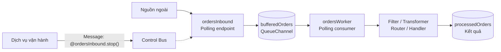
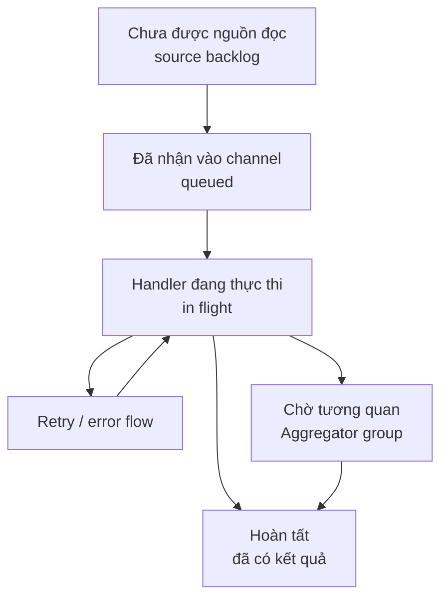
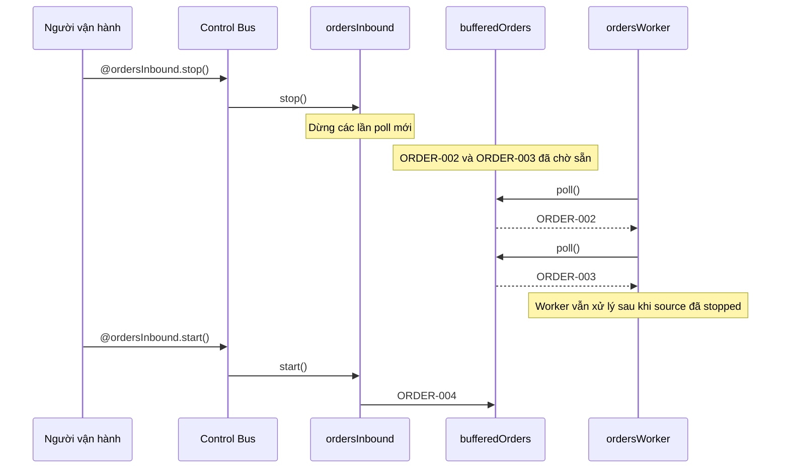

# Điều khiển một flow đang có message

## 1. Bài toán: dừng nhận mới khi message vẫn đang được xử lý

Trong một hệ thống Spring Integration, flow thường không rỗng ở thời điểm cần bảo trì. Ví dụ, ứng dụng đang nhận đơn hàng từ đối tác, đưa message qua Filter và Transformer, định tuyến bằng Router rồi xử lý thanh toán hoặc gửi thông báo. Một số message có thể đã vào queue, một số đang được handler xử lý, một số khác đang retry hoặc chờ đủ mảnh trong Aggregator.

Khi đối tác thông báo tạm dừng dịch vụ, người vận hành muốn **ngăn message mới được nhận** nhưng vẫn muốn **những message đã nhận được xử lý hoặc lưu lại đúng chính sách**. Nếu gọi `stop()` lên một endpoint mà không xác định ranh giới dừng, ứng dụng có thể tăng backlog, bỏ lỡ thông báo, tạo message trùng hoặc khiến các nhóm correlation chờ quá lâu.

Trong chương **Control bus** của module **SPRING_INTEGRATION_PATTERN**, bài này tập trung vào tình huống đó. Mục tiêu của module là triển khai Enterprise Integration Patterns bằng Spring Integration để tạo các luồng thông điệp ít phụ thuộc, dễ mở rộng; thực hành Router, Filter, Transformer, Splitter, Aggregator, Gateway, retry, error channel và correlation, đồng thời kiểm thử và theo dõi các nhánh xử lý.

Kết thúc bài, bạn có thể:

1. Xác định **endpoint cần điều khiển**, thay vì xem toàn bộ `IntegrationFlow` như một tiến trình duy nhất.
2. Dùng Control Bus gửi lệnh `start()`/`stop()` đến inbound endpoint khi **trong flow đã có message**.
3. Phân biệt message **chưa nhận**, **đã nhận nhưng đang chờ**, **đang xử lý** và **đã hoàn tất**.
4. Thực hiện quy trình **stop intake → quan sát → drain → xác nhận → resume**.
5. Kiểm thử rằng dừng nguồn không tự động làm mất các message đã ở downstream.
6. Lựa chọn xử lý phù hợp với QueueChannel, ExecutorChannel, retry, transaction và Aggregator.

## 2. “Dừng flow” thực chất là dừng thành phần nào?

Một flow Spring Integration có thể gồm nhiều endpoint và channel. `IntegrationFlow` mô tả cách chúng nối với nhau; nó không mặc nhiên cung cấp một lệnh `pause()` thống nhất, có thể tạm ngưng an toàn toàn bộ pipeline.

Xem topology có hàng đợi trung gian:



Trong topology này có hai endpoint có thể chạy theo lịch riêng:

- **`ordersInbound`:** chủ động lấy dữ liệu từ nguồn ngoài rồi đưa message vào `bufferedOrders`.
- **`ordersWorker`:** lấy message từ `bufferedOrders` và chuyển cho phần xử lý phía sau.

Nếu điều khiển `ordersInbound.stop()`, các lần polling mới từ nguồn ngoài sẽ ngừng theo ngữ nghĩa lifecycle của endpoint. Nhưng `ordersWorker` **vẫn có thể tiếp tục lấy các message đã nằm trong `bufferedOrders`**.

Nếu điều khiển `ordersWorker.stop()`, quá trình tiêu thụ từ queue trung gian ngừng; **`ordersInbound` có thể vẫn đưa message vào queue** nếu chưa dừng. Queue sẽ tăng backlog và có thể hết dung lượng. Tác động phụ thuộc loại channel và cấu hình capacity.

| Đối tượng bị dừng | Điều có thể ngừng | Điều có thể vẫn tiếp tục |
| --- | --- | --- |
| `ordersInbound` | Nhận thêm message từ nguồn theo các kỳ poll mới | Worker downstream tiêu thụ message đã ở queue |
| `ordersWorker` | Lấy thêm message từ `bufferedOrders` | Inbound tiếp tục đưa message vào queue nếu vẫn chạy |
| Cả hai endpoint | Poll mới tại hai vị trí sau khi chúng dừng | Message đã giao cho handler, retry, async executor hoặc Aggregator |
| Toàn bộ ứng dụng | Phụ thuộc quy trình shutdown từng bean và hạ tầng | Tài nguyên bên ngoài có thể còn message chưa ack hoặc đợi replay |

**Không có bảo đảm chung rằng `stop()` sẽ thu hồi message đang xử lý, rollback mọi giao dịch hoặc đợi toàn bộ nhánh downstream “rỗng”.** Bảo đảm chính xác phụ thuộc vào endpoint/adapter và kiểu channel, transaction, executor, message store.

## 3. Phân loại message theo trạng thái xử lý

Trước khi gửi lệnh, nên xác định các nhóm message:



| Nhóm | Ví dụ | Khi dừng inbound poller |
| --- | --- | --- |
| **Chưa được đọc** | Bản ghi trong DB, message trong broker, item còn ở source queue | Có thể vẫn ở nguồn nếu nguồn giữ backlog; cần kiểm tra checkpoint/ack |
| **Đã vào channel** | Message nằm trong `QueueChannel` | Có thể tiếp tục được worker lấy nếu worker vẫn running |
| **Đang xử lý** | Handler gọi API đối tác hoặc ghi DB | Có thể tiếp tục, hoàn tất hoặc lỗi; phụ thuộc transaction và stop semantics |
| **Đang retry** | Request thất bại đã vào retry policy | Có thể tiếp tục retry, chuyển sang error channel hoặc nằm trong lịch retry |
| **Chờ aggregation** | Một correlation group chưa đủ mảnh | Vẫn chờ trong MessageStore theo chính sách timeout/expiration |
| **Đã hoàn tất** | Message được xác nhận xử lý thành công | Lệnh stop không tự đảo ngược side effect đã xảy ra |

Khi một người vận hành nói “dừng flow ngay”, cần làm rõ họ muốn **ngừng nhận mới**, **đợi hoàn tất message đang chạy**, hay **hủy tác vụ có chủ đích**. Đây là ba yêu cầu khác nhau, thường cần ba cơ chế khác nhau.

## 4. Ví dụ Java DSL: nguồn và worker chạy độc lập

Ví dụ dùng một `BlockingQueue` làm nguồn dữ liệu mô phỏng, `QueueChannel` làm bộ đệm trung gian và một endpoint khác tiêu thụ bộ đệm. Cách chia này cho phép quan sát rõ message đã ở giữa flow trong khi nguồn đã stopped.

Dependency trong một dự án Spring Boot có quản lý version:

```gradle
dependencies {
    implementation("org.springframework.boot:spring-boot-starter-integration")
    testImplementation("org.springframework.boot:spring-boot-starter-test")
}
```

Tạo `LiveFlowConfiguration.java`:

```java
package example.controlbus;

import java.time.Duration;
import java.util.concurrent.BlockingQueue;
import java.util.concurrent.LinkedBlockingQueue;

import org.springframework.context.annotation.Bean;
import org.springframework.context.annotation.Configuration;
import org.springframework.integration.channel.DirectChannel;
import org.springframework.integration.channel.QueueChannel;
import org.springframework.integration.config.EnableIntegration;
import org.springframework.integration.core.MessageSource;
import org.springframework.integration.dsl.IntegrationFlow;
import org.springframework.integration.dsl.Pollers;
import org.springframework.messaging.MessageChannel;
import org.springframework.messaging.support.MessageBuilder;

@Configuration
@EnableIntegration
public class LiveFlowConfiguration {

    @Bean
    public MessageChannel controlChannel() {
        return new DirectChannel();
    }

    @Bean
    public IntegrationFlow controlBusFlow() {
        return IntegrationFlow.from("controlChannel")
                .controlBus()
                .get();
    }

    // Backlog bên nguồn, chỉ tồn tại trong bộ nhớ ứng dụng.
    @Bean
    public BlockingQueue<String> sourceBacklog() {
        return new LinkedBlockingQueue<>();
    }

    @Bean
    public MessageSource<String> orderSource(
            BlockingQueue<String> sourceBacklog) {
        return () -> {
            String orderId = sourceBacklog.poll();
            return orderId == null
                    ? null
                    : MessageBuilder.withPayload(orderId).build();
        };
    }

    // Bộ đệm giữa đầu nhận và worker downstream.
    @Bean
    public QueueChannel bufferedOrders() {
        return new QueueChannel();
    }

    // Nơi kiểm thử đọc các message đã qua worker.
    @Bean
    public QueueChannel processedOrders() {
        return new QueueChannel();
    }

    // Endpoint thứ nhất: đọc nguồn và đưa vào queue trung gian.
    @Bean
    public IntegrationFlow ordersIntakeFlow(
            MessageSource<String> orderSource) {
        return IntegrationFlow
                .from(orderSource, endpoint -> endpoint
                        .id("ordersInbound")
                        .autoStartup(false)
                        .poller(Pollers.fixedDelay(
                                Duration.ofMillis(200))))
                .channel("bufferedOrders")
                .get();
    }

    // Endpoint thứ hai: worker lấy message từ QueueChannel.
    @Bean
    public IntegrationFlow ordersProcessingFlow() {
        return IntegrationFlow
                .from("bufferedOrders", endpoint -> endpoint
                        .id("ordersWorker")
                        .poller(Pollers.fixedDelay(
                                Duration.ofMillis(200))))
                .channel("processedOrders")
                .get();
    }
}
```

### Các điểm quan trọng trong cấu hình

| Cấu hình | Vai trò |
| --- | --- |
| `controlChannel` + `.controlBus()` | Kênh và handler thực hiện lệnh SpEL |
| `.id("ordersInbound")` | ID của **inbound polling endpoint** cần dừng nhận mới |
| `.autoStartup(false)` | Nguồn ban đầu stopped để chủ động bật trong bài thực hành |
| `bufferedOrders()` | Queue chứa message đã vào pipeline nhưng chưa được worker lấy |
| `.id("ordersWorker")` | ID của **worker polling endpoint** lấy từ queue |
| `processedOrders()` | Queue kết quả để kiểm tra message đã đi qua worker |

`ordersProcessingFlow` dùng cấu hình polling trên một `PollableChannel`. Endpoint `ordersWorker` mặc định tự chạy khi context khởi động, còn `ordersInbound` chỉ chạy sau lệnh start. Vì vậy ngay cả khi nguồn stopped, worker vẫn có thể đọc message có sẵn trong `bufferedOrders`.

Ví dụ này cố ý dùng `QueueChannel` **trong bộ nhớ** và queue không giới hạn capacity nhằm tập trung vào lifecycle. Nó **không bảo đảm dữ liệu bền vững khi JVM dừng**; không dùng cấu hình bộ đệm vô hạn như một phương án production mặc định vì backlog có thể làm cạn bộ nhớ. Với dữ liệu cần lưu qua restart, nên đánh giá `MessageStore` bền vững hoặc broker, giới hạn capacity, retry/ack và chiến lược khôi phục phù hợp.

### Điều kiện để message đi tiếp

Nếu `ordersInbound` đã đưa một message vào `bufferedOrders`, việc `ordersInbound.stop()` xảy ra sau đó không xóa message trong queue. Khi `ordersWorker` tiếp tục poll, message vẫn được chuyển tới `processedOrders` trong ví dụ này.

Nếu cả hai endpoint stopped, message ở `bufferedOrders` chờ cho đến khi có consumer hoạt động trở lại (hoặc queue bị xóa, message hết hạn theo chính sách khác, hoặc tiến trình kết thúc và mất dữ liệu bộ nhớ).

## 5. Điều khiển bằng message qua Control Bus

Control Bus đánh giá biểu thức SpEL tham chiếu bean endpoint:

```text
@ordersInbound.start()
@ordersInbound.stop()
@ordersInbound.isRunning()

@ordersWorker.start()
@ordersWorker.stop()
@ordersWorker.isRunning()
```

Muốn ngừng lấy message từ nguồn nhưng vẫn xử lý backlog đã vào queue, ta chỉ phát **`@ordersInbound.stop()`**.

Tạo dịch vụ quản trị nội bộ `LiveFlowControlService.java`:

```java
package example.controlbus;

import org.springframework.beans.factory.annotation.Qualifier;
import org.springframework.context.ApplicationContext;
import org.springframework.context.Lifecycle;
import org.springframework.messaging.MessageChannel;
import org.springframework.messaging.support.MessageBuilder;
import org.springframework.stereotype.Service;

@Service
public class LiveFlowControlService {

    private final MessageChannel controlChannel;
    private final ApplicationContext context;

    public LiveFlowControlService(
            @Qualifier("controlChannel") MessageChannel controlChannel,
            ApplicationContext context) {
        this.controlChannel = controlChannel;
        this.context = context;
    }

    public void startIntake() {
        send("@ordersInbound.start()");
    }

    public void stopIntake() {
        send("@ordersInbound.stop()");
    }

    public void startWorker() {
        send("@ordersWorker.start()");
    }

    public void stopWorker() {
        send("@ordersWorker.stop()");
    }

    public boolean isIntakeRunning() {
        return context.getBean("ordersInbound", Lifecycle.class)
                .isRunning();
    }

    public boolean isWorkerRunning() {
        return context.getBean("ordersWorker", Lifecycle.class)
                .isRunning();
    }

    private void send(String expression) {
        boolean accepted = controlChannel.send(
                MessageBuilder.withPayload(expression).build());

        if (!accepted) {
            throw new IllegalStateException(
                    "Control command was not accepted");
        }
    }
}
```

Trong ví dụ, `MessageChannel.send()` trả `true` nếu channel chấp nhận message theo hợp đồng; đây **không phải** giá trị `isRunning()`. Vì dùng `DirectChannel` đồng bộ, exception từ handler Control Bus thường trở về caller, song vẫn cần đọc lại `Lifecycle.isRunning()` sau khi gửi.

Dịch vụ chỉ cung cấp **những phương thức phát expression cố định**. Trong ứng dụng thực, phải thêm xác thực, phân quyền, audit và bảo đảm không có nguồn không tin cậy nào nối trực tiếp vào `controlChannel`. Payload Control Bus là một biểu thức được đánh giá trong Spring context; không nhận biểu thức tùy ý từ HTTP request hoặc broker công khai.

## 6. Kịch bản đang có message trong flow

Giả sử `ordersInbound` đã nhận ba đơn hàng và đưa vào `bufferedOrders`, trong lúc worker mới xử lý một đơn:

```text
sourceBacklog:    [ORDER-004, ORDER-005]
bufferedOrders:   [ORDER-002, ORDER-003]
processedOrders:  [ORDER-001]
```

Khi gửi `@ordersInbound.stop()`:

1. **Nguồn mới:** `ordersInbound` được yêu cầu ngừng polling; `ORDER-004` và `ORDER-005` sẽ còn ở nguồn theo cơ chế giữ backlog của nguồn mô phỏng.
2. **Queue trung gian:** `ORDER-002` và `ORDER-003` vẫn thuộc `bufferedOrders`; chúng không tự biến mất chỉ vì inbound stopped.
3. **Worker:** nếu `ordersWorker` vẫn running, nó tiếp tục lấy message từ queue và gửi xuống downstream.
4. **Kết quả:** `processedOrders` có thể nhận thêm `ORDER-002` và `ORDER-003` **sau khi lệnh stop đầu vào đã được gửi**.
5. **Lúc resume:** gửi `@ordersInbound.start()`, poller nhận tiếp những item còn trong `sourceBacklog`.



Đây là hành vi đúng của thiết kế tách **intake** và **processing**. Nếu mục tiêu bảo trì là “không cho bất kỳ handler downstream nào gọi đối tác nữa”, dừng intake đơn thuần chưa đủ. Cần một phương án phù hợp để đợi hoặc ngừng worker, quản lý backlog và các công việc đã được giao.

## 7. Quy trình dừng an toàn khi còn message

Một quy trình thực tế thường được gọi là **quiesce** (ngừng tiếp nhận việc mới) rồi **drain** (đợi các việc đang có hoàn tất). Đây là quy trình vận hành do hệ thống thiết kế; Control Bus chỉ cung cấp một trong các thao tác để thực hiện nó.

### Bước 1: Xác định phạm vi cần dừng

Trước tiên xác định:

- Tên và kiểu endpoint đầu vào: polling adapter, message listener, inbound gateway hay adapter khác.
- Có bao nhiêu instance cùng nhận dữ liệu; một lệnh Control Bus thường chỉ tác động `ApplicationContext` của instance nhận lệnh.
- Có channel nào chứa backlog, executor nào còn task, transaction nào đang mở, retry nào còn chạy và group Aggregator nào còn chờ.
- Mục tiêu là chỉ **dừng nhận mới**, hay phải **dừng hoàn toàn tác động lên downstream** trước giờ bảo trì.

### Bước 2: Ngừng tiếp nhận message mới

Với ví dụ có polling endpoint:

```text
@ordersInbound.stop()
```

Sau đó xác minh `ordersInbound.isRunning() == false` trên **đúng instance**. Lệnh stop chưa phải bằng chứng rằng mọi việc đang chạy đã hoàn tất. Một kỳ poll hoặc handler đã bắt đầu trước stop có thể còn xử lý tùy triển khai.

### Bước 3: Đo và chờ phần việc đang tồn tại

Tiếp tục cho `ordersWorker` xử lý message trong `bufferedOrders` nếu downstream vẫn an toàn. Theo dõi:

- Số message còn chờ ở queue.
- Số message đang xử lý trong handler hoặc executor.
- Retry có lịch tiếp tục và các message trong error channel.
- Correlation group của Aggregator chưa hoàn tất.
- Message chưa ack/commit hoặc giao dịch còn mở trên broker và database.

Ví dụ kiểm tra queue trong bộ nhớ:

```java
int queued = bufferedOrders.getQueueSize();
boolean intakeRunning = control.isIntakeRunning();
boolean workerRunning = control.isWorkerRunning();
```

**`getQueueSize() == 0` không đồng nghĩa flow đã drain xong.** Message có thể đã rời queue nhưng vẫn đang xử lý, chờ retry, đang đi qua async executor hoặc chờ trong Aggregator. Phải kết hợp các chỉ số phù hợp với topology thực tế.

### Bước 4: Xác nhận điểm dừng nếu cần bảo trì downstream

Khi queue trống và không còn công việc cần hoàn tất, có thể dừng worker:

```text
@ordersWorker.stop()
```

Việc này chỉ nên được thực hiện nếu mục tiêu thực sự yêu cầu worker ngừng. Trong trường hợp chỉ bảo trì nguồn upstream, không cần dừng worker.

Nếu không thể đợi toàn bộ xử lý hoàn tất, hãy quyết định rõ cách duy trì message bền vững, cách retry khi resume và cách báo những group chưa đủ mảnh. Không coi việc hết thời gian chờ là một lần drain thành công.

### Bước 5: Resume theo đúng thứ tự

Nếu đã dừng cả worker lẫn intake:

1. Khôi phục và kiểm tra kết nối downstream.
2. Khởi động worker, bảo đảm nơi nhận dữ liệu hoạt động.
3. Khởi động inbound endpoint.
4. Theo dõi backlog, lỗi, retry, throughput và các message có khả năng bị gửi lại.

Trình tự thường giúp tránh dồn dữ liệu mới khi downstream chưa sẵn sàng, nhưng phải điều chỉnh theo adapter và ràng buộc phụ thuộc cụ thể. Sau khi start, `isRunning() == true` chỉ là trạng thái lifecycle, chưa chứng minh nguồn đã lấy message thành công.

## 8. Kiểm thử: message đã vào queue vẫn đi tiếp sau stop

Bài kiểm thử sau sử dụng `QueueChannel` để quan sát hai tình huống riêng:

- Message đã có trong `bufferedOrders` vẫn được `ordersWorker` xử lý khi `ordersInbound` stopped.
- Message còn ở `sourceBacklog` chưa được inbound đọc trong lúc stopped, nhưng sẽ được đọc sau khi start lại.

Tạo `LiveFlowControlTest.java`:

```java
package example.controlbus;

import static org.assertj.core.api.Assertions.assertThat;

import java.util.concurrent.BlockingQueue;

import org.junit.jupiter.api.Test;
import org.springframework.beans.factory.annotation.Autowired;
import org.springframework.integration.channel.QueueChannel;
import org.springframework.messaging.Message;
import org.springframework.messaging.support.MessageBuilder;
import org.springframework.test.context.junit.jupiter.SpringJUnitConfig;

@SpringJUnitConfig({
    LiveFlowConfiguration.class,
    LiveFlowControlService.class
})
class LiveFlowControlTest {

    @Autowired
    LiveFlowControlService control;

    @Autowired
    BlockingQueue<String> sourceBacklog;

    @Autowired
    QueueChannel bufferedOrders;

    @Autowired
    QueueChannel processedOrders;

    @Test
    void stoppingIntakeDoesNotDiscardMessagesAlreadyInPipeline() {
        assertThat(control.isIntakeRunning()).isFalse();
        assertThat(control.isWorkerRunning()).isTrue();

        try {
            // Mô phỏng message đã vào pipeline từ trước.
            assertThat(bufferedOrders.send(MessageBuilder
                    .withPayload("ALREADY_BUFFERED")
                    .build())).isTrue();

            control.stopIntake();

            // Worker vẫn chạy nên lấy message đã được buffer.
            Message<?> existing = processedOrders.receive(2_000);
            assertThat(existing).isNotNull();
            assertThat(existing.getPayload())
                    .isEqualTo("ALREADY_BUFFERED");

            // Message mới ở nguồn phải đợi khi intake stopped.
            sourceBacklog.offer("WAITING_AT_SOURCE");

            assertThat(processedOrders.receive(500)).isNull();
            assertThat(sourceBacklog).contains("WAITING_AT_SOURCE");
            assertThat(control.isIntakeRunning()).isFalse();

            control.startIntake();
            assertThat(control.isIntakeRunning()).isTrue();

            Message<?> resumed = processedOrders.receive(2_000);
            assertThat(resumed).isNotNull();
            assertThat(resumed.getPayload())
                    .isEqualTo("WAITING_AT_SOURCE");
        } finally {
            control.stopIntake();
        }

        assertThat(control.isIntakeRunning()).isFalse();
    }
}
```

Trong test này, `bufferedOrders.send(...)` mô phỏng một message đã được nhận vào pipeline **trước thời điểm dừng intake**. Nhờ vậy phép thử minh họa được hành vi downstream một cách xác định hơn so với việc cố đón đúng một thời điểm poll đang diễn ra.

Các giả định của test: context được cô lập; queue ban đầu rỗng; worker poller đang running; chỉ có một consumer; hệ thống không bị tác vụ khác can thiệp. Timeout trên `receive(...)` là giới hạn chờ, không phải cam kết thời gian xử lý trong production.

**Bổ sung kiểm thử in-flight thật:** dùng handler có cơ chế báo “đã bắt đầu xử lý” và một latch để giữ nó tại điểm được kiểm soát. Khi handler đã bắt đầu, gửi stop cho inbound rồi mới cho handler hoàn tất. Bài test nên khẳng định công việc đã nhận được hoàn tất theo hợp đồng hoặc được retry/rollback đúng chính sách. Tránh thiết kế test chờ stop **vô thời hạn** khi stop và handler có thể phụ thuộc lẫn nhau.

## 9. Khi xử lý bất đồng bộ và hàng đợi lớn

Trong hệ thống thực, message không phải lúc nào cũng chạy đồng bộ đến handler. Các loại kênh có ảnh hưởng khác nhau:

| Kiểu đường truyền | Điều cần lưu ý khi stop |
| --- | --- |
| `DirectChannel` | Handler thường chạy trong luồng gửi. Stop nguồn không nhất thiết hủy xử lý đã bắt đầu trong thread đó |
| `QueueChannel` | Message nằm trong queue cho đến khi consumer poll; dừng producer không xóa queue |
| `ExecutorChannel` | Message có thể đã được giao cho executor; cần theo dõi cả task đang chạy lẫn task còn chờ trong executor |
| Channel dựa trên store/broker | Trạng thái bền vững phụ thuộc vào store, ack, transaction và chính sách retention |
| `PublishSubscribeChannel` | Có thể gửi đến nhiều subscriber; trạng thái hoàn tất phải xét các nhánh liên quan |

Khi `ordersInbound.stop()` thành công, không nên dựa vào một con số “queue hiện rỗng” để kết luận an toàn. Chẳng hạn, worker có thể đã lấy một message khỏi queue nhưng còn đang gọi API; in-flight tăng trong khi queue size đã về 0.

Nếu cần quiesce một hệ thống tải cao, nên có:

- **Backpressure/capacity:** giới hạn số message chờ và quy định cách xử lý khi queue đầy.
- **In-flight tracking:** đếm handler đang xử lý và cả task đã nhận vào executor nhưng chưa thực thi.
- **Idempotency:** xử lý an toàn khi message được gửi lại sau timeout/rollback.
- **Drain timeout:** giới hạn thời gian chờ có thông báo khi chưa hoàn tất; không đánh dấu thành công giả.
- **Metrics:** số nhận, số xử lý, số lỗi, retry, backlog, thời gian chờ, độ trễ xử lý.

### Lưu ý về thứ tự và hiệu năng

Việc tạm dừng nguồn rồi bật lại có thể tạo một đợt backlog lớn. Nếu worker xử lý song song, thứ tự hoàn tất có thể khác thứ tự nhận. Khi nghiệp vụ cần bảo toàn thứ tự, phải thiết kế rõ phân vùng/partition theo key, concurrency, sequence number và cơ chế resequencing nếu cần. `start()`/`stop()` không tự thiết lập lại thứ tự thông điệp.

## 10. Transaction, acknowledgment và khả năng mất/trùng message

Ví dụ `BlockingQueue` và `QueueChannel` trong bộ nhớ được thiết kế để **thấy hành vi lifecycle**, không bảo đảm “exactly once” khi có lỗi.

Với adapter thực, cần đặt các câu hỏi:

1. Nguồn dữ liệu được đánh dấu “đã đọc” vào lúc nào?
2. Việc gửi message vào channel và cập nhật checkpoint có ở trong cùng transaction không?
3. Nếu handler lỗi sau khi đã ack message, có cơ chế replay hoặc dead-letter không?
4. Nếu stop trong khi giao dịch đang mở, commit/rollback diễn ra thế nào?
5. Nếu resume và nguồn gửi lại message, downstream có kiểm tra trùng lặp không?

Ví dụ một inbound adapter có thể đã nhận message từ broker và giao cho handler. Nếu ứng dụng dừng hoặc mất kết nối trước khi ack, broker có thể gửi lại tùy cơ chế nhận và cấu hình. Nếu handler đã ghi dữ liệu trước khi message được gửi lại, cần dùng idempotency key, deduplication hoặc transaction/outbox phù hợp để tránh side effect lặp.

**Control Bus không thay thế giao dịch, ack, retry hoặc error channel.** Lệnh stop chỉ tác động đến lifecycle của endpoint được gọi; cách dữ liệu được xác nhận và lưu bền vững vẫn do nguồn, adapter và topology quyết định.

## 11. Router, Filter, Splitter, Aggregator và retry khi dừng

Các mẫu EIP có thể giữ hoặc chuyển tiếp công việc sau khi inbound đã stopped:

| Thành phần | Rủi ro khi dừng khi flow còn message | Cách theo dõi / xử lý |
| --- | --- | --- |
| **Router** | Message đã được route tới nhiều nhánh khác nhau | Đo backlog, in-flight và lỗi theo từng nhánh |
| **Filter** | Một số message bị loại có chủ đích; dễ nhầm với mất message | Theo dõi discarded messages và quy tắc lọc |
| **Transformer** | Message đã vào handler vẫn có thể được biến đổi | Đo thời gian xử lý, exception và kết quả |
| **Splitter** | Batch đã chia còn nhiều mảnh đang di chuyển | Theo dõi sequence/correlation và số mảnh hoàn tất |
| **Aggregator** | Group chưa đủ thành viên có thể còn chờ trong MessageStore | Đo group còn mở, timeout, expiration và release strategy |
| **Gateway** | Request đã gửi còn chờ reply hoặc timeout | Đếm request/reply đang mở và chính sách timeout |
| **Retry** | Công việc cũ có thể tiếp tục backoff rồi retry | Giám sát attempt, backoff, idempotency và deadline |
| **Error channel** | Message lỗi có thể vẫn được xử lý sau stop | Quan sát error flow, dead-letter và phân loại lỗi |

Trong một flow có Splitter/Aggregator, chỉ thấy inbound stopped và queue size bằng 0 **không có nghĩa** tất cả correlation group đã hoàn tất. Cần quan sát MessageStore và chính sách release/expire của Aggregator. Một số group có thể thiếu mảnh do upstream dừng, nguồn trễ hoặc nhánh lỗi.

Nếu downstream không thể nhận thêm công việc trong lúc bảo trì, hãy tính đến việc đợi các handler đang hoạt động hoàn tất và lưu bền vững các message còn lại. Không dùng Filter để âm thầm bỏ message rồi gọi đó là “pause”.

## 12. Quan sát trạng thái và gửi lệnh an toàn

### 12.1. Phân biệt trạng thái và hiệu quả

Ba mức cần báo riêng cho người vận hành:

| Mức | Bằng chứng | Không chứng minh điều gì |
| --- | --- | --- |
| **Lệnh được gửi** | `MessageChannel.send()` chấp nhận message | Endpoint đã đạt trạng thái mục tiêu hoặc đã drain |
| **Endpoint đã dừng** | `Lifecycle.isRunning() == false` trên bean đúng | Không còn in-flight, retry, message trong queue hoặc ở replica khác |
| **Flow đã an toàn để bảo trì** | Queue, in-flight, retry, correlation group và giao dịch đã ở trạng thái phù hợp | Không có message ở hệ thống ngoài nếu nguồn vẫn tạo dữ liệu |

Thay vì báo `STOPPED` cho cả hệ thống ngay khi gửi một lệnh, giao diện quản trị có thể hiển thị các trạng thái:

- `STOP_REQUESTED` — đã gửi yêu cầu.
- `INTAKE_STOPPED` — endpoint đầu vào báo stopped.
- `DRAINING` — đang xử lý những message còn lại.
- `DRAINED` — đạt điều kiện drain đã định nghĩa.
- `FAILED` / `UNKNOWN` — lỗi hoặc thiếu dữ liệu xác nhận.

Đây là **mô hình trạng thái vận hành do ứng dụng tự thiết kế**, không phải trạng thái có sẵn của Spring Integration.

### 12.2. Bảo mật

Payload Control Bus là SpEL, nên chỉ một nguồn quản trị được xác thực và phân quyền mới được phép tạo lệnh. Không lấy `beanName`, `methodName` hoặc toàn bộ expression từ client rồi ghép chuỗi để gửi vào channel.

Ví dụ dịch vụ `LiveFlowControlService` ở trên sử dụng những biểu thức cố định. Ở production, cần kiểm soát quyền start/stop từng endpoint, audit actor/action/instance/time và cấm những adapter nhận dữ liệu ngoài gửi trực tiếp tới `controlChannel`.

### 12.3. Nhiều instance

Một lệnh `@ordersInbound.stop()` gửi vào Control Bus của instance A chỉ tác động tới bean của **A**. Nếu instance B, C vẫn chạy, chúng có thể tiếp tục lấy message từ cùng nguồn. Một công cụ điều phối toàn cụm phải gửi hoặc định tuyến lệnh tới từng instance cần dừng và xác nhận trạng thái từng nơi. Instance không phản hồi phải được đánh dấu **không xác định**, không được mặc định là đã dừng.

## 13. Sai lầm thường gặp

| Hiện tượng | Nguyên nhân có thể xảy ra | Hướng xử lý |
| --- | --- | --- |
| Stop inbound nhưng log handler vẫn xuất hiện | Message đã vào queue/handler hoặc retry đang chạy | Kiểm tra in-flight, worker, retry và số message đã nhận trước lệnh |
| `isRunning() == false` nhưng queue không rỗng | Dừng nguồn không làm rỗng queue trung gian | Cho worker tiếp tục drain hoặc lưu backlog bền vững |
| Stop worker nhưng inbound vẫn chạy | Điều khiển nhầm endpoint | Xác định đúng id của nguồn và consumer; theo dõi capacity |
| Queue size bằng 0 nhưng chưa an toàn để bảo trì | Handler/executor còn task, Aggregator còn group | Theo dõi các trạng thái sau queue |
| Dừng nguồn khiến message mất sau restart | Buffer chỉ trong bộ nhớ hoặc ack/checkpoint không phù hợp | Dùng broker/store bền vững, transaction hoặc replay |
| Resume thấy xử lý trùng | Broker gửi lại hoặc thao tác đã commit trước lỗi ack | Dùng idempotency và kiểm thử recovery |
| Một node dừng nhưng toàn cụm vẫn nhận | Control Bus tác động trong một `ApplicationContext` | Điều phối và xác nhận từng instance |
| Lệnh báo thành công nhưng ứng dụng không nhận được dữ liệu sau resume | Lệnh chỉ bật lifecycle; nguồn hoặc downstream còn lỗi | Kiểm tra health upstream, metrics, lỗi và backlog |

## 14. Bài tập thực hành

**Bài 1 — Stop intake trong khi còn backlog.** Khởi chạy `ordersInbound` và `ordersWorker`, đưa nhiều đơn hàng vào nguồn. Khi một số đã vào `bufferedOrders`, gửi `@ordersInbound.stop()`. Quan sát rằng worker vẫn có thể tiếp tục xử lý các message đã nhận, còn source backlog chỉ được đọc khi start lại.

**Bài 2 — Dừng sai endpoint.** Cho `ordersInbound` chạy, dừng `ordersWorker`. Đo kích thước `bufferedOrders` tăng lên. Giải thích nguyên nhân và đề xuất capacity, backpressure hoặc cơ chế dừng nguồn trước.

**Bài 3 — Drain đúng nghĩa.** Bổ sung một handler xử lý chậm và bộ đếm in-flight. Thiết kế điều kiện drain gồm queue rỗng, in-flight bằng 0 và không còn retry pending. Khi hết timeout, trả kết quả chưa hoàn tất thay vì báo thành công.

**Bài 4 — Retry và Aggregator.** Cho Splitter tạo một nhóm message có correlation ID; một nhánh lỗi và chờ retry. Stop inbound. Theo dõi group chưa hoàn tất và xác định cách timeout/expiration ảnh hưởng đến kết quả.

**Bài 5 — Hai replica.** Cho A và B cùng poll một nguồn. Dừng inbound ở A. Chứng minh B vẫn có thể nhận message, sau đó mô tả cơ chế điều phối cần thiết để dừng cả hai mà không đánh đồng trạng thái một instance với cả cụm.

## 15. Câu hỏi tự kiểm tra

1. Vì sao gọi `@ordersInbound.stop()` chưa chắc làm log xử lý message ngừng ngay?
2. Điểm khác nhau giữa dừng **inbound** và dừng **worker** khi có `QueueChannel` ở giữa là gì?
3. Tại sao `bufferedOrders.getQueueSize() == 0` chưa đủ chứng minh flow đã drain?
4. Khi dùng `ExecutorChannel`, những message nào có thể còn chờ dù inbound stopped?
5. Stop có tự rollback message đã ack hoặc side effect đã commit không?
6. Một Aggregator có thể còn group nào khi đầu nhận đã dừng?
7. Vì sao gửi lệnh qua Control Bus cần allowlist, phân quyền và audit?
8. Khi có nhiều replica, cần bằng chứng gì để xác nhận dừng nhận mới trên toàn cụm?

**Ghi nhớ:** điều khiển một flow đang có message bắt đầu từ việc **chọn đúng endpoint để dừng nhận mới**, sau đó **quan sát và xử lý những message đã vào pipeline**. Control Bus cung cấp lệnh lifecycle bằng message; tính toàn vẹn dữ liệu còn phụ thuộc vào channel, adapter, retry, transaction, correlation và quy trình drain/resume được thiết kế riêng cho hệ thống.

