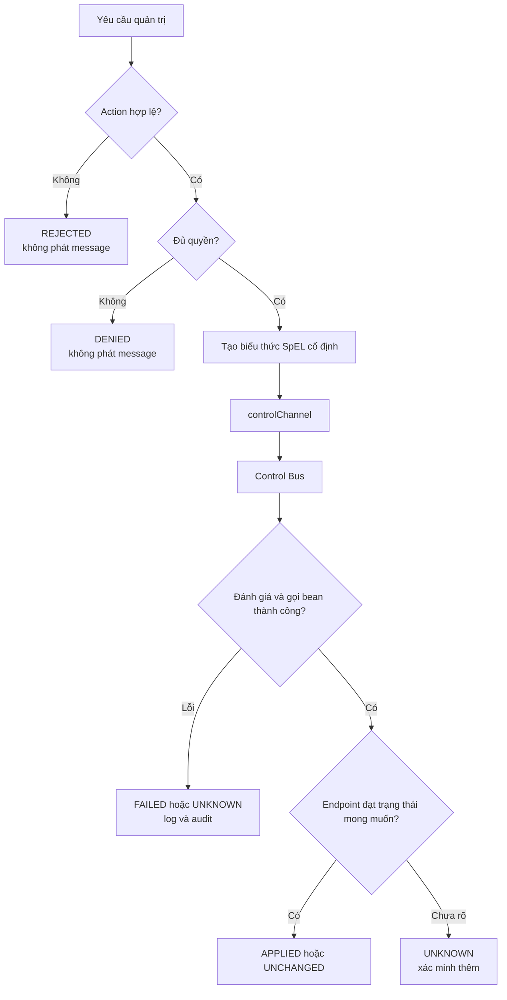

# Xử lý lệnh không hợp lệ

## 1. Bối cảnh và mục tiêu

Trong **Spring Integration**, Control Bus cho phép gửi message điều khiển đến một endpoint đang chạy mà không cần khởi động lại ứng dụng. Chẳng hạn, một dịch vụ quản trị gửi payload SpEL:

```text
@ordersPoller.start()
@ordersPoller.stop()
@ordersPoller.isRunning()
```

Control Bus đánh giá biểu thức để tương tác với bean đích trong Spring `ApplicationContext`. Đây là khả năng hữu ích khi triển khai **Enterprise Integration Patterns (EIP)**: một hệ thống có thể gồm Router, Filter, Transformer, Splitter, Aggregator, Gateway, retry, error channel và correlation. Tuy nhiên, một **lệnh không hợp lệ** phải được phát hiện đúng chỗ, xử lý rõ ràng và không làm hỏng luồng nghiệp vụ.

Trong module **SPRING_INTEGRATION_PATTERN**, mục tiêu là xây dựng các flow ít phụ thuộc, dễ mở rộng, đồng thời kiểm thử và quan sát được từng nhánh. Bài này thuộc chương **Control bus** và giải quyết câu hỏi: nếu ai đó gửi một hành động không được hỗ trợ, một biểu thức SpEL sai, một bean id không tồn tại hoặc một lệnh tới endpoint đang sai trạng thái, hệ thống nên phản hồi thế nào?

Sau bài học, bạn có thể:

1. Phân loại lỗi **đầu vào**, **quyền truy cập**, **đánh giá expression**, **truyền message** và **trạng thái vận hành**.
2. Thiết kế đường điều khiển chỉ cho phép những hành động đã định nghĩa trước, không nhận SpEL tùy ý từ bên ngoài.
3. Phân biệt `REJECTED`, `FAILED`, `UNKNOWN` và lệnh hợp lệ nhưng không làm thay đổi trạng thái.
4. Xử lý lỗi đồng bộ ở `DirectChannel` và đặt chiến lược nhận lỗi/xác nhận cho luồng bất đồng bộ.
5. Viết kiểm thử cho lệnh không được hỗ trợ, bean đích không tồn tại, thiếu quyền và start/stop lặp.
6. Ghi audit và kiểm tra tác động tới các message đang xử lý khi lệnh điều khiển thất bại.

## 2. Một lệnh có thể không hợp lệ ở nhiều tầng

Không nên coi mọi lỗi điều khiển là “SpEL sai cú pháp”. Có những request phải bị chặn **trước khi trở thành message**, trong khi những request khác chỉ thất bại khi Control Bus xử lý hoặc khi endpoint đổi trạng thái.



| Loại tình huống | Ví dụ | Thời điểm xử lý thích hợp |
| --- | --- | --- |
| Action không được hỗ trợ | `"RESET_ALL"` ngoài danh sách lệnh | Validation/allowlist trước Control Bus |
| Payload thiếu hoặc sai kiểu | `null`, object thay vì tên action | API hoặc service boundary |
| Thiếu quyền | Người chỉ được xem trạng thái gửi lệnh stop | Authentication và authorization |
| SpEL không hợp lệ | Biểu thức do code nội bộ tạo sai cú pháp | Khi handler Control Bus đánh giá |
| Bean/method không hợp lệ | `@missingPoller.stop()` hoặc bean không có `stop()` | Khi resolve bean hoặc gọi phương thức |
| Lỗi kênh | Không có subscriber, channel từ chối message | Khi gửi lệnh |
| Endpoint đang ở trạng thái mục tiêu | Stop một endpoint đã stopped | Có thể coi là **idempotent no-op**, không nhất thiết là lỗi |
| Không xác nhận được hiệu quả | Timeout, replica không phản hồi, trạng thái biến đổi đồng thời | Quy trình xác minh sau lệnh |
| Lỗi từ thao tác lifecycle | Endpoint báo exception khi start/stop | Lỗi vận hành; cần log nguyên nhân và xác minh hậu quả |

**Điểm cần phân biệt:** “không được hỗ trợ” và “đã gửi nhưng thực thi lỗi” là hai tình huống khác nhau. Một request có action lạ nên bị từ chối sớm; một command hợp lệ mà endpoint không tìm thấy là lỗi cấu hình hoặc vận hành, không nên trả về như thể người dùng chỉ nhập sai action.

## 3. Tập lệnh được phép và phản hồi có ý nghĩa

Giả sử nhóm vận hành được phép điều khiển endpoint `ordersPoller`. Hợp đồng công khai chỉ gồm:

```json
{"action": "START_ORDERS"}
```

hoặc:

```json
{"action": "STOP_ORDERS"}
```

Ứng dụng tự ánh xạ sang biểu thức cố định:

| Action bên ngoài | Biểu thức nội bộ | Quyền cần có |
| --- | --- | --- |
| `START_ORDERS` | `@ordersPoller.start()` | `integration.orders.write` |
| `STOP_ORDERS` | `@ordersPoller.stop()` | `integration.orders.write` |

Tuyệt đối không dùng request dạng `{"expression":"..."}` rồi chuyển nguyên văn chuỗi tới Control Bus. Cũng không ghép `beanName` và `methodName` do người dùng nhập vào biểu thức. Payload của Control Bus có thể được **đánh giá** trong ngữ cảnh ứng dụng; đây là đường quản trị có quyền cao.

Một bộ mã kết quả quản trị do **ứng dụng tự định nghĩa** có thể gồm:

| Mã | Diễn giải | Cách dùng |
| --- | --- | --- |
| `REJECTED` | Action không thuộc hợp đồng hoặc dữ liệu đầu vào không hợp lệ | Không gửi bất kỳ message điều khiển nào |
| `DENIED` | Caller không được phép thực hiện thao tác | Chặn trước service hoặc tại Spring Security proxy |
| `APPLIED` | Lệnh đã thực thi và quan sát thấy trạng thái mong muốn | Ghi kết quả và thời điểm quan sát |
| `UNCHANGED` | Endpoint đã ở trạng thái mong muốn trước lệnh | Trả về thành công không đổi trạng thái, nếu đây là chính sách mong muốn |
| `FAILED` | Có bằng chứng rõ ràng về lỗi validation/kênh/cấu hình | Báo lỗi, ghi log nguyên nhân, tránh retry mù |
| `UNKNOWN` | Không đủ bằng chứng để xác định hiệu quả | Truy vấn lại trạng thái, có giới hạn thời gian và không suy ra thành công |

Các mã trên **không phải enum dựng sẵn của Spring Integration**. Chúng giúp API và bảng điều khiển vận hành diễn đạt đúng trạng thái. Một lệnh có thể đã tạo side effect trước khi xuất hiện exception hoặc timeout; khi chưa thể xác định hậu quả, chọn `UNKNOWN` an toàn hơn việc tuyên bố chắc chắn endpoint chưa bị tác động.

### 3.1. Idempotency và lệnh lặp

Nếu `ordersPoller.isRunning() == true`, một yêu cầu `START_ORDERS` nữa thường không cần thực thi lại. Có thể trả `UNCHANGED` kèm trạng thái quan sát `true`. Tương tự, stop trên endpoint đã stopped có thể là một lần no-op thành công.

Tuy vậy, việc đọc `isRunning()` rồi gọi `start()` hoặc `stop()` không phải giao dịch nguyên tử. Một tác vụ quản trị khác có thể đổi trạng thái ngay sau khi đọc. Với hệ thống có nhiều bộ điều khiển, cần cơ chế đồng bộ/điều phối và version hoặc request id nếu nghiệp vụ yêu cầu thứ tự lệnh nghiêm ngặt.

## 4. Cấu hình mẫu để thử lệnh

Ví dụ dưới đây dùng Spring Boot với Spring Integration Java DSL. Một polling endpoint đọc mã đơn hàng từ queue trong bộ nhớ; Control Bus nhận lệnh qua `controlChannel`.

Phụ thuộc Gradle trong dự án Spring Boot có quản lý version:

```gradle
dependencies {
    implementation("org.springframework.boot:spring-boot-starter-integration")
    implementation("org.springframework.boot:spring-boot-starter-security")
    testImplementation("org.springframework.boot:spring-boot-starter-test")
    testImplementation("org.springframework.security:spring-security-test")
}
```

Đặt các lớp ví dụ trong package `example.controlbus`, ứng dụng dùng Java 17+.

```java
package example.controlbus;

import java.time.Duration;
import java.util.concurrent.BlockingQueue;
import java.util.concurrent.LinkedBlockingQueue;

import org.springframework.context.annotation.Bean;
import org.springframework.context.annotation.Configuration;
import org.springframework.integration.channel.DirectChannel;
import org.springframework.integration.config.EnableIntegration;
import org.springframework.integration.core.MessageSource;
import org.springframework.integration.dsl.IntegrationFlow;
import org.springframework.integration.dsl.Pollers;
import org.springframework.messaging.MessageChannel;
import org.springframework.messaging.support.MessageBuilder;
import org.springframework.security.config.annotation.method.configuration.EnableMethodSecurity;

@Configuration
@EnableIntegration
@EnableMethodSecurity
public class ControlBusDemoConfiguration {

    @Bean
    public MessageChannel controlChannel() {
        return new DirectChannel();
    }

    @Bean
    public IntegrationFlow controlBusFlow() {
        return IntegrationFlow.from("controlChannel")
                .controlBus()
                .get();
    }

    @Bean
    public BlockingQueue<String> orderQueue() {
        return new LinkedBlockingQueue<>();
    }

    @Bean
    public MessageSource<String> orderSource(
            BlockingQueue<String> orderQueue) {
        return () -> {
            String id = orderQueue.poll();
            return id == null
                    ? null
                    : MessageBuilder.withPayload(id).build();
        };
    }

    @Bean
    public IntegrationFlow ordersFlow(MessageSource<String> orderSource) {
        return IntegrationFlow.from(orderSource, endpoint -> endpoint
                        .id("ordersPoller")
                        .autoStartup(false)
                        .poller(Pollers.fixedDelay(Duration.ofSeconds(1))))
                .handle(message -> System.out.println(
                        "Received order: " + message.getPayload()))
                .get();
    }
}
```

Những điểm quan trọng:

- `controlChannel` dành cho message điều khiển; nó không tự thực hiện kiểm tra quyền theo người dùng.
- `.controlBus()` đăng ký handler đánh giá biểu thức của message gửi vào channel.
- `.id("ordersPoller")` đặt ID cho **polling inbound endpoint**. Đây là tên bean được Control Bus tham chiếu.
- `.autoStartup(false)` cho phép kiểm thử trạng thái stopped ngay sau khi tạo context.
- `DirectChannel` chuyển message đồng bộ tới subscriber trong cấu hình này; exception phát sinh khi xử lý lệnh thường truyền ngược cho thread gửi.

Ví dụ `orderQueue` là nguồn trong bộ nhớ, không bảo đảm lưu dữ liệu khi JVM kết thúc. Với broker hoặc adapter khác, cần kiểm tra riêng hợp đồng stop/start, acknowledgment, transaction và khả năng replay.

## 5. Dịch vụ chặn action sai trước Control Bus

Ta dùng một enum để chỉ định hành động, sau đó phát **biểu thức cố định** từ ứng dụng. Dịch vụ cũng phân biệt lỗi từ caller với lỗi từ việc thực thi.

### 5.1. Action và kết quả

```java
package example.controlbus;

public enum OrderAction {
    START_ORDERS,
    STOP_ORDERS
}
```

```java
package example.controlbus;

public enum CommandStatus {
    REJECTED,
    APPLIED,
    UNCHANGED,
    FAILED,
    UNKNOWN
}
```

```java
package example.controlbus;

public record CommandResult(
        CommandStatus status,
        Boolean observedRunning,
        String message) {
}
```

`observedRunning` có kiểu `Boolean` để có thể trả `null` khi không đọc được trạng thái. Không nên tự ép timeout hoặc lỗi truy vấn thành `false`, vì `false` có nghĩa là endpoint thực sự báo stopped.

### 5.2. Triển khai service

```java
package example.controlbus;

import org.slf4j.Logger;
import org.slf4j.LoggerFactory;
import org.springframework.beans.BeansException;
import org.springframework.beans.factory.annotation.Qualifier;
import org.springframework.context.ApplicationContext;
import org.springframework.context.Lifecycle;
import org.springframework.messaging.MessageChannel;
import org.springframework.messaging.support.MessageBuilder;
import org.springframework.security.access.prepost.PreAuthorize;
import org.springframework.stereotype.Service;

@Service
public class SafeOrderControlService {

    private static final Logger log =
            LoggerFactory.getLogger(SafeOrderControlService.class);

    private final MessageChannel controlChannel;
    private final ApplicationContext context;

    public SafeOrderControlService(
            @Qualifier("controlChannel") MessageChannel controlChannel,
            ApplicationContext context) {
        this.controlChannel = controlChannel;
        this.context = context;
    }

    @PreAuthorize("hasAuthority('SCOPE_integration.orders.write')")
    public CommandResult execute(String rawAction) {
        // Từ chối input không thuộc hợp đồng trước khi tạo SpEL.
        if (rawAction == null) {
            return new CommandResult(
                    CommandStatus.REJECTED, null, "Action is required");
        }

        final OrderAction action;
        try {
            action = OrderAction.valueOf(rawAction);
        } catch (IllegalArgumentException ex) {
            return new CommandResult(
                    CommandStatus.REJECTED, null, "Unsupported action");
        }

        final Lifecycle endpoint;
        try {
            endpoint = context.getBean("ordersPoller", Lifecycle.class);
        } catch (BeansException ex) {
            log.error("Lifecycle endpoint ordersPoller is unavailable", ex);
            return new CommandResult(
                    CommandStatus.FAILED, null, "Endpoint unavailable");
        }

        boolean desiredRunning = action == OrderAction.START_ORDERS;

        try {
            // Một request lặp có thể là no-op hợp lệ.
            if (endpoint.isRunning() == desiredRunning) {
                return new CommandResult(
                        CommandStatus.UNCHANGED,
                        desiredRunning,
                        "Already in requested state");
            }

            // Không ghép bean name hay method name từ input.
            String expression = switch (action) {
                case START_ORDERS -> "@ordersPoller.start()";
                case STOP_ORDERS -> "@ordersPoller.stop()";
            };

            boolean accepted = controlChannel.send(
                    MessageBuilder.withPayload(expression).build());

            if (!accepted) {
                return new CommandResult(
                        CommandStatus.FAILED,
                        null,
                        "Control channel did not accept command");
            }

            // Chỉ đáng tin trong phạm vi instance này, tại thời điểm đọc.
            boolean observed = endpoint.isRunning();
            return new CommandResult(
                    observed == desiredRunning
                            ? CommandStatus.APPLIED
                            : CommandStatus.UNKNOWN,
                    observed,
                    observed == desiredRunning
                            ? "Requested state observed"
                            : "State not confirmed");
        } catch (RuntimeException ex) {
            // Lệnh có thể đã tác động một phần trước khi lỗi xuất hiện.
            log.error("Control Bus command failed: {}", action, ex);
            return new CommandResult(
                    CommandStatus.UNKNOWN,
                    null,
                    "Command result could not be confirmed");
        }
    }
}
```

### 5.3. Vì sao xử lý theo thứ tự này?

1. **Validation trước:** Action không hợp lệ được trả `REJECTED`; không có SpEL nào được tạo và không gửi message vào Control Bus.
2. **Authorization ở điểm gọi:** `@PreAuthorize` kiểm tra authority trước khi vào phương thức qua Spring proxy. Caller không có quyền sẽ bị từ chối, thường phát sinh `AccessDeniedException`.
3. **Kiểm tra cấu hình:** Nếu bean `ordersPoller` không tồn tại hoặc không triển khai `Lifecycle`, đây là lỗi cấu hình, báo `FAILED` và ghi log nội bộ.
4. **Lệnh cố định:** Chỉ hai biểu thức có trong mã nguồn; action do caller đưa vào không bao giờ được dùng để tạo cú pháp SpEL tùy ý.
5. **Idempotency:** Nếu endpoint đã ở trạng thái mong muốn, trả `UNCHANGED` thay vì coi đó là lỗi.
6. **Xác nhận sau gửi:** Với `DirectChannel` đồng bộ trong ví dụ, đọc lại `isRunning()` giúp xác minh trạng thái mục tiêu. Nếu không khớp, trả `UNKNOWN` để kiểm tra thêm.
7. **Lỗi lúc thực thi:** Nếu exception xảy ra sau khi bắt đầu gửi lệnh, chưa chắc chắn side effect đã hay chưa xảy ra. Ghi chi tiết ở log nội bộ và trả kết quả an toàn, không tiết lộ stack trace ra API.

**Giới hạn quan trọng:** `@PreAuthorize` chỉ có tác dụng trên lời gọi qua Spring Security proxy khi method security đã được bật. Một component khác gửi thẳng message đến `controlChannel` sẽ **không** đi qua kiểm tra quyền của service này. Cần bảo đảm mọi đầu vào không đáng tin cậy chỉ tới service được kiểm soát, không tới Control Bus.

Trong production, API HTTP cũng phải xác thực caller (chẳng hạn qua SecurityFilterChain, Resource Server hoặc cơ chế phù hợp), kiểm tra phạm vi endpoint/tenant/environment và chuyển kết quả thành HTTP status có ý nghĩa. Quyền của người xem trạng thái cần được tách khỏi quyền start/stop.

## 6. Ví dụ phản hồi cho các trường hợp sai

Giả sử một API được bảo vệ gọi `SafeOrderControlService.execute(rawAction)`. Các tình huống sau có thể được ánh xạ thành phản hồi:

| Tình huống | Kết quả service | HTTP gợi ý | Lưu ý |
| --- | --- | --- | --- |
| Thiếu `action` | `REJECTED` | 400 | Không phát message |
| `action = "RESET_ALL"` | `REJECTED` | 400 | Không tiết lộ danh sách bean nội bộ |
| Chưa xác thực | Bị chặn ở HTTP security | 401 | Không gọi service |
| Đã xác thực nhưng thiếu authority | `AccessDeniedException` | 403 | Không phát message |
| `START_ORDERS` khi đã running | `UNCHANGED` | 200 | Idempotent no-op theo chính sách |
| `STOP_ORDERS` và quan sát stopped | `APPLIED` | 200 | Chỉ xác nhận lifecycle của endpoint đích |
| Endpoint đích không tồn tại | `FAILED` | 5xx | Lỗi cấu hình vận hành |
| Command được gửi nhưng kết quả chưa xác định | `UNKNOWN` | 202 hoặc 503 tùy hợp đồng | Không hứa trạng thái đã đạt; cung cấp cách truy vấn lại |

**Không nên ghi `SUCCEEDED` chỉ vì `MessageChannel.send() == true`.** Boolean này nói về việc gửi message, không phải trạng thái lifecycle hoặc hiệu quả xử lý đơn hàng. Khi hệ thống có channel bất đồng bộ, `send()` có thể trả trước khi Control Bus thực sự đánh giá biểu thức.

Nếu muốn trả HTTP 202 cho `UNKNOWN`, cần có cơ chế truy vấn trạng thái lệnh bằng request id; nếu không có cơ chế đó, 503 và hướng dẫn kiểm tra lại có thể phù hợp hơn. Việc ánh xạ HTTP là quyết định API, không phải hành vi tự động của Control Bus.

## 7. Khi Control Bus nhận trực tiếp một biểu thức sai

Dịch vụ ở phần trước cố tình ngăn bên ngoài truyền SpEL tùy ý. Dù vậy, một lỗi cấu hình hoặc bug trong code nội bộ vẫn có thể gửi biểu thức không hợp lệ:

```text
@missingPoller.stop()
```

Biểu thức trên có thể đúng cú pháp nhưng bean đích không tồn tại. Khi handler cố resolve bean, một exception có thể phát sinh. Các lỗi khác có thể đến từ sai cú pháp, method không hỗ trợ, lỗi trong chính method được gọi hoặc biểu thức trả giá trị không như mong đợi.

Trên đường đồng bộ `DirectChannel`:

```java
try {
    controlChannel.send(
            MessageBuilder
                    .withPayload("@missingPoller.stop()")
                    .build());
} catch (RuntimeException ex) {
    // Nội bộ: ghi nguyên nhân, correlation id và endpoint dự định.
    // API bên ngoài: trả thông báo lỗi đã được làm sạch.
}
```

**Không cố định mọi exception thành một class duy nhất** trong code nghiệp vụ: ngoại lệ thực tế có thể được Spring Messaging/Integration đóng gói, còn nguyên nhân gốc có thể là lỗi resolve bean, lỗi đánh giá SpEL hoặc lỗi phương thức lifecycle. Phần xử lý nên ghi exception chain nội bộ nhưng phản hồi bên ngoài bằng thông tin đã giới hạn.

Với message gửi qua channel bất đồng bộ, handler có thể thực thi ở thread khác, nên exception **không nhất thiết** quay về thread gọi `send()`. Cần cấu hình error flow/`errorChannel` phù hợp với endpoint và channel, đồng thời có chiến lược xác nhận thực thi. Không giả định chỉ cần khai báo một channel có tên `errorChannel` là mọi lỗi asynchronous đều được chuyển vào đó.

### Phân loại kết quả từ thông báo lỗi

| Dấu hiệu | Giả thuyết | Kiểm tra |
| --- | --- | --- |
| Không tìm thấy bean | Sai id hoặc sai ApplicationContext | Kiểm tra id gắn tại endpoint |
| Không có phương thức `stop()` | Nhầm channel/handler với endpoint hỗ trợ lifecycle | Kiểm tra bean type và `Lifecycle` |
| Lỗi cú pháp SpEL | Literal expression do code nội bộ tạo sai | Review literal và test trong context |
| Channel không có subscriber | Flow Control Bus chưa được gắn/khởi tạo | Kiểm tra topology và channel |
| Handler method ném exception | Endpoint lỗi khi start/stop | Kiểm tra root cause và trạng thái sau lỗi |
| Timeout khi đợi xác nhận | Handler chậm, lỗi mạng hoặc node không phản hồi | Trạng thái `UNKNOWN`; kiểm tra theo request id |

Các chuỗi SpEL sai chỉ nên dùng trong **môi trường kiểm thử cô lập** để xác minh đường xử lý lỗi. Không đưa biểu thức không tin cậy từ mạng hoặc người dùng vào Control Bus để “thử xem nó hợp lệ hay không”.

## 8. Kiểm thử cả đường hợp lệ lẫn đường từ chối

Bài test dưới đây dùng JUnit, AssertJ và `spring-security-test`. Test chạy với `@SpringJUnitConfig`, tức kiểm tra một Spring context chứa đúng cấu hình và service được bảo vệ bằng method security.

```java
package example.controlbus;

import static org.assertj.core.api.Assertions.assertThat;
import static org.assertj.core.api.Assertions.assertThatThrownBy;

import org.junit.jupiter.api.Test;
import org.springframework.beans.factory.annotation.Autowired;
import org.springframework.beans.factory.annotation.Qualifier;
import org.springframework.context.ApplicationContext;
import org.springframework.context.Lifecycle;
import org.springframework.messaging.MessageChannel;
import org.springframework.messaging.support.MessageBuilder;
import org.springframework.security.access.AccessDeniedException;
import org.springframework.security.test.context.support.WithMockUser;
import org.springframework.test.context.junit.jupiter.SpringJUnitConfig;

@SpringJUnitConfig({
    ControlBusDemoConfiguration.class,
    SafeOrderControlService.class
})
class InvalidControlCommandTest {

    @Autowired
    SafeOrderControlService service;

    @Autowired
    ApplicationContext context;

    @Autowired
    @Qualifier("controlChannel")
    MessageChannel controlChannel;

    @Test
    @WithMockUser(authorities = "SCOPE_integration.orders.write")
    void unknownActionIsRejectedWithoutChangingLifecycle() {
        Lifecycle poller = context.getBean(
                "ordersPoller", Lifecycle.class);
        boolean before = poller.isRunning();

        CommandResult result = service.execute("RESET_ALL");

        assertThat(result.status()).isEqualTo(CommandStatus.REJECTED);
        assertThat(poller.isRunning()).isEqualTo(before);
    }

    @Test
    @WithMockUser(authorities = "SCOPE_integration.orders.write")
    void repeatedStartIsAnIdempotentNoOp() {
        Lifecycle poller = context.getBean(
                "ordersPoller", Lifecycle.class);

        try {
            CommandResult started = service.execute("START_ORDERS");
            assertThat(started.status()).isEqualTo(
                    CommandStatus.APPLIED);
            assertThat(poller.isRunning()).isTrue();

            CommandResult repeated = service.execute("START_ORDERS");
            assertThat(repeated.status()).isEqualTo(
                    CommandStatus.UNCHANGED);
            assertThat(poller.isRunning()).isTrue();
        } finally {
            service.execute("STOP_ORDERS");
        }

        assertThat(poller.isRunning()).isFalse();
    }

    @Test
    @WithMockUser(authorities = "SCOPE_integration.orders.read")
    void readOnlyCallerCannotSubmitControlAction() {
        Lifecycle poller = context.getBean(
                "ordersPoller", Lifecycle.class);
        boolean before = poller.isRunning();

        assertThatThrownBy(() -> service.execute("STOP_ORDERS"))
                .isInstanceOf(AccessDeniedException.class);

        assertThat(poller.isRunning()).isEqualTo(before);
    }

    @Test
    void invalidInternalBeanReferenceRaisesAnError() {
        // Chỉ mô phỏng bug nội bộ; không cho client gửi raw SpEL.
        assertThatThrownBy(() -> controlChannel.send(
                MessageBuilder
                        .withPayload("@missingPoller.stop()")
                        .build()))
                .isInstanceOf(RuntimeException.class);
    }
}
```

Các test trên giả định một Spring context cô lập, không có thread quản trị khác đổi trạng thái. Nếu chạy nhiều test có thể chia sẻ context, cần cleanup và đảm bảo thứ tự độc lập; kiểm thử có timeout cho poller/handler nếu bổ sung luồng bất đồng bộ. Bài test không cần gửi một expression phá hoại để chứng minh chính sách allowlist hoạt động.

**Kiểm thử HTTP bổ sung:** Nếu ứng dụng có REST API, nên có test xác minh request thiếu body, action lạ hoặc thiếu quyền được xử lý **trước khi tạo message**. `@WithMockUser` kiểm tra method security với authority giả lập; nó không tự chứng minh token JWT thật được xác minh và ánh xạ đúng scope.

## 9. Không được nhầm lỗi lệnh với lỗi xử lý message nghiệp vụ

Giả sử Control Bus nhận `@ordersPoller.stop()` và lệnh hoàn tất. Một số message trước đó vẫn đang ở:

- `QueueChannel` chờ consumer;
- handler đang xử lý;
- retry với backoff;
- `errorChannel` hoặc dead-letter flow;
- Aggregator đang giữ correlation group chưa đủ mảnh.

Lệnh stop không tự xóa các message này hoặc rollback side effect đã thực hiện.

Ngược lại, nếu Control Bus không gọi được `stop()`, endpoint có thể vẫn đang poll. Vì vậy với các quy trình bảo trì, cần theo dõi song song **trạng thái điều khiển** và **trạng thái nghiệp vụ**.

| Thành phần EIP | Khi lệnh điều khiển thất bại cần xem gì? |
| --- | --- |
| Router | Nguồn có còn đưa message mới vào các nhánh không? |
| Filter | Message có bị loại theo quy tắc hay do lỗi route? |
| Transformer | Các message đang xử lý có tiếp tục biến đổi không? |
| Splitter | Có batch đang tách dở không? |
| Aggregator | Có correlation group đang chờ đủ mảnh hoặc timeout không? |
| Gateway | Có request đang đợi reply và nguy cơ timeout không? |
| Retry | Có tác vụ cũ đang retry; lỗi có tăng khi nguồn tiếp tục poll không? |
| Error channel | Lỗi thuộc command/control hay message nghiệp vụ; đã được ghi nhận ở đâu? |

Tách những loại lỗi này giúp nhóm vận hành tránh chẩn đoán sai: một exception SpEL không phải lỗi Transformer; một lỗi thanh toán trong retry không chứng minh lệnh stop đã thất bại.

## 10. Đồng thời, retry lệnh và môi trường nhiều instance

### 10.1. Hai lệnh mâu thuẫn

Một operator gửi `START_ORDERS`, operator khác gửi `STOP_ORDERS` gần như cùng lúc. Dù từng lệnh đều hợp lệ, trạng thái sau cùng phụ thuộc thứ tự thực thi và luồng xử lý của hệ thống. Đọc `isRunning()` sau mỗi lệnh có thể không còn đúng khi caller hiển thị kết quả.

Đối với endpoint quan trọng, có thể bổ sung cơ chế serialize lệnh theo endpoint, trạng thái mong muốn `desiredState` do bộ điều phối quản lý, version của yêu cầu và correlation id cho từng thao tác. Không coi phép đọc trạng thái hiện tại là khóa đồng bộ.

### 10.2. Gửi lại sau timeout

Nếu caller timeout khi gửi `STOP_ORDERS`, không thể suy ra lệnh chưa chạy. Gửi lại có thể là hành động hợp lệ nếu start/stop được định nghĩa idempotent, nhưng hệ thống vẫn cần xác minh trạng thái và tránh đổi nhầm sang một ý định mới hơn.

Hãy lưu `requestId`, thời điểm, action, target và trạng thái quan sát. Với action gây side effect không idempotent, việc retry cần cơ chế deduplication riêng.

### 10.3. Nhiều replica

Một Control Bus chỉ nhìn thấy bean trong `ApplicationContext` của instance nhận lệnh. Gửi stop đến node A không tự động dừng endpoint cùng tên ở B/C.

Nếu một node không trả kết quả, chỉ có thể nói trạng thái của node đó `UNKNOWN`. Không được kết luận toàn cụm đã dừng. Kết quả nên bao gồm instance id, endpoint id, thời điểm quan sát và thông tin tổng hợp. Trong kiến trúc đa tenant hoặc nhiều môi trường, quyền điều khiển còn phải gắn với tenant, environment và phạm vi ảnh hưởng.

## 11. Audit và thông tin trả về

Một thông điệp audit phù hợp có thể là:

```json
{
  "requestId": "ctrl-009-001",
  "actor": "ops-user",
  "action": "STOP_ORDERS",
  "target": "ordersPoller",
  "instance": "orders-node-a",
  "result": "UNKNOWN",
  "reasonCode": "EXECUTION_EXCEPTION",
  "observedRunning": null,
  "observedAt": "2026-11-21T08:00:00Z"
}
```

Đây là **cấu trúc do ứng dụng tự định nghĩa**, không phải payload do Spring Integration tự động phát. Log nội bộ có thể chứa exception chain cần thiết để chẩn đoán; phản hồi cho người dùng nên hạn chế chi tiết bean, class, stack trace và cấu hình ứng dụng.

Nên theo dõi các chỉ số:

- Số request bị từ chối do action không hỗ trợ, thiếu quyền hoặc payload sai.
- Số lệnh được chấp nhận nhưng thất bại khi xử lý.
- Số lệnh ở trạng thái `UNKNOWN` và thời gian cần để xác nhận lại.
- Tỷ lệ sai khác giữa `desiredState` và `isRunning()`.
- Số lần start/stop lặp bất thường, lệnh mâu thuẫn hoặc thao tác sai instance.
- Backlog và số message in-flight khi xử lý lệnh dừng để bảo trì.

Việc ghi audit nên diễn ra cả ở trường hợp **từ chối trước Control Bus**. Nếu chỉ log lệnh đã gửi thành công, hệ thống sẽ bỏ sót những nỗ lực truy cập trái quyền hoặc request sai liên tục.

## 12. Quy trình xử lý lỗi cho người vận hành

Khi có thông báo “không điều khiển được endpoint”, áp dụng thứ tự xác minh:

1. **Kiểm tra yêu cầu:** action có đúng hợp đồng, dữ liệu đủ và caller đã được phân quyền chưa?
2. **Kiểm tra mục tiêu:** endpoint id, loại bean, instance và môi trường có đúng không?
3. **Kiểm tra đường điều khiển:** channel có subscriber Control Bus, handler có được khởi tạo và lệnh có được chấp nhận không?
4. **Đọc lỗi thực thi:** nếu có exception, xác định root cause (SpEL, bean resolution, method invocation hoặc lỗi lifecycle).
5. **Kiểm tra lại trạng thái:** lấy `isRunning()` của đúng bean; đừng mặc định mọi lỗi đồng nghĩa không có side effect.
6. **Quan sát pipeline:** queue, in-flight, retry, error channel, transaction và Aggregator có đang thay đổi không?
7. **Quyết định retry:** chỉ thử lại khi có chính sách idempotency, không còn lệnh mới mâu thuẫn và đã chọn đúng instance.
8. **Ghi kết quả:** audit `REJECTED`, `DENIED`, `FAILED`, `UNKNOWN` hoặc `APPLIED` kèm thời điểm và người thao tác.

Đối với API quản trị, một thông báo lỗi tốt trả lời được: **lệnh nào**, **đích nào**, **đã được chấp nhận hay chưa**, **trạng thái đã xác minh hay chưa** và **cần thao tác tiếp theo nào**. Không cần để người dùng thấy biểu thức SpEL hoặc chi tiết exception thô.

## 13. Bài tập thực hành

**Bài tập 1 — Action không hợp lệ.** Gửi `"RESET_ALL"` và `null` tới service. Kiểm tra kết quả `REJECTED` và chứng minh không phát message tới Control Bus.

**Bài tập 2 — Lệnh lặp.** Gửi `START_ORDERS` hai lần. Quan sát `APPLIED` lần đầu và `UNCHANGED` lần hai khi không có tác vụ khác thay đổi endpoint. Sau đó stop và xác minh trạng thái.

**Bài tập 3 — Sai bean đích.** Trong một test context riêng, gửi nội bộ `@missingPoller.stop()`. Ghi lại exception và xác định cách chuyển lỗi thành phản hồi an toàn, không lộ stack trace cho client.

**Bài tập 4 — Thiếu quyền.** Tạo security context có quyền chỉ đọc và gửi `STOP_ORDERS`. Kiểm tra Spring Security chặn lời gọi trước khi bất kỳ expression nào được tạo.

**Bài tập 5 — Kênh bất đồng bộ.** Phác thảo cách thay `DirectChannel` bằng channel async. Nêu nơi đặt error flow, timeout, correlation ID và cách phân biệt message accepted với command executed. Không dùng `send() == true` để kết luận endpoint đã dừng.

**Bài tập 6 — Dừng trong khi có Aggregator.** Tạo một flow có Splitter/Aggregator và correlation key. Giả lập lỗi của lệnh stop; liệt kê metric cần kiểm tra để biết message mới có tiếp tục vào và những group cũ có còn chờ hay không.

**Bài tập 7 — Nhiều instance.** Gửi một lệnh stop tới hai replica; một replica thành công, replica còn lại timeout. Thiết kế cách báo trạng thái từng replica và kết quả tổng hợp không đánh đồng timeout với stopped.

## 14. Câu hỏi tự kiểm tra

1. Vì sao action ngoài allowlist phải bị từ chối **trước** khi tạo biểu thức SpEL?
2. Lệnh stop một endpoint đã stopped có nhất thiết là lỗi không? Khi nào nên trả `UNCHANGED`?
3. `MessageChannel.send() == true` có nghĩa Control Bus đã gọi method thành công không?
4. Vì sao cần phân biệt `FAILED` với `UNKNOWN` khi lệnh có thể đã tạo side effect?
5. Khi kênh điều khiển là bất đồng bộ, lỗi của handler có nhất thiết quay về thread gọi `send()` không?
6. Cơ chế `@PreAuthorize` có bảo vệ được một adapter khác gửi thẳng vào `controlChannel` không?
7. Stop inbound endpoint có xóa các message đã ở QueueChannel, retry hoặc Aggregator không?
8. Nếu một instance không phản hồi, vì sao không thể kết luận toàn cụm đã stopped?

**Ghi nhớ:** xử lý lệnh không hợp lệ bắt đầu từ **hợp đồng action rõ ràng, phân quyền và chặn input trước Control Bus**. Với lỗi khi thực thi, cần giữ riêng kết quả gửi message, lỗi đánh giá expression và trạng thái endpoint quan sát được. Một hệ thống tích hợp có thể quản trị an toàn khi mọi trường hợp từ chối, thất bại hoặc không xác định đều được ghi nhận và kiểm tra mà không làm mất dấu các message nghiệp vụ đang xử lý.

