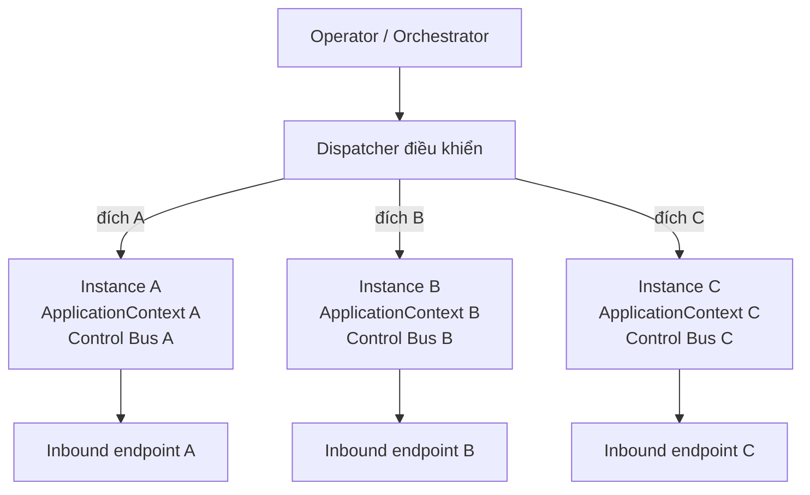
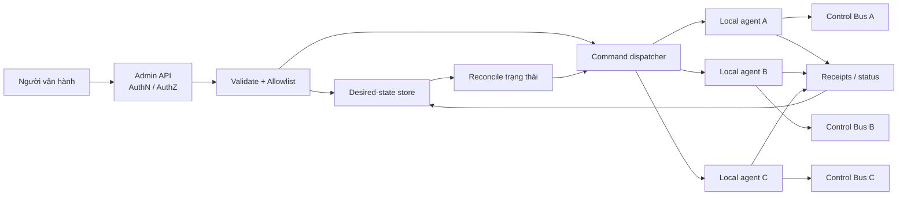
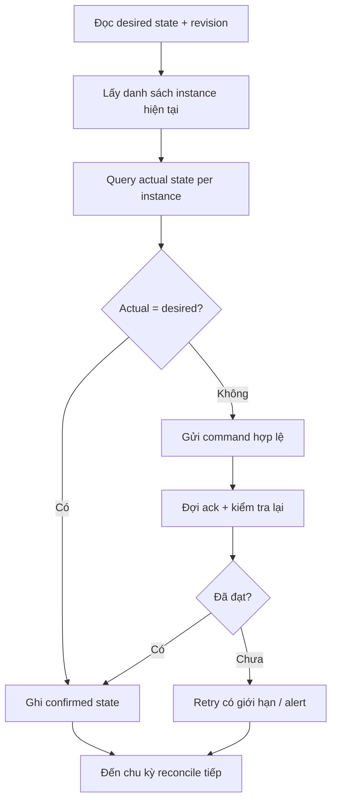

# Control bus trong vận hành nhiều instance

Trong môi trường phát triển, một ứng dụng Spring Integration thường chỉ chạy một tiến trình. Khi muốn tạm dừng inbound adapter hoặc khởi động lại một endpoint có thể quản lý vòng đời, lập trình viên gửi lệnh đến **Control Bus** và quan sát bean được điều khiển. Nhưng trong production, một dịch vụ thường chạy trên nhiều JVM, container hoặc pod. Một lệnh được xử lý bởi **một** instance không có nghĩa tất cả instance còn lại cũng thay đổi trạng thái.

Bài thuộc chương **Control bus** của module **SPRING_INTEGRATION_PATTERN**. Mục tiêu của module là học triển khai Enterprise Integration Patterns với Spring Integration, xây dựng luồng thông điệp ít phụ thuộc và dễ mở rộng; thực hành Router, Filter, Transformer, Splitter, Aggregator, Gateway, retry, error channel, correlation và khả năng kiểm thử, theo dõi nhánh xử lý. Ở đây, chúng ta tập trung đưa Control Bus vào vận hành đa instance mà vẫn đảm bảo tính đúng đắn của luồng nghiệp vụ.

**Sau bài học, bạn có thể:**

- Giải thích vì sao Control Bus có phạm vi **ApplicationContext/instance**, không mặc định là control plane phân tán.
- Phân biệt lệnh áp dụng cho một replica, một tập replica và toàn deployment; chọn cách định tuyến/ack phù hợp.
- Dùng Control Bus để điều khiển một endpoint có hỗ trợ `Lifecycle`, không mở quyền chạy SpEL tùy ý ra bên ngoài.
- Thiết kế định danh instance, command ID, TTL, idempotency, xác nhận trạng thái và cơ chế đối soát sau restart/scale.
- Phân biệt “đã nhận lệnh”, “bean đã dừng nhận việc mới” và “đã xử lý xong toàn bộ việc đang chạy”.
- Tạo checklist vận hành, metrics, logs, trace và test cho retry, rolling deployment, lệch trạng thái và lỗi điều khiển.

## 1. Từ Control Bus một instance đến cụm nhiều instance

**Control Bus** là một Enterprise Integration Pattern cho phép gửi thông điệp điều khiển đến các thành phần của hệ thống tích hợp. Trong Spring Integration, Control Bus hỗ trợ biểu thức điều khiển, thường dùng để gọi thao tác quản lý lên các bean được cho phép trong `ApplicationContext`, chẳng hạn các phương thức `start()`, `stop()` hoặc `isRunning()` của một bean có hỗ trợ vòng đời.

Ví dụ một payload lệnh điều khiển trong bối cảnh tin cậy:

```text
@ordersInboundEndpoint.stop()
```

Biểu thức này nhằm tác động tới bean tên `ordersInboundEndpoint` **trong context đã nhận và thực thi lệnh**. Tên bean và phương thức phải thật sự tồn tại, phù hợp với phiên bản framework và cơ chế điều khiển đang cấu hình; không phải mọi handler đều có thể dừng/khởi động bằng cách này.

Giả sử deployment có ba instance độc lập:



Nếu lệnh chỉ đến `Control Bus A` thì chỉ bean thuộc `ApplicationContext A` bị tác động. B và C vẫn có thể poll dữ liệu, consume message, hoặc chạy các endpoint tương ứng.

**Không có cơ chế broadcast cụm được bảo đảm chỉ nhờ khai báo một Control Bus trong từng replica.** Broadcast, target selection, bảo mật, giao nhận, idempotency và đối soát trạng thái phải được thiết kế ở lớp điều phối hoặc cơ sở hạ tầng phù hợp.

### Câu hỏi quan trọng trước khi gửi lệnh

Một yêu cầu vận hành như “dừng nhận đơn hàng” cần được cụ thể hóa:

- Dừng **một adapter trên một pod** để điều tra?
- Dừng **mọi replica** của một deployment?
- Dừng **một vai trò** như worker poller mà vẫn để API Gateway nhận request?
- Dừng nhận việc mới hay chờ xử lý xong các việc đang chạy (**drain**)?
- Dừng tạm thời đến một thời điểm, hay giữ trạng thái mong muốn qua restart?
- Trường hợp một replica không phản hồi thì coi toàn thao tác là thành công, một phần hay thất bại?

Không có một câu trả lời duy nhất. Thiết kế phải dựa trên tính chất của nguồn message, topology và yêu cầu nghiệp vụ.

## 2. Control Bus nằm ở đâu trong kiến trúc đa instance?

Một thiết kế có thể chia thành **data plane** và **control plane**:

| Mặt phẳng | Thành phần | Trách nhiệm |
| --- | --- | --- |
| Data plane | Gateway, Filter, Router, Transformer, Splitter, Aggregator, Service Activator | Xử lý message nghiệp vụ |
| Data plane | Queue, broker, inbound/outbound adapter | Giao nhận, truyền message theo hợp đồng nghiệp vụ |
| Control plane | Admin API, operator hoặc scheduler | Xác thực người ra lệnh, quyết định scope |
| Control plane | Command dispatcher | Chọn instance, gửi lệnh, quản lý timeout/ack |
| Control plane | Control Bus **cục bộ** | Thực thi thao tác hợp lệ trên bean của instance |
| Control plane | Registry/desired-state store | Biết replica nào tồn tại, trạng thái mong muốn và phiên bản |
| Observability | Log, metrics, traces, audit | Chứng minh lệnh được áp dụng và ảnh hưởng của nó |

Control plane không nên dựa vào việc một consumer đọc text log để quyết định gửi lệnh tiếp theo. Cần kênh giao tiếp rõ ràng: API quản trị có xác thực, message broker với routing phù hợp hoặc controller/operator đã được thiết kế để điều phối.

Một sơ đồ điển hình:



Sơ đồ là **kiến trúc đề xuất**, không phải các thành phần Spring Integration tự động tạo. Với hệ thống nhỏ, admin API có thể gọi endpoint quản trị trên từng pod thay vì có một dispatcher độc lập; điều quan trọng là biết rõ đối tượng được điều khiển và kết quả thực tế.

## 3. Chọn target: một instance, nhiều instance hay toàn cụm

| Phạm vi lệnh | Ví dụ | Đặc điểm |
| --- | --- | --- |
| `INSTANCE` | Tạm dừng poller trên replica A để phân tích lỗi | Cần định danh đích chính xác, tránh replica khác thực thi |
| `ROLE` | Tạm dừng các replica có vai trò `import-worker` | Cần registry hoặc selector có kiểm soát |
| `DEPLOYMENT` | Tạm ngừng nhập dữ liệu ở toàn bộ bản phát hành | Cần giải quyết replica mới hoặc pod vừa restart |
| `LEADER_ONLY` | Chỉ kích hoạt adapter trên leader | Cần leader election/lease và cơ chế chống stale leader |
| `CANARY` | Chỉ pause/resume một pod trước khi mở rộng thao tác | Giảm blast radius, có thể kiểm thử tác động |

Định danh instance nên là giá trị ổn định trong **vòng đời tiến trình** và đủ phân biệt giữa các replica đang chạy. Trong môi trường container, có thể sử dụng ID do orchestration layer cung cấp cộng với deployment/version. Đừng coi một tên host thủ công là định danh tồn tại vĩnh viễn: scale hoặc rolling update có thể tạo pod mới với ID khác.

### Hãy nhận diện các lỗi routing thường gặp

**Load-balanced HTTP admin endpoint:** nếu gửi `POST /admin/pause` tới một Service/Load Balancer chung, request có thể chỉ đến **một** pod. Gọi một lần rồi khẳng định “đã pause cả deployment” là sai.

**Broker queue chia consumer group:** nếu ba replica cùng consume một queue, một command có thể được một consumer nhận; đây là **work sharing**, không phải broadcast đến ba instance.

**Publish/subscribe:** có thể broadcast cho những subscriber đang kết nối nếu topology đúng, nhưng broadcast đơn thuần không bảo đảm mọi replica đã xử lý thành công hoặc pod mới sau đó sẽ biết trạng thái mong muốn.

**Per-instance routing:** gửi trực tiếp đến endpoint/admin address hay queue riêng của instance giúp chọn đích, nhưng cần xử lý sự thay đổi của địa chỉ, replica mất kết nối và command hết hạn.

Với thao tác trên toàn deployment, thường cần lưu **desired state** và dùng một vòng reconcile. Mỗi instance hiện tại và instance mới sẽ đối chiếu trạng thái mong muốn với trạng thái thực của endpoint.

## 4. Mẫu command có cấu trúc, không truyền SpEL từ người dùng

Một yêu cầu quản trị từ bên ngoài nên là lệnh **có schema và tập action giới hạn**:

```json
{
  "commandId": "b7e8a2fa-0ed5-4b4a-8977-8caa15b0c628",
  "scope": "INSTANCE",
  "targetInstance": "orders-worker-a",
  "action": "PAUSE_INGEST",
  "endpoint": "ordersInboundEndpoint",
  "requestedBy": "ops-automation",
  "reasonCode": "PLANNED_MAINTENANCE",
  "expectedRevision": 41,
  "expiresAt": "2026-11-21T10:15:00Z"
}
```

Các trường này **do ứng dụng điều khiển tự định nghĩa**, không phải schema mặc định của Spring Integration. Đặc biệt:

- `commandId`: dùng dedupe và liên kết log/ack.
- `scope` và `targetInstance`: ngăn replica không liên quan xử lý.
- `action`: dùng enum như `PAUSE_INGEST`, `RESUME_INGEST`, `GET_STATUS`.
- `endpoint`: nếu cho phép chọn endpoint, chỉ nhận những tên thuộc allowlist.
- `expectedRevision`: giúp từ chối lệnh cũ khi trạng thái đã đổi.
- `expiresAt`: ngăn một lệnh pause trễ được thực thi sau khi sự cố đã kết thúc.
- `requestedBy` và `reasonCode`: phục vụ kiểm tra quyền, truy vết và audit, không nên chứa token hoặc dữ liệu nhạy cảm.

**Không cho phép client cung cấp trực tiếp** payload dạng `"@anyBean.anyMethod()"`, và không nối chuỗi từ `action`/`endpoint` chưa xác thực thành SpEL. Control Bus có khả năng thực thi biểu thức; nếu một kênh nhận expression tùy ý bị lộ ra mạng, đây có thể là lỗ hổng điều khiển hoặc thực thi hành vi ngoài ý muốn.

## 5. Ví dụ Java DSL: Control Bus cục bộ trên từng instance

Ví dụ tối giản (Java 17+, Spring Integration Java DSL) khai báo **một channel riêng trong mỗi ApplicationContext**:

```java
import org.springframework.context.annotation.Bean;
import org.springframework.context.annotation.Configuration;
import org.springframework.integration.channel.DirectChannel;
import org.springframework.integration.dsl.IntegrationFlow;
import org.springframework.messaging.MessageChannel;

@Configuration
class LocalControlBusConfig {

    @Bean
    MessageChannel localControlInput() {
        return new DirectChannel();
    }

    @Bean
    IntegrationFlow localControlBusFlow() {
        return IntegrationFlow.from("localControlInput")
                .controlBus()
                .get();
    }
}
```

Khi flow được nạp trong ba JVM, có **ba** channel `localControlInput` và **ba** Control Bus độc lập. Không có phép biến đổi tự động khiến một message gửi vào A xuất hiện ở B hoặc C.

Để thao tác thực tế, giả định có một bean tên `ordersInboundEndpoint` implement `org.springframework.context.Lifecycle` (hoặc `SmartLifecycle`) và có thể stop/start. Tên bean này phải được khai báo/đặt chính xác bởi ứng dụng hoặc endpoint trong flow; **không** suy rằng mọi input channel đều có method `stop()`.

Ví dụ một service chỉ nhận thao tác nội bộ đã được duyệt:

```java
import org.springframework.beans.factory.annotation.Qualifier;
import org.springframework.context.Lifecycle;
import org.springframework.messaging.MessageChannel;
import org.springframework.messaging.support.GenericMessage;
import org.springframework.stereotype.Service;

@Service
class LocalIngestControl {

    private final MessageChannel localControlInput;
    private final Lifecycle ordersInboundEndpoint;

    LocalIngestControl(
            @Qualifier("localControlInput") MessageChannel control,
            @Qualifier("ordersInboundEndpoint") Lifecycle endpoint) {
        this.localControlInput = control;
        this.ordersInboundEndpoint = endpoint;
    }

    boolean pause() {
        // Lệnh là hằng số do ứng dụng định nghĩa, không phải user input.
        boolean sent = localControlInput.send(
                new GenericMessage<>("@ordersInboundEndpoint.stop()"));
        return sent && !ordersInboundEndpoint.isRunning();
    }

    boolean resume() {
        boolean sent = localControlInput.send(
                new GenericMessage<>("@ordersInboundEndpoint.start()"));
        return sent && ordersInboundEndpoint.isRunning();
    }

    boolean isRunning() {
        return ordersInboundEndpoint.isRunning();
    }
}
```

**Điều kiện dùng ví dụ:**

1. Bean `ordersInboundEndpoint` phải thật sự có trong cùng `ApplicationContext`, hỗ trợ `Lifecycle` và cho phép gọi theo chính sách bảo mật của Control Bus.
2. `DirectChannel` xử lý đồng bộ trên thread gửi trong ví dụ. Với channel khác, thời điểm lệnh được thực thi và xác nhận có thể khác.
3. Kết quả boolean ở đây chỉ là **kiểm tra trạng thái bean tại thời điểm đọc**, không chứng minh queue đã trống, mọi message đang xử lý đã hoàn tất hoặc toàn cụm đã áp dụng.
4. Đây là **local service**. Admin API thực tế phải xác thực, kiểm quyền, kiểm tra target/revision/TTL, ghi audit rồi mới gọi `pause()` hoặc `resume()`.
5. Nếu Control Bus không thể thao tác bean/endpoint được chọn trong phiên bản đang sử dụng, hãy cấu hình bean `Lifecycle` phù hợp hoặc một thành phần quản lý riêng; đừng giả định thay tên bean sẽ giải quyết được.

Không đưa `localControlInput` vào Gateway công khai cho phép payload tự do. Mục đích là tạo **adapter kiểu dữ liệu chặt** nằm giữa admin command và cơ chế biểu thức cục bộ.

### Vì sao không gọi stop trực tiếp cho mọi trường hợp?

Nếu ứng dụng chỉ có hai thao tác quản trị và đã có tham chiếu `Lifecycle`, một service được phân quyền gọi trực tiếp `start()/stop()` cũng có thể phù hợp. Control Bus hữu ích khi cần tích hợp quản lý các endpoint thông qua message flow và cơ chế điều khiển Spring Integration, nhưng **không phải điều kiện bắt buộc** để có kiến trúc đa instance an toàn.

## 6. Điều phối lệnh: gửi, xác nhận và kiểm chứng kết quả

Cần phân biệt nhiều mức thành công:

| Mức | Diễn giải | Có bảo đảm “đã ngừng nhận mọi message” không? |
| --- | --- | --- |
| `REQUESTED` | Operator/API đã nhận yêu cầu | Không |
| `ACCEPTED` | Lệnh hợp lệ và được đưa vào tuyến xử lý | Không |
| `DELIVERED` | Đã giao cho agent/instance đích theo hợp đồng transport | Không |
| `APPLIED` | Control Bus đã gọi thao tác, bean báo trạng thái phù hợp | Chưa chắc |
| `QUIESCED` | Instance không còn nhận việc mới theo điều kiện đã định | Phụ thuộc endpoint |
| `DRAINED` | In-flight work đã hoàn tất hoặc được xử lý theo chính sách | Chỉ khi có kiểm tra riêng |
| `CONFIRMED` | Reconcile xác minh các mục tiêu đạt trạng thái mong muốn | Theo scope và ngưỡng đã định |
| `FAILED/EXPIRED` | Thất bại, hết hạn hoặc không đạt trong timeout | Không |

Với một lệnh `PAUSE_INGEST`, dispatcher không nên trả `"deployment paused"` ngay sau khi publish message vào broker. Phải quyết định thế nào là thành công: cả 3/3 replica xác nhận, hay chỉ một nhóm mục tiêu; có cho phép instance đang offline không; trạng thái cần duy trì bao lâu.

Ví dụ receipt do ứng dụng định nghĩa:

```json
{
  "commandId": "b7e8a2fa-0ed5-4b4a-8977-8caa15b0c628",
  "instanceId": "orders-worker-a",
  "state": "APPLIED",
  "observedRunning": false,
  "revision": 42,
  "observedAt": "2026-11-21T10:14:02Z"
}
```

Một receipt `APPLIED` không chứng minh adapter của B/C đã dừng. Cần tổng hợp theo **danh sách target được chốt cho thao tác** và xử lý kết quả một phần:

```text
Deployment pause command: cmd-73
Targets: A, B, C
A: APPLIED, running=false
B: APPLIED, running=false
C: TIMED_OUT, status=unknown
Overall: PARTIAL (không trả SUCCESS)
```

Khi một instance không phản hồi, phải kiểm tra registry, sức khỏe instance, timeout và khả năng command được thực thi nhưng ack bị mất. Retries chỉ nên chạy với command có semantics được thiết kế idempotent.

## 7. Idempotency, thứ tự lệnh và tránh thực thi lệnh cũ

Mạng có thể gửi lặp, consumer restart, dispatcher retry khi mất ack và event bị trễ. Với control plane, tình huống nguy hiểm là:

```text
10:00:00  PAUSE được phát
10:00:03  RESUME được phát, đã áp dụng
10:00:06  Bản sao PAUSE cũ đến trễ
10:00:07  Replica lại dừng ingest dù operator đã resume
```

Đừng dựa duy nhất vào thứ tự log hoặc timestamp của máy gửi. Một chiến lược là lưu **desired state** với revision tăng dần và để instance chỉ áp dụng revision hợp lệ:

```text
revision=41 desired=PAUSED
revision=42 desired=RUNNING  <- trạng thái mới
replica thấy command revision=41 sau khi đã áp dụng 42
=> từ chối STALE_COMMAND
```

Các biện pháp bổ sung:

- **`commandId` để dedupe:** một lệnh được nhận lại không tạo thêm thao tác side effect ngoài ý muốn.
- **`expiresAt`/TTL:** lệnh cũ hết hạn không còn được thực thi.
- **Expected revision / compare-and-set:** tránh ghi đè trạng thái mới bằng lệnh cũ.
- **Idempotent action:** `PAUSE_INGEST` khi đã pause thường nên trả kết quả “đã ở trạng thái mong muốn”, không báo lỗi và phát lệnh khác.
- **Lưu dedupe phù hợp:** nếu chỉ giữ `commandId` trong RAM, restart có thể xóa lịch sử; cần cân nhắc store bền vững theo mức rủi ro.
- **Fencing/lease:** với tài nguyên chỉ một chủ sở hữu, bản thân một lệnh pause không đủ ngăn stale leader tiếp tục xử lý.

Control Bus gọi `start()` hoặc `stop()` không tạo transaction phân tán. Không có bảo đảm all-or-nothing khi áp dụng lần lượt cho nhiều replica. Nếu mục tiêu yêu cầu mức nhất quán cao, cần thiết kế điều phối, xác nhận và cơ chế phục hồi tương ứng.

## 8. Đối soát trạng thái sau restart, scale và rolling update

Vận hành trên Kubernetes, Docker Swarm hoặc một nền tảng orchestration thường có thay đổi thành viên cụm:

- Pod A bị restart sau khi đã pause.
- Deployment từ 3 replica scale lên 5.
- Rolling update tạo instance mới có cấu hình/bean name khác.
- Instance cũ mất kết nối nhưng vẫn tiếp tục chạy một thời gian.
- Một node không nhận được broadcast do mạng phân vùng.

Nếu trạng thái pause chỉ tồn tại **trong RAM của process**, bean mới có thể tự start khi ứng dụng khởi động. Do đó, broadcast `PAUSE` một lần không đủ để tạo **trạng thái mong muốn bền vững**.

Một vòng reconcile đơn giản:



Cần thiết kế **revision** và quan hệ giữa desired state và lifecycle: instance vừa tạo phải biết mình nên start hay pause trước khi bắt đầu nhận traffic/consume. Không thể trông chờ nó đã nghe được một command phát trước lúc nó xuất hiện.

Trong rolling deployment, thao tác điều khiển nên tách rõ **đối tượng mong muốn** (deployment/role) với **định danh instance hiện thời**. Nếu deployment được thay mới, dispatcher phải áp dụng policy tới tập replica phù hợp, không chỉ đến danh sách pod cũ.

## 9. Pause, stop, drain và readiness không đồng nghĩa

Một nút “Pause consumers” trên dashboard có thể che đi nhiều ngữ nghĩa:

| Thao tác | Mục tiêu | Điều không nên giả định |
| --- | --- | --- |
| Stop một inbound adapter/poller | Ngừng khởi tạo lượt nhận mới tại endpoint | Không tự động dừng tất cả handler đang chạy |
| Pause nhận traffic trên load balancer | Không nhận HTTP request mới qua route đó | Không bảo đảm worker/broker consumer đã dừng |
| Drain | Chờ in-flight jobs hoàn tất hoặc chuyển xử lý an toàn | Không phải mọi endpoint có sẵn lệnh drain |
| Stop cả ApplicationContext/pod | Dừng vòng đời ứng dụng | Không thay thế commit/ack và bảo vệ dữ liệu khi shutdown |
| Đổi readiness sang không sẵn sàng | Tránh nhận một số traffic mới từ router/LB | Không nhất thiết ngừng polling hay message broker consumption |
| Đổi desired state thành PAUSED | Duy trì ý định vận hành qua restart/scale | Cần reconcile thực tế để áp dụng |

Ví dụ một inbound poller dừng lịch poll mới nhưng có thể vẫn còn message trong handler hoặc queue. Với message broker, pause/stop consumer phụ thuộc client, ack mode, prefetch và rebalancing. Hãy kiểm chứng hành vi adapter cụ thể và triển khai chiến lược drain riêng khi cần.

### Runbook tạm dừng một nhóm worker

1. Xác định scope: instance hay role; không dùng địa chỉ Service có load balancing nếu cần target chính xác.
2. Kiểm tra tình trạng hiện tại: instance, revision, `isRunning()`, in-flight count, backlog, retry và lỗi.
3. Gửi command `PAUSE_INGEST` được xác thực, có TTL và command ID.
4. Nhận ack từng instance; kiểm tra trạng thái endpoint và việc không nhận message mới theo đúng chính sách.
5. Nếu phải drain, theo dõi in-flight và message còn chưa ack; chờ đến ngưỡng/timeout đã định hoặc thực hiện recovery theo quy trình.
6. Duy trì trạng thái mong muốn trong registry nếu pause phải sống qua restart.
7. Sau bảo trì, gửi `RESUME_INGEST` revision mới; xác nhận đúng target đã start, backlog giảm, tỷ lệ lỗi và độ trễ trở về bình thường.

Đừng đặt `isRunning()==false` làm bằng chứng duy nhất rằng một yêu cầu nghiệp vụ đã hoàn thành. Đây chỉ là tín hiệu trạng thái vòng đời của bean.

## 10. Leader-only poller và nguy cơ xử lý trùng

Một số nguồn dữ liệu chỉ nên có **một** poller chủ động trong toàn cụm: ví dụ một nguồn file/legacy API không hỗ trợ chia việc an toàn. Nếu ba instance đều start poller, có thể xảy ra xử lý trùng.

Một thiết kế đơn giản như “operator gửi Control Bus dừng poller trên hai replica còn lại” **không đủ bền vững**:

- Replica restart có thể tự bật poller.
- Một replica không nhận lệnh stop.
- Leader cũ mất lease nhưng chưa kịp dừng vẫn xử lý.
- Hai controller có thể cùng nghĩ rằng mình đang điều khiển tập worker.

Khi yêu cầu “chỉ một instance active”, cần phối hợp với **leader election/distributed lock/lease** hoặc cơ chế phân công nhiệm vụ của broker. Một lease chỉ đáng tin khi được kiểm tra/renew phù hợp; với tác vụ có side effect quan trọng, cân nhắc **fencing token** hoặc kiểm tra quyền sở hữu tại tài nguyên đích.

Control Bus có thể là **công cụ thực thi thay đổi cục bộ** (start/stop endpoint) khi leadership đổi, nhưng không tự cung cấp distributed lock, leader election hay exactly-once processing.

### Phân biệt với nguồn hỗ trợ scale ngang

Nếu ba replica cùng consume từ một broker có consumer group và phân vùng phù hợp, chúng có thể được thiết kế để cùng hoạt động; việc dừng hai replica có thể **giảm throughput và tăng backlog** mà không giúp tăng tính đúng đắn. Phải xác định tính chất nguồn inbound trước khi áp dụng chiến lược leader-only.

## 11. Bảo mật Control Bus trong môi trường nhiều instance

Control Bus sử dụng biểu thức điều khiển có thể truy cập bean/method trong application context. Bởi vậy, exposed channel, admin API hoặc broker topic điều khiển cần được xem là **bề mặt đặc quyền cao**.

Nguyên tắc phòng thủ:

1. **Không nhận SpEL tự do** qua HTTP public, WebSocket public hoặc queue mà nhiều hệ thống có thể publish.
2. **Allowlist action và target:** chuyển `PAUSE_INGEST` thành một lệnh hằng do ứng dụng kiểm soát; không nối chuỗi method/bean name từ input.
3. **Xác thực và phân quyền:** operator, automation và service account có quyền khác nhau; thao tác trên production nên được giới hạn và có audit.
4. **Scope nhỏ:** lệnh pause một replica không tự được nâng lên pause toàn cụm. Với thao tác có ảnh hưởng lớn, cân nhắc phê duyệt hai bước hoặc progressive rollout.
5. **Bảo vệ kênh truyền:** TLS/mTLS hoặc cơ chế tương đương; phân quyền publish/consume ở broker, tránh lộ topic cho consumer nghiệp vụ.
6. **TTL, revision, nonce/command ID:** chống replay và thực thi lệnh không còn phù hợp.
7. **Audit có cấu trúc:** ghi ai yêu cầu, action, scope, targets, thời gian, revision, kết quả; không ghi credential hay expression tùy ý.
8. **Network isolation:** chỉ cho phép control agent/controller truy cập endpoint điều khiển.
9. **Giới hạn tốc độ:** chống lặp pause/resume dày gây flapping; áp dụng ở control plane, không nhầm với rate limiting message nghiệp vụ.
10. **Kiểm thử negative cases:** target không tồn tại, action không hợp lệ, account thiếu quyền, command hết hạn và lệnh cũ.

Ngay cả trong mạng nội bộ, một bearer token hoặc quyền publish bị lộ có thể ảnh hưởng tất cả replica nếu kênh điều khiển không được bảo vệ. Cấu hình Control Bus đúng về mặt cú pháp chưa đồng nghĩa an toàn để đưa thẳng ra mạng.

## 12. Correlation, logging, metrics và audit cho control plane

Các sự kiện điều khiển cần phân biệt với message nghiệp vụ. Ví dụ structured log:

```json
{
  "event": "control.command_applied",
  "service": "orders-worker",
  "instanceId": "orders-worker-a",
  "commandId": "b7e8a2fa-0ed5-4b4a-8977-8caa15b0c628",
  "action": "PAUSE_INGEST",
  "endpoint": "ordersInboundEndpoint",
  "revision": 42,
  "observedRunning": false,
  "outcome": "APPLIED",
  "durationMs": 18
}
```

Đây là schema minh họa do ứng dụng định nghĩa. Trong vận hành, cần theo dõi cả:

| Tín hiệu | Ví dụ | Mục đích |
| --- | --- | --- |
| Structured log | `control.command_received`, `control.command_applied`, `control.command_failed` | Điều tra command cụ thể theo command ID |
| Metric counter | `control_commands_total{action="PAUSE_INGEST",outcome="applied"}` | Tổng hợp thành công/thất bại theo action |
| Metric timer | `control_command_duration` | Thời gian áp dụng/đợi xác nhận |
| Gauge | Số instance đang ở trạng thái mong muốn, số instance lệch | Phát hiện drift |
| Metric ứng dụng | Backlog, in-flight, handled/s, failed/s | Kiểm chứng ảnh hưởng tới data plane |
| Trace | Span dispatch, local apply và verify (nếu được instrument) | Xác định command chậm ở đoạn nào |
| Audit bền vững | RequestedBy, command ID, scope, revision, kết quả | Truy vết thay đổi vận hành quan trọng |

**Không dùng `instanceId` hoặc `commandId` làm metric label bừa bãi** trong hệ thống có replica/autoscaling lớn: cardinality có thể tăng rất cao. Giữ các ID chi tiết trong log/audit, dùng label metric có tập giá trị hữu hạn như `action`, `outcome`, `serviceRole`.

Không coi số dòng log “command applied” là tổng số replica đã dừng. Một command có thể bị retry, log mất, hoặc bean thay đổi trạng thái sau khi ghi. Dashboard tổng hợp trạng thái phải dựa trên registry/kiểm chứng hiện tại.

### Phân biệt request correlation với control command ID

`requestCorrelationId` của luồng đơn hàng giúp tra một nghiệp vụ; `commandId` của control plane giúp tra một thay đổi vận hành. Một lệnh pause có thể ảnh hưởng hàng nghìn request khác nhau. Đừng gắn chung một requestCorrelationId giả cho tất cả message để biểu thị việc đang bảo trì; điều đó làm mất ý nghĩa truy vết nghiệp vụ.

## 13. Rủi ro khi dispatcher hoặc registry không sẵn sàng

Điều khiển từ xa cần có chính sách cho từng kiểu lỗi:

- **Dispatcher mất kết nối:** command chưa được giao phải được lưu/chờ hoặc trả lỗi có thể retry theo thời hạn; không báo thành công giả.
- **Replica offline:** lưu desired state và áp dụng khi replica trở lại (nếu lệnh vẫn phù hợp), hoặc chờ operator quyết định.
- **Ack bị mất:** command có thể đã được thực thi; tránh gửi một thao tác không idempotent mà không kiểm tra command ID/trạng thái thực.
- **Registry stale:** một instance đã bị thay mới; cần tái khám phá thành viên và so revision.
- **Mạng phân vùng:** có thể không xác minh được toàn cụm; báo trạng thái partial/unknown, không suy từ số node kết nối.
- **Controller restart:** việc điều phối phải có thể tiếp tục từ trạng thái bền vững hoặc chấp nhận làm lại bằng idempotency.
- **Deployment version khác nhau:** cùng action có thể không có bean tên giống nhau; dùng capability/version check và deny với instance không hỗ trợ.
- **Control channel bị nghẽn:** giám sát queue, timeout, latency, không cho lệnh điều khiển vô hạn chiếm tài nguyên của data plane.

Với tác vụ có yêu cầu availability cao, cần xác định rõ **fail-open** hay **fail-closed** nếu không lấy được desired state. Ví dụ tiếp tục ingest khi registry không đọc được có thể tốt cho thông lượng nhưng trái lệnh tạm dừng khẩn; tự động pause có thể an toàn hơn cho dữ liệu nhưng gây downtime. Đây là quyết định chính sách, không phải hành vi mặc định của Control Bus.

## 14. Kiểm thử đa instance và tính đúng đắn vận hành

Đừng chỉ kiểm tra rằng Java gọi `stop()` đúng trên một bean. Cần một test plan bao gồm topology thật hoặc mô phỏng nhiều instance độc lập.

| Tình huống | Cách thử | Kết quả cần xác minh |
| --- | --- | --- |
| Local instance | Gửi lệnh vào Control Bus A | Bean ở A thay đổi, B/C không tự đổi |
| Sai target | Gửi command target=B đến agent A | A từ chối, không thực thi biểu thức |
| Broadcast | Yêu cầu pause A+B+C | Nhận đủ ack theo scope, không chỉ thấy một log thành công |
| Load balancer | Gọi một HTTP Service chung | Không giả định một request đã chạm mọi replica |
| Shared queue | Publish một command vào queue chia consumer | Hiểu nó đến một consumer, không phải broadcast |
| Duplicate command | Gửi hai lần cùng command ID | Chỉ áp dụng side effect theo chính sách idempotency |
| Stale command | Gửi revision 41 sau khi đã áp dụng 42 | Từ chối lệnh cũ |
| TTL quá hạn | Giao command sau `expiresAt` | Không thực thi lệnh đã hết hạn |
| Ack loss | Thực thi xong nhưng giả lập mất receipt | Reconcile/đối soát đúng, không kết luận thất bại nghiệp vụ mù quáng |
| Restart pod | Restart replica đang PAUSED | Desired state được áp dụng lại, không bật ingest trái ý định |
| Scale out | Tạo instance D sau broadcast pause | D đọc policy mong muốn trước khi nhận việc |
| Rolling update | Thay bean/version | Kiểm tra capability và phát hiện command không tương thích |
| Pause khi có in-flight | Gửi lệnh lúc đang xử lý message | Phân biệt endpoint stopped với drain completed |
| Leader mất lease | Để stale leader chưa nhận STOP | Fencing/ownership ngăn side effect trùng |
| Không đủ quyền | Gửi lệnh từ actor không có quyền | Bị từ chối, có audit, không lộ SpEL |
| Control plane offline | Chặn dispatcher hoặc registry | Trả trạng thái rõ, có phục hồi và cảnh báo |
| Log/audit thiếu | Drop log chẩn đoán | Trạng thái control vẫn kiểm chứng độc lập với log |

### Unit test cho local Lifecycle giả

Ví dụ lớp stub có thể giúp kiểm tra ngữ nghĩa stop/start mà không cần kết nối broker:

```java
import java.util.concurrent.atomic.AtomicBoolean;
import org.springframework.context.Lifecycle;

class FakeInboundEndpoint implements Lifecycle {
    private final AtomicBoolean running = new AtomicBoolean(true);

    @Override
    public void start() {
        running.set(true);
    }

    @Override
    public void stop() {
        running.set(false);
    }

    @Override
    public boolean isRunning() {
        return running.get();
    }
}
```

Khi viết integration test, cần đăng ký stub dưới đúng tên bean `ordersInboundEndpoint`, cấu hình `localControlInput`/`localControlBusFlow` và gọi hai thao tác `pause()/resume()` để đọc lại trạng thái. Bài test đó chỉ xác nhận Control Bus và bean ở một `ApplicationContext`. Để kiểm tra phân tán, phải chạy **ít nhất hai context/instance** với lớp dispatcher thực tế hoặc fake transport đủ mô phỏng routing, duplicate, restart và timeout.

## 15. Bài thực hành: bảo trì cụm ba worker

**Bối cảnh:** dịch vụ `orders-ingest` có ba replica `A`, `B`, `C`; mỗi replica có inbound adapter cùng tên logic `ordersInboundEndpoint`. Luồng vào qua Filter, Router, Transformer, Splitter, Aggregator rồi gửi ra Gateway đến dịch vụ khác. Người vận hành cần tạm dừng ingest để đổi schema upstream, nhưng vẫn cho các message in-flight xử lý xong.

### Các bước thực hiện

1. Vẽ sơ đồ ba instance và chỉ rõ ba `ApplicationContext` khác nhau. Xác định Control Bus, channel quản trị nội bộ và endpoint được phép dừng ở mỗi context.
2. Định nghĩa command `PAUSE_INGEST` với command ID, scope `DEPLOYMENT`, revision, TTL, requestedBy và reasonCode. Không chấp nhận SpEL tự do từ người gửi.
3. Tạo admin dispatcher xác thực actor, lấy danh sách target A/B/C và gửi đến **đúng mỗi replica**. Tránh gửi một lệnh vào một queue chia consumer nếu mong cả ba xử lý.
4. Mỗi replica dùng local `LocalIngestControl` để gọi Control Bus với biểu thức hằng cho bean đã được allowlist. Trả receipt `APPLIED` cùng trạng thái `isRunning()`.
5. Tổng hợp kết quả: nếu A/B thành công nhưng C timeout, hiển thị `PARTIAL`; không báo “toàn cụm đã pause”.
6. Kiểm tra in-flight messages, backlog và số message chưa ack. Chỉ tuyên bố `DRAINED` sau khi đạt điều kiện drain được định nghĩa riêng, không chỉ vì `isRunning()==false`.
7. Restart C và thêm replica D trong thời gian bảo trì. Kiểm tra việc đọc desired state khiến C/D không tự ingest trái policy.
8. Sau khi upstream sẵn sàng, phát `RESUME_INGEST` với revision mới. Xác nhận trạng thái từng target, đo throughput, retry, timeout và lỗi của Gateway.
9. Thử lại một command PAUSE cũ sau RESUME; nó phải bị từ chối như `STALE_COMMAND`.
10. Kiểm tra audit/log/metric theo `commandId` và `instanceId`; chứng minh người không đủ quyền không thể điều khiển bean hoặc gửi biểu thức tùy ý.

### Tiêu chí hoàn thành

- Điều khiển A không tự động làm B/C đổi trạng thái.
- Lệnh triển khai toàn cụm có danh sách target và kết quả xác nhận được.
- Duplicate, TTL và revision không tạo trạng thái sai.
- Instance mới/restart tuân theo desired state.
- Có phân biệt `APPLIED`, `QUIESCED` và `DRAINED`.
- Không có đường public đưa SpEL tùy ý vào Control Bus.
- Luồng xử lý EIP tiếp tục đúng theo chính sách error channel, retry và correlation; log chỉ phục vụ quan sát.

### Câu hỏi tự kiểm tra

1. Vì sao gửi một lệnh `@ordersInboundEndpoint.stop()` vào Control Bus A không dừng endpoint trên B và C?
2. Tại sao gửi một command vào queue có ba consumer không tương đương broadcast?
3. `isRunning()==false` chứng minh điều gì và không chứng minh điều gì?
4. Vì sao lệnh `PAUSE_INGEST` cần command ID, revision, TTL và expected target?
5. Vì sao instance mới sau autoscale có thể phá trạng thái pause nếu không có desired-state reconciliation?
6. Với leader-only poller, Control Bus thay thế distributed lock được không? Vì sao?
7. Khi ack của C bị mất sau khi C đã thực thi lệnh, dispatcher nên phản ứng thế nào?
8. Vì sao không nên cho admin API nhận trực tiếp chuỗi SpEL từ client?
9. Khi nên dùng quản trị cấp orchestrator thay vì gọi Control Bus trên từng instance?
10. Làm sao kiểm tra một thao tác pause không làm mất hoặc xử lý trùng message đang in-flight?

## 16. Tài liệu tham khảo

- [Spring Integration Reference — Control Bus](https://docs.spring.io/spring-integration/reference/control-bus.html): Control Bus, biểu thức điều khiển và quản lý endpoint.
- [Spring Integration Reference — Java DSL](https://docs.spring.io/spring-integration/reference/dsl.html): định nghĩa flow và endpoint.
- [Spring Integration Reference — Message Channels](https://docs.spring.io/spring-integration/reference/channel.html): DirectChannel, publish-subscribe và các loại channel.
- [Spring Integration Reference — Polling Consumer](https://docs.spring.io/spring-integration/reference/endpoint.html): endpoint/poller và vòng đời xử lý.
- [Spring Integration Reference — Error Handling](https://docs.spring.io/spring-integration/reference/error-handling.html): xử lý lỗi khi message processing thất bại.
- [Spring Framework — Bean lifecycle](https://docs.spring.io/spring-framework/reference/core/beans/factory-nature.html#beans-factory-lifecycle): `Lifecycle`, `SmartLifecycle` và quản lý vòng đời.
- [Kubernetes — Pod lifecycle](https://kubernetes.io/docs/concepts/workloads/pods/pod-lifecycle/): restart, lifecycle và trạng thái pod.
- [Kubernetes — Probes](https://kubernetes.io/docs/concepts/configuration/liveness-readiness-startup-probes/): readiness, liveness và startup.
- [OWASP Authorization Cheat Sheet](https://cheatsheetseries.owasp.org/cheatsheets/Authorization_Cheat_Sheet.html): phân quyền và giảm đặc quyền cho quản trị.

**Ghi nhớ:** Control Bus là cơ chế thực thi điều khiển **cục bộ** rất hữu ích, nhưng vận hành nhiều instance cần thêm một lớp điều phối có target rõ ràng, xác thực/ủy quyền, trạng thái mong muốn, xác nhận thực tế và reconcile. Đừng nhầm một lệnh đã gửi với cả cụm đã áp dụng; đừng nhầm endpoint đã stop với mọi công việc đã drain; và đừng dùng một chuỗi SpEL có thể do người ngoài kiểm soát làm giao thức quản trị.
