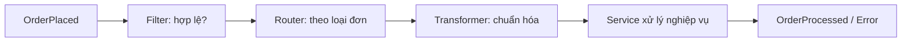
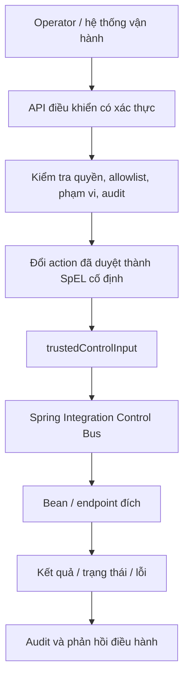
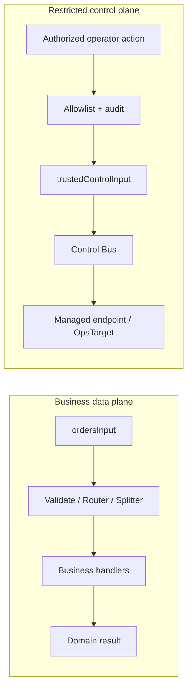

# Phân biệt control bus với business message

Trong chương **Control bus** của **SPRING_INTEGRATION_PATTERN**, một câu hỏi kiến trúc quan trọng là: **thông điệp dùng để điều khiển hệ thống khác thông điệp xử lý nghiệp vụ ở điểm nào?** Cả hai có thể được biểu diễn bằng `Message<?>`, đi qua channel và được xử lý bởi endpoint Spring Integration, nhưng chúng mang **ý định, phạm vi tác động, quyền truy cập và tiêu chí thành công hoàn toàn khác nhau**.

Khi xây dựng Enterprise Integration Patterns với Spring Integration, chúng ta thường ghép Router, Filter, Transformer, Splitter, Aggregator và Gateway để xử lý dữ liệu đơn hàng, thanh toán hoặc tồn kho. Song song, đội vận hành cần dừng một luồng nhập, tiếp tục một endpoint sau bảo trì, hoặc truy vấn trạng thái hoạt động. **Control Bus** cung cấp cách gửi lệnh điều khiển tới các thành phần trong ứng dụng qua một luồng message. Lệnh đó không phải là sự kiện nghiệp vụ và không nên đi lẫn vào tuyến xử lý đơn hàng.

> **Quy tắc nền tảng:** Business message nói về **đối tượng và sự kiện nghiệp vụ**; control message nói về **hoạt động của chính hệ thống tích hợp**. Chung một hạ tầng message không có nghĩa có thể dùng chung quyền hạn, kênh đầu vào hay quy tắc retry.

## 1. Hai loại message giải quyết hai bài toán khác nhau

### 1.1. Business message: data plane

*Business message* mang dữ liệu và yêu cầu mà hệ thống phục vụ người dùng, đối tác hoặc quy trình nghiệp vụ cần xử lý. Ví dụ:

- `OrderPlaced(orderId, items)`: một đơn hàng mới được tạo.
- `PaymentAuthorized(paymentId, amount)`: thanh toán được xác thực.
- `InventoryReserved(orderId, sku, quantity)`: hàng đã được giữ.
- `GenerateInvoice(orderId)`: yêu cầu thực hiện một tác vụ nghiệp vụ.

Các message này có thể là **event** (mô tả sự việc đã xảy ra) hoặc **command nghiệp vụ** (yêu cầu thực hiện tác vụ trong miền nghiệp vụ). Chúng thường đi qua Router, Filter, Transformer, Splitter, Aggregator, Gateway và các bộ xử lý chuyên môn.

Ví dụ luồng đơn hàng:



Kết quả thành công được đánh giá bằng bất biến nghiệp vụ: đơn hàng được ghi chính xác, không ghi trùng, số tiền khớp, hàng tồn được điều chỉnh đúng.

### 1.2. Control message: control plane

*Control message* truyền **yêu cầu quản trị hoặc điều hành luồng tích hợp**, ví dụ:

- Tạm dừng một endpoint nhận dữ liệu khi downstream quá tải.
- Khởi động lại một adapter sau khi hạ tầng bên ngoài phục hồi.
- Truy vấn trạng thái một thành phần đang chạy hay đã dừng.
- Thực hiện thao tác quản trị được cho phép trên bean/endpoint đích.

Trong Spring Integration, **Control Bus** là một pattern/endpoint dùng **SpEL (Spring Expression Language)** để xử lý lệnh điều khiển, thường có dạng biểu thức gọi phương thức trên bean:

```text
@opsTarget.pause()
@opsTarget.resume()
@opsTarget.isPaused()
```

Tên `opsTarget` và các phương thức ở đây là **bean minh họa do ứng dụng khai báo**, không phải các lệnh mặc định của Spring Integration. Trong ứng dụng thực, bean đích phải tồn tại, phương thức phải được phép gọi và tác động cần được kiểm soát.

**Điểm khác biệt:** `pause()` ở đây điều hành việc nhận dữ liệu; nó không thay đổi trực tiếp ý nghĩa của một đơn hàng. Một business command cũng có thể tên là `PauseSubscription`, nhưng nếu nó tạm dừng **gói thuê bao của khách hàng**, đó vẫn là message nghiệp vụ, không phải Control Bus.

## 2. Bảng so sánh để tránh nhầm lẫn

| Tiêu chí | Business message | Control Bus message |
| --- | --- | --- |
| Mục tiêu | Thực hiện hoặc ghi nhận hoạt động nghiệp vụ | Quản trị hành vi thành phần tích hợp |
| Đối tượng tác động | Đơn hàng, hóa đơn, thanh toán, dữ liệu domain | Adapter, endpoint, luồng xử lý, bean quản trị |
| Payload thường gặp | DTO/domain event, JSON, mã tác vụ nghiệp vụ | Biểu thức SpEL hoặc yêu cầu điều khiển đã được ánh xạ |
| Kênh điển hình | `ordersInput`, `paymentsInput`, topic nghiệp vụ | Kênh nội bộ riêng như `trustedControlInput` |
| Nguồn phát | Ứng dụng, dịch vụ, người dùng/đối tác qua API nghiệp vụ | Thành phần vận hành đã xác thực và được ủy quyền |
| Kết quả thành công | Trạng thái nghiệp vụ đúng và bền vững | Thao tác điều khiển đã được chấp nhận/thực hiện ở đúng mục tiêu |
| Bảo mật | Quyền trên tài nguyên nghiệp vụ, kiểm tra dữ liệu | Quyền quản trị cao, hạn chế biểu thức và bean có thể gọi |
| Retry | Theo hợp đồng nghiệp vụ và idempotency | Phải xét tính lặp được của thao tác điều khiển |
| Audit | Ai tác động lên dữ liệu gì, kết quả nghiệp vụ ra sao | Ai ra lệnh gì, nhắm instance/endpoint nào, trước/sau thế nào |
| Failure | Lỗi domain hoặc xử lý message | Lỗi điều khiển, endpoint không tồn tại, quyền hạn, trạng thái không hợp lệ |
| Phạm vi ảnh hưởng | Thường một đối tượng/giao dịch | Có thể ảnh hưởng hàng nghìn message hoặc toàn bộ đầu vào của một flow |
| Tính sẵn có | Theo SLA nghiệp vụ | Theo quy trình vận hành, an toàn và phục hồi |

**Không phân loại chỉ bằng kiểu payload.** Một `Message<String>` chứa JSON đơn hàng vẫn là business message; một `Message<String>` chứa `@opsTarget.pause()` trên kênh Control Bus được xem là control message. Ý nghĩa phụ thuộc **hợp đồng channel/endpoint và quyền phát message**.

## 3. Control Bus vận hành như thế nào trong Spring Integration?

Ở mức khái niệm, Control Bus là một endpoint nhận message điều khiển và đánh giá biểu thức để tương tác với bean của Spring ApplicationContext.



**Ranh giới nguy hiểm nhất** là bước chuyển từ dữ liệu bên ngoài thành biểu thức được thực thi. Nếu cho người dùng hoặc đối tác gửi SpEL tùy ý vào Control Bus, họ có thể cố gọi các phương thức không được dự định cho vận hành. Bởi vậy:

1. Không công khai thẳng channel Control Bus qua HTTP, broker hay websocket không có kiểm soát.
2. Không đưa chuỗi SpEL nguyên văn do người dùng cung cấp tới endpoint.
3. Tạo **tập hành động được phép (allowlist)** rồi ánh xạ mỗi hành động sang biểu thức cố định.
4. Kiểm tra danh tính, vai trò, tenant, môi trường và endpoint mục tiêu trước khi gửi.
5. Ghi audit cho yêu cầu, quyết định cho phép/từ chối và kết quả thực thi.
6. Hạn chế tài khoản/mạng/đường kết nối có quyền gọi Control Bus.

**Control Bus không tự thay thế cơ chế xác thực hoặc phân quyền.** Việc Spring Integration có thể gọi một bean qua SpEL là năng lực kỹ thuật, không phải bằng chứng rằng lời gọi đó an toàn từ mọi nguồn.

## 4. Ví dụ Java DSL: hai đường message tách biệt

Đoạn mã sau minh họa một Control Bus nhận lệnh **chỉ từ channel nội bộ** và một bean quản trị đơn giản. Nó cố tình không kết nối channel này với nguồn HTTP/broker công khai.

```java
import java.util.concurrent.atomic.AtomicBoolean;

import org.springframework.context.annotation.Bean;
import org.springframework.context.annotation.Configuration;
import org.springframework.integration.config.EnableIntegration;
import org.springframework.integration.dsl.IntegrationFlow;

@Configuration
@EnableIntegration
public class ControlPlaneConfiguration {

    @Bean("opsTarget")
    OpsTarget opsTarget() {
        return new OpsTarget();
    }

    @Bean
    IntegrationFlow internalControlBus() {
        return IntegrationFlow.from("trustedControlInput")
                .controlBus()
                .get();
    }

    public static final class OpsTarget {
        private final AtomicBoolean paused = new AtomicBoolean();

        public boolean pause() {
            return paused.compareAndSet(false, true);
        }

        public boolean resume() {
            return paused.compareAndSet(true, false);
        }

        public boolean isPaused() {
            return paused.get();
        }
    }
}
```

**Diễn giải:**

- `trustedControlInput` là một channel của luồng điều khiển, **không phải channel chứa sự kiện đơn hàng**.
- `.controlBus()` tạo endpoint xử lý biểu thức điều khiển theo cơ chế của Spring Integration.
- `@opsTarget.pause()` hay `@opsTarget.resume()` sẽ gọi phương thức trên bean `opsTarget` nếu biểu thức được gửi tới endpoint và được đánh giá thành công.
- `OpsTarget` chỉ đổi **cờ trạng thái minh họa**. Nó **không tự dừng bất kỳ inbound adapter nào**. Để thật sự stop/start một adapter, cần nhắm đúng bean có khả năng lifecycle (chẳng hạn thành phần hỗ trợ `Lifecycle`/`SmartLifecycle`), kiểm tra bean name và hành vi `start()/stop()` ở phiên bản ứng dụng.
- Giá trị trả về `true/false` phản ánh việc cờ có đổi hay không; nếu cần phản hồi request–reply, phải cấu hình và kiểm thử luồng trả kết quả thích hợp.

Có thể tách business flow ở channel khác, ví dụ `ordersInput`, để chuyển các `OrderPlaced` vào dịch vụ nghiệp vụ. Không có lý do gửi `OrderPlaced` đến `trustedControlInput`: Control Bus không phải service activator để xử lý payload đơn hàng.

### 4.1. Message nghiệp vụ và message điều khiển trông khác nhau ra sao?

Ví dụ cùng dùng Spring Messaging API:

```java
import org.springframework.messaging.Message;
import org.springframework.messaging.support.MessageBuilder;

record OrderPlaced(String orderId, long amountCents) { }

Message<OrderPlaced> business = MessageBuilder
        .withPayload(new OrderPlaced("order-42", 125_000L))
        .build();

// Chỉ được tạo bên trong thành phần đã xác thực và allowlist hành động:
Message<String> control = MessageBuilder
        .withPayload("@opsTarget.pause()")
        .build();
```

Đoạn code chỉ **minh họa hình dạng hai payload**, không phải một file Java hoàn chỉnh (các biến phải được đặt trong phương thức/lớp sử dụng) và không triển khai kiểm tra quyền. Điểm khác biệt không nằm ở `Message<T>`, mà ở **đích nhận, ngữ nghĩa và quyền gọi**.

### 4.2. Không nhận biểu thức SpEL trực tiếp từ API

Một thiết kế phù hợp hơn là ánh xạ từ những hành động hành chính đã được duyệt:

```java
public final class ApprovedControlCommands {

    private ApprovedControlCommands() { }

    public enum Action {
        PAUSE_INTAKE,
        RESUME_INTAKE,
        READ_STATUS
    }

    public static String expressionFor(Action action) {
        if (action == null) {
            throw new IllegalArgumentException("Action is required");
        }

        return switch (action) {
            case PAUSE_INTAKE -> "@opsTarget.pause()";
            case RESUME_INTAKE -> "@opsTarget.resume()";
            case READ_STATUS -> "@opsTarget.isPaused()";
        };
    }
}
```

Thành phần xác thực/ủy quyền quyết định người gọi có quyền thực hiện `PAUSE_INTAKE`, `RESUME_INTAKE` hay `READ_STATUS` trên môi trường và instance nào. **Hàm `expressionFor()` chỉ làm allowlist mapping; bản thân nó chưa kiểm tra quyền, chưa audit và chưa gửi message.**

Một ví dụ gửi từ **nội bộ sau khi đã qua bước cấp quyền**:

```java
import org.springframework.messaging.MessageChannel;
import org.springframework.messaging.support.MessageBuilder;

public final class TrustedControlDispatcher {
    private final MessageChannel internalControlChannel;

    public TrustedControlDispatcher(
            MessageChannel internalControlChannel) {
        this.internalControlChannel = internalControlChannel;
    }

    public void dispatch(ApprovedControlCommands.Action action) {
        String expression =
                ApprovedControlCommands.expressionFor(action);

        boolean accepted = internalControlChannel.send(
                MessageBuilder.withPayload(expression).build());

        if (!accepted) {
            throw new IllegalStateException(
                    "Control message was not accepted by channel");
        }
    }
}
```

Khi wire trong Spring, dependency này phải trỏ tới channel `trustedControlInput` đã khai báo, chẳng hạn dùng `@Qualifier("trustedControlInput")` khi cần. **`send()` trả về `true` chỉ xác nhận kênh chấp nhận message theo hợp đồng của nó, không phải bằng chứng thao tác đã thực thi, đã được commit hay đã áp dụng lên mọi instance.** Muốn xác nhận kết quả, cần request–reply hoặc một cơ chế kiểm tra trạng thái cùng correlation/audit ID riêng.

## 5. Tại sao không dùng business channel để gửi lệnh dừng hệ thống?

Giả sử ứng dụng xử lý đơn hàng qua `ordersInput`. Nếu đồng thời đưa `@orderPoller.stop()` lên cùng channel:

- Một handler nghiệp vụ có thể diễn giải biểu thức điều khiển như dữ liệu khách hàng, dẫn tới lỗi định dạng.
- Một adapter nối vào Control Bus ngoài ý muốn có thể **thực thi** nội dung mà nguồn nghiệp vụ không có quyền yêu cầu.
- Router/Filter định nghĩa cho domain event không nhất thiết kiểm tra được đặc quyền vận hành.
- Retry của business event có thể khiến lệnh điều khiển bị gửi lại ngoài ý muốn.
- Bộ giám sát throughput của đơn hàng có thể đếm control command như một đơn hàng mới.

Vì thế, nên tách đường vào theo nguyên tắc **control plane / data plane**:



Hai luồng có thể **tác động lẫn nhau về trạng thái vận hành** (tạm dừng nguồn sẽ làm giảm business message mới), nhưng không cần dùng chung kênh hoặc dùng chung mô hình phân quyền.

### 5.1. Business command không phải lúc nào cũng là control command

Các tên sau dễ gây hiểu lầm:

| Message | Phân loại | Vì sao? |
| --- | --- | --- |
| `CancelOrder(orderId)` | Business command | Hủy một đơn hàng theo quy tắc nghiệp vụ |
| `SuspendCustomerAccount(accountId)` | Business command | Thay đổi trạng thái tài khoản khách hàng |
| `PauseInboundOrderAdapter` | Control command | Điều khiển adapter nhận đơn hàng của ứng dụng |
| `ResumeRetryWorker` | Control command | Điều hành thành phần xử lý lỗi/retry |
| `OrderCancelled(orderId)` | Business event | Ghi nhận đơn hàng đã bị hủy |
| `ErrorMessage` từ error flow | Thông điệp kỹ thuật chứa lỗi | **Không mặc định là Control Bus command** |

Sự kiện lỗi kỹ thuật có thể là cơ sở để tự động đề xuất dừng một endpoint, nhưng phải có **policy kiểm soát quyền, điều kiện và giới hạn** trước khi chuyển từ phát hiện lỗi sang một lệnh vận hành có tác động lớn.

## 6. Retry và error handling: quy tắc khác nhau

### 6.1. Retry đối với business message

Business flow có thể thử lại một yêu cầu đặt hàng hoặc gọi dịch vụ thanh toán khi bị lỗi tạm thời. Để an toàn cần khóa idempotency, deadline, xử lý DLQ và đảm bảo không tạo hiệu ứng nghiệp vụ hai lần.

Ví dụ `OrderPlaced(order-42)` được redeliver hai lần: handler phải biết liệu đơn hàng đã được chấp nhận thành công chưa trước khi ghi thêm.

### 6.2. Retry đối với Control Bus command

Một lệnh `pause()` có thể an toàn khi gọi lặp nếu được thiết kế **idempotent**: sau lần đầu, các lần gọi tiếp chỉ giữ trạng thái paused. Nhưng không phải mọi lệnh quản trị đều an toàn:

- `restart()` nhiều lần có thể gây mất khả năng phục vụ.
- `rotateKey()` hoặc `clearCache()` có thể gây hiệu ứng ngoài dự tính.
- `start()` khi adapter còn dữ liệu tồn đọng có thể tạo một đợt tải lớn.
- Một lệnh một lần (*one-shot*) có thể không chấp nhận retry dù lỗi phản hồi.

**Phải định nghĩa idempotency cho từng action.** Nếu không nhận được phản hồi, bước đầu tiên có thể là **đọc lại trạng thái đích** thay vì gửi lại lệnh ngay. Lưu `commandId`, mục tiêu, version và trạng thái để phân biệt “chưa thực hiện” với “đã thực hiện nhưng phản hồi thất lạc”.

### 6.3. Lỗi điều khiển không đồng nghĩa lỗi dữ liệu

Một biểu thức gọi bean không tồn tại, method không hợp lệ hoặc endpoint không thể đổi trạng thái có thể gây lỗi thực thi. Cách lỗi được trả về phụ thuộc kênh synchronous/asynchronous, gateway, adapter và cấu hình error flow.

- Không mặc định mọi control exception sẽ tự đi vào cùng `errorChannel` với lỗi domain.
- Không đưa lỗi vận hành vào DLQ đơn hàng mà không phân loại; nó cần runbook và quyền xử lý riêng.
- Không chuyển `ErrorMessage` thành lệnh Control Bus mà không có bước đánh giá rõ ràng.
- Ghi lỗi đủ để biết **lệnh nào, ai yêu cầu, đích nào, trạng thái trước/sau và tác động**.

Nếu Control Bus thật sự dừng một inbound endpoint, nghiệp vụ vẫn cần quyết định điều gì xảy ra với message đang xử lý: chờ hoàn thành, đưa lại broker, hoặc ngừng nhận message mới. **Stop/start lifecycle không tự bảo đảm mọi business transaction đang chạy đã hoàn tất.**

## 7. Phạm vi tác động: một JVM hay toàn hệ thống?

Một Control Bus trong Spring Integration thường gọi bean của **ApplicationContext nơi nó đang chạy**. Trong hệ thống có nhiều instance:

```text
Operator chọn "pause ingestion"

Instance A: adapter A dừng.
Instance B: adapter B vẫn chạy.
Instance C: adapter C vẫn chạy.

⇒ Không thể khẳng định toàn bộ hệ thống đã tạm dừng.
```

Muốn thao tác trên toàn cụm cần thiết kế **cơ chế điều phối**:

1. Xác định rõ target: instance, nhóm instance hoặc tên dịch vụ.
2. Gửi lệnh qua kênh quản trị được bảo vệ hoặc bộ điều phối đáng tin cậy.
3. Mỗi instance áp dụng lệnh cho bean đúng tên và quyền hạn.
4. Thu thập trạng thái xác nhận từ từng instance, không coi “đã gửi” là “đã hoàn tất”.
5. Xử lý timeout, instance không phản hồi, retry và trường hợp một phần cụm đã thực hiện.
6. Ghi audit cùng `commandId` và trạng thái tổng hợp của chiến dịch điều khiển.

Control Bus **không tự biến lời gọi tới bean local thành một lệnh broadcast có đồng thuận**. Nếu cần khả năng nhất quán toàn cụm, phải thiết kế ở lớp trên, kết hợp broker, service discovery/management API hoặc công cụ orchestration phù hợp.

## 8. Bảo mật và audit cho control message

Vì Control Bus có thể tương tác với bean đang vận hành, nó cần mức bảo vệ cao hơn nhiều business channel thông thường.

### 8.1. Những điểm cần chặn

| Rủi ro | Hậu quả | Biện pháp |
| --- | --- | --- |
| Người ngoài gửi SpEL trực tiếp | Thực thi thao tác không được dự định | Không công khai kênh; allowlist hành động cố định |
| Người có quyền đọc được phép stop | Lạm quyền ảnh hưởng khả dụng | Phân quyền theo action và môi trường |
| Trộn channel nghiệp vụ với control | Business payload bị diễn giải như lệnh | Tách channel, type contract, validation |
| Retry command nguy hiểm | Một lệnh được áp nhiều lần | Command ID, idempotency và state check |
| Dừng nhầm instance | Chỉ một phần cụm dừng hoặc nhầm môi trường | Target rõ ràng, inventory và xác nhận trạng thái |
| Không có audit | Không điều tra được ai thay đổi gì | Log có cấu trúc và kiểm tra kết quả |
| Lệnh bị gửi bất ngờ lúc tải cao | Tạo thay đổi lớn khi có nhiều message đang xử lý | Approval/policy, rate limit, maintenance window |
| Thông tin nhạy cảm trong log | Rò cấu hình/secret | Chỉ log action, target, commandId, outcome; loại bỏ secret |

**Đừng dùng blacklist vài từ khóa SpEL** rồi coi như đủ an toàn. Biện pháp đáng tin cậy hơn là **không nhận SpEL tự do**: người gọi chỉ được chọn action đã công bố; máy chủ giữ các biểu thức cố định và được kiểm tra trước khi vận hành.

### 8.2. Mẫu audit cho control plane

```json
{
  "commandId": "ctrl-2026-110",
  "actor": "operator-role",
  "action": "PAUSE_INTAKE",
  "targetInstance": "order-ingest-2",
  "targetBean": "opsTarget",
  "requestedAt": "2026-11-21T09:00:00Z",
  "authorization": "ALLOW",
  "execution": "SUCCEEDED",
  "before": "RUNNING",
  "after": "PAUSED"
}
```

Đây là **schema minh họa của ứng dụng**, không phải header hoặc audit record mặc định của Spring Integration. Trong hệ thống thực phải ghi đúng trạng thái đã xác minh, không tự suy rằng `send() == true` là `execution: SUCCEEDED`.

Business flow có thể có audit riêng như `orderId`, `paymentId` và trạng thái xử lý; hai hệ thống audit có thể liên kết theo trace/incident ID khi một quyết định vận hành ảnh hưởng đến business traffic.

## 9. Kiểm thử sự tách biệt giữa control và business message

Các test cần xác minh **cả chức năng và ranh giới quyền hạn**, không chỉ việc gọi `@opsTarget.pause()` thành công.

| Ca kiểm thử | Đầu vào | Kết quả phải kiểm tra |
| --- | --- | --- |
| Business event hợp lệ | `OrderPlaced` đến `ordersInput` | Handler nghiệp vụ xử lý đúng; không tác động bean điều khiển |
| Control command hợp lệ | Action `PAUSE_INTAKE` qua dispatcher đã được cấp quyền | Bean đích đổi trạng thái; audit phản ánh kết quả xác nhận |
| Payload nghiệp vụ chứa chuỗi SpEL | Field ghi chú đơn hàng có `@opsTarget.pause()` | Chuỗi được xem như dữ liệu, **không được thực thi** |
| Lệnh không nằm allowlist | Action tùy ý hoặc chuỗi SpEL do người gọi nhập | Bị từ chối trước khi đến Control Bus |
| Người không có quyền | User đọc log yêu cầu `RESUME_INTAKE` | Trả lỗi ủy quyền; không gửi message tới control channel |
| Retry lệnh pause | Gửi `PAUSE_INTAKE` hai lần | Trạng thái vẫn paused, không có hiệu ứng ngoài không mong muốn |
| Method không tồn tại | Biểu thức trỏ tới method không có trên bean | Lỗi điều khiển được ghi nhận ở nhánh phù hợp |
| Sai target | Lệnh cho instance A nhưng được gửi tới B | B từ chối/không thực thi tùy hợp đồng |
| Một node trong cụm không phản hồi | A thành công, B timeout | Không báo “toàn cụm đã dừng” khi chưa có bằng chứng |
| Stop khi có giao dịch dở | Endpoint đang xử lý đơn hàng | Không mất/nhân đôi business effect theo chính sách |
| Retry/ACK thất bại | Lệnh đã chạy nhưng phản hồi thất lạc | Đối chiếu trạng thái, không retry mù quáng |
| Telemetry tách biệt | Cùng lúc có đơn hàng và lệnh điều khiển | Metric/audit phân biệt business event và control action |

### 9.1. Unit test cho allowlist mapping

Ví dụ JUnit 5 chỉ kiểm tra rằng API chuyển action đã biết sang biểu thức cố định, chứ không nhận SpEL tùy ý:

```java
import static org.junit.jupiter.api.Assertions.assertEquals;
import static org.junit.jupiter.api.Assertions.assertThrows;

import org.junit.jupiter.api.Test;

class ApprovedControlCommandsTest {

    @Test
    void mapsOnlyKnownActionsToFixedExpressions() {
        assertEquals("@opsTarget.pause()",
                ApprovedControlCommands.expressionFor(
                        ApprovedControlCommands.Action.PAUSE_INTAKE));

        assertEquals("@opsTarget.isPaused()",
                ApprovedControlCommands.expressionFor(
                        ApprovedControlCommands.Action.READ_STATUS));
    }

    @Test
    void rejectsMissingAction() {
        assertThrows(IllegalArgumentException.class,
                () -> ApprovedControlCommands.expressionFor(null));
    }
}
```

Để kiểm thử đầy đủ cần thêm integration test với ApplicationContext và channel thật, kiểm tra method được gọi đúng, kết quả lỗi được xử lý, cùng test ủy quyền ở cổng API. **Một unit test mapping không chứng minh Control Bus đã an toàn nếu người dùng vẫn có đường khác gửi SpEL tự do.**

## 10. Checklist thiết kế control plane an toàn

1. **Phân loại theo mục đích:** business message mô tả/xử lý domain; control message điều hành adapter/endpoint/bean.
2. **Tách channel và endpoint:** không nối nguồn nghiệp vụ vào `trustedControlInput`.
3. **Không nhận raw SpEL từ người dùng:** chuyển action đã được duyệt thành biểu thức cố định.
4. **Xác thực và ủy quyền:** kiểm tra actor, action, target, môi trường và chính sách phê duyệt.
5. **Giới hạn phạm vi bean có thể gọi:** không phơi cả ApplicationContext hoặc phương thức nguy hiểm qua ingress công khai.
6. **Thiết kế trạng thái và idempotency:** lệnh vận hành có thể được lặp hoặc thất lạc phản hồi; không giả định retry luôn an toàn.
7. **Kiểm chứng kết quả thật:** phân biệt message được channel chấp nhận, lệnh đã gọi và trạng thái endpoint đã đổi.
8. **Có audit riêng:** commandId, actor, target, trạng thái trước/sau, lỗi và kết quả xác minh.
9. **Phối hợp multi-instance:** điều khiển bean local không tự đồng nghĩa kiểm soát toàn cụm.
10. **Bảo vệ business flow đang chạy:** stop/start phải có chính sách với message đang xử lý, retry và giao dịch dở.
11. **Tách lỗi vận hành khỏi lỗi nghiệp vụ:** có kênh báo lỗi, cảnh báo và runbook tương ứng.
12. **Kiểm thử cả trường hợp bị từ chối:** unauthorized, raw SpEL, wrong target, replay, concurrent requests và failure.

## 11. Câu hỏi tự kiểm tra

**Câu 1:** Một thông điệp `CancelOrder(orderId)` là business hay control message?

**Trả lời:** Đây là **business command** vì nó tác động đến trạng thái đơn hàng trong miền nghiệp vụ, dù tên của nó mang nghĩa “điều khiển”.

**Câu 2:** Một `Message<String>` chứa `@opsTarget.pause()` có phải tự động là lệnh Control Bus hợp lệ?

**Trả lời:** Không. Nó chỉ có ý nghĩa khi đi tới Control Bus có bean phù hợp. **Tính hợp lệ về bảo mật** còn đòi hỏi nguồn gửi đã được xác thực, ủy quyền, qua allowlist và được audit.

**Câu 3:** Nếu gửi lệnh stop tới Control Bus của instance A, có thể kết luận mọi adapter của cluster đã dừng?

**Trả lời:** Không. Lời gọi thường nhắm các bean trong ApplicationContext của instance A; muốn trạng thái toàn cụm cần cơ chế điều phối và xác minh từng mục tiêu.

**Câu 4:** Nếu `MessageChannel.send()` trả về `true`, có thể ghi audit “lệnh vận hành thành công” ngay không?

**Trả lời:** Không nên. Nó cho biết thông điệp được kênh chấp nhận theo hợp đồng kênh, không thay thế việc xác minh phương thức được thực thi và endpoint đạt trạng thái yêu cầu.

**Câu 5:** Khi `errorChannel` nhận một `ErrorMessage` do Gateway lỗi, đó có phải mặc định là một control command?

**Trả lời:** Không. Đó là một thông điệp lỗi kỹ thuật. Chỉ khi một chính sách quản trị có thẩm quyền quyết định hành động, hệ thống mới nên tạo control command tương ứng.

**Kết luận:** Phân biệt Control Bus với business message không chỉ là đặt tên channel. Đó là việc **tách ranh giới điều hành hệ thống khỏi xử lý dữ liệu nghiệp vụ**. Spring Integration dùng cùng mô hình message cho nhiều pattern, nhưng Control Bus có khả năng tương tác trực tiếp với bean và endpoint nên cần allowlist, phân quyền, audit, idempotency và xác minh trạng thái nghiêm ngặt. Thiết kế đúng giúp luồng nghiệp vụ tiếp tục mở rộng mà thao tác quản trị vẫn an toàn, minh bạch và có thể kiểm thử.

