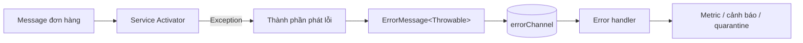

# Error Channel nhận ErrorMessage trong Spring Integration

## 1. Mục tiêu bài học

Trong học phần `SPRING_INTEGRATION_PATTERN`, chúng ta thực hành các **Enterprise Integration Patterns** bằng Spring Integration để xây dựng luồng thông điệp ít phụ thuộc, dễ mở rộng, kiểm thử được và quan sát được. Khi một bước **Router**, **Filter**, **Transformer**, **Gateway**, **Splitter** hoặc **Aggregator** thất bại, hệ thống cần biết lỗi xảy ra ở đâu, message nào bị ảnh hưởng và liệu có thể thử lại hay không.

**Error Channel** là cơ chế định tuyến thông tin lỗi dưới dạng message. Đối tượng quan trọng nhất ở đầu vào kênh lỗi là `org.springframework.messaging.support.ErrorMessage`, một `Message` có payload là `Throwable`. Đây là cách Spring Integration biểu diễn lỗi trong mô hình trao đổi message thay vì chỉ ghi stack trace.

Sau bài học, bạn có thể:

- Giải thích vai trò của `ErrorMessage`, `errorChannel`, payload lỗi và message gốc.
- Phân biệt exception trả trực tiếp về caller với lỗi được **publish** đến Error Channel.
- Đọc `ErrorMessage` trong một error handler và trích xuất correlation ID an toàn.
- Dùng global `errorChannel` và nhận biết trường hợp phải cấu hình kênh lỗi riêng.
- Kiểm thử error handler, đồng thời phân biệt kiểm thử người nhận lỗi với kiểm thử cơ chế tự phát lỗi.
- Thiết kế retry, quarantine, alert và logging mà không làm thất lạc message nghiệp vụ.

## 2. ErrorMessage là gì?

`ErrorMessage` là một `Message<Throwable>` đặc biệt của Spring Messaging. Phần **payload** là đối tượng exception/lỗi; ngoài ra message có **headers** và có thể có **originalMessage** để hỗ trợ truy lại ngữ cảnh.

Hãy phân biệt các đối tượng sau:

| Đối tượng | Vai trò | Cách đọc |
| --- | --- | --- |
| `ErrorMessage` | Bao thông tin lỗi thành một message gửi qua channel. | Nhận bằng `@ServiceActivator` hoặc một `MessageHandler` trên error channel. |
| `ErrorMessage.getPayload()` | Trả về một `Throwable`: nguyên nhân hoặc exception đã được bọc bởi framework. | Xác định loại lỗi, nguyên nhân và chuỗi nguyên nhân (`getCause()`). |
| `ErrorMessage.getOriginalMessage()` | Message gốc nếu publisher đã cung cấp. Có thể `null`. | Đọc `eventId`, `correlationId`, thông tin routing của message đầu vào. |
| `MessagingException.getFailedMessage()` | Message liên quan đến exception kiểu `MessagingException`, nếu có. | Nguồn thông tin bổ sung khi không có `originalMessage`. |
| `ErrorMessage.getHeaders()` | Headers **của error message**. | Metadata của sự kiện lỗi; không mặc định đồng nhất với headers của message bị lỗi. |

Ví dụ giả định một message đơn hàng có header `eventId=evt-42` đi vào Service Activator; handler ném exception và một thành phần phát lỗi tạo ra `ErrorMessage`. Error handler sẽ thấy payload là exception, còn thông tin `evt-42` cần được lấy từ **message thất bại** nếu publisher cung cấp, không phải giả định header đó nằm sẵn trên `ErrorMessage`.



**Lưu ý:** Không phải mọi exception đều tự động đi qua `errorChannel`. Điều đó phụ thuộc vào cách endpoint nhận message, channel đồng bộ hay bất đồng bộ, poller/adapter và error handler đã cấu hình.

## 3. Khi nào Error Channel nhận lỗi?

Hai đường đi phổ biến có hành vi khác nhau:

### 3.1. Luồng đồng bộ

Với `DirectChannel`, message được chuyển cho handler trên thread của người gửi. Nếu handler ném exception, lỗi thường **truyền ngược về caller** của `send(...)` hoặc Gateway. Không thể mặc định rằng một `ErrorMessage` sẽ xuất hiện trên global `errorChannel`.

```text
Caller --send()--> DirectChannel --> Handler --throw--> Caller nhận exception
```

Trong mô hình này, caller hoặc advice/retry interceptor chịu trách nhiệm xử lý lỗi. Nếu muốn có message trên một Error Channel, cần có thành phần được cấu hình rõ ràng để **publish** lỗi thay vì chỉ để exception lan truyền.

### 3.2. Luồng bất đồng bộ hoặc nguồn message được framework quản lý

Với một channel thực thi qua executor, hoặc các nguồn nhận message qua poller/adapter có hỗ trợ error handling, lỗi có thể được bắt và đóng gói thành `ErrorMessage` rồi gửi tới Error Channel. Việc chọn kênh và có phát lỗi hay không phụ thuộc endpoint cùng cấu hình cụ thể.

```text
Sender --send()--> Executor / poller / adapter --> Handler
                                               |
                                               +--> Exception
                                                      |
                                                      v
                                                 ErrorMessage
                                                      |
                                                      v
                                               Error Channel
```

Vì ranh giới thread khác nhau, ở luồng bất đồng bộ `send(...) == true` có thể chỉ nghĩa là message đã được nhận vào channel, **chưa chứng minh xử lý nghiệp vụ thành công**.

| Tiêu chí | DirectChannel đồng bộ | Endpoint/channel có xử lý lỗi bất đồng bộ |
| --- | --- | --- |
| Nơi lỗi thường được báo | Caller qua exception. | Error handler/publisher của endpoint hoặc channel. |
| `ErrorMessage` tự có? | Không nên giả định. | Có khi thành phần phát lỗi được cấu hình/hỗ trợ. |
| Người gửi biết kết quả xử lý? | Thường nhận được lỗi ngay trong lời gọi. | Có thể đã kết thúc lời gọi trước khi handler hoàn thành. |
| Cần kiểm thử | Exception truyền ngược và retry của caller. | Error Channel, metadata, retry, và xác nhận xử lý bất đồng bộ. |

## 4. Global errorChannel và channel theo từng luồng

Khi bật hạ tầng Spring Integration, context thường cung cấp một channel chuẩn tên **`errorChannel`**, thường là một `PublishSubscribeChannel`. Các thành phần phát lỗi có thể sử dụng nó làm nơi nhận lỗi mặc định. Tên này là quy ước quan trọng, nhưng việc một exception thực sự tới đó vẫn phụ thuộc error publishing của nguồn phát.

Một số nguồn xử lý lỗi cho phép chỉ định channel lỗi riêng; trong nhiều trường hợp, header `errorChannel` của message gốc cũng có thể được publisher sử dụng để xác định đích. Chẳng hạn, để phân tách lỗi của luồng thanh toán và luồng thông báo:

```text
Payment flow  ----> paymentErrorChannel ----> Điều tra thanh toán
Notify flow   ----> notifyErrorChannel  ----> Retry thông báo
Other errors  ----> errorChannel        ----> Giám sát lỗi chung
```

**Đừng cấu hình kênh lỗi theo phỏng đoán:** hãy kiểm tra tài liệu và cách hoạt động thực tế của adapter, gateway hoặc endpoint đang dùng. Một header `errorChannel` chỉ có ý nghĩa nếu thành phần phát lỗi hỗ trợ và sử dụng header đó. Nếu channel riêng không tồn tại, sai kiểu hoặc không có subscriber nhận lỗi, lỗi có thể tiếp tục gây exception ở khâu phát lỗi.

Global Error Channel có thể có logging subscriber mặc định tùy cấu hình Spring Integration. Việc xuất hiện log không đồng nghĩa ứng dụng đã retry, persist hoặc giải quyết được message thất bại.

## 5. Ví dụ thực hành: nhận ErrorMessage bằng @ServiceActivator

Ví dụ sau tập trung vào **phía nhận** của Error Channel. `ErrorMessageObserver` đọc `Throwable` và cố gắng tìm message gốc, sau đó lưu một bản ghi tối thiểu để tiện kiểm thử. Trong production, thay `ErrorProbe` bằng metric, logging có cấu trúc hoặc kênh xử lý lỗi nghiệp vụ thích hợp.

Với ứng dụng Spring Boot, có thể dùng `spring-boot-starter-integration`; để kiểm thử dùng thêm `spring-boot-starter-test`. Với Spring Framework độc lập, cấu hình `@EnableIntegration` và dependency Spring Integration tương ứng.

```java
import java.util.concurrent.atomic.AtomicReference;

import org.springframework.context.annotation.Bean;
import org.springframework.context.annotation.Configuration;
import org.springframework.integration.annotation.ServiceActivator;
import org.springframework.integration.config.EnableIntegration;
import org.springframework.messaging.Message;
import org.springframework.messaging.MessagingException;
import org.springframework.messaging.support.ErrorMessage;

@Configuration
@EnableIntegration
public class ErrorChannelConfig {

    public record ErrorSnapshot(String exceptionType, String eventId) {}

    public static class ErrorProbe {
        private final AtomicReference<ErrorSnapshot> latest =
            new AtomicReference<>();

        public void record(ErrorSnapshot snapshot) {
            latest.set(snapshot);
        }

        public ErrorSnapshot latest() {
            return latest.get();
        }
    }

    @Bean
    public ErrorProbe errorProbe() {
        return new ErrorProbe();
    }

    @Bean
    public ErrorMessageObserver errorMessageObserver(ErrorProbe probe) {
        return new ErrorMessageObserver(probe);
    }

    public static class ErrorMessageObserver {
        private final ErrorProbe probe;

        public ErrorMessageObserver(ErrorProbe probe) {
            this.probe = probe;
        }

        @ServiceActivator(inputChannel = "errorChannel")
        public void receive(ErrorMessage error) {
            Throwable failure = error.getPayload();
            Message<?> failed = error.getOriginalMessage();

            // Một số nguồn không cung cấp originalMessage riêng.
            if (failed == null && failure instanceof MessagingException me) {
                failed = me.getFailedMessage();
            }

            String eventId = "unknown";
            if (failed != null) {
                Object value = failed.getHeaders().get("eventId");
                if (value != null) {
                    eventId = value.toString();
                }
            }

            probe.record(new ErrorSnapshot(
                failure.getClass().getSimpleName(), eventId));
        }
    }
}
```

**Điểm cần hiểu khi đọc ví dụ:**

1. `@ServiceActivator(inputChannel = "errorChannel")` đăng ký một endpoint nhận message trên Error Channel.
2. Tham số kiểu `ErrorMessage` cho phép truy cập trực tiếp cả payload `Throwable` lẫn `originalMessage`.
3. `originalMessage` và `getFailedMessage()` là các nguồn **có thể có**, không được mặc định là khác `null`.
4. Ví dụ chỉ giữ loại exception và `eventId`; không đưa toàn bộ payload/stack trace nhạy cảm vào hệ thống đo đạc.
5. Error handler chỉ ghi nhận quan sát. Trong hệ thống thật, một quyết định retry, bù trừ hoặc quarantine phải dựa trên chính sách nghiệp vụ rõ ràng.

### Kiểm thử hợp đồng của người nhận ErrorMessage

Test sau chủ động tạo một `ErrorMessage` rồi gửi tới global `errorChannel`. Đây là phép kiểm thử **consumer của Error Channel**: xác minh endpoint nhận được message và trích xuất đúng ngữ cảnh. Nó không kiểm chứng rằng một adapter cụ thể tự publish lỗi khi exception phát sinh.

```java
import org.junit.jupiter.api.Test;
import org.springframework.beans.factory.annotation.Autowired;
import org.springframework.beans.factory.annotation.Qualifier;
import org.springframework.messaging.Message;
import org.springframework.messaging.MessageChannel;
import org.springframework.messaging.MessagingException;
import org.springframework.messaging.support.ErrorMessage;
import org.springframework.messaging.support.MessageBuilder;
import org.springframework.test.context.junit.jupiter.SpringJUnitConfig;

import static org.assertj.core.api.Assertions.assertThat;

@SpringJUnitConfig(ErrorChannelConfig.class)
class ErrorChannelConfigTest {

    @Autowired
    @Qualifier("errorChannel")
    MessageChannel errorChannel;

    @Autowired
    ErrorChannelConfig.ErrorProbe probe;

    @Test
    void receivesErrorMessageAndFindsOriginalEventId() {
        Message<String> original = MessageBuilder
            .withPayload("order-created")
            .setHeader("eventId", "evt-42")
            .build();

        MessagingException failure =
            new MessagingException(original, "Order rejected");
        ErrorMessage error = new ErrorMessage(failure, original);

        assertThat(errorChannel.send(error)).isTrue();
        assertThat(probe.latest()).isEqualTo(
            new ErrorChannelConfig.ErrorSnapshot(
                "MessagingException", "evt-42"));
    }
}
```

Một test bổ sung hữu ích là gửi `new ErrorMessage(new IllegalStateException("failure"))` và xác minh `eventId` thành `"unknown"`, thay vì gặp `NullPointerException`. Với handler bất đồng bộ, cần cơ chế chờ có giới hạn hoặc assertion theo sự kiện, tránh kiểm tra tức thời như ví dụ đồng bộ này.

### Kiểm thử cơ chế phát lỗi trong luồng thực

Sau khi test người nhận, hãy viết **integration test riêng** cho nguồn phát lỗi (ví dụ một poller hoặc một channel dùng executor):

1. Cấu hình nguồn phát message, error handler và Error Channel được hỗ trợ.
2. Đưa vào message có `eventId` xác định; cố tình làm handler ném exception.
3. Đợi Error Channel nhận `ErrorMessage` và xác nhận payload chứa nguyên nhân mong đợi.
4. Kiểm tra `originalMessage` hoặc `failedMessage` nếu loại endpoint có cung cấp, cùng correlation metadata.
5. Xác minh hành vi retry, commit/rollback và cách xử lý khi error handler cũng thất bại.

Không dùng kết quả của test gửi thủ công `ErrorMessage` làm bằng chứng rằng **mọi** exception ở hệ thống đã được chuyển tới error channel.

## 6. ErrorMessage và quan hệ với retry, Gateway, Null Channel

### Retry trước hay sau khi publish lỗi?

Retry thường thuộc trách nhiệm của advice, endpoint, adapter hoặc cơ chế điều khiển của luồng. Trong một thiết kế phổ biến, lỗi tạm thời được thử lại theo giới hạn; khi không thể xử lý thành công, một thành phần mới chuyển trạng thái thất bại ra luồng lỗi. Tuy nhiên, **thứ tự retry và publish lỗi phụ thuộc cấu hình**, không phải một bảo đảm chung của `errorChannel`.

Hãy phân loại lỗi:

| Loại lỗi | Ví dụ | Hướng xử lý gợi ý |
| --- | --- | --- |
| Tạm thời | API đối tác timeout, mất kết nối ngắn hạn | Retry có giới hạn, backoff; sau đó phát lỗi/quarantine. |
| Dữ liệu không hợp lệ | Sai schema, thiếu trường bắt buộc | Từ chối hoặc quarantine; thường không retry vô hạn. |
| Nghiệp vụ có thể bù trừ | Đã trừ tồn kho nhưng không hoàn tất đặt hàng | Workflow bù trừ/Saga hoặc xử lý thủ công có kiểm soát. |
| Lỗi không rõ nguyên nhân | Exception ngoài dự kiến | Bảo toàn ngữ cảnh, cảnh báo, điều tra trước khi quyết định phát lại. |

### Gateway và người gọi đồng bộ

Một Gateway đồng bộ thường kỳ vọng kết quả hoặc exception trong contract. Khi một nhánh bất đồng bộ publish `ErrorMessage`, sự kiện lỗi không nhất thiết tự chuyển thành response hợp lệ cho caller đang chờ. Cần thiết kế rõ timeout, reply/error reply và cơ chế thông báo trạng thái.

Ví dụ, request HTTP tạo đơn hàng không thể dựa vào việc “đã có ErrorMessage trong hệ thống” để trả mã thành công. Caller cần ACK/response theo hợp đồng; nếu xử lý kéo dài bất đồng bộ, có thể trả một mã theo dõi và cung cấp API truy vấn trạng thái.

### Error Channel khác Null Channel

```text
Điều kiện loại bỏ hợp lệ ----> nullChannel  ----> kết thúc có chủ đích
Exception cần xử lý      ----> errorChannel ----> ErrorMessage / error flow
```

Đưa exception chưa được xử lý sang `nullChannel` để “giữ luồng chạy” có thể làm mất dữ liệu và che giấu lỗi. Ngược lại, một heartbeat được phép bỏ qua không cần tạo `ErrorMessage`, vì đó không phải lỗi.

### Splitter, Aggregator và correlation

Trong chuỗi `Splitter → các nhánh xử lý → Aggregator`, một nhánh thất bại có thể khiến Aggregator không nhận đủ message con. Nếu tất cả lỗi chỉ được phát vào một Error Channel riêng mà không có chiến lược kết thúc nhóm, nhóm tương quan có thể chờ cho đến khi hết hạn.

Khi thiết kế luồng lỗi, cần trả lời:

- `correlationId`, `sequenceNumber` và `sequenceSize` được giữ ở đâu nếu message thất bại bị bọc thành `ErrorMessage`?
- Nếu lỗi xảy ra ở một message con, nhóm sẽ retry, hết hạn, phát kết quả lỗi hay bù trừ?
- Error handler có cần `failedMessage` để xác định nhóm và phần tử bị lỗi không?

Không nên giả định headers trong `ErrorMessage` giữ toàn bộ headers ban đầu; cần đọc từ message thất bại khi có và kiểm thử với đúng phiên bản adapter.

## 7. Quan sát và vận hành Error Channel

Một error handler hiệu quả thường ghi lại **ngữ cảnh vừa đủ** để điều tra và quyết định hành động tiếp theo:

| Thông tin | Mục đích |
| --- | --- |
| Tên flow/endpoint | Biết lỗi phát sinh ở bước nào. |
| Loại exception và nguyên nhân gốc | Phân loại retry hoặc lỗi dữ liệu. |
| `eventId` / `correlationId` | Nối lỗi với yêu cầu và nhóm message liên quan. |
| Số lần thử / thời điểm lỗi | Phát hiện sự cố kéo dài, tránh retry vô hạn. |
| Quyết định xử lý | `retry`, `quarantine`, `compensate`, `alert` hoặc `resolved`. |

Metric có thể bao gồm `integration_errors_total{flow,type}`, `integration_retries_total{flow}` và `integration_failed_messages_total{flow}`. Tránh dùng `eventId` làm metric label vì số lượng giá trị tăng quá nhanh. Nếu cần lưu message để xử lý lại, hãy dùng kho dữ liệu hoặc dead-letter/quarantine phù hợp; Error Channel tự nó không phải kho bền vững.

**Vận hành an toàn:** không log password, token, thông tin thanh toán hoặc toàn bộ payload nhạy cảm; chuẩn hóa thông điệp cảnh báo. Error handler cũng có thể ném exception, nên cần kiểm thử cách lỗi thứ cấp được xử lý để tránh vòng lặp phát lỗi hoặc làm mất thông tin lỗi đầu tiên.

## 8. Bài tập thực hành

**Bối cảnh:** Luồng nhận sự kiện đơn hàng, chuyển đổi payload, gọi dịch vụ thanh toán và cập nhật trạng thái. Dịch vụ thanh toán có thể timeout, còn một số sự kiện thiếu `orderId`.

1. Thiết kế luồng dùng `errorChannel` hoặc kênh lỗi riêng để nhận `ErrorMessage` từ một endpoint bất đồng bộ có hỗ trợ error publishing.
2. Viết error handler trích xuất `orderId` hoặc `correlationId` từ message thất bại (nếu có), đồng thời ghi nhận loại exception.
3. Quy định retry có backoff cho timeout, còn lỗi thiếu `orderId` sẽ được lưu để điều tra.
4. Viết test gửi thủ công `ErrorMessage` để kiểm tra handler, và integration test cho một exception thực tế của nguồn phát.
5. Giả lập một message con của Splitter gặp lỗi. Mô tả Aggregator sẽ kết thúc, hết hạn hoặc bù trừ ra sao.

**Câu hỏi suy ngẫm:** Nếu một `DirectChannel` ném exception và caller nhận được lỗi nhưng global `errorChannel` không thấy `ErrorMessage`, đó có nhất thiết là lỗi cấu hình không? Bạn sẽ kiểm tra ranh giới đồng bộ/bất đồng bộ và cơ chế error publishing như thế nào?

## 9. Ghi nhớ

**Error Channel nhận `ErrorMessage` khi một thành phần chủ động publish lỗi qua kênh đó.** Payload của `ErrorMessage` là `Throwable`; thông tin message gốc có thể nằm ở `originalMessage` hoặc trong `MessagingException.getFailedMessage()`. Đừng mặc định mọi exception đều tự vào global `errorChannel`: hãy xác định ranh giới thực thi, cấu hình publisher, chính sách retry và người nhận lỗi. Thiết kế tốt giúp luồng Spring Integration xử lý lỗi có trách nhiệm, truy vết được và không đánh mất nghĩa vụ nghiệp vụ.
