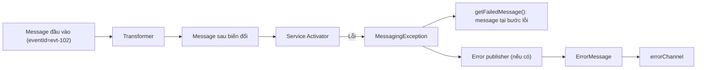
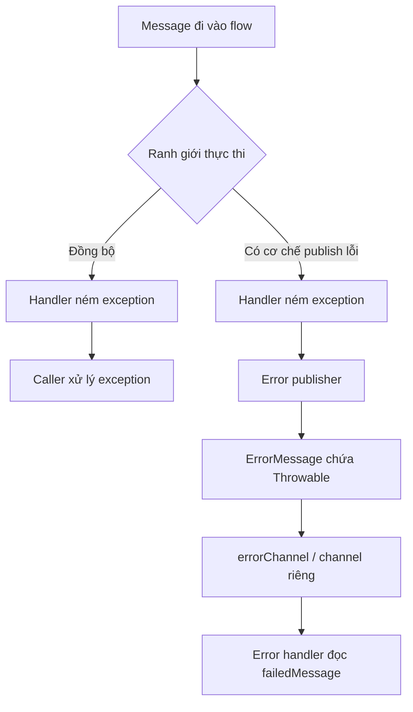

# MessagingException và failedMessage trong Spring Integration

## 1. Bối cảnh và mục tiêu

Trong học phần `SPRING_INTEGRATION_PATTERN`, chúng ta triển khai **Enterprise Integration Patterns** với Spring Integration để xây dựng các luồng message ít phụ thuộc, dễ mở rộng, đồng thời kiểm thử và quan sát các nhánh xử lý. Khi **Transformer**, **Filter**, **Router**, **Gateway**, **Splitter**, **Aggregator** hoặc một adapter gặp lỗi, câu hỏi quan trọng không chỉ là *“Exception gì đã xảy ra?”* mà còn là *“Message nào đang được xử lý ở thời điểm lỗi?”*.

`org.springframework.messaging.MessagingException` giúp kết nối **thông tin exception** với **ngữ cảnh message thất bại**. Phương thức `getFailedMessage()` có thể trả về message liên quan tới thao tác đã thất bại, nhờ đó error handler có cơ sở xác định loại sự kiện, correlation ID và dữ liệu cần khôi phục.

Sau bài này, bạn có thể:

- Giải thích sự khác nhau giữa `MessagingException`, `Throwable`, `ErrorMessage` và `failedMessage`.
- Trích xuất `getFailedMessage()` và đọc header liên quan mà không giả định message luôn tồn tại.
- Xác định ngữ cảnh lỗi khi exception được bọc nhiều lớp hoặc xảy ra sau một phép biến đổi message.
- Phân biệt exception truyền ngược trên kênh đồng bộ và `ErrorMessage` được phát trên error channel.
- Viết một error handler và kiểm thử các trường hợp có hoặc thiếu `failedMessage`.
- Vận dụng thông tin message thất bại để thiết kế retry, quarantine và correlation.

## 2. Cấu trúc của MessagingException

`MessagingException` là một **runtime exception** thuộc Spring Messaging; bản thân nó là exception, **không phải một message trên channel**. Nó có thể mang tham chiếu tới một `Message<?>` cụ thể.

| Thành phần | Ý nghĩa | Lưu ý khi sử dụng |
| --- | --- | --- |
| `getMessage()` | Mô tả lỗi ở dạng chuỗi. | Phục vụ chẩn đoán; không phải payload nghiệp vụ. |
| `getCause()` | Nguyên nhân được bọc bên trong exception, nếu có. | Có thể cần duyệt nhiều lớp cause. |
| `getFailedMessage()` | `Message<?>` gắn với tác vụ bị lỗi, nếu có. | **Có thể trả về `null`**. |
| `getFailedMessage().getPayload()` | Payload của message liên quan tới lỗi. | Có thể là dữ liệu đã qua Transformer, không còn giống đầu vào ban đầu. |
| `getFailedMessage().getHeaders()` | Headers của message thất bại. | Kiểm tra `correlationId`, `sequenceNumber`, custom header tùy luồng. |

Một số loại exception trong hệ sinh thái messaging kế thừa `MessagingException`, chẳng hạn `MessageHandlingException` khi handler gặp vấn đề và `MessageDeliveryException` khi chuyển message không thành công. Loại exception chính xác và việc có gắn `failedMessage` hay không phụ thuộc vị trí xảy ra lỗi và cách framework/ứng dụng tạo exception.

### Ví dụ đơn giản: chủ động gắn failedMessage

```java
import org.springframework.messaging.Message;
import org.springframework.messaging.MessagingException;
import org.springframework.messaging.support.MessageBuilder;

Message<String> message = MessageBuilder.withPayload("ORDER_CREATED")
    .setHeader("eventId", "evt-102")
    .setHeader("correlationId", "order-42")
    .build();

MessagingException failure = new MessagingException(
    message, "Không thể xử lý đơn hàng");

Message<?> failed = failure.getFailedMessage();
System.out.println(failed.getPayload()); // ORDER_CREATED
System.out.println(failed.getHeaders().get("eventId")); // evt-102
```

Ở đây, code tạo `MessagingException` với một message cụ thể nên `getFailedMessage()` có giá trị. Trong lỗi thực tế, không nên mặc định mọi exception đều được xây dựng theo cách này.

## 3. failedMessage khác originalMessage như thế nào?

Trong một luồng tích hợp, message có thể được biến đổi, tách ra hoặc định tuyến qua nhiều kênh:



**`failedMessage`** thuộc `MessagingException` và thường thể hiện message có liên quan đến thao tác thất bại. Nếu exception được tạo tại bước Service Activator, đó có thể là message **sau khi Transformer đã đổi payload**.

**`originalMessage`** là thông tin tùy chọn trên `org.springframework.messaging.support.ErrorMessage`, được cung cấp khi bên phát lỗi tạo `ErrorMessage`. Nó có thể đại diện cho message đầu vào của một ranh giới xử lý; không có bảo đảm rằng nó luôn là message đầu tiên trong toàn bộ pipeline.

| Câu hỏi | `MessagingException.getFailedMessage()` | `ErrorMessage.getOriginalMessage()` |
| --- | --- | --- |
| Thuộc đối tượng nào? | Exception. | ErrorMessage được publish vào channel. |
| Ý nghĩa chính | Message liên quan đến **thao tác thất bại**. | Message được **error publisher** ghi nhận là nguồn gốc của lỗi. |
| Có luôn tồn tại? | Không. | Không. |
| Có thể khác nhau? | Có, đặc biệt qua Transformer/Splitter. | Có thể là message trước biến đổi hoặc trước một ranh giới adapter. |
| Dùng để làm gì? | Chẩn đoán bước lỗi, thông tin retry/quarantine. | Truy vết tới ngữ cảnh ban đầu khi publisher có cung cấp. |

Không giả định headers trên chính `ErrorMessage` giống headers của message thất bại. Nếu muốn tìm `eventId` hoặc `correlationId`, hãy xác định **đúng message** để đọc header.

## 4. Khi nào getFailedMessage() có thể null?

`getFailedMessage()` trả về `null` nếu không có message được gắn vào exception. Một số tình huống có thể gặp:

1. Lỗi được tạo bởi code ngoài tầng messaging, ví dụ `IllegalStateException` hay `IOException`; các exception này không có API `getFailedMessage()`.
2. Ứng dụng tạo `MessagingException` bằng một constructor cho phép message không tồn tại hoặc truyền vào message rỗng.
3. Error publisher gói một exception thông thường vào `ErrorMessage`, nhưng không bổ sung ngữ cảnh message gốc.
4. Exception nằm trong chuỗi `cause` hoặc một lớp bọc khác; việc chỉ nhìn vào exception ngoài cùng sẽ bỏ sót `MessagingException` bên trong.

Cách xử lý an toàn là kiểm tra kiểu exception, kiểm tra kết quả `null`, rồi tìm nguồn ngữ cảnh dự phòng. Nếu vẫn không có message, error handler vẫn phải xử lý lỗi trên cơ sở loại exception và thông tin endpoint/flow; không được tự gán sai payload hoặc correlation ID.

```java
static String readEventId(Throwable error) {
    if (error instanceof MessagingException messagingException) {
        Message<?> failed = messagingException.getFailedMessage();
        if (failed != null) {
            Object eventId = failed.getHeaders().get("eventId");
            if (eventId != null) {
                return eventId.toString();
            }
        }
    }
    return "unknown";
}
```

Đoạn trên chỉ bắt được trường hợp `MessagingException` là lớp ngoài cùng. Phần tiếp theo bổ sung cách kiểm tra chuỗi `cause`.

## 5. Thực hành: error handler đọc failedMessage trong chuỗi cause

Giả sử một lỗi nghiệp vụ được bọc qua ranh giới bất đồng bộ:

```text
IllegalStateException ("Async wrapper")
  └── MessagingException ("Không thể xử lý ORDER_CREATED")
        └── failedMessage: eventId=evt-102, stage=payment
```

Error handler cần tìm `MessagingException` có `failedMessage` trong chuỗi nguyên nhân. Mã dưới đây duyệt các cause, có kiểm soát vòng lặp bằng identity set để tránh duyệt vô hạn nếu dữ liệu lỗi bất thường.

### Cấu hình và error consumer

Ví dụ sử dụng Java 17, Spring Integration cùng cơ chế `@ServiceActivator`. Với Spring Boot có thể thêm `spring-boot-starter-integration` và `spring-boot-starter-test` cho kiểm thử. `FailureProbe` là bộ nhớ dùng để quan sát trong bài học; ứng dụng thật nên sử dụng hệ thống metric và logging thích hợp.

```java
import java.util.Collections;
import java.util.IdentityHashMap;
import java.util.Set;
import java.util.concurrent.atomic.AtomicReference;

import org.springframework.context.annotation.Bean;
import org.springframework.context.annotation.Configuration;
import org.springframework.integration.annotation.ServiceActivator;
import org.springframework.integration.config.EnableIntegration;
import org.springframework.messaging.Message;
import org.springframework.messaging.MessagingException;
import org.springframework.messaging.support.ErrorMessage;

@Configuration
@EnableIntegration
public class FailedMessageErrorConfig {

    public record FailureSnapshot(
        String exceptionType,
        String failedEventId,
        String originalEventId,
        String failedStage) {}

    public static class FailureProbe {
        private final AtomicReference<FailureSnapshot> latest =
            new AtomicReference<>();

        public void save(FailureSnapshot snapshot) {
            latest.set(snapshot);
        }

        public FailureSnapshot latest() {
            return latest.get();
        }

        public void clear() {
            latest.set(null);
        }
    }

    @Bean
    public FailureProbe failureProbe() {
        return new FailureProbe();
    }

    @Bean
    public ErrorObserver errorObserver(FailureProbe probe) {
        return new ErrorObserver(probe);
    }

    public static class ErrorObserver {
        private final FailureProbe probe;

        public ErrorObserver(FailureProbe probe) {
            this.probe = probe;
        }

        @ServiceActivator(inputChannel = "errorChannel")
        public void onError(ErrorMessage errorMessage) {
            Throwable error = errorMessage.getPayload();

            Message<?> failed = findFailedMessage(error);
            Message<?> original = errorMessage.getOriginalMessage();

            probe.save(new FailureSnapshot(
                error.getClass().getSimpleName(),
                headerAsString(failed, "eventId"),
                headerAsString(original, "eventId"),
                headerAsString(failed, "stage")));
        }

        // Chỉ tìm trong chuỗi cause. Không suy diễn message từ payload.
        static Message<?> findFailedMessage(Throwable error) {
            Set<Throwable> visited = Collections.newSetFromMap(
                new IdentityHashMap<Throwable, Boolean>());

            for (Throwable current = error;
                 current != null && visited.add(current);
                 current = current.getCause()) {
                if (current instanceof MessagingException me) {
                    Message<?> failed = me.getFailedMessage();
                    if (failed != null) {
                        return failed;
                    }
                }
            }
            return null;
        }

        static String headerAsString(Message<?> message, String key) {
            if (message == null) {
                return "unknown";
            }
            Object value = message.getHeaders().get(key);
            return value == null ? "unknown" : value.toString();
        }
    }
}
```

Điểm quan trọng của ví dụ:

- `onError(ErrorMessage)` chỉ chạy khi **một nguồn phát lỗi đã publish** `ErrorMessage` lên `errorChannel`. Việc ném exception tự nó chưa chắc kích hoạt consumer này.
- `getPayload()` của ErrorMessage là `Throwable`; code cần duyệt cause để tìm `MessagingException` có ngữ cảnh message.
- `failedEventId` và `originalEventId` được giữ **riêng biệt**. Nếu Transform/Split tạo message khác, thông tin có thể khác nhau.
- `unknown` là giá trị thay thế có chủ đích khi không đủ ngữ cảnh, không phải một event ID thật.
- Việc lấy message chỉ phục vụ phân tích. Không tự động phát lại message nếu chưa hiểu side effect đã thành công một phần hay chưa.

### Kiểm thử đầu vào của error consumer

Kiểm thử dưới đây **chủ động gửi ErrorMessage** tới global `errorChannel` để xác minh chức năng nhận lỗi. Nó không chứng minh mọi exception của một luồng thực tế đều được phát vào channel này; cần integration test riêng cho adapter hoặc endpoint có error publishing.

```java
import org.junit.jupiter.api.BeforeEach;
import org.junit.jupiter.api.Test;
import org.springframework.beans.factory.annotation.Autowired;
import org.springframework.beans.factory.annotation.Qualifier;
import org.springframework.messaging.Message;
import org.springframework.messaging.MessageChannel;
import org.springframework.messaging.MessagingException;
import org.springframework.messaging.support.ErrorMessage;
import org.springframework.messaging.support.MessageBuilder;
import org.springframework.test.context.junit.jupiter.SpringJUnitConfig;

import static org.assertj.core.api.Assertions.assertThat;

@SpringJUnitConfig(FailedMessageErrorConfig.class)
class FailedMessageErrorConfigTest {

    @Autowired
    @Qualifier("errorChannel")
    MessageChannel errorChannel;

    @Autowired
    FailedMessageErrorConfig.FailureProbe probe;

    @BeforeEach
    void reset() {
        probe.clear();
    }

    @Test
    void findsFailedMessageInsideWrappedException() {
        Message<String> input = MessageBuilder
            .withPayload("order-request")
            .setHeader("eventId", "evt-102")
            .build();

        Message<String> transformed = MessageBuilder
            .withPayload("payment-request")
            .setHeader("eventId", "evt-102-payment")
            .setHeader("stage", "payment")
            .build();

        MessagingException handlingFailure =
            new MessagingException(transformed, "Payment failed");
        Throwable wrapper =
            new IllegalStateException("Async wrapper", handlingFailure);
        ErrorMessage error = new ErrorMessage(wrapper, input);

        assertThat(errorChannel.send(error)).isTrue();
        assertThat(probe.latest()).isEqualTo(
            new FailedMessageErrorConfig.FailureSnapshot(
                "IllegalStateException", "evt-102-payment",
                "evt-102", "payment"));
    }

    @Test
    void handlesMissingFailedAndOriginalMessage() {
        ErrorMessage error =
            new ErrorMessage(new IllegalArgumentException("Invalid request"));

        assertThat(errorChannel.send(error)).isTrue();
        assertThat(probe.latest()).isEqualTo(
            new FailedMessageErrorConfig.FailureSnapshot(
                "IllegalArgumentException",
                "unknown", "unknown", "unknown"));
    }
}
```

Test thứ nhất chứng minh `failedMessage` của exception có thể khác `originalMessage` của ErrorMessage. Test thứ hai chứng minh error handler không sụp đổ khi cả hai nguồn ngữ cảnh đều vắng mặt. Với error channel xử lý bất đồng bộ, hãy dùng cơ chế chờ có giới hạn thay cho assertion ngay sau `send()`.

## 6. Đồng bộ, bất đồng bộ và điểm xuất hiện exception

Với `DirectChannel` trong Spring Integration, handler thường chạy trên thread gửi message. Nếu phát sinh `MessagingException`, exception có thể truyền ngược về caller; **global `errorChannel` không bắt buộc nhận `ErrorMessage`**.

```java
try {
    inputChannel.send(message);
} catch (MessagingException ex) {
    Message<?> failed = ex.getFailedMessage();
    // failed có thể null; caller quyết định retry/báo lỗi phù hợp.
}
```

Khi dùng poller, executor channel hoặc adapter có cơ chế error publishing, thành phần tương ứng có thể bắt `Throwable`, đóng gói thành `ErrorMessage` rồi gửi vào một Error Channel. Cần xác minh **nguồn phát lỗi**, tên channel, error handler và cách các message headers được giữ lại.



Một `ErrorMessage` có thể mang exception kiểu khác `MessagingException`. Cũng có trường hợp `MessagingException` tồn tại trong `getCause()` chứ không phải payload cấp cao nhất. Vì vậy error handler nên chịu được các cấu trúc khác nhau.

## 7. Dùng failedMessage để quyết định xử lý lỗi

`failedMessage` đặc biệt hữu ích khi cần liên hệ lỗi với **đơn vị công việc cụ thể**, nhưng không tự nó quyết định được có nên retry.

| Nhu cầu | Dữ liệu có thể khai thác | Chính sách cần bổ sung |
| --- | --- | --- |
| Xác định request thất bại | `eventId`, `orderId` hoặc `traceId` trong headers/payload phù hợp. | Mapping tới bản ghi nghiệp vụ. |
| Theo dõi một nhóm Splitter/Aggregator | `correlationId`, `sequenceNumber`, `sequenceSize` nếu còn trên failed message. | Giải phóng/timeout nhóm, phát kết quả lỗi hoặc bù trừ. |
| Retry lỗi tạm thời | Type/cause của exception, message thất bại. | Giới hạn số lần, backoff, idempotency và transaction. |
| Quarantine message độc hại | Header nhận diện và bản sao nội dung phù hợp. | Kho lưu bền vững, phân quyền, thời hạn lưu và công cụ phát lại. |
| Quan sát hệ thống | Tên endpoint, loại lỗi, correlation ID. | Metric, log cấu trúc và cảnh báo. |

### Ví dụ: một message con của Aggregator gặp lỗi

Nếu Splitter tạo 5 phần của một đơn hàng nhưng phần số 3 thất bại, `failedMessage` có thể mang `sequenceNumber=3` và `correlationId` của nhóm. Tuy nhiên, thông tin này **không tự bổ sung message bị thiếu vào Aggregator**. Nếu release strategy cần đủ 5 phần, nhóm có thể chờ đến lúc timeout.

Cần thiết kế việc retry phần số 3, kết thúc nhóm với trạng thái lỗi, hoặc xử lý hết hạn. Đừng chỉ log `failedMessage` rồi mặc định rằng Aggregator sẽ tự giải phóng nhóm.

### Retry và side effect

Nếu lỗi xuất hiện sau khi handler đã ghi database nhưng trước khi gửi reply, phát lại `failedMessage` có thể tạo bản ghi trùng. Khi thiết kế retry cần có idempotency key, transaction hoặc chính sách bù trừ. `getFailedMessage()` cho biết **message liên quan đến lỗi**, không cho biết liệu mọi side effect trước đó có rollback hay không.

## 8. Quy tắc an toàn khi ghi log và xây dựng error flow

1. Luôn kiểm tra `null` trước khi truy cập `getFailedMessage().getPayload()` hoặc headers.
2. Chỉ đọc metadata thực sự cần; đừng log nguyên payload chứa dữ liệu cá nhân, token hoặc thông tin thanh toán.
3. Tách **loại exception** và **nguyên nhân gốc** khỏi thông điệp mô tả, vì `getMessage()` có thể chứa dữ liệu nhạy cảm hoặc thay đổi theo phiên bản.
4. Giữ correlation ID trong chuỗi Transformer/Splitter khi cần truy vết, và kiểm thử sự tồn tại của header sau mỗi ranh giới quan trọng.
5. Khi `failedMessage` không tồn tại, dùng ngữ cảnh từ `ErrorMessage.getOriginalMessage()` (nếu có), hoặc ghi trạng thái `unknown` cùng tên endpoint.
6. Error Channel không phải dead-letter queue. Nếu cần phát lại sau khi sửa dữ liệu, phải có kho lưu trữ/quarantine thích hợp.
7. Đặt chính sách cho tình huống error handler cũng thất bại để tránh mất thông tin lỗi gốc hoặc vòng lặp báo lỗi.

Metric gợi ý: `integration_errors_total{flow,exception_type}`, `failed_message_missing_total{flow}` và `retry_attempts_total{flow}`. Tránh dùng từng `eventId` làm metric label; hãy lưu ID vào log hoặc audit store có khả năng truy vấn thay vì tạo nhãn có số lượng giá trị quá lớn.

## 9. Bài tập thực hành

Một luồng nhận `ORDER_CREATED`, dùng Transformer tạo payment request, sau đó gọi một dịch vụ thanh toán. Dịch vụ có thể timeout hoặc từ chối dữ liệu đầu vào.

1. Viết handler bắt `ErrorMessage` và trích xuất `failedMessage`, `originalMessage`, `eventId`, `correlationId` với cơ chế fallback an toàn.
2. Tạo test có `MessagingException` được bọc trong `IllegalStateException`; chứng minh thông tin ở `failedMessage` vẫn truy xuất được.
3. Tạo test không có bất kỳ message gốc nào; xác nhận handler không ném `NullPointerException`.
4. Dùng integration test với một endpoint có error publisher thực tế, kiểm tra liệu lỗi đi tới global `errorChannel` hay một channel riêng.
5. Xây chính sách retry cho timeout, quarantine cho lỗi schema, và phân biệt với một nhánh được phép bỏ qua qua `nullChannel`.
6. Nếu payment request là một phần của nhóm Aggregator, giải thích cách dùng correlation metadata để tránh treo nhóm khi một phần bị lỗi.

**Câu hỏi tự kiểm tra:** `failedMessage` có phải luôn là message ban đầu của toàn luồng không? Vì sao đọc `ErrorMessage.getHeaders()` không đủ để suy ra headers của message đã thất bại?

## 10. Ghi nhớ

**`MessagingException` là exception có thể mang `failedMessage`; `ErrorMessage` là message dùng để truyền thông tin lỗi qua Error Channel.** `getFailedMessage()` giúp truy ra ngữ cảnh tại bước thất bại nhưng **có thể trả về `null`**. Hãy phân biệt failed message với original message, duyệt cause khi cần và kiểm thử đúng cơ chế phát lỗi của endpoint. Khi kết hợp với retry, error channel và correlation một cách có kiểm soát, thông tin này giúp các luồng Spring Integration dễ truy vết và khôi phục hơn.
