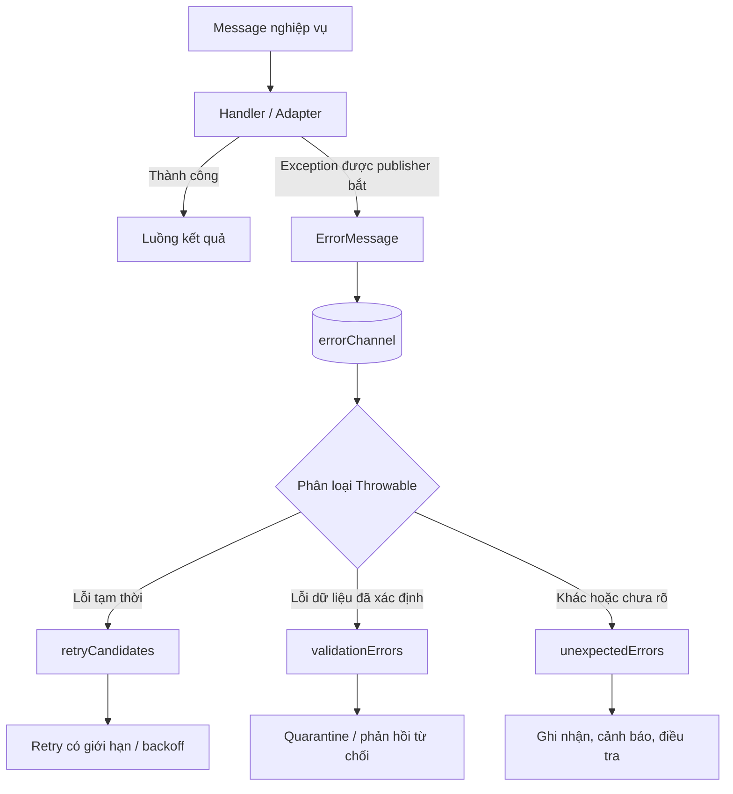

# Định tuyến lỗi theo loại exception với Error Channel trong Spring Integration

## 1. Mục tiêu và bối cảnh

Trong học phần `SPRING_INTEGRATION_PATTERN`, chúng ta áp dụng **Enterprise Integration Patterns** (EIP) bằng Spring Integration để tạo luồng message ít phụ thuộc, dễ mở rộng, đồng thời kiểm thử và quan sát từng nhánh. Một luồng xử lý đơn hàng có thể gặp lỗi tạm thời khi gọi API, lỗi dữ liệu không hợp lệ hoặc lỗi chương trình chưa xác định. Nếu cả ba đều đi vào một handler chung rồi áp dụng cùng chính sách retry, hệ thống có thể thử lại vô ích, gây quá tải hoặc làm mất dữ liệu cần điều tra.

**Định tuyến lỗi theo loại exception** là sử dụng quyết định phân loại để gửi mỗi sự kiện lỗi tới một nhánh xử lý thích hợp. Spring Integration cho phép kết hợp **Error Channel** với **Content-Based Router**: Error Channel nhận `ErrorMessage`, Router xem xét `Throwable` và chọn kênh đầu ra như `retryCandidates`, `validationErrors` hoặc `unexpectedErrors`.

Sau bài học, bạn sẽ:

- Giải thích cách `ErrorMessage`, `Throwable` và Router phối hợp trong một error flow.
- Phân loại dựa trên loại exception **thực sự**, kể cả khi nó bị bọc trong `MessagingException` hoặc các lớp `cause`.
- Thiết kế tuyến xử lý rõ ràng cho lỗi tạm thời, lỗi dữ liệu và lỗi chưa xác định.
- Viết Java DSL để định tuyến error message mà vẫn giữ ngữ cảnh của message thất bại.
- Kiểm thử từng tuyến và nhận biết giới hạn của test gửi `ErrorMessage` thủ công.
- Kết hợp retry, quarantine, error channel và correlation mà không tạo vòng lặp xử lý lỗi.

## 2. Vì sao cần Router trong luồng lỗi?

Error Channel là một `MessageChannel` chuyên nhận **thông tin lỗi đã được đóng gói**. Trong Spring Messaging, `ErrorMessage` có payload kiểu `Throwable`, có headers riêng và có thể mang `originalMessage`. Exception kiểu `MessagingException` cũng có thể chứa `failedMessage` để truy ngược message liên quan đến thao tác thất bại.

Một Error Channel **không tự quyết định** khi nào nên retry hoặc đưa message vào kho điều tra. Đây là trách nhiệm của các handler/flow nhận lỗi. Router đặt quy tắc chọn nhánh tại một điểm có thể kiểm thử.



**Điều kiện quan trọng:** Sơ đồ mô tả trường hợp một **error publisher** đã bắt exception và phát `ErrorMessage`. Với `DirectChannel` đồng bộ, exception thường truyền ngược về caller; không được mặc định mọi exception đều tự xuất hiện trên global `errorChannel`. Hãy xác minh đặc điểm error publishing của poller, adapter, executor hoặc gateway đang dùng.

## 3. Chọn tuyến theo chính sách nghiệp vụ

Định tuyến theo exception không chỉ là đổi tên kênh. Mỗi tuyến cần có **điều kiện**, **mục đích** và **hành động** cụ thể:

| Nhóm lỗi | Dấu hiệu ví dụ | Tuyến gợi ý | Chính sách tiếp theo |
| --- | --- | --- | --- |
| Tạm thời (*transient*) | Mất kết nối ngắn hạn, timeout từ dịch vụ ngoài | `retryCandidates` | Retry hữu hạn, backoff và idempotency; sau giới hạn chuyển sang điều tra. |
| Dữ liệu không hợp lệ (*non-retryable*) | Thiếu `orderId`, sai hợp đồng dữ liệu đã xác thực | `validationErrors` | Quarantine, báo từ chối có cấu trúc hoặc sửa dữ liệu. |
| Chưa phân loại | `NullPointerException`, lỗi bất ngờ từ thư viện | `unexpectedErrors` | Giữ ngữ cảnh, cảnh báo, điều tra; quyết định retry sau khi hiểu nguyên nhân. |

**Không nên dùng `IllegalArgumentException` chung làm quy tắc “mọi lỗi dữ liệu đều không retry”**: exception này cũng có thể xuất hiện do lỗi lập trình. Trong ví dụ, chúng ta tạo các loại exception nghiệp vụ có nghĩa rõ ràng. Trong production, classifier có thể xét thêm mã lỗi API, khả năng khôi phục, trạng thái giao dịch và chính sách của từng endpoint.

Ngoài ra, “đã đưa vào tuyến retry” **chưa có nghĩa là đã retry**. Kênh chỉ chuyển message sang nhánh xử lý; hành vi thử lại phải được triển khai bằng retry advice, retry template, lịch thử lại hoặc cơ chế của broker/adapter.

## 4. Đọc đúng exception khi có nhiều lớp bọc

Trong Spring Integration, handler có thể ném `RemoteServiceTimeoutException` nhưng khi tới error flow, payload lại là `MessageHandlingException` hoặc `MessagingException` có `getCause()` trỏ đến exception ban đầu.

```text
ErrorMessage.payload
  └── MessageHandlingException (có thể có failedMessage)
        └── RemoteServiceTimeoutException
              └── (thông tin timeout của dịch vụ ngoài)
```

Nếu Router chỉ kiểm tra `error instanceof RemoteServiceTimeoutException`, sự kiện trên sẽ bị phân loại sai. Cách đơn giản, có kiểm soát là duyệt chuỗi `getCause()` để tìm loại exception đã được quy định. Không phân loại dựa vào chuỗi `getMessage()` vì thông điệp có thể thay đổi theo ngôn ngữ, thư viện hoặc dữ liệu đầu vào.

Khi duyệt cause, cần chú ý:

1. Một exception có thể không có `cause`; quy tắc mặc định phải dẫn đến tuyến an toàn.
2. Có thể có nhiều exception có nghĩa khác nhau trong chuỗi; ưu tiên phân loại cần được định nghĩa rõ.
3. `MessagingException.getFailedMessage()` có thể giúp truy ra `eventId` hoặc `correlationId`, nhưng nó **không phải loại exception** để quyết định retry.
4. Chỉ vì một exception mang message thất bại không có nghĩa phát lại message sẽ an toàn: bước trước đó có thể đã ghi dữ liệu thành công một phần.

## 5. Ví dụ Java DSL: ba tuyến lỗi riêng

Chúng ta xây một **error routing flow** với tên channel chuẩn `errorChannel`. Router đọc **payload `Throwable`** của `ErrorMessage`, trả về một khóa tuyến và chuyển **toàn bộ message lỗi** đến channel đích. Các `QueueChannel` ở ví dụ chỉ phục vụ quan sát trong test; trong hệ thống thật, mỗi tuyến sẽ có một handler thực thi chính sách.

Ví dụ dùng Java 17, Spring Integration Java DSL và `@EnableIntegration`. Với Spring Boot, có thể sử dụng `spring-boot-starter-integration`; phần kiểm thử dùng JUnit 5, Spring Test và AssertJ.

```java
import java.util.Collections;
import java.util.IdentityHashMap;
import java.util.Set;

import org.springframework.context.annotation.Bean;
import org.springframework.context.annotation.Configuration;
import org.springframework.integration.channel.QueueChannel;
import org.springframework.integration.config.EnableIntegration;
import org.springframework.integration.dsl.IntegrationFlow;
import org.springframework.messaging.PollableChannel;

@Configuration
@EnableIntegration
public class ExceptionRoutingConfig {

    // Lỗi nghiệp vụ có ngữ nghĩa cụ thể, tránh suy từ message string.
    public static class RemoteServiceTimeoutException
            extends RuntimeException {
        public RemoteServiceTimeoutException(String message) {
            super(message);
        }
    }

    public static class InvalidOrderException extends RuntimeException {
        public InvalidOrderException(String message) {
            super(message);
        }
    }

    @Bean
    public PollableChannel retryCandidates() {
        return new QueueChannel();
    }

    @Bean
    public PollableChannel validationErrors() {
        return new QueueChannel();
    }

    @Bean
    public PollableChannel unexpectedErrors() {
        return new QueueChannel();
    }

    @Bean
    public IntegrationFlow exceptionRoutingFlow() {
        return IntegrationFlow.from("errorChannel")
            .route(Throwable.class,
                ExceptionRoutingConfig::classify,
                router -> router
                    .channelMapping("TRANSIENT", "retryCandidates")
                    .channelMapping("INVALID", "validationErrors")
                    .channelMapping("UNKNOWN", "unexpectedErrors"))
            .get();
    }

    static String classify(Throwable error) {
        Set<Throwable> visited = Collections.newSetFromMap(
            new IdentityHashMap<Throwable, Boolean>());

        for (Throwable current = error;
             current != null && visited.add(current);
             current = current.getCause()) {

            if (current instanceof InvalidOrderException) {
                return "INVALID";
            }
            if (current instanceof RemoteServiceTimeoutException) {
                return "TRANSIENT";
            }
        }
        return "UNKNOWN";
    }
}
```

Giải thích những điểm quan trọng:

- `IntegrationFlow.from("errorChannel")` tạo một subscriber cho Error Channel chuẩn đã được Spring Integration cung cấp khi bật hạ tầng tích hợp. Trong một ứng dụng có nhiều error subscribers, cần kiểm tra hành vi phát tới nhiều người nhận để tránh xử lý trùng.
- `.route(Throwable.class, ...)` nhận đối tượng **payload `Throwable`** để tính route key. Không dùng `ErrorMessage.class` làm payload type: payload của `ErrorMessage` là `Throwable`.
- `channelMapping(...)` ánh xạ từng route key sang channel. Router chuyển tiếp message lỗi gốc để handler ở nhánh đích còn có thể đọc `ErrorMessage`, `originalMessage` hoặc `failedMessage`.
- `classify(...)` tìm trong chuỗi cause và nhận diện **chỉ những exception ứng dụng đã cho phép**. Mọi loại khác đi về `UNKNOWN`, tránh việc bỏ message không rõ nguồn gốc.
- `visited` dùng identity để tránh lặp vô hạn khi gặp cấu trúc cause bất thường.
- Ba `QueueChannel` là **đầu ra thử nghiệm**, chưa có retry scheduler, kho quarantine hay dịch vụ cảnh báo. Đưa chúng vào production mà không có consumer sẽ khiến lỗi tồn đọng và tăng tiêu thụ bộ nhớ.

### Tại sao không chỉ dùng một `catch (Exception)`?

Nếu một handler bắt mọi exception rồi tự quyết định không cho error publisher biết, hệ thống có thể mất khả năng quan sát. Router nằm ở error flow giữ một điểm phân loại rõ ràng, nhưng chỉ hoạt động với các lỗi **đã đến được** Error Channel. Chính sách bắt lỗi tại handler phải tương thích với thiết kế chung.

## 6. Kiểm thử phân loại và định tuyến

Test dưới đây tự tạo `ErrorMessage`, gửi vào `errorChannel` rồi xác nhận message đến **đúng nhánh**. Với global Error Channel mặc định, việc router nhận message có thể diễn ra đồng bộ; `QueueChannel` cho phép đợi một khoảng thời gian giới hạn. Mỗi test gửi một loại lỗi độc lập.

```java
import org.junit.jupiter.api.Test;
import org.springframework.beans.factory.annotation.Autowired;
import org.springframework.beans.factory.annotation.Qualifier;
import org.springframework.messaging.Message;
import org.springframework.messaging.MessageChannel;
import org.springframework.messaging.MessagingException;
import org.springframework.messaging.PollableChannel;
import org.springframework.messaging.support.ErrorMessage;
import org.springframework.messaging.support.MessageBuilder;
import org.springframework.test.context.junit.jupiter.SpringJUnitConfig;

import static org.assertj.core.api.Assertions.assertThat;

@SpringJUnitConfig(ExceptionRoutingConfig.class)
class ExceptionRoutingConfigTest {

    @Autowired
    @Qualifier("errorChannel")
    MessageChannel errorChannel;

    @Autowired
    @Qualifier("retryCandidates")
    PollableChannel retryCandidates;

    @Autowired
    @Qualifier("validationErrors")
    PollableChannel validationErrors;

    @Autowired
    @Qualifier("unexpectedErrors")
    PollableChannel unexpectedErrors;

    @Test
    void wrappedTimeoutGoesToRetryCandidates() {
        Message<String> failed = MessageBuilder
            .withPayload("PAYMENT_REQUEST")
            .setHeader("eventId", "evt-101")
            .build();

        var timeout = new ExceptionRoutingConfig.RemoteServiceTimeoutException(
            "upstream timeout");
        var wrapped = new MessagingException(
            failed, "Payment service failed", timeout);

        assertThat(errorChannel.send(
            new ErrorMessage(wrapped, failed))).isTrue();

        Message<?> routed = retryCandidates.receive(1_000);
        assertThat(routed).isInstanceOf(ErrorMessage.class);
        assertThat(routed.getPayload()).isSameAs(wrapped);
    }

    @Test
    void invalidOrderGoesToValidationChannel() {
        var invalid = new ExceptionRoutingConfig.InvalidOrderException(
            "orderId is missing");

        assertThat(errorChannel.send(new ErrorMessage(invalid))).isTrue();

        Message<?> routed = validationErrors.receive(1_000);
        assertThat(routed).isInstanceOf(ErrorMessage.class);
        assertThat(routed.getPayload()).isSameAs(invalid);
    }

    @Test
    void unexpectedFailureGoesToInvestigation() {
        var unexpected = new IllegalStateException("unexpected state");

        assertThat(errorChannel.send(
            new ErrorMessage(unexpected))).isTrue();

        Message<?> routed = unexpectedErrors.receive(1_000);
        assertThat(routed).isInstanceOf(ErrorMessage.class);
        assertThat(routed.getPayload()).isSameAs(unexpected);
    }
}
```

Mỗi phép kiểm tra trên xác minh **router và các channel đích**. Test này không chứng minh rằng một adapter cụ thể tự chuyển exception đến Error Channel. Để kiểm tra end-to-end, cần cấu hình một endpoint có error publishing, cố tình gây lỗi trong handler và xác minh `ErrorMessage` thực sự được phát, sau đó tới đúng tuyến.

Các test nên mở rộng cho chuỗi `cause` sâu, `MessagingException` không có `failedMessage`, một exception có nhiều lớp bọc, và trường hợp unknown không bị mất. Nếu có nhiều subscriber hoặc concurrent error flows, nên dùng correlation ID để đối chiếu sự kiện với kết quả thay vì chỉ dựa vào phần tử đầu tiên của queue.

## 7. Gắn chính sách cho từng nhánh

Router chỉ quyết định **gửi đến đâu**. Phần xử lý sau Router phải có contract riêng.

### 7.1. Tuyến lỗi tạm thời: retry có giới hạn

Handler của `retryCandidates` có thể lập lịch phát lại một công việc, hoặc chuyển vào cơ chế retry của adapter. Trước khi retry, cần xác minh liệu side effect ở lần trước đã xảy ra một phần hay chưa. Một transaction rollback, idempotency key hoặc cơ chế bù trừ có thể cần thiết để tránh ghi trùng đơn hàng.

Chính sách điển hình:

1. Đọc loại lỗi, số lần thử đã thực hiện và định danh nghiệp vụ.
2. Nếu nằm trong giới hạn, retry có backoff và jitter theo chính sách.
3. Khi vượt giới hạn, lưu thông tin vào tuyến điều tra/quarantine và phát cảnh báo.
4. Ghi rõ trạng thái đã xử lý để tránh phát lại vô hạn cùng một message.

**Không gửi nguyên `ErrorMessage` thẳng vào channel nghiệp vụ** trừ khi flow đó thực sự xử lý payload `Throwable`. Nếu cần phát lại, lấy message nghiệp vụ thích hợp từ `failedMessage` hoặc một bản lưu bền vững, đồng thời hiểu rõ ngữ cảnh transaction và số lần thử.

### 7.2. Tuyến lỗi dữ liệu: từ chối hoặc quarantine

Với `InvalidOrderException`, retry lập tức cùng dữ liệu thường không thay đổi kết quả. Có thể lưu bản ghi quarantine, báo trạng thái `REJECTED` cho caller theo contract, hoặc yêu cầu sửa dữ liệu trước khi phát lại. Cần tránh phát lộ payload nhạy cảm trong log.

### 7.3. Tuyến chưa rõ: điều tra trước khi quyết định

Một exception chưa nhận diện không nên tự chuyển sang `nullChannel` hoặc bị retry vô hạn. Giữ thông tin flow, thời điểm, loại exception, correlation ID và ngữ cảnh cần thiết để điều tra. Handler có thể phát alert và lưu một tham chiếu tới công việc thất bại.

### 7.4. Không tạo vòng lặp lỗi

Nếu chính handler tại `validationErrors` hoặc `unexpectedErrors` lại ném exception, ứng dụng có thể phát một ErrorMessage mới. Cần đặt giới hạn xử lý lỗi thứ cấp, tránh lặp lại cùng tuyến mà không có điều kiện dừng. Với error handler có side effect quan trọng (lưu quarantine), phải kiểm thử cả trường hợp kho lưu trữ bị lỗi.

## 8. Error Channel, Gateway và correlation

### Phân biệt thông báo lỗi với phản hồi cho Gateway

Một Gateway yêu cầu/phản hồi có thể đang đợi reply hoặc exception. Việc lỗi đã được chuyển vào một Error Channel **không tự động bảo đảm** caller nhận được phản hồi phù hợp. Hãy quy định rõ timeout, error reply, ACK và trạng thái nghiệp vụ. Nếu API nhận yêu cầu bất đồng bộ, có thể trả mã theo dõi và cung cấp trạng thái kết quả về sau.

### Giữ thông tin message thất bại

Trong error handler, có thể cần đọc `ErrorMessage.getOriginalMessage()` hoặc `MessagingException.getFailedMessage()`. Cả hai đều có thể `null` và không nhất thiết là cùng một message. Router ở ví dụ giữ toàn bộ ErrorMessage để các tuyến còn cơ hội truy xuất:

| Metadata | Dùng để làm gì? | Giới hạn |
| --- | --- | --- |
| `eventId` / `orderId` | Đối chiếu công việc và ngăn xử lý trùng. | Có thể nằm trên message thất bại, original message hoặc kho nghiệp vụ. |
| `correlationId` | Liên kết các phần message thuộc cùng một nhóm. | Không bảo đảm hiện diện nếu các bước đã thay đổi headers. |
| `sequenceNumber`, `sequenceSize` | Biết phần nào của Splitter thất bại. | Không tự giải phóng nhóm Aggregator. |
| `retryCount` / attempt | Xác định giới hạn thử lại. | Phải được ghi và cập nhật có chủ đích; không nên suy từ một ErrorMessage. |

Nếu Splitter phát ra nhiều phần nhưng một phần đi vào error flow, Aggregator có thể thiếu phần tương ứng. Phân loại lỗi đúng tuyến là cần thiết nhưng **không đủ**: hãy quyết định retry phần bị lỗi, hoàn tất nhóm với trạng thái lỗi, áp dụng timeout hoặc bù trừ.

## 9. Quan sát và vận hành luồng định tuyến lỗi

Tối thiểu nên đo số lỗi theo từng tuyến và biết chính sách tiếp theo có thực sự thành công:

| Metric hoặc log | Mục đích |
| --- | --- |
| `integration_errors_routed_total{flow,route}` | Số ErrorMessage được phân loại vào từng nhánh. |
| `integration_retries_total{flow,result}` | Số lần thử lại và kết quả sau retry. |
| `integration_quarantine_total{flow,reason}` | Số công việc cần sửa hoặc điều tra. |
| `integration_unexpected_errors_total{flow,type}` | Phát hiện nhóm lỗi mới hoặc tăng đột biến. |
| Log `eventId`, `correlationId`, `exceptionType` | Liên hệ sự kiện lỗi với message và thao tác nghiệp vụ. |

Không dùng `eventId` làm nhãn metric vì mỗi ID khác nhau sẽ tạo thêm chuỗi thời gian. Không log token, mật khẩu, dữ liệu thanh toán hoặc payload đầy đủ nếu không cần thiết. Ghi nhận `route=TRANSIENT` mới có nghĩa lỗi đã được **định tuyến**, chưa có nghĩa công việc đã hoàn thành sau retry.

Với global `errorChannel` là kiểu publish/subscribe, các subscriber khác có thể cùng nhận một ErrorMessage. Đây có thể là cách quan sát hữu ích, nhưng nếu hai subscriber cùng tạo side effect như retry hoặc ghi dead-letter, phải thiết kế quyền sở hữu và tính idempotent để tránh xử lý trùng.

## 10. Bài tập thực hành

**Bối cảnh:** Luồng xử lý sự kiện giao hàng nhận `SHIPMENT_CREATED` và `SHIPMENT_UPDATED`. Khi gọi hãng vận chuyển, hệ thống gặp một trong bốn lỗi: timeout, thiếu địa chỉ, token hết hạn hoặc lỗi chưa biết.

1. Định nghĩa rõ exception/loại lỗi cho bốn trường hợp. Chọn tuyến retry, validation hoặc investigation cho mỗi loại và giải thích quyết định.
2. Viết một `IntegrationFlow` dùng Router nhận `Throwable` từ Error Channel, bảo đảm unknown luôn có tuyến xử lý.
3. Viết test gửi `ErrorMessage` có `MessagingException` bọc timeout; xác minh đúng kênh retry candidate.
4. Viết test invalid address và unknown; kiểm tra mỗi nhánh nhận message và không mất ngữ cảnh cần thiết.
5. Thiết kế retry tối đa có backoff, idempotency và hành vi sau khi vượt giới hạn. Mô tả cách xử lý khi handler lưu quarantine cũng thất bại.
6. Nếu một `SHIPMENT_UPDATED` là phần tử từ Splitter, xác định cách Aggregator biết phần đó bị lỗi và khi nào nhóm được kết thúc.

**Câu hỏi tự kiểm tra:** Vì sao `error instanceof RemoteServiceTimeoutException` có thể cho kết quả sai khi payload là `MessagingException`? Vì sao một Router phân loại đúng exception vẫn chưa bảo đảm rằng message được retry thành công?

## 11. Ghi nhớ

**Định tuyến lỗi theo loại exception** là kết hợp Error Channel với Router để biến lỗi thành những nhánh xử lý có chính sách rõ ràng. Router cần đọc đúng payload `Throwable`, xét chuỗi nguyên nhân khi cần và đặt tuyến mặc định an toàn cho lỗi chưa phân loại. Hệ thống chỉ thực sự đáng tin cậy khi các nhánh retry, validation và investigation có xử lý hoàn tất, khả năng quan sát, giới hạn thử lại và chiến lược tương quan với message nghiệp vụ.
