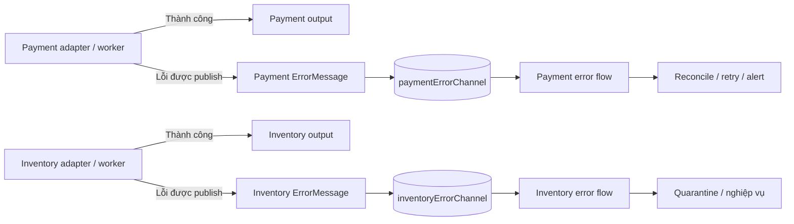

# Flow xử lý lỗi riêng trong Spring Integration

## 1. Mục tiêu bài học

Trong học phần `SPRING_INTEGRATION_PATTERN`, chúng ta triển khai **Enterprise Integration Patterns** bằng Spring Integration để tạo luồng thông điệp ít phụ thuộc và dễ mở rộng. Khi hệ thống có nhiều tuyến nghiệp vụ, ví dụ thanh toán, quản lý tồn kho và gửi thông báo, các lỗi ở mỗi tuyến thường cần cách khắc phục khác nhau. Một flow lỗi chung chỉ ghi stack trace sẽ khó thể hiện rõ trách nhiệm xử lý, mức độ ưu tiên và quy tắc khôi phục.

**Flow xử lý lỗi riêng** (*dedicated error flow*) là một luồng Spring Integration nhận thông tin lỗi từ một nguồn hoặc một nhóm nghiệp vụ được xác định, rồi thực hiện chính sách xử lý phù hợp. Có thể sử dụng một `MessageChannel` dành riêng cho lỗi thanh toán, một channel khác cho lỗi tồn kho và vẫn duy trì `errorChannel` chung cho những lỗi không được phân tuyến riêng.

Sau bài này, bạn có thể:

- Giải thích khi nào nên tách error flow theo nghiệp vụ hoặc nguồn phát lỗi.
- Phân biệt **kênh lỗi**, **thành phần phát lỗi**, **luồng nhận lỗi** và **hành động khôi phục**.
- Cấu hình các `MessageChannel` cùng `IntegrationFlow` độc lập bằng Java DSL.
- Trích xuất `ErrorMessage`, `Throwable`, `originalMessage` và `failedMessage` để quan sát lỗi.
- Kiểm thử việc phân lập tuyến lỗi, kiểm tra ngữ cảnh message và hiểu giới hạn của test gửi lỗi thủ công.
- Thiết kế retry, dead-letter/quarantine, cảnh báo, correlation và bảo đảm phản hồi của Gateway.

## 2. Vì sao không xử lý mọi lỗi trong một flow?

Một luồng xử lý đơn hàng có thể bao gồm `Router → Transformer → Gateway → Service Activator` và các nhánh phụ có `Splitter/Aggregator`. Khi một nhánh xảy ra lỗi, thông tin cần thiết và chính sách xử lý phụ thuộc vào công việc đang thực hiện.

| Nguồn lỗi | Ví dụ | Chính sách phù hợp |
| --- | --- | --- |
| Thanh toán | Đối tác thanh toán timeout hoặc trả trạng thái chưa rõ | Kiểm tra trạng thái giao dịch, retry có idempotency, cảnh báo mức ưu tiên cao. |
| Tồn kho | Không đủ hàng hoặc dữ liệu kho không hợp lệ | Cập nhật trạng thái nghiệp vụ, quarantine dữ liệu, thông báo để điều chỉnh. |
| Thông báo | Email provider tạm thời không phản hồi | Retry với backoff, sau giới hạn đưa vào hàng đợi xử lý lại. |
| Lỗi không phân loại | Exception ngoài dự kiến | Ghi thông tin chẩn đoán, cảnh báo và điều tra. |

Tách error flow mang lại **phân định trách nhiệm**, quy tắc retry rõ ràng và metric riêng cho từng nguồn. Tuy nhiên, tách channel không tự tạo retry, transaction hay lưu trữ bền vững. Tất cả hành động đó phải do endpoint hoặc handler tương ứng triển khai.

## 3. Kiến trúc của một dedicated error flow

Một error flow gồm bốn phần:

1. **Nguồn phát lỗi:** poller, adapter, gateway, executor hoặc code ứng dụng có cơ chế bắt exception.
2. **Error publisher:** thành phần tạo và gửi `ErrorMessage` khi phù hợp.
3. **Error Channel:** `MessageChannel` nhận `ErrorMessage`, chẳng hạn `paymentErrorChannel`.
4. **Error flow:** các endpoint quan sát, phân loại, retry, quarantine hoặc phát cảnh báo.



Đặt tên channel có nghĩa nghiệp vụ giúp mỗi nhóm chịu trách nhiệm về một chính sách. Các channel `paymentErrorChannel` và `inventoryErrorChannel` trong sơ đồ là tên ví dụ, phải được khai báo và gắn với nguồn phát lỗi tương ứng.

**Phân biệt quan trọng:** Với `DirectChannel` đồng bộ, exception từ handler thường lan truyền ngược về caller. Việc có một bean tên `paymentErrorChannel` không có nghĩa mọi exception của luồng thanh toán tự đến bean đó. Nguồn phát cần hỗ trợ error publishing và được **chỉ định đích lỗi**, hoặc ứng dụng phải tạo `ErrorMessage` một cách tường minh.

## 4. Chọn cách gắn một nguồn phát vào error flow

Trong Spring Integration, cách gắn kênh lỗi tùy thuộc **ranh giới thực thi**:

| Trường hợp | Cách tiếp cận | Điều cần kiểm tra |
| --- | --- | --- |
| Poller hoặc inbound adapter có hỗ trợ error channel | Cấu hình error channel của poller/adapter để publish lỗi tới kênh riêng. | Kiểu exception, transaction, thời điểm retry và failed message có được giữ không. |
| Message có header `errorChannel` | Một số thành phần dùng header này để xác định đích khi publish lỗi. | Thành phần cụ thể có đọc header hay không; header là tên channel hay tham chiếu channel hợp lệ. |
| Executor hoặc ranh giới bất đồng bộ | Cấu hình cơ chế error handling của executor/channel/endpoint. | Người gửi đã kết thúc trước khi lỗi xảy ra chưa, và ai phát `ErrorMessage`. |
| Handler đồng bộ, gọi trực tiếp qua `DirectChannel` | Xử lý exception tại caller, hoặc tạo publisher tường minh khi yêu cầu nghiệp vụ. | Không nuốt lỗi và không vô tình trả thành công cho một giao dịch thất bại. |

Ví dụ mang tính diễn giải với một message:

```text
Message có payload và header eventId=pay-104
        |
        v
Payment worker (được cấu hình dùng paymentErrorChannel)
        |
        +--> thành công: phát kết quả thanh toán
        |
        +--> exception được bắt:
                  ErrorMessage(Throwable, originalMessage nếu có)
                         |
                         v
                  paymentErrorChannel
                         |
                         v
                  paymentErrorFlow
```

**Không nên tự giả định** error channel của một inbound adapter, outbound gateway hay một poller sẽ hoạt động giống nhau: cần đọc contract cấu hình của endpoint đang dùng và kiểm thử bằng một exception thực tế. Header `errorChannel` không phải cơ chế bắt lỗi toàn cục áp dụng cho mọi Java exception.

## 5. Ví dụ Java DSL: hai flow lỗi tách biệt

Ví dụ tập trung vào **phần nhận lỗi** để minh họa sự phân lập. Chúng ta tạo hai `DirectChannel` chuyên nhận `ErrorMessage`, hai `IntegrationFlow` xử lý riêng, và một bộ ghi nhận đơn giản dùng cho kiểm thử. Các channel đồng bộ giúp test có thể quan sát ngay kết quả; khi sử dụng channel bất đồng bộ hoặc kho lưu ngoài hệ thống, cần kiểm thử với cơ chế chờ thích hợp.

Để chạy ví dụ trên Java 17 với Spring Integration, có thể dùng `spring-boot-starter-integration` trong Spring Boot; dùng `spring-boot-starter-test` cho JUnit 5, Spring Test và AssertJ.

```java
import java.util.List;
import java.util.concurrent.ConcurrentLinkedQueue;

import org.springframework.context.annotation.Bean;
import org.springframework.context.annotation.Configuration;
import org.springframework.integration.channel.DirectChannel;
import org.springframework.integration.config.EnableIntegration;
import org.springframework.integration.dsl.IntegrationFlow;
import org.springframework.messaging.Message;
import org.springframework.messaging.MessageChannel;
import org.springframework.messaging.MessagingException;
import org.springframework.messaging.support.ErrorMessage;

@Configuration
@EnableIntegration
public class DedicatedErrorFlowConfig {

    public record ErrorObservation(
        String source, String exceptionType, String eventId) {}

    public static class ErrorProbe {
        private final ConcurrentLinkedQueue<ErrorObservation> observed =
            new ConcurrentLinkedQueue<>();

        public void record(ErrorObservation observation) {
            observed.add(observation);
        }

        public List<ErrorObservation> snapshot() {
            return List.copyOf(observed);
        }

        public void clear() {
            observed.clear();
        }
    }

    @Bean
    public ErrorProbe errorProbe() {
        return new ErrorProbe();
    }

    @Bean
    public MessageChannel paymentErrorChannel() {
        return new DirectChannel();
    }

    @Bean
    public MessageChannel inventoryErrorChannel() {
        return new DirectChannel();
    }

    @Bean
    public IntegrationFlow paymentErrorFlow(ErrorProbe probe) {
        return IntegrationFlow.from("paymentErrorChannel")
            .handle(message -> recordError("payment", message, probe))
            .get();
    }

    @Bean
    public IntegrationFlow inventoryErrorFlow(ErrorProbe probe) {
        return IntegrationFlow.from("inventoryErrorChannel")
            .handle(message -> recordError("inventory", message, probe))
            .get();
    }

    private static void recordError(
            String source, Message<?> received, ErrorProbe probe) {

        // Channel được thiết kế để nhận ErrorMessage.
        if (!(received instanceof ErrorMessage error)) {
            throw new IllegalArgumentException(
                "Expected ErrorMessage on " + source + " error flow");
        }

        Throwable failure = error.getPayload();
        Message<?> original = error.getOriginalMessage();
        Message<?> failed = findFailedMessage(failure);

        // Chỉ dùng failedMessage khi publisher không có originalMessage.
        Message<?> context = original != null ? original : failed;
        Object eventId = context == null
            ? null : context.getHeaders().get("eventId");

        probe.record(new ErrorObservation(
            source,
            failure.getClass().getSimpleName(),
            eventId == null ? "unknown" : eventId.toString()));
    }

    private static Message<?> findFailedMessage(Throwable failure) {
        for (Throwable current = failure;
             current != null;
             current = current.getCause()) {
            if (current instanceof MessagingException me
                    && me.getFailedMessage() != null) {
                return me.getFailedMessage();
            }
        }
        return null;
    }
}
```

Đoạn mã giữ nguyên `ErrorMessage` tới mỗi flow; `ErrorMessage.getPayload()` mới là `Throwable`. Vì vậy, khi cần đọc `originalMessage` hoặc `getFailedMessage()`, hãy dùng toàn bộ error message thay vì chỉ giữ một chuỗi mô tả exception.

Trong ví dụ, `ErrorProbe` chỉ ghi nhận sự kiện và không thực hiện retry hay lưu dead-letter. Khi triển khai production, thay `recordError(...)` bằng các bước xử lý phù hợp từng nghiệp vụ. Không dùng bộ nhớ trong ứng dụng làm kho chứa message lỗi cần phát lại lâu dài.

### Làm thế nào để phát một lỗi vào đúng flow?

Một publisher được cấu hình tại adapter có thể gửi `ErrorMessage` đến đúng channel. Nếu ứng dụng **chủ động tạo sự kiện lỗi**, điểm publish cần xác định nguồn nghiệp vụ rõ ràng:

```java
// Minh họa trong một thành phần có sẵn MessageChannel paymentErrorChannel:
void publishPaymentFailure(
        Throwable failure, Message<?> originalMessage) {
    ErrorMessage error = new ErrorMessage(failure, originalMessage);
    boolean accepted = paymentErrorChannel.send(error);
    if (!accepted) {
        throw new IllegalStateException("Cannot publish payment failure");
    }
}
```

Đây là ví dụ **publish thủ công**, chỉ thích hợp khi ứng dụng đã quyết định ranh giới xử lý và nơi gửi lỗi. Nếu caller vẫn cần nhận exception, đừng nuốt lỗi sau khi publish. Với một hệ thống dùng broker, việc gửi event lỗi, rollback/ack và lưu trạng thái thất bại phải được thiết kế cùng nhau để tránh tình trạng thông báo lỗi thành công nhưng message gốc bị mất.

## 6. Kiểm thử các luồng lỗi riêng

Ta gửi `ErrorMessage` tới từng channel và kiểm tra nhánh còn lại không nhận dữ liệu. Kiểm thử này xác minh **cấu hình error flow phía nhận** và định dạng thông tin quan sát; chưa xác minh cách adapter bắt exception và phát lỗi.

```java
import org.junit.jupiter.api.BeforeEach;
import org.junit.jupiter.api.Test;
import org.springframework.beans.factory.annotation.Autowired;
import org.springframework.beans.factory.annotation.Qualifier;
import org.springframework.messaging.Message;
import org.springframework.messaging.MessageChannel;
import org.springframework.messaging.MessagingException;
import org.springframework.messaging.support.ErrorMessage;
import org.springframework.messaging.support.MessageBuilder;
import org.springframework.test.context.junit.jupiter.SpringJUnitConfig;

import static org.assertj.core.api.Assertions.assertThat;

@SpringJUnitConfig(DedicatedErrorFlowConfig.class)
class DedicatedErrorFlowTest {

    @Autowired
    @Qualifier("paymentErrorChannel")
    MessageChannel paymentErrors;

    @Autowired
    @Qualifier("inventoryErrorChannel")
    MessageChannel inventoryErrors;

    @Autowired
    DedicatedErrorFlowConfig.ErrorProbe probe;

    @BeforeEach
    void reset() {
        probe.clear();
    }

    @Test
    void paymentErrorIsHandledOnlyByPaymentFlow() {
        Message<String> original = MessageBuilder
            .withPayload("PAYMENT_REQUEST")
            .setHeader("eventId", "pay-104")
            .build();

        var failure = new IllegalStateException("payment service timeout");
        boolean accepted = paymentErrors.send(
            new ErrorMessage(failure, original));

        assertThat(accepted).isTrue();
        assertThat(probe.snapshot()).containsExactly(
            new DedicatedErrorFlowConfig.ErrorObservation(
                "payment", "IllegalStateException", "pay-104"));
    }

    @Test
    void inventoryErrorUsesItsOwnFlowAndFailedMessageFallback() {
        Message<String> failed = MessageBuilder
            .withPayload("RESERVE_STOCK")
            .setHeader("eventId", "stock-205")
            .build();

        var failure = new MessagingException(
            failed, "Inventory reservation failed");
        boolean accepted = inventoryErrors.send(new ErrorMessage(failure));

        assertThat(accepted).isTrue();
        assertThat(probe.snapshot()).containsExactly(
            new DedicatedErrorFlowConfig.ErrorObservation(
                "inventory", "MessagingException", "stock-205"));
    }

    @Test
    void missingMessageContextDoesNotCrashErrorFlow() {
        var failure = new IllegalArgumentException("Invalid inventory request");

        assertThat(inventoryErrors.send(
            new ErrorMessage(failure))).isTrue();

        assertThat(probe.snapshot()).containsExactly(
            new DedicatedErrorFlowConfig.ErrorObservation(
                "inventory", "IllegalArgumentException", "unknown"));
    }
}
```

Ở mỗi test, `snapshot()` chỉ chứa **một** observation thuộc flow mong đợi. Nếu cả payment flow và inventory flow cùng nhận một ErrorMessage, test sẽ phát hiện số lượng hoặc nhãn nguồn không khớp.

Để kiểm thử **toàn bộ hệ thống**, cần thêm integration test cho endpoint thực: gây exception tại payment worker hoặc inventory adapter, xác minh có `ErrorMessage` vào đúng kênh, kiểm tra reply/ack của nguồn và đảm bảo chính sách retry/quarantine xảy ra đúng một lần. Đặc biệt với luồng bất đồng bộ, không dựa vào `send(...) == true` để kết luận nghiệp vụ đã xử lý thành công.

## 7. Thiết kế nội dung thực sự cho từng error flow

### 7.1. Thanh toán: đối soát trước khi phát lại

Timeout không có nghĩa giao dịch chắc chắn thất bại; phía đối tác có thể đã nhận tiền nhưng response bị mất. Error flow thanh toán nên nhận `transactionId` hoặc `idempotencyKey`, truy vấn trạng thái giao dịch nếu đối tác hỗ trợ, rồi mới quyết định retry hoặc bù trừ. Cần tránh gửi lại một lệnh thanh toán không có bảo vệ chống trùng.

Một pipeline xử lý lỗi thanh toán có thể là:

```text
paymentErrorChannel
  → lấy transactionId và loại exception
  → kiểm tra trạng thái ở cổng thanh toán
  → nếu chưa xử lý: retry có giới hạn / backoff
  → nếu đã xử lý: cập nhật kết quả, không thu tiền lại
  → nếu chưa rõ: đánh dấu PENDING_REVIEW, cảnh báo vận hành
```

### 7.2. Tồn kho: ghi nhận lý do nghiệp vụ

Không đủ tồn kho thường là một kết quả nghiệp vụ, đôi khi nên trả phản hồi từ chối thay vì phát `ErrorMessage`. Nếu hệ thống xem đây là lỗi cần xử lý, flow tồn kho có thể ghi trạng thái `RESERVATION_REJECTED`, lưu thông tin cần đối soát và thông báo cho điều phối đơn hàng. Khi bị lỗi kỹ thuật như database unavailable, có thể áp dụng retry theo chính sách riêng.

### 7.3. Luồng lỗi mặc định: không để lỗi thất lạc

Với nguồn phát chưa cấu hình channel riêng, có thể dùng global `errorChannel` để ghi log/metric và điều tra. Không mặc định giả định mọi exception tự đến global channel; điều đó phụ thuộc cách endpoint publish lỗi.

Không nên để một error flow đã xử lý thất bại lại gửi nguyên error message về global `errorChannel` vô hạn. Phải xác định cơ chế xử lý lỗi thứ cấp, giới hạn số lần và kho giữ thông tin gốc khi cần.

## 8. Error flow riêng và các EIP khác

### Gateway và phản hồi cho caller

Một Gateway đồng bộ có thể đang chờ reply. Error flow riêng nhận `ErrorMessage` không tự tạo ra response cho Gateway. Nếu contract yêu cầu HTTP response hoặc mã trạng thái, hãy thiết kế cơ chế phản hồi lỗi hoặc cập nhật trạng thái nghiệp vụ cụ thể. Không coi việc gửi lỗi vào channel là một ACK thành công cho caller.

### Retry, error channel và dead-letter/quarantine

**Retry** thử lại công việc khi được phép; **Error Channel** chuyển thông tin lỗi cho flow xử lý; **dead-letter/quarantine** lưu dữ liệu phục vụ điều tra hoặc phát lại. Ba thành phần có trách nhiệm khác nhau. Khi retry vượt giới hạn, chính sách có thể chuyển sang quarantine, nhưng Error Channel đơn thuần không bảo đảm lưu trữ.

### Splitter, Aggregator và correlation

Nếu một `Splitter` tạo 5 message con mà một message đi vào error flow riêng, `Aggregator` có thể chờ thiếu phần tương ứng. Error flow cần biết `correlationId`, `sequenceNumber`, `sequenceSize` (nếu được giữ trong `failedMessage` hoặc `originalMessage`) để xác định công việc cần retry, hết hạn nhóm, hoặc phát trạng thái thất bại. Việc chuyển lỗi sang channel khác **không tự cập nhật group state**.

### Router, Filter và nhánh discard hợp lệ

Không phải dữ liệu bị Filter loại bỏ đều là lỗi. Heartbeat được phép bỏ qua có thể chuyển vào `nullChannel`; một message vi phạm contract dữ liệu quan trọng cần được từ chối hoặc quarantine. Hãy giữ ranh giới giữa *bỏ qua hợp lệ* và *thất bại phải xử lý* để metric và cảnh báo không bị sai lệch.

## 9. Vận hành và quan sát

Mỗi error flow nên có chỉ số đủ rõ để phân biệt **đã nhận lỗi**, **đã bắt đầu khắc phục** và **đã hoàn tất khắc phục**:

| Chỉ số / dữ liệu | Ý nghĩa |
| --- | --- |
| `integration_error_messages_total{flow}` | Số `ErrorMessage` nhận trên từng error flow. |
| `integration_recovery_attempts_total{flow,result}` | Số lần thử phục hồi và kết quả. |
| `integration_quarantine_total{flow,reason}` | Số message được lưu để điều tra. |
| `integration_error_flow_failures_total{flow}` | Lỗi xảy ra ngay trong error handler. |
| `traceId`, `eventId`, `correlationId` | Đối chiếu sự kiện lỗi với giao dịch hoặc nhóm message. |

Nên log có cấu trúc và chuẩn hóa `errorType`, `flow`, `decision`, `retryAttempt`. Không dùng từng `eventId` làm metric label; không log toàn bộ payload chứa dữ liệu cá nhân, token hoặc thông tin thanh toán. Với global channel kiểu publish/subscribe, nhiều subscriber có thể cùng thấy một lỗi: cần phân công rõ subscriber nào được phép retry hoặc tạo side effect để tránh thực thi hai lần.

Đối với error flow chạy bất đồng bộ, hãy kiểm tra cả tình huống crash hoặc restart khi lỗi đang được xử lý. Nếu yêu cầu không mất message, cần một cơ chế lưu bền vững và xác nhận xử lý thích hợp, không thể chỉ trông cậy vào `DirectChannel` hay bộ nhớ JVM.

## 10. Bài tập thực hành

**Bối cảnh:** Ứng dụng thương mại điện tử có ba luồng: thanh toán, giữ tồn kho và gửi email xác nhận.

1. Đề xuất ba channel lỗi `paymentErrorChannel`, `inventoryErrorChannel`, `notificationErrorChannel` và mô tả ai là nguồn phát, ai là người nhận.
2. Thiết kế chính sách cho timeout thanh toán, hết hàng và email provider rate limit; giải thích trường hợp nào cần retry, đối soát hay quarantine.
3. Viết integration test cố tình gây một lỗi thanh toán và chứng minh message chỉ đi vào payment error flow khi adapter đã được cấu hình đúng.
4. Viết test cho `ErrorMessage` không có `originalMessage` nhưng chứa `MessagingException.getFailedMessage()`; kiểm tra có thể lấy lại `eventId`.
5. Thiết kế metric/cảnh báo cho từng flow, cùng phương án khi chính error handler bị lỗi.
6. Nếu một đơn hàng được tách thành các item và một item gặp lỗi tồn kho, đề xuất cách kết thúc nhóm Aggregator thay vì chờ vô hạn.

**Câu hỏi tự kiểm tra:** Vì sao khai báo `paymentErrorChannel` chưa đủ để bảo đảm mọi exception của payment flow đi tới đó? Khi nào nên dùng global `errorChannel` thay vì một channel lỗi riêng? Vì sao không nên coi `ErrorMessage` là bản sao bền vững của message nghiệp vụ?

## 11. Ghi nhớ

**Flow xử lý lỗi riêng** giúp tách trách nhiệm phục hồi theo nghiệp vụ trong Spring Integration. Cấu trúc đúng gồm nguồn phát lỗi có khả năng publish, một Error Channel được chọn rõ ràng và một error flow có hành động thực tế. Hãy kiểm thử cả phía nhận `ErrorMessage` lẫn đường phát lỗi từ endpoint, giữ ngữ cảnh tương quan khi cần, bảo đảm retry có giới hạn và theo dõi kết quả phục hồi. Đây là cơ sở để các luồng Router, Filter, Gateway, Splitter và Aggregator hoạt động dễ quan sát, ít phụ thuộc và an toàn hơn khi có sự cố.
