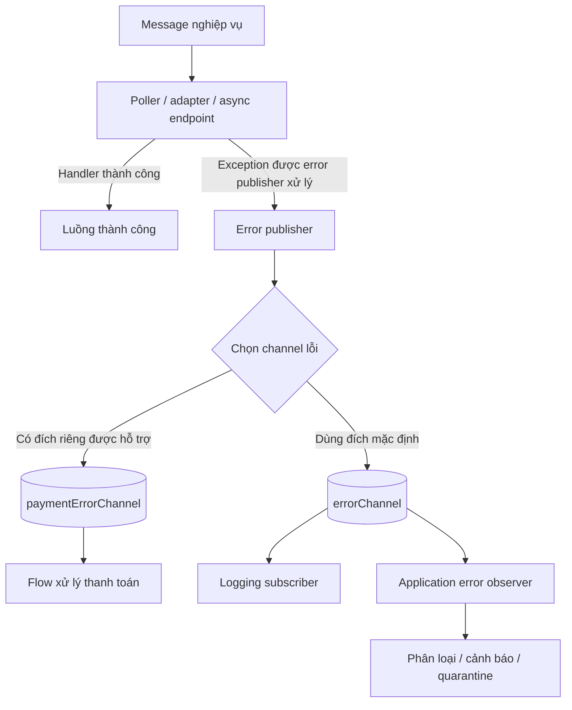

# Default error channel và global behavior trong Spring Integration

## 1. Mục tiêu và tình huống thực tế

Trong module `SPRING_INTEGRATION_PATTERN`, chúng ta thực hành các **Enterprise Integration Patterns** với Spring Integration để xây dựng các luồng message ít phụ thuộc, dễ mở rộng, có thể kiểm thử và theo dõi. Một ứng dụng có thể có nhiều luồng `Router`, `Filter`, `Transformer`, `Splitter`, `Aggregator` và `Gateway`. Khi một endpoint thất bại, câu hỏi đầu tiên thường là: **lỗi đi đâu nếu chưa chỉ định kênh xử lý lỗi riêng?**

Spring Integration có tên kênh quy ước **`errorChannel`**, thường được gọi là *default/global error channel*. Đây là một điểm nhận `ErrorMessage` dùng chung trong phạm vi một application context. Tuy nhiên, tên kênh này **không có nghĩa tất cả Java exception đều tự động chảy vào đó**.

Sau bài này, bạn có thể:

- Mô tả cơ chế `errorChannel` mặc định và phạm vi “global”.
- Hiểu hành vi publish/subscribe, logging subscriber mặc định và nhiều consumer lỗi.
- Phân biệt **exception truyền ngược về caller** với **`ErrorMessage` được publish**.
- Giải thích cách một error publisher chọn channel riêng hoặc fallback về global channel.
- Đăng ký một consumer nhận `ErrorMessage` mà không phải thay thế bean `errorChannel`.
- Kiểm thử consumer của global channel, tìm nguyên nhân khi không thấy lỗi và tránh lặp xử lý.
- Thiết kế retry, cảnh báo, quarantine và correlation phù hợp với hợp đồng nghiệp vụ.

## 2. Default/global error channel là gì?

Khi hạ tầng Spring Integration được bật (ví dụ bằng `@EnableIntegration` hoặc cấu hình tự động phù hợp), framework thường cung cấp một channel chuẩn tên **`errorChannel`** nếu ứng dụng chưa khai báo một bean tương ứng. Channel mặc định này thường là một **`PublishSubscribeChannel`** và có cơ chế ghi log lỗi được cung cấp bởi hạ tầng.

Một thành phần có chức năng phát lỗi có thể gửi `ErrorMessage` đến channel này khi không có đích lỗi cụ thể hơn. Lúc đó, các subscriber của channel nhận message lỗi để ghi nhận, cảnh báo hoặc chuyển sang luồng phục hồi.

| Khái niệm | Vai trò | Điều không nên suy diễn |
| --- | --- | --- |
| `errorChannel` | Tên channel chuẩn cho các `ErrorMessage` được publish tới đích mặc định. | Không phải bộ bắt lỗi tự động của mọi thread và mọi endpoint. |
| `PublishSubscribeChannel` | Phân phối message tới các subscriber đã đăng ký. | Không mặc nhiên là hàng đợi bền vững hay cơ chế retry. |
| `ErrorMessage` | Một `Message<Throwable>` chứa exception và có thể chứa message gốc. | Không bảo đảm luôn có `originalMessage` hoặc correlation metadata. |
| Logging subscriber | Ghi lại lỗi đến channel theo cấu hình framework. | Log xuất hiện không có nghĩa lỗi đã được khôi phục. |
| Error flow của ứng dụng | Phân loại, theo dõi hoặc xử lý lỗi theo nghiệp vụ. | Chỉ tồn tại khi bạn cấu hình endpoint thực sự nhận và xử lý lỗi. |

**“Global” là trong phạm vi Spring application context**, không phải một message bus toàn hệ thống. Nếu có ba microservice khác nhau, kênh `errorChannel` của service A không tự truyền lỗi tới service B hay C.

### Sơ đồ tổng quan



Việc chọn kênh lỗi không phải lúc nào cũng theo cùng một quy tắc cho mọi adapter. Cần xem nguồn phát dùng cấu hình kênh riêng, header `errorChannel`, hay fallback mặc định. Hình trên mô tả **khả năng điều hướng**, không phải lời hứa rằng exception từ mọi endpoint đều được publish.

## 3. Điều kiện để một ErrorMessage đến global channel

Muốn hiểu hành vi mặc định, hãy nhìn vào **ranh giới thực thi** và **thành phần phát lỗi**.

### 3.1. Lỗi ở luồng đồng bộ

Với `DirectChannel`, handler thường chạy ngay trên thread của caller. Nếu handler ném exception, lỗi có thể đi ngược qua `send(...)` hoặc `Gateway` tới caller. Global `errorChannel` **không bắt buộc nhận** một `ErrorMessage`.

```text
Caller --> DirectChannel --> Handler --> throw MessagingException
   ^                                    |
   +------------- exception -------------+
```

Tình huống này **không nhất thiết là lỗi cấu hình**. Caller, gateway hoặc retry advice có thể là nơi thích hợp để quyết định xử lý lỗi. Nếu yêu cầu nghiệp vụ bắt buộc phải gửi thông tin lỗi qua channel, cần một error publisher rõ ràng thay vì mong framework tự bắt mọi exception đồng bộ.

### 3.2. Lỗi ở nguồn nhận hoặc ranh giới bất đồng bộ

Poller, một số inbound adapter và các cơ chế thực thi bất đồng bộ có thể sử dụng error handler/publisher để bắt exception rồi phát `ErrorMessage`. Ví dụ một worker được poller gọi thất bại, trong khi thread gửi message ban đầu không còn chờ kết quả.

```text
Poller / executor / adapter
    --> Handler --> exception
                    |
                    v
               Error publisher
                    |
                    v
              ErrorMessage(Throwable)
                    |
                    +--> channel riêng nếu được chọn
                    |
                    +--> errorChannel khi dùng fallback toàn cục
```

**Không dùng `send(...) == true` làm bằng chứng nghiệp vụ đã hoàn tất ở luồng bất đồng bộ.** Nó có thể chỉ có nghĩa message đã được channel nhận để thực hiện sau.

### 3.3. Lỗi không được publish

Một số trường hợp khiến global channel không có message:

1. Exception được ném trên thread đồng bộ và truyền thẳng về caller.
2. Handler tự bắt rồi bỏ qua exception mà không tạo sự kiện lỗi.
3. Error publisher sử dụng một channel riêng thay cho `errorChannel`.
4. Thành phần không hỗ trợ cơ chế error publishing mà ứng dụng đang giả định.
5. Lỗi xảy ra khi khởi tạo ứng dụng, trước khi kênh/endpoint sẵn sàng, hoặc ngoài phạm vi hạ tầng Spring Integration.

Vì vậy, khi kiểm thử, cần kiểm tra **cả đường phát lỗi** chứ không chỉ kiểm tra subscriber trên global channel.

## 4. Publish/subscribe và logging mặc định

Global `errorChannel` mặc định thường dùng `PublishSubscribeChannel`. Channel này có thể phân phối cùng một `ErrorMessage` đến nhiều subscriber, chẳng hạn:

- Logging handler của framework.
- Một flow đo metric lỗi.
- Một flow phục hồi, quarantine hoặc thông báo vận hành.

Điều này tiện cho **quan sát tách biệt khỏi xử lý nghiệp vụ**. Tuy nhiên, cần chú ý bốn đặc điểm:

**Một:** Việc có nhiều subscriber **không** biến channel thành hệ thống lưu trữ bền vững. Nếu tiến trình dừng, đừng giả định message lỗi còn để phát lại.

**Hai:** Nếu channel không có executor, việc gọi subscriber thường diễn ra đồng bộ theo quá trình phân phối message. Một subscriber chậm hoặc ném exception có thể ảnh hưởng đến luồng phát lỗi; chi tiết phụ thuộc cấu hình channel và error handler.

**Ba:** Logging subscriber không phải chính sách retry, dead-letter hay bù trừ. Không được đánh dấu một giao dịch là đã xử lý chỉ vì thấy log lỗi.

**Bốn:** Hai subscriber cùng thực hiện side effect như retry hoặc ghi dead-letter có thể tạo xử lý trùng. Hãy chỉ định rõ một **owner** cho việc phục hồi, còn subscriber khác chỉ quan sát.

### Có nên tạo lại bean errorChannel?

Thông thường **không cần**. Để quan sát lỗi, hãy đăng ký một `@ServiceActivator(inputChannel = "errorChannel")` hoặc `IntegrationFlow.from("errorChannel")` thay vì thay thế toàn bộ bean hạ tầng.

Nếu ứng dụng chủ động định nghĩa bean tên `errorChannel`, điều đó có thể thay đổi kiểu channel, subscriber mặc định và ngữ nghĩa phát lỗi. Hãy chỉ làm khi có yêu cầu kiến trúc cụ thể và đã kiểm thử cơ chế logging, số lượng subscriber, khả năng xử lý lỗi thứ cấp và compatibility với phiên bản Spring Integration đang dùng.

## 5. Chọn global hay error channel riêng?

Một error publisher có thể ưu tiên channel được chỉ định trong cấu hình của endpoint hoặc một chỉ dẫn hợp lệ từ message, rồi sử dụng fallback mặc định khi thích hợp. Trong Spring Messaging, tên header quy ước là `errorChannel` (`MessageHeaders.ERROR_CHANNEL`); giá trị có thể là tham chiếu tới `MessageChannel` hoặc tên channel, tùy cơ chế phân giải của thành phần.

**Sự tồn tại của header không tự làm exception được publish.** Chỉ thành phần phát lỗi có hỗ trợ và thực sự sử dụng thông tin này mới chuyển lỗi đến đúng đích.

| Tình huống | Lựa chọn | Lý do |
| --- | --- | --- |
| Muốn log/metric lỗi chung của các nguồn không có chính sách riêng | Global `errorChannel` | Tập trung quan sát, dễ thống kê lỗi chưa phân loại. |
| Lỗi thanh toán cần đối soát trước khi thử lại | `paymentErrorChannel` | Tránh vô ý áp dụng retry chung gây thanh toán trùng. |
| Lỗi dữ liệu cần người vận hành sửa rồi phát lại | `validationErrorChannel` | Kết nối chính sách quarantine/triage chuyên biệt. |
| Lỗi notification có retry/backoff độc lập | `notificationErrorChannel` | Tách mức ưu tiên và ngưỡng cảnh báo với hệ thống lõi. |
| Lỗi lạ không có nguồn hoặc contract đủ rõ | Global channel + tuyến điều tra | Không âm thầm discard. |

Khi dùng một `ErrorMessage` để điều hướng, hai nguồn ngữ cảnh có thể khác nhau:

- `ErrorMessage.getOriginalMessage()`: message mà publisher cung cấp khi phát lỗi, có thể `null`.
- `MessagingException.getFailedMessage()`: message gắn với thao tác thất bại, có thể `null` và có thể là message **sau** Transformer hoặc Splitter.

Error flow phải hiểu nguồn gốc correlation ID để không gán nhầm ngữ cảnh giao dịch.

## 6. Ví dụ: theo dõi global errorChannel mà không thay thế channel

Ví dụ sử dụng Java 17 và Spring Integration. Với Spring Boot, có thể thêm `spring-boot-starter-integration`; với JUnit 5/Spring Test/AssertJ, dùng các dependency test tương ứng (chẳng hạn `spring-boot-starter-test`).

Chúng ta tạo một bean observer có `@ServiceActivator` lắng nghe global `errorChannel`. Observer đọc loại exception và `eventId` từ message gốc, rồi ghi lại dưới dạng bản ghi nhỏ trong bộ nhớ để kiểm thử. Mẫu này **chỉ minh họa quan sát**, không thay thế hệ thống logging, metric hoặc durable quarantine của production.

```java
import java.util.List;
import java.util.concurrent.ConcurrentLinkedQueue;

import org.springframework.context.annotation.Bean;
import org.springframework.context.annotation.Configuration;
import org.springframework.integration.annotation.ServiceActivator;
import org.springframework.integration.config.EnableIntegration;
import org.springframework.messaging.Message;
import org.springframework.messaging.MessagingException;
import org.springframework.messaging.support.ErrorMessage;

@Configuration
@EnableIntegration
public class GlobalErrorChannelLessonConfig {

    public record ErrorObservation(String exceptionType, String eventId) {}

    public static class ErrorProbe {
        private final ConcurrentLinkedQueue<ErrorObservation> observations =
            new ConcurrentLinkedQueue<>();

        public void record(ErrorObservation observation) {
            observations.add(observation);
        }

        public List<ErrorObservation> snapshot() {
            return List.copyOf(observations);
        }

        public void clear() {
            observations.clear();
        }
    }

    @Bean
    public ErrorProbe errorProbe() {
        return new ErrorProbe();
    }

    @Bean
    public GlobalErrorObserver globalErrorObserver(ErrorProbe probe) {
        return new GlobalErrorObserver(probe);
    }

    public static class GlobalErrorObserver {
        private final ErrorProbe probe;

        public GlobalErrorObserver(ErrorProbe probe) {
            this.probe = probe;
        }

        @ServiceActivator(inputChannel = "errorChannel")
        public void onError(ErrorMessage errorMessage) {
            Throwable failure = errorMessage.getPayload();

            Message<?> original = errorMessage.getOriginalMessage();
            String eventId = readHeader(original, "eventId");

            // Nếu originalMessage không có ID, thử failedMessage.
            if (eventId == null) {
                Message<?> failed = findFailedMessage(failure);
                eventId = readHeader(failed, "eventId");
            }

            probe.record(new ErrorObservation(
                failure.getClass().getSimpleName(),
                eventId == null ? "unknown" : eventId));
        }

        private static String readHeader(Message<?> message, String name) {
            if (message == null) {
                return null;
            }
            Object value = message.getHeaders().get(name);
            return value == null ? null : value.toString();
        }

        private static Message<?> findFailedMessage(Throwable failure) {
            int hops = 0;
            for (Throwable current = failure;
                 current != null && hops < 32;
                 current = current.getCause(), hops++) {
                if (current instanceof MessagingException me) {
                    Message<?> failed = me.getFailedMessage();
                    if (failed != null) {
                        return failed;
                    }
                }
            }
            return null;
        }
    }
}
```

Điểm cần chú ý:

1. `@EnableIntegration` bật hạ tầng Integration cần thiết. Ví dụ đăng ký **subscriber** chứ không tự khai báo lại bean `errorChannel`.
2. Tham số `ErrorMessage` giúp method đọc cả `Throwable` lẫn `originalMessage`.
3. `errorMessage.getHeaders()` là headers của message lỗi, **không nên đồng nhất** với headers của message bị lỗi.
4. `findFailedMessage(...)` chỉ dùng như fallback có giới hạn; nó không chứng minh các side effect trước lỗi đã rollback.
5. Bản ghi `unknown` thể hiện thiếu ngữ cảnh, không phải một event ID thật.

## 7. Kiểm thử hành vi phía nhận

Test sau chủ động gửi `ErrorMessage` tới global channel và kiểm tra subscriber. Đây là **consumer test**: nó xác minh observer có nhận và xử lý định dạng message lỗi. Nó **không** chứng minh rằng các exception phát sinh từ bất kỳ adapter nào đều tự được gửi tới channel.

```java
import org.junit.jupiter.api.BeforeEach;
import org.junit.jupiter.api.Test;
import org.springframework.beans.factory.annotation.Autowired;
import org.springframework.beans.factory.annotation.Qualifier;
import org.springframework.messaging.Message;
import org.springframework.messaging.MessageChannel;
import org.springframework.messaging.MessagingException;
import org.springframework.messaging.support.ErrorMessage;
import org.springframework.messaging.support.MessageBuilder;
import org.springframework.test.context.junit.jupiter.SpringJUnitConfig;

import static org.assertj.core.api.Assertions.assertThat;

@SpringJUnitConfig(GlobalErrorChannelLessonConfig.class)
class GlobalErrorChannelLessonTest {

    @Autowired
    @Qualifier("errorChannel")
    MessageChannel errorChannel;

    @Autowired
    GlobalErrorChannelLessonConfig.ErrorProbe probe;

    @BeforeEach
    void reset() {
        probe.clear();
    }

    @Test
    void acceptsErrorMessageWithOriginalMessage() {
        Message<String> original = MessageBuilder
            .withPayload("ORDER_CREATED")
            .setHeader("eventId", "evt-201")
            .build();

        ErrorMessage error = new ErrorMessage(
            new IllegalStateException("Payment timeout"), original);

        assertThat(errorChannel.send(error)).isTrue();
        assertThat(probe.snapshot()).containsExactly(
            new GlobalErrorChannelLessonConfig.ErrorObservation(
                "IllegalStateException", "evt-201"));
    }

    @Test
    void usesFailedMessageWhenOriginalMessageIsMissing() {
        Message<String> failed = MessageBuilder
            .withPayload("RESERVE_STOCK")
            .setHeader("eventId", "evt-202")
            .build();

        MessagingException failure =
            new MessagingException(failed, "Inventory unavailable");

        assertThat(errorChannel.send(new ErrorMessage(failure))).isTrue();
        assertThat(probe.snapshot()).containsExactly(
            new GlobalErrorChannelLessonConfig.ErrorObservation(
                "MessagingException", "evt-202"));
    }

    @Test
    void missingContextDoesNotBreakGlobalObserver() {
        ErrorMessage error =
            new ErrorMessage(new IllegalArgumentException("Invalid event"));

        assertThat(errorChannel.send(error)).isTrue();
        assertThat(probe.snapshot()).containsExactly(
            new GlobalErrorChannelLessonConfig.ErrorObservation(
                "IllegalArgumentException", "unknown"));
    }
}
```

Vì ví dụ sử dụng channel mặc định không cấu hình executor riêng và một observer chỉ ghi bộ nhớ, các assertion kiểm tra ngay sau `send(...)` là phù hợp với trường hợp đồng bộ đang minh họa. Nếu đổi sang async/error subscriber bất đồng bộ, cần đợi sự kiện với timeout và tránh kiểm tra kết quả tức thời.

### Kiểm thử đường phát lỗi thực tế

Sau khi đã kiểm thử consumer, hãy viết một integration test riêng cho **source có error publisher**:

1. Cấu hình poller/adapter hoặc thành phần async hỗ trợ phát lỗi.
2. Chỉ định global `errorChannel` làm đích mặc định hoặc không chỉ định channel riêng nếu contract của source cho phép fallback.
3. Làm handler ném exception có chủ đích, gắn `eventId` để đối chiếu.
4. Xác minh nhận được `ErrorMessage`, loại lỗi và ngữ cảnh đầu vào khi publisher cung cấp.
5. Thử lại cùng trường hợp với channel lỗi riêng; xác minh lỗi đi đến đích được chọn, không vô ý tạo xử lý kép.
6. Kiểm tra tiếp retry, transaction/ack và hành vi khi error subscriber cũng thất bại.

Không nên coi “test gửi tay qua `errorChannel` PASS” là bằng chứng một `DirectChannel` đồng bộ tự động publish exception.

## 8. Global channel phối hợp với Retry, Gateway và Null Channel

### Retry

Một error flow có thể quyết định đưa lỗi tới nơi xử lý lại, nhưng `errorChannel` không tự retry. **Retry advice** hoặc cơ chế thử lại của endpoint có thể chạy trước khi một lỗi được publish; thứ tự chính xác phụ thuộc cấu hình. Khi các lần thử thất bại, hãy lưu thông tin lỗi để điều tra thay vì gửi qua lại vô hạn giữa các channel.

Đối với một giao dịch thanh toán, việc thử lại sau timeout cần idempotency hoặc đối soát trạng thái. Có `ErrorMessage` không chứng minh giao dịch trước đó chắc chắn chưa xảy ra.

### Gateway và contract phản hồi

Một Gateway đồng bộ thường có contract trả reply hoặc ném exception. Khi lỗi của nhánh bất đồng bộ được publish đến global `errorChannel`, caller **không tự động** nhận một phản hồi thành công hoặc thất bại đúng theo hợp đồng. Cần cấu hình error reply, timeout hoặc cơ chế cập nhật trạng thái công việc rõ ràng.

### Null Channel

```text
Message được phép bỏ có chủ đích --> nullChannel  --> kết thúc nhánh
Exception được publish           --> errorChannel --> xử lý/giám sát lỗi
```

Không dùng `nullChannel` thay cho `errorChannel` khi message cần được retry, lưu để điều tra hoặc trả trạng thái lỗi. Ngược lại, một heartbeat được phép bỏ qua không cần được biến thành exception.

### Splitter, Aggregator và correlation

Nếu một message con của Splitter thất bại và đi vào global error flow, Aggregator có thể thiếu phần cần thiết để hoàn thành nhóm. `ErrorMessage` và `MessagingException` đôi khi mang `correlationId`, `sequenceNumber` hoặc `sequenceSize` qua message gốc/thất bại; điều đó **không tự điều chỉnh release strategy**. Phải thiết kế cách retry phần con, kết thúc nhóm ở trạng thái lỗi, timeout hoặc bù trừ.

## 9. Vận hành và xử lý sự cố với global errorChannel

Để quan sát đúng, nên phân biệt số lỗi đến channel, số lỗi đã được phân loại và số công việc được phục hồi thành công:

| Metric hoặc log | Ý nghĩa |
| --- | --- |
| `integration_error_messages_total{source,channel}` | Số lỗi được publish tới các channel. |
| `integration_error_routes_total{flow,route}` | Số lỗi được error flow chọn tuyến. |
| `integration_recovery_total{flow,result}` | Số công việc đã được phục hồi hoặc thất bại sau retry. |
| `integration_error_handler_failures_total{flow}` | Số lỗi xảy ra ngay trong error handler. |
| Log `eventId`, `correlationId`, `exceptionType` | Truy vết lỗi đến request hoặc message group cụ thể. |

Đừng dùng `eventId` làm metric label vì sẽ tạo quá nhiều chuỗi thời gian. Tránh ghi toàn bộ payload nhạy cảm, token hoặc dữ liệu thanh toán vào log. Error Channel không phải kho lưu trữ có thể phát lại: nếu yêu cầu phục hồi sau restart, dùng broker, database hoặc quarantine bền vững theo thiết kế.

### Bảng chẩn đoán nhanh

| Triệu chứng | Nguyên nhân có thể | Cách xác minh |
| --- | --- | --- |
| Caller nhận exception nhưng `errorChannel` không có lỗi | Luồng đồng bộ, không có publisher. | Kiểm tra loại channel, thread gọi và contract lỗi của endpoint. |
| Error handler không nhận message nhưng log lỗi vẫn xuất hiện | Log đến từ caller hoặc logger khác; error được gửi channel riêng; listener chưa đăng ký. | Kiểm tra bean/endpoint subscriber và đích của publisher. |
| Hai handler cùng retry một lỗi | Nhiều subscriber trên PublishSubscribeChannel cùng có side effect. | Kiểm tra danh sách subscriber và ownership. |
| Nhận `ErrorMessage` nhưng thiếu `eventId` | Publisher không cung cấp original message hoặc headers đã bị thay đổi. | Kiểm tra `originalMessage`, `failedMessage` và bước Transformer. |
| Một lỗi làm error handler ném exception mới | Subscriber chưa chịu được dữ liệu thiếu hoặc dependency lỗi. | Test error flow thất bại thứ cấp và chính sách kết thúc an toàn. |
| Log đã ghi nhưng công việc không được xử lý lại | Logger chỉ quan sát; chưa có retry/quarantine. | Kiểm tra downstream error flow và metric phục hồi. |

## 10. Bài tập thực hành

**Bối cảnh:** Một hệ thống xử lý đơn hàng có luồng thanh toán, tồn kho và thông báo. Tồn kho dùng poller, thanh toán có Gateway đồng bộ và thông báo chạy bất đồng bộ.

1. Vẽ ba đường đi exception và xác định trường hợp nào **có thể** publish `ErrorMessage` vào global `errorChannel`, trường hợp nào truyền lỗi về caller.
2. Viết consumer dùng `@ServiceActivator(inputChannel = "errorChannel")` để ghi số lỗi và `eventId` có kiểm soát.
3. Cấu hình một nguồn phát lỗi có hỗ trợ error publishing để dùng `notificationErrorChannel`. Giải thích vì sao global listener không nên xử lý trùng công việc thông báo.
4. Viết test gửi tay `ErrorMessage` có và không có `originalMessage`, rồi viết **integration test** gây lỗi thực trong poller/adapter.
5. Thiết kế retry hữu hạn, lưu quarantine bền vững và cảnh báo nếu retry cuối cùng thất bại.
6. Thử một exception trong nhánh Splitter, xác định correlation metadata để Aggregator không chờ vô hạn.

**Câu hỏi tự kiểm tra:** “Global” có nghĩa mọi exception trong JVM chắc chắn vào `errorChannel` không? Vì sao có logging subscriber mặc định chưa đủ để đảm bảo phục hồi? Khi nào nên đăng ký thêm consumer trên channel mặc định, và khi nào nên thiết kế một channel riêng?

## 11. Ghi nhớ

`errorChannel` là **đích nhận lỗi mặc định được Spring Integration quy ước**, thường có hành vi publish/subscribe và logging, nhưng chỉ nhận `ErrorMessage` khi một thành phần thực sự publish tới đó. Global channel hữu ích để quan sát tập trung, không phải cơ chế bắt mọi exception, retry tự động hay lưu dữ liệu bền vững. Hãy chọn kênh lỗi theo nguồn phát, giữ ngữ cảnh `originalMessage`/`failedMessage`, kiểm thử cả người nhận lẫn publisher, và bảo đảm các flow lỗi có chính sách phục hồi rõ ràng.
