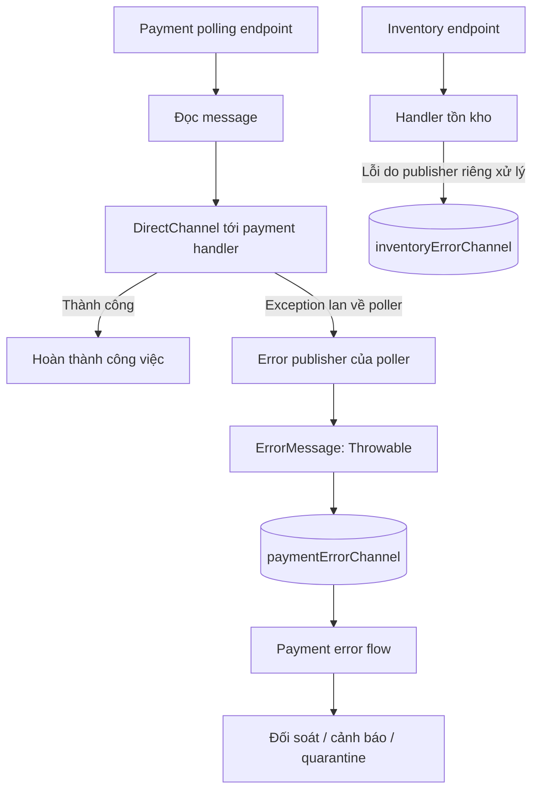

# Local error channel của endpoint trong Spring Integration

## 1. Bài toán và mục tiêu

Trong module `SPRING_INTEGRATION_PATTERN`, chúng ta học **Enterprise Integration Patterns** với Spring Integration để xây dựng luồng message ít phụ thuộc, dễ mở rộng, đồng thời kiểm thử và theo dõi các nhánh xử lý như Router, Filter, Transformer, Splitter, Aggregator, Gateway, retry và error channel.

Giả sử ứng dụng có hai nguồn nhận message: một **poller thanh toán** và một **poller cập nhật tồn kho**. Lỗi thanh toán cần được đối soát với nhà cung cấp; lỗi tồn kho có thể cần kiểm tra dữ liệu và đưa vào quarantine. Nếu cả hai nguồn phát lỗi vào một nơi mà không giữ thông tin nguồn, việc phân loại, cảnh báo và phục hồi sẽ khó kiểm soát.

**Local error channel của endpoint** là kênh lỗi được chỉ định cho một **thành phần phát lỗi cụ thể** (chẳng hạn polling endpoint hoặc adapter hỗ trợ error channel), thay vì mặc định đưa lỗi đến global `errorChannel`. Cách này giúp gắn chính sách phục hồi sát với nguồn phát.

Học xong bài này, bạn có thể:

- Phân biệt **endpoint-local error channel**, global `errorChannel` và header `errorChannel` trên message.
- Xác định loại lỗi nào có thể được endpoint publish thành `ErrorMessage`, loại nào truyền ngược về caller.
- Cấu hình một poller với kênh lỗi riêng và một error flow xử lý `ErrorMessage`.
- Viết kiểm thử có lỗi phát sinh thực sự ở polling endpoint, không chỉ gửi `ErrorMessage` thủ công.
- Thiết kế retry, quarantine, correlation, logging và hành vi sau khi error handler thất bại.

## 2. “Local” có nghĩa gì?

Tên “local” nói về **phạm vi quyết định đích phát lỗi**, không phải một channel chỉ tồn tại bên trong method. Ví dụ `paymentErrorChannel` vẫn có thể là một bean `MessageChannel` bình thường trong Spring application context; điều làm nó trở thành kênh lỗi cục bộ là **polling endpoint thanh toán được cấu hình gửi lỗi tới đó**.

| Thành phần | Phạm vi | Vai trò |
| --- | --- | --- |
| Global `errorChannel` | Đích quy ước chung trong một application context. | Nhận `ErrorMessage` do các error publisher chọn đích mặc định. |
| `paymentErrorChannel` | Channel do ứng dụng tạo; một endpoint hoặc nhóm endpoint chọn dùng. | Chuyển lỗi thanh toán sang error flow thích hợp. |
| Header `errorChannel` | Metadata trên một message cụ thể. | Có thể được **một số** cơ chế phát lỗi/luồng request-reply sử dụng để xác định đích; không tự bắt exception. |
| `ErrorMessage` | Message mang payload kiểu `Throwable`. | Truyền sự kiện lỗi qua channel; có thể mang thêm original message. |
| Error handler/flow | Consumer đăng ký trên channel. | Ghi nhận, phân loại, phục hồi, quarantine hoặc cảnh báo. |

Một kênh lỗi riêng **không tự động bao trùm toàn bộ chuỗi downstream**. Nếu message đi qua một ranh giới thread/adapter khác, lỗi ở đó có thể do error publisher khác quản lý. Mỗi ranh giới cần được xem xét cụ thể.

## 3. Điều kiện để endpoint publish lỗi

Khi một handler chạy đồng bộ phía sau `DirectChannel`, exception thường đi ngược về caller gọi `send(...)` hoặc Gateway. Khi đó, việc bạn khai báo một bean `paymentErrorChannel` **không tự làm lỗi được gửi sang bean này**.

Ngược lại, một polling endpoint hoặc một adapter có cơ chế xử lý lỗi có thể bắt exception xảy ra trong công việc nó thực thi, tạo `ErrorMessage` rồi gửi đến error channel đã cấu hình. Cấu hình endpoint chỉ có hiệu lực khi exception **đi qua đúng vùng xử lý lỗi** của endpoint.



> Một exception được chuyển tới local error channel chỉ khi endpoint/error publisher tương ứng **có hỗ trợ và đã thực sự publish**. Không nên suy diễn rằng `@Poller(errorChannel = "...")` làm mọi lỗi Java trong JVM đi về cùng một chỗ.

### Đồng bộ và bất đồng bộ

| Trường hợp | Hành vi thường gặp | Điều phải kiểm thử |
| --- | --- | --- |
| Gửi tới `DirectChannel` từ caller thông thường | Exception lan ngược trên thread caller. | Caller/Gateway có nhận exception đúng contract không? |
| Poller gọi handler qua `DirectChannel` | Exception có thể lan ngược đến poller, được error handler của poller bắt và publish. | Error Channel của poller có nhận `ErrorMessage` không? |
| Handler chuyển công việc vào executor hoặc broker khác | Exception xảy ra sau ranh giới có thể do thành phần downstream xử lý. | Publisher ở phía downstream chọn channel nào? |
| Inbound/outbound adapter có hỗ trợ error channel | Có thể phát `ErrorMessage` theo cấu hình adapter. | Cấu hình thuộc tính, reply, ack/rollback và loại message lỗi của adapter. |

Nếu một thành phần đã bắt exception và chỉ ghi log, upstream poller có thể không thấy exception nữa. Ngược lại, nếu handler gây lỗi sau khi đã xác nhận message thành công ở một ranh giới bất đồng bộ, poller ban đầu có thể không còn quản lý được lỗi đó.

## 4. Cấu hình local error channel ở đâu?

Có một số cách tùy loại endpoint:

1. **Poller:** cấu hình thuộc tính `errorChannel` cho poller của một nguồn nhận message, khi kiểu polling endpoint đó hỗ trợ.
2. **Adapter/gateway:** sử dụng thuộc tính error channel hoặc error handling do đúng adapter/gateway cung cấp. Không suy đoán cùng một cú pháp dùng được cho mọi adapter.
3. **Message header:** một số cơ chế dùng `MessageHeaders.ERROR_CHANNEL` để tìm đích lỗi. Header là một **chỉ dẫn**, không phải bộ bắt exception.
4. **Publisher do ứng dụng tự viết:** bắt lỗi có chủ đích, tạo `ErrorMessage` và gửi đến channel xác định; đồng thời bảo toàn contract lỗi với caller.

**Thứ tự ưu tiên không nên được khái quát cho mọi endpoint.** Tùy publisher, nó có thể sử dụng header, cấu hình endpoint, channel mặc định hoặc một error handler chuyên dụng. Nếu nguồn có cả header và cấu hình local, hãy kiểm thử chính xác cơ chế đang dùng và không giả định một thứ tự cố định.

### Khi nào nên dùng global channel?

Global `errorChannel` phù hợp với việc ghi nhận lỗi chưa có luồng nghiệp vụ riêng, hoặc quan sát tập trung. Local channel phù hợp khi lỗi cần chính sách chuyên biệt như đối soát thanh toán, retry gửi email hoặc quarantine dữ liệu kho. Hai loại kênh có thể cùng tồn tại, nhưng phải tránh hai handler cùng thử lại một giao dịch.

## 5. Ví dụ hoàn chỉnh: polling endpoint thanh toán

Đây là ví dụ dùng **Java 17, Spring Integration Java DSL và annotation poller**. Một `MessageSource` chỉ phát một message để kiểm thử; handler cố tình ném exception; poller được gắn `paymentErrorChannel`; error flow ghi nhận lỗi đã nhận.

Trong Spring Boot có thể sử dụng `spring-boot-starter-integration`, và `spring-boot-starter-test` cho JUnit 5, Spring Test cùng AssertJ. Ví dụ không phụ thuộc broker hay cơ sở dữ liệu để người học thấy rõ đường phát lỗi của poller.

```java
import java.util.concurrent.CountDownLatch;
import java.util.concurrent.TimeUnit;
import java.util.concurrent.atomic.AtomicBoolean;
import java.util.concurrent.atomic.AtomicReference;

import org.springframework.context.annotation.Bean;
import org.springframework.context.annotation.Configuration;
import org.springframework.integration.annotation.InboundChannelAdapter;
import org.springframework.integration.annotation.Poller;
import org.springframework.integration.channel.DirectChannel;
import org.springframework.integration.config.EnableIntegration;
import org.springframework.integration.core.MessageSource;
import org.springframework.integration.dsl.IntegrationFlow;
import org.springframework.messaging.Message;
import org.springframework.messaging.MessageChannel;
import org.springframework.messaging.support.ErrorMessage;
import org.springframework.messaging.support.MessageBuilder;

@Configuration
@EnableIntegration
public class PaymentPollingLocalErrorConfig {

    public static class ErrorProbe {
        private final CountDownLatch received = new CountDownLatch(1);
        private final AtomicReference<ErrorMessage> latest =
            new AtomicReference<>();

        public void record(ErrorMessage error) {
            latest.set(error);
            received.countDown();
        }

        public boolean await(long timeout, TimeUnit unit)
                throws InterruptedException {
            return received.await(timeout, unit);
        }

        public ErrorMessage latest() {
            return latest.get();
        }
    }

    @Bean
    public ErrorProbe errorProbe() {
        return new ErrorProbe();
    }

    @Bean
    public MessageChannel paymentInput() {
        return new DirectChannel();
    }

    @Bean
    public MessageChannel paymentErrorChannel() {
        return new DirectChannel();
    }

    // Source được poller gọi. Sau message đầu tiên sẽ trả null.
    @Bean
    @InboundChannelAdapter(
        channel = "paymentInput",
        poller = @Poller(
            fixedDelay = "200",
            errorChannel = "paymentErrorChannel"))
    public MessageSource<String> paymentSource() {
        AtomicBoolean emitted = new AtomicBoolean();
        return () -> emitted.compareAndSet(false, true)
            ? MessageBuilder.withPayload("PAYMENT_REQUEST")
                .setHeader("eventId", "evt-pay-42")
                .build()
            : null;
    }

    @Bean
    public IntegrationFlow paymentProcessingFlow() {
        return IntegrationFlow.from("paymentInput")
            .handle(String.class, (payload, headers) -> {
                // Minh họa một handler đồng bộ bị lỗi.
                throw new IllegalStateException(
                    "Simulated payment provider timeout");
            })
            .get();
    }

    @Bean
    public IntegrationFlow paymentErrorFlow(ErrorProbe probe) {
        return IntegrationFlow.from("paymentErrorChannel")
            .handle(message -> {
                if (!(message instanceof ErrorMessage error)) {
                    throw new IllegalArgumentException(
                        "Expected ErrorMessage");
                }
                probe.record(error);
            })
            .get();
    }
}
```

### Lần theo đường đi của lỗi

1. Spring Integration khởi chạy polling endpoint của `paymentSource` theo `fixedDelay`.
2. `MessageSource` trả một message có `eventId=evt-pay-42`. Những lần sau trả `null`, nên không tạo thêm công việc mới.
3. Poller gửi message tới `paymentInput` là `DirectChannel`; handler chạy đồng bộ và ném `IllegalStateException`.
4. Exception lan về vùng xử lý lỗi của poller; cấu hình `@Poller(errorChannel = "paymentErrorChannel")` chỉ định kênh mà poller sử dụng để publish `ErrorMessage`.
5. `paymentErrorFlow` nhận `ErrorMessage` và lưu nó vào `ErrorProbe` để test kiểm tra.

Tại bước 4, payload của `ErrorMessage` có thể là `MessagingException` bọc `IllegalStateException`, thay vì đúng loại exception do handler ném. Không nên kiểm tra duy nhất `error.getPayload().getClass()` rồi kết luận nguyên nhân gốc.

Trong hệ thống thật, poller có thể được cấu hình transaction hoặc retry advice. Việc một exception đã được ghi nhận trong local error flow **không tự xác nhận** đã rollback, đã ACK broker hay đã phát lại message. Các hành vi này phụ thuộc cấu hình nguồn nhận và chính sách nghiệp vụ.

## 6. Kiểm thử end-to-end ở ranh giới poller

Khác với test tự gửi `new ErrorMessage(...)` vào channel, ví dụ sau làm lỗi **phát sinh trong handler thực sự**, sau đó chờ `ErrorMessage` đến local channel.

```java
import java.util.concurrent.TimeUnit;

import org.junit.jupiter.api.Test;
import org.springframework.beans.factory.annotation.Autowired;
import org.springframework.messaging.support.ErrorMessage;
import org.springframework.test.context.junit.jupiter.SpringJUnitConfig;

import static org.assertj.core.api.Assertions.assertThat;

@SpringJUnitConfig(PaymentPollingLocalErrorConfig.class)
class PaymentPollingLocalErrorTest {

    @Autowired
    PaymentPollingLocalErrorConfig.ErrorProbe probe;

    @Test
    void pollerPublishesExceptionToLocalErrorChannel()
            throws InterruptedException {

        assertThat(probe.await(5, TimeUnit.SECONDS)).isTrue();

        ErrorMessage error = probe.latest();
        assertThat(error).isNotNull();
        assertThat(causeChainContains(
            error.getPayload(), "Simulated payment provider timeout"))
            .isTrue();
    }

    private static boolean causeChainContains(
            Throwable error, String expectedMessage) {
        int hops = 0;
        for (Throwable current = error;
             current != null && hops < 32;
             current = current.getCause(), hops++) {
            if (expectedMessage.equals(current.getMessage())) {
                return true;
            }
        }
        return false;
    }
}
```

**Vì sao test này có giá trị?** Nó xác minh ba khâu liền nhau: poller phát message, handler ném exception, và endpoint đã cấu hình đưa một `ErrorMessage` đến local channel. Việc sử dụng `CountDownLatch` cho phép test chờ có giới hạn thay vì ngủ cố định rồi suy đoán thời điểm xử lý.

Ví dụ không kiểm tra `eventId` như một điều kiện bắt buộc, vì việc publisher giữ `originalMessage` hoặc `failedMessage` phụ thuộc ngữ cảnh phát lỗi. Để kiểm tra chính xác correlation metadata, hãy viết thêm assertion phù hợp với phiên bản và adapter được sử dụng.

### Kiểm thử phần nhận mà không cần chờ poller

Trong một test tách biệt, bạn có thể gửi thủ công `ErrorMessage` vào `paymentErrorChannel` để xác minh handler hoạt động khi có hoặc thiếu message gốc. Tuy nhiên, đó **chỉ là consumer test**, không được dùng thay cho test phát lỗi thực tế như phía trên.

### Cần thêm những test nào?

- Endpoint thanh toán có lỗi nhưng endpoint tồn kho vẫn hoạt động và không nhận nhầm ErrorMessage.
- Một exception đồng bộ từ `DirectChannel` thông thường vẫn truyền về caller, nếu không có publisher.
- ErrorMessage thiếu `originalMessage` và `MessagingException.getFailedMessage()` không làm error handler sụp đổ.
- Lỗi xảy ra **bên trong error handler**, bảo đảm không lặp vô hạn hoặc tạo trạng thái thành công giả.
- Poller có transaction/retry advice: kiểm tra số lần thử, commit/rollback và việc phát lỗi đúng thời điểm.

## 7. Lấy ngữ cảnh message từ local error flow

Một `ErrorMessage` mang payload `Throwable`, có thể có `getOriginalMessage()`. Nếu exception là `MessagingException`, `getFailedMessage()` cũng có thể chứa một message. **Không mặc định hai message này giống nhau**: giữa đầu vào và bước bị lỗi có thể đã có Transformer, Splitter hoặc Gateway làm thay đổi payload/headers.

Ví dụ tiện ích dành cho error handler:

```java
import org.springframework.messaging.Message;
import org.springframework.messaging.MessagingException;
import org.springframework.messaging.support.ErrorMessage;

static String findEventId(ErrorMessage error) {
    Message<?> original = error.getOriginalMessage();
    String id = header(original, "eventId");
    if (id != null) {
        return id;
    }

    int hops = 0;
    for (Throwable cause = error.getPayload();
         cause != null && hops < 32;
         cause = cause.getCause(), hops++) {
        if (cause instanceof MessagingException me) {
            id = header(me.getFailedMessage(), "eventId");
            if (id != null) {
                return id;
            }
        }
    }
    return "unknown";
}

static String header(Message<?> message, String key) {
    if (message == null) {
        return null;
    }
    Object value = message.getHeaders().get(key);
    return value == null ? null : value.toString();
}
```

Đừng lấy `error.getHeaders().get("eventId")` rồi giả định đó là header nghiệp vụ ban đầu: nó là **header của ErrorMessage**. Nếu `eventId` không tồn tại trong cả hai nguồn, nên ghi `unknown` kèm tên endpoint để điều tra, không tự chế một ID có vẻ hợp lệ.

Để đảm bảo phân tích lỗi ở nhánh Splitter/Aggregator, cần quan sát thêm `correlationId`, `sequenceNumber` và `sequenceSize` của message liên quan đến lỗi. Local Error Channel tự nó không đánh dấu một phần tử là đã hoàn thành, cũng không làm Aggregator phát kết quả khi thiếu phần tử.

## 8. Local error channel không phải retry hay dead-letter queue

Hãy tách ba khái niệm:

| Cơ chế | Chức năng | Có gì **không** được bảo đảm? |
| --- | --- | --- |
| Endpoint-local error channel | Chuyển ErrorMessage tới handler chuyên biệt của nguồn phát. | Không tự retry và không lưu message bền vững. |
| Retry advice / retry template / adapter retry | Thử lại công việc khi được phép. | Không bảo đảm không trùng side effect nếu chưa thiết kế idempotency. |
| Dead-letter / quarantine | Giữ dữ liệu để điều tra và phát lại có kiểm soát. | Không tự có chỉ vì đã đăng ký một error channel. |

Một flow thanh toán có thể xử lý theo chiến lược:

```text
paymentErrorChannel
  → phân loại lỗi và đọc transactionId / eventId
  → nếu timeout: đối soát tình trạng thanh toán
  → nếu chưa thực hiện: retry có giới hạn và idempotency key
  → nếu dữ liệu sai: quarantine và yêu cầu sửa
  → nếu không rõ trạng thái: đánh dấu PENDING_REVIEW và cảnh báo
```

Đặc biệt với lỗi thanh toán, timeout không chứng minh giao dịch chắc chắn thất bại. Phát lại ngay `failedMessage` có thể thu tiền lần hai nếu phía đối tác đã xử lý trước khi mất phản hồi. Error flow phải phối hợp với transaction và cơ chế đối soát.

### Gateway và reply contract

Một Gateway yêu cầu/phản hồi có thể đang chờ kết quả. Việc lỗi được publish tới local error channel **không tự tạo reply** cho caller. Nếu luồng API bắt buộc trả thành công hoặc thất bại, hãy cấu hình đường phản hồi lỗi rõ ràng, timeout phù hợp hoặc trả mã theo dõi cho công việc bất đồng bộ.

### Ranh giới Splitter/Aggregator

Khi một message con thất bại và bị chuyển qua error flow, Aggregator có thể không nhận đủ số phần theo release strategy. Cần retry phần con, hết hạn nhóm, phát trạng thái lỗi hoặc bù trừ theo nghiệp vụ. Việc chuyển ErrorMessage đến local channel chỉ **thông báo lỗi**, không tự sửa trạng thái nhóm tương quan.

## 9. Quan sát và xử lý sự cố

Nên đo lường **đã nhận lỗi**, **đã chọn phương án phục hồi** và **đã phục hồi thành công** một cách tách biệt:

| Metric / log | Ý nghĩa |
| --- | --- |
| `integration_error_received_total{endpoint,channel}` | Số ErrorMessage tới từng local error channel. |
| `integration_retry_attempts_total{endpoint,result}` | Số lần retry và kết quả. |
| `integration_quarantine_total{source,reason}` | Số lỗi dữ liệu cần điều tra hoặc sửa. |
| `integration_error_handler_failures_total{endpoint}` | Phát hiện lỗi thứ cấp trong error flow. |
| `eventId`, `transactionId`, `correlationId` trong log | Truy vết đến công việc bị lỗi, không dùng làm metric label. |

Tránh log toàn bộ payload nhạy cảm, token hoặc thông tin thanh toán. Một channel lỗi riêng có thể có nhiều subscriber nếu dùng kiểu publish/subscribe; phải chỉ định rõ subscriber nào có quyền retry hoặc ghi side effect để tránh xử lý trùng. Nếu dùng `DirectChannel`, một error handler ném exception có thể làm lỗi tiếp tục lan ngược tới code đang publish, nên cần kế hoạch xử lý **lỗi thứ cấp**.

### Chẩn đoán nhanh

| Triệu chứng | Nguyên nhân có thể | Cách kiểm tra |
| --- | --- | --- |
| Đã khai báo `paymentErrorChannel` nhưng không thấy lỗi | Endpoint chưa được cấu hình dùng channel đó; lỗi xảy ra ngoài phạm vi publisher. | Xác định đúng poller/adapter, ranh giới thread và nơi exception phát sinh. |
| Caller nhận exception nhưng local channel không thấy ErrorMessage | Handler chạy đồng bộ, exception truyền về caller. | Kiểm tra `DirectChannel` và contract gọi. |
| Lỗi xuất hiện ở global `errorChannel` thay vì local | Publisher dùng fallback mặc định hoặc channel riêng chưa áp dụng. | Kiểm tra đích cấu hình và header/ưu tiên của **publisher cụ thể**. |
| Handler nhận lỗi nhưng thiếu `eventId` | Original/failed message không có metadata hoặc bị thay đổi. | Kiểm tra `getOriginalMessage()`, `getFailedMessage()` và các bước biến đổi. |
| Retry lặp lại và đơn hàng bị nhân đôi | Thiếu idempotency hoặc không có giới hạn thử lại. | Kiểm tra side effect, transaction, retry count và chính sách quá hạn. |
| Lỗi của error handler lại gây một lỗi mới | Không có chiến lược xử lý lỗi thứ cấp. | Thử mô phỏng kho quarantine/alert unavailable, xác minh có điểm dừng. |

## 10. Bài tập thực hành

**Bối cảnh:** Có ba endpoint: polling cập nhật trạng thái thanh toán, inbound adapter tồn kho và một Gateway gửi thông báo. Mỗi endpoint có mức độ quan trọng và chính sách phục hồi riêng.

1. Đề xuất `paymentErrorChannel`, `inventoryErrorChannel` và cách xử lý exception ở Gateway. Nêu rõ **ai phát** `ErrorMessage` cho từng trường hợp.
2. Cấu hình một polling endpoint dùng `@Poller(errorChannel = "paymentErrorChannel")`; tạo handler cố tình ném lỗi và test ErrorMessage đến đúng channel.
3. Viết test riêng cho consumer nhận `ErrorMessage` khi `originalMessage` thiếu; thử tìm `eventId` từ `failedMessage` hoặc ghi `unknown`.
4. Cho thanh toán timeout, mô tả khi nào cần đối soát, retry có giới hạn, quarantine hoặc cảnh báo.
5. Đưa một message qua ExecutorChannel rồi làm handler phía sau lỗi. Giải thích tại sao cần kiểm tra error publisher của ranh giới bất đồng bộ, không chỉ poller đầu vào.
6. Giả lập một message con của Splitter thất bại; thiết kế cách Aggregator không chờ vô hạn.

**Câu hỏi tự kiểm tra:** Vì sao một bean có tên `paymentErrorChannel` chưa đủ để chuyển mọi exception thanh toán vào đó? Điều gì khác nhau giữa cấu hình error channel trên poller và đặt header `errorChannel` trong message? Nếu ErrorMessage đã đến kênh riêng, điều gì vẫn cần thiết để đảm bảo dữ liệu có thể phục hồi?

## 11. Ghi nhớ

**Local error channel của endpoint** là điểm nhận lỗi được **một error publisher cụ thể chọn và sử dụng**. Nó giúp tách chính sách phục hồi theo nguồn phát, nhưng không tự bắt mọi exception, không thay thế retry, không bảo đảm ACK/rollback và không lưu dữ liệu bền vững. Với Spring Integration, hãy xác định ranh giới lỗi, cấu hình đúng endpoint, giữ ngữ cảnh `ErrorMessage`/`failedMessage`, kiểm thử cả publisher lẫn consumer và thiết kế chính sách phục hồi riêng cho từng luồng nghiệp vụ.
