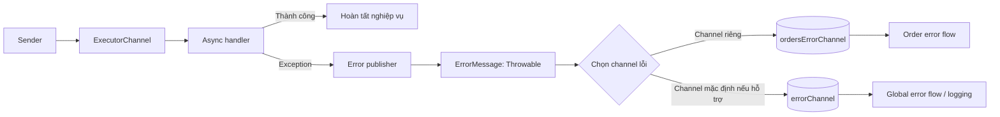

# Error channel khi message bất đồng bộ trong Spring Integration

## 1. Bối cảnh và mục tiêu

Trong module `SPRING_INTEGRATION_PATTERN`, chúng ta triển khai **Enterprise Integration Patterns** (EIP) với Spring Integration để xây dựng luồng message ít phụ thuộc, dễ mở rộng, đồng thời kiểm thử và quan sát các nhánh Router, Filter, Transformer, Splitter, Aggregator, Gateway, retry và error channel.

Một hệ thống nhận sự kiện `ORDER_CREATED` có thể chuyển việc xử lý sang một thread khác để không chặn người gửi. Nhưng nếu thread đó gọi dịch vụ thanh toán và gặp timeout, người gửi thường đã rời khỏi lời gọi `send(...)`. Exception không thể đơn giản “ném ngược” về stack của người gửi như trong trường hợp xử lý đồng bộ. **Error Channel** giúp đưa thông tin lỗi thành `ErrorMessage` để một nhánh khác tiếp nhận, phân loại và xử lý.

Sau bài này, bạn có thể:

- Phân biệt lỗi trên `DirectChannel` đồng bộ với lỗi xảy ra sau ranh giới bất đồng bộ.
- Giải thích vì sao `send(...) == true` không đồng nghĩa nghiệp vụ thành công.
- Nhận diện **error publisher**, `ErrorMessage`, global `errorChannel` và channel lỗi riêng.
- Dùng `ExecutorChannel` để minh họa một luồng bất đồng bộ và publish `ErrorMessage` có chủ đích.
- Kiểm thử luồng async bằng `CountDownLatch` thay vì dựa vào thời gian ngủ cố định.
- Thiết kế retry, quarantine, correlation, reply cho Gateway và metric tránh mất dữ liệu.

## 2. Điều gì thay đổi khi xử lý bất đồng bộ?

Ở một luồng đồng bộ, `DirectChannel` chuyển message tới handler trên cùng thread gọi. Nếu handler ném exception, caller thường nhận exception trong lời gọi `send(...)` hoặc Gateway.

```text
Caller thread
  --> DirectChannel
      --> Handler
          --> throw Exception
  <-- exception truyền về caller
```

Khi có `ExecutorChannel` hoặc một ranh giới bất đồng bộ tương tự, việc chuyển message cho executor và xử lý message là **hai thời điểm khác nhau**. Người gửi có thể nhận kết quả gửi thành công khi công việc mới được chấp nhận vào hàng đợi thực thi:

```text
Caller thread                   Worker thread
    |                                |
    +--> asyncChannel.send()         |
    |        +--> executor ----------+--> Handler
    |                                |       |
    +<-- send() trả về                |       +--> Exception
                                     |               |
                                     +--> Error publisher
                                                  |
                                                  v
                                             ErrorMessage
                                                  |
                                                  v
                                             Error Channel
```

**Hệ quả:** `send(...) == true` có thể chỉ xác nhận channel đã nhận yêu cầu để xử lý, **chưa xác nhận side effect thành công**, database đã commit, message đã được ACK ở broker hay reply đã được tạo.

| Vấn đề | Đồng bộ qua DirectChannel | Sau ranh giới bất đồng bộ |
| --- | --- | --- |
| Thread thực thi handler | Thường cùng thread người gửi. | Thread do executor/poller/adapter quản lý. |
| Lỗi ở handler | Có thể truyền trực tiếp về caller. | Thường cần cơ chế error handling/publishing riêng tại ranh giới thực thi. |
| Giá trị trả về của `send()` | Có thể phản ánh lỗi handler trong cùng lời gọi. | Có thể chỉ phản ánh việc chấp nhận công việc. |
| Người nhận lỗi | Caller, advice hoặc Gateway. | Error Channel/handler được publisher hỗ trợ, hoặc cơ chế lỗi của adapter. |
| Xác nhận hoàn tất nghiệp vụ | Phải theo contract của flow. | Cần signal hoàn tất, trạng thái công việc hoặc reply bất đồng bộ phù hợp. |

### Không phải mọi kênh bất đồng bộ giống nhau

`ExecutorChannel` gửi tác vụ đến một `Executor`; `QueueChannel` giữ message để một polling consumer lấy ra; inbound adapter có thể chạy trên thread hoặc listener riêng. Mỗi cơ chế có cách bắt và publish lỗi khác nhau. Vì vậy không nên áp dụng một giả định cho tất cả: “hễ bất đồng bộ là exception tự tới global `errorChannel`”.

## 3. ErrorMessage được phát từ đâu?

Spring Messaging biểu diễn sự kiện lỗi bằng `org.springframework.messaging.support.ErrorMessage`. Đây là một `Message<Throwable>`: **payload là exception**; phần metadata có thể chứa `originalMessage` được publisher cung cấp. Nếu exception là `MessagingException`, `getFailedMessage()` có thể cho biết message liên quan đến bước thất bại.

Để lỗi thực sự đi qua channel, một **error publisher** hoặc error handler tương đương phải:

1. Nhận biết exception tại điểm thực thi mà nó quản lý.
2. Tạo `ErrorMessage` (hoặc cơ chế tương đương theo contract của adapter).
3. Chọn channel lỗi được hỗ trợ: channel riêng, header `errorChannel` trong trường hợp publisher có sử dụng, hoặc global `errorChannel` theo cấu hình.
4. Gửi message lỗi đến một error flow có người nhận thực sự.



**Lưu ý về global channel:** `errorChannel` là tên chuẩn trong Spring Integration, thường có dạng publish/subscribe và có logging subscriber mặc định. Nó không tự bắt mọi Java exception ngoài phạm vi cơ chế phát lỗi. Việc có nhiều subscriber cũng không đồng nghĩa đã retry hoặc đã lưu message vào kho bền vững.

## 4. Chọn đường xử lý lỗi phù hợp với ranh giới

| Nguồn thực thi | Đường lỗi cần kiểm tra | Ví dụ |
| --- | --- | --- |
| `DirectChannel` do caller gọi trực tiếp | Exception có thể trả về caller. | Một Gateway gọi Service Activator đồng bộ. |
| `ExecutorChannel` | Cơ chế xử lý exception của dispatcher/executor và error publisher mà cấu hình đang sử dụng. | Worker xử lý `ORDER_CREATED` trên thread riêng. |
| `QueueChannel` + polling consumer | Error handler của poller/consumer, không phải bản thân queue. | Poller nhận message từ queue nội bộ. |
| Inbound adapter có listener riêng | Cơ chế error channel, retry, redelivery và ack/nack của adapter cụ thể. | Consumer broker nhận message. |
| Ứng dụng tự dùng `CompletableFuture` hoặc `Executor` | Cần xử lý kết quả/exception của Future hoặc tự publish lỗi có chủ đích. | Một tác vụ chạy ngoài endpoint của Spring Integration. |

Nếu một handler **bắt exception rồi không ném tiếp**, error publisher ở bên ngoài không còn thấy exception đó. Điều này có thể hợp lệ khi handler đã ghi trạng thái thất bại hoặc tự phát `ErrorMessage`, nhưng phải bảo đảm không báo thành công giả.

Ngược lại, nếu **vừa tự publish lỗi, vừa ném lại cùng exception** mà cơ chế executor cũng có auto-publishing, hệ thống có thể nhận **hai ErrorMessage cho một lần thất bại**. Chỉ chọn một chủ sở hữu xử lý lỗi hoặc thiết kế deduplication rõ ràng.

## 5. Ví dụ Java DSL: ExecutorChannel và error flow tường minh

Để hành vi có thể kiểm thử mà không phụ thuộc vào mặc định error publishing của một phiên bản/adapter, ví dụ sau **cố ý publish ErrorMessage trong handler bất đồng bộ**. Đây là một cách triển khai minh họa ranh giới lỗi, **không phải yêu cầu phải tự catch trong mọi ứng dụng**. Với endpoint có error publisher của framework, hãy dùng contract đó thay vì phát lỗi hai lần.

Ví dụ dùng Java 17, Spring Integration Java DSL và `ThreadPoolTaskExecutor`. Trong Spring Boot có thể dùng `spring-boot-starter-integration`; phần test dùng JUnit 5, Spring Test và AssertJ (chẳng hạn qua `spring-boot-starter-test`).

```java
import java.util.concurrent.CountDownLatch;
import java.util.concurrent.TimeUnit;
import java.util.concurrent.atomic.AtomicReference;

import org.springframework.context.annotation.Bean;
import org.springframework.context.annotation.Configuration;
import org.springframework.beans.factory.annotation.Qualifier;
import org.springframework.integration.channel.DirectChannel;
import org.springframework.integration.channel.ExecutorChannel;
import org.springframework.integration.config.EnableIntegration;
import org.springframework.integration.dsl.IntegrationFlow;
import org.springframework.messaging.Message;
import org.springframework.messaging.MessageChannel;
import org.springframework.messaging.support.ErrorMessage;
import org.springframework.scheduling.concurrent.ThreadPoolTaskExecutor;

@Configuration
@EnableIntegration
public class AsyncErrorFlowConfig {

    public record OrderEvent(String orderId, boolean simulateFailure) {}

    public static class ErrorProbe {
        private final CountDownLatch observed = new CountDownLatch(1);
        private final AtomicReference<ErrorMessage> latest =
            new AtomicReference<>();

        public void record(ErrorMessage error) {
            latest.set(error);
            observed.countDown();
        }

        public boolean await(long timeout, TimeUnit unit)
                throws InterruptedException {
            return observed.await(timeout, unit);
        }

        public ErrorMessage latest() {
            return latest.get();
        }
    }

    @Bean
    public ErrorProbe errorProbe() {
        return new ErrorProbe();
    }

    @Bean
    public ThreadPoolTaskExecutor orderExecutor() {
        ThreadPoolTaskExecutor executor = new ThreadPoolTaskExecutor();
        executor.setCorePoolSize(1);
        executor.setMaxPoolSize(2);
        executor.setQueueCapacity(50);
        executor.setThreadNamePrefix("order-worker-");
        return executor; // Spring quản lý initialize và shutdown bean
    }

    @Bean
    public MessageChannel ordersInput() {
        return new DirectChannel();
    }

    @Bean
    public MessageChannel ordersAsync(ThreadPoolTaskExecutor orderExecutor) {
        return new ExecutorChannel(orderExecutor);
    }

    @Bean
    public MessageChannel ordersErrorChannel() {
        return new DirectChannel();
    }

    @Bean
    public IntegrationFlow asyncOrdersFlow(
            @Qualifier("ordersErrorChannel") MessageChannel ordersErrorChannel) {
        return IntegrationFlow.from("ordersInput")
            .channel("ordersAsync")
            .handle((Message<?> message) -> {
                try {
                    OrderEvent event = (OrderEvent) message.getPayload();
                    if (event.simulateFailure()) {
                        throw new IllegalStateException(
                            "Order service temporarily unavailable");
                    }
                    // Trong thực tế: lưu kết quả, phát event tiếp theo, v.v.
                } catch (RuntimeException failure) {
                    // Publisher tường minh tại worker: không ném lại lỗi
                    // sau khi đã publish thành công để tránh double-publish.
                    ErrorMessage error = new ErrorMessage(failure, message);
                    if (!ordersErrorChannel.send(error)) {
                        throw new IllegalStateException(
                            "Cannot publish order failure", failure);
                    }
                }
            })
            .get();
    }

    @Bean
    public IntegrationFlow ordersErrorFlow(ErrorProbe probe) {
        return IntegrationFlow.from("ordersErrorChannel")
            .handle((Message<?> received) -> {
                if (!(received instanceof ErrorMessage error)) {
                    throw new IllegalArgumentException(
                        "Expected ErrorMessage");
                }
                probe.record(error);
            })
            .get();
    }
}
```

### Đường đi của một message gặp lỗi

1. Caller gửi `OrderEvent` tới `ordersInput`.
2. `ordersInput` chuyển message sang `ordersAsync`, là `ExecutorChannel` dùng thread pool.
3. Executor thực thi handler sau ranh giới bất đồng bộ; trường `simulateFailure=true` gây exception.
4. Khối `catch` tạo `ErrorMessage` và gửi tới `ordersErrorChannel`. Nó không ném lại exception nếu đã publish thành công.
5. `ordersErrorFlow` nhận sự kiện lỗi và ghi vào `ErrorProbe` phục vụ test.

Ví dụ sử dụng `DirectChannel` cho kênh lỗi để việc gửi tới `ErrorProbe` diễn ra trên thread worker khi xử lý lỗi. Đây vẫn là **luồng xử lý nghiệp vụ bất đồng bộ so với caller** vì ranh giới `ExecutorChannel` đã tách thread. Nếu error handler ném exception, `send()` tới kênh lỗi có thể thất bại; trong production cần chiến lược xử lý lỗi thứ cấp và kho lưu bền vững.

**Giới hạn của mẫu:** `ErrorProbe` chỉ nằm trong bộ nhớ. Ứng dụng thật cần quyết định retry, lưu trạng thái thất bại, dead-letter/quarantine và metric; việc gửi `ErrorMessage` thành công không bảo đảm dữ liệu sẽ được xử lý lại sau khi tiến trình khởi động lại.

## 6. Kiểm thử: đợi lỗi bất đồng bộ mà không đoán thời điểm

Khi kiểm thử flow chạy trên executor, không nên `Thread.sleep(...)` một khoảng cố định rồi hy vọng worker đã xử lý xong. Thay vào đó, hãy dùng `CountDownLatch` hoặc một cơ chế đồng bộ hóa có giới hạn thời gian.

```java
import java.util.concurrent.TimeUnit;

import org.junit.jupiter.api.Test;
import org.springframework.beans.factory.annotation.Autowired;
import org.springframework.beans.factory.annotation.Qualifier;
import org.springframework.messaging.MessageChannel;
import org.springframework.messaging.support.ErrorMessage;
import org.springframework.messaging.support.MessageBuilder;
import org.springframework.test.context.junit.jupiter.SpringJUnitConfig;

import static org.assertj.core.api.Assertions.assertThat;

@SpringJUnitConfig(AsyncErrorFlowConfig.class)
class AsyncErrorFlowTest {

    @Autowired
    @Qualifier("ordersInput")
    MessageChannel ordersInput;

    @Autowired
    AsyncErrorFlowConfig.ErrorProbe probe;

    @Test
    void asyncHandlerPublishesFailureToDedicatedErrorFlow()
            throws InterruptedException {
        var event = new AsyncErrorFlowConfig.OrderEvent("ord-42", true);

        assertThat(ordersInput.send(
            MessageBuilder.withPayload(event)
                .setHeader("eventId", "evt-async-42")
                .setHeader("correlationId", "order-42")
                .build())).isTrue();

        // send() xác nhận channel nhận công việc;
        // latch mới xác nhận error flow đã quan sát lỗi.
        assertThat(probe.await(5, TimeUnit.SECONDS)).isTrue();

        ErrorMessage failure = probe.latest();
        assertThat(failure).isNotNull();
        assertThat(failure.getPayload())
            .isInstanceOf(IllegalStateException.class)
            .hasMessageContaining("Order service temporarily unavailable");
        assertThat(failure.getOriginalMessage()).isNotNull();
        assertThat(failure.getOriginalMessage().getHeaders()
            .get("eventId")).isEqualTo("evt-async-42");
    }
}
```

Đây là **integration test của mẫu có publisher tường minh**: nó xác minh message đi qua `ExecutorChannel`, lỗi được bắt tại worker và `ErrorMessage` đến đúng error flow. Test không chứng minh `ExecutorChannel` hoặc mọi adapter sẽ tự publish lỗi nếu bỏ khối `catch`.

Một bộ test đầy đủ nên bổ sung đường thành công, nhiều message đồng thời, executor bị từ chối tác vụ khi quá tải, exception trong error handler, kiểm tra không double-publish, và tình huống timeout khi không nhận được ErrorMessage.

## 7. Nếu dùng error publishing do framework cung cấp

Khi poller hoặc adapter có cơ chế error publishing, bạn không nhất thiết phải dùng `catch` thủ công như ví dụ. Thay vào đó, cấu hình chính xác nguồn phát và kênh lỗi mà nó hỗ trợ, ví dụ một `errorChannel` riêng cho một polling endpoint. Luồng nhận lỗi vẫn có thể là `IntegrationFlow.from("ordersErrorChannel")` hoặc `@ServiceActivator(inputChannel = "ordersErrorChannel")`.

Một số cơ chế error publishing sử dụng header `MessageHeaders.ERROR_CHANNEL` của message ban đầu để chọn đích; trong trường hợp khác, thuộc tính của endpoint hoặc global `errorChannel` được dùng. **Không giả định thứ tự ưu tiên chung** cho mọi phiên bản và mọi adapter; kiểm thử với đúng endpoint.

| Cách phát lỗi | Khi nào phù hợp? | Rủi ro cần kiểm soát |
| --- | --- | --- |
| Publisher của poller/adapter | Nguồn tích hợp đã cung cấp cơ chế xử lý lỗi. | Cấu hình channel sai, nhầm thời điểm ack/rollback, mất metadata gốc. |
| Error handling của ranh giới executor | Framework/channel thực thi có cơ chế xử lý lỗi phù hợp. | Giả định auto-publish nhưng thực tế lỗi chỉ đến error handler khác. |
| `CompletableFuture`/executor của ứng dụng | Công việc nằm ngoài endpoint quản lý bởi Spring Integration. | Không quan sát Future, mất exception hoặc không lưu trạng thái thất bại. |
| Publisher tường minh như ví dụ | Cần kiểm soát chính xác lỗi nào được chuyển thành message. | Bỏ sót exception ngoài khối `try`, double-publish khi kết hợp auto-publishing. |

**Nguyên tắc:** Một lỗi cần có một chiến lược sở hữu rõ ràng. Nếu framework đã bắt và publish exception, đừng tự catch rồi publish lại mà không có lý do. Nếu ứng dụng tự catch và phát lỗi, phải giám sát cả việc **phát lỗi thất bại**.

## 8. Error channel không thay thế retry, transaction và xác nhận

Tách đường lỗi khỏi người gửi giúp hệ thống không bị chặn, nhưng đặt ra các câu hỏi về độ tin cậy:

| Câu hỏi | Vì sao quan trọng? | Cách thiết kế |
| --- | --- | --- |
| Công việc đã được xử lý một phần chưa? | Retry có thể gây side effect trùng. | Dùng idempotency key, transaction hoặc đối soát trước khi phát lại. |
| Message đầu vào đã được ACK chưa? | ACK sớm có thể khiến lỗi không còn khả năng redelivery. | Kiểm tra cơ chế ack/nack, commit và retry của adapter. |
| Error Channel có lưu message bền vững không? | `DirectChannel` và `PublishSubscribeChannel` không tự là kho lưu trữ. | Chuyển lỗi cần xử lý lại tới broker, database hoặc quarantine thích hợp. |
| Khi lỗi vượt quá số lần retry thì sao? | Retry không giới hạn có thể làm quá tải hệ thống. | Backoff, giới hạn số lần và nhánh xử lý cuối cùng. |
| Error handler cũng thất bại thì sao? | Có thể tạo lỗi thứ cấp hoặc vòng lặp. | Chính sách lưu trạng thái/alert an toàn và điểm dừng rõ ràng. |

Ví dụ khi gọi cổng thanh toán: một timeout sau khi phía đối tác nhận tiền **không chứng minh** giao dịch thất bại. Error flow phải tra cứu trạng thái hoặc dùng idempotency trước khi thử lại. Sự tồn tại của `ErrorMessage` không đảm bảo giao dịch trước đó đã rollback.

### Retry và kênh lỗi

- **Retry advice / adapter retry** thử lại một thao tác theo chính sách; vị trí retry có thể nằm trước khi lỗi được phát vào channel.
- **Error Channel** truyền thông tin lỗi đã được phát, phục vụ phân loại và khắc phục.
- **Dead-letter/quarantine** giữ dữ liệu để điều tra, sửa và phát lại có kiểm soát.

Đưa một ErrorMessage vào `retryCandidates` chỉ có nghĩa message lỗi đã đến đúng nhánh; chưa chứng minh thao tác nghiệp vụ đã retry hay thành công.

## 9. Gateway, Splitter/Aggregator và ngữ cảnh tương quan

### Gateway yêu cầu/phản hồi

Gateway đồng bộ thường có hợp đồng trả reply hoặc exception. Nếu flow chuyển việc xử lý sang `ExecutorChannel`, caller có thể đang chờ reply với timeout. Việc worker publish `ErrorMessage` lên một kênh riêng **không tự trả về phản hồi lỗi hợp lệ cho Gateway**. Cần thiết kế một đường reply/error reply hoặc quy trình bất đồng bộ trả `jobId` và API tra cứu trạng thái.

Trong một API nhận công việc bất đồng bộ, không nên trả “đã thanh toán thành công” chỉ vì message đã được executor chấp nhận. Chỉ trả trạng thái “đã tiếp nhận” khi đúng contract, sau đó cập nhật trạng thái khi worker hoàn thành.

### Splitter và Aggregator

Giả sử Splitter tạo 5 message con và worker bất đồng bộ xử lý từng phần. Nếu phần thứ 3 lỗi và được đưa vào Error Channel riêng, Aggregator có thể chỉ nhận 4 phần, không đáp ứng điều kiện release dựa trên `sequenceSize=5`.

Error flow cần quyết định retry phần 3, phát trạng thái lỗi cho nhóm, timeout hoặc bù trừ. `ErrorMessage` **không tự cập nhật** trạng thái nhóm của Aggregator.

### Tìm message gốc hoặc message thất bại

`ErrorMessage.getOriginalMessage()` có thể là message mà error publisher cung cấp. `MessagingException.getFailedMessage()` có thể chứa message tại bước thất bại. Cả hai đều có thể `null`, và chúng không nhất thiết là message giống nhau.

```java
import org.springframework.messaging.Message;
import org.springframework.messaging.MessagingException;
import org.springframework.messaging.support.ErrorMessage;

static Message<?> findContext(ErrorMessage error) {
    if (error.getOriginalMessage() != null) {
        return error.getOriginalMessage();
    }
    int depth = 0;
    for (Throwable current = error.getPayload();
         current != null && depth < 32;
         current = current.getCause(), depth++) {
        if (current instanceof MessagingException me
                && me.getFailedMessage() != null) {
            return me.getFailedMessage();
        }
    }
    return null;
}
```

Khi có message phù hợp, đọc `eventId`, `correlationId`, `sequenceNumber` và `sequenceSize` nếu chúng thực sự tồn tại. Không coi headers trên chính `ErrorMessage` là bản sao đầy đủ của headers nghiệp vụ. Tránh đưa payload nhạy cảm hoặc định danh có số lượng giá trị lớn vào metric labels.

## 10. Quan sát và chẩn đoán lỗi bất đồng bộ

Một hệ thống async cần phân biệt **đã nhận message**, **đã bắt đầu xử lý**, **đã hoàn thành**, **đã thất bại** và **đã khôi phục**:

| Metric/log | Ý nghĩa |
| --- | --- |
| `async_messages_accepted_total{flow}` | Công việc được channel nhận để xử lý. |
| `async_processing_completed_total{flow}` | Xử lý nghiệp vụ thực sự hoàn tất thành công. |
| `async_errors_published_total{flow,channel}` | `ErrorMessage` được publisher gửi tới error flow. |
| `async_recovery_total{flow,result}` | Kết quả retry/quarantine hoặc xử lý cuối cùng. |
| `async_error_handler_failures_total{flow}` | Lỗi xảy ra ngay tại error handler. |
| Log `eventId`, `traceId`, `correlationId` | Đối chiếu yêu cầu gốc với worker thread và kết quả. |

Đừng dùng `eventId` làm metric label: số lượng ID tăng liên tục có thể làm bùng nổ số chuỗi thời gian. Với log, chỉ lưu metadata cần thiết; tránh mật khẩu, token, thông tin thanh toán hoặc payload đầy đủ.

### Bảng chẩn đoán nhanh

| Triệu chứng | Nguyên nhân có thể | Cách kiểm tra |
| --- | --- | --- |
| `send()` trả `true` nhưng không thấy kết quả nghiệp vụ | Worker chưa chạy, bị lỗi hoặc chưa hoàn tất. | Kiểm tra executor, hàng đợi công việc, metric completed/error. |
| Worker có stack trace nhưng Error Channel rỗng | Exception chưa được publisher bắt hoặc được xử lý theo cơ chế khác. | Kiểm tra ranh giới thực thi và error handler của executor/adapter. |
| ErrorMessage tới global thay vì local channel | Publisher chọn đích mặc định hoặc chưa áp dụng cấu hình riêng. | Kiểm tra config/header theo contract của publisher cụ thể. |
| Hai ErrorMessage cho một failure | Code tự publish rồi tiếp tục ném lỗi cho auto-publisher. | Chọn một cơ chế sở hữu lỗi, kiểm tra deduplication. |
| Gateway hết thời gian chờ dù error flow đã xử lý | Error Channel không tự tạo reply cho Gateway. | Thiết kế reply/error reply và timeout. |
| Error flow thiếu `eventId` | Original/failed message không được cung cấp hoặc headers bị biến đổi. | Kiểm tra nguồn `getOriginalMessage()`, `getFailedMessage()` và correlation. |
| Lỗi lặp vô hạn sau retry | Không có giới hạn hoặc retry sai side effect. | Giới hạn retry, backoff, trạng thái cuối và idempotency. |

## 11. Bài tập thực hành

**Bối cảnh:** Ứng dụng xử lý đơn hàng dùng `ExecutorChannel` cho xác nhận thanh toán và `QueueChannel` cho gửi thông báo. Payment provider có thể timeout, notification provider có thể trả rate limit.

1. Vẽ đường đi của `send()`, worker thread, error publisher và `ErrorMessage` ở hai luồng. Xác định đâu là ranh giới bất đồng bộ.
2. Chỉnh ví dụ `AsyncErrorFlowConfig` để ghi cả event thành công, nhưng không dựa vào `send() == true` làm bằng chứng hoàn thành.
3. Viết test có lỗi thực tế ở worker, chờ `ErrorMessage` bằng latch và kiểm tra `eventId`.
4. Viết test khi error handler ném exception hoặc channel lỗi không có consumer; mô tả cơ chế cần bổ sung để không mất lỗi.
5. Đề xuất retry có giới hạn, backoff, idempotency và kho quarantine cho payment timeout.
6. Giả lập một phần của nhóm Splitter bị lỗi trên thread riêng, thiết kế cách Aggregator kết thúc nhóm mà không chờ vô hạn.
7. Nếu dùng Gateway để nhận request, quyết định API trả kết quả đồng bộ hay trạng thái “đã tiếp nhận” kèm `jobId`.

**Câu hỏi tự kiểm tra:** Vì sao không thể kết luận message được xử lý thành công khi `ExecutorChannel.send()` trả `true`? Ai chịu trách nhiệm biến exception của worker thành `ErrorMessage`? Khi nào việc tự publish và ném lại exception sẽ gây trùng lặp xử lý?

## 12. Ghi nhớ

**Khi message được xử lý bất đồng bộ, lỗi thường xuất hiện sau khi thread người gửi đã kết thúc thao tác gửi.** Error Channel giúp biến lỗi thành `ErrorMessage` để một nhánh chuyên trách quan sát và khắc phục, nhưng chỉ hoạt động khi có cơ chế phát lỗi thực sự. Trong Spring Integration, hãy xác định đúng ranh giới `ExecutorChannel`/poller/adapter, cấu hình đích lỗi rõ ràng, kiểm thử bằng tín hiệu đồng bộ hóa và thiết kế retry, correlation, reply và lưu trữ bền vững theo hợp đồng nghiệp vụ.
