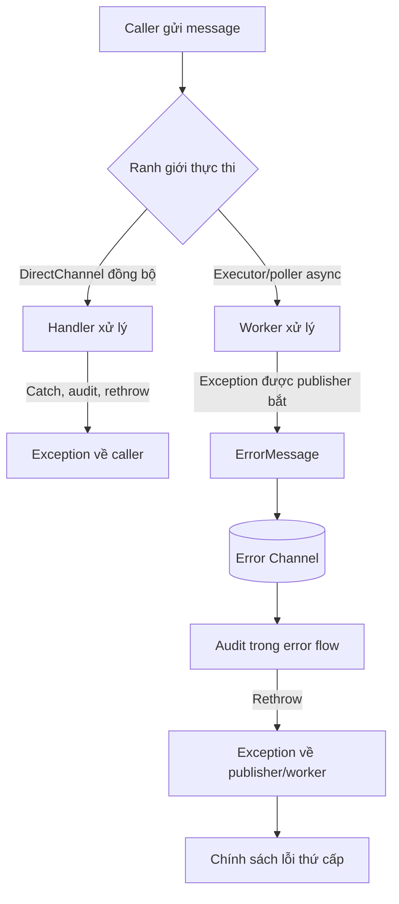
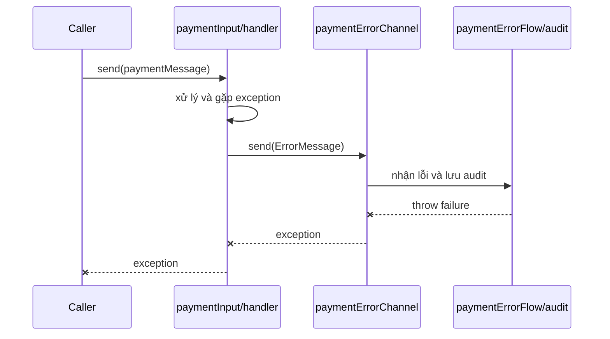

# Rethrow exception sau khi xử lý trong Spring Integration

## 1. Bối cảnh và mục tiêu

Trong học phần `SPRING_INTEGRATION_PATTERN`, chúng ta thực hành **Enterprise Integration Patterns** với Spring Integration để xây dựng luồng thông điệp ít phụ thuộc, dễ mở rộng và có thể kiểm thử, theo dõi. Các luồng dùng Router, Filter, Transformer, Splitter, Aggregator, Gateway hoặc Service Activator đều có thể gặp lỗi cần ghi nhận trước khi báo thất bại cho tầng gọi hoặc kích hoạt retry.

Giả sử handler xử lý thanh toán ném `IllegalStateException`. Ứng dụng muốn ghi một bản ghi audit, thêm thông tin chẩn đoán rồi **ném lại exception** (*rethrow*). Nếu chỉ bắt exception để ghi log và kết thúc bình thường, các thành phần phía trên có thể hiểu nhầm rằng công việc đã thành công. Nhưng nếu ném exception từ một error flow bất đồng bộ, lỗi đó cũng không thể tự quay lại thread của HTTP request đã kết thúc.

**Mục tiêu:** Hiểu chính xác nơi exception sẽ truyền tới sau khi được xử lý, bảo toàn nguyên nhân và điều kiện rollback/retry, tránh publish lỗi trùng hoặc tạo vòng lặp Error Channel.

Sau bài học, bạn có thể:

- Phân biệt `throw` lại exception ở handler nghiệp vụ với `throw` từ consumer của `ErrorMessage`.
- Giải thích điều kiện để caller đồng bộ thấy exception sau một bước ghi audit.
- Phân tích ý nghĩa của rethrow qua `DirectChannel`, `PublishSubscribeChannel`, poller và `ExecutorChannel`.
- Viết flow Java DSL minh họa **audit → rethrow** cùng kiểm thử JUnit.
- Giữ nguyên `cause`, `failedMessage`, `originalMessage` và correlation ID khi có.
- Quyết định lúc nào nên rethrow, khi nào nên chuyển trạng thái lỗi và kết thúc error flow có kiểm soát.

## 2. Rethrow exception là gì?

Trong Java, **rethrow** nghĩa là ném tiếp một exception đã bắt hoặc đã nhận:

```java
try {
    paymentService.charge(order);
} catch (RuntimeException failure) {
    auditService.recordFailure(order.id(), failure);
    throw failure; // Giữ nguyên đối tượng exception và chuỗi cause.
}
```

Đoạn mã không “khôi phục” lỗi: nó thực hiện một side effect quan sát rồi để caller hoặc infrastructure tiếp tục quyết định. Trong Spring Integration có **hai vị trí rethrow khác nhau**:

1. **Ngay trong handler nghiệp vụ:** `catch`, ghi audit rồi `throw failure`. Nếu đang ở `DirectChannel` đồng bộ, exception có thể lan về lời gọi `send(...)` hoặc Gateway.
2. **Trong error flow:** một thành phần đã publish `ErrorMessage`, consumer ghi nhận lỗi rồi ném `error.getPayload()` (khi hợp lệ) hoặc một exception có `cause`. Exception lúc này truyền về **thành phần đang gửi `ErrorMessage`**, không mặc nhiên tới người gửi message nghiệp vụ ban đầu.

> Quy tắc cần nhớ: **Rethrow làm thất bại lời gọi hiện tại. Nó không tự tìm lại một caller đã rời khỏi stack hoặc đã chạy trên thread khác.**

### Ba kết quả dễ bị nhầm

| Hành động ở error handler | Kết quả tức thời | Có bảo đảm công việc được khôi phục? |
| --- | --- | --- |
| Chỉ ghi log rồi return | Error handler kết thúc bình thường. | Không. Lỗi gốc có thể đã được tiêu thụ ở ranh giới đó. |
| Ghi log rồi `throw` | Lời gọi vào error handler thất bại. | Không. Có thể kích hoạt xử lý lỗi thứ cấp hoặc truyền lại exception. |
| Ghi trạng thái thất bại/quarantine rồi return | Error flow hoàn tất việc bàn giao lỗi theo chính sách. | Chỉ khi đã ghi bền vững và đáp ứng contract hệ thống. |

Rethrow không phải phương án luôn đúng. Một hệ thống cần chọn cách xử lý theo **caller contract**, loại endpoint và chính sách retry/transaction.

## 3. Đường đi exception trong các loại channel



| Nơi xử lý | Rethrow được ai quan sát? | Điều phải lưu ý |
| --- | --- | --- |
| Handler sau `DirectChannel` đồng bộ | Thread đang gọi `send()`, trừ khi có lớp trung gian bắt lỗi. | Có thể ảnh hưởng transaction/retry của caller. |
| Handler nhận `ErrorMessage` qua `DirectChannel` riêng | Thread đang gọi `errorChannel.send(error)`. | Chỉ về caller nghiệp vụ nếu hai lời gọi còn nối tiếp trên cùng stack. |
| Handler nhận lỗi từ poller | Thread của poller/error publisher. | Caller ban đầu có thể không tồn tại; rollback/ack tùy poller/adapter. |
| Handler sau `ExecutorChannel` | Worker hoặc error handler của executor. | Không tự truyền về thread đã gọi `send()`. |
| Consumer trên global `errorChannel` dạng publish/subscribe | Phụ thuộc dispatcher, subscriber, executor và error handler của channel. | Không giả định mọi subscriber đều chạy hoặc exception luôn tới upstream. |

**Error Channel không phải bộ bắt lỗi JVM toàn cục.** Nó chỉ nhận `ErrorMessage` khi một publisher thực sự gửi message lỗi vào channel. Với handler đồng bộ, exception hoàn toàn có thể truyền thẳng về caller mà không qua global `errorChannel`.

## 4. Rethrow trong handler nghiệp vụ: cách đơn giản nhất

Nếu yêu cầu là “ghi nhận thất bại nhưng caller đồng bộ vẫn phải nhận lỗi”, cách rõ ràng thường là **catch và rethrow ngay trong handler**. Ví dụ:

```java
@ServiceActivator(inputChannel = "paymentRequests")
public void charge(PaymentRequest request) {
    try {
        paymentService.charge(request);
    } catch (RuntimeException failure) {
        audit.record(request.id(), failure.getClass().getSimpleName());
        throw failure; // Không nuốt lỗi nghiệp vụ.
    }
}
```

Đây là đoạn mã minh họa; `PaymentRequest`, `paymentService` và `audit` là thành phần do ứng dụng định nghĩa. Nếu error publisher ở tầng cao hơn có trách nhiệm xử lý exception, phương án này giúp tránh phát thêm một `ErrorMessage` thủ công.

**Một lưu ý quan trọng về transaction:** Nếu bản ghi audit nằm trong **cùng transaction** với thao tác thất bại, rethrow có thể khiến transaction rollback **cả bản ghi audit**. Cần thiết kế kho audit hoặc outbox với ranh giới giao dịch rõ ràng nếu bắt buộc giữ thông tin lỗi sau rollback. Không mặc nhiên suy rằng “đã gọi hàm audit” tương đương “audit đã bền vững”.

## 5. Rethrow trong error flow: ai nhận exception?

Giả sử một adapter/poller phát:

```text
ErrorMessage
  ├── payload: MessagingException / IllegalStateException / Throwable khác
  ├── originalMessage: Message<?> nếu publisher cung cấp
  └── headers: metadata của chính ErrorMessage
```

Một consumer có thể xử lý:

```java
@ServiceActivator(inputChannel = "paymentErrorChannel")
public void auditAndRethrow(ErrorMessage error) {
    Throwable failure = error.getPayload();
    failureAudit.write(failure.getClass().getSimpleName());

    if (failure instanceof RuntimeException runtime) {
        throw runtime;
    }
    throw new IllegalStateException("Payment error after audit", failure);
}
```

Đoạn này là **mẫu minh họa phương thức**; bean `failureAudit` do ứng dụng cung cấp. Nó ném lại exception trên **thread thực thi consumer**. Nếu một worker bất đồng bộ gửi `ErrorMessage` qua `paymentErrorChannel`, exception mới truyền về worker/publisher đó. Nó **không** trở thành response HTTP cho caller ban đầu.

Khi payload là `MessagingException`, dùng `getFailedMessage()` để truy ngữ cảnh công việc. Khi payload là exception thường, `ErrorMessage.getOriginalMessage()` có thể có dữ liệu. Cả hai đều có thể `null`, và không nhất thiết là cùng một message sau Transformer/Splitter.

**Không nên chỉ `throw new RuntimeException(error.getPayload().getMessage())`:** cách này mất cause, loại exception, stack trace và làm yếu khả năng phân loại retry. Nếu phải bọc lỗi, hãy truyền nguyên `Throwable` làm `cause`.

## 6. Ví dụ Java DSL: audit trong Error Channel rồi rethrow đồng bộ

Ví dụ dưới đây được thiết kế để minh họa rõ **mối quan hệ giữa hai lần gửi message**. Một handler nghiệp vụ nhận `PAYMENT_REQUEST` trên `DirectChannel`, phát `ErrorMessage` đến một error channel riêng. Error flow ghi bản ghi audit rồi ném lại lỗi ban đầu. Vì cả hai channel đều là `DirectChannel`, lời gọi phát ErrorMessage chưa thoát khỏi stack của caller; exception có thể đi ngược về `paymentInput.send(...)`.

Đây là thiết kế **phát lỗi tường minh để học rethrow**. Trong ứng dụng thật, nếu framework/adapter đã tự publish lỗi, không tự publish thêm cùng exception.

Ví dụ sử dụng Java 17 và Spring Integration Java DSL; với Spring Boot có thể dùng `spring-boot-starter-integration`, cùng `spring-boot-starter-test` để kiểm thử JUnit 5.

```java
import java.util.List;
import java.util.concurrent.ConcurrentLinkedQueue;

import org.springframework.beans.factory.annotation.Qualifier;
import org.springframework.context.annotation.Bean;
import org.springframework.context.annotation.Configuration;
import org.springframework.integration.channel.DirectChannel;
import org.springframework.integration.config.EnableIntegration;
import org.springframework.integration.dsl.IntegrationFlow;
import org.springframework.messaging.Message;
import org.springframework.messaging.MessageChannel;
import org.springframework.messaging.support.ErrorMessage;

@Configuration
@EnableIntegration
public class RethrowAfterHandlingConfig {

    public record ErrorAuditRecord(
        String eventId, String exceptionType) {}

    public static class ErrorAudit {
        private final ConcurrentLinkedQueue<ErrorAuditRecord> records =
            new ConcurrentLinkedQueue<>();

        public void record(ErrorAuditRecord record) {
            records.add(record);
        }

        public List<ErrorAuditRecord> snapshot() {
            return List.copyOf(records);
        }

        public void clear() {
            records.clear();
        }
    }

    @Bean
    public ErrorAudit errorAudit() {
        return new ErrorAudit();
    }

    @Bean
    public MessageChannel paymentInput() {
        return new DirectChannel();
    }

    @Bean
    public MessageChannel paymentErrorChannel() {
        return new DirectChannel();
    }

    @Bean
    public IntegrationFlow paymentFlow(
            @Qualifier("paymentErrorChannel") MessageChannel errors) {

        return IntegrationFlow.from("paymentInput")
            .handle((Message<?> message) -> {
                try {
                    // Giả lập lỗi của một dịch vụ thanh toán đồng bộ.
                    throw new IllegalStateException("Payment rejected");
                } catch (RuntimeException failure) {
                    ErrorMessage event = new ErrorMessage(failure, message);

                    // Error flow có thể ném lại ngay tại lời gọi send này.
                    boolean accepted = errors.send(event);
                    if (!accepted) {
                        throw new IllegalStateException(
                            "Failed to publish payment error", failure);
                    }
                }
            })
            .get();
    }

    @Bean
    public IntegrationFlow paymentErrorFlow(ErrorAudit audit) {
        return IntegrationFlow.from("paymentErrorChannel")
            .handle((Message<?> received) -> {
                if (!(received instanceof ErrorMessage error)) {
                    throw new IllegalArgumentException(
                        "Expected ErrorMessage");
                }

                Throwable failure = error.getPayload();
                Message<?> original = error.getOriginalMessage();
                Object value = original == null
                    ? null : original.getHeaders().get("eventId");
                String eventId = value == null ? "unknown" : value.toString();

                audit.record(new ErrorAuditRecord(
                    eventId, failure.getClass().getSimpleName()));

                // Rethrow: thất bại lời gọi gửi ErrorMessage hiện tại.
                if (failure instanceof RuntimeException runtime) {
                    throw runtime;
                }
                throw new IllegalStateException(
                    "Non-runtime error after audit", failure);
            })
            .get();
    }
}
```

### Từng bước xảy ra trong ví dụ

1. Caller gọi `paymentInput.send(paymentMessage)`.
2. `paymentFlow` xử lý trên cùng thread và tạo `IllegalStateException("Payment rejected")`.
3. Khối `catch` tạo `ErrorMessage` với `originalMessage = paymentMessage`, rồi gọi `paymentErrorChannel.send(error)`.
4. `paymentErrorFlow` nhận lỗi, ghi bản ghi audit và **ném lại** exception; lời gọi `paymentErrorChannel.send(error)` thất bại.
5. Vì luồng đang đồng bộ, exception có thể tiếp tục lan về `paymentInput.send(...)` (framework có thể bọc thêm một `MessagingException`/`MessageHandlingException`).



Lợi ích của ví dụ là kiểm chứng được **đường truyền exception**. Nó không phải khuyến nghị mọi ứng dụng nên phát ErrorMessage rồi rethrow theo vòng này; khi chỉ cần caller nhận lỗi, catch/rethrow ngay trong handler nghiệp vụ thường đơn giản hơn.

## 7. Kiểm thử: audit xảy ra nhưng exception vẫn không bị nuốt

Test dưới đây kiểm tra đồng thời hai điều: **audit đã được gọi** và **caller nhận được một exception**. Vì tầng Spring Integration có thể bọc exception, test duyệt chuỗi cause thay vì cứng nhắc đòi exception ngoài cùng là đúng loại `IllegalStateException`.

```java
import org.junit.jupiter.api.BeforeEach;
import org.junit.jupiter.api.Test;
import org.springframework.beans.factory.annotation.Autowired;
import org.springframework.beans.factory.annotation.Qualifier;
import org.springframework.messaging.MessageChannel;
import org.springframework.messaging.support.ErrorMessage;
import org.springframework.messaging.support.MessageBuilder;
import org.springframework.test.context.junit.jupiter.SpringJUnitConfig;

import static org.assertj.core.api.Assertions.assertThat;
import static org.assertj.core.api.Assertions.assertThatThrownBy;

@SpringJUnitConfig(RethrowAfterHandlingConfig.class)
class RethrowAfterHandlingConfigTest {

    @Autowired
    @Qualifier("paymentInput")
    MessageChannel paymentInput;

    @Autowired
    @Qualifier("paymentErrorChannel")
    MessageChannel paymentErrors;

    @Autowired
    RethrowAfterHandlingConfig.ErrorAudit audit;

    @BeforeEach
    void clearAudit() {
        audit.clear();
    }

    @Test
    void errorFlowAuditsThenRethrowsToSynchronousCaller() {
        var payment = MessageBuilder.withPayload("PAYMENT_REQUEST")
            .setHeader("eventId", "pay-501")
            .build();

        assertThatThrownBy(() -> paymentInput.send(payment))
            .satisfies(thrown -> assertThat(rootCause(thrown))
                .isInstanceOf(IllegalStateException.class)
                .hasMessage("Payment rejected"));

        assertThat(audit.snapshot()).containsExactly(
            new RethrowAfterHandlingConfig.ErrorAuditRecord(
                "pay-501", "IllegalStateException"));
    }

    @Test
    void directErrorSendRethrowsToErrorPublisherNotAnotherCaller() {
        var error = new ErrorMessage(
            new IllegalArgumentException("Bad payment data"));

        assertThatThrownBy(() -> paymentErrors.send(error))
            .satisfies(thrown -> assertThat(rootCause(thrown))
                .isInstanceOf(IllegalArgumentException.class)
                .hasMessage("Bad payment data"));

        assertThat(audit.snapshot()).containsExactly(
            new RethrowAfterHandlingConfig.ErrorAuditRecord(
                "unknown", "IllegalArgumentException"));
    }

    private static Throwable rootCause(Throwable error) {
        Throwable current = error;
        int hops = 0;
        while (current.getCause() != null && hops++ < 32) {
            current = current.getCause();
        }
        return current;
    }
}
```

Test thứ nhất mô phỏng caller nghiệp vụ và xác minh exception không bị “nuốt” sau audit. Test thứ hai gửi `ErrorMessage` trực tiếp: rethrow quay về **người gọi `paymentErrors.send(...)`**, nhấn mạnh rằng đó không nhất thiết là caller tạo giao dịch ban đầu.

**Giới hạn:** `ErrorAudit` trong ví dụ nằm trong bộ nhớ và không có transaction. Test kiểm chứng hành vi chương trình, **không chứng minh bản ghi audit còn tồn tại sau rollback, crash hay restart**. Khi chuyển sang database, cần kiểm thử commit/rollback riêng.

## 8. Điều gì xảy ra nếu error flow chạy bất đồng bộ?

Xét cùng flow nhưng `paymentErrorChannel` là một `ExecutorChannel` được quản lý bởi executor hoặc message lỗi được poller/adapter gửi sau khi caller đã kết thúc:

```text
HTTP caller -- gửi yêu cầu --> async boundary -- trả "đã tiếp nhận"
                                         |
                                         v
                                    Worker thất bại
                                         |
                                         v
                                    ErrorMessage
                                         |
                                         v
                                  Error flow audit + throw
                                         |
                                         v
                                  Worker/error dispatcher
```

Tại đây, rethrow trong error handler **không thể tự động quay lại HTTP response đã gửi**. Nó chỉ làm lời gọi hoặc tác vụ đang xử lý ErrorMessage thất bại. Tùy cấu hình dispatcher, việc đó có thể tạo log, lỗi thứ cấp hoặc ảnh hưởng cơ chế ack/rollback của publisher.

Nếu caller cần biết kết quả bất đồng bộ, hãy thiết kế **completion event, trạng thái job, callback, reply channel hoặc API tra cứu trạng thái**, với timeout và correlation ID. Nếu caller yêu cầu kết quả đồng bộ, hãy giữ hợp đồng reply/exception rõ ràng thay vì hy vọng global error channel trả lỗi giúp.

### Gateway và lỗi phản hồi

Gateway có thể sử dụng các cơ chế reply/error reply tùy cấu hình, nhưng không phải bất kỳ `throw` nào trong một error subscriber cũng trở thành exception cho method Gateway. Hãy kiểm thử thực tế thời điểm timeout, loại message phản hồi và ranh giới thread. Không trả “thanh toán thành công” chỉ vì executor đã nhận công việc.

## 9. Rethrow, retry, transaction và khả năng phục hồi

### Rethrow có thể kích hoạt retry — hoặc không

Nếu exception được ném tới một retry advice/caller có chính sách thử lại, thao tác có thể được thực hiện lại. Nhưng nếu exception xảy ra **sau** khi error publisher đã ghi nhận lỗi và không còn retry interceptor bao quanh, rethrow có thể chỉ tạo một lỗi ở error handler.

| Bối cảnh | Rethrow có thể dẫn đến | Cần bổ sung |
| --- | --- | --- |
| Handler được bao bởi retry advice | Thử lại thao tác trong giới hạn chính sách. | Backoff, phân loại lỗi, giới hạn và idempotency. |
| Handler chạy trong transaction | Rollback khi exception đáp ứng quy tắc rollback. | Phân biệt checked/unchecked exception, transaction boundary và audit persistence. |
| Error handler trên `DirectChannel` | Exception tới publisher đang gọi channel. | Quy tắc ai chịu trách nhiệm xử lý lỗi thứ cấp. |
| Error handler bất đồng bộ | Lỗi trong worker/dispatcher; caller ban đầu không tự thấy. | Cập nhật job status, alert, quarantine hoặc retry của worker. |
| Error Channel global có nhiều subscriber | Một subscriber thất bại có thể ảnh hưởng cách phân phối. | Kiểm thử dispatcher, logging subscriber và tránh side effect trùng. |

Một `ErrorMessage` có payload `Throwable` nhưng **không phải lệnh retry**. Muốn phát lại công việc, cần xác định message nghiệp vụ, trạng thái transaction, số lần đã thử và khả năng idempotent. Không gửi nguyên `ErrorMessage` vào input channel nghiệp vụ nếu input đó kỳ vọng payload đơn hàng/thanh toán.

### Ghi audit rồi rethrow có thật sự giữ audit?

Không nhất thiết. Ví dụ:

```text
BEGIN transaction
  -> cập nhật thanh toán
  -> insert audit_failure
  -> throw RuntimeException
ROLLBACK transaction  // cả audit_failure cũng có thể bị rollback
```

Nếu bắt buộc lưu audit của lần thất bại, cân nhắc một **transaction riêng có kiểm soát**, outbox, hoặc kho ghi sự kiện phù hợp. Cần cân bằng khả năng audit bền vững và tính nhất quán; đừng mặc nhiên mở transaction mới cho mọi log lỗi vì có thể gây phát sinh ghi trùng khi retry.

## 10. Tránh các anti-pattern khi rethrow

| Anti-pattern | Hậu quả | Thay thế |
| --- | --- | --- |
| `catch (Exception e) { log(e); }` rồi return thành công | Caller/worker có thể đánh dấu công việc đã hoàn tất dù thất bại. | Rethrow nếu contract cần lỗi; hoặc ghi trạng thái thất bại có kiểm soát. |
| `throw new RuntimeException(e.getMessage())` | Mất `cause`, loại exception và stack trace gốc. | `throw e` nếu hợp lệ, hoặc `new RuntimeException("...", e)`. |
| Vừa publish ErrorMessage vừa rethrow cho một auto-publisher khác | Hai sự kiện lỗi cho một failure, double-retry hoặc double-alert. | Chỉ định một owner phát lỗi, thiết kế deduplication khi cần. |
| Consumer trên global channel ném lỗi liên tục | Có thể tạo lỗi thứ cấp, làm gián đoạn subscriber hoặc vòng lặp. | Tách observer khỏi recovery owner và có điểm dừng. |
| Ghi audit trong transaction sẽ rollback nhưng coi là đã lưu | Mất dấu vết khi giao dịch thất bại. | Kiểm chứng durable write và ranh giới transaction. |
| Rethrow mà không giữ `failedMessage`/`originalMessage` | Mất correlation, khó retry hoặc điều tra. | Giữ exception gốc và metadata cần thiết, không log payload nhạy cảm. |

### Giữ correlation khi Router/Splitter/Aggregator gặp lỗi

Trong các luồng nhiều nhánh, lỗi có thể liên quan đến một message con sau khi Splitter. `MessagingException.getFailedMessage()` có thể mang `correlationId`, `sequenceNumber` và `sequenceSize`; `ErrorMessage.getOriginalMessage()` là ngữ cảnh do publisher cung cấp. Các trường này có thể thiếu và không nhất thiết thuộc cùng một message.

Nếu một phần tử thất bại mà error handler chỉ rethrow ở một worker khác, Aggregator có thể vẫn chờ phần tử đó đến timeout. Cần thiết kế retry phần con, kết thúc nhóm với trạng thái lỗi, hết hạn hoặc bù trừ; rethrow **không tự sửa trạng thái nhóm**.

## 11. Quan sát và vận hành sau khi rethrow

Nên đo tách biệt “đã phát hiện lỗi”, “đã ghi nhận lỗi” và “đã khôi phục”:

| Metric/log | Mục đích |
| --- | --- |
| `integration_errors_observed_total{flow,type}` | Đếm sự kiện lỗi được consumer nhận. |
| `integration_errors_rethrown_total{flow}` | Đếm trường hợp error handler đã chủ động ném lại lỗi. |
| `integration_error_audit_persisted_total{flow,result}` | Biết audit đã bền vững hoặc thất bại. |
| `integration_retry_results_total{flow,result}` | Phân biệt retry thành công, quá giới hạn và bỏ cuộc. |
| `integration_error_handler_failures_total{flow}` | Phát hiện lỗi thứ cấp trong luồng xử lý lỗi. |

Log có thể bao gồm `eventId`, `traceId`, `correlationId`, tên endpoint và loại exception; tránh dùng từng `eventId` làm metric label. Không log token, thông tin thanh toán hay toàn bộ payload nhạy cảm. Hãy xác định cách báo động khi audit/quarantine cũng lỗi, thay vì để vòng lặp rethrow không có giới hạn.

## 12. Bài tập thực hành

**Bối cảnh:** Payment Gateway xử lý đơn hàng, một phần chạy đồng bộ và một phần chuyển sang executor. Hệ thống phải lưu thông tin lỗi để điều tra nhưng không được báo giao dịch thành công khi thanh toán thất bại.

1. Viết handler đồng bộ `catch → audit → throw`, rồi kiểm thử caller nhận exception và audit được gọi.
2. Chạy ví dụ `RethrowAfterHandlingConfig`. Giải thích vì sao exception từ `paymentErrorFlow` quay về `paymentInput.send(...)`.
3. Đổi một ranh giới sang executor, kiểm thử caller không thể trông đợi exception từ worker sẽ ném trên thread của mình; bổ sung cơ chế completion/status.
4. Giả lập `MessagingException` bọc một exception khác, ghi loại lỗi/cause và lấy `eventId` từ `failedMessage` khi có.
5. Thêm retry giới hạn cho timeout, còn lỗi dữ liệu sai thì chuyển quarantine. Xác minh không phát hai ErrorMessage cho một lần thất bại.
6. Giả lập audit database nằm cùng transaction với thanh toán. Dự đoán bản ghi audit còn hay mất sau rollback và đề xuất phương án bảo toàn thông tin phù hợp.
7. Thử một nhánh Aggregator bị lỗi. Phân tích vì sao rethrow ở error channel không đủ để kết thúc nhóm message đang thiếu phần tử.

**Tự kiểm tra:** Nếu `ErrorMessage` do poller gửi trên thread của poller, một `throw` trong error handler sẽ truyền về đâu? Khi nào `throw failure` phù hợp hơn `throw new IllegalStateException("...", failure)`? Vì sao rethrow không phải sự bảo đảm retry hay rollback?

## 13. Ghi nhớ

**Rethrow exception sau khi xử lý** là giữ trạng thái thất bại sau khi đã ghi log, audit hoặc bổ sung ngữ cảnh cần thiết. Với `DirectChannel` đồng bộ, lỗi có thể trở về caller; với Error Channel, rethrow trở về **người gửi ErrorMessage trong lời gọi hiện tại**, và ở luồng bất đồng bộ thường không liên quan đến caller gốc. Trong Spring Integration, hãy giữ nguyên cause, tách trách nhiệm publish lỗi và recovery, kiểm thử đường truyền exception, transaction, retry và correlation trước khi dùng rethrow làm một phần của thiết kế vận hành.
