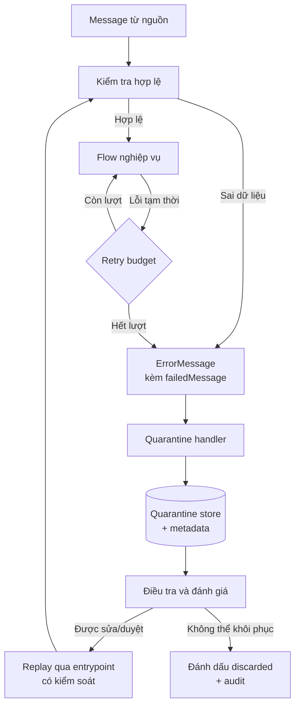
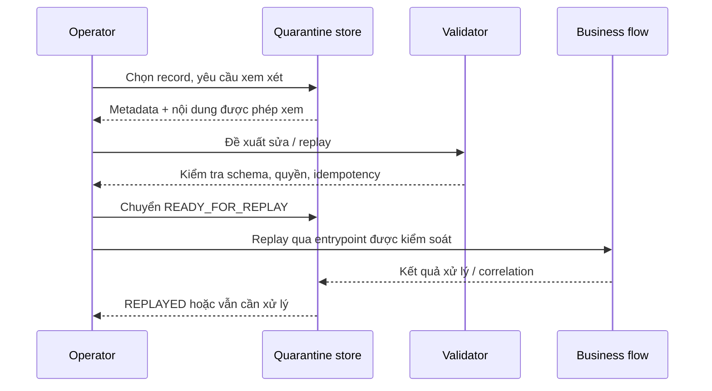

# Quarantine message lỗi

## 1. Bài toán: một message lỗi không nên làm tắc cả luồng

Một ứng dụng tích hợp có thể nhận hàng nghìn message từ đối tác và xử lý qua **Filter → Transformer → Router → Gateway**. Khi một message không đáp ứng quy tắc nghiệp vụ, ví dụ mã đơn hàng sai định dạng, tiếp tục retry với cùng dữ liệu thường không giải quyết được vấn đề. Nếu cứ gửi lại vào flow chính, message lỗi có thể bị xử lý lặp vô hạn, chiếm worker, làm tăng backlog và gây ảnh hưởng tới các message hợp lệ.

**Quarantine message lỗi** là chiến lược **cách ly message chưa thể xử lý an toàn** vào một nơi lưu giữ và quản trị riêng. Message đã được cách ly có thể được điều tra, sửa dữ liệu theo chính sách, xác định cách khôi phục rồi **replay** có kiểm soát hoặc loại bỏ với lý do rõ ràng. Quarantine không đồng nghĩa với việc âm thầm xóa message, cũng không đồng nghĩa tự động retry vô thời hạn.

Bài thuộc chương **Error channel** của module **SPRING_INTEGRATION_PATTERN**. Trong phạm vi học triển khai Enterprise Integration Patterns bằng Spring Integration, ta sẽ kết nối khả năng cách ly với Router, Filter, Transformer, Splitter, Aggregator, Gateway, retry, error channel và correlation, đồng thời kiểm thử và theo dõi các nhánh.

Sau bài học, bạn có thể:

1. Phân biệt **retry**, **error channel**, **dead-letter queue (DLQ)** và **quarantine**.
2. Nhận diện lỗi tạm thời và lỗi khó tự phục hồi để quyết định khi nào cách ly.
3. Lưu message gốc, lý do lỗi, định danh tương quan và trạng thái xử lý mà không làm lộ dữ liệu không cần thiết.
4. Tạo luồng quarantine bằng Spring Integration Java DSL và `ErrorMessage`.
5. Kiểm thử rằng message lỗi được cách ly, message hợp lệ vẫn đi tiếp và không có replay tự động vô hạn.
6. Thiết kế quy trình kiểm tra, sửa, replay, giám sát và audit cho môi trường thực tế.

## 2. Quarantine, retry và DLQ khác nhau thế nào?

| Cơ chế | Vai trò chính | Tình huống phù hợp | Hạn chế cần nhớ |
| --- | --- | --- | --- |
| **Retry** | Thử lại thao tác bị lỗi, thường có số lần và backoff giới hạn | Timeout mạng, API tạm quá tải | Không chữa được payload sai cấu trúc; retry không giới hạn gây tắc nghẽn |
| **Error channel** | Đường chuyển thông tin lỗi đến một flow xử lý lỗi | Lỗi từ poller/flow bất đồng bộ hoặc lỗi được publish chủ động | Tự thân không bảo đảm lưu bền vững và không mặc định nhận mọi exception đồng bộ |
| **DLQ** | Nơi chuyển message thất bại sau chính sách xử lý/nhận lại | Broker hỗ trợ dead-letter hoặc queue lỗi riêng | Có thể thiếu workflow điều tra, phân quyền, sửa dữ liệu và lịch sử replay |
| **Quarantine** | Quy trình cách ly, lưu giữ, đánh giá và ra quyết định với message không xử lý được | Lỗi validation có tính lâu dài, message nghi ngờ, vượt retry budget | Phải thiết kế lưu trữ, bảo mật, quyền duyệt, xử lý replay và dọn dữ liệu |

Một DLQ **có thể là hạ tầng lưu giữ của quarantine**, nhưng cần thêm metadata và quy trình vận hành để trở thành một hệ thống quarantine hoàn chỉnh.

Đừng đồng nhất quarantine với `errorChannel` mặc định. Spring Integration có cơ chế xử lý và gửi `ErrorMessage`, nhưng chỉ việc khai báo channel tên `errorChannel` không tạo ra kho lưu, dashboard, kiểm duyệt hoặc cơ chế replay an toàn.

### Ví dụ phân loại

| Lỗi | Hành động ưu tiên | Giải thích |
| --- | --- | --- |
| HTTP 503 từ đối tác | Retry có giới hạn và backoff | Lỗi có khả năng tự phục hồi |
| Mã đơn hàng không đúng schema | Quarantine | Gửi lại nguyên payload không làm schema đúng hơn |
| Thiếu trường bắt buộc | Quarantine hoặc yêu cầu sửa từ upstream | Lỗi dữ liệu có tính xác định |
| Kết nối database bị ngắt | Retry/circuit breaker; chuyển lỗi theo chính sách nếu hết budget | Phải tránh gây quá tải và giữ message bền vững |
| Message không rõ phiên bản schema | Quarantine, đánh dấu lý do và version | Cần xác định cách chuyển đổi trước khi chạy lại |
| Thanh toán đã ghi thành công nhưng ack thất bại | Điều tra + idempotency/reconciliation trước replay | Replay mù có thể tạo side effect trùng |

**Quy tắc vận hành:** chọn hành động dựa trên loại lỗi, tính bền vững của nguồn, khả năng retry an toàn và tính idempotent của handler. Không quarantine toàn bộ lỗi ngay lần đầu và cũng không retry vô hạn mọi lỗi.

## 3. Vòng đời của một message bị cách ly

Một luồng thông thường có thể đi theo sơ đồ:



Vòng đời bản ghi quarantine nên được định nghĩa rõ. Chẳng hạn:

```text
QUARANTINED
  -> UNDER_REVIEW
  -> READY_FOR_REPLAY
  -> REPLAYING
  -> REPLAYED

QUARANTINED / UNDER_REVIEW
  -> DISCARDED
```

Các trạng thái này là **quy ước do ứng dụng thiết kế**, không phải enum được Spring Integration tự tạo. Một bản ghi đang `REPLAYING` cần được xử lý sao cho hai operator không replay cùng lúc. Một bản ghi `DISCARDED` cần giữ thông tin audit theo chính sách, tránh xóa dấu vết điều tra một cách vô tình.

Phân biệt rõ hai điểm:

- **Xử lý lỗi:** quyết định dừng đường bình thường của message và lưu thông tin để chẩn đoán.
- **Xác nhận (ack/commit):** khi dùng broker hoặc transaction, chỉ xác nhận rằng message đã được xử lý theo chính sách khi dữ liệu cần thiết **đã được lưu an toàn**. Nếu ghi quarantine thất bại, không được im lặng coi message là đã xử lý thành công.

## 4. Những thông tin tối thiểu cần lưu

Một record quarantine cần đủ thông tin để truy tìm lỗi, đối chiếu message gốc và kiểm soát replay.

| Trường | Ví dụ | Mục đích |
| --- | --- | --- |
| `quarantineId` | UUID mới | Định danh bản ghi cách ly |
| `originalMessageId` | Message ID gốc | Đối chiếu message ban đầu |
| `source` | `orders-inbound` | Xác định nguồn tạo message |
| `correlationId` | `batch-20261121-01` | Liên kết với batch, Splitter/Aggregator hoặc request |
| `reasonCode` | `INVALID_ORDER_ID` | Phân loại nguyên nhân có thể thống kê |
| `errorSummary` | Mô tả đã làm sạch | Hỗ trợ điều tra mà không lộ secret/stack trace |
| `originalPayloadRef` | Khóa tham chiếu tới storage bảo vệ | Khôi phục nội dung khi có quyền |
| `attemptCount` | 1 | Kiểm soát số lần thử lại/replay |
| `quarantinedAt` | Thời điểm UTC | Theo dõi độ tuổi message |
| `status` | `QUARANTINED` | Quản lý quy trình |
| `reviewer` / `decision` | Người duyệt và quyết định | Audit và trách nhiệm |

Với payload chứa thông tin cá nhân, token hoặc bí mật, **không nên ghi toàn bộ payload vào log**. Có thể lưu trong kho được mã hóa, phân quyền theo vai trò, giới hạn thời gian lưu và chỉ ghi tham chiếu hoặc các trường định danh được cho phép vào metadata. Nếu cần replay, vẫn phải đảm bảo có khả năng truy xuất nội dung gốc hợp lệ.

Trong Spring Messaging, `ErrorMessage` mang một `Throwable`; khi lỗi được gói trong `MessagingException`, có thể lấy message gốc qua `getFailedMessage()`. Nhưng **không phải mọi đường lỗi đều giữ được message gốc**: lỗi tại source, lỗi trước khi tạo message, hoặc xử lý exception không đúng cách có thể không có `failedMessage`. Thiết kế quarantine không được giả định mọi error message đều chứa đủ dữ liệu để replay.

## 5. Error channel liên quan gì đến quarantine?

Ở Spring Integration, lỗi có thể xuất hiện trong nhiều bối cảnh:

- Với một chuỗi `DirectChannel` đồng bộ, exception của handler thường đi ngược về caller. **Không mặc nhiên** có `ErrorMessage` ở global error channel.
- Với polling endpoint, có thể cấu hình `errorChannel` trong poller để xử lý exception phát sinh từ tác vụ poll theo cơ chế error handler.
- Với executor hoặc một số endpoint bất đồng bộ, lỗi có thể được chuyển thành `ErrorMessage` trên error channel theo cấu hình và ngữ cảnh message.
- Một handler nghiệp vụ cũng có thể **chủ động phát `ErrorMessage`** khi quyết định một lỗi không thể retry và cần cách ly.

Cần biết **ai phát lỗi, vào channel nào, có `failedMessage` không, và ai tiêu thụ lỗi**. Tránh coi mọi exception của ứng dụng là sẽ tự động được gửi vào cùng một channel.

Ví dụ dưới đây dùng đường **publish error có chủ đích** cho lỗi dữ liệu đã được phân loại. Nó có ưu điểm: message gốc vẫn nằm trong tay handler tại thời điểm phát lỗi, nên metadata quarantine có thể được tạo và kiểm tra một cách xác định.

## 6. Ví dụ Spring Integration: cách ly đơn hàng sai định dạng

Ta thiết kế một ứng dụng nhận `OrderCommand` có `orderId`. Mã hợp lệ theo hợp đồng của ví dụ là `ORD-` theo sau bởi tối thiểu ba chữ số. Message sai định dạng được gửi tới một channel xử lý lỗi; message hợp lệ tiếp tục đi vào `successfulOrders`.

Ví dụ giả định Spring Boot 3.x, Java 17+ và Spring Integration version do Spring Boot quản lý:

```gradle
dependencies {
    implementation("org.springframework.boot:spring-boot-starter-integration")
    testImplementation("org.springframework.boot:spring-boot-starter-test")
}
```

### 6.1. Mô hình message và bản ghi quarantine

Tạo `OrderCommand.java`:

```java
package example.quarantine;

public record OrderCommand(String orderId) {
}
```

Tạo `QuarantineRecord.java`. Ví dụ chỉ lưu mã đơn hàng thuộc contract dữ liệu thử nghiệm; ứng dụng thật cần xác định các trường nào được phép lưu:

```java
package example.quarantine;

import java.time.Instant;
import java.util.UUID;

public record QuarantineRecord(
        UUID quarantineId,
        UUID originalMessageId,
        String correlationId,
        String orderId,
        String reasonCode,
        Instant quarantinedAt) {
}
```

Tạo `InMemoryQuarantineStore.java`:

```java
package example.quarantine;

import java.util.List;
import java.util.concurrent.ConcurrentLinkedQueue;

public class InMemoryQuarantineStore {

    private final ConcurrentLinkedQueue<QuarantineRecord> records =
            new ConcurrentLinkedQueue<>();

    public void save(QuarantineRecord record) {
        records.add(record);
    }

    public List<QuarantineRecord> all() {
        return List.copyOf(records);
    }
}
```

`InMemoryQuarantineStore` chỉ phục vụ thực hành. Dữ liệu sẽ mất nếu JVM dừng; trong production, cần kho bền vững, có transaction/ack phù hợp, chính sách retention và quyền truy xuất.

### 6.2. Định nghĩa hai channel và hai flow

Tạo `QuarantineFlowConfiguration.java`:

```java
package example.quarantine;

import java.time.Instant;
import java.util.UUID;

import org.springframework.beans.factory.annotation.Qualifier;
import org.springframework.context.annotation.Bean;
import org.springframework.context.annotation.Configuration;
import org.springframework.integration.channel.DirectChannel;
import org.springframework.integration.channel.QueueChannel;
import org.springframework.integration.config.EnableIntegration;
import org.springframework.integration.dsl.IntegrationFlow;
import org.springframework.messaging.Message;
import org.springframework.messaging.MessageChannel;
import org.springframework.messaging.MessagingException;
import org.springframework.messaging.MessageDeliveryException;
import org.springframework.messaging.MessageHandlingException;
import org.springframework.messaging.support.ErrorMessage;

@Configuration
@EnableIntegration
public class QuarantineFlowConfiguration {

    @Bean
    public MessageChannel ordersInput() {
        return new DirectChannel();
    }

    // Channel chỉ dành cho lỗi được phân loại là cần quarantine.
    @Bean
    public MessageChannel quarantineErrors() {
        return new DirectChannel();
    }

    @Bean
    public QueueChannel successfulOrders() {
        return new QueueChannel();
    }

    @Bean
    public InMemoryQuarantineStore quarantineStore() {
        return new InMemoryQuarantineStore();
    }

    @Bean
    public IntegrationFlow ordersFlow(
            @Qualifier("quarantineErrors") MessageChannel quarantineErrors,
            @Qualifier("successfulOrders") MessageChannel successfulOrders) {

        return IntegrationFlow.from("ordersInput")
                .handle(message -> {
                    if (!(message.getPayload() instanceof OrderCommand order)) {
                        throw new MessageHandlingException(
                                message, "Expected OrderCommand payload");
                    }

                    String id = order.orderId();
                    if (id == null || !id.matches("ORD-[0-9]{3,}")) {
                        MessageHandlingException failure =
                                new MessageHandlingException(
                                        message,
                                        "INVALID_ORDER_ID",
                                        new IllegalArgumentException(
                                                "Order ID format is invalid"));

                        // Giữ message gốc trong ErrorMessage.
                        ErrorMessage error = new ErrorMessage(failure, message);

                        // DirectChannel: handler quarantine chạy đồng bộ.
                        if (!quarantineErrors.send(error)) {
                            throw new MessageDeliveryException(
                                    message, "Quarantine channel rejected error");
                        }
                        // Đã lưu/quarantine thành công thì dừng nhánh bình thường.
                        return;
                    }

                    if (!successfulOrders.send(message)) {
                        throw new MessageDeliveryException(
                                message, "Success channel rejected message");
                    }
                })
                .get();
    }

    @Bean
    public IntegrationFlow quarantineFlow(
            InMemoryQuarantineStore quarantineStore) {
        return IntegrationFlow.from("quarantineErrors")
                .handle(message -> {
                    if (!(message instanceof ErrorMessage error)) {
                        throw new IllegalArgumentException(
                                "Expected ErrorMessage");
                    }
                    if (!(error.getPayload() instanceof MessagingException ex)) {
                        throw new IllegalArgumentException(
                                "Expected MessagingException");
                    }

                    Message<?> failed = ex.getFailedMessage();
                    if (failed == null) {
                        failed = error.getOriginalMessage();
                    }
                    if (failed == null
                            || !(failed.getPayload() instanceof OrderCommand order)) {
                        // Không xác định được message gốc: cần cảnh báo/escalate.
                        throw new IllegalStateException(
                                "Original OrderCommand is unavailable");
                    }

                    Object rawCorrelation =
                            failed.getHeaders().get("correlationId");
                    String correlationId = rawCorrelation == null
                            ? ""
                            : rawCorrelation.toString();

                    quarantineStore.save(new QuarantineRecord(
                            UUID.randomUUID(),
                            failed.getHeaders().getId(),
                            correlationId,
                            order.orderId(),
                            "INVALID_ORDER_ID",
                            Instant.now()));
                })
                .get();
    }
}
```

Luồng chính `ordersFlow` phát `ErrorMessage` chỉ khi **mã đơn hàng sai định dạng**. `quarantineFlow` lấy `failedMessage`, định danh tương quan và nguyên nhân đã phân loại, sau đó lưu record cách ly. Message hợp lệ được gửi tới `successfulOrders`.

Hai điều quan trọng:

1. Đây là ví dụ **xử lý lỗi có chủ đích tại ranh giới nghiệp vụ**. `quarantineErrors` là channel riêng; không nên suy ra Spring Integration sẽ tự chuyển mọi exception đồng bộ vào đây.
2. Việc `return` sau khi gửi lỗi thể hiện **kết quả terminal đã được xử lý theo chính sách**. Với nguồn có ack/transaction, chỉ được xác nhận hoàn tất sau khi việc lưu quarantine đã thành công theo mức độ bền vững bắt buộc. Bản demo dùng bộ nhớ nên không thích hợp làm cơ chế bảo toàn message trong production.

Nếu `quarantineFlow` ném exception khi lưu, `DirectChannel` có thể truyền lỗi ngược đến `ordersFlow` và bên gửi. Điều này tốt hơn việc âm thầm bỏ message. Tùy nguồn, cần có cơ chế rollback/redelivery hoặc fallback store phù hợp; không nên nuốt exception rồi ack message như thể đã được lưu an toàn.

### 6.3. Dòng chạy của hai message

Giả sử application gửi:

```java
ordersInput.send(MessageBuilder
        .withPayload(new OrderCommand("BAD-7"))
        .setHeader("correlationId", "batch-72")
        .build());

ordersInput.send(MessageBuilder
        .withPayload(new OrderCommand("ORD-1234"))
        .setHeader("correlationId", "batch-72")
        .build());
```

Kết quả dự kiến:

- `BAD-7` được tạo bản ghi quarantine với `reasonCode=INVALID_ORDER_ID`, `originalMessageId` và `correlationId=batch-72`; không đi vào `successfulOrders`.
- `ORD-1234` đi vào `successfulOrders`; không tạo thêm bản ghi quarantine.
- Hai message dùng cùng correlation ID của batch nhưng **không** có nghĩa phải được xử lý như cùng một bản ghi. `messageId` và `quarantineId` vẫn tách biệt.

Trong ứng dụng thật, payload có thể là object phức tạp. Lúc đó không nên chỉ `String.valueOf(payload)` và lưu vào log; cần schema, phiên bản, serializer đáng tin, trường được phép lưu và kho bảo vệ dữ liệu.

## 7. Khi dùng error channel tự động thay cho publish có chủ đích

Không phải lúc nào lỗi cũng được phát ở nhánh validation như ví dụ. Lỗi có thể đến từ inbound poller, message handler, gateway hoặc executor.

Ví dụ, một poller có thể cấu hình đường lỗi riêng:

```java
// Đoạn DSL minh họa trong cấu hình inbound polling endpoint.
.from(messageSource, spec -> spec
        .id("ordersInbound")
        .poller(Pollers.fixedDelay(Duration.ofSeconds(1))
                .errorChannel("ordersProcessingErrors")))
```

Error flow của `ordersProcessingErrors` có thể phân loại `ErrorMessage`, rồi quyết định retry, quarantine hoặc báo lỗi vận hành. Khi áp dụng, phải kiểm tra phiên bản Spring Integration, kiểu endpoint, error handler và phương thức phát `ErrorMessage` thực tế.

**Đặc biệt cẩn thận với message gốc:** nếu lỗi xảy ra trước khi source tạo được `Message<?>`, có thể không có `failedMessage`. Nếu lỗi đến từ handler ở một flow bất đồng bộ, việc giữ `failedMessage` và headers phụ thuộc nơi phát lỗi. Quarantine handler phải có **nhánh xử lý khi không thể khôi phục message gốc**: báo động, lưu thông tin lỗi tối thiểu an toàn và không giả vờ rằng có thể replay.

Trong đường `DirectChannel` đồng bộ, nếu handler ném exception và caller không bắt, lỗi thường truyền về caller; không mặc nhiên đi qua `errorChannel` global. Cần quyết định rõ nơi chuyển lỗi và ai chịu trách nhiệm hoàn tất giao dịch hoặc trả lỗi cho caller.

## 8. Kiểm thử đường hợp lệ và đường quarantine

Ví dụ dưới đây dùng JUnit Jupiter và AssertJ, chỉ một test để tránh ảnh hưởng từ trạng thái `InMemoryQuarantineStore` có thể được dùng lại giữa các test cùng Spring context.

Tạo `QuarantineFlowTest.java`:

```java
package example.quarantine;

import static org.assertj.core.api.Assertions.assertThat;

import org.junit.jupiter.api.Test;
import org.springframework.beans.factory.annotation.Autowired;
import org.springframework.beans.factory.annotation.Qualifier;
import org.springframework.integration.channel.QueueChannel;
import org.springframework.messaging.Message;
import org.springframework.messaging.MessageChannel;
import org.springframework.messaging.support.MessageBuilder;
import org.springframework.test.context.junit.jupiter.SpringJUnitConfig;

@SpringJUnitConfig(QuarantineFlowConfiguration.class)
class QuarantineFlowTest {

    @Autowired
    @Qualifier("ordersInput")
    MessageChannel ordersInput;

    @Autowired
    @Qualifier("successfulOrders")
    QueueChannel successfulOrders;

    @Autowired
    InMemoryQuarantineStore quarantineStore;

    @Test
    void invalidOrderIsQuarantinedAndValidOrderContinues() {
        Message<OrderCommand> invalid = MessageBuilder
                .withPayload(new OrderCommand("BAD-7"))
                .setHeader("correlationId", "batch-72")
                .build();

        assertThat(ordersInput.send(invalid)).isTrue();
        assertThat(successfulOrders.receive(0)).isNull();

        assertThat(quarantineStore.all()).hasSize(1);
        QuarantineRecord record = quarantineStore.all().get(0);

        assertThat(record.originalMessageId())
                .isEqualTo(invalid.getHeaders().getId());
        assertThat(record.orderId()).isEqualTo("BAD-7");
        assertThat(record.reasonCode()).isEqualTo("INVALID_ORDER_ID");
        assertThat(record.correlationId()).isEqualTo("batch-72");

        Message<OrderCommand> valid = MessageBuilder
                .withPayload(new OrderCommand("ORD-1234"))
                .build();

        assertThat(ordersInput.send(valid)).isTrue();
        Message<?> processed = successfulOrders.receive(0);

        assertThat(processed).isNotNull();
        assertThat(processed.getPayload()).isEqualTo(valid.getPayload());
        assertThat(quarantineStore.all()).hasSize(1);
    }
}
```

Bài kiểm thử xác nhận ba hành vi cần thiết: **message sai được cách ly**, **message đúng vẫn đi tiếp** và **message đúng không bị đánh dấu quarantine**. Vì các `DirectChannel` trong ví dụ xử lý đồng bộ, record được lưu trước khi lời gọi `send()` trả về. Với channel bất đồng bộ, test phải chờ có timeout và kiểm tra rõ ràng cả trạng thái chưa xác định.

Để tăng độ tin cậy của hệ thống production, cần kiểm thử thêm:

1. **Lưu quarantine thất bại:** lỗi phải được phản ánh tới nguồn hoặc fallback; không ack nhầm và không mất dấu message.
2. **Message gốc không tồn tại:** handler không được giả lập message gốc rồi cho phép replay sai.
3. **Hai lần nhận cùng message:** chính sách deduplication/idempotency phải được kiểm tra theo khóa nghiệp vụ.
4. **Retry hết budget:** chỉ chuyển sang quarantine khi loại lỗi và số lần thử đáp ứng chính sách.
5. **Replay thất bại:** record quay về trạng thái phù hợp, có lịch sử lượt thử, tránh vòng lặp vô hạn.
6. **Phân quyền:** người chỉ được đọc record không tự động có quyền xem payload nhạy cảm, sửa hay replay.

## 9. Thiết kế lưu trữ quarantine cho production

Ví dụ trong bộ nhớ cho thấy mô hình message, nhưng chưa bảo vệ dữ liệu khi lỗi tiến trình hoặc mất điện. Khi đưa vào production, cần trả lời các câu hỏi sau:

| Chủ đề | Cần quyết định |
| --- | --- |
| **Durability** | Lưu ở database/broker/object storage nào, có commit trước khi ack nguồn không? |
| **Atomicity** | Nếu business message và bản ghi quarantine thuộc hai hệ thống khác nhau, làm sao tránh khoảng trống giữa ghi và ack? |
| **Capacity** | Dung lượng, retention, phân vùng, giới hạn bản ghi và cảnh báo tăng trưởng |
| **Schema** | Version của payload, lý do lỗi, metadata và đường nâng cấp schema |
| **Security** | Mã hóa, quyền đọc payload, audit truy xuất, masking/redaction |
| **Concurrency** | Ngăn hai worker hoặc hai người vận hành replay cùng một bản ghi |
| **Replay** | Đưa message về entrypoint nào, giữ khóa idempotency thế nào, giới hạn lượt thử |
| **Deletion** | Bao lâu được xóa? Có legal hold hoặc yêu cầu lưu audit không? |

Một mẫu triển khai là dùng kho quarantine bền vững cùng transaction/outbox khi có thể, hoặc broker có DLQ bền vững và dịch vụ quản trị riêng. Cơ chế nào phù hợp phụ thuộc vào nguồn dữ liệu, trình tự ack/commit, khả năng giao dịch và yêu cầu khôi phục.

**Không bảo đảm exactly-once chỉ nhờ quarantine.** Nếu message được xử lý một phần trước khi lỗi, replay có thể lặp side effect. Nên sử dụng idempotency key, kiểm tra trạng thái nghiệp vụ và reconciliation trước khi cho phép replay.

### Khi kho quarantine cũng bị lỗi

Kho quarantine là một điểm vận hành quan trọng: không được biến việc “không lưu được message lỗi” thành sự kiện bị bỏ qua.

- Nếu có transaction với nguồn, ưu tiên để rollback/redelivery theo chính sách đã định.
- Nếu nguồn không hỗ trợ rollback hoặc mất quyền kiểm soát ack, cần có fallback bền vững hoặc cảnh báo sự cố nghiêm trọng.
- Khi số message quarantine tăng bất thường, có thể cần giảm tốc intake, áp dụng backpressure hoặc tạm dừng endpoint thông qua Control Bus có phân quyền.
- Không retry vô hạn ngay tại error handler khiến luồng xử lý lỗi tự nghẽn và làm tắc luồng chính.

Trong các trường hợp xử lý message bất đồng bộ, cần xem thêm executor saturation, kích thước queue lỗi và điều gì xảy ra khi handler xử lý lỗi lại ném exception.

## 10. Replay có kiểm soát: không đưa nguyên message về flow một cách mù quáng

Replay là thao tác có thể gây side effect nghiệp vụ, nên phải có quy trình chặt chẽ.



Một quy trình an toàn có thể gồm:

1. **Lựa chọn:** tìm record theo reason code, khoảng thời gian, source, correlation ID.
2. **Điều tra:** xem thông tin đã được phân quyền; xác định vì sao message sai và liệu downstream đã có side effect chưa.
3. **Phê duyệt:** nếu cần sửa dữ liệu, giữ bản gốc bất biến và ghi lại bản sửa/phiên bản mới với người duyệt.
4. **Kiểm tra trước replay:** validate schema, đảm bảo không vượt số lượt thử, đối chiếu idempotency key và trạng thái nghiệp vụ.
5. **Claim nguyên tử:** đánh dấu record `REPLAYING` bằng compare-and-set/version để tránh hai operator replay đồng thời.
6. **Phát lại:** gửi message qua **entrypoint nghiệp vụ chính thức**, để Filter/Transformer/Router và validation chạy lại theo chính sách.
7. **Xác nhận kết quả:** chỉ đánh dấu `REPLAYED` khi có bằng chứng xử lý theo hợp đồng; khi timeout, ghi `UNKNOWN` và kiểm tra trước khi retry.
8. **Audit:** lưu người thao tác, thời điểm, thay đổi dữ liệu, message ID mới và original ID, kết quả và nguyên nhân.

Không gọi trực tiếp handler ở cuối flow chỉ để bỏ qua validation. Cũng không phát lại mọi record quarantine ngay khi một lỗi hạ tầng được khắc phục; trước tiên phải phân loại message, đánh giá backlog và giới hạn tốc độ.

### ID và correlation khi replay

Spring Messaging có `MessageHeaders.ID` do framework tạo khi build message mới. Khi replay, thường có **message ID mới**, nhưng cần giữ một header hoặc trường metadata như `originalMessageId`, `quarantineId` và `replayAttempt` để có thể truy ngược lịch sử.

Một message được replay có thể có correlation ID của batch cũ; với Aggregator đang mở hoặc đã hết hạn, dùng lại correlation ID có thể vô tình trộn mảnh giữa các lần xử lý. Cần xác định có giữ nguyên correlation, mở correlation mới hay tái tạo batch theo quy tắc của từng flow. Không lựa chọn một cách chung cho mọi Aggregator.

## 11. Tác động tới các mẫu EIP khác

| Mẫu EIP | Quan hệ với quarantine | Điều cần kiểm tra |
| --- | --- | --- |
| **Filter** | Có thể phát hiện payload sai quy tắc | Có discard flow rõ ràng, tránh lặng lẽ xóa message |
| **Transformer** | Chuyển đổi schema có thể lỗi | Có giữ input gốc và schema version để sửa không? |
| **Router** | Định tuyến lỗi xác định sang nhánh cách ly | Không route dữ liệu không hợp lệ quay lại vòng lặp retry |
| **Splitter** | Một batch có thể có một phần bị cách ly | Giữ sequence/correlation và ảnh hưởng tới những phần còn lại |
| **Aggregator** | Group thiếu mảnh cách ly có thể chờ mãi | Timeout, release/expiration, MessageStore và kế hoạch bù mảnh |
| **Gateway** | Caller có thể chờ reply khi message bị cách ly | Quy định phản hồi nghiệp vụ và timeout; quarantine không tự phát reply |
| **Retry** | Thử lại lỗi tạm thời trước khi quarantine | Số lượt, backoff, phân loại lỗi và idempotency |
| **Error channel** | Chuyển `ErrorMessage` cho flow xử lý lỗi | Bảo toàn `failedMessage`, tránh error handler tạo lỗi lặp |
| **Correlation** | Kết nối message lỗi với batch hoặc request gốc | Lưu key và cân nhắc semantics khi replay |

Ví dụ một Splitter phát 10 mảnh, mảnh thứ 7 bị quarantine vì payload sai. Aggregator đang chờ đủ 10 mảnh có thể không được release như bình thường. Cần chính sách xử lý phần thiếu: chờ sửa và replay, release partial result có cảnh báo, hết hạn group hoặc chuyển cả batch sang trạng thái lỗi. Chỉ cách ly một mảnh mà bỏ qua trạng thái Aggregator sẽ để lại sự cố khó phát hiện.

## 12. Quan sát, cảnh báo và quản trị

Các metric hữu ích bao gồm:

- **Tốc độ quarantine** theo source, `reasonCode` và schema version.
- **Độ tuổi bản ghi** chưa được xem xét hoặc chưa replay.
- **Tỷ lệ replay thành công**, số lần replay và lỗi lặp lại sau replay.
- **Tỷ lệ lỗi kho quarantine**, độ trễ lưu và số lượt thất bại khi gửi vào error flow.
- **Retry budget** trước khi cách ly và số message đang ở backoff.
- **Backlog** của luồng chính, error channel, DLQ và các group Aggregator chưa hoàn tất.
- **Số thao tác quản trị**: xem payload, sửa, replay, discard, thay đổi quyền.

Một bản ghi audit có thể có cấu trúc:

```json
{
  "event": "MESSAGE_QUARANTINED",
  "quarantineId": "f2a4f5c8-21d1-4e9f-9704-2a876fc2d551",
  "originalMessageId": "9d661753-bb3d-4ce4-bf0f-77b003e04f61",
  "source": "orders-inbound",
  "correlationId": "batch-72",
  "reasonCode": "INVALID_ORDER_ID",
  "status": "QUARANTINED",
  "recordedAt": "2026-11-21T08:00:00Z"
}
```

Đây là **mẫu audit do ứng dụng tự xây dựng**. Spring Integration không tự quản lý mọi trường này. Đừng gắn payload hoặc exception stack trace chứa dữ liệu nhạy cảm trực tiếp vào log/metric tag.

Khi phát hiện đột biến quarantine, có thể tạm dừng nguồn inbound qua Control Bus hoặc điều chỉnh rate limit theo chính sách. Quarantine không tự động ngắt source và cũng không tự sửa dữ liệu nguồn.

## 13. Lỗi thường gặp

| Triệu chứng | Khả năng gây ra | Cách xử lý |
| --- | --- | --- |
| Message sai vẫn được xử lý tiếp | Nhánh lỗi không kết thúc luồng bình thường | Khi đã quarantine thành công, không chuyển tiếp vào nhánh thành công |
| Message lỗi biến mất sau restart | Quarantine dùng bộ nhớ hoặc ack trước khi lưu bền vững | Dùng store bền vững và kiểm tra transaction/ack |
| Không lấy được original payload | `MessagingException.getFailedMessage()` là `null` | Gắn context tại nơi phát lỗi, giữ reference hoặc cảnh báo không thể replay |
| Lỗi trong error flow khiến loop | Error handler tiếp tục gửi lỗi vào chính nó | Thiết kế fallback/escalation độc lập, tránh recursive publish |
| DLQ chứa nhiều message nhưng chưa xử lý | Thiếu workflow vận hành | Xây dựng trạng thái, quyền duyệt, SLA xử lý và replay |
| Replay tạo side effect trùng | Không có idempotency hoặc không đối chiếu trạng thái nghiệp vụ | Dùng key ổn định, reconciliation và audit |
| Aggregator chờ vô hạn | Một mảnh bị quarantine nhưng group không có timeout | Thiết kế expiration/release strategy |
| Tất cả lỗi đều vào quarantine | Không phân biệt transient/permanent | Retry có giới hạn, circuit breaker và chính sách phân loại |
| Payload bị lộ qua log | Ghi raw message hoặc exception tùy tiện | Masking, phân quyền, hạn chế trường metadata |
| Quarantine store quá tải | Không có giới hạn/backpressure | Cảnh báo capacity, phân vùng và kế hoạch dừng nguồn phù hợp |

## 14. Bài tập thực hành

**Bài 1 — Phân loại lỗi.** Cho các lỗi: HTTP 503, sai mã đơn hàng, không tìm thấy schema version, timeout DB và thanh toán đã commit nhưng ack lỗi. Xác định loại nào nên retry, loại nào cần quarantine ngay và loại nào cần reconciliation trước replay.

**Bài 2 — Xây dựng error flow.** Chạy ví dụ Java DSL, gửi `BAD-7` và `ORD-1234`, kiểm tra `QuarantineRecord`, `originalMessageId`, `correlationId` và `successfulOrders`.

**Bài 3 — Ghi quarantine lỗi.** Thay kho bộ nhớ bằng một store giả lập ném exception khi lưu. Kiểm tra lỗi được phản hồi ra caller theo đường đồng bộ và không được xác nhận message đã cách ly thành công.

**Bài 4 — Replay có kiểm soát.** Thiết kế API chỉ cho operator được phép yêu cầu replay. Mô tả trạng thái `READY_FOR_REPLAY`, `REPLAYING`, `REPLAYED`, khóa tránh replay đồng thời, idempotency key và kết quả khi timeout.

**Bài 5 — Quarantine trong Splitter/Aggregator.** Splitter tạo năm mảnh cùng correlation ID; mảnh thứ tư bị quarantine. Thiết kế chính sách timeout, bổ sung mảnh đã sửa hoặc release partial result; ghi rõ tác động lên group còn chờ.

**Bài 6 — Bảo mật dữ liệu lỗi.** Với message chứa email và thông tin thanh toán, đề xuất metadata có thể hiện trên dashboard và nội dung phải nằm trong kho mã hóa. Xác định ai được xem, sửa, replay hoặc discard.

## 15. Câu hỏi tự kiểm tra

1. Vì sao một message sai schema thường không nên retry vô hạn?
2. DLQ khác gì với một workflow quarantine hoàn chỉnh?
3. `ErrorMessage` luôn có `failedMessage` để replay không? Nếu không, cần làm gì?
4. Vì sao không phải mọi exception từ `DirectChannel` đồng bộ đều tự động đến global `errorChannel`?
5. Nếu lưu quarantine thất bại, vì sao không được nuốt exception rồi ack nguồn?
6. Khi replay một mảnh của Splitter, cần xét điều gì về correlation ID và Aggregator?
7. Vì sao cần phân biệt original message ID, quarantine ID và replay message ID?
8. Quyền xem metadata có đồng nghĩa với quyền đọc payload và replay không?

**Ghi nhớ:** quarantine là **quy trình cách ly và quản trị message lỗi**: giữ đủ bằng chứng để chẩn đoán, bảo vệ dữ liệu gốc, quyết định có kiểm soát và replay an toàn. Spring Integration cung cấp `ErrorMessage`, error channel và các thành phần EIP để xây dựng đường đi; tính bền vững, phân quyền, idempotency, correlation và audit phải được thiết kế theo yêu cầu nghiệp vụ thực tế.

