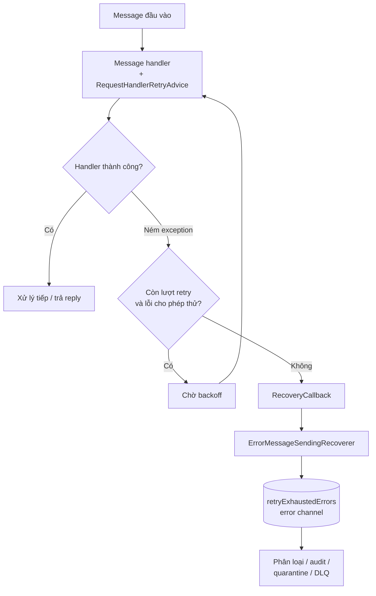
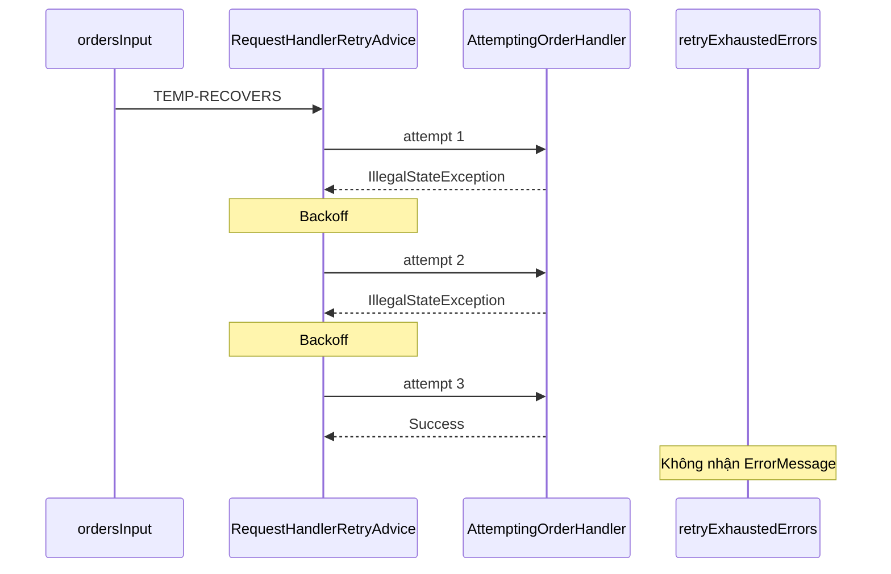
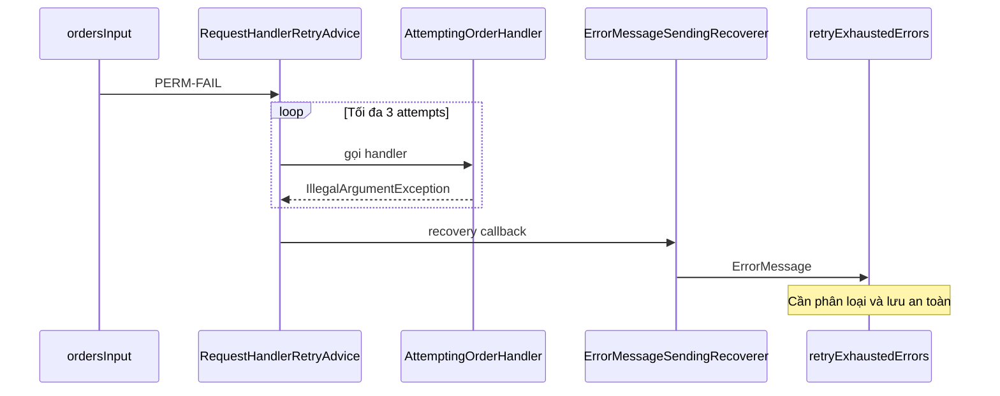

# Retry advice và error channel

## 1. Vì sao retry cần gắn với một đường xử lý lỗi?

Trong một hệ thống tích hợp đơn hàng, message thường đi qua nhiều thành phần: **Filter** kiểm tra dữ liệu, **Transformer** chuẩn hóa, **Router** chọn nhánh, **Gateway** gọi đối tác, rồi lưu hoặc tổng hợp kết quả. Đôi lúc đối tác trả HTTP 503 hoặc kết nối bị ngắt trong thời gian ngắn. Thử lại vài lần có thể giúp message hoàn tất. Nhưng nếu lỗi kéo dài, tiếp tục retry mãi sẽ giữ worker, tăng độ trễ và làm tắc các message khác.

**Spring Integration** cho phép áp dụng `RequestHandlerRetryAdvice` cho một message handler. Advice sử dụng cơ chế của **Spring Retry** để gọi lại handler theo chính sách số lần và khoảng cách giữa các lần thử. Sau khi hết lượt retry, ta có thể dùng `ErrorMessageSendingRecoverer` để chuyển lỗi thành `ErrorMessage` tới một **error channel** được chọn, thay vì để message rơi vào vòng thử lại vô hạn.

Bài **“Retry advice và error channel”** thuộc chương **Error channel** của module **SPRING_INTEGRATION_PATTERN**. Trong phạm vi học Enterprise Integration Patterns với Router, Filter, Transformer, Splitter, Aggregator, Gateway, retry, error channel và correlation, bài này tập trung vào ranh giới giữa **thử lại tại handler** và **định tuyến thất bại đến nhánh xử lý lỗi**.

Sau bài học, bạn có thể:

1. Phân biệt `RequestHandlerRetryAdvice`, `RetryTemplate`, `RecoveryCallback` và error channel.
2. Cấu hình số lần thử, backoff và đường khôi phục sau khi hết lượt.
3. Kiểm tra message thành công sau vài lần thử và message bị chuyển sang error channel khi vẫn thất bại.
4. Nhận diện những lỗi **không nên retry** và cách phân loại lỗi trước khi thử lại.
5. Hiểu tác động của retry lên message, transaction, ack, gateway, correlation và hệ thống bất đồng bộ.
6. Thiết kế kiểm thử, quan sát, bảo mật và vận hành nhánh lỗi mà không đánh đồng “đã gửi tới error channel” với “đã xử lý nghiệp vụ thành công”.

## 2. Bốn thành phần cần hiểu

| Thành phần | Trách nhiệm | Không tự làm |
| --- | --- | --- |
| `RequestHandlerRetryAdvice` | Bao quanh lời gọi một message handler và thực hiện retry khi xử lý ném exception | Không tự quyết định nghiệp vụ nào nên bị loại, không biến mọi lỗi thành DLQ |
| `RetryTemplate` | Xác định `RetryPolicy`, `BackOffPolicy` và cách thực thi các lượt thử | Không tự thiết lập một error channel |
| `ErrorMessageSendingRecoverer` | Khi được gọi bởi recovery callback, phát thông tin lỗi tới một `MessageChannel` | Không bảo đảm nơi nhận lưu bền vững hoặc có người xử lý |
| **Error channel** | Tiếp nhận `ErrorMessage` và đưa tới nhánh phân loại, cảnh báo, quarantine hoặc DLQ | Không mặc định nhận tất cả exception đồng bộ và không tự retry |

Hai mốc quan trọng:

- **Retry chưa hết lượt:** handler có thể được gọi lại trong cùng thao tác mà chưa phát một `ErrorMessage` tới kênh được cấu hình cho recovery.
- **Retry đã hết lượt:** `RecoveryCallback` được kích hoạt. Nếu dùng `ErrorMessageSendingRecoverer`, lỗi được publish tới kênh đích; việc tiếp tục hay dừng đường nghiệp vụ phụ thuộc topology và hợp đồng của handler/gateway.

Sơ đồ khái niệm:



**Quan trọng:** khi dùng error channel trong recovery, cần hiểu rằng nhánh lỗi có thể được xem là kết quả đã được xử lý bởi recovery callback. Một request-reply gateway có thể **không có reply thành công** và có thể timeout nếu không thiết kế phản hồi lỗi rõ ràng. Không hứa rằng chỉ cần gửi lỗi vào channel là requester sẽ nhận exception ngay lập tức.

## 3. Phạm vi của retry advice

Retry advice gắn với **một handler cụ thể**, không phải mọi thành phần trong toàn bộ `IntegrationFlow`:

```text
ordersInput
    -> validator
    -> paymentHandler [RequestHandlerRetryAdvice]
    -> confirmationHandler
```

Nếu `paymentHandler` lỗi, advice thử lại lời gọi `paymentHandler` theo chính sách. Nó không tự động chạy lại các bước `validator` đã hoàn tất ở phía trước và không nhất thiết thực hiện lại toàn bộ flow từ nguồn.

Điều này vừa hữu ích, vừa có rủi ro:

- **Hữu ích:** không cần xử lý lại các bước đã thành công và không cần phát lại cùng message từ broker chỉ vì kết nối một đối tác bị lỗi tạm thời.
- **Rủi ro:** nếu handler đã tạo side effect (ví dụ ghi dữ liệu hoặc trừ tiền) rồi mới ném exception, retry có thể lặp side effect. Cần idempotency, transaction hoặc reconciliation tùy nghiệp vụ.
- **Rủi ro khác:** khi handler gọi API chậm, các lượt thử và backoff chiếm thời gian thực thi. Nếu flow đồng bộ, request gốc có thể vượt timeout. Nếu worker bất đồng bộ, số message đang chờ có thể tăng.

Không nên xem retry advice là giải pháp thay thế cho **circuit breaker**, **rate limiter**, **timeout**, **backpressure** hoặc **dead-letter processing**. Các cơ chế này giải quyết các vấn đề khác nhau và thường phải phối hợp với nhau.

### 3.1. Stateless và stateful retry

Trong các ví dụ cơ bản, retry là **stateless**: các lần gọi lại handler diễn ra bên trong một lần xử lý message theo `RetryTemplate`. Khi kết thúc thất bại và recovery được gọi, lượt retry đó cũng kết thúc.

**Stateful retry** có thể cần trong những tình huống transaction phải rollback rồi xử lý lại message qua nhiều lần delivery. Khi đó cần cơ chế nhận diện message/key ổn định, xử lý vòng đời retry context và hiểu rõ transaction/re-delivery của nguồn. Không nên tự bật stateful retry chỉ để “giữ retry lâu hơn”; việc ánh xạ khóa, rollback và recovery cần thiết kế riêng.

### 3.2. Tổng số lần thử và backoff

Ví dụ `maxAttempts(3)` thường nghĩa là **tối đa ba lần gọi handler, bao gồm lần đầu**, không phải một lần đầu cộng thêm ba retry. Nếu tất cả thất bại, recovery được gọi sau lần thứ ba.

Ví dụ với backoff cố định 100 ms:

| Thời điểm tương đối | Thao tác | Kết quả giả định |
| --- | --- | --- |
| `t0` | Gọi handler lần 1 | Ném lỗi tạm thời |
| `t0 + 100 ms` | Gọi handler lần 2 | Ném lỗi tạm thời |
| `t0 + 200 ms` | Gọi handler lần 3 | Thành công hoặc tiếp tục lỗi |
| Sau lần cuối lỗi | Gọi recovery callback | Phát `ErrorMessage` tới kênh chỉ định |

Đây là sơ đồ minh họa: thời điểm thực tế còn phụ thuộc thời gian thực thi từng lần gọi và scheduler/thread. Với các hệ thống production nên dùng exponential backoff có giới hạn, jitter phù hợp và tổng retry budget tránh đồng loạt gọi lại khi đối tác vừa hồi phục.

## 4. Ví dụ Java DSL: retry ba lần rồi gửi ErrorMessage

Ví dụ sử dụng Spring Boot và Spring Integration, kèm Spring Retry. Để đơn giản, handler mô phỏng hai loại message:

- `TEMP-RECOVERS` thất bại ở hai lần đầu, thành công ở lần thứ ba.
- `PERM-FAIL` luôn thất bại, sau ba lượt sẽ chuyển sang channel lỗi.

Các identifier trên chỉ dùng trong bài kiểm thử; production cần phân loại exception và quyết định loại nào được retry.

### 4.1. Dependencies

Trong dự án Spring Boot có quản lý version phụ thuộc:

```gradle
dependencies {
    implementation("org.springframework.boot:spring-boot-starter-integration")
    implementation("org.springframework.retry:spring-retry")
    testImplementation("org.springframework.boot:spring-boot-starter-test")
}
```

Tùy hệ thống có thể đã nhận Spring Retry qua dependency khác. Cần thống nhất version của Spring Retry với Spring Boot và Spring Integration được dùng.

### 4.2. Handler mô phỏng số lần thử

Tạo `AttemptingOrderHandler.java`:

```java
package example.retryerror;

import java.util.concurrent.ConcurrentHashMap;
import java.util.concurrent.ConcurrentMap;
import java.util.concurrent.atomic.AtomicInteger;

import org.springframework.messaging.Message;
import org.springframework.messaging.MessageHandler;

public final class AttemptingOrderHandler implements MessageHandler {

    private final ConcurrentMap<String, AtomicInteger> attempts =
            new ConcurrentHashMap<>();

    @Override
    public void handleMessage(Message<?> message) {
        String orderId = (String) message.getPayload();

        int attempt = attempts
                .computeIfAbsent(orderId, ignored -> new AtomicInteger())
                .incrementAndGet();

        if ("TEMP-RECOVERS".equals(orderId) && attempt < 3) {
            throw new IllegalStateException(
                    "Simulated temporary downstream error");
        }

        if ("PERM-FAIL".equals(orderId)) {
            throw new IllegalArgumentException(
                    "Simulated permanent business error");
        }

        // Với TEMP-RECOVERS ở lần 3, handler kết thúc bình thường.
    }

    public int attemptsFor(String orderId) {
        AtomicInteger value = attempts.get(orderId);
        return value == null ? 0 : value.get();
    }
}
```

Handler đếm lần gọi theo mã message; đây là cơ chế quan sát test, không phải bộ đếm retry dùng cho production. Retry trong Spring Integration do advice quản lý.

### 4.3. Cấu hình channel, advice và recovery

Tạo `RetryErrorFlowConfiguration.java`:

```java
package example.retryerror;

import org.springframework.beans.factory.annotation.Qualifier;
import org.springframework.context.annotation.Bean;
import org.springframework.context.annotation.Configuration;
import org.springframework.integration.channel.DirectChannel;
import org.springframework.integration.channel.QueueChannel;
import org.springframework.integration.config.EnableIntegration;
import org.springframework.integration.dsl.IntegrationFlow;
import org.springframework.integration.handler.advice.ErrorMessageSendingRecoverer;
import org.springframework.integration.handler.advice.RequestHandlerRetryAdvice;
import org.springframework.messaging.MessageChannel;
import org.springframework.retry.support.RetryTemplate;

@Configuration
@EnableIntegration
public class RetryErrorFlowConfiguration {

    @Bean
    public MessageChannel ordersInput() {
        return new DirectChannel();
    }

    // Nơi giữ ErrorMessage sau khi hết lượt retry để kiểm thử.
    @Bean
    public QueueChannel retryExhaustedErrors() {
        return new QueueChannel();
    }

    @Bean
    public AttemptingOrderHandler attemptingOrderHandler() {
        return new AttemptingOrderHandler();
    }

    @Bean
    public RequestHandlerRetryAdvice orderRetryAdvice(
            @Qualifier("retryExhaustedErrors")
            QueueChannel retryExhaustedErrors) {

        RetryTemplate retryTemplate = RetryTemplate.builder()
                .maxAttempts(3)
                .fixedBackoff(100)
                .build();

        RequestHandlerRetryAdvice advice =
                new RequestHandlerRetryAdvice();
        advice.setRetryTemplate(retryTemplate);

        // Recovery chỉ chạy khi retry không đạt kết quả.
        advice.setRecoveryCallback(
                new ErrorMessageSendingRecoverer(retryExhaustedErrors));

        return advice;
    }

    @Bean
    public IntegrationFlow ordersFlow(
            AttemptingOrderHandler attemptingOrderHandler,
            RequestHandlerRetryAdvice orderRetryAdvice) {

        return IntegrationFlow.from("ordersInput")
                .handle(attemptingOrderHandler,
                        endpoint -> endpoint.advice(orderRetryAdvice))
                .get();
    }
}
```

Ở đây, `retryExhaustedErrors` được tạo bằng `QueueChannel` để test có thể đọc trực tiếp `ErrorMessage`. Nó là **kênh lỗi riêng sau khi retry hết lượt**, không phải global `errorChannel` mặc định. Spring Integration không tự chuyển mọi exception của mọi flow sang kênh này.

Trong ứng dụng thực, có thể thay `QueueChannel` bằng một `DirectChannel` gắn error flow xử lý ngay hoặc kênh/broker có cơ chế lưu bền vững. Khi đổi loại channel, cần rà soát semantics đồng bộ/bất đồng bộ và hành vi nếu error handler thất bại.

### 4.4. Vì sao recoverer cần kênh đích?

Lệnh:

```java
advice.setRecoveryCallback(
        new ErrorMessageSendingRecoverer(retryExhaustedErrors));
```

nối “đã retry hết” với nơi nhận lỗi. Nếu **không** cấu hình recovery callback cho advice, ngoại lệ sau khi hết lượt thường được ném ngược ra đường gọi và được xử lý theo ngữ cảnh gọi (caller, poller error handler, gateway hoặc adapter). Nếu **có** recovery callback gửi lỗi, cần bảo đảm nơi nhận thực sự hoạt động và có khả năng xử lý message đã thất bại.

Một recoverer chỉ mới **publish** lỗi. Việc lưu lỗi vào database, đưa message vào DLQ, phân loại permanent/transient, cảnh báo hoặc replay phải được hiện thực trong error flow và hạ tầng tương ứng.

## 5. Quan sát luồng chạy từng trường hợp

### 5.1. Message khôi phục ở lần thứ ba



Kết quả: handler được gọi ba lần nhưng **không có recovery**, vì lần cuối thành công. Không được ghi cả ba lần gọi như ba đơn hàng riêng đã xử lý thành công; nên có idempotency và metric phân biệt attempt với business completion.

### 5.2. Message hết lượt retry



Trong ví dụ, `PERM-FAIL` được retry cả ba lần **để minh họa cơ chế**. Đối với hệ thống thật, lỗi validation hoặc vi phạm quy tắc nghiệp vụ được xác định là không thể tự phục hồi thường nên được đưa thẳng tới nhánh lỗi/quarantine, không tiêu tốn ba lần gọi vô ích.

### 5.3. Một message lỗi có thể mang những gì?

`ErrorMessage` có payload là một `Throwable`. Trong nhiều ngữ cảnh xử lý message, chuỗi exception có thể chứa `MessagingException` với `getFailedMessage()`, hoặc recoverer có thể mang theo thông tin message gốc theo cách framework cấu hình.

Ví dụ một handler xử lý lỗi không nên giả định mọi lần đều có `failedMessage`:

```java
import org.springframework.messaging.Message;
import org.springframework.messaging.MessagingException;
import org.springframework.messaging.support.ErrorMessage;

public void inspectError(ErrorMessage errorMessage) {
    Throwable failure = errorMessage.getPayload();

    Message<?> original = null;
    if (failure instanceof MessagingException messagingException) {
        original = messagingException.getFailedMessage();
    }

    if (original == null) {
        original = errorMessage.getOriginalMessage();
    }

    if (original == null) {
        // Không có dữ liệu đủ để replay; tạo cảnh báo và lưu metadata tối thiểu.
        return;
    }

    // Trích xuất metadata đã được phép lưu, không log payload thô.
}
```

Lỗi có thể bị lồng nhiều lớp exception; khi thiết kế một error flow thực tế cần xét chuỗi cause, loại recoverer và điểm phát lỗi. Không giả định rằng mọi lỗi nguồn đều có message gốc — ví dụ lỗi xảy ra trước khi nguồn tạo được `Message<?>`.

## 6. Kiểm thử: khi nào error channel nhận message?

Tạo `RetryErrorFlowTest.java`:

```java
package example.retryerror;

import static org.assertj.core.api.Assertions.assertThat;

import org.junit.jupiter.api.Test;
import org.springframework.beans.factory.annotation.Autowired;
import org.springframework.beans.factory.annotation.Qualifier;
import org.springframework.integration.channel.QueueChannel;
import org.springframework.messaging.Message;
import org.springframework.messaging.MessageChannel;
import org.springframework.messaging.support.ErrorMessage;
import org.springframework.messaging.support.MessageBuilder;
import org.springframework.test.context.junit.jupiter.SpringJUnitConfig;

@SpringJUnitConfig(RetryErrorFlowConfiguration.class)
class RetryErrorFlowTest {

    @Autowired
    @Qualifier("ordersInput")
    MessageChannel ordersInput;

    @Autowired
    @Qualifier("retryExhaustedErrors")
    QueueChannel retryExhaustedErrors;

    @Autowired
    AttemptingOrderHandler handler;

    @Test
    void recoversOnThirdAttemptWithoutSendingErrorMessage() {
        Message<String> order = MessageBuilder
                .withPayload("TEMP-RECOVERS")
                .build();

        assertThat(ordersInput.send(order)).isTrue();
        assertThat(handler.attemptsFor("TEMP-RECOVERS"))
                .isEqualTo(3);
        assertThat(retryExhaustedErrors.receive(0)).isNull();
    }

    @Test
    void sendsErrorMessageAfterRetryIsExhausted() {
        Message<String> order = MessageBuilder
                .withPayload("PERM-FAIL")
                .build();

        assertThat(ordersInput.send(order)).isTrue();
        assertThat(handler.attemptsFor("PERM-FAIL"))
                .isEqualTo(3);

        Message<?> exhausted = retryExhaustedErrors.receive(0);
        assertThat(exhausted).isInstanceOf(ErrorMessage.class);
        assertThat(((ErrorMessage) exhausted).getPayload())
                .isNotNull();

        // Một message lỗi được nhận ở kênh recovery trong ví dụ.
        assertThat(retryExhaustedErrors.receive(0)).isNull();
    }
}
```

Hai phép thử dùng mã đơn khác nhau nên có thể kiểm tra độc lập số lần handler được gọi. Với một test suite phức tạp, cần bảo đảm không có test khác chia sẻ Spring context và thay đổi queue, handler hay cấu hình retry. `QueueChannel.receive(0)` lấy ngay message đang có; vì đường `DirectChannel` và recoverer ở ví dụ đồng bộ, test không cần chờ message async.

Bộ test này chứng minh một đường đi kỹ thuật, **không chứng minh dữ liệu lỗi đã được lưu bền vững, retry là an toàn cho thanh toán hoặc gateway đã nhận được reply hợp lệ**. Các điều kiện đó cần kiểm thử riêng theo topology production.

Nên bổ sung các tình huống:

1. Handler thành công ngay lần đầu: `attempts = 1`, không có error message.
2. Handler thành công lần thứ hai: `attempts = 2`, không có error message.
3. Handler ném lỗi không nên retry: phân loại trước hoặc dùng chính sách retry chỉ cho exception được phép.
4. Channel lỗi bị ngắt: recovery không được biến thất bại lưu lỗi thành một thành công giả.
5. Handler có side effect rồi ném exception: kiểm tra idempotency và chống thực thi trùng.
6. Có gateway đang đợi reply: kiểm tra caller nhận lỗi/timeout theo hợp đồng, tránh chờ vô hạn.
7. Có transaction/ack ở nguồn: kiểm tra điều kiện commit, rollback hoặc redelivery.

## 7. Không nên retry mọi loại exception

Lỗi **transient** và **permanent** cần chính sách khác nhau:

| Loại lỗi | Ví dụ | Cách xử lý khuyến nghị |
| --- | --- | --- |
| Tạm thời | Timeout mạng, 429 có retry-after phù hợp, 503 | Retry có giới hạn + backoff, cân nhắc circuit breaker |
| Dữ liệu không hợp lệ | Thiếu order ID, sai schema, enum không hỗ trợ | Quarantine hoặc phản hồi lỗi nghiệp vụ; thường không retry |
| Không đủ quyền | 401/403 do credentials sai hoặc policy | Không retry mù; sửa quyền hoặc cấu hình trước |
| Tài nguyên không còn | Đơn hàng đã bị xóa hoặc conflict nghiệp vụ | Quyết định theo nghiệp vụ; có thể cần reconciliation |
| Lỗi lập trình | `NullPointerException` do bug lặp lại | Ghi lỗi, điều tra và xử lý sau sửa code |
| Ghi thành công nhưng phản hồi mất | Timeout sau khi đối tác đã hoàn tất side effect | Kiểm tra trạng thái/idempotency trước khi thử lại |

Các cách phân loại:

- **Trước advice:** validation ở Filter/Transformer/Router hoặc handler chuyên trách, để loại lỗi dữ liệu khỏi nhánh gọi đối tác.
- **Trong RetryTemplate:** dùng `RetryPolicy` có khả năng phân biệt loại exception để chỉ cho retry những lỗi được phép.
- **Sau khi hết lượt:** error flow phân loại từ exception và metadata, chuyển sang DLQ/quarantine/escalation.

Không nên chỉ dùng tên exception đơn giản mà bỏ qua nguyên nhân bên trong. Trong Spring Integration, lỗi có thể được bọc trong `MessagingException` hoặc wrapper của Spring Retry; việc chọn lớp lỗi cần xét exception chain và trạng thái side effect.

### Backoff và tổng retry budget

Retry kéo dài thời gian giữ tài nguyên. Nếu mỗi attempt gọi API tối đa 2 giây, ba attempt đã có thể chiếm khoảng 6 giây cộng backoff. Với hàng trăm message đồng thời, một đối tác đang lỗi có thể khiến nhiều thread chờ.

Để giảm rủi ro, cần:

- Giới hạn attempts, timeout cho **mỗi lần gọi** và tổng thời gian retry.
- Chọn exponential backoff có maximum delay, jitter nếu nhiều worker cùng retry.
- Kết hợp circuit breaker để không liên tục thử một dịch vụ được biết là đang hỏng.
- Theo dõi tốc độ retry, số attempt, exhausted count, thời gian chờ, backlog và tỷ lệ lỗi.
- Đối với API có SLA thấp, cân nhắc phát trạng thái “đang xử lý” rồi hoàn tất qua callback/event, thay vì buộc requester chờ toàn bộ retry đồng bộ.

## 8. Quan hệ giữa retry advice và global error channel

Một câu hỏi hay gặp: **“Nếu advice đã có recovery callback, có cần `errorChannel` toàn cục nữa không?”** Câu trả lời phụ thuộc thiết kế:

- **Kênh recovery riêng** trong ví dụ chỉ nhận lỗi **từ advice cụ thể khi retry đã hết**. Nó cho phép phân loại và đo riêng một handler.
- **Global `errorChannel`** thường phục vụ những nơi framework phát `ErrorMessage` theo cơ chế error handler của endpoint; nó không tự động thu tất cả exception của mọi `DirectChannel` đồng bộ.
- **Kênh lỗi của poller/adapter** có thể xử lý exception phát sinh trong tác vụ poll hoặc nhận bất đồng bộ, tùy cấu hình.
- **Caller/gateway** có thể trực tiếp nhận exception nếu không có recovery callback xử lý, hoặc gặp tình huống không có reply/timeout nếu recovery callback đã chuyển lỗi đi mà không tạo reply tương ứng.

Không nên mặc định một message lỗi sẽ xuất hiện **cả** ở kênh recovery riêng **lẫn** global `errorChannel`. Nếu cần fan-out cho monitoring, tạo định tuyến hoặc publish-subscribe có chủ đích, xử lý trường hợp một subscriber thất bại và tránh đếm trùng.

### 8.1. Nếu error handler cũng thất bại

Kênh xử lý lỗi không bất tử. Database quarantine có thể hết dung lượng, broker DLQ có thể không kết nối được, hoặc error flow có thể có bug.

Vì vậy:

1. Không nuốt exception của bước lưu lỗi rồi ack nguồn như thể message đã được bảo quản.
2. Ghi cảnh báo cấp cao khi recoverer không phát được error message hoặc nơi nhận không lưu bền vững.
3. Chọn cơ chế fallback, rollback/redelivery hoặc tạm ngừng intake phù hợp với adapter.
4. Tránh để một error handler gửi lỗi **ngược vào chính kênh của nó** tạo vòng lặp vô hạn.
5. Kiểm tra rằng error channel không chứa payload quá nhạy cảm trong log và có hạn chế truy cập.

Khi dùng queue lỗi trong bộ nhớ, message có thể mất nếu ứng dụng dừng. Đó chỉ là công cụ học tập; production nên dùng kho hoặc broker bền vững nếu mục tiêu là giữ message để điều tra hay replay.

## 9. Tác động tới transaction, acknowledgment và replay

Một retry advice không tự tạo cơ chế “exactly once”. Đặc biệt:

- Nếu handler đã ghi dữ liệu rồi lỗi khi gửi reply, việc gọi lại handler có thể tạo bản ghi trùng.
- Nếu broker ack message trước khi kho lỗi được commit, một crash có thể làm mất cơ hội replay.
- Nếu kho lỗi đã nhận message nhưng broker vẫn redeliver do rollback, có thể xuất hiện cả bản sao tại nguồn và bản ghi lỗi.
- Nếu một message thất bại sau khi Splitter đã phát một số mảnh, retry nhầm phạm vi có thể tạo mảnh lặp hoặc nhóm Aggregator khó giải quyết.

Quy trình thiết kế nên trả lời:

1. Transaction bao quanh những thao tác nào? Advice nằm bên trong hay bên ngoài boundary của transaction?
2. Mỗi attempt có rollback trước khi thử lại không? Có side effect ngoài transaction (HTTP request, email, thanh toán) hay không?
3. Khi recovery callback đã xử lý lỗi, nguồn sẽ ack/commit hay rollback?
4. Quarantine hoặc DLQ có lưu **message gốc** và correlation ID đủ để replay không?
5. Nếu replay, dùng idempotency key nào và có cần một correlation mới không?

**Lưu ý về thứ tự advice:** Khi có transaction advice và retry advice trên cùng handler, thứ tự áp dụng thay đổi transaction nào bao quanh attempt nào. Không nên đưa ra một thứ tự duy nhất cho mọi ứng dụng; cần thiết kế theo hợp đồng transaction của nguồn và kiểm thử thực tế.

Đối với luồng có tài chính hoặc side effect quan trọng, nên kết hợp idempotency key ổn định, kiểm tra trạng thái bên đối tác, outbox hoặc reconciliation thay vì chỉ tăng attempts.

## 10. Áp dụng cùng các mẫu EIP khác

| Mẫu EIP | Retry và error channel liên quan thế nào? | Lưu ý |
| --- | --- | --- |
| **Filter** | Có thể loại lỗi dữ liệu trước handler có retry | Không bỏ message trái ý; định nghĩa discard flow hoặc quarantine |
| **Transformer** | Lỗi mapping có thể là permanent | Phân loại trước khi retry; giữ payload gốc và schema version |
| **Router** | Đưa lỗi đã phân loại đến quarantine, DLQ hoặc nhánh cảnh báo | Tránh route quay lại handler tạo vòng lặp vô hạn |
| **Splitter** | Một phần của batch có thể thất bại sau nhiều retry | Giữ sequence/correlation và phân biệt xử lý từng mảnh |
| **Aggregator** | Một mảnh thất bại không tới đích khiến group thiếu phần | Timeout, release strategy, message store, hướng bù mảnh |
| **Gateway** | Handler có thể retry trong khi caller đợi reply | Tổng timeout, reply/error channel và semantics của recovery |
| **Retry** | Advice retry cục bộ tại một handler | Không mặc định retry cả flow hoặc broker delivery |
| **Error channel** | Nhận ErrorMessage sau exhausted hoặc từ error handler khác | Kiểm tra subscriber, độ bền, phân loại, replay |
| **Correlation** | Liên kết attempts và lỗi với message/request gốc | Không dùng message ID mới thay thế idempotency key một cách tùy tiện |

Ví dụ một Splitter chia đơn hàng thành năm dòng. Dòng thứ ba đi qua handler gọi API và hết retry, sau đó được chuyển vào quarantine. Aggregator đang đợi đủ năm dòng có thể không release. Nếu replay dòng thứ ba sau một giờ, cần xác định group cũ còn tồn tại hay đã expire, có nên dùng cùng correlation ID hay bắt đầu một lần tổng hợp mới.

## 11. Quan sát và audit nhánh retry

Các chỉ số hữu ích:

| Tín hiệu | Ý nghĩa |
| --- | --- |
| `handler_attempts_total` | Tổng số lần handler được gọi |
| `retry_success_after_attempts` | Số message phục hồi ở lần thứ hai/trở đi |
| `retry_exhausted_total` | Số message đã hết lượt retry |
| `recovery_publish_failure_total` | Số lần không gửi được lỗi đến channel đích |
| `error_channel_backlog` | Số error message đang chờ |
| `error_message_age` | Độ tuổi message chưa được xử lý |
| `downstream_latency` | Độ trễ phụ thuộc đối tác và ảnh hưởng của backoff |
| `aggregator_pending_groups` | Số correlation group đang đợi |

Đây là **tên metric gợi ý**, không phải các chỉ số Spring Integration tự phát mặc định. Khi hiện thực qua Micrometer/observability, cần quyết định label có cardinality thấp và tránh đưa raw message ID, payload hoặc dữ liệu cá nhân vào tag.

Một bản ghi audit theo correlation ID có thể là:

```json
{
  "originalMessageId": "0f2ec4f7-10f3-4a30-83d0-096d5d3ca6b5",
  "correlationId": "order-batch-72",
  "handler": "paymentHandler",
  "attempts": 3,
  "result": "RETRY_EXHAUSTED",
  "errorChannel": "retryExhaustedErrors",
  "failureCategory": "UPSTREAM_UNAVAILABLE",
  "observedAt": "2026-11-21T08:00:00Z"
}
```

Các trường đó phải được lấy từ trace, retry context, headers và hệ thống audit do ứng dụng thiết kế. Không nên tự suy attempts chỉ từ một `ErrorMessage` nếu context không giữ đủ thông tin. Không log exception chứa token, thông tin thanh toán hoặc payload nhạy cảm theo cách không kiểm soát.

## 12. Runbook xử lý khi retry tăng đột biến

Khi hệ thống báo `retry_exhausted_total` tăng:

1. **Xác nhận phạm vi:** handler nào, đối tác nào, instance nào và loại exception nào chiếm đa số?
2. **Phân loại lỗi:** transient do downstream hay permanent do dữ liệu? Có lỗi mới xuất hiện sau triển khai không?
3. **Kiểm tra backoff và attempts:** retry có làm nghẽn thread hoặc tạo thêm tải lên downstream không?
4. **Kiểm tra đường lỗi:** `ErrorMessage` có được publish tới channel recovery? Error handler có lưu bền vững không?
5. **Kiểm tra backlog:** message ở nguồn, executor, QueueChannel, DLQ, Aggregator và retry pending.
6. **Đánh giá hành động:** giảm tốc, circuit breaker, tạm ngừng inbound polling qua Control Bus có phân quyền hoặc mở rộng worker phù hợp.
7. **Kiểm tra idempotency:** trước khi replay, xác định message có thể đã tạo side effect hay chưa.
8. **Khôi phục có kiểm soát:** giới hạn replay rate, theo dõi lỗi tái phát và đóng incident khi các trạng thái nghiệp vụ đã được đối chiếu.

Không chỉ tăng `maxAttempts` để làm đồ thị lỗi giảm; cách đó có thể chuyển lỗi sang latency, backlog và timeout. Nếu downstream đang quá tải, retry dồn dập thường làm tình hình tệ hơn.

## 13. Những lỗi triển khai thường gặp

| Hiện tượng | Nguyên nhân có thể | Hướng xử lý |
| --- | --- | --- |
| Không thấy handler được retry | Advice không gắn với đúng endpoint, lỗi không thoát khỏi handler | Kiểm tra DSL `.advice(...)` và exception có được ném ra |
| Chỉ thấy 2 lần gọi khi khai báo 3 | Hiểu nhầm maxAttempts hoặc loại lỗi bị loại khỏi RetryPolicy | Kiểm tra chính sách và metric attempts |
| Có message lỗi khi handler phục hồi | Error flow bị kích hoạt trước khi retries hết hoặc có một nguồn lỗi khác | Xác minh nơi publish và phân biệt attempt failure với terminal failure |
| Lỗi hết lượt nhưng không có ErrorMessage | Chưa cấu hình recovery callback, channel đích sai hoặc publish lỗi | Kiểm tra bean recoverer, channel và exception |
| Gateway timeout sau recovery | Recovery đưa lỗi sang channel nhưng không trả reply cho gateway | Thiết kế hợp đồng lỗi/reply riêng, timeout có giới hạn |
| Retry gây side effect trùng | Handler không idempotent, transaction/ack chưa được thiết kế | Dùng idempotency/reconciliation và kiểm thử fail-after-commit |
| Error flow bị nghẽn | Store lỗi hết dung lượng hoặc error handler lỗi | Monitoring, fallback và giới hạn backlog |
| Message lỗi mất sau restart | `QueueChannel` lỗi nằm trong bộ nhớ | Dùng store hoặc broker bền vững |
| Aggregator chờ mãi | Một mảnh sau exhausted không tới group | Timeout/expiration và chiến lược bù/trả kết quả một phần |
| Lỗi transient bị quarantine ngay | RetryPolicy hoặc phân loại exception chưa đúng | Xem nguyên nhân gốc và chính sách theo lỗi |
| Lỗi permanent vẫn retry nhiều lần | Cấu hình retry tất cả exception | Phân loại trước và cấu hình policy phù hợp |

## 14. Bài tập thực hành

**Bài 1 — Cấu hình retry và recovery.** Chạy `RetryErrorFlowConfiguration`, gửi `TEMP-RECOVERS` rồi kiểm tra số attempts và error channel rỗng. Gửi `PERM-FAIL` và xác minh có đúng một `ErrorMessage` sau khi hết ba lần thử.

**Bài 2 — Tách transient và permanent.** Bổ sung logic phân loại ngoại lệ. Đối với lỗi validation, không retry; đối với timeout mạng, retry có backoff. Viết test khẳng định số attempts khác nhau.

**Bài 3 — Failure khi lưu lỗi.** Thay kênh lỗi demo bằng flow lưu vào store giả lập. Cho store ném exception, xác minh hệ thống không ghi nhận message là đã lưu bền vững hoặc ack thành công giả.

**Bài 4 — Gateway có timeout.** Thêm một request-reply Gateway ở trước handler; gửi message luôn thất bại. Thiết kế reply/error contract để caller nhận kết quả xác định khi recovery phát lỗi sang một kênh riêng.

**Bài 5 — Side effect trùng.** Giả lập handler ghi một bản ghi thành công rồi ném exception. Quan sát retry sẽ gọi lại handler; bổ sung idempotency key để cùng một order không tạo nhiều bản ghi.

**Bài 6 — Splitter/Aggregator.** Tách một batch thành ba phần; cho phần thứ hai luôn thất bại và đi vào error channel. Thiết kế trạng thái correlation group, timeout và cách replay không tạo nhóm lặp.

**Bài 7 — Giám sát vận hành.** Xây bộ đếm attempts, exhausted errors và backlog của error channel. Khi downstream 503 kéo dài, đề xuất ngưỡng cảnh báo và hành động giảm tải phù hợp.

## 15. Câu hỏi tự kiểm tra

1. `RequestHandlerRetryAdvice` retry cả flow hay chỉ handler được gắn advice?
2. `maxAttempts(3)` biểu thị ba lần retry thêm hay ba lần gọi handler tổng cộng?
3. Khi handler thành công ở lần cuối, `ErrorMessageSendingRecoverer` có được gọi không?
4. Vì sao error channel riêng sau khi exhausted không giống global `errorChannel`?
5. Nếu có recovery callback publish lỗi, Gateway có chắc chắn nhận được reply lỗi không?
6. Vì sao một lỗi permanent thường không nên retry như timeout tạm thời?
7. Lỗi có đi vào error channel đồng nghĩa message đã được lưu bền vững không?
8. Khi retry làm lặp side effect, yếu tố nào cần bổ sung ngoài attempts/backoff?
9. Vì sao cần giám sát correlation group của Aggregator khi một phần bị chuyển sang error channel?
10. Nếu handler đồng bộ ném exception, có phải luôn có `ErrorMessage` trên global `errorChannel` không?

**Ghi nhớ:** `RequestHandlerRetryAdvice` giúp thử lại **handler** khi lỗi có khả năng phục hồi; `ErrorMessageSendingRecoverer` tạo một đường thoát rõ ràng khi các lần thử đã hết; **error channel** giúp định tuyến và quản trị thất bại. Để vận hành an toàn, phải phân loại lỗi, giới hạn retry, quan sát kết quả, giữ dữ liệu bền vững khi cần và kiểm tra transaction, idempotency cùng correlation của toàn pipeline.

